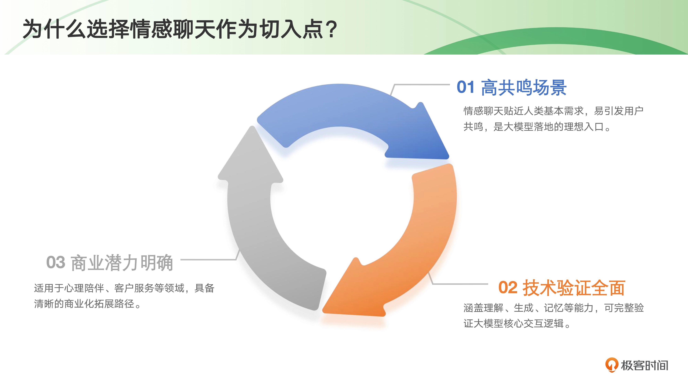
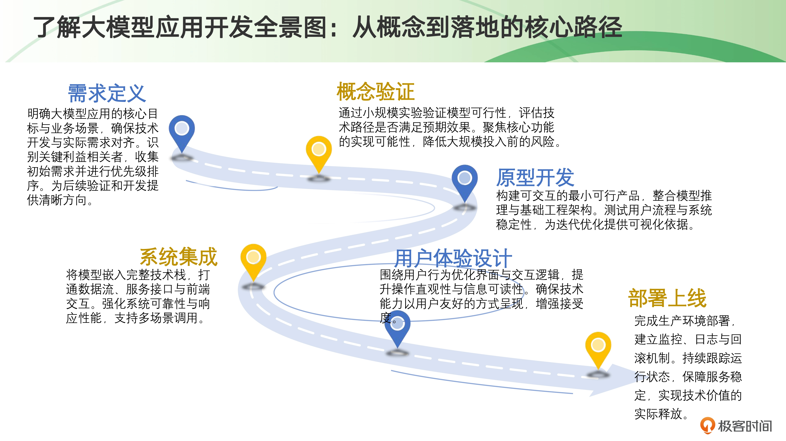
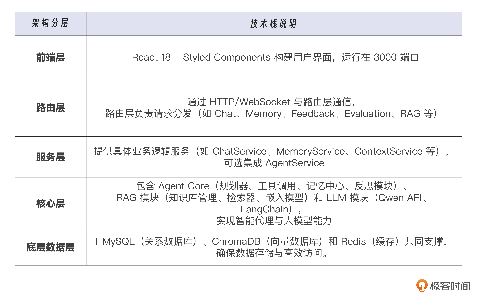
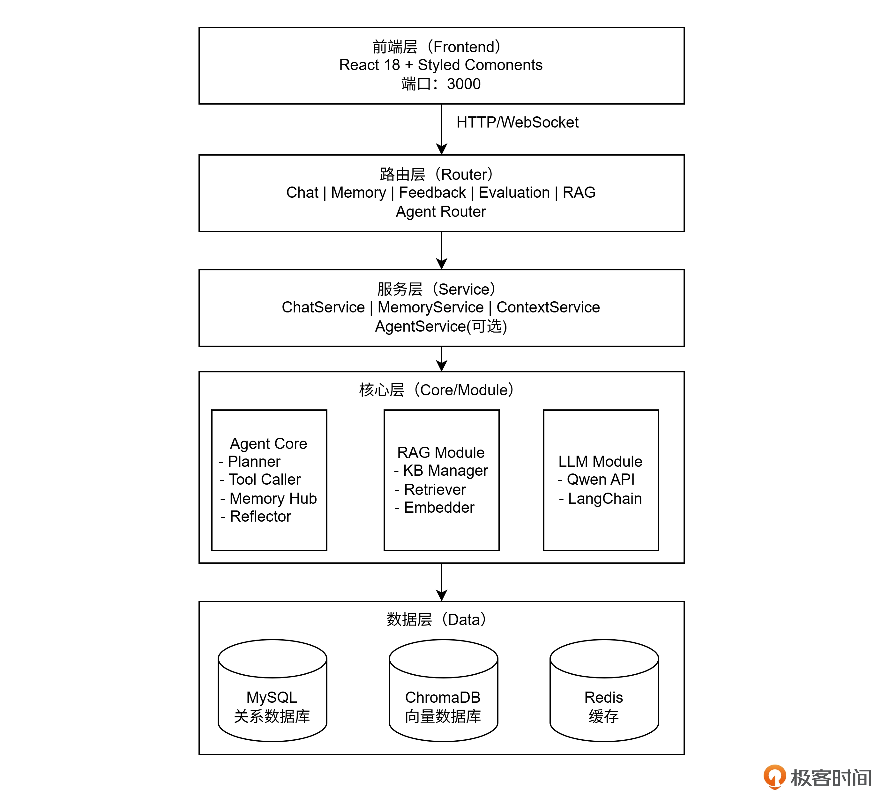
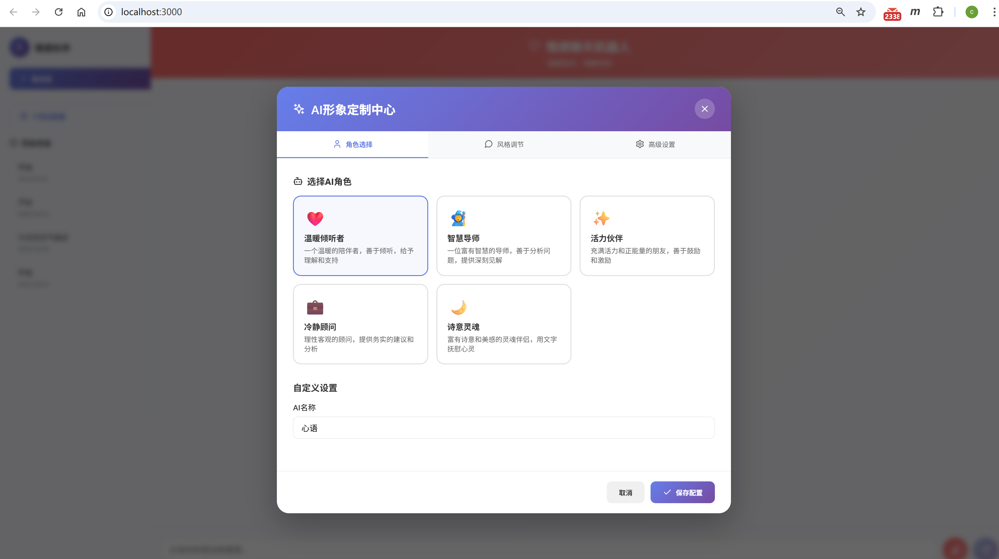
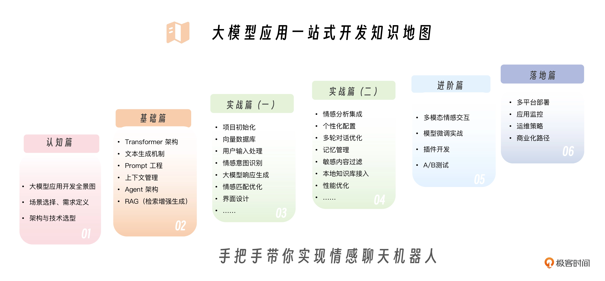
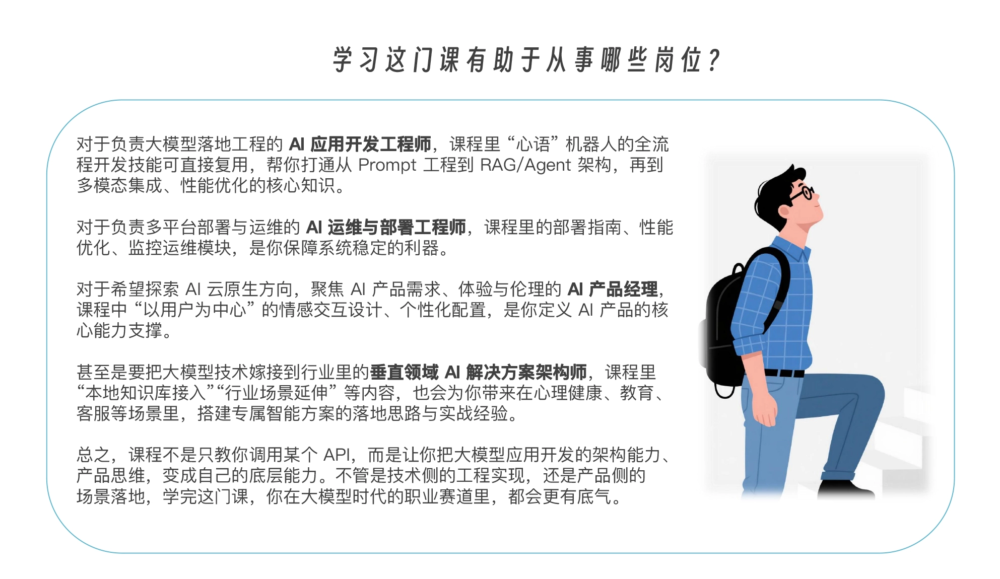
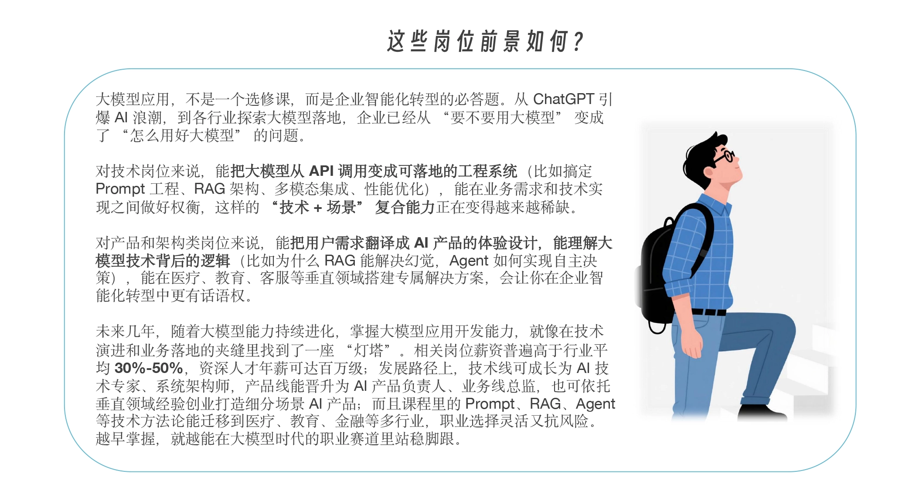

# 开篇词 | 从对话到陪伴：大模型应用开发的全景实战课

你好，我是袁从德。欢迎你和我一起学习《大模型应用一站式开发》。

我有近 9 年的互联网大厂算法与 AI 工程经验，曾任职腾讯、阿里巴巴，现任创业公司 CTO。我专注于广告推荐系统、大模型应用与智能体架构，在顶会发表多篇一作论文，并拥有多项国家及国际专利，致力于用 AI 技术驱动业务增长与社会价值落地。

过去两年里，你可能已经亲历了大模型带来的震撼：ChatGPT 能写诗编程，Sora 可以生成逼真的视频，通义千问、Kimi、Claude 等模型在各类任务中展现出惊人的能力。许多团队也跃跃欲试，尝试将大模型融入产品——客服机器人、智能写作助手、数据分析工具……

然而，你可能很快就会发现，调用一个 API 并不等于构建一个可用的应用。我们看到太多案例：

- Prompt 写了一百遍，回答依然似是而非。

- 想让模型回答企业内部知识，却发现它凭空编造。

- 构建了一个 RAG 系统，检索结果明明相关，生成的答案却驴唇不对马嘴。

- 设计了一个 Agent 流程，结果模型在循环中无限兜圈，始终无法收敛。

- 上线后成本飙升，延迟高达十几秒，用户体验极差。

这些问题的背后，是大模型应用开发缺乏系统方法论的现实。它不再是“提示词工程 + API 调用”的简单组合，而是一门融合了 AI 理论、软件工程、系统架构和产品设计的综合性学科。

在这样的背景下，《大模型应用一站式开发》课程应运而生。这不是一本关于“如何调用 API”的操作手册，也不是一场浮于表面的技术秀场。它是一张完整的开发地图，一条从认知觉醒到工程落地的系统路径，一次从“使用者”到“创造者”的角色跃迁。

我们将会一起完成情感聊天机器人“心语”项目的全流程实现，并以此为切入点，带你深入大模型应用开发的全生命周期，从理论到实践，从架构到部署，从技术到伦理，构建属于你的第一个真正意义上的 AI 原生产品。

## 一、为什么选“情感聊天”？小切口，大世界

你可能会问：为什么选择“情感聊天”作为这门课的主线？在无数大模型应用场景中，医疗、金融、教育、法律、客服……哪一个不比聊天更具商业价值？

答案是：因为“情感”是最接近人性的入口，而“聊天”是最自然的交互方式。

在所有 AI 应用中，情感陪伴看似轻，实则重。它不追求解决某个具体问题，而是致力于建立一种持续的关系。这种关系的建立，恰恰最能体现大模型的核心优势——语言理解、上下文记忆、人格化表达和生成式回应。更重要的是，情感聊天对技术栈的要求相对轻量，开发周期短，反馈闭环快，非常适合初学者快速验证想法、积累信心。

但它的意义远不止于此。通过构建一个能倾听、共情、回应的 AI 伴侣，我们实际上在完成一次深刻的产品思维训练：

- 我们要学会定义角色：这个 AI 是谁？是温柔的姐姐，是理性的导师，还是知心的朋友？

- 我们要学会理解用户：当用户说“我好累”时，背后是工作压力、情感困扰，还是单纯的疲惫？

- 我们要学会设计体验：如何让对话自然流畅？如何在安全与开放之间找到平衡？

- 我们要学会承担责任：当用户陷入情绪低谷时，AI 该如何回应？何时该建议寻求专业帮助？

这些问题，没有标准答案，却直指 AI 产品设计的本质——技术服务于人，而非取代人。

我想带你完成的情感聊天机器人也不是一个“玩具项目”，而是一个方法论的沙盘推演。它所涉及的技术模块——Prompt 工程、上下文管理、向量数据库、RAG、Agent 架构、情感分析、个性化配置——几乎涵盖了所有大模型应用的核心组件。

你在这里学到的每一步，都可以无缝迁移到教育陪练、老年关怀、品牌客服、心理健康支持等高价值场景。当你能设计出一个让用户愿意倾诉心声的 AI，你就已经具备了构建任何智能服务系统的能力。

## 二、入门大模型应用开发，有哪些原理必须掌握？

前面我说过，大模型应用开发是综合性学科，那自然也离不开 AI 理论。不过，我们并不会对理论死记硬背，而是从“理论如何帮助我们解决工程问题”的角度来进行学习。

课程的基础篇，我们将系统梳理大模型应用开发的三大核心技术范式——Prompt 工程、RAG、Agent。它们不是孤立的技术点，而是构成智能应用的三原色，可以自由组合，创造出无限可能。

### 1. Prompt 工程：与大模型对话的语言艺术

Prompt 是所有大模型应用的起点。它是你与 AI 之间的“第一语言”。一个精心设计的 Prompt，可以激发模型的最佳表现；一个随意编写的 Prompt，则可能导致输出混乱、偏离目标。

Prompt 工程本质上是一种产品思维。一个好的 Prompt 必须回答三个问题：

- 用户是谁？ —— 理解目标用户的背景、需求和心理状态。

- AI 是谁？ —— 定义角色、人格、语气、行为边界。

- 我们想创造什么体验？ —— 设计对话流程、情感节奏、价值传递。

例如，在我们后续课程“心语”机器人的设计中，我们不仅要求模型“提供情感支持”，还具体规定：

- “你是一位温暖、耐心、有同理心的心理陪伴者。请用简洁、口语化的语言回应，避免使用专业术语。如果用户表达负面情绪，请先共情，再引导，必要时建议寻求专业帮助。”

这样的 Prompt，不仅定义了功能，更塑造了“人格”。它让 AI 不再是冷冰冰的机器，而是一个有温度的对话者。

### 2. RAG：让 AI 言之有据，重建人机信任

大模型最大的弱点之一是幻觉——它会自信地编造事实。这在情感聊天中或许可以容忍，但在医疗、法律、金融等严肃场景中，却是致命的。

RAG（Retrieval-Augmented Generation，检索增强生成）技术的出现，正是为了解决这一问题。它的核心思想是：在生成回答之前，先从可信的知识库中检索相关信息，再基于这些信息生成回复。

之后的课程中，我们将为“心语”机器人接入心理学知识库。当用户提到“焦虑”，AI 不再凭空猜测，而是检索 CBT（认知行为疗法）中的应对策略，给出科学建议。这不仅提升了回答的准确性，更重要的是，重建了人机之间的信任契约。

RAG 的意义，远不止于“查资料”。它让大模型从通用知识库转变为专业顾问，为行业智能体的落地提供了可能。

### 3. Agent：赋予 AI 自主行动能力

如果说 Prompt 是“大脑”，RAG 是“知识库”，那么 Agent 就是“手脚”。Agent 架构让大模型不仅能“说”，还能“做”。比如可以根据用户情绪，自动播放舒缓音乐、设置冥想提醒、记录情绪日记，甚至在未来接入日历、天气、新闻等外部服务。

Agent 的核心是规划（Planning）、记忆（Memory）、工具使用（Tool Use）和反思（Reflection）。它让 AI 从被动响应的对话机器，进化为主动服务的数字伙伴。更深远的意义在于：Agent 正在重新定义“应用”的边界。未来的应用不再是功能的集合，而是一个能自主决策、持续学习、与用户建立长期关系的“智能体”。

## 三、从 0 到 1：工程化落地的完整路径

理论再精彩，如果不能落地，也只是空中楼阁。因此，我们安排了两章内容，带你从 0 到 1完成项目的工程化落地。

我们会一起完成项目的初始化，为后续的工程打好地基。随后引入向量数据库为 AI 注入长期记忆，集成情感分析模型（如 TextBlob、VADER 或微调的 BERT），实时识别用户情绪，并动态调整 AI 的回应策略，让 AI 更加“善解人意”。

我们还将开发个性化配置功能，允许用户自定义 AI 的聊天风格、语气、角色设定。这标志着AI 从“标准化服务”走向“千人千面”的个性化体验。

搞定了基建工作，安全合规方面也不容忽视。我们将探讨敏感内容过滤机制。情感聊天涉及大量私人信息，必须建立严格的安全护栏，防止 AI 生成不当内容，或泄露用户隐私。我们将会学习基于规则、关键词、机器学习模型的多层过滤方案，并在设计之初就融入“伦理优先”的原则。

此外，为了提升应用的使用体验，我们也会探讨提升响应速度与稳定性的性能优化技巧。

该项目采用分层架构设计，整体架构清晰，支持高扩展性与智能化交互。详情你可以参考后面的表格。

代码链接：https://github.com/congde/emotional_chat.git

前端展示如下所示：

## 四、未来已来：大模型应用的无限可能

情感聊天机器人只是一个起点，为了让你有能力探索更多可能，进阶篇里我们还会学习如何给应用集成语音与图像能力、专属模型的微调方法、插件开发与 A/B 测试等等内容。相信掌握了这些，你的大模型应用开发水平也会更进一步。

落地篇里，我们会学习如何将应用部署到云服务器，使用 Docker 容器化，实现高可用与弹性扩展。同时建立监控系统，实时跟踪性能、错误率、用户反馈，确保系统稳定运行。

最后，我们将畅想大模型应用的商业化路径。到了那时你会发现，课程里学到的技术架构与设计理念，可以轻松迁移到更多的行业和场景中，比如：

- 教育领域：个性化学伴，24 小时答疑解惑；

- 医疗健康：数字护士，跟踪患者情绪与用药情况；

- 企业服务：智能客服、数字员工，提升运营效率；

- 娱乐社交：虚拟偶像、情感伴侣，满足精神陪伴需求。

- 知识导图

## 五、结语：我们不只是开发者，更是未来的缔造者

当你开启这门课的时候，你已经站在了时代的潮头。

你将学会的，不仅是如何调用一个 API、搭建一个界面、部署一个服务。你将掌握的，是一种全新的创造范式——用语言塑造智能，用数据训练共情，用系统承载关系。

你亲手打造的“心语”机器人，或许只是一个简单的聊天程序。但它的每一次回应，都凝聚着你对人性的理解；它的每一次记忆，都承载着你对关系的思考；它的每一次行动，都体现着你对责任的担当。

未来的 AI 产品，不应是冷冰冰的工具，而应是有温度、有个性、有责任感的“数字生命”。而你，正是这场变革的缔造者。

在这条路上，你会遇到挑战：模型不听话、数据不准确、用户不买账。但请记住，每一个伟大的创新，都始于一个不完美的原型。每一个改变世界的 AI，都始于一行简单的代码。

现在，我们的地基已经打好，地图已经展开，旅程即将开始。让我们带着对技术的敬畏，对人性的理解，对未来的期待，正式启程。因为，当代码开始“共情”，真正的智能时代，才刚刚开始！

