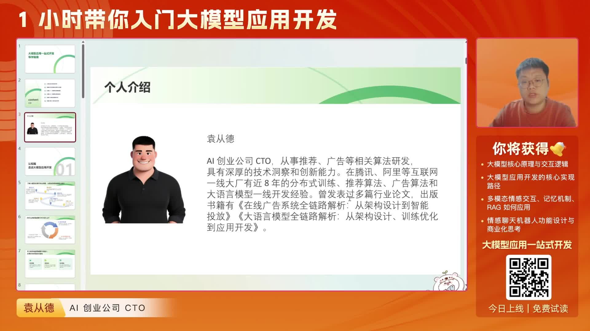

# 直播回放 | 1小时带你入门大模型应用开发

本次直播将带你了解大模型应用开发的系统方法论。从大语言模型底层逻辑，到实战搭建情感聊天应用；从聊天应用功能设计、基础搭建部署到商业化探索，全方位为你呈现大模型应用开发的关键要点与实施步骤。无论你是初学者还是有一定基础的 AI 开发者，相信都会通过此次直播得到启发。

核心要点

• 大模型应用开发遵循“需求洞察 → 概念验证 → 原型开发 → 系统集成 → 用户体验设计 → 部署上线”的六步全景路径。

• 情感聊天是大模型的理想落地场景，具备高共鸣、技术验证丰富和商业潜力明确三大优势。

• POM（Prompt Engineering）通过清晰指令、角色设定与示例引导提升模型响应准确性与一致性。

• 上下文管理需平衡长短期记忆，利用摘要或向量存储保留关键信息，避免“断片”问题。

• RAG 技术实现知识动态更新，无需重新训练即可增强模型专业性与可解释性，适用于客服、医疗等高准确率场景。

• 实战中采用 Python+React 技术栈，结合向量数据库、情感识别、解码策略控制与反馈机制优化交付质量。

• 多模态融合支持文本、语音、视觉情绪感知，提升情感理解深度；微调与插件扩展进一步增强个性化与功能性。

• 系统部署需重视监控日志、智能告警、回滚机制与自动化运维，保障服务高可用性。

• 商业化路径建议避开广告模式，优先探索 ToB 授权、订阅制等模式，注重价值交付而非单纯功能堆砌。

知识框架

一、认知篇：大模型应用开发全景图

六大阶段流程：

• 需求定义：以心理健康类 APP 为例，明确用户群体与初始需求。

• 概念验证（MVP）：用小模型验证技术可行性，降低大规模投入风险。

• 原型开发：快速搭建可交互原型，验证核心功能逻辑。

• 系统集成：打通数据流、服务接口与前端交互，提升系统可靠性。

• 用户体验设计：优化界面逻辑与交互形式（如打字机式输出），增强用户体感。

• 部署上线：建立监控日志与回滚机制，保障服务稳定性。

为何选择情感聊天作为切入点？

• 高共鸣场景：贴近人类基本情感诉求，易引发用户共鸣。

• 技术验证全面：覆盖多模态理解（文本 / 语音 / 图像）、意图识别、生成控制等完整链路。

• 商业路径清晰：可延伸至陪伴、客服、教育、医疗等领域，具备明确变现潜力。

二、基础篇：核心技术原理

Transformer 架构与文本生成机制

• 核心组件：自注意力机制（Self-Attention）、多头注意力、编码 - 解码结构。

• 优势：支持并行化处理，优于 RNN/LSTM；擅长捕捉长距离依赖关系。

• 文本生成方式：基于概率逐词预测下一个 Token，通过温度（Temperature）与采样策略控制多样性与连贯性。

POM 指令工程（Prompt Engineering）

目标：精准引导模型理解用户意图与响应方向。

关键要素：

• 明确指令目标与格式，避免模糊表达。

• 设定角色身份，增强对话代入感与一致性。

• 提供输入输出样例，帮助模型理解复杂任务。

上下文管理限制：受限于模型最大上下文窗口（如 8K/32K Token），需合理控制输入长度。

解决方案：

• 摘要提取：压缩历史对话保留关键信息。

• 向量存储：将对话片段向量化后存入向量数据库，按需召回。

• 动态上下文：根据对话进展筛选与更新上下文，提升响应相关性与自然度。

RAG

工作原理：用户 Query → 从知识库检索相关文档 → 将结果注入 Prompt → 输入大模型生成回答。

优势：

• 减少幻觉，增强回答可解释性。

• 支持动态知识更新，无需重新训练模型。

• 适用高精度场景（如客服、医疗）。

挑战：

• 知识库构建：文档切片策略、多模态数据处理。

• 检索算法优化：语义相似性匹配精度。

三、实战篇：情感聊天机器人构建

技术选型与环境搭建• 后端语言：推荐 Python（生态丰富、学习成本低），亦可用 Go/Java 通过 API 调用模型。

• 前端框架：React（通用性强，便于团队协作）。

• 工具链：VS Code + Cursor（AI 辅助编码）、虚拟环境管理（venv/pipenv）保障版本兼容。

核心功能开发

1. 输入处理

• 文本清洗、去噪、格式统一。

• 多模态支持：文字、语音、图片分别处理。

2. 情感意图识别：

• 使用分类模型判断用户情绪倾向与对话目标。

• 结合上下文解析隐性信息（如提及过往事件）。

3. 响应生成与优化：

• 解码策略控制：调节温度参数平衡创造性和稳定性。

• 情感匹配：通过情感标签调整语气与风格，增强共情。

• 反馈机制：收集用户反馈用于迭代优化，提升连贯性与个性化。

4. 系统架构设计

• MVP 阶段：前后端融合，快速验证。

• 商业化阶段：前后端分离，模块化设计（NLU、情感计算、生成模型）。

• 通信机制：WebSocket（推荐用于聊天场景）或 REST API，保障低延迟双向传输。

• 界面优化：消息气泡、加载反馈、滚动定位、打字机动画提升沉浸感。

四、进阶能力升级

情感分析深化

• 规则库 + 动态响应机制，实现更细腻的情绪识别与适配回复。

• 支持用户自定义聊天风格、语气、角色设定，提升个性化体验。

多人对话与记忆机制

• 短期记忆：维护当前会话上下文。

• 长期记忆：通过向量数据库存储历史互动。

• 状态机机制：追踪对话状态演变，实现主动式交互（如察觉用户低落后主动关怀）。

安全与合规

• 多层过滤机制：规则匹配 + 模型检测，实时拦截敏感内容。

• 引导正向沟通，符合伦理与监管要求。

• 配置化管理 + 定期模型迭代，适应动态变化的安全标准。

本地知识库集成• 知识库清洗、分片、向量化。

• RAG 检索 + 动态 POM 注入，实现通用模型与专有知识深度融合。

性能优化

• 缓存策略：Redis 缓存高频请求（如问候语），减少重复计算。

• 资源监控：实时跟踪 GPU/CPU/ 内存 / 负载，动态调整资源配置。

• 异步 IO 与消息队列：避免阻塞主线程，提升并发能力。

五、部署与商业化

多平台部署路径：本地运行 → 云服务器（阿里云 /AWS）→ Docker 容器化，支持弹性伸缩。

运维体系

• 日志集中管理：提升问题定位效率。

• 实时性能监控：关注响应延迟、吞吐量。

• 智能告警与自动化恢复：快速应对宕机等故障。

• CI/CD + 回滚机制：降低发布风险。

商业化思考

• ToC 模式：订阅制为主，强调个性化与长期价值。

• ToB 模式：提供 API/SDK，支持高级定制，但需平衡定制化与规模效应。

• 构建生态：大厂可开放平台，个人开发者宜拥抱现有生态。

• 成本可控：利用免费模型 API（如千问）、低成本部署，适合初学者实践。
