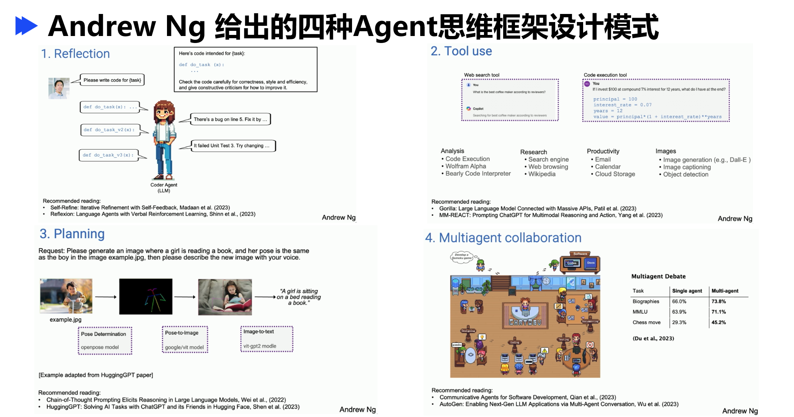
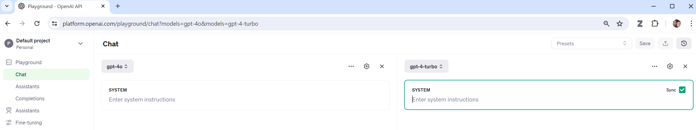
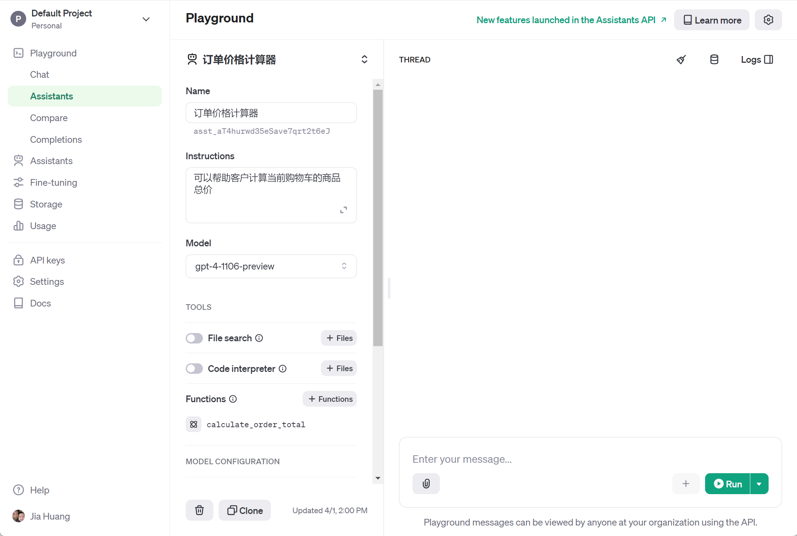
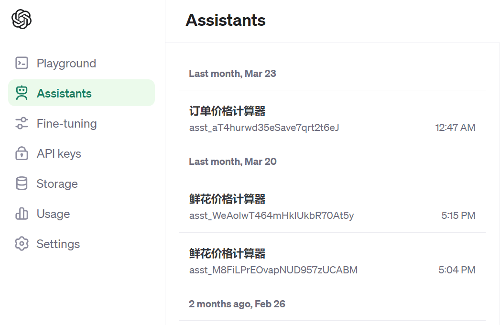
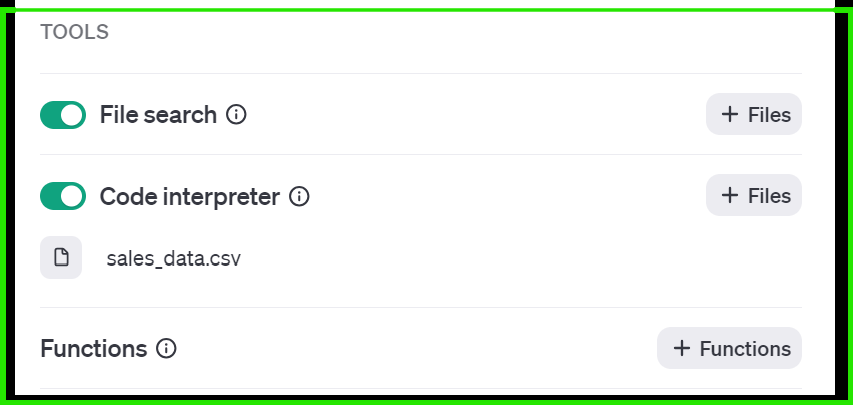
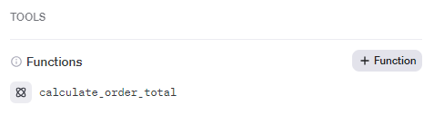
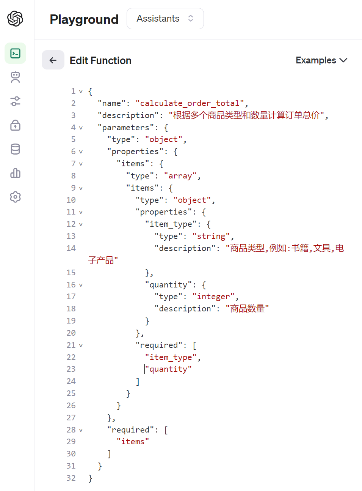

# 01 | 用OpenAIAssistants的Function进行订单管理

你好，我是黄佳。

从今天开始，我们开始大模型应用开发实战的启程篇。最简单的大模型应用开发工具应该就是OpenAI Assistants。不过虽然简单，但是它的功能超级强大。所以，在启程篇中我们先把这个工具讲透。（注意，在 2024 年四月中旬，OpenAI 发布了 Assistants 的 Beta v2 版本，我们的课程基于 v2 版本。）

先说说本课的学习目标，主要有两个：

1. 完全掌握到底什么是 OpenAI Assistants，怎么使用它。

2. 通过 Assistants 提供的 Function，把自然语言问答自动地转换成函数调用的元数据，并能够动态地选择合适的函数进行调用。其中，什么是函数调用的元数据，什么是动态调用，也许有一点难理解，不怕，学完本课就会清晰。

另外，这节课我会带你完成一个订单管理功能，只根据用户的对话，给他计算购物篮里面订单商品的总金额。

## OpenAI 的 Assistants 工具其实是个不错的 Agent

吴恩达老师在他最新的演讲中，大谈特谈 AI Agent，而且给出了下面四种 Agent 设计模式。



这四种 Agent 实现模式分别是：

1. 反思（Reflection）：Agent 通过交互学习和反思来优化决策。

2. 工具使用（Tool use）：Agent 在这个模式下能调用多种工具来完成任务。

3. 规划（Planning）：在规划模式中，Agent 需要规划出一系列行动步骤来达到目标。

4. 多 Agent 协作（Multiagent collaboration）：涉及多个 Agent 之间的协作。

这些模式描绘了 AI Agent 在不同情境下的行为和功能实现，反映了在 AI 系统设计时需要考虑的多样化策略，更重要的是对大模型的思维方式进行了指引，相当于武装上了“先进思想”。

说回 Assistants。OpenAI 的 Assistants 工具是一种基于 GPT 模型的语言理解和生成平台。它旨在通过提供信息、解答问题、生成文本和执行特定任务来协助我们的日常工作，成为我们的小助手、好助理。

嗯，听到这里你会不会觉得 OpenAI 公司的这个 Assistants 有点 Agent 的意思。的确如此，Assistants 工具特意被设计得十分灵活且多功能，可以应用于各种场景和用例，从简单的日常对话到复杂的技术问题解答。

而且，吴恩达老师提出的 4 种 Agent 设计模式，Assistants 至少实现了其中的两种，甚至是三种（前三种）；而第四种呢，也可以在程序中通过创建多个 Assistants 来实现。为什么这么说，相信我们启程篇学完之后，你就会同意我的观点。

Assistants 工具的主要特点如下：

- 高级语言理解：能够理解和处理自然语言输入，识别用户的意图和需求。

- 丰富的文本生成：可以根据用户的指令生成连贯、相关且有用的文本回应。

- 适应性和定制化：可以根据特定的应用场景和需求定制，以提供更加个性化的服务。

- 交互性：能够进行连贯的对话，理解上下文，记住对话历史，以提供更加深入和有连续性的交互体验。

- 易于集成：可以被集成到各种平台和应用中，如网站、应用程序或其他数字服务。

所以呢，Assistants 工具的应用可以是非常广泛的，例如客服自动化、个人助理、教育、内容创作、编程辅助等多个领域。而且，通过不断学习和适应，它也在进步，变得越来越高效、灵活且智能。

以我使用 Assistants 的直观感受来说，我觉得，这个工具的确做到了简单易用。智能程度也不错，听指挥，能够完成一系列的办公自动化任务。

我们甚至都不需要具有编程能力，就能使用强大的 Assistants。当然，你得先拥有 OpenAIAPI 的账号和密钥，这是学习我们这个课程的基础。

这就带着你实操一下，感受这个工具的魅力。

## 在 OpenAI 的 Playground 中试用 Assistants

OpenAI 公司给我们提供了一个 Playground，这个 Playground 是探索并学习在不编写任何代码的情况下构建自己的 Assistants 的好方法。你可以通过这个平台运行指令和代码，使用GPT-4， 甚至是最新的 GPT-4o 模型（GPT-4o 模型的特点是又好又快）辅助完成 AI 应用、机器学习或数据科学相关的任务。



- 在 Playground 中用 Chat 功能比较 gpt-4o 和 gpt-4

Playground 里面的项目不少，有 Assistants，还有 Chat（对话）功能、Compare（对比不同模型对同一提示的响应）功能和 Completions（文本完成，是旧版的 Chat，已经过时了）等功能。

### 新建一个 Assistant

我们在右侧 Playground 下方选择 Assistants， 并把这个 Assistants 命名为“订单价格计算器”。



指定我们要创建的 Assistant 的名称以及说明：“可以帮助客户计算当前购物车的商品总价”，并选择模型，之后保存，这个 Assistant 就创建好了，它拥有 ChatGPT 的全部功能，我们可以和它对话，输入你的 Message 后，单击屏幕右下方的 Run，它就会根据自己拥有的知识进行回答。

在 Playground 中创建了这个 Assistant 之后，单击屏幕右方（Playground 图标下方）的Assistants 选项，你就会看到你所创建的所有 Assistants 列表。现在让我们记录下 Agent 的ID，以备后面程序中启用它。



这个列表，包括你在 Playground 和程序中创建的所有 Assistant。

### Assistant 中的可用工具

此时，你肯定会问，如果这个 Assistant 和 ChatGPT 一样，那又有什么特别之处呢？为何不直接调用 GPT 模型的 API 来完成任务呢？



答案就是图中的这三种 Tools，就是工具，其实就是你的 Assistants 可以调用的功能。看到此处，你是否就直接联想到了吴恩达老师提出的第二种 Agent 模式：Tool use。

现在，OpenAI 不仅为我们的 Assistant 提供了强大的 GPT 模型，还提供了三种工具，它们分别是 File search、Code Interpreter 和 Functions。它们允许 Assistant 执行特定的任务、编写和运行代码、检索文档信息，大大扩展了 Assistant 的应用场景。

能够调用工具了！这就使 OpenAI Assistant 不再仅仅是一个聊天机器人，而是成为了一个功能强大、适应性强的 AI 助手。——它进化了！

具体来说：

- Functions（函数）： Functions 允许开发者定义自己的函数，并让 Assistant 在对话中动态调用这些函数。这使得 Assistant 能够执行特定的计算、数据处理、外部 API 调用等任务，并将结果返回给用户。例如，我们可以定义一个计算订单总价的函数，当用户询问订单价格时，Assistant 可以调用这个函数，并将计算结果告诉用户。Functions 使 Assistant 能够与外部系统和服务进行交互，能够执行代码，完成具体功能。

- Code Interpreter（代码解释器）：Code Interpreter 非常强大，它允许 Assistant 编写、运行和解释代码。这使得 Assistant 能够完成数据分析、数据可视化、自动化任务等复杂的编程

- 工作。例如，你可以上传一个包含销售数据的 CSV 文件，并请求 Assistant 生成一个销售报告，进行数据分析，生成可视化图表，并将报告返回给用户。

- File search（检索）：File search 是文档检索工具，它允许 Assistant 从一组预先上传的文档中检索信息，并根据用户的询问提供相关的答案。使用这个工具，我们可以将产品手册、FAQ、知识库等各种文档上传到 Assistant 中，当用户提出问题时，Assistant 可以自动在这些文档中搜索答案，并将最相关的信息返回给用户。

未来，Open AI 公司还计划发布更多的工具，并允许我们作为开发者，在 OpenAI 网站上提供开发者自己定义的工具，那么 Assistant 的能力将变得更加强大和灵活。

### 在 Assistant 中添加 Function

下面，我们在 Assistant 中添加 Function，来完成一个购物车订单总价计算的功能。

第一步，是选择 +Function 图标，添加 Function 的定义。



第二步，则是添加功能的调用说明，如下图所示。



文本如下：

```json
{
 "name": "calculate_order_total",
 "description": "根据多个商品类型和数量计算订单总价",
 "parameters": {
   "type": "object",
   "properties": {
     "items": {
       "type": "array",
       "items": {
         "type": "object",
         "properties": {
           "item_type": {
             "type": "string",
             "description": "商品类型,例如:书籍,文具,电子产品"
           },
           "quantity": {
             "type": "integer",
             "description": "商品数量"
           }
         },
         "required": [
           "item_type",
           "quantity"
         ]
       }
     }
   },
   "required": [
     "items"
   ]
 }
}
```

此处的这个调用说明需要特别解释，因为 Function 的说明和实际的函数代码有着本质的区别，很容易混淆。让我来详细解释一下它们的不同之处。

Function 的说明，如图中所示，是一个 JSON 格式的对象，用于向 Assistant 描述一个自定义函数，也叫做描述函数的元数据。这个 JSON 对象包含了函数的名称（name）、描述（description）、参数（parameters）等元数据信息。它的作用是让 Assistant 了解这个函数的功能、输入参数的类型和格式，以及哪些参数是必需的。但是，这个 JSON 对象本身并不包含函数的实现代码。

例如，图中的 JSON 对象描述了一个名为 “calculate_order_total” 的函数，它的作用是“根据多个商品类型和数量计算订单总价”，它接受一个名为 “items” 的参数，该参数是一个数组，数组中的每个元素都是一个包含 “item_type” 和 “quantity” 属性的对象。

而实际的函数代码，则是这个函数的具体实现，它定义了函数如何处理输入参数、执行计算、返回结果等细节。函数代码是用编程语言（如 Python、JavaScript 等）编写的，而不是JSON 格式。

例如，对应于上述 JSON 描述的 “calculate_order_total” 函数，其实际的 Python 实现代码可能如下：

```python
def calculate_order_total(items):
   item_prices = {
       "书籍": 10,
       "文具": 5,
       "电子产品": 100
   }
   total_price = 0
   for item in items:
       price_per_item = item_prices.get(item['item_type'], 0)
       total_price += price_per_item * item['quantity']
   return total_price
```

这个 Python 函数接受一个 “items” 参数，遍历其中的每个商品，根据商品类型查找单价，累加计算总价，并返回结果。不过，这个函数的具体 Python 代码我们没必要让 Assistants 知道（它只需要知道函数的元数据，也就是调用格式和接口），具体 Python 代码是在下一步的应用程序中，我们才需要加入的内容。

因此，再次强调一次：刚才在 Playground 中添加的 Function 的说明（JSON 对象）和实际的函数代码有着明确的区别。

- Function 的说明是一个 JSON 对象，用于向 Assistant 描述函数的元数据，如函数名称、参数类型等，但不包含函数的实现代码。

- 实际的函数代码是用编程语言编写的，它定义了函数的具体实现细节，如何处理输入参数、执行计算、返回结果等。

在使用 Function calling 时，我们需要先提供函数的 JSON 描述，Assistant 了解函数的接口定义。然后在代码中实现对应的函数。当 Assistant 在对话中决定调用该函数时，它会根据JSON 描述生成一个包含具体参数值的 JSON 对象——这也就是函数调用的元数据，我们的代码需要解析这个 JSON 对象，提取参数值，调用相应的函数，并将结果返回给 Assistant。

如果你还没有完全弄懂这个流程也不要紧，我们马上就实现这个流程。

## 在程序中调用 Assistant

下面，我就带着你在程序中调用这个刚刚创建的 Assistant，来真真实实地完成一个购物篮订单金额的计算工具。

我们首先通过刚才记录下来的 ID 检索了之前创建的 Assistant。

### 检索到并获取 Assistant

```
# 检索您之前创建的Assistant
assistant_id = "asst_FXoBJo1KlqfpCCKvNIoCyJHB"  # 你自己的助手ID
assistant = client.beta.assistants.retrieve(assistant_id)
print(assistant)
```

### 创建 Thread，与 Assistant 对话

然后创建一个新的 Thread，并向 Thread 添加了用户的消息，请求 Assistant 计算订单总价。所谓 Thread，就是你和 GPT 的一次会话 Session，我们下一课还会细讲它。

```
# 创建一个线程并同时创建消息
thread = client.beta.threads.create(
 messages=[
   {
     "role": "user",
     "content": "你好,我购买了一本书和一个电子产品,请帮我计算一下订单总价！",
   }
 ]
)
print(thread)
```

### 创建 Run，运行对话

接下来，我们创建一个新的 Run，让 Assistant 处理这个 Thread。在 Assistant 处理 Thread的过程中，需要轮询 Run 的状态，直到状态变为 requires_action（需要调用函数）或completed（对话完成）。

为了方便轮询，OpenAI 给出了一个 create_and_poll 函数。（关于 Run 的状态转换流程，我们下节课详细介绍）

```
run = client.beta.threads.runs.create_and_poll(
 thread_id=thread.id,
 assistant_id=assistant.id,
 # instructions="You are a personal math tutor. When asked a math question, writ
)
run
```

输出如下：

```
Run(id='run_fMy4vfnomLy0MCwvrpZ5t607', assistant_id='asst_FXoBJo1KlqfpCCKvNIoCyJH
```

create_and_poll 函数会不断检查 Run 的状态，并打印 Run 的详细信息。当 Run 的状态变为requires_action 或 completed 时，函数返回最新的 Run 对象。

### 读取 Run 返回的元数据

当 Run 的状态变为 requires_action 时，意味着 Assistant 需要调用一个函数来完成任务。我们需要从 Run 中提取函数调用的元数据信息，包括函数名、参数和 ID。为此，我们定义了一个 get_function_details 函数。

```python
# 读取function元数据信息
def get_function_details(run):
   function_name = run.required_action.submit_tool_outputs.tool_calls[0].functio
   arguments = run.required_action.submit_tool_outputs.tool_calls[0].function.ar
   function_id = run.required_action.submit_tool_outputs.tool_calls[0].id
   return function_name, arguments, function_id
# 读取并打印元数据信息
function_name, arguments, function_id = get_function_details(run)
print("function_name:", function_name)
print("arguments:", arguments)
print("function_id:", function_id)
```

输出如下：

```
function_name: calculate_order_total
arguments: {"items":[{"item_type":"书籍","quantity":1},{"item_type":"电子产品","qua
function_id: call_UPLImNhob6s1XoQ9npdtT3Zh
```

可以看到，此处 get_function_details 函数从 Run 的 required_action 中提取到了所有函数调用相关的元数据信息，包括函数名（calculate_order_total）、JSON 格式的参数（{“item_type”:“书籍”,“quantity”:1},{“item_type”:“电子产品”,“quantity”:1}]}）和函数 ID（call_UPLImNhob6s1XoQ9npdtT3Zh）。

这里就是 Assitant 非常聪明的地方。

请注意，经过了 Run 中的 Function 处理，你的智能助理成功地把自然语言

```
"你好,我购买了一本书和一个电子产品，请帮我计算一下订单总价！"
```

转换成了函数能够读懂的语言

```json
{"item_type":"书籍","quantity":1},{"item_type":"电子产品","quantity":1}
```

还记得吧，这些就是我们在 Playground 的 Function 元数据中通过 JSON 格式定义的内容。这就是动态调用函数的基础！我们不需要硬性指定函数，Assitants 会动态的帮咱们选择函数，同时确定每一个参数的传入数据值。

接下来，我们需要根据函数名和参数，动态调用相应的函数。此时，我们终于需要调用程序中的 calculate_order_total 函数来计算订单总价了。

```python
# 定义计算订单总价函数
def calculate_order_total(items):
   item_prices = {
       "书籍": 10,
       "文具": 5,
       "电子产品": 100
   }
   total_price = 0
   for item in items:
       price_per_item = item_prices.get(item['item_type'], 0)
       total_price += price_per_item * item['quantity']
   return total_price
# 根据Assistant返回的参数动态调用函数
import json
# 将 JSON 字符串转换为字典
arguments_dict = json.loads(arguments)
# 调用函数
order_total = globals()[function_name](**arguments_dict)
# 打印结果以进行验证
print(f"订单总价为: {order_total} 元")
```

输出如下：

```
订单总价为: 110 元
```

这里定义了 calculate_order_total 函数，用于根据商品类型和数量计算订单总价。然后使用

```
json.loads 将 JSON 格式的参数转换为 Python 字典并使用 globals()
[function_name](**arguments_dict) 动态调用函数，并将结果存储在 order_total 变
```

量中。打印订单总价以进行验证，结果无误。

计算完订单总价后，还没有完，还需要将结果提交给 Assistant，以便它继续处理 Thread。为此，我们定义了一个 submit_tool_outputs 函数。

```
# 提交结果
run = client.beta.threads.runs.submit_tool_outputs(
   thread_id=thread.id,
   run_id=run.id,
   tool_outputs=[
       {
           "tool_call_id": function_id,
           "output": str(order_total),
       }
   ]
)
print("提交结果之后Run的状态", run)
```

输出如下：

```
提交结果之后Run的状态 Run(id='run_uznnPaD3mtaJyuiBvX1UFN6a', assistant_id='asst_aT4h
```

submit_tool_outputs 函数将函数调用的结果提交给 Assistant，包括函数 ID 和输出。提交结果后，Run 的状态会变为 completed，表示 Assistant 终于完成了任务。

最后，我们再次轮询 Run 的状态，直到任务完全结束，然后获取 Assistant 在 Thread 中的最终回应。

```
# 再次轮询Run直至完成
run = client.beta.threads.runs.poll(thread_id=thread.id, run_id=run.id)
# 获取Assistant在Thread中的回应
messages = client.beta.threads.messages.list(
   thread_id=thread.id
)
print("全部的message", messages)
# 输出Assistant的最终回应
print('下面打印最终的Assistant回应:')
for message in messages.data:
   if message.role == "assistant":
       print(f"{message.content}\n")
```

输出如下：

```
全部的message ThreadMessageList(data=[ThreadMessage(id='msg_mMvOUiL7Ibt0txNvSnXaxi
[MessageContentText(text=Text(annotations=[], value='您的订单总价为110元。'), type='
```

至此，整个程序就结束了。这个示例展示了如何在程序中调用 OpenAI Assistant，以及使用Function calling 功能完成一个简单的订单总价计算任务。你可以参考这个示例的结构和逻辑，设计并实现更加复杂的 Assistant 交互流程，以满足你所需要的、更实际的业务场景的需求。

## 在程序中创建 Assistant

好的，至此，今天的目标任务已经顺利完成。不过，最后，我还想补充一点内容，以便让你掌握全局。

刚才，我们的程序是调用了在 Playground 中创建的 Assistant，然而在项目实战中，创建Assistant 的工作当然是在程序中完成的。我将用 client.beta.assistants.create 方法创建一个新的 Assistant，并将 calculate_order_total 这个函数的元数据（JSON 格式）添加到Assistant 的工具列表中。

以下是代码实现：

```python
from openai import OpenAI
client = OpenAI()
assistant = client.beta.assistants.create(
   instructions="您是一个订单助手。请使用提供的函数来计算订单总价并回答问题。",
   model="gpt-4-1106-preview",
   tools=[{
       "type": "function",
       "function": {
           "name": "calculate_order_total",
           "description": "根据多个商品类型和数量计算订单总价",
           "parameters": {
               "type": "object",
               "properties": {
                   "items": {
                       "type": "array",
                       "items": {
                           "type": "object",
                           "properties": {
                               "item_type": {
                                   "type": "string",
                                   "description": "商品类型,例如:书籍,文具,电子产品"
                               },
                               "quantity": {
                                   "type": "integer",
                                   "description": "商品数量"
                               }
                           },
                           "required": [
                               "item_type",
                               "quantity"
                           ]
                       }
                   }
               },
               "required": [
                   "items"
               ]
           }
       }
   }]
)
print(assistant)
```

这里首先导入 OpenAI 类并创建一个客户端对象。然后创建一个新的 Assistant。在创建Assistant 时，我们提供了以下参数.

- instructions：给 Assistant 的指令，告诉它作为一个订单助手，使用提供的函数计算订单总价并回答问题。

- model：使用的语言模型，这里使用 “gpt-4-1106-preview”。

- tools：一个包含函数定义的列表。在这个例子中，我们只提供了一个函数calculate_order_total，它的定义与我们在 Playgound 中指定的 JSON 格式的元数据信息完全一致。

创建 Assistant 后，我们将其打印出来，以便查看新创建的 Assistant 的详细信息。

输出如下：

```javascript
Assistant(id='asst_123abc', created_at=1711126020, description=None, file_ids=[],
instructions='您是一个订单助手。请使用提供的函数来计算订单总价并回答问题。', metadata={}, m
name=None, object='assistant', tools=[ToolFunction(function=FunctionDefinition(na
description='根据多个商品类型和数量计算订单总价', parameters={'type': 'object', 'proper
'items': {'type': 'object', 'properties': {'item_type': {'type': 'string', 'descr
'quantity': {'type': 'integer', 'description': '商品数量'}}, 'required': ['item_ty
'required': ['items']}), type='function')])
```

这表明一个新的 Assistant 已经成功创建，并且包含了我们定义的 calculate_order_total 函数作为其工具。

现在，你就可以使用这个新的 Assistant 来处理用户的订单查询，它也将使用calculate_order_total 函数计算订单总价，并提供相应的回答。这个 Assistant 与我们在Playground 中创建的完全相同。

## 总结时刻

上面就是我们今天这节课的全部内容。你看见了 Assistants 中各种工具开始亮相并大显身手，其中 Functions 是自定义的函数，Code interpreter 是一个代码解释工具，而 File search 则是文档检索工具。

这些工具，使得 Assistant 跨越了仅仅是 Chatbot 的鸿沟，变身为一个能够实际执行任务、解决问题的智能助手，在各个领域都有广泛的应用前景。

我们通过 Planground 和 API，分别创建了 Assitant。之后，我在其中添加了一个名为“calculate_order_total” 的 Function，提供了详细的调用说明（Function calling），并特别强调了描述函数的元数据与实际函数代码的区别，避免混淆。

通过 Assitant，我们把自然语言问答，自动地转换成了函数调用的参数，并能够动态地选择合适的函数进行调用（文章的红字部分）。—— 这就是这节课的精髓。

之后，在 Python 程序中，通过调用 OpenAI 的 API，我们用创建的 Assistant 来计算购物篮订单的总价。这个过程包括创建 Thread、添加用户消息、创建 Run、轮询 Run 状态、提取函数元数据、动态调用函数、提交函数结果等步骤，最终得到了以自然语言呈现的订单查询结果。

## 思考题

以下是几个思考题，可以帮助你进一步巩固和扩展今天学到的内容。

1. 除了订单总价计算，你还能想到哪些场景可以运用 Functions 功能？尝试为这些场景设计合适的 Function calling 说明。

2. 在示例程序中，我们只实现了一个函数，也就是 calculate_order_total，你能否根据自己思考到的业务场景，增加两个其它函数。然后，你的 Assistant 应该能够根据具体问题（用户的对话），来自动选择合适的函数进行调用。

3. 在示例程序中，我们使用了一个简单的商品价格字典来计算订单总价。在实际项目中，这些数据当然来自数据库或外部 API。请尝试修改程序，从外部数据源获取商品价格信息。

4. OpenAI 给出的 Assistants 官方文档，质量其实也是非常不错的，我也建议你去阅读一下，作为学习过程中查漏补缺的基本指南。

期待你的思考，欢迎在评论区与我交流。如果今天的内容让你有所收获，也欢迎你把这节课转发给有需要的朋友！我们下节课再见！
