# 02 | OpenAIAssistants中的线程和Run状态解析

你好，我是黄佳，欢迎来到启程篇的第二节课。

在上节课中，我们介绍了如何使用 OpenAI 的 Playground 创建一个 Assistant，并通过Python 程序检索并调用它完成一个简单的订单总价计算任务。今天，我们将继续深入探讨OpenAI Assistant 中两个重要的概念：Thread（线程）和 Run（运行），以及它们的生命周期和各种状态。

OpenAI Assistants 的技术架构中总共有 4 个值得一提的对象，分别是：Assistant、Thread、Run 和 Message，其基本操作步骤如下：

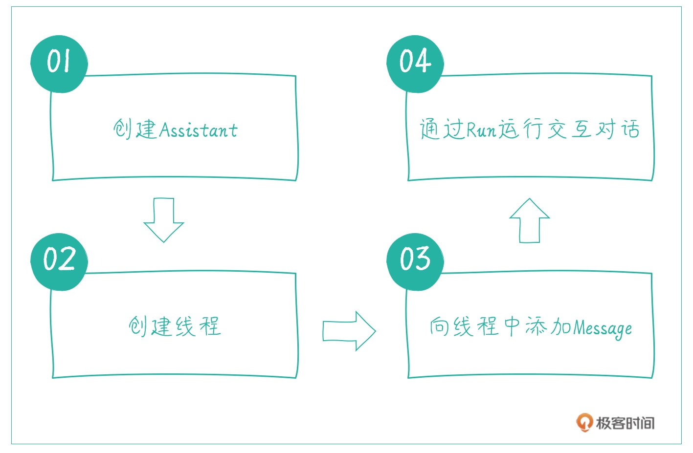

这些对象中，Assisant 和 Message 不言自明，无须解释。那么，如何理解 Thread 和 Run呢？

## 究竟什么是 Thread 和 Run?

在 OpenAI Assistant 的设计中，Thread 代表了 Assistant 和用户之间的一次完整对话会话。它存储了 Assistant 和用户之间来回的 Messages（消息），并自动处理上下文截断，以适应模型的上下文长度限制。

其实这就像是你在网页上和 ChatGPT 等任何语言模型的一个聊天页面，这个会话过程中，背后的 Thread 帮你记住之前的聊天上下文，并且在你输入的信息过长时会提醒你。

而 Run 则表示在一个 Thread 上调用 Assistant 的过程。Assistant 会根据其配置以及 Thread中的 Messages，通过调用模型和工具来执行任务。在 Run 的过程中，Assistant 也会向Thread 中添加新的 Messages。

其实这就像是你在网页上和 ChatGPT 等任何语言模型的一次互动过程。

### Assistant、Thread 和 Run 的交互过程

Assistant、Thread 和 Run 这三个核心概念之间的关系和交互过程如下图所示。

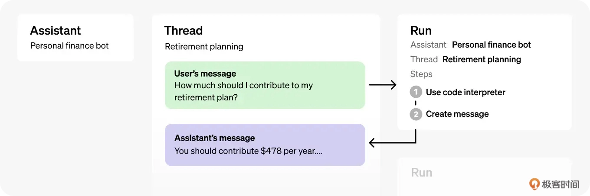

在这个示例中，一个名为 “Personal finance bot” 的 Assistant 被配置用于提供退休规划方面的建议。当用户向这个 Assistant 发送一条消息 “How much should I contribute to my retirementplan?” 时，就会创建一个新的 Thread，用于处理这个关于退休规划的对话。

为了回答用户的问题，系统会在这个 Thread 上启动一个新的 Run。在 Run 的执行过程中，Assistant 分两步生成回复：

- 首先，使用代码解释器（code interpreter）工具计算出一个建议的缴费金额。

- 然后，基于计算结果生成一条回复消息，例如 “You should contribute $478 per year…”。

最后，Assistant 生成的回复消息会添加到 Thread 中，发送给用户。

这样，Assistant、Thread 和 Run，以及 Message 协同工作，共同完成一次人机对话。

此外，请你注意，在上一课中，我们创建线程的时候并没有指明助手的 ID，因此，可以认为OpenAI 的线程和助手是彼此独立的。在 OpenAI 的 API 设计中，创建和管理线程来维持一个连贯的对话流程，而助手则是在这些线程中提供回答和交互的实体。助手负责处理具体的请求，而线程则更多关注于对话的组织和管理。

也就是说，一个线程中可以有多个助手；同时，一个助手可以有多个线程。这种设计增加了系统的灵活性和应用场景的广度。比如在一个复杂的对话系统中，不同的助手可能专注于处理不同类型的任务或问题。例如，一个助手可能专门处理与天气相关的查询，而另一个助手则处理旅游建议。在同一个对话线程中，根据用户的不同问题，系统可以将请求路由到不同的助手进行处理。

### Thread 的上下文和生命周期管理

创建 Thread 时，可以指定一组初始的 Messages。之后我们可以不断地向 Thread 中添加新的 Messages，这代表用户与 Assistant 的持续对话。

值得注意的是，Thread 会自动管理上下文窗口，以确保它不超过模型的上下文长度限制。当Thread 中 Messages 的总长度超过模型的上下文窗口时，Thread 会在其内部用 GPT 模型对上下文做总结，并尝试尽可能多地包含最新的 Messages，而丢弃最早的 Messages。

线程创建之后，就会一直在那里等待你的消息，并和你对话。你此时可能会有疑问，如果我们创建了一系列重复的空的新线程，如何删除它呢？线程什么时候停止呢? 它会一直等着我来访问么？它过一段时间之后会不会自动消亡呢？

其实，旧的线程可以通过 API client.beta.threads.delete(thread_id) 来清理，不过，前提是你必须要知道线程的 ID。

对于 assistants、run 和 message，你都可以通过 list API 来获取你所创建的所有对象的列表。

- client.beta.assistants.list

- client.beta.threads.runs.list

- client.beta.threads.messages.list

但是你会发现，OpenAI 目前并没有为我们提供线程的列表 API。因此，当你没有记录下之前创建的线程，你就没有办法删除它。

我发现有人在论坛上提出了是否可以通过 API 列出当前的线程，以便管理。

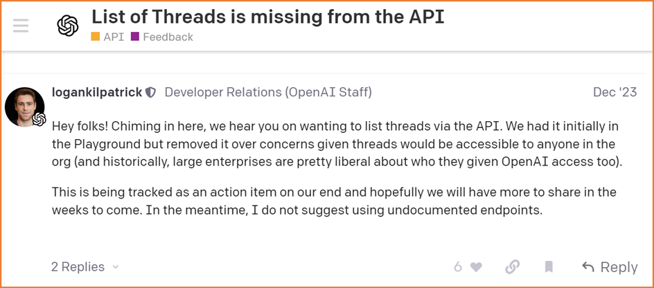

- 关于线程生存周期和如何获取线程列表的讨论

OpenAI 的开发团队表示他们了解这一需求，说 Playground 中最初是有这个功能的，但是由于担心线程会对组织内的任何人开放（考虑到大型企业对 OpenAI 访问权限设置较为宽松），所以他们移除了这一功能。这个问题已经被记录为一个待处理事项，团队希望在未来几周内能够分享更多信息。同时，他们建议不要使用尚未公开的端点（endpoints，也就是提问者提到的获取线程列表的 API 功能）。

当我发现自己重复创建了很多线程的时候，也在 OpenAI 的论坛中发了一个帖子，询问当我删除自己创建的助手时（可以在 Playground 或者用 API 删除 Assistants），这些线程会不会跟着被清理掉。很快就得到了论坛 leader 的回复。但是他也不是 100% 肯定（其实现在想想，我觉得答案是 No，因为 Thread 和 Assistant 是彼此独立存在的）。根据他的回答，60 天后没有动静的线程，会被系统自动清理掉。

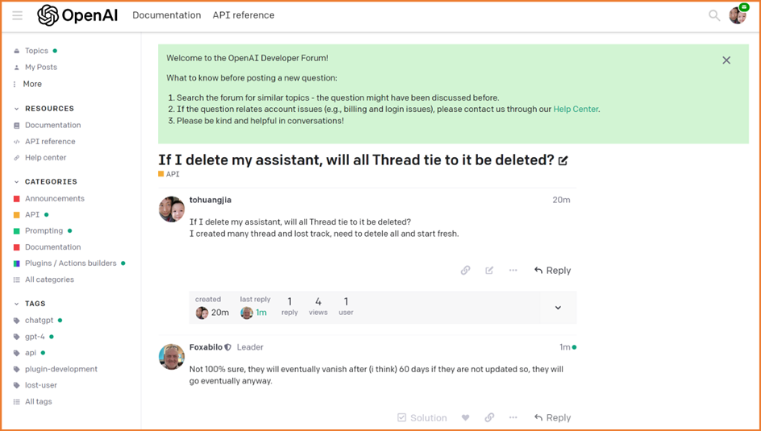

- 我询问删除助手时，线程会不会跟着被清理掉

虽然创建了线程，但是没有 Token 的传输，应该不会产生费用的。所以，要删光你的活动线程似乎并不容易，暂时就这样吧，不要强迫症了。我想，开着的线程应该不会浪费过多资源吧，只要你没有循环地频繁在线程中发送和接收消息就好。

## Run 的生命周期和状态

当我们在一个 Thread 上创建一个新的 Run 时，Assistant 就开始根据 Thread 中的上下文Messages 来执行任务。在这个过程中，Run 会经历下图所示的多个状态。

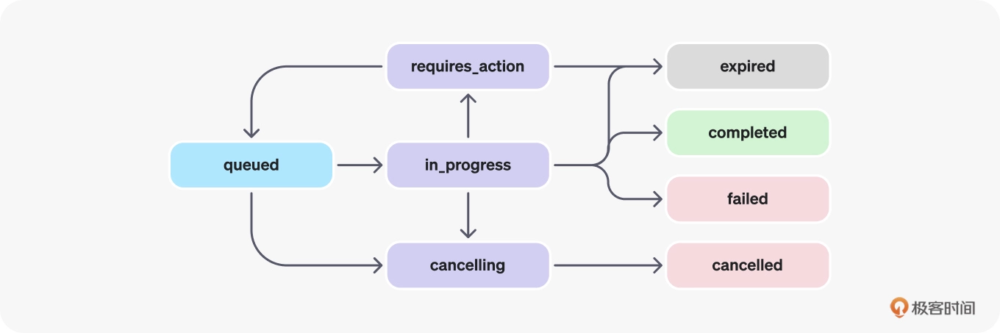

对于这些状态，我列表解释如下。

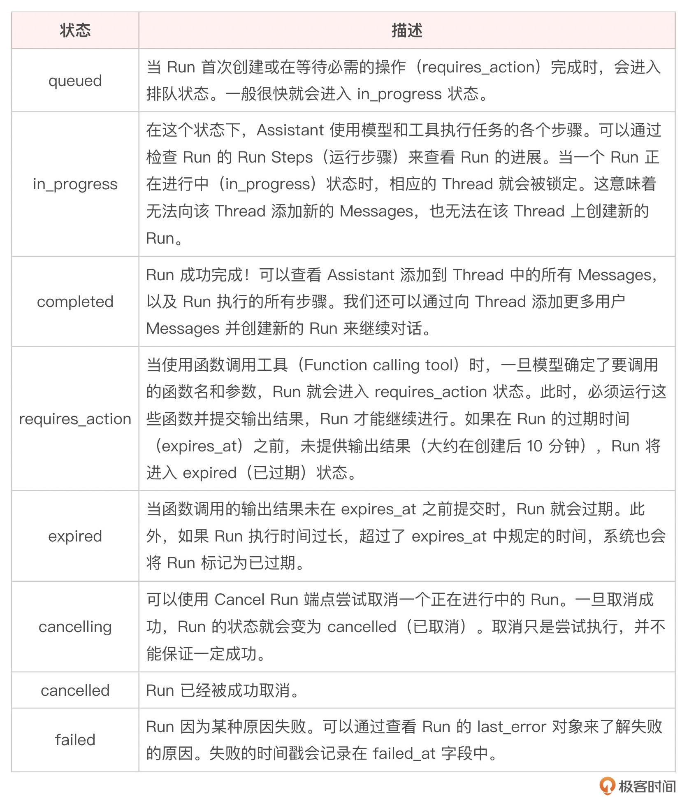

在 Run 创建后，也就是 Thread 开始运行对话交互之后，为了及时获取 Run 的最新状态，我们需要定期检索 Run 对象，以观察 Run 的状态变化。每次检索时，可以通过查看 Run 的status 字段来确定应用程序接下来应该执行的操作。

## 通过实战分析 Run 的状态流转

好了，有了上面的理论做基础，我们现在就可以开始分析上一讲中，我们的 Run 究竟经历了那些状态，从出生到消亡，它的状态是怎样流转的。

### 最简单的状态流转

我们先来看一个最简单的状态变化的情况。此处的示例仍然调用上一节课中创建的同一个Assistant，但是，问题比较简单，Assistant 能够智能的发现，不需要进行 Function Call，因此会直接回答。

简单调用 Assistant 的程序代码如下：

```python
# 导入OpenAI库,并创建OpenAI客户端
from dotenv import load_dotenv
load_dotenv()
from openai import OpenAI
client = OpenAI()
# 检索您之前创建的Assistant
assistant_id = "asst_aT4hurwd35eSave7qrt2t6eJ"  # 你自己的助手ID
assistant = client.beta.assistants.retrieve(assistant_id)
print(assistant)
# 创建一个新的Thread
thread = client.beta.threads.create()
print(thread)
# 向Thread添加用户的消息
message = client.beta.threads.messages.create(
   thread_id=thread.id,
   role="user",
   content="你好,请问你能做什么。"
)
print(message)
# 运行Assistant来处理Thread
run = client.beta.threads.runs.create(
   thread_id=thread.id,
   assistant_id=assistant.id
)
print("读取Run的状态", run)
import time
# 定义一个轮询的函数
def poll_run_status(client, thread_id, run_id, interval=10):
   while True:
       run = client.beta.threads.runs.retrieve(thread_id=thread_id, run_id=run_i
       print(f"Run的轮询信息:\n{run}\n")
       if run.status in ['requires_action', 'completed']:
           return run
       time.sleep(interval)  # 等待后再次检查
# 轮询以检查Run的状态
run = poll_run_status(client, thread.id, run.id)
# 获取Assistant在Thread中的回应
messages = client.beta.threads.messages.list(
   thread_id=thread.id
)
print("全部的message", messages)
# 输出Assistant的最终回应
print('下面打印最终的Assistant回应:')
for message in messages.data:
   if message.role == "assistant":
       print(f"{message.content}\n")
```

在这里，我们定义了 poll_run_status 函数，用来轮询检查 Assistant 在处理 Thread 过程中的状态，并定期输出当前 Run 的状态。这个函数的主要作用是在调用 Assistant 处理 Thread后，持续检查 Assistant 处理的状态，直到处理完成或需要采取进一步行动为止。

这个程序的输出如下：

```
Assistant(id='asst_aT4hurwd35eSave7qrt2t6eJ', created_at=1711126020, description=
Thread(id='thread_1709dA8z7mQxnXP3U3QSnQiW', created_at=1712030293, metadata={},
ThreadMessage(id='msg_nPRj7cttfIEoXgmmAuGaJMdV', assistant_id=None, content=[Mess
读取Run的状态 Run(id='run_8XqQ2w5cO5H3te3GdeQxSrfB', assistant_id='asst_aT4hurwd35e
Run的轮询信息:
Run(id='run_8XqQ2w5cO5H3te3GdeQxSrfB', assistant_id='asst_aT4hurwd35eSave7qrt2t6e
Run的轮询信息:
Run(id='run_8XqQ2w5cO5H3te3GdeQxSrfB', assistant_id='asst_aT4hurwd35eSave7qrt2t6e
计算订单总价', parameters={'type': 'object', 'properties': {'items': {'type': 'arra
Run的轮询信息:
Run(id='run_8XqQ2w5cO5H3te3GdeQxSrfB', assistant_id='asst_aT4hurwd35eSave7qrt2t6e
Run的轮询信息:
Run(id='run_8XqQ2w5cO5H3te3GdeQxSrfB', assistant_id='asst_aT4hurwd35eSave7qrt2t6e
全部的message SyncCursorPage[ThreadMessage](data=[ThreadMessage(id='msg_1x5L8QTIhw
下面打印最终的Assistant回应:
[MessageContentText(text=Text(annotations=[], value='你好！我是一个人工智能助手，可以帮
```

这个输出内容很多，又有点不好理解，所以我给你总结成了下面的列表。

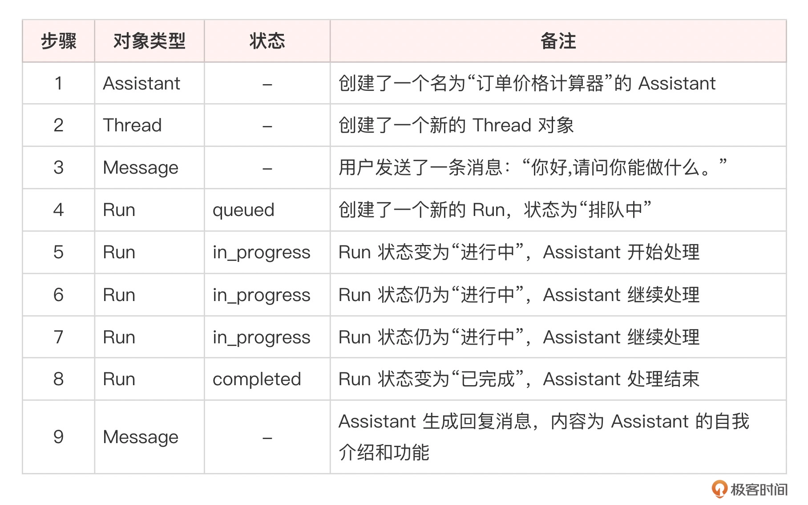

通过这个表格，我们可以清晰地看到整个对话过程中，Assistant、Thread、Message 和 Run这几个关键对象的状态变化。其中，Run 的状态变化最为关键，体现了 Assistant 处理用户请求的完整生命周期，从 “queued” 到 “in_progress”，最后到 “completed”。整体流程正如下图所示。

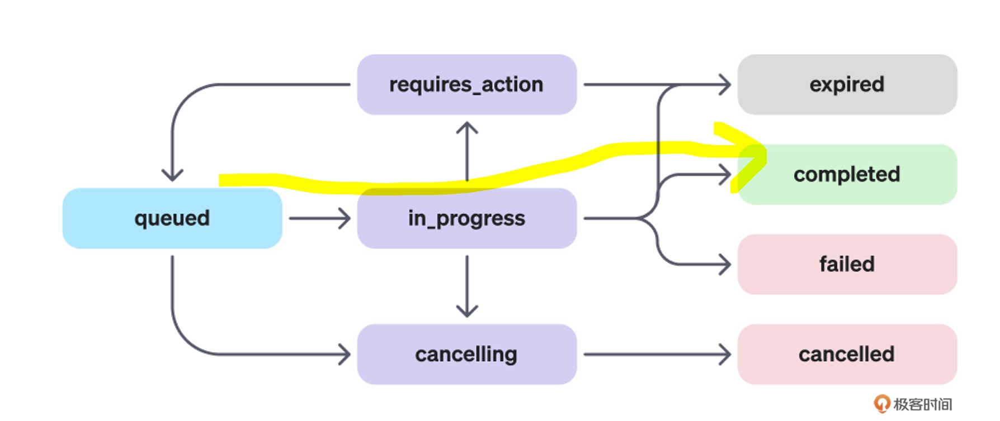

这就是不调用 Function 时，Run 状态变化的最简示例。

### 加入了 Function Call 之后的状态流转

以上，是最简单的流程。你可能已经意识到了，上一讲中，我们的示例中 Run 的状态比上面复杂多了。这是因为，我们当时的对话“你好，我购买了一本书和一个电子产品，请帮我计算一下订单总价”，成功地激活了 Assistant 的功能调用服务（Function Tool），从而进一步触发了 Run 的 requires_action 状态。

此时，如果你使用自定义的 poll_run_status 函数来取代上一讲中的 create_and_poll API，你就会发现，Run 经过了 queue 和 in_progress 两个状态之后，是进入了 requires_action 这个新状态，等待函数的本地调用，当然本地调用结束之后，必须再通过 submit_tool_outputs提交给 Assistant，Run 状态才变为 “completed”，Assistant 处理过程才结束。

如果你持续地把 Run 的 status 打印出来，总结成列表的形式，就会如下表所示。

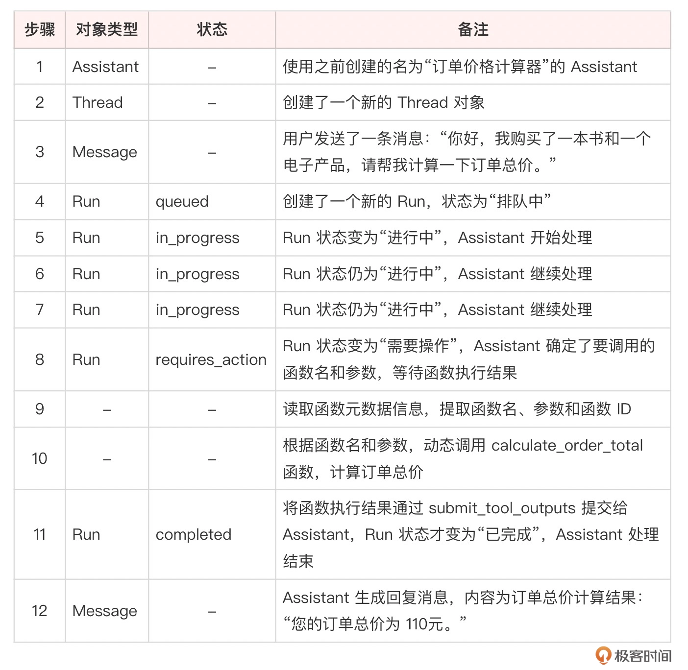

通过这个表格，我们可以清晰地看到整个对话过程中，Assistant、Thread、Message 和 Run这几个关键对象的状态变化。其中，Run 的状态变化最为关键，体现了 Assistant 处理用户请求的完整生命周期。正如下图所示。

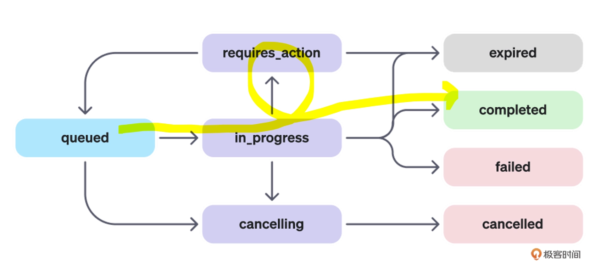

与上一个例子相比，这个例子中 Run 的状态出现了 “requires_action”（需要操作），表明Assistant 在处理过程中需要调用外部函数。我们可以看到，在读取函数元数据信息、动态调用函数并获得结果后，Run 的状态才变为 “completed”（已完成）。这展示了函数调用在Assistant 处理过程中的重要作用。

## 总结时刻

这节课，我带着你深入探讨了 OpenAI Assistant 中 Thread 和 Run 的概念，以及它们的生命周期管理和状态转换。了解这些内容可以帮助我们更好地使用 OpenAI 的 Assistants API 构建强大的 AI 应用。

这几个重要概念列表如下：

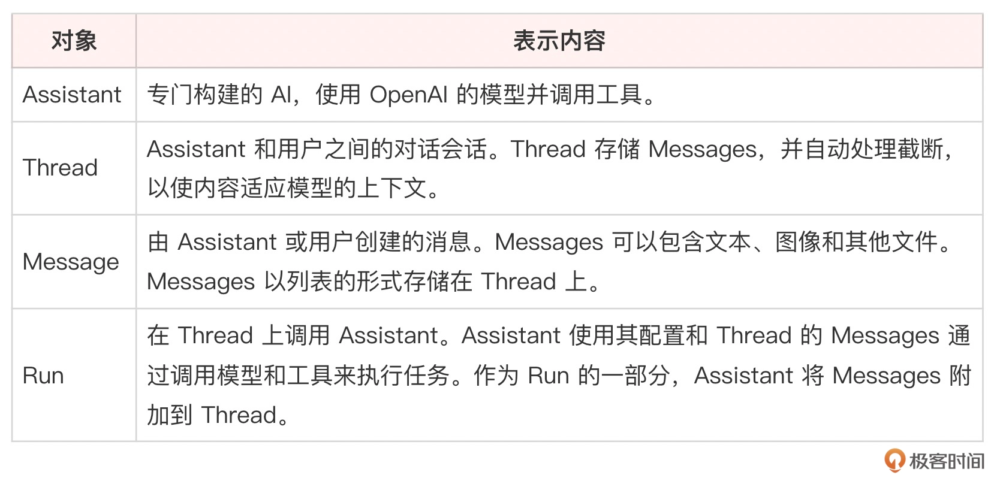

在下节课中，我们将继续学习 Assistant 的其他重要功能，如代码解释器（Code interpreter）和文件检索（File search）等工具的使用。敬请期待！

## 思考题

1. 我们自定义的函数 poll_run_status() 和 client.beta.threads.runs.create_and_poll() 这个 API有何异同？为何这一课中，我们选择使用自定义的函数 poll_run_status()？

2. 观察程序中每一个 Run 的输出，说一说，Run 的生命周期大概有多长？在本课的两个示例中，Run 在什么情况下可能会进入 Expired 状态？

3. 调整程序代码，尝试通过 client.beta.threads.runs.cancel 这个 API 来取消正在进行的Run，使 Run 进入 cancelled 状态。

期待你的思考，欢迎在评论区与我交流。如果今天的内容让你有所收获，也欢迎你把这节课转发给有需要的朋友！我们下节课再见！
