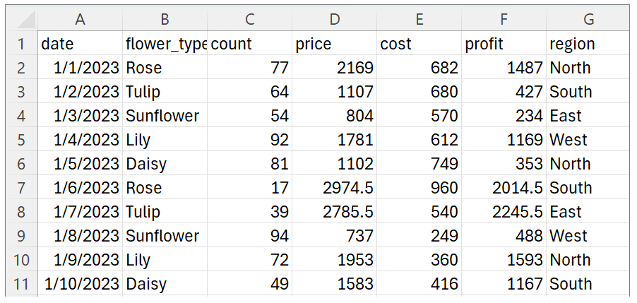
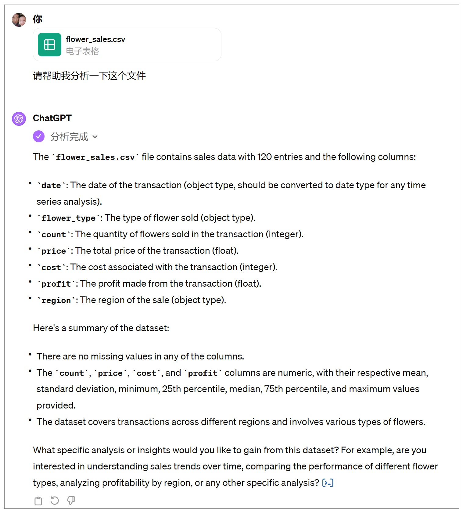
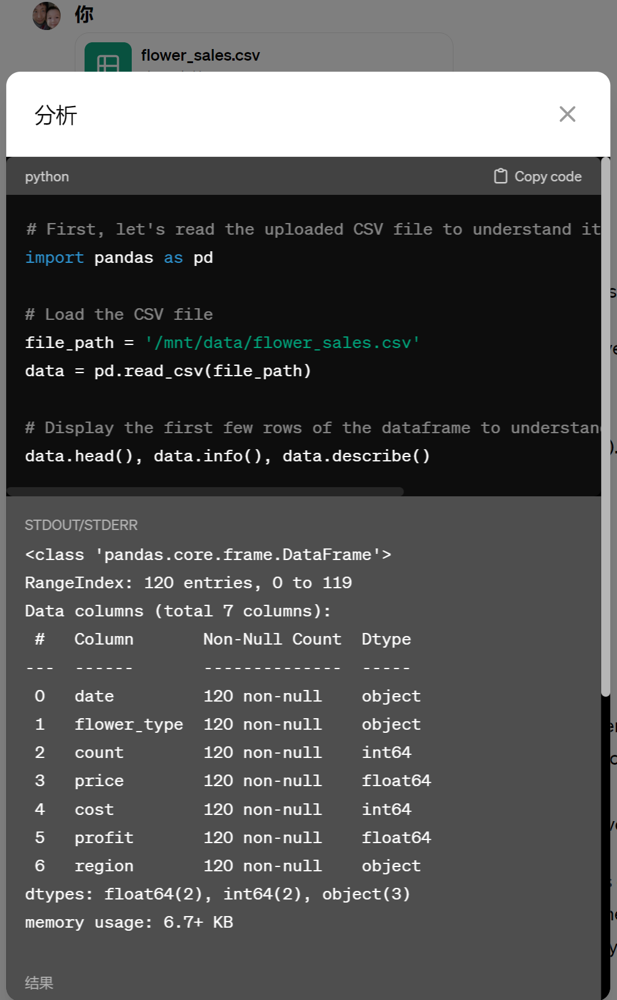
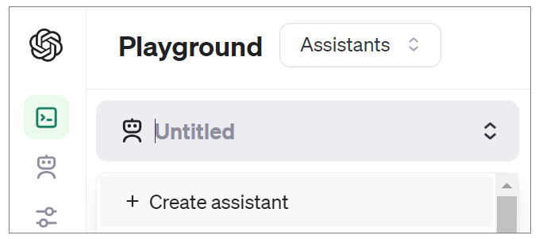
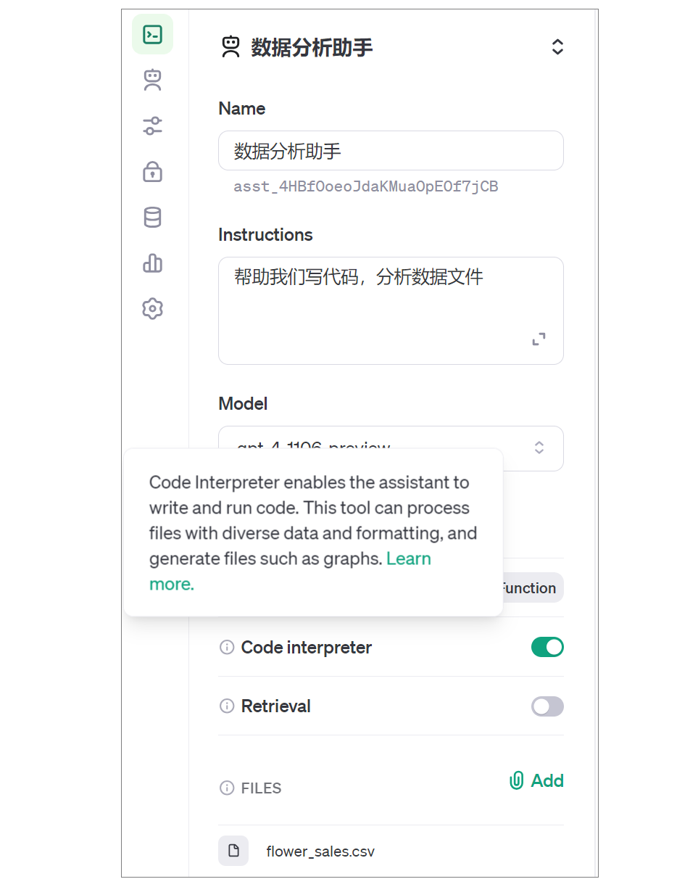
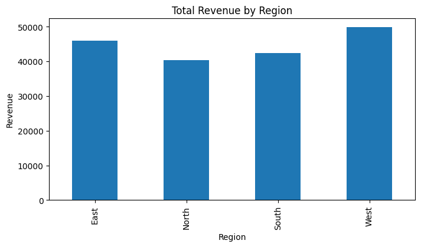
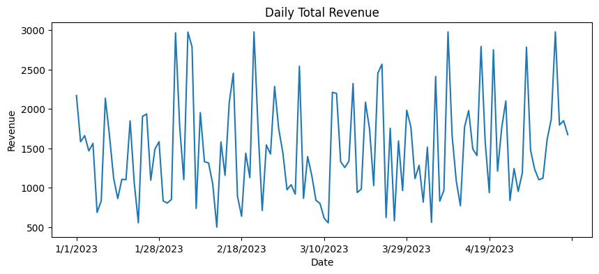
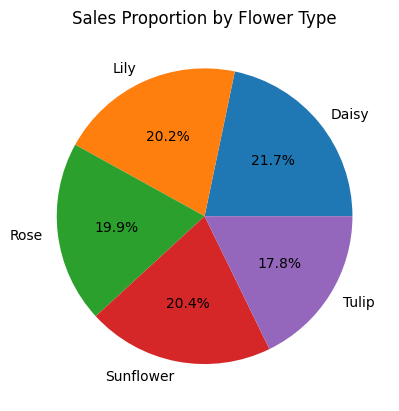
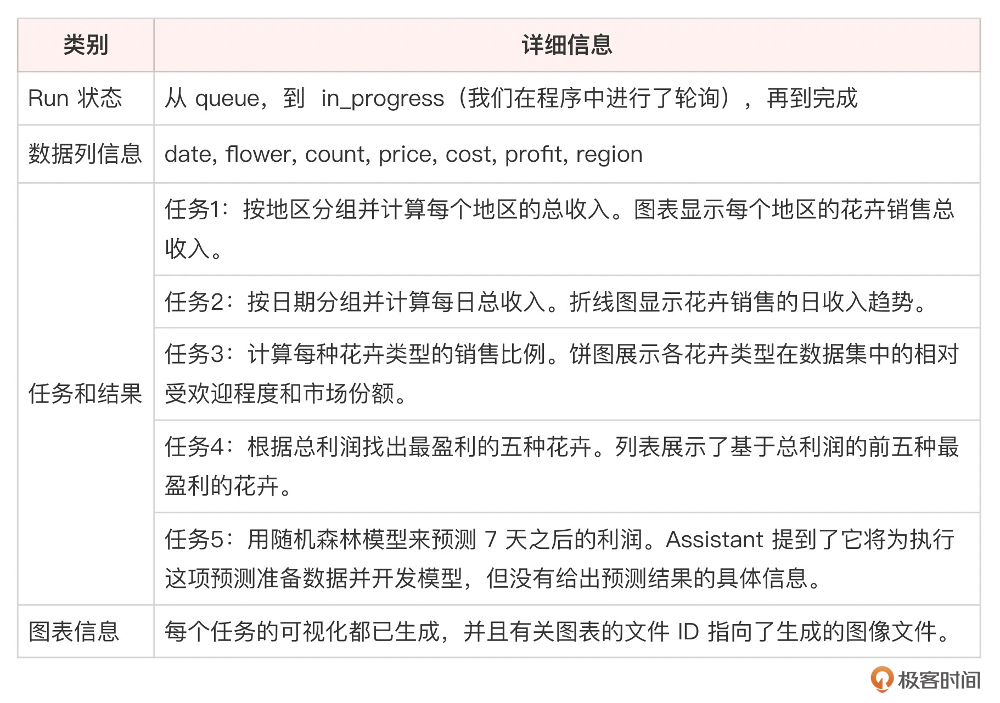
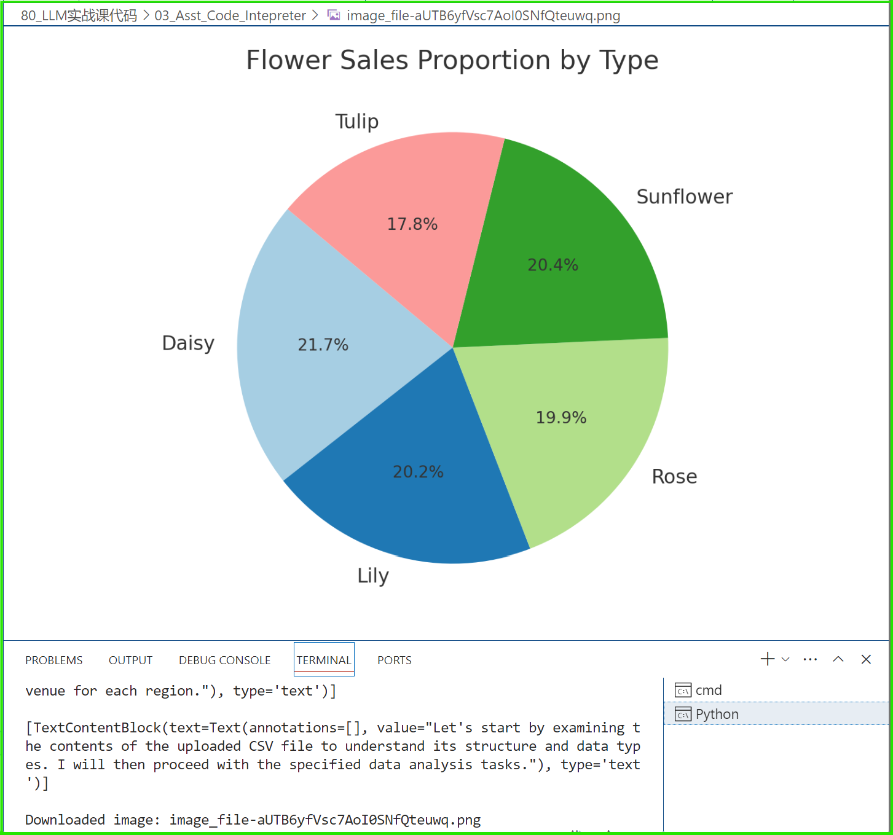

# 03 | 用Assistants中的Codeinterpreter做数据分析

你好，我是黄佳。

在启程篇的前两课中，我们学习了如何调用 Function，以及 Thread（线程）和 Run（运行交互对话）的来龙去脉，今天我们稍微轻松一下，讲些没有那么烧脑，相对来说比较简单的内容。我们一起来看看，如何使用 Assistants 中的 Code interpreter 做数据分析。

## 什么是 Code interpreter

Code interpreter 这个工具的名字有点误导，一开始，我以为它是一个强大的代码分析器，是类似于 Github Copilot、CodeLlama 这样的工具，能够分析、补全或者生成代码，帮助开发者提高编程效率和代码质量。我想，如果我把一堆程序代码丢进去，Code interpreter 应该能帮我分析分析吧（其实 ChatGPT 不调用任何工具，就已经可以胜任这种代码分析和生成的任务了）。

但是，其实不是，Code interpreter 当然可以生成代码，但它的主要的目标工作是帮助我们根据数据文件做数据分析。这里所说的数据分析，是从头到尾的一站式服务——生成数据分析代码的同时，还能直接运行所生成的代码，并呈现结果。

用官方的话来说，Code interpreter 是一款托管在 OpenAI 服务器的工具，允许用 Python 代码读取、处理和分析数据文件。它支持多种常见的文件格式，如 csv、json、pdf 等，可以对数据进行切片、过滤、排序、分组、聚合等多种操作，而且内置了数据可视化功能，可以一键生成折线图、柱状图、饼图等图表。OpenAI 对 Code interpreter 使用按量计费，每个会话收费0.03 美元，会话默认持续 1 小时。

Code interpreter 并不仅仅存在于 Assistants 中，而是已经无缝集成到了 ChatGPT 这款产品的内部。比如，我有一个下图所示的销售数据文件（课程文件和代码在此处下载），就可以让 ChatGPT（GPT-4）为我进行数据分析。



上传给 GPT-4 之后，ChatGPT 的数据分析结果如下。



上述分析结果，不仅仅是通过简单的 GPT 文本读取总结出来的，而是经过了 Python 代码的加工处理之后所呈现的结果。当我们在 ChatGPT 对话界面中选择以下这两种箭头，就可以看到 Python 代码，以及代码生成的数据分析结果。




这个过程中，ChatGPT 就用到了 Code Intepreter 的功能。只不过，此时 Code Intepreter 已经内嵌到 ChatGPT 中了，ChatGPT 知道什么时候应该调用它。

## 使用 Playground 中的 Code Intepreter

好，下面我们来把这个工具集成到自己的 Assistant 中，我们还是先通过 Playground 中的Code Intepreter 来看看它的使用机理。

第一步，选择 Create assistant 新建一个 Assistant，并命名为数据分析助手（名字随意）。



第二步，开启 Code interpreter 功能，并通过 Add 功能上传数据文件。



之后，就可以在对话区域内通过自然语言来调用 Assistant 进行数据分析。

## 使用 Python 进行数据分析

现在，让我们暂时忘掉 Code intepreter，回到 Python 数据分析的领域。我们来基于数据文件flower_sales.csv 手工编写一些代码进行基本的数据分析操作。

首先，我们按地区计算总收入，并绘制柱状图。

```python
import pandas as pd
import matplotlib.pyplot as plt
# Read the CSV file
df = pd.read_csv('flower_sales.csv')
# Calculate total revenue by region and create a bar chart
revenue_by_region = df.groupby('region')['price'].sum()
revenue_by_region.plot.bar(figsize=(8, 4))
plt.title('Total Revenue by Region')
plt.xlabel('Region')
plt.ylabel('Revenue')
plt.show()
```



然后，按日期计算每日总收入，并绘制折线图。

```
# Calculate daily total revenue and create a line chart
daily_revenue = df.groupby('date')['price'].sum()
daily_revenue.plot.line(figsize=(10, 4))
plt.title('Daily Total Revenue')
plt.xlabel('Date')
plt.ylabel('Revenue')
plt.show()
```



之后，计算各花卉类型的销售占比，并绘制饼图。

```
# Calculate the sales proportion of each flower type and create a pie chart
flower_sales = df.groupby('flower')['count'].sum()
plt.pie(flower_sales, labels=flower_sales.index, autopct='%1.1f%%')
plt.title('Sales Proportion by Flower Type')
plt.show()
```



接下来，找出利润最高的 5 种花卉。

```
# Find the top 5 most profitable flowers
top5_profit_flowers = df.groupby('flower')['profit'].sum().nlargest(5)
print('Top 5 Most Profitable Flowers:')
print(top5_profit_flowers)
```

输出如下：

```
Top 5 Most Profitable Flowers:
flower
Rose         30532.5
Tulip        25037.0
Lily         15823.0
Daisy         9905.0
Sunflower     9517.0
Name: profit, dtype: float64
```

最后，使用随机森林回归模型来预测未来 7 天的总收入。

```
from sklearn.ensemble import RandomForestRegressor
# Forecast the total revenue for the next 7 days using Random Forest Regressor
revenue_ts = df.groupby('date')['price'].sum().reset_index()
revenue_ts['date'] = pd.to_datetime(revenue_ts['date'])
revenue_ts['day'] = revenue_ts['date'].dt.day
X = revenue_ts['day'].values.reshape(-1, 1)
y = revenue_ts['price'].values
model = RandomForestRegressor(n_estimators=100, random_state=42)
model.fit(X, y)
future_dates = pd.date_range(start=revenue_ts['date'].max(), periods=8, freq='D')
future_days = future_dates.day.values.reshape(-1, 1)
forecast = model.predict(future_days)
print('Forecasted Total Revenue for the Next 7 Days:')
print(pd.Series(forecast, index=future_dates))
```

输出如下：

```
Forecasted Total Revenue for the Next 7 Days:
2023-05-01    1836.360355
2023-05-02    1805.565833
2023-05-03    1185.813321
2023-05-04    1282.622365
2023-05-05    1743.691246
2023-05-06    1885.061446
2023-05-07    2132.975299
Freq: D, dtype: float64
```

这是一个很简单的机器学习模型，其主要步骤是先将日期列转换为时间戳格式，并提取日期中的日信息作为模型的输入特征，将日期特征所对应的总收入作为标签，这也就是模型的输入和输出。然后，创建并训练随机森林回归模型。模型训练好之后，生成未来 7 天的日期序列，并提取日信息作为模型的输入，最后使用训练好的模型对未来 7 天的总收入进行预测。

## 使用 Assistant API 中的 Code Intepreter

上面的几个数据分析示例，虽然不难，但是毕竟还是需要编程基础，一个数据分析师完成上述编程任务，大概需要几个小时到一两天的时间写代码。

那现在呢，我们就通过 Assistants API 中的 Code intepreter 工具，以自然语言的方式来完成上述数据分析功能。在这个过程中，Assistants API 的调用流程是固定的，而我们需要设计的只是自然语言提示文本。

先来看一个以文本格式作为输出的数据分析示例。

```go
from dotenv import load_dotenv
load_dotenv()
from openai import OpenAI
import os
import requests
import time
import json
client = OpenAI()
def create_assistant(instructions, file_path):
   with open(file_path, "rb") as file:
       file_obj = client.files.create(file=file, purpose='assistants')
       file_id = file_obj.id
   assistant = client.beta.assistants.create(
       instructions=instructions,
       model="gpt-4",
       tools=[{"type": "code_interpreter"}],
       file_ids=[file_id]
   )
   return assistant
def create_thread(user_message, file_id):
   thread = client.beta.threads.create(
       messages=[
           {
               "role": "user",
               "content": user_message,
               "file_ids": [file_id]
           }
       ]
   )
   return thread
def run_assistant(thread_id, assistant_id):
   run = client.beta.threads.runs.create(
       thread_id=thread_id,
       assistant_id=assistant_id
   )
   return run
def poll_run_status(client, thread_id, run_id, interval=20):
   while True:
       run = client.beta.threads.runs.retrieve(thread_id=thread_id, run_id=run_i
       print(f"Run的轮询信息:\n{run}\n")
       if run.status in ['requires_action', 'completed']:
           return run
       time.sleep(interval)
def get_assistant_reply(thread_id):
   response = client.beta.threads.messages.list(thread_id=thread_id)
   message = response.data[-1]
   message_content = message.content[0].text
   annotations = message_content.annotations
   citations = []
   for index, annotation in enumerate(annotations):
       message_content.value = message_content.value.replace(annotation.text, f'
       if (file_citation := getattr(annotation, 'file_citation', None)):
           cited_file = client.files.retrieve(file_citation.file_id)
           citations.append(f'[{index}] {file_citation.quote} from {cited_file.f
       elif (file_path := getattr(annotation, 'file_path', None)):
           cited_file = client.files.retrieve(file_path.file_id)
           citations.append(f'[{index}] Click <here> to download {cited_file.fil
           download_file(cited_file.filename, file_path.file_id)
   message_content.value += '\n' + '\n'.join(citations)
   return message_content.value
def download_file(filename, file_id):
   file_content = client.files.content(file_id)
   with open(filename, 'wb') as file:
       file.write(file_content)
def main():
   instructions = """
   Please use the flower_sales.csv data to complete the following analysis tasks
   1. Group the data by region and calculate the total revenue for each region.
   2. Group the data by date and calculate the daily total revenue. Create a lin
   3. Calculate the sales proportion of each flower type and display the results
   4. Find the top 5 most profitable flowers based on the total profit.
   5. Using the historical sales data, forecast the total revenue for the next 7
   """
   file_path = r"01_Assitants\CodeIntepreter\flower_sales.csv"
   with open(file_path, "rb") as file:
       file_obj = client.files.create(file=file, purpose='assistants')
       file_id = file_obj.id
   assistant = create_assistant(instructions, file_path)
   user_message = "Please perform the data analysis tasks as instructed."
   thread = create_thread(user_message, file_id)
   run = run_assistant(thread.id, assistant.id)
   print(f"Run status: {run.status}")
   # 轮询Run直到完成或需要操作
   run = poll_run_status(client, thread.id, run.id)
   # 获取Assistant在Thread中的回应
   messages = client.beta.threads.messages.list(thread_id=thread.id)
   print("全部的message", messages)
   # 输出Assistant的最终回应
   print('下面打印最终的Assistant回应:')
   for message in messages.data:
       if message.role == "assistant":
           print(f"{message.content}\n")
if __name__ == "__main__":
   main()
```

这段代码中，我们先上传数据文件，创建一个 Assistant 对象和一个 Thread 对象，然后在Thread 上运行 Assistant 来执行指定的数据分析任务。之后，还是轮询 Run 的状态，并在Run 完成之后，获取并显示 Assistant 的回复。

其中的关键设计，就是提示信息的设计。

```
   instructions = """
   Please use the flower_sales.csv data to complete the following analysis tasks
   1. Group the data by region and calculate the total revenue for each region.
   2. Group the data by date and calculate the daily total revenue. Create a lin
   3. Calculate the sales proportion of each flower type and display the results
   4. Find the top 5 most profitable flowers based on the total profit.
   5. Using the historical sales data, forecast the total revenue for the next 7
   """
```

这里，我们给出的 5 个数据分析任务，正是和刚才我们用 Python 数据分析代码来实现的完全一致。

输出如下：

```
Run的初始信息: queued
Run的轮询信息:
Run(id='run_202iwnMlW8nJVbEKOMPWJqVT', assistant_id='asst_ZzFnvavBoYZ59NDLnLinNC9
Run的轮询信息:
Run(id='run_202iwnMlW8nJVbEKOMPWJqVT', assistant_id='asst_ZzFnvavBoYZ59NDLnLinNC9
Run的轮询信息:
Run(id='run_202iwnMlW8nJVbEKOMPWJqVT', assistant_id='asst_ZzFnvavBoYZ59NDLnLinNC9
Run的轮询信息:
Run(id='run_202iwnMlW8nJVbEKOMPWJqVT', assistant_id='asst_ZzFnvavBoYZ59NDLnLinNC9
Run的轮询信息:
Run(id='run_202iwnMlW8nJVbEKOMPWJqVT', assistant_id='asst_ZzFnvavBoYZ59NDLnLinNC9
全部的message SyncCursorPage[Message](data=[Message(id='msg_cRSYdkrscxnyHXimfqqivQ
下面打印最终的Assistant回应:
[TextContentBlock(text=Text(annotations=[], value="The top 5 most profitable flow
[ImageFileContentBlock(image_file=ImageFile(file_id='file-aUTB6yfVsc7AoI0SNfQteuw
[ImageFileContentBlock(image_file=ImageFile(file_id='file-ARR9oWz1AdYwLCVeaDNsYfG
[ImageFileContentBlock(image_file=ImageFile(file_id='file-DA3uSxFhVE8KqZFrWKY2YWT
[TextContentBlock(text=Text(annotations=[], value="The dataset contains the follo
[TextContentBlock(text=Text(annotations=[], value="Let's start by examining the c
```

上面日志中的内容过多，我们简单列表总结一下。



从输出中，可以看到，Assistant 声称，饼图已经生成啦，可以下载。下面，我们就把所有的数据分析图片下载下来。

```python
from openai import OpenAI
def download_file(filename, file_id):
   file_content = client.files.content(file_id)
   with open(filename, 'wb') as file:
       file.write(file_content.read())
def get_assistant_messages(thread_id, assistant_id):
   response = client.beta.threads.messages.list(thread_id=thread_id)
   messages = [message for message in response.data if message.role == 'assistan
   return messages
def process_message(message):
   for content_block in message.content:
       if content_block.type == 'image_file':
           file_id = content_block.image_file.file_id
           filename = f"image_{file_id}.png"
           download_file(filename, file_id)
           print(f"Downloaded image: {filename}")
       elif content_block.type == 'text':
           text = content_block.text.value
           annotations = content_block.text.annotations
           for annotation in annotations:
               if annotation.type == 'file_path':
                   file_id = annotation.file_path.file_id
                   filename = annotation.text.split('/')[-1]
                   download_file(filename, file_id)
                   print(f"Downloaded file: {filename}")
def main():
   thread_id = 'thread_D3JUkq05bfvtmBw7QoNSuTy7'
   assistant_id = 'asst_ZzFnvavBoYZ59NDLnLinNC99'
   messages = get_assistant_messages(thread_id, assistant_id)
   for message in messages:
       process_message(message)
if __name__ == "__main__":
   client = OpenAI()
   main()
```

运行程序，代码分析器（也就是数据分析助手）创建的图片将出现在你的本地目录中。



好啦，经过上面的展示，你可以看到，我们使用 Assistants 中的 Code interpreter 做数据分析时，所需要的切换是从“数据分析编程”到调用 Assistants API 进行“自然语言编程”。

当你非常熟悉了 Assistants API 的使用流程后，当然是用“自然语言编程”更节省心力啦！

## 总结时刻

本课中，我们深入浅出地介绍了如何使用 OpenAI 的 Code interpreter 工具进行数据分析。通过对比手写 Python 代码和使用自然语言调用 Code interpreter，你应该可以清晰地理解这两种方式的异同。

我最想向你强调的，也就是整个大语言模型应用开发的基本思路，本质上，就是从计算机语言编码，到自然语言编码的范式转换。这一转变的意义在于降低了数据分析的门槛。使用自然语言描述分析需求，无需掌握复杂的编程技能，更多的人可以参与到数据分析的过程中来。同时提高了分析效率。通过自然语言交互，分析人员可以快速迭代分析思路，不必花费大量时间编写和调试代码。Code interpreter 会自动生成优化后的代码，并给出结果。

与此同时，这种编程范式促进了人机协作。分析人员提出需求，机器自动执行分析并生成可视化图表，双方优势互补。人的创造力和洞察力，与机器的计算能力和执行力相结合，可以实现更加智能高效的数据分析。这也预示了未来人机交互的趋势。随着自然语言处理技术的发展，我们与计算机交流的方式会变得越来越自然，越来越接近人与人之间的交流。编程语言或许会成为历史，自然语言则会成为人机交互的主要方式。

## 思考题

1. 本示例中的提示信息我是用英文写的，请你用中文提示试试效果。

2. 在本示例的任务 5：用随机森林模型来预测 7 天之后的利润中，Assistant 犯懒了，没有真正实现，为什么？请你加强提示语，或者把它作为一个单独的任务重新设计实现。

3. 未来，自然语言驱动的数据分析模式可能在哪些场景下大显身手? 又有哪些场景目前还难以适用?

4. 自然语言驱动的趋势是否意味着编程技能将变得不再重要？数据分析人员如何在这一趋势下提升自己的职业竞争力？传统的编程技能与自然语言交互能力如何实现互补?

其实，有的题目并没有标准答案，我们可以在留言区一起探讨，那么，我期待看到你的留言。如果今天的内容让你有所收获，也欢迎你把这节课转发给有需要的朋友！我们下节课再见！
