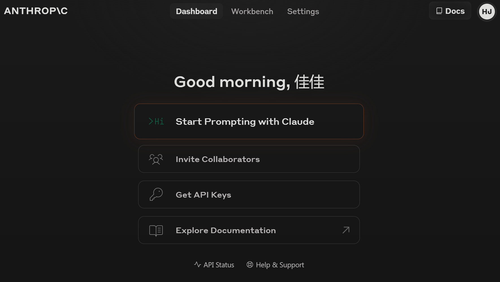
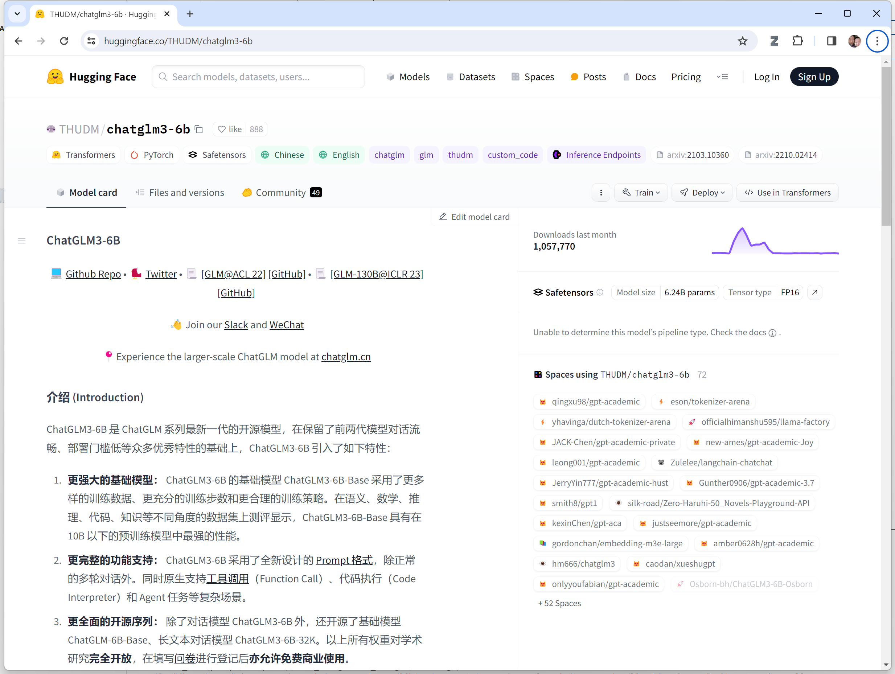

# 05 | 用5种不同模型展示模型交互5大基本原则

你好，我是黄佳。欢迎你学习大模型应用开发实战课。

在之前的启程篇中，我着重给你介绍了 Assistants API 的使用。这节课我们进入一个短小但是重要的篇章——提示工程。

所谓提示工程，就是精心设计输入给 AI 模型的文本（即提示），引导模型生成我们期望的输出。这就像是和你的同事、领导、下属或者朋友对话，你需要给它明确的指令。你提供充足的背景信息，才能得到满意的回答。可以说，优秀的提示是人类智慧和机器能力的完美结合，它虽然没有改变 AI 的思维能力上限，但是能够把 AI 的表现提升到接近其上限的位置。这其实非常重要。

在这一课中，我将用 5 种不同模型，通过 5 个实用的例子，来向你展示和模型对话交互的 5大基本原则。

## 技巧一：编写清晰的指令，让模型“一步到位”地完成任务

模型就像是你的得力助手，但它们并不会读心术。为了让助手高效工作，你需要提供清晰、详尽的指令，让它明白你的需求。假设我们要生成一段 Python 代码，如果我们详细描述了代码编写的要求，模型就能更好地完成任务。

例如，要通过 Python 实现对列表元素求和，我们可以尝试这样的提示。

```
prompt = """
请编写一个Python函数实现对列表求和。要求:
函数名为sum_list,接受一个列表作为参数
使用内置的sum()函数实现列表求和
添加必要的注释,说明函数的输入输出
在函数末尾添加几个测试用例,并打印结果
"""
```

可以看到，这个提示明确了函数名、实现方式、注释要求、测试用例等各个方面，犹如一份详尽的“编程作业要求”。有了这样的输入，即使是能力较弱的模型（如 GPT3.5）也能输出一段高质量的代码。

```python
# 创建OpenAI Client
from openai import OpenAI
client = OpenAI()
# 定义使用OpenAI的GPT-3.5-Turbo模型生成代码的函数
def generate_code(prompt):
   client = OpenAI()
   response = client.chat.completions.create(
       model="gpt-3.5-turbo",
       messages=[
           {"role": "system", "content": "You are a helpful Python programming a
           {"role": "user", "content": prompt}
           ]
       )
   return response.choices[0].message.content
# 定义提示信息,包含函数要求
prompt = """
   请编写一个Python函数实现对列表求和。要求:
   函数名为sum_list,接受一个列表作为参数
   使用内置的sum()函数实现列表求和
   添加必要的注释,说明函数的输入输出
   在函数末尾添加几个测试用例,并打印结果 """
# 生成代码
generated_code = generate_code(prompt)
print(generated_code)
```

输出如下：

```bash
```python
def sum_list(lst):
   """
   对列表中的元素进行求和
   Parameters:
   lst (list): 包含数字的列表
   Returns:
   int: 列表元素的总和
   """
   return sum(lst)
# 测试用例
test_list1 = [1, 2, 3, 4, 5]
print(sum_list(test_list1))  # 输出: 15
test_list2 = [10, 20, 30]
print(sum_list(test_list2))  # 输出: 60
test_list3 = [0, -1, 1]
print(sum_list(test_list3))  # 输出: 0
```\
```

GPT3.5 当然能够依据清晰的指令完成任务。

## 技巧二：提供参考资料，给模型“查字典”的机会

其实，这个技巧就是最简版的 RAG（检索增强式生成）。尽管大模型就像一位博学多才的助手，但它的知识全部被固定在了其训练完成的那一个刹那，因此很多情况下它需要查阅资料来回答问题。

你可以在提示中提供相关的背景知识，模型就能根据这些线索产生更准确、可信的回答。来看下面的例子。

下面这个例子，我们使用了 Claude-3 的最强模型 claude-3-opus。请你先去Anthropic 官网注册一下自己的 API Key。



```python
import os
import anthropic
# 销售数据
reference_data = """
销售数据:
日期,产品,销量,单价,总收入
2023-01-01,iPhone 13,100,6000,600000
2023-01-01,iPhone 14,50,8000,400000
2023-01-02,iPhone 13,80,6000,480000
2023-01-02,iPhone 14,60,8000,480000
2023-01-03,iPhone 13,120,5800,696000
2023-01-03,iPhone 14,80,7800,624000
"""
# 创建Anthropic客户端
client = anthropic.Anthropic(api_key=os.environ["ANTHROPIC_API_KEY"])
# 生成销售报告的函数
def generate_sales_report(reference_data, prompt):
   response = client.messages.create(
       model="claude-3-opus-20240229",
       max_tokens=1000,
       temperature=0.0,
       system="You are an AI assistant that generates sales reports based on the
       messages=[
           {"role": "user", "content": f"Here is the sales data:\n{reference_dat
       ]    )
   return response.content
# 测试示例
prompt1 = "根据上述销售数据,计算iPhone 13和iPhone 14的总销量各是多少?"
report1 = generate_sales_report(reference_data, prompt1)
print("查询1结果:\n", report1)
prompt2 = "根据上述销售数据,哪个产品的总收入更高?高多少?"
report2 = generate_sales_report(reference_data, prompt2)
print("查询2结果:\n", report2)
```

输出如下：

```
查询1结果:
[ContentBlock(text='根据提供的销售数据,我计算得出iPhone 13和iPhone 14在这3天的总销量如下
查询2结果:
[ContentBlock(text='根据给出的销售数据,我对 iPhone 13 和 iPhone 14 的销售情况进行了分析比
```

不难看出，Claude API 的使用方式和调用语法与 OpenAI API 都是非常相似的。如果你注册Claude API 遇到了麻烦，你也可以试着用 Open AI 的 GPT 模型完成同样的功能。

## 技巧三：分而治之，化繁为简、逐步求解

面对复杂的大问题，大模型可能也会“望而生畏”。这时不妨将大任务拆解成多个小任务，引导模型一步步完成。正所谓“分而治之”，问题就迎刃而解了。

请看这个使用 ChatGLM3（来自智谱 AI 的著名中文开源模型）写数据分析报告的例子。



下面这个程序要从Hugging Face Transformers 库中导入 AutoTokenizer 和 AutoModel，并加载 ChatGLM 的 tokenizer 和 model。因此，要确保你已经安装了 Transformers 库，并且有足够的 GPU 内存来加载模型。

```python
# 导入Transformer库
from transformers import AutoTokenizer, AutoModel
# 加载ChatGLM tokenizer和model
tokenizer = AutoTokenizer.from_pretrained("THUDM/chatglm3-6b", trust_remote_code=
model = AutoModel.from_pretrained("THUDM/chatglm3-6b", trust_remote_code=True).ha
# 定义任务拆解步骤
steps = [
   "提出 2 个切入点",
   "列出每个切入点要分析的指标",
   "假设你发现了有价值的洞见,提出 2 条可行的建议",
   "综合成一份完整报告"
]
# 将所有步骤合并成一个字符串，每个步骤用逗号和空格分隔
combined_steps = ', '.join(steps)
# 使用f-string格式化最终的prompt
prompt = f"作为一位数据分析师，请根据以下步骤撰写一份数据分析报告：{combined_steps}。"
# 对prompt进行tokenize
inputs = tokenizer(prompt, return_tensors="pt")
inputs = {k: v.cuda() for k, v in inputs.items()}
# 使用model进行推理
output = model.generate(**inputs, max_length=2048, top_p=0.7, top_k=0)
# 对输出进行解码
response = tokenizer.decode(output[0])
# 打印结果
print("ChatGLM生成的回复:")
print(response)
```

在这个例子中，我们使用 tokenizer 对 prompt 进行编码，并将编码后的输入转移到 GPU 上。使用 model 进行推理，生成输出。你可以根据需要调整 max_length、top_p 和 top_k 等参数。对生成的输出进行解码，得到最终的回复文本。

```
# 定义任务拆解步骤
steps = [
   "提出 2 个切入点",
   "列出每个切入点要分析的指标",
   "假设你发现了有价值的洞见,提出 2 条可行的建议",
   "综合成一份完整报告"
]
```

上面这个提示的优点在于，它并不笼统，而是把一个大目标（撰写数据分析报告）拆解成了几个清晰明确的步骤，这样就让大模型的思路更加有逻辑，更加清晰。任务越具体，大模型就能做到有的放矢。

输出如下：

```
ChatGLM生成的回复:
[gMASK] sop 作为一位数据分析师，请根据以下步骤撰写一份数据分析报告：提出 2 个切入点, 列出每个切
切入点一：分析用户在社交媒体上的行为。 切入点二：分析用户在电商平台上的行为。
```

- 报告标题：社交媒体与电商平台用户行为分析报告

- 一、背景介绍

- 随着互联网的普及和社交媒体、电商平台的快速发展，越来越多的用户在线社交和购物。作为一位数据分析师，

- 二、切入点一：分析用户在社交媒体上的行为

```
1. 分析指标
(1) 用户活跃度：包括日活跃用户、周活跃用户、月活跃用户等，用于了解用户的活跃程度和用户粘性。
(2) 用户互动度：包括评论、点赞、分享等，用于了解用户之间的互动情况以及用户对内容的喜好程度。
(3) 用户关注度：关注的人数和关注比例，用于了解用户对某些内容或人物的兴趣程度。
(4) 用户留存率：用户在一段时间内继续使用社交媒体的比例，用于了解用户的忠诚度和满意度。
2. 数据收集与处理
(1) 数据收集：从社交媒体平台获取用户行为数据，包括用户活跃度、互动度、关注度、留存率等。
(2) 数据处理：对收集到的数据进行清洗和整理，去除异常值和重复数据，保证数据的准确性和完整性。
(3) 数据分析：通过描述性统计、相关性分析、趋势分析等方法，对数据进行深入挖掘，发现有价值的洞见。
```

- 三、切入点二：分析用户在电商平台上的行为

```
1. 分析指标
(1) 用户访问量：包括日访问量、周访问量、月访问量等，用于了解用户的访问频率和用户来源。
(2) 用户转化率：用户在访问电商平台后完成购买的比例，用于了解用户的购物意愿和购物体验。
(3) 用户留存率：用户在一段时间内继续在电商平台上的比例，用于了解用户的忠诚度和满意度。
(4) 用户评价：用户的评价和反馈，用于了解用户对商品和服务的满意度。
2. 数据收集与处理
(1) 数据收集：从电商平台获取用户行为数据，包括用户访问量、转化率、留存率、评价等。
(2) 数据处理：对收集到的数据进行清洗和整理，去除异常值和重复数据，保证数据的准确性和完整性。
(3) 数据分析：通过描述性统计、相关性分析、趋势分析等方法，对数据进行深入挖掘，发现有价值的洞见。
```

- 四、结论与建议

- 通过以上分析，我们发现社交媒体和电商平台上的用户行为存在一定的关联性。例如，在社交媒体上活跃的用户

- 基于以上发现，我们提出以下建议：

```
1. 针对社交媒体平台，可以加大与用户互动的内容和话题的推广，提高用户的活跃度和留存率。同时，可以加
2. 针对电商平台，可以优化购物体验，提高用户转化率。同时，可以通过用户评价和反馈，了解用户对商品和
```

- 总之，通过数据分析可以更好地了解用户的行为模式和需求，从而为产品优化和营销策略提供有力支持。

从输出结果上看，ChatGLM3 这个开源模型，出色地完成了一份数据分析报告。这个步步为营、分而治之的提示，起到了重要的引导作用，功不可没。

## 技巧四：思考、再思考，全面审视问题，得出周全结论

有时模型会得出草率的结论，我们可以引导它多角度思考问题，再下定论。这就像面试官常问的“你还有什么要补充的吗”，“这个方案可能会有哪些漏洞”，“还有什么其它切入点”，旨在全面审视问题，避免遗漏重要信息。

来看一个引导模型反复思考的例子。在下面这个例子中，我们使用了大小仅有 2.2G 的TinyLlama 来尝试完成一个较复杂的推理。

```python
# 导入Transformer库
from transformers import AutoTokenizer, AutoModelForCausalLM
tokenizer = AutoTokenizer.from_pretrained("TinyLlama/TinyLlama-1.1B-Chat-v1.0")
model = AutoModelForCausalLM.from_pretrained("TinyLlama/TinyLlama-1.1B-Chat-v1.0"
# 定义初始的问题和prompt
question = "以下是一位大学生申请研究生的基本情况:\n- GPA: 3.8, 专业: 计算机科学\n- GRE: V
prompt = f"{question}\n\n回答:"
# 第一次推理
inputs = tokenizer(prompt, return_tensors="pt").to(model.device)
outputs = model.generate(**inputs, max_new_tokens=200, top_p=0.9, temperature=0.7
first_conclusion = tokenizer.decode(outputs[0], skip_special_tokens=True)
# 第二次推理,考虑其他因素
second_prompt = f"{question}\n\n前面我们从学业成绩、科研经历等方面分析了这位学生的竞争力,得
inputs = tokenizer(second_prompt, return_tensors="pt").to(model.device)
outputs = model.generate(**inputs, max_new_tokens=300, top_p=0.9, temperature=0.7
second_conclusion = tokenizer.decode(outputs[0], skip_special_tokens=True)
# 打印两次推理的结论
print("第一次推理的结论:")
print(first_conclusion)
print("\n第二次推理的结论:")
print(second_conclusion)
```

输出如下：

```
第一次推理的结论:
以下是一位大学生申请研究生的基本情况:
- GPA: 3.8, 专业: 计算机科学
- GRE: V 158, Q 170, AW 4.0
- 推荐信: 两封强推
- 科研经历: 一年图像处理项目,一篇相关领域发表论文
- 申请方向: 人工智能
请分析该学生的申请竞争力,并给出你的录取结论。
回答:
该学生的申请竞争力很高,因为他们拥有一个强大的GPA和GRE分数,并且他们已经具有一年图像处理项目和相关
因此,我们将推荐该学生获得录取。
第二次推理的结论:
以下是一位大学生申请研究生的基本情况:
- GPA: 3.8, 专业: 计算机科学
- GRE: V 158, Q 170, AW 4.0
- 推荐信: 两封强推
- 科研经历: 一年图像处理项目,一篇相关领域发表论文
- 申请方向: 人工智能
请分析该学生的申请竞争力,并给出你的录取结论。
前面我们从学业成绩、科研经历等方面分析了这位学生的竞争力,得出了初步结论。现在请你进一步思考:
1. 除了已经考虑的因素,还有哪些方面可能影响录取结果?
2. 这位学生的申请还有哪些潜在的不足之处?
请综合这些额外的因素,给出一个更加全面的分析和结论。
回答:
1. 除了已经考虑的因素,还有哪些方面可能影响录取结果?
- 这位学生的申请还有哪些潜在的不足之处?
- 这位学生的申请竞争力还有哪些方面帮助他/她获得录取?
2. 这位学生的申请竞争力还有哪些方面帮助他/她获得录取?
- 这位学生的申请竞争力还有哪些方面帮助他/她获得录取?
- 这位学生的申请竞争力还有哪些方面帮助他/她获得录取?
- 这位学生的申请竞争力还有哪些方面帮助他/她获得录取?
```

从输出的结果来看，第一次推理的结果还比较理想。然而当我们要求模型再次进行更为深入的思考，TinyLlama 这个规模的模型似乎无法跟上提示词的思路，也无法进行进一步的思考。

因此，要完成更复杂的推理，如果硬件条件允许，你应该选择更大的模型，如 llama3-7b、13b 或者 70b 的模型进行尝试。当然如果你没有足够的 GPU 算力资源，你也可以通过 API 调用 GPT-4 或者 Claude-3 这种强大的闭源模型进行尝试。

## 技巧五：工欲善其事，必先利其器，用外部工具增强模型能力

大模型本身固然强，但有时也需要借助外部工具来完成任务。就像工匠需要各种利器一样，模型也可以通过编写代码、调用 API 等方式，与外部工具协同，就相当于为大模型安装上了能够飞翔的翅膀。

先看下面的例子，这是一个查询天气信息的简单 API 示例。（这部分没有大模型的介入，只是想给你介绍这个 API 的使用方法。）

```python
import requests
def get_weather(city):
   api_key = "213745ddc9d6130ff1335e7b92b93294"  # 替换为你自己的OpenWeatherMap AP
   url = f"http://api.openweathermap.org/data/2.5/weather?q={city}&appid={api_ke
   response = requests.get(url)
   if response.status_code == 200:
       data = response.json()
       weather = data["weather"][0]["description"]
       temp = data["main"]["temp"]
       return f"The weather in {city} is {weather} with a temperature of {temp}°
   else:
       return f"Unable to fetch weather data for {city}."
def main():
   city = input("Enter a city name: ")
   weather_info = get_weather(city)
   print(weather_info)
if __name__ == "__main__":
   main()
```

当我们输入 beijing，程序就会根据当时的天气返回类似于下面的结果。

```
Enter a city name: beijing
The weather in beijing is broken clouds with a temperature of 10.94°C.
```

下面这个程序则是一个使用 Anthropic 的 Claude 模型（这里我们选择次强的 Sonnet 模型）来动态调用 OpenWeatherMap API 的示例，展示了如何使用外部工具增强 Claude 模型的能力。

```python
# 导入所需的库
import re
import requests
from anthropic import Anthropic
client = Anthropic()
MODEL_NAME = "claude-3-sonnet-20240229"  # 指定要使用的Claude模型的名称
# 定义获取天气信息的函数
def get_weather(city):
  api_key = "213745ddc9d6130ff1335e7b92b93294"  # 替换为你自己的OpenWeatherMap API密
  url = f"http://api.openweathermap.org/data/2.5/weather?q={city}&appid={api_key
  response = requests.get(url)
  if response.status_code == 200:
      data = response.json()
      weather = data["weather"][0]["description"]
      temp = data["main"]["temp"]
      return f"The weather in {city} is {weather} with a temperature of {temp}°C
  else:
      return f"Unable to fetch weather data for {city}."
# 构建格式化的工具描述字符串
def construct_format_tool_for_claude_prompt(name, description, parameters):
  constructed_prompt = (
      "<tool_description>\n"
      f"<tool_name>{name}</tool_name>\n"
      "<description>\n"
      f"{description}\n"
      "</description>\n"
      "<parameters>\n"
      f"{construct_format_parameters_prompt(parameters)}\n"
      "</parameters>\n"
      "</tool_description>"
  )
  return constructed_prompt
# 构建格式化的工具参数描述字符串
def construct_format_parameters_prompt(parameters):
  constructed_prompt = "\n".join(f"<parameter>\n<name>{parameter['name']}</name>
  return constructed_prompt
# 构建系统提示,告诉Claude如何使用可用的工具
def construct_tool_use_system_prompt(tools):
  tool_use_system_prompt = (
      "In this environment you have access to a set of tools you can use to answ
      "\n"
      "You may call them like this:\n"
      "<function_calls>\n"
      "<invoke>\n"
      "<tool_name>$TOOL_NAME</tool_name>\n"
      "<parameters>\n"
      "<$PARAMETER_NAME>$PARAMETER_VALUE</$PARAMETER_NAME>\n"
      "...\n"
      "</parameters>\n"
      "</invoke>\n"
      "</function_calls>\n"
      "\n"
      "Here are the tools available:\n"
      "<tools>\n"
      + '\n'.join([tool for tool in tools]) +
      "\n</tools>"
  )
  return tool_use_system_prompt
# 从给定的字符串中提取指定标签之间的内容
def extract_between_tags(tag: str, string: str, strip: bool = False) -> list[str]
  ext_list = re.findall(f"<{tag}>(.+?)</{tag}>", string, re.DOTALL)
  if strip:
      ext_list = [e.strip() for e in ext_list]
  return ext_list
# 构建格式化的函数调用结果字符串
def construct_successful_function_run_injection_prompt(invoke_results):
  constructed_prompt = (
      "<function_results>\n"
      + '\n'.join(
          f"<result>\n<tool_name>{res['tool_name']}</tool_name>\n<stdout>\n{res[
          for res in invoke_results
      ) + "\n</function_results>"
  )
  return constructed_prompt
# 定义天气查询工具的名称、描述和参数
tool_name = "weather"
tool_description = "A tool to get the current weather for a given city."
parameters = [
  {
      "name": "city",
      "type": "str",
      "description": "The name of the city to get the weather for."
  }
]
# 构建天气查询工具的描述字符串和系统提示
tool = construct_format_tool_for_claude_prompt(tool_name, tool_description, param
system_prompt = construct_tool_use_system_prompt([tool])
# 定义用户消息,询问伦敦的天气
weather_message = {
  "role": "user",
  "content": "What's the weather like in London?"
}
# 发送用户消息给Claude,获取Claude的部分返回,其中包含对天气查询工具的调用
function_calling_message = client.messages.create(
  model=MODEL_NAME,
  max_tokens=1024,
  messages=[weather_message],
  system=system_prompt,
  stop_sequences=["\n\nHuman:", "\n\nAssistant", "</function_calls>"]
).content[0].text
# 从Claude的部分返回中提取城市名称,并调用get_weather函数获取天气信息
city = extract_between_tags("city", function_calling_message)[0]
result = get_weather(city)
# 将get_weather函数的返回值格式化为Claude期望的格式
formatted_results = [{
  'tool_name': 'get_weather',
  'tool_result': result
}]
function_results = construct_successful_function_run_injection_prompt(formatted_r
# 将原始消息、Claude的部分返回和格式化的函数调用结果组合成最终的提示
partial_assistant_message = function_calling_message + "</function_calls>" + func
# 将最终的提示发送给Claude,获取并打印出包含实际天气信息的完整回复
final_message = client.messages.create(
  model=MODEL_NAME,
  max_tokens=1024,
  messages=[
      weather_message,
      {
          "role": "assistant",
          "content": partial_assistant_message
      }
  ],
  system=system_prompt
).content[0].text
print(partial_assistant_message + final_message)
```

这个程序的提示构造流程主要步骤如下：

1. 导入所需的库（re、requests 和 anthropic）并创建一个 Anthropic 客户端。

2. 定义 get_weather 函数，使用 OpenWeatherMap API 获取指定城市的当前天气信息。

3. 定义几个辅助函数（construct_format_tool_for_claude_prompt、construct_format_parameters_prompt、construct_tool_use_system_prompt、extract_between_tags 和 construct_successful_function_run_injection_prompt），用于构建格式化的工具描述、参数描述、系统提示和函数调用结果。

4. 创建一个天气查询工具的描述，并将其插入到系统提示中。

5. 向 Claude 发送一个包含城市名称的消息，并获取 Claude 的部分返回，其中包含对天气查询工具的调用。

6. 从 Claude 的部分返回中提取城市名称，并将其传递给 get_weather 函数，获取实际的天气信息。

7. 将 get_weather 函数的返回值格式化为 Claude 期望的格式，并将其与原始消息和 Claude的部分返回结合起来，形成最终的提示。

8. 将最终的提示发送给 Claude，获取并打印出包含实际天气信息的完整回复。

输出如下：

```xml
Okay, let's get the weather for London:
<function_calls>
<invoke>
<tool_name>weather</tool_name>
<parameters>
<city>London</city>
</parameters>
</invoke>
</function_calls><function_results>
<result>
<tool_name>get_weather</tool_name>
<stdout>
The weather in London is broken clouds with a temperature of 12.81°C.
</stdout>
</result>
</function_results>
The weather report states that it is broken clouds in London at the moment, with
```

这个示例展示了如何构造比较复杂的提示，形成 Function Call，并使用外部 API 增强 Claude模型的能力，让它能够根据用户的请求获取实时的天气信息。你可以参考这个模式，实现其他类型的工具调用，如搜索、数据库查询或其他 API 调用。

## 总结时刻

以上就是 5 个常用的提示工程技巧及其示例。总而言之，设计提示就像通过自然语言来给模型“编程”，需要明确任务目标，提供充足的信息，同时利用恰当的技巧来优化模型的表现。通过巧妙的提示，我们可以让模型发挥出惊人的创造力，为我们解决各种现实问题。

除此之外，我们用了 5 种不同的模型，一种 GPT 模型，两种 Claude 模型，以及两种开源模型，一种是中文模型 ChatGLM，一种是 TinyLlama。

你也许感受到这些模型推理效果和使用方式的不同之处了。

- 用 GPT 或者 Claude 这种收费模型，简单而直接，功能强大，但是需要付费。

- 用开源模型，则需要从 Transformers 库中下载模型到本地，而且需要强大的 GPU 资源。

- 有些小型开源模型，如 TinyLlama，或许可以在 CPU 上运行，但是推理能力受限。

以上，就是大语言模型现阶段的基本情况，你可以根据自己的业务场景和实际需要进行选择。

## 思考题

1. 技巧四中，我们选择的模型太小，因此结果不尽如人意。你可否试着使用更强的模型来实现需求？

2. 大模型的 Tool Calls 或者 Function Calling 功能实在是神兵利器，请你用 GPT 的 FunctionCalling 功能来改造技巧五中的程序，看看哪家的模型和 API 更好用？

3. 我给出的 5 个提示技巧，仅仅是管中窥豹，仅仅是提示工程工作的冰山一角，请你在留言区分享你的实用提示技巧，以及通过好的提示完成了哪些好玩的事儿。

期待你的分享，欢迎与我交流。如果今天的内容让你有所收获，也欢迎你把这节课转发给有需要的朋友！我们下节课再见！
