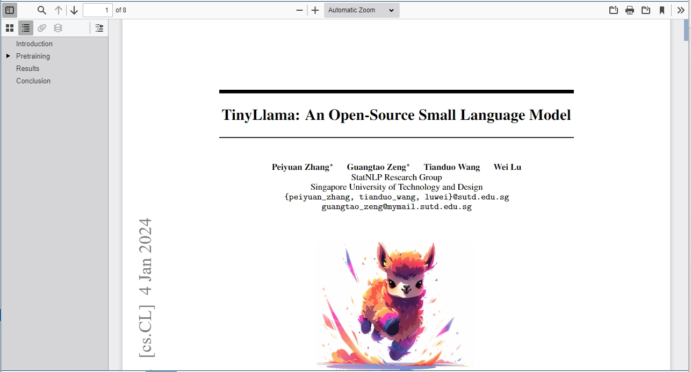
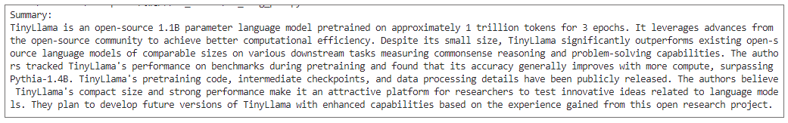
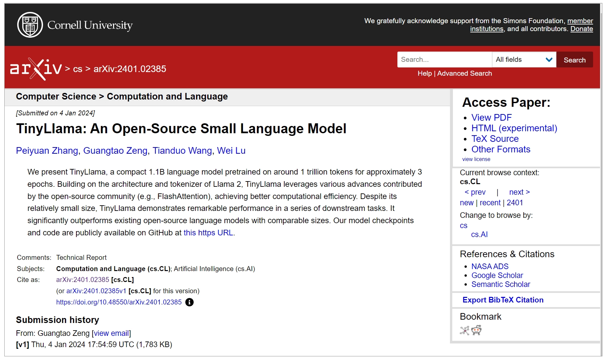
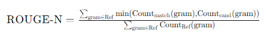
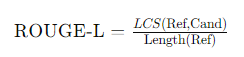
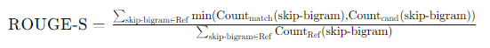
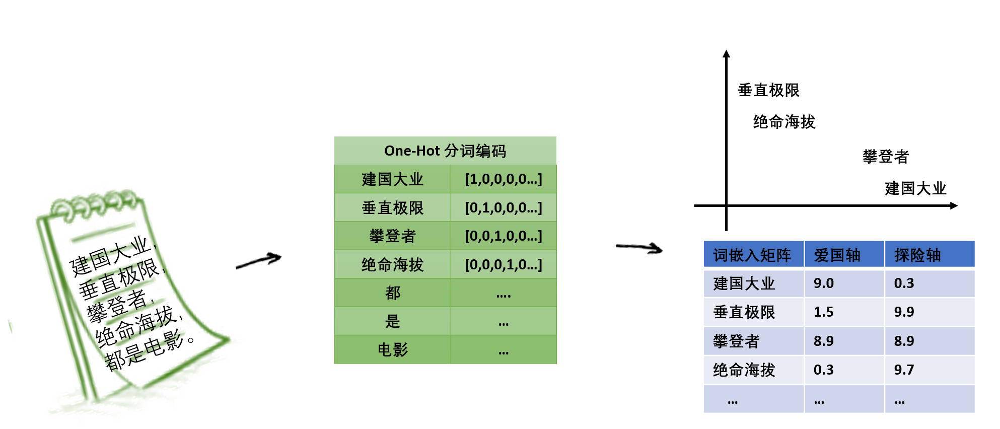

# 11 | 长PDF文档的总结与评估策略

你好，我是黄佳。

今天，我们来探索大语言模型在另一个传统自然语言处理应用场景中的突破，就是长文档的总结和评估，这也是大语言模型的一个重要应用方向。我们将探讨如何利用大语言模型的强大能力，实现高质量的文档总结，并对总结结果进行全面评估。

## 新一代大模型出现之前的文档总结

文档总结是一个经典课题。传统的文档总结方法通常基于统计学和信息检索理论，如提取关键词、句子排序等。这些方法虽然简单高效，但在处理长文档、复杂语义时往往力不从心。

老一代的大模型文档总结通常采用两种范式：文本抽取式（Extractive）和摘要生成式（Abstractive）。

- 抽取式方法是从原文中选取关键句作为摘要。比如基于 BERT 的文档总结就常常使用这个范式。

- 生成式方法则根据对原文的理解，生成新的摘要文本。比如基于初代 GPT、T5、BART 等生成式模型的文档总结就基于这个范式。

下面，让我带着你用一个经典“老”NLP 模型 T5，来做一个论文的摘要总结。论文我们随便选择一个就可以了，这里，我选择的是 Tiny Llama 这篇论文，先看看它主要说了什么。



这篇论文介绍的 TinyLlama 是一个 1.1B 参数的小型语言模型，在约 1 万亿 Token 上预训练了3 个 Epoch。它采用了 Llama 2 的架构和分词器，并利用了开源社区贡献的各种进展（如FlashAttention）以提高计算效率。尽管规模相对较小，但 TinyLlama 在一系列下游任务中表现出色，优于具有相似规模的现有开源语言模型。

首先，导入 PyPDF2 包，打开论文文件，读取 PDF 文件内容。

```python
# 导入PyPDF2包
import PyPDF2
# 读取PDF文件内容
pdf_path = "99_data\\pdf\\2401.02385-TinyLlama.pdf"
def read_pdf(file_path):
   with open(file_path, 'rb') as file:
       reader = PyPDF2.PdfReader(file)
       text = ""
       for page in reader.pages:
           text += page.extract_text()
   return text
```

然后，导入 T5 模型和分词器， 定义函数来加载模型和分词器。

```python
# 导入T5模型和分词器
from transformers import T5Tokenizer, T5ForConditionalGeneration
# 定义函数来加载模型和分词器
def load_model(model_name='t5-small'):
   tokenizer = T5Tokenizer.from_pretrained(model_name)
   model = T5ForConditionalGeneration.from_pretrained(model_name)
   return tokenizer, model
```

最后，就可以通过 T5 模型来做文档总结啦！

```python
# 定义函数进行文本总结
def summarize_text(text, tokenizer, model):
   # 使用T5的前缀来指定任务类型
   text = "summarize: " + text
   # 对文本进行编码
   inputs = tokenizer.encode(text, return_tensors="pt", max_length=512, truncati
   # 使用模型生成总结
   summary_ids = model.generate(inputs, max_length=150, min_length=40, length_pe
   # 解码生成的总结
   summary = tokenizer.decode(summary_ids[0], skip_special_tokens=True)
   return summary
# 加载预训练的T5模型
tokenizer, model = load_model('t5-small')
# 对PDF内容进行总结
pdf_summary = summarize_text(pdf_text, tokenizer, model)
print("Generated Summary:", pdf_summary)
# 保存生成的摘要到文件
with open("t5_summary.txt", "w", encoding="utf-8") as file:
   file.write(t5_summary)
```

程序输出如下：

```
TinyLlama is a compact 1.1B language model pretrained on around 1 trillion tokens
```

结果看起来不错，对吗？其实不然。

首先，T5 的总结结果其实更像是论文开头部分的照搬照抄。另外，你在程序中应该注意到max_length=512 这个参数，其实传统的“大”语言模型，如 BERT、T5，一般情况下，只能够接受 512，最多 1024 个 Token，可不像新一代的模型动不动就可以接受几万、几十万的Token 作为上下文。

因此，我们所看到的 Summary 结果，只不过是对整个论文第一段话的总结。😁

对于老一代模型来说，针对文档总结任务对大模型进行微调（Fine-tune），也可以进一步提升它们的摘要质量。微调使模型更加适应特定领域的文本，学习总结的格式和风格。在一些研究中还提出了复杂的 Prompt 设计，引导模型生成满足特定需求的摘要。

当然，现在有了真正的大模型，这种微调也已经是昨日黄花了。

## 用新一代的大模型做文档总结

ChatGPT 等新一代大语言模型的出现，为文档总结带来了新的突破。这些模型在海量文本数据上进行预训练，学习到了丰富的语言知识和通用表示。它们能够深入理解文本的语义、结构、样式等各个方面，生成连贯、通顺的摘要。

好啦，话不多说，我们现在利用强大的 Claude-3 Opus，来生成真正高效的 PDF 论文总结。

首先，导入 PyPDF2 包，打开论文文件，读取 PDF 文件内容。这个步骤和代码前面已介绍。

然后，导入 anthropic 库，并设置 API 密钥。

```python
from dotenv import load_dotenv
load_dotenv()
import os
import anthropic
os.environ["ANTHROPIC_API_KEY"] = "<your_api_key>"
```

接下来，我们构造一个名为 generate_summary 的函数，用于利用 Claude 模型生成研究论文的摘要。这个函数接受一个参数 text，即要总结的论文全文，然后会返回全文的总结。

```python
def generate_summary(text):
   client = anthropic.Anthropic()
   system_prompt = "你是一个用于总结研究论文的AI助手。"
   messages = [
       {
           "role": "user",
           "content": [
               {
                   "type": "text",
                   "text": f"""
                   请总结以下研究论文,重点关注其关键发现、方法和结论:
                   {text}
                   请用大约150字提供一个简明扼要的英文摘要。
                   """
               }
           ]
       }
   ]
   message = client.messages.create(
       model="claude-3-opus-20240229",
       max_tokens=1000,
       messages=messages,
       system=system_prompt
   )
   return message.content[0].text.strip()
```

我们创建了一个 Anthropic 客户端对象，用于与 Claude 模型进行交互。在系统提示中，我们告诉 Claude 它是一个用于总结研究论文的 AI 助手。

接下来，我们构造了一个消息列表，其中包含一条用户消息，并在消息的内部中通过 {text} 变量嵌入了要总结的论文全文。我们还在消息中提供了一些指示，要求 Claude 关注论文的关键发现、方法和结论，并生成一个大约 150 字的简洁摘要。

client.messages.create 方法会将所构造的消息列表、系统提示以及其他参数传递给 Claude。Claude 会根据这些信息生成论文的摘要，并返回结果。

最后，使用 Claude 生成总结并保存。

```
# 使用Claude生成总结
claude_summary = generate_summary(pdf_text)
print("Summary:", claude_summary)
# 保存生成的摘要到文件
with open("claude_summary.txt", "w", encoding="utf-8") as file:
   file.write(claude_summary)
```

运行程序后，得到的总结文字如下：



```
Summary:
TinyLlama is an open-source 1.1B parameter language model pretrained on approxima
```

翻译成中文：

- TinyLlama 是一个开源的 11 亿参数语言模型，在大约 1 万亿个标记上预训练了 3 个周期。它利用了开源社区的进展来实现更好的计算效率。尽管其规模较小，但 TinyLlama 在衡量常识推理和解决问题能力的各种下游任务上显著优于现有的相似规模的开源语言模型。作者在预训练期间跟踪了 TinyLlama 在基准测试中的表现，发现其准确性通常随着计算量的增加而提高，超过了 Pythia-1.4B。TinyLlama 的预训练代码、中间检查点和数据处理细节已经公开发布。作者认为，TinyLlama 的紧凑尺寸和强大性能使其成为研究人员测试与语言模型相关的创新想法的有吸引力的平台。他们计划根据从这个开放研究项目中获得的经验，开发具有增强功能的 TinyLlama 的未来版本。

这个总结非常非常优秀。它并不是像刚才 T5 模型那样，只是对头几行文字的简单 copy，而是详实地介绍出了 TinyLlama 这篇论文的主要工作、意义和创新点，以及作者的评述及未来计划。

## 评估文档总结的优劣

不过，口说无凭，我们需要想一些办法来量化这个总结的优质程度。这不仅可以帮助我们了解总结的效果，还可以为进一步优化模型提供依据。

所以，下面我们的目标就是通过不同的方法来量化文档总结的优质程度。

### 基于真值的评估

在文档总结领域，基于真值的评估是常见的方法。文档总结的真值并不是那么容易获得的，好在对于论文来说，我们可以使用论文摘要作为真值，然后通过计算生成的总结与真值之间的相似度来评估质量。



- arxiv 网站中的每一篇论文都有作者对论文的总结

有了真值之后，常用的经典评估指标包括 ROUGE 和 BERTScore。

### ROUGE 评估

ROUGE（Recall-Oriented Understudy for Gisting Evaluation）是一组用于自动化评估机器翻译和自动摘要系统性能的指标，要衡量生成摘要与参考摘要之间的重叠情况，特别关注回忆率（Recall）。

ROUGE 主要有三种变体：ROUGE-N、ROUGE-L 和 ROUGE-S，从不同的角度评估摘要的质量。

### 1. ROUGE-N

ROUGE-N 是基于 N-gram 的匹配来评估生成摘要与参考摘要之间的相似度。N-gram 可以是单个词（unigram）、双词（bigram）、三词（trigram）等。常见的 ROUGE-N 指标包括ROUGE-1 和 ROUGE-2，分别表示基于 unigram 和 bigram 的匹配情况。

- ROUGE-1：计算生成摘要和参考摘要之间的 unigram 匹配。

- ROUGE-2：计算生成摘要和参考摘要之间的 bigram 匹配。

ROUGE-N 的计算公式如下：



其中，Countmatch(gram) 表示生成摘要中 N-gram 的匹配次数，CountRef(gram) 则表示参考摘要中 N-gram 的总次数。

### 2. ROUGE-L

ROUGE-L 基于最长公共子序列（Longest Common Subsequence, LCS）来评估生成摘要和参考摘要之间的相似度。通过计算生成摘要和参考摘要之间的最长公共子序列匹配情况，LCS能够捕捉到全局序列信息，而不仅仅是局部的 N-gram 匹配。

ROUGE-L 的计算公式如下：



​其中，LCS(Ref,Cand) 表示生成摘要和参考摘要之间的最长公共子序列的长度，Length(Ref)表示参考摘要的长度。

### 3. ROUGE-S

ROUGE-S（Skip-Bigram）基于跳跃双词（skip-bigram）来评估生成摘要和参考摘要之间的相似度。通过计算生成摘要和参考摘要之间的跳跃双词匹配情况，跳跃双词允许在不改变词序的情况下跳过一些词，这样可以更灵活地捕捉摘要中的词对关系。



因此，ROUGE 评估指标能够从不同的角度评估生成摘要和参考摘要之间的相似度，涵盖了局部 N-gram 匹配（ROUGE-N）、全局序列信息（ROUGE-L）和灵活词对关系（ROUGE-S）。结合这些指标，我们就可以全面衡量生成摘要的质量。

下面是使用 ROUGE 评估生成摘要的示例代码。

```python
# 读取摘要文件
def read_summary(file_path):
   with open(file_path, 'r', encoding='utf-8') as file:
       return file.read()
t5_summary = read_summary("t5_summary.txt")
claude_summary = read_summary("claude_summary.txt")
ref_summary = read_summary("ref_summary.txt")
from rouge import Rouge
# Rouge评估函数
def get_rouge_scores(text1, text2):
   rouge = Rouge()
   return rouge.get_scores(text1, text2)
# 示例生成摘要和参考摘要
eval_summary = "..." # 把总结结果放进来
ref_summary = "..." 把论文的原始总结放进来
# 计算ROUGE分数
rouge_scores = get_rouge_scores(eval_summary, ref_summary)
# 提取并显示关键的ROUGE指标
for metric, scores in rouge_scores[0].items():
   print(f"{metric} - Precision: {scores['p']}, Recall: {scores['r']}, F1-Score:
```

输出如下：

```
ROUGE Scores:
            T5 Summary  Claude Summary
Metric
rouge-1 (f)    0.568421        0.421875
rouge-1 (p)    0.843750        0.415385
rouge-1 (r)    0.428571        0.428571
rouge-2 (f)    0.466019        0.178082
rouge-2 (p)    0.727273        0.171053
rouge-2 (r)    0.342857        0.185714
rouge-l (f)    0.568421        0.406250
rouge-l (p)    0.843750        0.400000
rouge-l (r)    0.428571        0.412698
```

这样，就可以计算生成摘要和参考摘要的 ROUGE 分数，并从精确率（Precision）、召回率（Recall）和 F1 分数（F1-Score）三个方面进行分析。如果仅从 ROUGE 指标看，T5 竟然比 Claude 这种大模型总结得还要好？真的如此吗？我们继续看其他指标。

### BERTScore 评估

BERTScore 则是另一种评估方法，它通过计算生成的摘要和参考摘要的 BERT 嵌入表示之间的相似度来评估摘要的质量。



- 词向量示意

相比于 ROUGE，BERTScore 利用了词向量的思想，因此就能够更好地捕捉语义上的相似度。

```python
from bert_score import BERTScorer
# BERTScore评估
scorer = BERTScorer(lang="en")
P1, R1, F1_1 = scorer.score([eval_summary_1], [ref_summary])
print(f"\nSummary 1 BERTScore F1: {F1_1.tolist()[0]}")
print(f"Summary 2 BERTScore F1: {F2_2.tolist()[0]}")
```

输出如下：

```
T5 Summary BERTScore F1: 0.9143788814544678
Claude Summary BERTScore F1: 0.9115773439407349
```

我们得到生成摘要和参考摘要的 BERTScore 分数，以此来衡量它们的语义相似度。从这个指标来看，T5 和大模型总结得分很相似。

### 使用 Claude 进行评估

除了使用传统的评估指标，我们还可以利用 Claude/GPT-4 这样的新一代大模型来进行更全面的评估。大模型不仅能够生成高质量的文档总结，还能够根据你自己定制的评估标准对总结进行评分。

我们可以定义几个关键的评估标准，包括相关性、准确性、简洁性、连贯性、一致性、流畅性等。

每个标准都会有它具体的评分规则，我们这里选择几个。

- 相关性：评估摘要是否涵盖了原文中最重要和核心的信息。

- 准确性：评估摘要中的信息是否准确反映了原文的内容，是否存在误导或错误信息。

- 简洁性：评估摘要是否在简明扼要的基础上传达了主要信息，而不是冗长或重复。

以下是使用 Claude（你可以选择 GPT 或者其他国内大模型，对 Claude 的总结进行交叉评估）进行评估的示例代码。

```python
# Claude评估函数
import anthropic
import re
def get_claude_score(criteria, document, summary, metric_name):
   prompt = f"""
   你将会被提供一段文章和一段摘要。你的任务是根据以下标准对摘要进行评分（1到5分）：
   评价标准：
   {criteria}
   示例：
   原文：
   {document}
   摘要：
   {summary}
   请给出{metric_name}的评分（1到5分）："""
   client = anthropic.Anthropic(api_key=os.getenv("ANTHROPIC_API_KEY"))
   response = client.completions.create(
       prompt=prompt,
       stop=["\n"],
       model="claude-v1",
       max_tokens=1000
   )
   result = response["choices"][0]["text"]
   score = int(re.findall(r'\d+', result)[0])
   return score
evaluation_metrics = {
   "相关性": "相关性(1-5) - 摘要是否涵盖了原文中最重要和核心的信息。",
   "准确性": "准确性(1-5) - 摘要中的信息是否准确反映了原文的内容，是否存在误导或错误信息。",
   "简洁性": "简洁性(1-5) - 摘要是否在简明扼要的基础上传达了主要信息，而不是冗长或重复。",
}
summaries = {"T5 Summary": t5_summary, "Claude Summary": claude_summary}
claude_scores = {"Metric": [], "T5 Summary": [], "Claude Summary": []}
for metric, criteria in evaluation_metrics.items():
   claude_scores["Metric"].append(metric)
   for summ_id, summ in summaries.items():
       score = get_claude_score(criteria, ref_summary, summ, metric)
       claude_scores[summ_id].append(score)
import pandas as pd
claude_df = pd.DataFrame(claude_scores).set_index("Metric")
print("\nClaude Evaluation Scores:")
print(claude_df)
```

Claude 基于对原文和摘要的深度理解，从多个角度对摘要质量做出了判断。

```
Claude Evaluation Scores:
       T5 Summary  Claude Summary
Metric
相关性              3               5
准确性              5               4
简洁性              4               4
```

此时，终于，Claude 这种新一代大模型的总结能力，在评估指标上超越了 T5。可见，这种全方位的评估更接近于我们人类的评估水准，这就有助于我们优化摘要模型，生成更高质量的摘要。

以上，就是几种常用的文档总结评估方式。这些评估方法，对其他 NLP 任务，比如机器翻译、句子配对等等，亦有启发。综合利用这些评估方法，我们可以更好地了解文档总结的效果，并进一步优化我们的模型。

## 总结时刻

今天，我们探讨了如何利用大语言模型实现智能化的文档总结与评估。我介绍了大模型文档总结的理论基础，展示了使用 Claude 生成和评估摘要的实战示例，如果你没有 Claude API，你当然也可以用其他大模型来尝试做相同的工作。可以看到，无论是生成摘要，还是评估摘要，Prompt 设计在引导模型完成特定任务中至关重要。

得益于大模型强大的语言理解和生成能力，我们可以实现高质量的摘要生成，并对摘要进行全面、客观的评估。传统的基于真值的评估方法（如 ROUGE 和 BERTScore）可以提供一定的量化指标，而新一代的大模型（如 Claude）则可以提供更丰富和深入的评估信息。

未来，随着大语言模型的进一步发展，其在文档总结领域的应用将更加广泛和深入。结合知识图谱、多模态等技术，能实现更加智能、个性化的摘要服务。同时，对话式摘要、增量式摘要等新型交互和优化范式值得关注和探索。

## 思考题

1. 新一代大模型的总结比旧的语言模型总结能力强，这是毫无疑问的，那么为什么在我们的评估结果中，似乎是 T5 总结得更好? 从 ROUGE 上看，尤其如此。这其实是有原因的，你能找出关键原因么？

2. 如何拓展大语言模型摘要评估的维度? 比如，你可以结合专家知识，设计出更加全面、更细粒度的评估指标和评估提示词。

3. 除了学术论文，大语言模型 Claude 当然还可以应用于多种文档总结任务，如新闻、财报、医疗病历，请你基于手头的业务数据尝试一下！尤其是思考真值如何获取。

期待你的分享，欢迎与我交流。如果今天的内容让你有所收获，也欢迎你把这节课转发给有需要的朋友！我们下节课再见！
