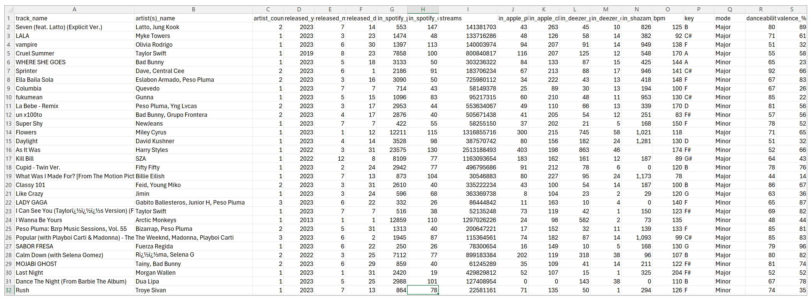
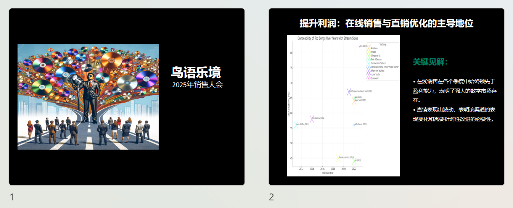
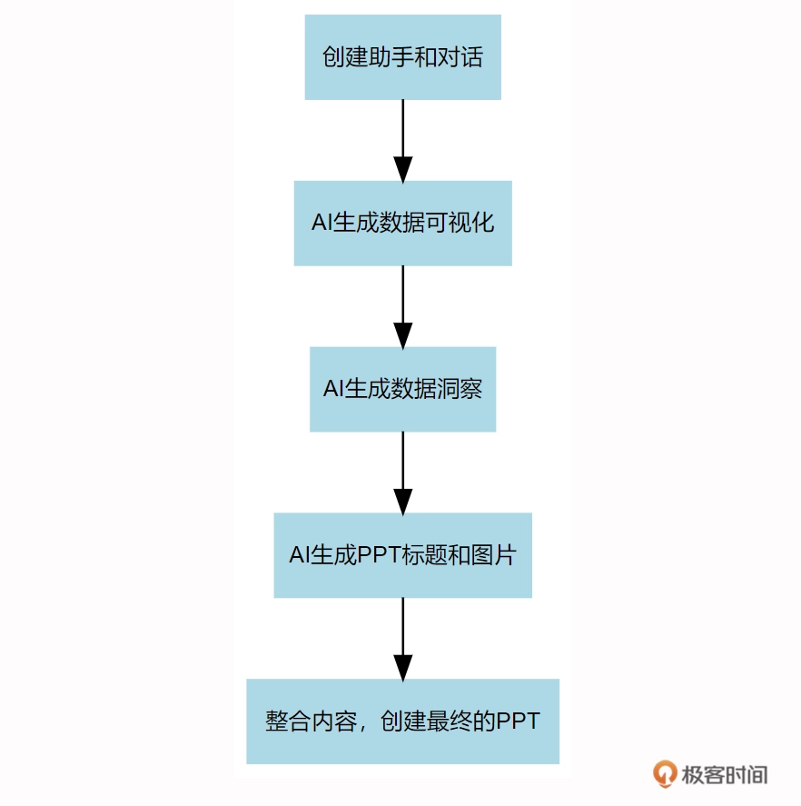
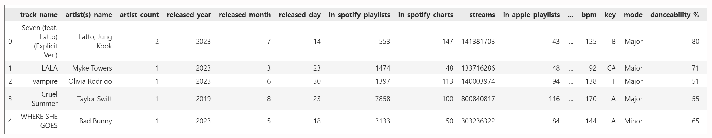
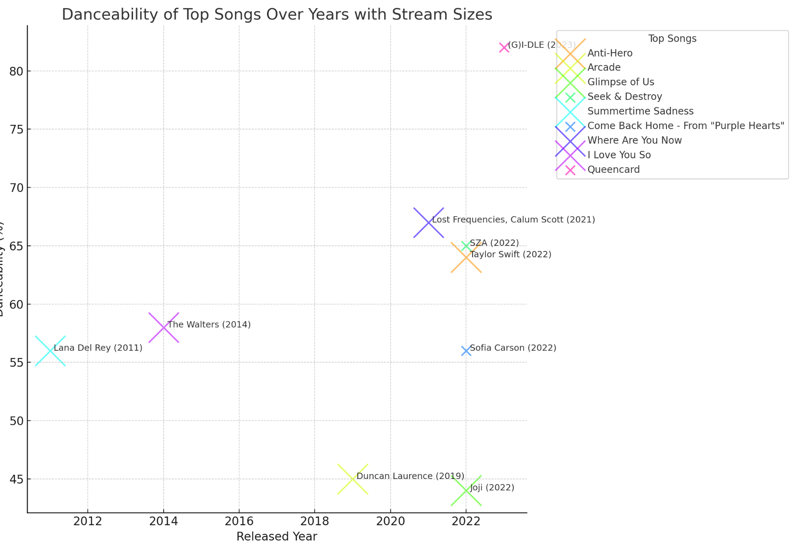
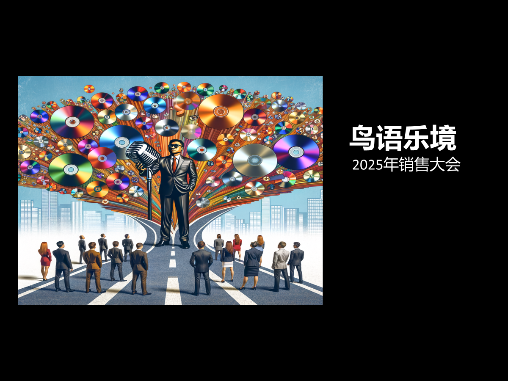
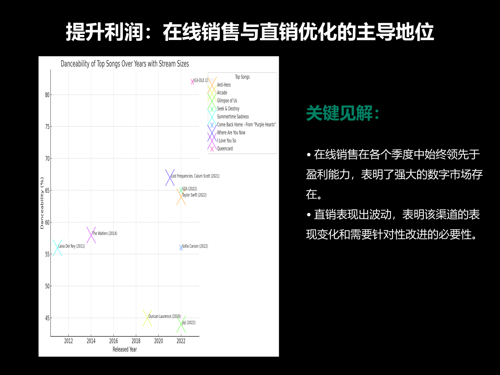

# 12 | 用Assistants自主思考生成商业报告PPT

你好，我是黄佳。

大语言模型不仅可以生成文本摘要，还可以读取数据、做出直观的可视化，并生成有意义的见解。这种见解，是任何传统计算机程序所无法给出的，在大语言模型出现之前，也只有人类能够做出。

今天，我们要探索如何利用 OpenAI 的大语言模型完成一个有趣的商业案例：分析畅销歌曲数据，生成行业报告并创建 PPT。我们将经历从原始数据到精美 PPT 的全过程，体验大语言模型的强大能力。

## 项目目标：流行音乐趋势分析

先来看看这份从 Spotify App 中搜集来的，播放量最多的流行音乐数据表。



这些属性从多个角度刻画了流行音乐的特点，包括其发行时间、在各大平台的表现、音乐特性等。

假设我们是一家名为“鸟语乐境”的流行音乐分享平台，我们需要通过分析这些数据来洞察当下流行音乐的趋势，了解大众的音乐品味。同时，这些信息对于音乐制作人、歌手和音乐平台也有重要的参考价值，有助于他们创作和推荐符合市场需求的音乐作品。

我们将让 AI 来帮我们梳理数据，生成图片，以及基于数据生成观点和简介，最后自动创建生成较为靠谱的 PPT。



## 项目整体流程

这个数据分享项目的整体流程如下图所示，在这个过程中，最主要的环节，都将由 AI 完成。



这个项目的核心环节是 OpenAI 的 Assistant 替我们生成数据可视化，以及在数据中寻找和挖掘趋势和洞见。整个过程，我们只需要通过提示词来对 Assistant 进行一些小小的引导和启发即可。

接下来，让我们期待一下，Assistant 是如何对这些数据进行更深入的探索！

### 步骤 1：创建助手和对话

首先，还是导入必要的库并创建 OpenAI 客户端。

```python
# 导入OpenAI库，并创建OpenAI客户端
from dotenv import load_dotenv
load_dotenv()
from openai import OpenAI
client = OpenAI()
```

然后，导入这个包含 2023 年 Spotify 最畅销歌曲数据的 CSV 文件。

```python
# 导入数据文件
import pandas as pd
file_path = 'Spotify_Songs.csv'
sales_data = pd.read_csv(file_path, nrows=20)
sales_data.head()
```

数据集包含了曲目名称、艺术家、发布年份、流媒体播放量等有价值的信息。



为了让 OpenAI 的大语言模型能够分析这些数据，我们需要将 CSV 文件上传到 OpenAI，并创建一个数据科学助手。这个助手将负责编写代码、创建可视化并提取洞见。

```
# 创建文件
file = client.files.create(
 file=open(file_path, "rb"),
 purpose='assistants',
)
# 创建一个包含这个文件的助手
assistant = client.beta.assistants.create(
 instructions="作为一名数据科学助理，当给定数据和一个查询时，你能编写适当的代码并创建适当的可
 model="gpt-4-0125-preview",
 tools=[
   {"type": "code_interpreter"}
 ],
 tool_resources={
   "code_interpreter": {
     "file_ids": [file.id]  # Here we add the file id
   }
 }
)
print(assistant)
```

输出如下：

```
Assistant(id='asst_frwRB2Ugjj2XVUGnRy5f3no7', created_at=1717210909, description=
```

### 步骤 2：AI 生成数据可视化

助手创建完成后，就可以与它进行对话了。我们将创建对话线程，同时在对话线程中添加要求Assistant 进行数据分析的消息，并运行线程。

先创建对话线程。这里要请求助手，根据数据创建一个能展示畅销音乐特点和趋势的可视化图表。

```
# 创建对话线程
thread = client.beta.threads.create(
 messages=[
   {
     "role": "user",
     "content": "根据数据集的内容，选择最有代表性的字段，根据畅销音乐的特点和趋势做一张可视化
     "attachments": [
       {
         "file_id": file.id,
         "tools": [
           { "type": "code_interpreter" }
         ]
       }
     ]
   }
 ]
)
print(thread)
```

输出如下：

```
Thread(id='thread_iIvaQeLDBTSUa6Zacil8KQ80', created_at=1717223262, metadata={},
```

下面创建 Run。

```
# 创建Run来运行和助手的对话
run = client.beta.threads.runs.create(
   thread_id=thread.id,
   assistant_id=assistant.id,
)
print(run)
```

输出如下：

```
Run(id='run_EDjLmAUQ6PHRxgKHCUNkBk1h', assistant_id='asst_frwRB2Ugjj2XVUGnRy5f3no
```

下面，运行对话，等待 Assistant 根据数据集内容来创建图表。

```python
# 检查并等待可视化完成
import time
while True:
   messages = client.beta.threads.messages.list(thread_id=thread.id)
   try:
       # 检查是否创建了图像
       messages.data[0].content[0].image_file
       # 等待运行完成
       time.sleep(5)
       print('图表已创建！')
       if messages.data and messages.data[0].content:
           print('当前Message:', messages.data[0].content[0])
       break
   except:
       time.sleep(10)
       print('您的Assistant正在努力做图表呢...')
       if messages.data and messages.data[0].content:
           print('当前Message:', messages.data[0].content[0])
```

输出如下：

```
您的Assistant正在努力做图表呢...
您的Assistant正在努力做图表呢...
您的Assistant正在努力做图表呢...
当前Message: TextContentBlock(text=Text(annotations=[], value='根据数据集的内容，我们有
您的Assistant正在努力做图表呢...
当前Message: TextContentBlock(text=Text(annotations=[], value='数据集包含645位不同的艺
您的Assistant正在努力做图表呢...
您的Assistant正在努力做图表呢...
您的Assistant正在努力做图表呢...
当前Message: TextContentBlock(text=Text(annotations=[], value='选择了流量最高的10首歌
您的Assistant正在努力做图表呢...
当前Message: TextContentBlock(text=Text(annotations=[], value='似乎在尝试清理数据和准备
您的Assistant正在努力做图表呢...
您的Assistant正在努力做图表呢...
当前Message: TextContentBlock(text=Text(annotations=[], value='我在尝试运行可视化代码
您的Assistant正在努力做图表呢...
当前Message: TextContentBlock(text=Text(annotations=[], value='我在尝试运行可视化代码
```

- 图表已创建！

```
当前Message: ImageFileContentBlock(image_file=ImageFile(file_id='file-03gX6k5Htwwl
```

上面的输出内容非常值得细品。

可以看出，Assistant 会自己发现错误，进行一系列的尝试，纠正问题所在，然后再不断地尝试，包括分析数据、选择合适的艺术家、清理数据等。它逐步深入地进行分析和思考，最终，它创建了一张展示了几首最畅销歌曲随时间变化的可跳舞性和能量的趋势图！

我们下载这张图片并进行展示。

```python
# 转换输出文件为PNG格式
def convert_file_to_png(file_id, write_path):
   data = client.files.content(file_id)
   data_bytes = data.read()
   with open(write_path, "wb") as file:
       file.write(data_bytes)
plot_file_id = messages.data[0].content[0].image_file.file_id
image_path = "音乐趋势图.png"
convert_file_to_png(plot_file_id,image_path)
# 上传图表
plot_file = client.files.create(
 file=open(image_path, "rb"),
 purpose='assistants'
)
```



这张图展示了不同年份的热门歌曲的可跳舞性与流媒体播放量的关系。

- 横轴（X 轴）：表示歌曲的发行年份，从 2012 年到 2023 年。

- 纵轴（Y 轴）：表示歌曲的可跳舞性百分比（Danceability%），范围从 45% 到 85%。

- 标记大小：表示歌曲在流媒体平台上的播放量（Stream Sizes）。标记越大，表示该歌曲的播放量越大。

- 标记颜色和形状：不同颜色和形状表示不同的歌曲，每首歌都有唯一的标记。

图中主要观察点如下：

- 高可跳舞性歌曲：如图中右上角的 (G)I-DLE 的歌曲，显示了较高的可跳舞性（接近80%）。

- 热门年份：2022 年和 2023 年发布了多首高可跳舞性且播放量高的歌曲，如 Taylor Swift 和SZA 的歌曲。

- 长期趋势：图中可以看到从 2012 年到 2023 年，热门歌曲的可跳舞性总体上有上升的趋势，表明近年来流行音乐的风格越来越适合跳舞。

- 显著标记：一些标记特别大，代表这些歌曲在流媒体平台上有非常高的播放量，如 TaylorSwift 和 Duncan Laurence 的歌曲。

总结来看，这张图是展示了热门歌曲的可跳舞性随时间的变化，以及这些歌曲在流媒体平台上的受欢迎程度。

下面，看看助手整个的思维和行动过程。

```
# 看看助手整个的思维和行动过程
messages = client.beta.threads.messages.list(thread_id=thread.id)
[message.content[0] for message in messages.data]
```

输出如下：

```
[ImageFileContentBlock(image_file=ImageFile(file_id='file-03gX6k5HtwwlBQg6M75cRLe
TextContentBlock(text=Text(annotations=[], value='我在尝试运行可视化代码时未能成功导入
TextContentBlock(text=Text(annotations=[], value='似乎在尝试清理数据和准备可视化时出现
TextContentBlock(text=Text(annotations=[], value='选择了流量最高的10首歌曲进行分析和可
TextContentBlock(text=Text(annotations=[], value='在选择前10位流量最高的艺术家时，出现
TextContentBlock(text=Text(annotations=[], value='数据集包含645位不同的艺术家，这意呩着
TextContentBlock(text=Text(annotations=[], value='根据数据集的内容，我们有以下字段可以
TextContentBlock(text=Text(annotations=[], value='首先，我将打开和检查上传的文件，以了
TextContentBlock(text=Text(annotations=[], value='根据数据集的内容，选择最有代表性的字
```

其实，AI 的思考过程更值得我们玩味，假设你把这份工作交给一个刚毕业的新手数据分析师，他其实并不一定能把自己的思考链条说得像 AI 这么清楚。

### 步骤 3：AI 生成数据洞察

下面，我们先定义一个提交用户的消息的函数。然后，使用 submit_message 函数，来发送请求，让助手生成数据洞察。

```python
# 定义提交用户的消息的函数
def submit_message_wait_completion(assistant_id, thread, user_message, file_ids=N
   # 检查并等待活跃的Run完成
   for run in client.beta.threads.runs.list(thread_id=thread.id).data:
       if run.status == 'in_progress':
           print(f"等待Run {run.id} 完成...")
           while True:
               run_status = client.beta.threads.runs.retrieve(thread_id=thread.i
               if run_status in ['succeeded', 'failed']:
                   break
               time.sleep(5)  # 等待5秒后再次检查状态
   # 提交消息
   params = {
       'thread_id': thread.id,
       'role': 'user',
       'content': user_message,
   }
   # 设置attachments
   if file_ids:
       attachments = [{"file_id": file_id, "tools": [ {"type": "code_interpreter
       params['attachments'] = attachments
   client.beta.threads.messages.create(**params)
   # 创建Run
   run = client.beta.threads.runs.create(thread_id=thread.id, assistant_id=assis
   return run
# 使用submit_message函数, 来发送请求，让助手生成洞察
submit_message_wait_completion(assistant.id, thread, "请根据你刚才创建的图表，给我两个约
```

输出如下：

```
Run(id='run_WdgdIFOyQXTM9ATigdrKgham', assistant_id='asst_frwRB2Ugjj2XVUGnRy5f3no
```

下面，读取 AI 生成的数据洞察。

```python
# 获取对话线程的响应
def get_response(thread):
   return client.beta.threads.messages.list(thread_id=thread.id)
# 等待响应并打印洞察
time.sleep(10) # 假设助理需要一些时间来生成洞察
response = get_response(thread)
bullet_points = response.data[0].content[0].text.value
print(bullet_points)
```

输出的数据洞察如下：

```
1. "2019至2023年间，畅销歌曲的跳舞性明显上升，展现了流行音乐向更加活跃风格的转变。"
2. "Taylor Swift和Duncan Laurence的歌曲以超高流量领跑，彰显了其在全球音乐市场的巨大影响力。
```

这是非常漂亮的、有理有据的观察，也是商业分析的初步结果。其实我们可以顺着这个思路进一步让 AI 进行更深层的思考。当然，我们这个展示性质的 Demo 就到此为止，下面我们要根据这个洞察继续创建 PPT 了。

### 步骤 4：AI 生成 PPT 标题和图片

下面，我们根据上面的见解，也就是基于对数据的洞察，让 AI 顺着思考，为 PPT 生成一个标题。

```
# 根据见解生成标题
submit_message_wait_completion(assistant.id, thread, "根据你创建的情节和要
点，为幻灯片想一个非常简短的标题。它应该只反映你得出的主要见解。")
```

Assistant 马上给出一个非常棒的标题，“流行音乐趋势：活跃风格与巨星影响力”。

下面，我们让 AI 为这个 PPT 标题配图。

我们使用 DALL-E 的 API 来生成图片。这里提供公司简介作为提示，并指定生成高清大图。

```python
# 提供我们公司的说明
company_summary = "我们是CD批发商，但是我们董事长也是个流行歌手！"
# 使用DALL-E 3生成图片
response = client.images.generate(
 model='dall-e-3',
 prompt=f"根据这个公司概述 {company_summary}, \
          创建一张展示成长和前进道路的启发性照片。这将用于季度销售规划会议",
      size="1024x1024",
      quality="hd",
      n=1
)
image_url = response.data[0].url
# 获取DALL-E 3生成的图片
import requests
dalle_img_path = '音乐趋势图.png'
img = requests.get(image_url)
# 将图片保存到本地
with open(dalle_img_path,'wb') as file:
 file.write(img.content)
# 上传图片提供给助手做为PPT素材
dalle_file = client.files.create(
 file=open(dalle_img_path, "rb"),
 purpose='assistants'
)
```

程序成功执行，并且创建了一张合适的 PPT 标题配图。DALL-E 会返回生成图片的 URL，可以下载这张图片并上传给之前创建的助手，作为之后生成 PPT 的素材。

### 步骤 5：创建最终的 PPT

终于到了生成 PPT 的最后阶段！我们已经准备好了所有素材：数据图表、洞察要点和创意图片。现在，我们使用预先定义的 PPT 模板（这个模板的设置参考自 OpenAI 的示例，你也可以自行调整格式），将这些内容填充进去。

```python
title_template = """
from pptx import Presentation
from pptx.util import Inches, Pt
from pptx.enum.text import PP_PARAGRAPH_ALIGNMENT
from pptx.dml.color import RGBColor
# 创建新的演示文稿对象
prs = Presentation()
# 添加一个空白的幻灯片布局
blank_slide_layout = prs.slide_layouts[6]
slide = prs.slides.add_slide(blank_slide_layout)
# 将幻灯片的背景颜色设置为黑色
background = slide.background
fill = background.fill
fill.solid()
fill.fore_color.rgb = RGBColor(0, 0, 0)
# 在幻灯片左侧添加图片，上下留有边距
left = Inches(0)
top = Inches(0)
height = prs.slide_height
width = prs.slide_width * 3/5
pic = slide.shapes.add_picture(image_path, left, top, width=width, height=height)
# 在较高位置添加标题文本框
left = prs.slide_width * 3/5
top = Inches(2)
width = prs.slide_width * 2/5
height = Inches(1)
title_box = slide.shapes.add_textbox(left, top, width, height)
title_frame = title_box.text_frame
title_p = title_frame.add_paragraph()
title_p.text = title_text
title_p.font.bold = True
title_p.font.size = Pt(38)
title_p.font.color.rgb = RGBColor(255, 255, 255)
title_p.alignment = PP_PARAGRAPH_ALIGNMENT.CENTER
# 添加副标题文本框
left = prs.slide_width * 3/5
top = Inches(3)
width = prs.slide_width * 2/5
height = Inches(1)
subtitle_box = slide.shapes.add_textbox(left, top, width, height)
subtitle_frame = subtitle_box.text_frame
subtitle_p = subtitle_frame.add_paragraph()
subtitle_p.text = subtitle_text
subtitle_p.font.size = Pt(22)
subtitle_p.font.color.rgb = RGBColor(255, 255, 255)
subtitle_p.alignment = PP_PARAGRAPH_ALIGNMENT.CENTER
"""
data_vis_template = """
from pptx import Presentation
from pptx.util import Inches, Pt
from pptx.enum.text import PP_PARAGRAPH_ALIGNMENT
from pptx.dml.color import RGBColor
# 创建新的演示文稿对象
prs = Presentation()
# 添加一个空白的幻灯片布局
blank_slide_layout = prs.slide_layouts[6]
slide = prs.slides.add_slide(blank_slide_layout)
# 将幻灯片的背景颜色设置为黑色
background = slide.background
fill = background.fill
fill.solid()
fill.fore_color.rgb = RGBColor(0, 0, 0)
# 定义占位符
image_path = data_vis_img
title_text = "提升利润：在线销售与直销优化的主导地位"
bullet_points = "• 在线销售在各个季度中始终领先于盈利能力，表明了强大的数字市场存在。\n• 直销
# 在幻灯片左侧添加图片占位符
left = Inches(0.2)
top = Inches(1.8)
height = prs.slide_height - Inches(3)
width = prs.slide_width * 3/5
pic = slide.shapes.add_picture(image_path, left, top, width=width, height=height)
# 添加覆盖整个宽度的标题文本
left = Inches(0)
top = Inches(0)
width = prs.slide_width
height = Inches(1)
title_box = slide.shapes.add_textbox(left, top, width, height)
title_frame = title_box.text_frame
title_frame.margin_top = Inches(0.1)
title_p = title_frame.add_paragraph()
title_p.text = title_text
title_p.font.bold = True
title_p.font.size = Pt(28)
title_p.font.color.rgb = RGBColor(255, 255, 255)
title_p.alignment = PP_PARAGRAPH_ALIGNMENT.CENTER
# 添加硬编码的“关键见解”文本和项目符号列表
left = prs.slide_width * 2/3
top = Inches(1.5)
width = prs.slide_width * 1/3
height = Inches(4.5)
insights_box = slide.shapes.add_textbox(left, top, width, height)
insights_frame = insights_box.text_frame
insights_p = insights_frame.add_paragraph()
insights_p.text = "关键见解："
insights_p.font.bold = True
insights_p.font.size = Pt(24)
insights_p.font.color.rgb = RGBColor(0, 128, 100)
insights_p.alignment = PP_PARAGRAPH_ALIGNMENT.LEFT
insights_frame.add_paragraph()
bullet_p = insights_frame.add_paragraph()
bullet_p.text = bullet_points
bullet_p.font.size = Pt(12)
bullet_p.font.color.rgb = RGBColor(255, 255, 255)
bullet_p.line_spacing = 1.5
"""
title_text = "鸟语乐境"
subtitle_text = "2025年销售大会"
submit_message_wait_completion(assistant.id,thread,f"使用包含的代码模板创建符合模板格式
{title_template}。重要提示：在此第一张幻灯片中使用本消息中包含的图片文件作为image_path图像，
 使用副标题文本 {subtitle_text} 作为subtitle_text变量。\
   接着，使用以下代码模板创建第二张幻灯片：{data_vis_template}，创建符合模板格式的PPTX幻灯片
{data_vis_template}。重要提示：使用您之前在本线程中创建的第二个附图（折线图）作为data_vis_im
 使用您之前创建的见解项目符号列表作为bullet_points变量。将这两张幻灯片输出为.pptx文件。确保输
             file_ids=[dalle_file.id, plot_file.id]
)
# 等待助手完成PPT创建任务
while True:
   try:
       response = get_response(thread)
       pptx_id = response.data[0].content[0].text.annotations[0].file_path.file_
       print("成功检索到 pptx_id:", pptx_id)
       break
   except Exception as e:
       print("您的Assistant正在努力制作幻灯片...")
       time.sleep(10)
import io
pptx_id = response.data[0].content[0].text.annotations[0].file_path.file_id
ppt_file= client.files.content(pptx_id)
file_obj = io.BytesIO(ppt_file.read())
with open("宣传大会.pptx", "wb") as f:
   f.write(file_obj.getbuffer())
```

输出如下：

```
您的Assistant正在努力制作幻灯片...
您的Assistant正在努力制作幻灯片...
您的Assistant正在努力制作幻灯片...
您的Assistant正在努力制作幻灯片...
您的Assistant正在努力制作幻灯片...
成功检索到 pptx_id: file-c39pmCGSIhl2llr1835lTMgP
```

助手会按照我们的要求，生成一个两页的 PPT。第一页使用了 DALL-E 生成的创意图片，第二页则是数据图表和洞察要点。最后，我们可以将生成的 PPTX 文件下载到本地。

下面，就是展示时刻！当当当当，两张漂亮的 PPT 映入眼帘。





AI，你真棒！

## 总结时刻

在今天的实操中，我们体验了如何利用 OpenAI 的大语言模型完成从数据分析到 PPT 生成的全流程。在这个过程中，大语言模型不仅展示了其在文本生成和语言理解上的卓越能力，还展现了其在数据分析和商业智能领域的巨大潜力。通过本次探索，我们深入体验了大语言模型在处理数据、生成可视化、提供有意义见解，以及为文字配图等方面的强大功能。

过程中有几个环节令我印象深刻，一是在数据可视化环节，AI 通过不断尝试和纠错，最终呈现出一张直观的可视化图表。此外，AI 不仅仅停留在数据展示层面，更能够深入挖掘数据背后的洞察。例如，通过分析图表，AI 生成了关于流行音乐趋势的两个重要见解。

可以看到，借助大语言模型强大的数据分析、自然语言理解和多模态生成能力，我们可以大大简化和自动化商业报告的生成过程。想象一下，如果你的公司定期有类似的数据分析和报告任务，使用这套流程可以节省多少时间和人力！

在真实的商业场景中，数据可能更加复杂，分析的角度也更加多元。幸运的是，大语言模型的能力还远不止于此。你的场景越复杂，在你精心设计的 Prompts 和模板的引导下，AI 能够发挥的威力可能也就越大。我们有理由相信，高级数据分析师和商业分析人员可以引导 AI 生成更加深入、专业、符合业务需求的分析报告，而大语言模型也必将在商业智能领域发挥出越来越重要的作用。

## 思考题

1. 其实，畅销歌曲只是一个示例数据集，这节课所介绍的流程的价值在于，它可以切换到任意领域，任何行业的数据集（在我的新书《动手做 AI Agent》，我就用同样的流程完成了一个咖哥图书销量的数据分析），你能想到还有哪些数据适合用类似的方法来分析和生成报告吗？

2. 在课程的案例中，我们使用了一些预定义的 PPT 模板，你认为是否可以让 AI 自己生成各种风格的 PPT 模板呢？

3. 如果要将课程案例扩展成一个自动化的商业分析报告生成平台，你认为还需要哪些额外的功能？

欢迎你也尝试一下！我相信通过大语言模型所带来的智能化浪潮，我们每个人都有机会成为更加高效和有创意的商业数据分析专家。
