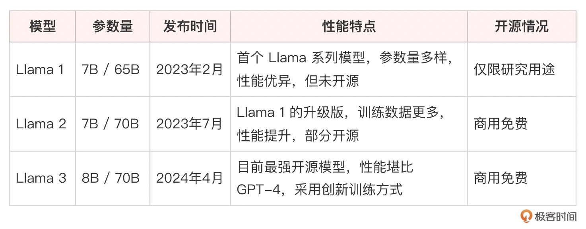
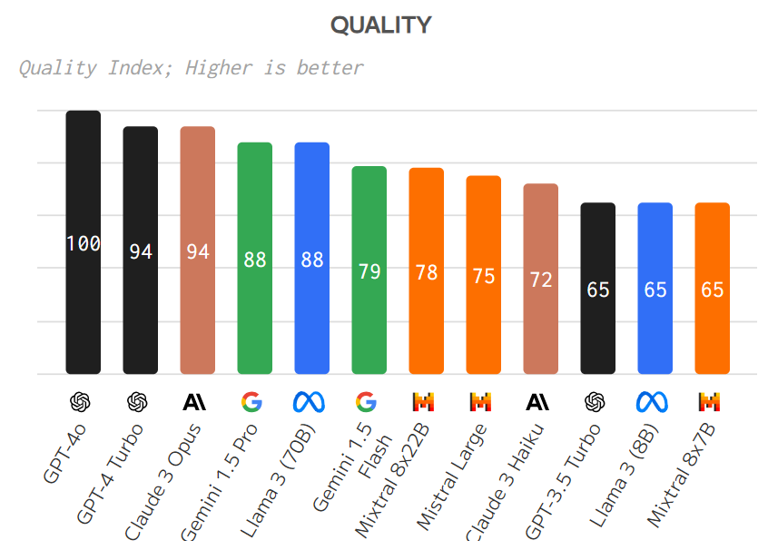
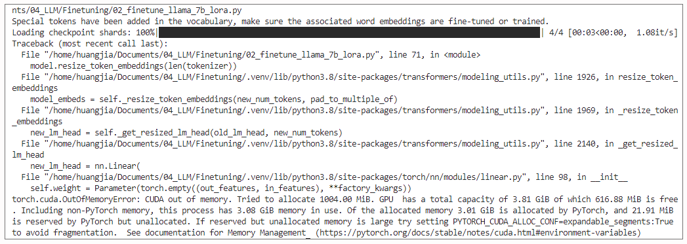
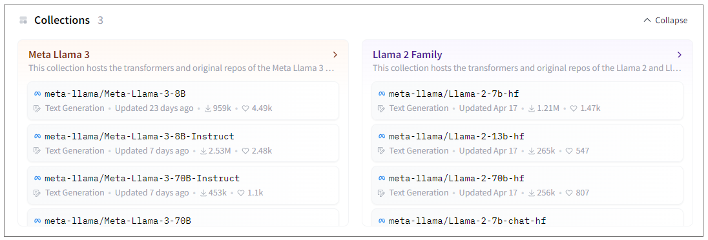
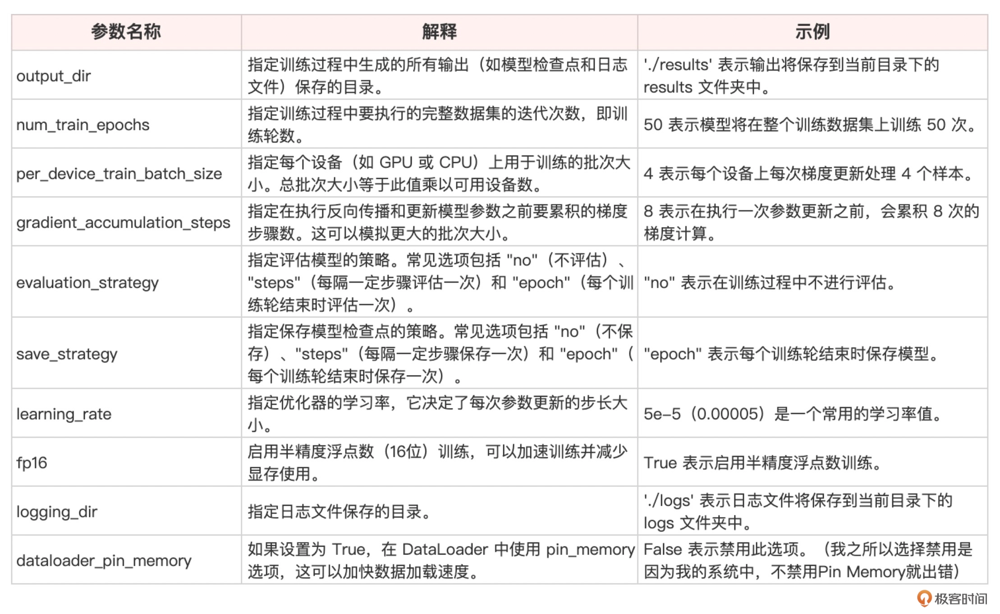
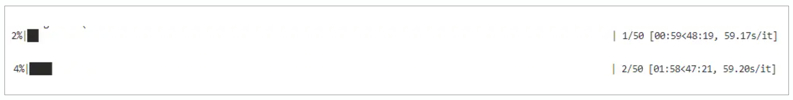
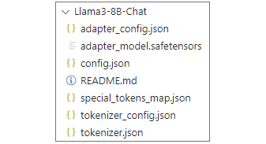
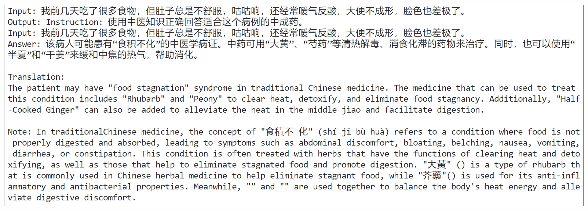

# 14 | 以Llama3为例讲透QLoRA量化+微调

你好，我是黄佳。

在上节课中，我们以 Qwen 模型为例，探讨了一下大语言模型参数高效微调的基本方法，重点介绍了当下最热门的 LoRA 技术，并通过 PEFT 框架实际操作了一把用 Alpaca 风格的中文数据微调 Qwen 模型。

不过上节课还有些地方没有讲透彻，比如 LoRA 的数学原理究竟是什么？在微调的同时，还有哪些压缩大模型的技巧？这一次，我们就换一个模型——LLM 开源之王 Llama 3，来继续讨论一下微调和量化的话题。

## Llama 3 模型介绍

Llama 是由 Meta AI 最新发布的一个大语言模型家族，其中 Llama 3 是截至目前（2024 年 7月）的最强开源模型。

Llama 系列模型开启了大语言模型（真正能用的、具有商用价值这个级别的）开源的先河，它的发展历程简单总结如下：



表中已经开源的模型，均可以在 Meta 官网或者 Hugging Face 模型库中下载（需要先申请下载权限）。

Llama 3 拥有两个版本，一个是 8B（80 亿）参数模型，另一个是 70B（700 亿）参数模型。这两个版本都相较于之前的迭代有了显著的性能提升，在多项基准测试中表现出色，与 GPT-4和 Claude 等领先模型相比同样具有竞争力。

- Llama 3-8B：具有非常好的性价比，性能在同级别的模型中很突出。测试显示它在问答、摘要和指令执行等任务中表现良好。

- Llama 3-70B：70B 模型在更复杂的任务中表现卓越。在 MMLU（一般知识）和HumanEval（编码）等基准测试中表现优异​。这个模型特别擅长理解和生成细致入微的回应，在某些任务中可以与 GPT-4 等更大模型竞争。



- Llama 3 是目前最强开源模型，性能堪比 GPT-4

Meta 在训练 Llama 时采用了一种创新的方式来收集和筛选训练数据。与常见的从网络上爬取文本的做法不同，Llama 的训练数据主要来自于与人类助手的对话互动。这些数据被称为“自我指导”数据，因为它们是通过提示大语言模型自己生成指令并完成任务而得到的。这种数据不仅更贴近实际应用场景，而且还有助于减少有害内容的出现。

上一课中说了，在开源 Llama 的同时，Meta 也提供了一个指令微调的数据集，叫做 Alpaca。这个数据集包含 52K 个由 Llama 自己生成的指令 - 输出对，涵盖了问答、总结、创意写作等多种任务类型。Alpaca 很快引起了开发者社区的广泛兴趣，催生出 Stanford Alpaca、Vicuna、Alpaca-LoRA 等一系列基于 Llama 的微调项目。上节课我们已经看到的中医数据集，正是 Alpaca 的数据格式，因此我们的微调项目也可以称作 Alpaca - 中医项目。

虽然 Llama 3 的体积巨大，要在完整模型上进行微调非常困难。但借助 LoRA 技术，我们仍然可以用比较实惠的算力来适配 Llama。接下来，我们就来仔细看看 LoRA 是如何工作的。

## LoRA 原理解析

LoRA 是 Low-Rank Adaptation 的缩写，顾名思义，它利用了低秩分解的数学技巧来近似大模型中的权重矩阵。

对于 Transformer 类的语言模型来说，绝大部分的参数都集中在自注意力模块和前馈网络中。而 LoRA 的核心思想，就是用两个低秩矩阵（秩 r 远小于原矩阵的维度）的乘积，去近似原本的权重矩阵 A。

- ′

## A =

## A + B ∗C

这里：

```
原始矩阵 A 是一个 d x d 的大矩阵。
矩阵 B 是一个 d x r 的小矩阵。
矩阵 C 是一个 r x d 的小矩阵，其中 r 远小于 d。
```

也就是说，B 和 C 是两个可学习的低秩矩阵（形状分别为 (d, r) 和 (r, d)），d 是原矩阵 A 的维度，r 是我们设定的秩（通常取 8、16、32 等较小的值）。

在训练阶段，我们冻结原模型的权重 A，只更新 LoRA 引入的 B、C 矩阵。因为 B、C 的参数量很小（只有原矩阵的一小部分），所以训练开销大大降低。在推理阶段，我们可以把 A’ 还原成一个完整矩阵，或者保留 A、B、C 的低秩形式，以节省内存。

通过这样一个很简单的矩阵分解，我们实现了用极小的参数开销去适配一个超大模型。LoRA巧妙地保留了预训练权重中蕴含的通用语言知识，同时引入了专门用于特定任务的增量。

## 从 LoRA 到 QLoRA

LoRA 主要解决了参数效率问题，而没有考虑到模型的大小以及推理阶段的速度和显存占用。然而现代的大模型体积过于庞大，就拿我现在用的 Nvidia A100 DGX 服务器、24G 内存显卡来说，如果使用 LoRA 进行微调 Llama3-8B 模型，肯定仍然会出现内存溢出问题。



- A100 GPU 服务器直接 LoRA 微调 Llama3-8B 模型，内存溢出

为了进一步压缩和加速微调后的 LoRA 模型，我们可以在此基础上应用量化（Quantization）技术。

那么，什么是量化？其实很简单，量化是用较低的数值精度（如 int8、int4）去表示原本的浮点数（float32），从而减小模型体积。量化可以在模型训练完成后进行（Post-trainingQuantization，PTQ），也可以在训练过程中同步进行（Quantization-aware training，QAT）。

如何做到的？

原始模型中的权重通常以 float32 格式存储，每个权重需要 32 位来表示。在量化过程中，这些浮点数被转换成整数，且使用的位数更少。例如：

- int8 量化：每个权重用 8 位整数表示。这意味着每个权重的取值范围限制在 -128 到 127 之间（对于有符号整数）。

- int4 量化：每个权重用 4 位整数表示，取值范围是 -8 到 7 之间（对于有符号整数）。

这种转换通常涉及到缩放和偏移操作，以保持量化前后的值尽可能接近。例如，浮点数乘以一个缩放因子（scale factor）后四舍五入到最近的整数，然后可能还需要加上一个偏移量（zeropoint）以匹配整数表示的范围。

通过使用更少的位来表示每个权重，量化可以显著减少模型的存储需求。以一个简单的例子说明。

- 假设一个模型有 1 百万个权重（当然真实的大模型的参数数量远远超过 1 百万）。

- 在 float32 格式中，这些权重总共需要 32 位 x 1,000,000 = 32,000,000 位，即 4MB 的存储空间。

- 如果使用 int8 量化，相同的权重只需要 8 位 x 1,000,000 = 8,000,000 位，即 1MB 的存储空间。

- 如果进一步使用 int4 量化，存储需求降至 4 位 x 1,000,000 = 4,000,000 位，即 0.5MB。

目前，最为流行的量化技术就是 LoRA 和量化相结合的变体，叫做 QLoRA。顾名思义，QLoRA 就是用 int4 或者 int8 级别的低精度去表示 LoRA 中引入的增量矩阵。这种方法大幅降低了 LoRA 的存储和带宽需求，使其更容易在资源受限的环境中部署。

在微调阶段，QLoRA 采用了跟 LoRA 类似的思路。原模型权重依然保持不变，QLoRA 引入两个增量矩阵（对应 LoRA 的 B 和 C）。增量矩阵初始化为全零，在训练过程中逐步学习到用于适配目标任务的低秩增量。每一步更新完增量矩阵后，QLoRA 就对其进行动态量化（Dynamic Quantization），将其转换为 int4。

在推理阶段，我们可以选择只保存量化后的增量矩阵，把原模型的编码和增量的编码分开。这样不仅减小了微调模型的体积，也避免了重复存储原模型的精度浪费问题。

通过 QLoRA，我们在模型性能几乎无损的情况下，可以把 LoRA 增量矩阵的体积压缩到原来的 1/8（从 float32 到 int4），模型完成了瘦身（注意，这个瘦身只是针对于 LoRA 增量矩阵而言，模型原始权重矩阵 A 精度不变），推理速度也因此提升。当然，这是以损失一部分精度为代价的。

## 用 PEFT 做 QLoRA 微调

之前我们提到过，Hugging Face 的 PEFT 是一个非常强大的参数高效微调框架，它集成了各种微调技术，包括 Adapter、Prefix Tuning、P-Tuning、LoRA、QLoRA 等。我们在上一讲中已经实现了通过 LoRA 对 Qwen 中文大模型进行微调。

下面，我们继续保持程序的结构不变，只是在其中加入量化的部分。要在 PEFT 框架的基础上进一步进行模型量化，我们必须安装 bitsandbytes 包。

```
pip install bitsandbytes
```

bitsandbytes 是一个优化库，主要用于加速和优化大规模机器学习模型的训练和推理，在资源受限的环境下进行深度学习任务。 bitsandbytes 支持多种低精度格式（如 int8、int4），以显著减少模型的内存占用和计算需求。

具体来说，bitsandbytes 库通过以下方式实现 4 位（或 8 位）量化。

1. 权重量化：将模型的权重（通常是 32 位浮点数）转换为 4 位（或 8 位）整数表示。

2. 反量化：在进行计算时，将 4 位（或 8 位）整数权重转换回浮点数。

3. 优化计算：bitsandbytes 库针对低精度计算进行了优化，以提高计算效率。

接下来导入所需要的库，尤其是 bitsandbytes。

```python
import json
import torch
from torch.utils.data import Dataset
from transformers import AutoTokenizer, AutoModelForCausalLM, TrainingArguments,
from peft import get_peft_model, LoraConfig, TaskType
from transformers import BitsAndBytesConfig
```

之后，我们指定模型、设备，并加载分词器。



Hugging Face 上面有两个 8B 版本的模型供选择。其中，后缀为 Instruct 的是 Llama 3 指令微调模型，也就是针对对话用例进行了优化，在常见的行业基准上优于许多可用的开源聊天模型。我们可以选择这个模型。

```
# 指定模型
MODEL = 'meta-llama/Meta-Llama-3-8B'
# 确定设备
device = torch.device("cuda" if torch.cuda.is_available() else "cpu")
# 加载分词器和模型
tokenizer = AutoTokenizer.from_pretrained(MODEL, trust_remote_code=True)
tokenizer.pad_token = tokenizer.eos_token
# 使用 BitsAndBytesConfig 进行量化配置
quantization_config = BitsAndBytesConfig(load_in_4bit=True,
                                        llm_int4_threshold=200.0)
model = AutoModelForCausalLM.from_pretrained(MODEL,
                                            trust_remote_code=True,
                                            device_map="auto",
                                            torch_dtype=torch.float16，
                                            quantization_config=quantization_con
model.is_parallelizable = True
model.model_parallel = True
model.supports_gradient_checkpointing = True
model.gradient_checkpointing_enable()
model.enable_input_require_grads()
```

```
代码中的 tokenizer.pad_token = tokenizer.eos_token 非常重要，因为如果不做
```

这个步骤，我的 Llama 3 微调过程就会出错。这是因为 Llama 3 模型的 tokenizer 默认没有填

```
充符（pad token），而 Trainer 在处理批次数据时需要使用填充符将不同长度的序列填充到
```

相同的长度。

在这里，量化是在加载模型时通过 BitsAndBytesConfig 实现的。作用是使用 bitsandbytes库将模型的权重加载为 4 位精度（int4）的格式。4 位量化可以显著减少模型的内存占用，同

```
时在一定程度上保持模型的性能。bitsandbytes 库还支持 8 位量化（load_in_8bit=True）
```

选项。

其中，参数 llm_int4_threshold 的作用是设置一个阈值，用于确定哪些权重应该被量化为 4位。这个阈值的目的是保留重要的高精度权重，同时量化那些对模型性能影响较小的权重。这个参数一般是一个比较大的整数，比如 200，也就是值高出 200 的参数被视为重要权重，就不量化了。

下面，继续数据集的定义部分，代码保持不变。

```bash
# 自定义数据集类
class CustomDataset(Dataset):
   def __init__(self, data_path, tokenizer, device):
       self.data = json.load(open(data_path))
       self.tokenizer = tokenizer
       self.device = device
   def __len__(self):
       return len(self.data)
   def __getitem__(self, idx):
       example = self.data[idx]
       formatted_example = self.format_example(example)
       inputs = self.tokenizer(
           formatted_example["context"],
           max_length=512,
           truncation=True,
           padding='max_length',
           return_tensors="pt"
       )
       labels = self.tokenizer(
           formatted_example["target"],
           max_length=512,
           truncation=True,
           padding='max_length',
           return_tensors="pt"
       )
       inputs['labels'] = labels['input_ids']
       result = {key: val.squeeze().to(self.device) for key, val in inputs.items
       # 打印输入数据和形状
       print(f"Sample {idx}:")
       print(f"Context: {formatted_example['context']}")
       print(f"Target: {formatted_example['target']}")
       print({key: val.shape for key, val in result.items()})
       return result
   def format_example(self, example: dict) -> dict:
       context = f"Instruction: {example['instruction']}\n"
       if example.get("input"):
           context += f"Input: {example['input']}\n"
       context += "Answer: "
       target = example["output"]
return {"context": context, "target": target}
```

定义训练参数。

```
# 定义训练参数
training_args = TrainingArguments(
   output_dir='./results',
   num_train_epochs=5,
   per_device_train_batch_size=4,
   gradient_accumulation_steps=8,
   evaluation_strategy="no",
   save_strategy="epoch",
   learning_rate=5e-5,
   fp16=True,
   logging_dir='./logs',
   dataloader_pin_memory=False,
)
```

TrainingArguments 中的各个参数列表解释如下：



然后就是自定义 Trainer，并开始训练。

```python
# 自定义 Trainer
class CustomTrainer(Trainer):
   def compute_loss(self, model, inputs, return_outputs=False):
       labels = inputs.pop("labels")
       print({key: val.shape for key, val in inputs.items()})  # 打印输入形状
       outputs = model(**inputs)
       logits = outputs.logits
       shift_logits = logits[..., :-1, :].contiguous()
       shift_labels = labels[..., 1:].contiguous()
       loss_fct = torch.nn.CrossEntropyLoss()
       loss = loss_fct(shift_logits.view(-1, shift_logits.size(-1)), shift_label
       return (loss, outputs) if return_outputs else loss
# 定义 Trainer
trainer = CustomTrainer(
   model=model,
   args=training_args,
   train_dataset=train_dataset,
)
# 开始训练
trainer.train()
```

50 轮的训练开始。



训练 50 轮结束后，可以保存模型。

```python
# 创建保存模型的目录
import os
save_directory = 'Llama3-8B-Chat'
os.makedirs(save_directory, exist_ok=True)
# 保存训练后的模型和配置文件
model.save_pretrained(save_directory)
tokenizer.save_pretrained(save_directory)
# 将配置文件下载到模型目录中
config = model.config.to_dict()
config_path = os.path.join(save_directory, 'config.json')
with open(config_path, 'w') as f:
   json.dump(config, f, ensure_ascii=False, indent=4)
print(f"Model and configuration saved to {save_directory}")
```

微调后的模型保存好之后，可以通过下面的代码来进行 Inference，测试一下微调后的效果。



```python
# 导入所需的库
from transformers import AutoModelForCausalLM, AutoTokenizer
import torch
# 定义模型ID，这里使用我们微调过的Llama3-8B-Chat模型
model_id = "./Llama3-8B-Chat"
# 确保模型在单个设备上加载（如果有GPU，则使用GPU）
device = torch.device("cuda" if torch.cuda.is_available() else "cpu")
# 加载分词器和模型
tokenizer = AutoTokenizer.from_pretrained(model_id, trust_remote_code=True)
model = AutoModelForCausalLM.from_pretrained(
   model_id,
   device_map=None,  # 不使用自动设备映射
   trust_remote_code=True  # 允许加载远程代码
)
# 将模型设置为评估模式
model.eval()
# 定义测试样本
test_examples = [
   {
       "instruction": "使用中医知识正确回答适合这个病例的中成药。",
       "input": "我前几天吃了很多食物，但肚子总是不舒服，咕咕响，还经常嗳气反酸，大便不成形，
   },
   {
       "instruction": "使用中医知识正确回答适合这个病例的中成药。",
       "input": "肛门疼痛，痔疮，肛裂。"
   },
   {
       "instruction": "使用中医知识正确回答适合这个病例的中成药。",
       "input": "有没有能够滋养肝肾、清热明目的中药。"
   }
]
# 对每个测试样本生成回答
for example in test_examples:
   # 构建输入文本，包括指令和输入内容
   context = f"Instruction: {example['instruction']}\nInput: {example['input']}\
   # 对输入文本进行分词
   inputs = tokenizer(context, return_tensors="pt")
   # 将输入数据移动到模型所在的设备上
   inputs = {key: value.to(model.device) for key, value in inputs.items()}
   # 禁用FlashAttention以确保生成过程正常
   with torch.no_grad():  # 不计算梯度，节省内存
       outputs = model.generate(
           inputs['input_ids'],  # 输入的token ID
           max_length=512,  # 最大生成长度
           num_return_sequences=1,  # 只生成一个回答
           no_repeat_ngram_size=2,  # 避免重复生成n-gram
           use_cache=False  # 不使用缓存加速生成
       )
   # 解码生成的token ID，得到回答文本
   answer = tokenizer.decode(outputs[0], skip_special_tokens=True)
   print(f"Input: {example['input']}")
   print(f"Output: {answer}\n")
```

输出示例如下：

- Input: 我前几天吃了很多食物，但肚子总是不舒服，咕咕响，还经常嗳气反酸，大便不成形，脸色也差极了。Output: Instruction: 使用中医知识正确回答适合这个病例的中成药。Input: 我前几天吃了很多食物，但肚子总是不舒服，咕咕响，还经常嗳气反酸，大便不成形，脸色也差极了。Answer: 该病人可能患有“食积不化”的中医学病症。中药可用“大黄”、“芍药”等清热解毒、消食化滞的药物来治疗。同时，也可以使用“半夏”和“干姜”来缓和中焦的热气，帮助消化。

- Translation:The patient may have “food stagnation” syndrome in traditional Chinese medicine. Themedicine that can be used to treat this condition includes “Rhubarb” and “Peony” to clearheat, detoxify, and eliminate food stagnancy. Additionally, “Half-Cooked Ginger” can alsobe added to alleviate the heat in the middle jiao and facilitate digestion.

- Note: In traditionalChinese medicine, the concept of “食積不 化” (shí jī bù huà) refers to acondition where food is not properly digested and absorbed, leading to symptoms such asabdominal discomfort, bloating, belching, nausea, vomiting, diarrhea, or constipation. Thiscondition is often treated with herbs that have the functions of clearing heat anddetoxifying, as well as those that help to eliminate stagnated food and promote digestion.“大黃” () is a type of rhubarb that is commonly used in Chinese herbal medicine to helpeliminate stagnant food, while “芥藥”() is used for its anti-inflammatory and antibacterialproperties. Meanwhile, “” and “” are used together to balance the body’s heat energy andalleviate digestive discomfort.



从输出看，Meta-Llama-3-8B-Instruct 这个模型比较贴心，不仅给出了中文指南，还特意翻译成了英文版。这体现出它作为一个中英文多语大模型的特色。虽然没有完全按照数据集的资料来回答，但是这是我微调的轮次少的原因，而且，答案中也体现出了“大黄”和“半夏”等数据集中指示的内容，说明微调对模型的知识产生了影响。

## 总结时刻

这节课我们以 Llama 3 模型为例，深入剖析了 LoRA 和 QLoRA 的工作原理，并通过 PEFT 和bitsandbytes 进行了微调和量化。

量化是一种常见的大模型压缩技术，特别是在部署到资源受限的设备上时，如手机或嵌入式系统。通过将模型中的数据类型从高精度（如 32 位浮点数，即 float32）转换为低精度（如 8 位或 4 位整数，即 int8 或 int4），可以显著降低模型的存储需求和计算复杂性。

我们看到，LoRA 利用低秩分解来近似适配增量，大大降低了微调开销，而我们通过 QLoRA在此基础上应用动态量化，进一步为微调过程瘦身。

不过，这里我需要说明一下，在这个示例中我们所做的 QLoRA 量化，仅仅是针对于 LoRA 增量矩阵而进行的，我们其实并没有改变模型原始权重矩阵的参数精度。如果你希望压缩整个模型，那么你需要使用 PyTorch 的 quantize_dynamic 包对模型做整体的量化。

```
from torch.quantization import quantize_dynamic
# 假设 model 是微调后的模型
quantized_model = quantize_dynamic(
   model, {torch.nn.Linear}, dtype=torch.qint8
)
```

除了 PEFT 和 bitsandbytes 工具之外，目前所流行的大模型微调和量化框架还包括微软推出的 DeepSpeed、北航推出的 Llama-Factory 等，这些框架整合了各种开源的微调技术，能够一站式实现大语言模型参数高效微调和量化的全流程。这些框架的具体使用方式，你可以去它们的 GitHub 主页上学习和探索。

此外，如何评估微调和量化后的模型效果，也是一个大课题。不同的任务，有不同的评估方法。对于较常见的问答式任务，具体的评估指标可以包括困惑度（Perplexity）、BLEU 分数、ROUGE 分数等。此外，人工评估也是必不可少的，可以邀请领域专家对模型生成的文本进行质量评估。

微调和量化是大语言模型产业化落地的关键一环。随着开源模型逐渐强大，以及微调技术的发展，大型语言模型的边际成本正变得越来越低。这意味着构建一个高质量的定制化对话系统，已经不再是科技巨头和顶尖实验室的特权，每个有编程基础的开发者都可以参与其中，用丰富的开源资源打造专属于自己的 AI 助手。目前，开源社区正在加速大语言模型的民主化进程，让我们携手创造一个智能共生的未来！

## 思考题

1. 请你用本课介绍的微调和量化流程，来微调你自己的数据集（可以在网上搜索并下载，比如目前流行的中文大模型微调数据集“弱智吧”）和其它开源模型（比如 ChatGLM3）。

2. 微调和量化是两个相当大的课题，我们这里只是走了一个完整流程，效果并不一定多好，你可否继续调整各种参数（比如轮次、精度），以提升微调效果，如果某些参数对微调效果产生了显著的影响，欢迎你进行分享。

3. 请你使用 Llama-Factory、Deep-Speed 等微调框架，来微调 Llama 3 模型，并分享你的经验。

期待你的分享，欢迎与我交流。如果今天的内容让你有所收获，也欢迎你把这节课转发给有需要的朋友！我们下节课再见！
