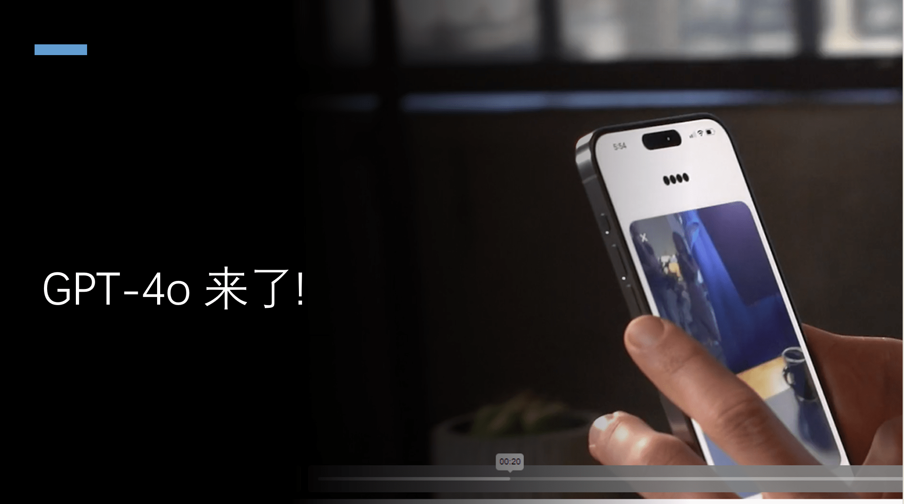
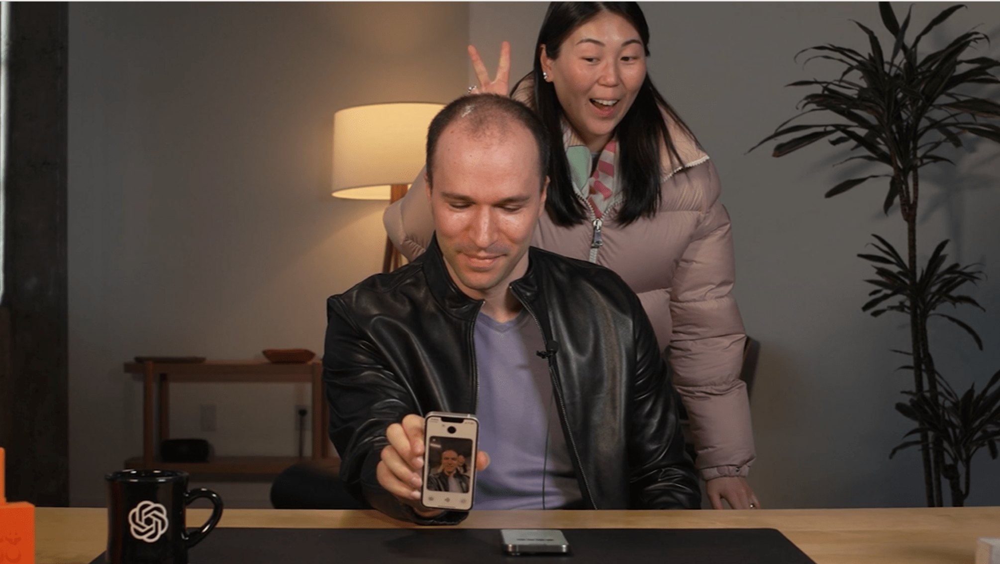
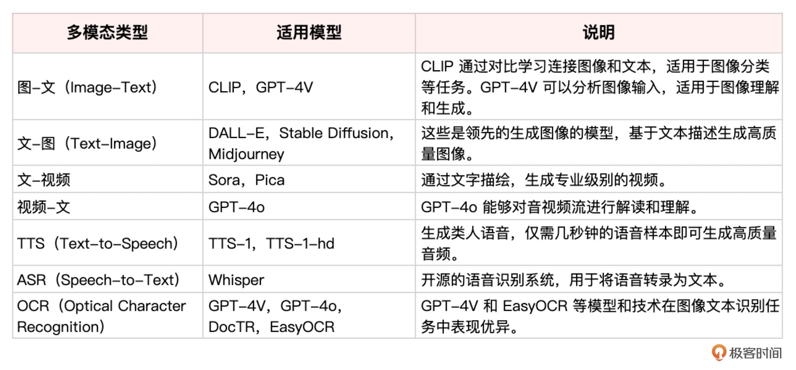
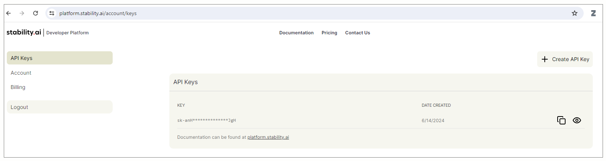
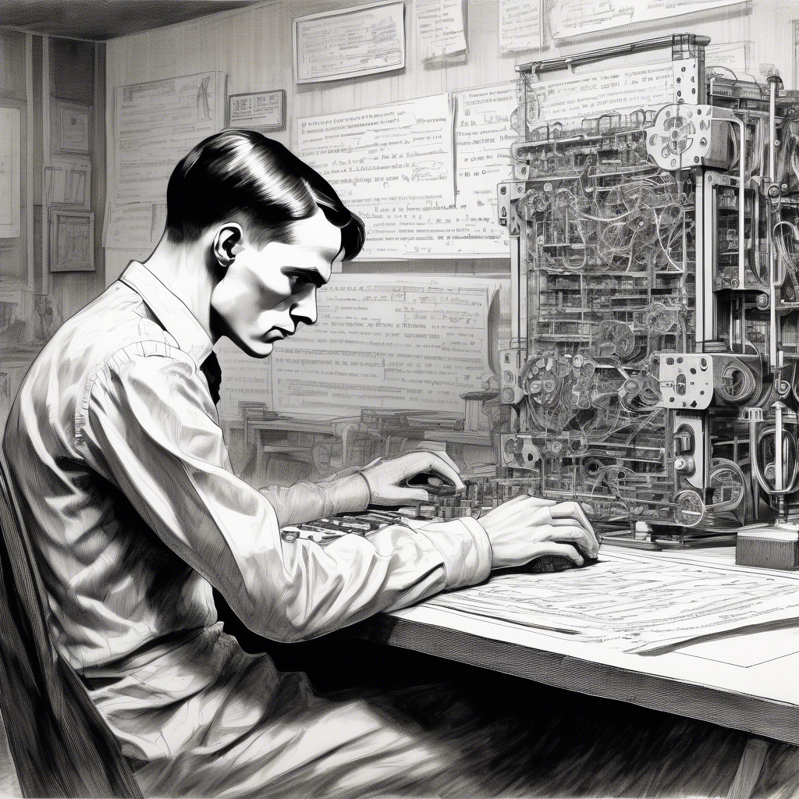

# 16 | 多模态：整合大语言模型与Dall-E-StableDiffusionAPI

你好，我是黄佳。从今天开始，我们进入一个新的应用开发领域——多模态开发实战。

AI 时代基本天天有惊喜，通常是小惊喜，偶尔有大惊喜。2024 年 5 月，OpenAI 的又一款语言模型让人眼前一亮，连连惊叹，这就是 GPT-4o。



## GPT-4o 和多模态

OpenAI 官宣：GPT-4o（“o”代表“o​mni”）是朝着更自然的人机交互迈出的一步——它接受文本、音频、图像和视频的任意组合作为输入，并生成文本、音频和图像的任意组合输出。它可以在最短 232 毫秒内响应音频输入，平均为 320 毫秒，这与人类在对话中的反应时间相似。它在英语和代码文本上的表现与 GPT-4 Turbo 相当，在非英语语言文本上的表现有显著改善，同时也更快。与现有模型相比，GPT-4o 在视觉和音频理解方面尤其出色，价格却便宜50%。

而且，GPT-4o 并不仅仅是语言模型技术上的新突破，它也是一款非常出彩的 AI 产品，是产品设计和用户体验方面的王者。

只要你打开麦克风和摄像头，你的 AI 就真的拥有了耳朵、嘴和眼睛，能够接收实时信息，无缝地和你（甚至是和另一个 AI）互动。你和它聊天，就像和另外一个人聊天一样，它能够观察到你的语气、表情、外部环境的样子和你当前的个人状态。它可以为你辅导数学，给你做旅游向导，帮助你准备面试，甚至是两个或者多个 AI 还可以相互对话、沟通。



- 一个能观察环境的 GPT（Camera 打开）正在告诉另一个 GPT（Camera 未打开）它看到了什么

因此，面对变化如此之快的 AI 世界，仅仅用文本形式进行大模型应用开发已经是不够的了。我们要全面地去了解如何利用 OpenAI（以及其他公司如 Antropic）给出的多模态 API 来完成多模态交互任务。

我这里把多模态交互任务全部列表如下。



列表中的第一项，用大模型来解析图片内容，这个我们在之前的“能读图的 PDF RAG”系统中已经见过了，GPT-4o 当然也有这个能力。那么，GPT4-Turbo 实际上是整合了 GPT-4 和GPT-4v 这两个模型；而 GPT-4o 则更厉害，是图、文、音频一起训练出来的。

后面的几节课程中，我们就一个个地看看后面的各个多模态功能，目前的大模型把这些任务做到了一个什么程度，以及我们应该如何去使用它们。

好，下面就开始第一个实战。让大语言模型与强大的图像生成工具无缝整合（DALL-E、Stable Diffusion、Midjourney 等等），创造出更生动、更吸引人的交互体验。

一图胜千言，有时候文字展示信息的效果真的不像图片那么快、那么全面、那么有冲击力，但是问题是我们人类画师画一张图需要很久很久。想象一下，当你与 AI 助手聊天时，它不仅能提供详尽的文字说明，还能即时生成与话题相关的精美图像，这将使整个对话过程变得更加身临其境。

## 文生图项目实战

下面就开始从文本生成图像的实战。

我们的目标，是利用多模态模型生图，但是，作为创造力不是很丰富的普通人，我们也不大清楚怎么和 Dall-E、Stable Diffusion 来交互，创作出更具表现力的图片。这时候，你可以选择先通过提示工程，让大语言模型先创作出来更好的图片提示词，再把图片提示词传递给多模态（文生图）大模型，最后生成图片，并进行展示。

### 步骤 1：设计提示词

第一个步骤，我们需要给 Claude 一个明确的指示，告诉它在何时以及如何调用图像生成函数。

在这段提示词中，我们把用户的简单指令转换为了具有更多细节的、易于被 Dall-E 和 StableDiffusion 等文生图模型所能够接受的指示，并且通过具体实际示例，确保文生图模型能够高效地生成高质量的图像。

```xml
# 步骤1: 设置带有示例的系统提示词
image_prompt = ('''你是一个乐于助人的AI助手。这次对话的一个特点是你可以访问图像生成API,所以如
                  请写'<img_prompt>(提示词)</img_prompt>',将提示词替换为你想要创建的图像
image_prompt += """
为获得尽可能好的图像,请遵循以下5条原则:
1. 简洁明了:使用简洁、具体的词语描述图像,避免抽象或模棱两可的表达。
2. 丰富细节:在不影响简洁性的前提下,适度添加细节,使图像更生动、更有说服力。
3. 合理构图:考虑图像的整体构图,如主体、背景、色彩搭配等,力求协调、平衡。
4. 情感表达:根据图像的主题和目的,适当加入情感元素,以引发共鸣、思考或美感体验。
5. 创新独特:鼓励创新和独特的表现方式,避免陈词滥调,努力创造令人眼前一亮的视觉效果。
例如,如果我问"爱因斯坦是如何提出相对论的?",你可以这样生成一个图像:
<img_prompt>年轻的爱因斯坦坐在书桌前,周围散落着满是计算和公式的纸张,他全神贯注地凝视前方,仿佛在
"""
```

这样，通过提供一个详细的示例（爱因斯坦提出相对论），示范如何结合细节、构图、情感和创新来描述一个图像，就使得指示更加具体且易于理解和模仿。

### 步骤 2：用 Claude 等文本模型生成图片提示

现在，我们把提示词，传递给 Claude，让它为我们生成新的图片描述。

```python
# 步骤2: 用Claude等文本模型生成图片提示
import anthropic
MODEL_NAME = "claude-3-opus-20240229"
CLIENT = anthropic.Anthropic()
# 定义与Claude交互的函数
def image_prompt_claude(prompt):
   claude_response = CLIENT.messages.create(
       system=image_prompt,
       model=MODEL_NAME,
       max_tokens=1024,
       messages=[
         {"role": "user", "content": prompt}
       ],
   ).content[0].text
   return claude_response
# 与Claude交互,获取图像提示词
claude_response = image_prompt_claude("图灵是如何为现代计算机奠定基础的?")
print('Clause给出的提示词: ', claude response)import anthropic
```

这里，我提出了一个关于电脑发明历史的问题，然后打印 Claude 的文字回复如下。

```xml
Clause给出的提示词:  艾伦·图灵被公认为现代计算机科学之父,他在计算理论、人工智能等领域做出了开创
1. 图灵机理论:1936年,图灵提出了一种抽象计算模型——图灵机。图灵机被证明与其他计算模型等价,成为计算
2. 可计算性理论:图灵进一步提出了可判定性问题和图灵可计算性概念。他证明了著名的"停机问题"是不可判
3. 通用计算机设计:图灵机理论中的"通用图灵机"启发了现代通用计算机的概念。1945年,图灵设计出第一台
4. 人工智能:1950年,图灵发表了著名的文章《计算机器与智能》,提出了"图灵测试"判断机器是否具有智能。
5. 密码学:二战期间,图灵在英国布莱切利园领导了破解德国Enigma密码的工作,为战争的胜利做出了重要贡献
总之,图灵在计算理论、计算机设计、人工智能等方面的许多先驱性工作,奠定了现代计算机科学的基础,是20世
<img_prompt>黑白素描画,年轻的艾伦·图灵正在专注地工作。他坐在桌前,面前摆放着图灵机模型,由一条长
```

上面，文生图的描述，也就是要输入图文模型（Dall-E）的文生图提示词，非常完美。同时，我们还要注意到，这里面包含了一个 <img_prompt>，这个内容可以解析出来。

### 步骤 3：解析 Claude 的响应

在刚才的回复中，Claude 是先回复了用户的提问，然后再生成了图片提示词。因此，我们要把刚才的回复进行一个解析，把文字回复和图片生成提示词（调用多模态模型的函数）拆分开来。

```python
# 步骤3: 解析Claude的响应
import re
def parse_response(claude_response):
   image_prompt_match = re.search(r'<img_prompt>(.*?)</img_prompt>', claude_resp
   if image_prompt_match:
       image_prompt = image_prompt_match.group(1)
       text_response = re.sub(r'<img_prompt>.*?</img_prompt>', '', claude_respon
   else:
       image_prompt = None
       text_response = claude_response
   return text_response.strip(), image_prompt
text_response, image_prompt = parse_response(claude_response)
print('解析Clause给出的text_response提示词: ', '\n', text_response, '\n')
print('解析Clause给出的image_prompt提示词:: ', '\n', image_prompt)
```

文字提示词不再重复展示，而解析出来的 Claude 给出的 image_prompt 提示词如下：

- 黑白照片效果, 年轻的艾伦·图灵正在专注地工作。他坐在办公桌前, 桌上放着一台正在运行的早期计算机原型机, 机器的电子管正在闪烁。图灵拿着一张写满复杂数学符号和流程图的纸, 似乎在设计算法。他的目光睿智而专注, 完全沉浸在对计算机科学的探索中。

### 步骤 4：连接 Dall-E API 生成图片

下面，让我们来完善 generate_image 的代码，通过文生图模型来生成图像。

```python
# 步骤4: 连接Dall-E API生成图片
from openai import OpenAI
openai = OpenAI()
def generate_image(prompt, height=1024, width=1024, num_samples=1):
   response = openai.images.generate(
       model="dall-e-3",
       prompt=prompt,
       size=f"{height}x{width}",
       quality="standard",
       n=num_samples,
   )
   # 假设响应包含生成图像的URL
   image_url = response.data[0].url
   return image_url
# 根据解析结果决定是否生成图像
if image_prompt:
   image_url = generate_image(image_prompt)
else:
   print("Claude没有给出生成图像的提示。")
```

函数中，我们向 Dall-E API 发送图像生成请求，并将提示词作为变量传递给模型。如果请求成功，我们将从响应中提取生成的图像数据，并返回解码后的图像。

下面，展示几张我用 Dall-E 3 生成的图片。

```python
import requests
from IPython.display import display, Image
def display_image(image_url):
   # 假设该函数收到图像的URL,它需要获取并显示图像。
   response = requests.get(image_url)
   image = Image(response.content)
   display(image)
display_image(image_url)
```


Dall-E 3 生图的效果还是不错的，但是总体来说，Dall-E 3 生图风格有些呆板、僵硬。另外一个问题，就是 Dall-E 里面的图，会出现很多字符文字做背景，但是内行一看，会发现这些文字都是错误的。

### 额外步骤：连接 Stable Diffusion API

类似地，我们也可以使用 Python 请求 Stable Diffusion API。如果有兴趣，而且不介意付一点费，可以在这里去申请一个 API Key（网站在线生图免费，但是 API 要付费）。如果不想付费，也没有关系，看看我下面的步骤就好，这里只是为了展示不同的 API 调用方式。



stability.ai 提供的一系列模型，目前还不能接受 API 中的中文提示词，我测试的时候会报错，因此我调用 gpt-3.5-turbo 把提示词翻译成英文。

```python
# 定义一个函数,将中文文本翻译为英文
def translate_to_english(chinese_text):
   response = openai.chat.completions.create(
       model="gpt-3.5-turbo",
       messages=[
           {"role": "system", "content": "You are a translator."},
           {"role": "user", "content": f"Translate the following Chinese text to
       ]
   )
   translation = response.choices[0].message.content
   return translation.strip()
# 将中文图像提示词翻译为英文
english_image_prompt = translate_to_english(image_prompt)
print("英文图像提示词:", english_image_prompt)
```

翻译好之后的英文提示词如下：

```
The black and white sketch depicts a young Alan Turing working attentively. He is
```

下面调用 Stable Diffusion API 生图。

```python
import requests
import os
from dotenv import load_dotenv
# 加载 .env 文件中的环境变量
load_dotenv()
# 从环境变量中获取 API 密钥
STABILITY_API_KEY = os.getenv("STABILITY_API_KEY")
def generate_image_sd(prompt, height=1024, width=1024, num_samples=1):
   engine_id = "stable-diffusion-v1-6"
   api_host = 'https://api.stability.ai'
   # 发送 POST 请求生成图像
   response = requests.post(
       f"{api_host}/v1/generation/{engine_id}/text-to-image",
       headers={
           "Content-Type": "application/json",
           "Accept": "application/json",
           "Authorization": f"Bearer {STABILITY_API_KEY}"
       },
       json={
           "text_prompts": [
               {
                   "text": prompt,  # 使用传入的提示词
               }
           ],
           "cfg_scale": 7,  # 配置比例，影响生成图像的多样性
           "height": height,  # 图像高度
           "width": width,  # 图像宽度
           "samples": num_samples,  # 生成图像的数量
           "steps": 30,  # 生成图像的步数
       },
   )
   # 检查响应状态码，如果不是 200，抛出异常
   if response.status_code != 200:
       raise Exception("Non-200 response: " + str(response.text))
   # 解析 JSON 响应数据
   data = response.json()
   return data['artifacts'][0]['base64']  # 返回生成的图像的 base64 编码
from base64 import b64decode
from IPython.display import Image, display
# 生成图像的提示词
english_image_prompt = "A black-and-white photo style depicting a young Alan Turi
# 调用函数生成图像
base64_image = generate_image_sd(english_image_prompt)
# 解码 base64 编码的图像数据
image_data = b64decode(base64_image)
# 显示图像
display(Image(image_data))
```

与 Dall-E API 调用类似，我们设置了请求 URL、API 密钥和请求，其中包括提示词、图像尺寸、样本数量等参数。

调用成功之后的几张图片为大家展示如下。




上面两张图片是比较低的 Stable Diffusion 版本生成的，后来，我也尝试了更新的版本，得到的图片质量更好。


在这张图片中，图片更加流畅、清晰，而且也改善了刚才我说的，文字字符不正确的问题。总体来说，我个人觉得 Stable Diffusion 的生图效果是好于 Dall-E 的，而且可以传递的参数设置也比较多，比较灵活。

## 总结时刻

通过这种方式，我们将大语言模型与图像生成 API 巧妙地结合在一起，创造出了一种全新的交互体验。用户不仅能获得详尽的文字说明，还能看到生动形象的视觉辅助，这无疑会使整个交流过程更加愉悦和高效。

作为开发者，我们在这个过程中扮演着至关重要的角色。我们需要为语言模型提供清晰明确的指令，确保它理解何时以及如何恰当地使用图像生成工具。同时，我们还要进行必要的数据处理和转换，以实现语言模型与图像生成 API 之间的无缝衔接。

将大语言模型与图像生成 API 整合是一项非常有趣和有意义的探索。通过发挥两者的长处，我们能够创造出远超传统聊天机器人的智能对话体验，甚至带来越来越多的令人惊叹的语言 - 视觉交互应用，而这一切，都有赖于开发者的创意和努力。我们在后续的多模态实战中还会看到更多的案例尝试。

## 思考题

1. 尝试不同的提示词，生成不同有趣的图片。

2. CLIP 和 DALL-E 都是 OpenAI 开发的多模态神经网络大模型，其中 DALL-E 有 API，是收费商业模型，而 CLIP 是开源模型。你可否自己查阅文档，看看二者的技术栈（也就是模型架构和实现方式）有何区别？

3. 如果你对 Stable Diffusion API 有兴趣，请你尝试调用更新版本的 API 和模型，生成质量更好的图片。

期待你的分享，欢迎与我交流。如果今天的内容让你有所收获，也欢迎你把这节课转发给有需要的朋友！我们下节课再见！
