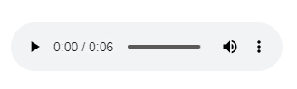
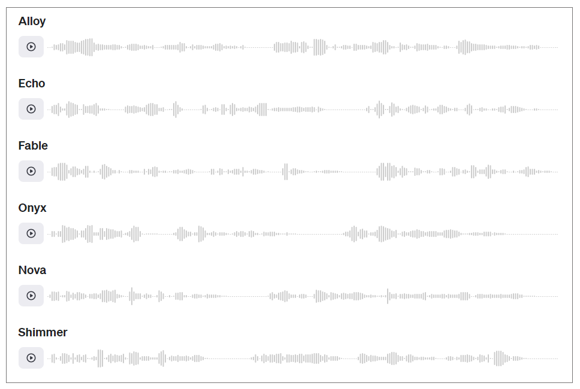
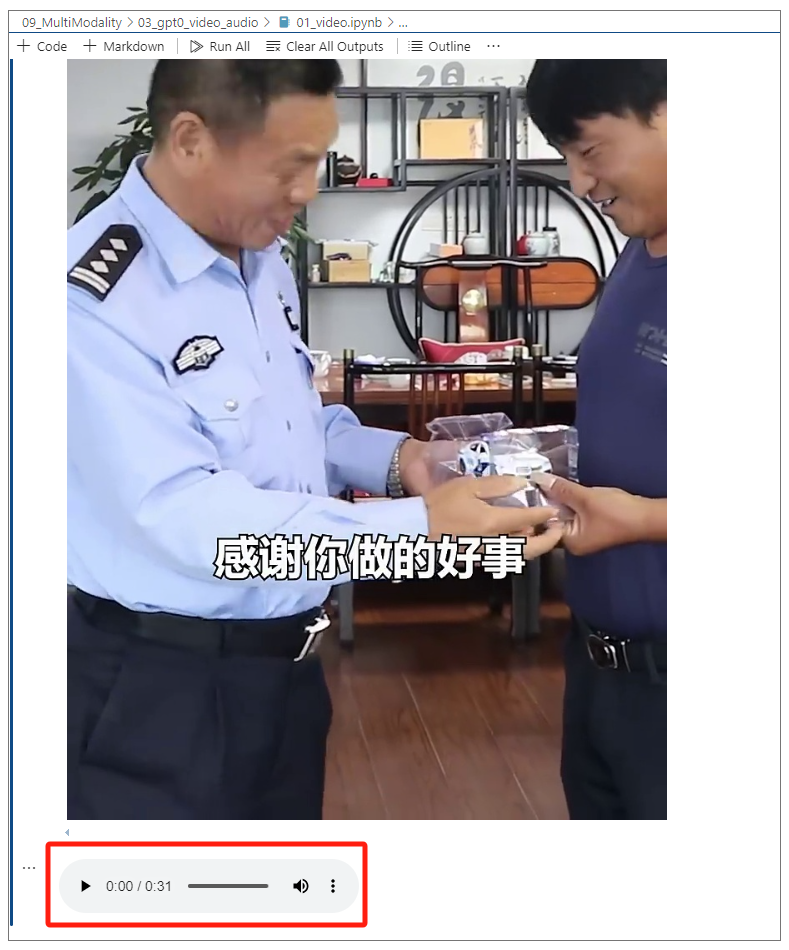
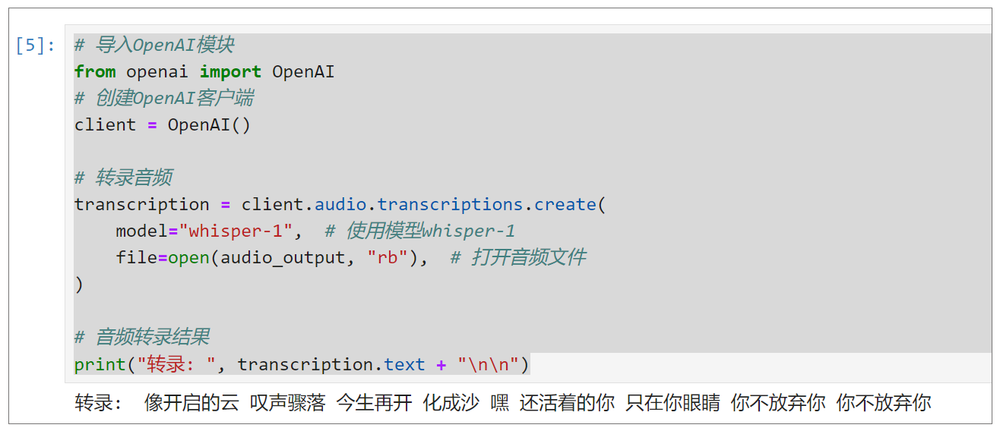
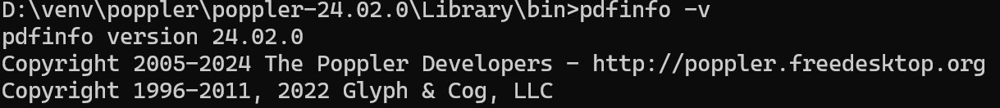
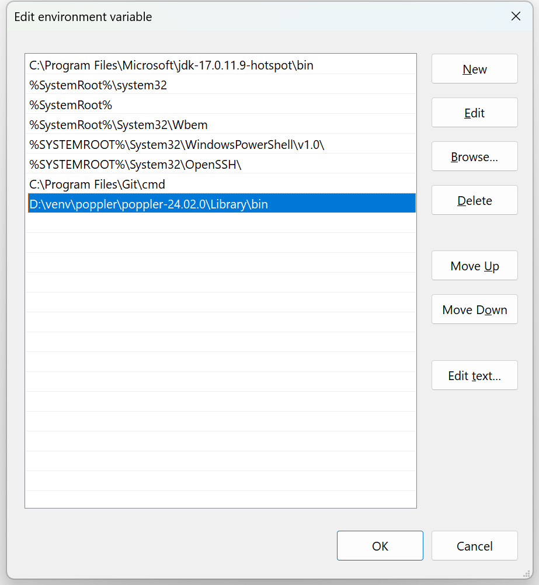
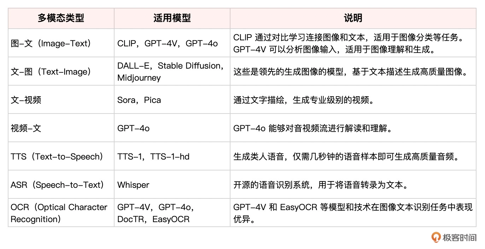

# 18 | 多模态：用大语言模型进行TTS-ASR-OCR

你好，我是黄佳。

说到多模态，最常见的当然是图 / 文之间的相互转换，也就是给出提示文字，让 StableDiffusion / Midjourney / DALL-E 这样的模型出图。或者是把图片丢给大语言模型，然后让大语言模型给出图片的解说性文字。

上面这两种多模态系统都已经很常见了，尤其是文生图模型，那绝对是 AIGC 的主力军，大大提升了设计人员的工作效率，甚至让普通人也能画图。

而视频方面，上一讲中，我们已经介绍了 GPT-4o 对视频的解读，而随着 Sora 的问世，也让普通人拥有了制作出电影级别的特效的梦想。

今天，我们接着来把多模态的处理进一步补全，具体来说说 TTS、ASR 和 OCR 这三种形式。

## TTS/ASR/OCR

这三种多模态形式虽然没有图文和视频这样耳熟能详，但是也都是常见课题，其中：

- TTS（Text-to-Speech，文本转语音）：将文字信息转化为语音输出的技术。

- ASR（Automatic Speech Recognition，自动语音识别）：将语音信号转化为文字的技术。

- OCR（Optical Character Recognition，光学字符识别）：将图像或扫描件中的文字转化为可编辑的文本的技术。

大语言模型在这些领域都有广泛的应用。

- TTS 方面，大模型能够进行更自然、富有表现力的语音合成，可以生成更接近人类语音的音色、语调和韵律，甚至可以模仿特定人物的语音风格。而且，LLM 训练数据覆盖面广，可以合成多种语言和方言的语音，实现跨语言交流。此外，还支持实时语音合成，能够快速响应用户的输入，实时生成语音，适用于实时交互场景。

- ASR 方面，大语言模型强大的语言理解能力可以更好地处理复杂的语音信号，提高识别准确率，尤其是在嘈杂环境下。它不仅能将语音转化为文字，还能理解语音背后的语义，实现更智能的语音交互。同时，也可以实现多语言、多方言支持，打破语言障碍。

- OCR 方面，大语言模型可以更好地处理各种字体、字号和排版的文字，提高识别准确率，尤其是在手写体和复杂背景下。同时有更好的版面分析能力，能够识别文本的结构和布局，例如段落、标题、表格等，方便后续处理。此外，因为训练数据覆盖面广，所以可以识别多种语言的文字，实现跨语言信息提取。

下面我们就对这三种多模态逐个进行实战。

## TTS 实战案例

TTS 技术的突破得益于深度学习模型的成熟，特别是大语言模型的出现，使得合成的语音更加自然流畅，能够捕捉到人类语音的微妙变化。

以下是一个使用大语言模型进行 TTS 的实战案例。

```python
from openai import OpenAI
client = OpenAI()
speech_file_path = "AI_speech.mp3"
response = client.audio.speech.create(
 model="tts-1",
 voice="alloy",
 input="我是咖哥，可能你有所不知，我拥有两个美少女助理，一个是小冰，一个是小雪!"
)
response.stream_to_file(speech_file_path)
```

这是 OpenAI 的 tts-1 模型，追求的是生成音频的速度，还有另外一个模型 tts-1-hd，追求的是声音质量。



运行代码之后，一个不错的语音 MP3 就生成了，你可以下载下来听一听效果。注意了，自己听听没问题，但如果你想对外发布音频，你需要声明这是 AI 生成的音频——这是 OpenAI的要求。

当然，Alloy 不是唯一的声音效果，还有其他几种选择，你可以去 OpenAI 的官网试听一下各种音效。



此外，虽然默认响应格式为 MP3，OpenAI 也提供其他音频格式，如 Opus、AAC、FLAC、WAV 和 PCM。

- Opus：用于互联网流媒体和通信，低延迟。

- AAC：用于数字音频压缩，YouTube、Android、iOS 首选。

- FLAC：用于无损音频压缩，深受音频爱好者的青睐，用于存档。

- WAV：未压缩的 WAV 音频，适用于低延迟应用程序以避免解码开销。

- PCM：与 WAV 类似，但包含 24kHz（16 位有符号，低端）的原始样本，没有标题。

在 TTS 领域，大语言模型可以生成更加自然流畅、富有表现力的语音。它不仅能模仿特定人物的语音风格，还能支持多语言、多方言的实时语音合成。这使得 TTS 技术在智能客服、有声读物、语音助手等场景有了更广阔的应用前景。

## ASR 实战案例

自动语音识别（ASR）是另一个受益于大语言模型发展的领域。在上一节课的 GPT-4o 的实战示例中，我们曾经介绍了利用 GPT-4o 来总结视频帧的步骤。但是，在那个示例中，其实我们尚缺失一个环节。这个环节就是音频识别，也就是 ASR 的步骤。

因为，目前的 GPT-4o API 还没有集中整合所有的多模态能力（未来一定会），因此，我们如果想知道这段视频中的 BGM（背景音乐）给了我们哪些信息的话，我们就需要对视频中的声音做 ASR。

下面，就是通过 whisper-1 模型对第 17 课中的实战示例进行增强的步骤。

首先，同时对音频、视频都进行预处理。这里我们需要安装 moviepy 库。

```python
# 导入所需的库
import os
import cv2 # 视频处理
import base64 # 编码帧
from moviepy.editor import VideoFileClip # 音频处理
VIDEO_FILE = "Good_Driver.mp4"
def extract_frames_and_audio(video_file, interval=2):
   encoded_frames = []
   file_name, _ = os.path.splitext(video_file)
   video_capture = cv2.VideoCapture(video_file)
   total_frame_count = int(video_capture.get(cv2.CAP_PROP_FRAME_COUNT))
   frame_rate = video_capture.get(cv2.CAP_PROP_FPS)
   frames_interval = int(frame_rate * interval)
   current_frame = 0
   # 循环遍历视频并以指定的采样率提取帧
   while current_frame < total_frame_count - 1:
       video_capture.set(cv2.CAP_PROP_POS_FRAMES, current_frame)
       success, frame = video_capture.read()
       if not success:
           break
       _, buffer = cv2.imencode(".jpg", frame)
       encoded_frames.append(base64.b64encode(buffer).decode("utf-8"))
       current_frame += frames_interval
   video_capture.release()
   # 从视频中提取音频
   audio_output = f"{file_name}.mp3"
   video_clip = VideoFileClip(video_file)
   video_clip.audio.write_audiofile(audio_output, bitrate="32k")
   video_clip.audio.close()
   video_clip.close()
   print(f"提取了 {len(encoded_frames)} 帧")
   print(f"音频提取到 {audio_output}")
   return encoded_frames, audio_output
# 每2秒提取1帧（采样率）
encoded_frames, audio_output = extract_frames_and_audio(VIDEO_FILE, interval=2)
```

输出如下：

```
MoviePy - Writing audio in Good_Driver.mp3
MoviePy - Done.
提取了 17 帧
音频提取到 Good_Driver.mp3
```

下一步，显示所提取的视频和音频。

```sql
import time
from IPython.display import Image, display, Audio
# 创建显示句柄以动态更新显示内容
display_handle = display(None, display_id=True)
# 显示提取的帧，每帧之间暂停0.025秒
for frame in encoded_frames:
   display_handle.update(Image(data=base64.b64decode(frame.encode("utf-8")), wid
   time.sleep(0.025)
# 显示提取的音频
Audio(audio_output)
```

在 Notebook 的输出区，可以看到除了视频帧之外，音频也被展示在下方。



你可以播放这个音频。

接下来，使用 OpenAI 的 whisper-1 来进行语音识别。

```python
# 导入OpenAI模块
from openai import OpenAI
# 创建OpenAI客户端
client = OpenAI()
# 转录音频
transcription = client.audio.transcriptions.create(
   model="whisper-1",  # 使用模型whisper-1
   file=open(audio_output, "rb"),  # 打开音频文件
)
# 音频转录结果
print("转录: ", transcription.text + "\n\n")
```

转录结果输出如下：



可见，短视频的背景音乐并没有对视频进行说明，而是配了歌曲。这个歌曲的内容，如果不进行 ASR，仅靠视频图像分析，是完全无法得到的。

```
# 使用GPT-4o模型生成视音频整体介绍
response = client.chat.completions.create(
   model='gpt-4o',
   messages=[
   {"role": "system", "content":"""请用Markdown格式生成视频的介绍，同时整合转录的文字""
   {"role": "user", "content": [
       "视频帧如下",
       *map(lambda x: {"type": "image_url",
                       "image_url": {"url": f'data:image/jpg;base64,{x}', "detai
       {"type": "text", "text": f"音频转录文字如下: {transcription.text}"}
       ],
   }
],
   temperature=0,
)
print(response.choices[0].message.content)
```

输出如下：

```
## 视频介绍
### 视频内容
```

- 这段视频展示了一位工程车司机在发现路面凹陷后，主动采取措施警示后方车辆，避免了潜在的交通事故。以下

```
1. **发现路面凹陷**：
  - 视频开始时，一辆蓝色的卡车行驶在路上，司机发现前方路面有凹陷，可能对来往车辆造成安全隐患。
2. **采取行动**：
  - 工程车司机苏进祥发现情况后，立即打开双闪灯停车。
  - 他下车后跑到路边，拿起锥形桶。
3. **设置警示标志**：
  - 苏进祥将锥形桶放置在路面凹陷处，警示后方车辆注意避让。
4. **恢复交通**：
  - 确认安全后，苏进祥返回车辆并继续行驶。
5. **表彰与感谢**：
  - 当地公安找到苏进祥并表示感谢，赠送了纪念品以表彰他的好事。
### 视频截图


### 音频转录
```

- 视频中的音频内容如下：

```
```\
像开启的云 叹声骤落 今生再开 化成沙
嘿 还活着的你 只在你眼睛 你不放弃你 你不放弃你
```\
### 总结
```

- 这段视频展示了一个普通司机在面对突发情况时的冷静和责任感，他的及时行动有效地避免了可能发生的交通事

可以看到，有了 ASR 音频转录之后，我们对这个视频的整体介绍更加完备，增加了背景音乐的信息。而大语言模型的引入提高了识别精度，尤其是在噪声环境下的表现。

## GPT-4o OCR 实战

OCR 技术让计算机能够“读懂”图片和扫描件中的文字信息。在大语言模型的加持下，OCR 系统能够处理更加复杂多样的字体、字号和排版，大大提升了文字识别的准确度。

此外，OCR 还能识别文本的结构布局，并支持多语种识别，让非结构化的图像文本数据变得可检索、可分析。

下面，我们使用 OpenAI 的 GPT-4o 模型对 PDF 文件进行 OCR 处理，将 PDF 文件中的文本提取出来并保存到文本文件中。

注意，这段代码的 pdf2image 也需要 Poppler 才能正常工作，先是将其下载，并解压到某个目录。

用下面的命令验证已经安装好。



然后，将这个目录添加至环境变量。



下面开始基于大模型的 OCR 实战。

```python
# 从.env文件中加载环境变量
from dotenv import load_dotenv
import os
load_dotenv()
from openai import OpenAI
# 设置API密钥和模型名称
MODEL = "gpt-4o"
client = OpenAI(api_key=os.getenv("OPENAI_API_KEY"))
# 创建OpenAI客户端实例,并从环境变量中获取API密钥
from pdf2image import convert_from_path
import io
import base64
PDF_PATH = "test.pdf"
images = convert_from_path(PDF_PATH)
# 将PDF文件转换为图片列表
# 将图片编码为base64格式并保存为JPG文件
def encode_image(image, index):
   jpg_path = f"page_{index}.jpg"
   image.save(jpg_path, format="JPEG")
   # 将图片保存为JPG文件
   buffer = io.BytesIO()
   image.save(buffer, format="JPEG")
   return base64.b64encode(buffer.getvalue()).decode("utf-8")
   # 将图片编码为base64格式
base64_images = [encode_image(img, idx) for idx, img in enumerate(images)]
# 对每个图片进行base64编码
response = client.chat.completions.create(
   model=MODEL,
   messages=[
       {"role": "system", "content": "你是一个有帮助的助手。请从提供的图片中提取文本。"}
       {"role": "user", "content": [
           {"type": "image_url", "image_url": {"url": f"data:image/jpeg;base64,{
       ]}
   ],
   temperature=0.0,
)
# 调用OpenAI的chat.completions API进行OCR任务,将编码后的图片传递给模型
# 将提取的文本保存到文件中
with open("extracted_text.txt", "w") as text_file:
   for choice in response.choices:
       text_file.write(choice.message.content + "\n")
# 将OCR结果保存到文件"extracted_text.txt"中
print("OCR过程完成。提取的文本已保存至'extracted_text.txt'。")
```

上面这段代码不复杂，先创建 OpenAI 客户端实例，并指定使用的模型为 GPT-4o。之后，使用 pdf2image 库将 PDF 文件转换为一组图片。定义 encode_image 函数，将图片编码为base64 格式，并保存为 JPG 文件，对每个图片进行 base64 编码。调用 OpenAI 的chat.completions API，将编码后的图片传递给模型，模型处理图片并返回提取的文本结果，并将提取的文本保存到文件 extracted_text.txt 中。

通过我的这段代码，你可以方便地利用 OpenAI 的大语言模型实现对 PDF 文件的 OCR 处理，将非结构化的图像文本数据转换为可编辑、可检索的文本格式。

## 总结时刻

总的来说，大语言模型凭借其强大的语言理解和生成能力，在 TTS、ASR 和 OCR 这些多模态 AI 技术领域展现出了巨大的潜力，为我们带来了更自然、更准确、更智能的语音和文本处理体验。

从我给出的实战案例中，你应该已经切实感受到了大语言模型在语音合成、语音识别和文字识别任务中的卓越表现。

下面是一个并不全面的多模态大模型功能简表，供你参考。



这些模型涵盖了图像、文本、语音等多种模态，通过多模态学习技术，使模型能够更好地理解和生成跨模态的数据。具体应用包括图像分类、图像生成、语音生成和语音识别等多种任务。

可以预见，随着大语言模型的不断发展，这些多模态 AI 技术将在智能客服、语音助手、语音交互、文档智能处理等领域得到越来越广泛的应用，为我们的工作和生活带来更多便利。

## 思考题

1. 我给出的多模态大模型简表并不全面，你还使用过哪些多模态大模型，请你不吝分享。

2. TTS、ASR 和 OCR 这三种多模态技术（以及其他多模态技术）在工作中的应用非常广泛。你遇到过哪些必须使用这些技术的应用场景，谈谈你的体验和感受。这些技术给你带来了哪些便利？还有哪些不足之处？

3. 假设你是一家公司的技术负责人，现在要开发一款融合了多模态技术的智能办公助手产品，请你畅想一下你将怎样设计这个产品的各个功能组件。

期待你的分享，欢迎与我交流。如果今天的内容让你有所收获，也欢迎你把这节课转发给有需要的朋友！我们下节课再见！
