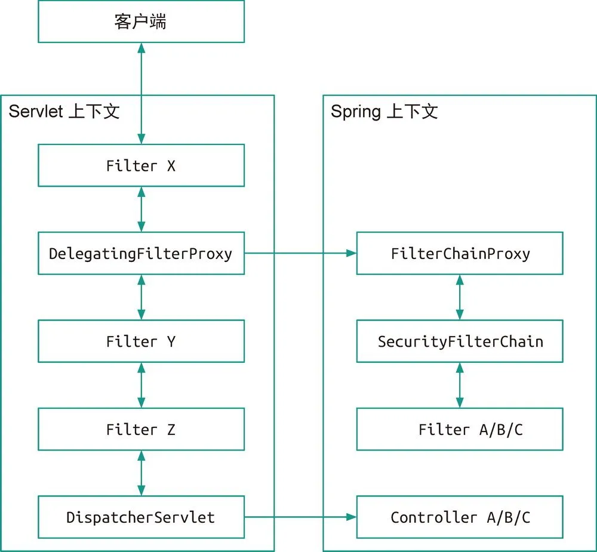
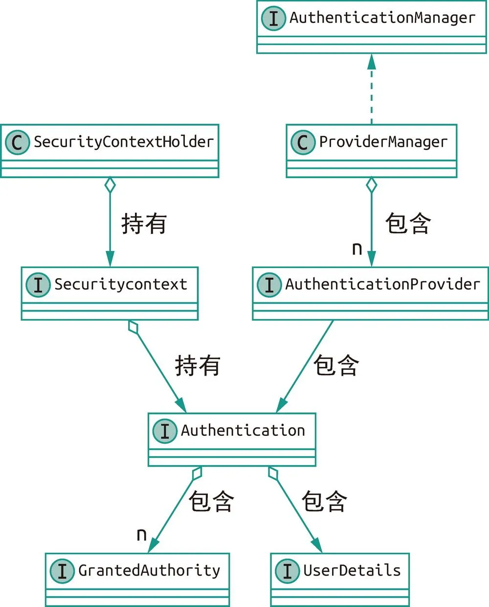
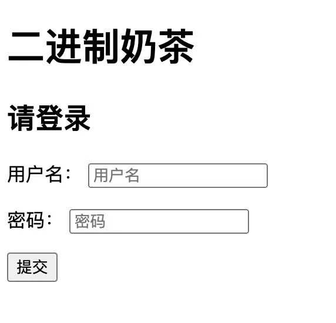
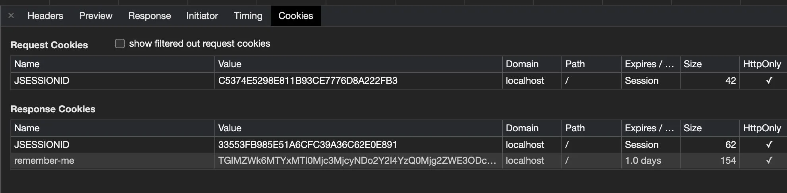

# 第10章保护Web安全(1)

- 本章内容Spring Security 的基本情况

- 基本的认证与授权管理方法

- 几种常见 Web 攻击的应对措施

- 简单的 REST API 客户端认证方法

安全是开发者永远绕不开的话题，尤其是现在大家的安全意识在不断地提高，越来越重视对信息安全的保护；与此同时，黑产或者灰产也对用户和系统虎视眈眈，这就对系统开发者提出了更高的要求。你很难想象没有一点儿安全防护、在网上“裸奔”的系统。除了基础的系统安全措施，在系统开发过程中，开发者也要加入更多安全方面的考量。本章就让我们来聊聊如何在Spring 开发的 Web 项目中增加一些安全措施。

## 10.1　认识 Spring Security

Spring Security 是 Spring 家族中专门用来提供认证（authentication）与授权（authorization）的一款框架，同时还对一些常见的攻击场景提供了对应的防御措施。对于基于 SpringFramework 开发的系统而言，Spring Security 算得上是安全加固的首选框架，可以帮助我们更方便地打造一个相对安全的 Web 系统。

回顾 Spring Security 的历史，最早可以追溯到 2003 年，彼时的 Spring Framework 也才刚刚起步不久。虽然 Spring 团队认为安全是个非常值得投入的领域，但实在是无暇顾及这块。

- 1

Ben Alex 开发了一个名为“The Acegi Security System for Spring”的项目

- ，后来该项目被纳

入 Spring 项目集，并于 2006 年 5 月发布了正式的 1.0.0 版本，在经历了大量的改进后，于2007 年底正式改名为 Spring Security。现在的 Spring Security 项目非常活跃，已经与 SpringFramework 一样，成为 Java Web 开发过程中安全相关领域的事实标准了。

Spring Security 主要提供了如下一些特性。

- 身份认证，证明你是谁。Spring Security 支持多种不同类型的认证，例如基于用户名和密码的认证，基于 JAAS（Java Authentication and Authorization Service）的认证，以及CAS 等。

- 操作授权，规定你能做什么。Spring Security 提供了相对完善的 RBAC（Role-BasedAccess Control，基于角色的访问控制）权限，通过表达式就能方便地完成相关配置，将粒度控制到方法级别。

- 常见攻击防御，在防火墙之外，再给应用穿套“铠甲”。Spring Security 能提供的防护种类有限，主要是针对 CSRF 和 HTTP 请求加固的。

### 10.1.1　模块介绍

从 Spring Security 3.0 开始，Spring Security 被分成了多个模块，放在不同的 Jar 中，我们可以按需引入相关的依赖。就这一点而言，它与 Spring Framework 的风格是高度一致的。表10-1 列举了一些主要的模块。

表 10-1　Spring Security 的一些主要模块

Jar 包

- 说明

spring-security-core.jar

- 核心模块，包含了主要的认证与授权支持

spring-security-web.jar

- 提供 Web 相关的安全支持，大部分情况下都会用到它

spring-security-config.jar

- 提供 XML 与 Java 配置方式，可以辅助进行各种配置

- 提供 LDAP（Lightweight Directory Access Protocol）相关

spring-security-ldap.jar

- 支持，很多公司都采用 LDAP 进行用户管理，因此 LDAP的支持很实用

- 提供了 OAuth 2.0 相关的支持。除了核心相关内容，还有

spring-security-oauth2-*.jar

- 客户端的支持和简单的资源服务器实现

到了 Spring Security 5.x 的时代，除了同步的 Servlet 应用，Spring Security 还开始支持Spring WebFlux 这样的响应式应用程序。不过在本章中，我们还是更多地聚焦于 Servlet 应用。

### 10.1.2　工作原理

- 2

Spring Security 针对 Web 应用做了安全加固，本质上是在应用的 Servlet

- 执行前后做了一

些拦截。我们可以把它理解为类似 AOP 的方式，只不过这个拦截是依托于 Servlet 的

```
Filter 过滤器接口来实现的。
```

既然是和 Spring Framework 搭配使用的，我们自然希望将尽可能多的东西交由 Spring 容器来

```
托管，因此 Spring Security 提供了一个 DelegatingFilterProxy。它是一个标准的
```

Servlet 过滤器，注册到 Servlet 的容器中，但所有的操作都由 Spring 容器中那些实现了

```
Filter 的 Bean 来完成。我们可以认为 DelegatingFilterProxy 充当了 Servlet 容器与
```

Spring 容器之间的桥梁。

通常情况下，系统中用到的过滤器不止一个，仅 Spring Security 就提供了大量不同作用的Servlet 过滤器。如果每个都需要我们做特别的配置，那工作量无疑是巨大的。因此，我们直

```
接在 DelegatingFilterProxy 里配置一个 FilterChainProxy，由它来调用
SecurityFilterChain（默认实现是 DefaultSecurityFilterChain），后者会管理所
涉及的 Filter Bean。针对当前请求该对应哪些过滤器，都由 SecurityFilterChain 来
```

决定。Spring Security 针对不同安全需求提供了大量过滤器，具体可见表 10-2。

表 10-2　Spring Security 提供的部分 Filter 实现

```
Filter
```

- 作用

- 处理 CORS（Cross-Origin Resource Sha

```
CorsFilter
资源共享）的 Filter 实现
```

- 处理 CSRF（Cross-Site Request Forgery

```
CsrfFilter
伪造）的 Filter 实现
```

如果用一张图来概括 Spring Security 的处理流程，它应该如图 10-1 所示。客户端发起请求，进入 Servlet 容器后会交由一系列 Servlet 过滤器进行处理，最后再走到

```
DispatcherServlet，处理后的结果再反向经过过滤器。其中的
DelegatingFilterProxy 在处理时会把请求转给在 Spring 上下文中的
FilterChainProxy，后者再将请求转给 SecurityFilterChain。顾名思义，过滤器链
```

不是一个过滤器，而是一连串的过滤器，这些过滤器都是在 Spring 上下文中管理的。



- 图 10-1　Spring Security 的请求处理流程

## 10.2　身份认证

在对 Spring Security 有了一个大概的了解后，就该将其投入实践了，我们主要解决两个问题——我是谁以及我能干什么，分别对应身份认证与访问授权两大功能。接下来，就让我们从身份认证开始，来看看 Spring Security 是怎么帮助我们的吧。

### 10.2.1　Spring Security 的身份认证机制

```
在 Spring Security 中，有一个安全上下文的概念，用 SecurityContext 接口来表示，
SecurityContextHolder 负责提供方法创建并维护当前的 SecurityContext。上下文
中包含了当前用户的身份信息，用 Authentication 接口来表示，它又由下面的三部分信息
```

组成。

```
用户主体信息，Authentication 直接继承了 Principal 接口，可以根据规范返回用户
信息，getPrincipal() 方法返回任意的 Object，通常这里会使用 UserDetails。
```

- 证明信息，在用户名与密码做认证的场景下，证明信息通常就是密码，在身份认证通过后会清除该信息，避免信息泄露。

```
权限信息，由 GrantedAuthority 接口来表示，描述了当前用户是什么角色的，能做什
```

- 么。

```
Authentication 里几乎已经包含了我们需要的所有信息，因此，整个过程中最重要的动作
就是如何取得当前用户的 Authentication，并将其设置到 SecurityContext 里。
AuthenticationManager 接口定义了 Spring Security 应该如何进行身份认证，
ProviderManager 则是其最常用的实现，其中会有很多 AuthenticationProvider 来
进行具体的身份验证判断，例如基于数据库做判断就用 DaoAuthenticationProvider。
```

身份认证机制中一些主要接口与类的关系如图 10-2 所示。



- 图 10-2　身份认证机制中一些主要接口与类的关系

### 10.2.2　基于用户名和密码的身份认证

在 Spring Boot 项目中，可以引入 spring-boot-starter-security 快速实现简单的身份认证功能，与此同时，框架也给我们留足了配置项和扩展点，能满足大部分的安全认证需求。

1. 通过 Spring Boot 的自动配置实现身份认证Spring Boot 提供的自动配置包含 HTTP 表单认证与 HTTP Basic 认证，在 pom.xml 中添加如下依赖：

```xml
<dependency>
1
   <groupId>org.springframework.boot</groupId>
2
   <artifactId>spring-boot-starter-security</artifactId>
3
</dependency>
4
```

- 启动程序后，在输出的日志中能看到类似下面这样的一段输出，这是 Spring Boot 的自动配

```
置类 SecurityProperties.User 中用 UUID 生成的一段密码，对应的用户名默认是
user，用 UUID 做密码：
Using generated security password: 40e5d02a-de50-46d6-97a6-970252c35d57
1
在浏览器中，如果访问 http://localhost:8080/order 页面，会被 302 Found 重定向到
```

- 3

```
 命令，则会看到 401
```

- Spring Security 提供的默认登录页面；如果用 curl4

```
Unauthorized 返回码：
▸ curl -v http://localhost:8080/order
1
2
< HTTP/1.1 401
3
< Set-Cookie: JSESSIONID=3BB3C245CC937AF15B48DB2D1C07DE6F; Path=/; HttpOnly
4
< WWW-Authenticate: Basic realm="Realm"
5
< X-Content-Type-Options: nosniff
6
< X-XSS-Protection: 1; mode=block
7
< Cache-Control: no-cache, no-store, max-age=0, must-revalidate
8
< Pragma: no-cache
9
< Expires: 0
10
< X-Frame-Options: DENY
11
< Content-Type: application/json
12
< Transfer-Encoding: chunked
13
< Date: Sun, 10 Jan 2021 13:48:50 GMT
14
<
15
* Connection #0 to host localhost left intact
16
{"timestamp":"2021-01-10T13:48:50.763+00:00","status":401,"error":"Unauthorized
17
"/order"}* Closing connection 0
18
```

- 可以在登录页面中输入用户名进行登录，如果是 curl 命令则用下面的命令提供 HTTP Basic认证所需的信息：

```
▸ curl -v -u user:40e5d02a-de50-46d6-97a6-970252c35d57 http://localhost:8080/o
1
```

- 如果每次都必须使用默认的用户名和自动生成的密码，那未免也太不方便了。既然是

```
SecurityProperties 里的属性，那必然可以通过配置来进行设置。可以在
application.properties 中配置下面的属性，将用户名和密码变成我们指定的内容：
spring.security.user.name=binarytea
1
spring.security.user.password=showmethemoney
2
```

- 茶歇时间：使用 Spring Security 加密保存密码我们在项目中引入 Spring Security，就是为了增强项目的安全性，对密码的保护也是安全工作的一部分。由于密码泄露而造成的安全问题数不胜数，因而不建议直接用明文方

```
式来保存密码。好在 Spring Security 提供了 PasswordEncoder 接口，我们可以用其
encode() 方法对明文进行编码，用 matches() 方法比较明文和编码后的内容。在创
建 Spring Security 的 User 对象时，也能指定要使用的 PasswordEncoder，直接在设
```

- 置密码时自动进行密码编码。

```
在 5.0 版本前，默认的实现是 NoOpPasswordEncoder，对应的字符串前缀是 。通过
PasswordEncoderFactories.createDelegatingPasswordEncoder() 可以创
建一个包含大量算法的 DelegatingPasswordEncoder 实例，具体见表 10-3。
```

- 表 10-3　默认创建的 DelegatingPasswordEncoder 所代理的 PasswordEncoder

```
对应的 PasswordEncoder 实现
```

- 前缀

```
NoOpPasswordEncoder
BCryptPasswordEncoder
Pbkdf2PasswordEncoder
SCryptPasswordEncoder
MessageDigestPasswordEncoder
MessageDigestPasswordEncoder
StandardPasswordEncoder
MessageDigestPasswordEncoder
MessageDigestPasswordEncoder
LdapShaPasswordEncoder
Argon2PasswordEncoder
```

- 如果我们希望配置已编码的密码，可以通过代码事先加密，也可以简单一些，使用5Spring Boot 的 CLI 命令行工具：

```
▸ spring encodepassword plaintext
1
$2a$10$GUextEAokHFRL7vWGk6sqOE8RKyiXD1tnPLJxpqlvBfur4BXzvOSG
2
也可以用 -a 指定算法：
```

```
▸ spring encodepassword -a pbkdf2 plaintext
1
a40a2a9e11f7a85db0c2c3b508d096138fb38c4ae8fb7e6452f821fdd309496d9c4810b6e984
2
```

2. 自定义身份认证细节通过前面的自动配置，我们已经实现了基本的身份认证需求，在访问大部分页面和接口前（除了登录和退出页），都必须先登录。但自动配置不是万能的，总会有些地方需要我们做个性化定制，例如，我们希望有些 URL 能禁用强制登录。

```
可以在代码中编写一个继承了 WebSecurityConfigurerAdapter 类的配置类，同时在
上面增加 @EnableWebSecurity 注解。代码示例 10-1 就将 /menu 路径彻底放开了，允
```

- 6许所有人来访问。

- 代码示例 10-1　个性化的身份认证配置

```java
@Configuration
1
@EnableWebSecurity
2
public class WebSecurityConfiguration extends WebSecurityConfigurerAdapter {
3
   @Override
4
   protected void configure(HttpSecurity http) throws Exception {
5
       http.authorizeRequests()
6
           .antMatchers("/menu").permitAll()
7
           .anyRequest().authenticated().and()
8
           .formLogin().and() // 使用表单登录
9
           .httpBasic(); // 使用HTTP Basic认证
10
   }
11
}
12
如果只希望提供 HTTP Basic 的方式，可以将上面代码中的 formLogin() 调用去掉。其
```

- 实，在遇到未登录的情况时，究竟采用何种方式应对，提供什么入口，是由

```
AuthenticationEntryPoint 接口来决定的。例如，
LoginUrlAuthenticationEntryPoint 就会将浏览器重定向到登录页 URL；而
BasicAuthenticationEntryPoint 则会返回 401 Unauthorized 响应码，添加
WWW-Authenticate 头，使用 HTTP Basic 认证方式。
在使用登录表单认证时，我们之前看到的 /login 页面是 Spring Security 提供的默认登录
页，这个页面是通过 DefaultLoginPageGeneratingFilter 来生成的。如果查看它的
```

- 源码，你会发现这个页面基本就是靠字符串拼接出来的。不过，就算这么一个页面，SpringSecurity 也给我们留足了配置项，一些常用的配置如表 10-4 所示。

- 表 10-4　formLogin() 提供的一些常用配置

- 配置方法作用

```
usernameParameter()
```

- 配置表单中的用户名字段

```
passwordParameter()
```

- 配置表单中的密码字段

```
defaultSuccessUrl()
```

- 登录成功后跳转的 URL

```
failureUrl()
```

- 登录失败后跳转的 URL

```
loginProcessingUrl()
```

- 提交用户名和密码到此处指定的 URL 进行身份认证

- 指定自己的登录页，如果设置了这个配置，就不会再有默

```
loginPage()
```

- 认的登录页了

- 代码示例 10-2 是自定义登录页面配置的一个演示，设置了登录成功与失败的 URL，定制了7表单中的用户名和密码字段，还修改了处理登录请求的 URL。在设置放行 URL 时，这里分别演示了使用 ANT 匹配器和 MVC 匹配器的方法。

- 代码示例 10-2　自定义登录表单

```java
protected void configure(HttpSecurity http) throws Exception {
1
   http.authorizeRequests()
2
       .antMatchers("/").permitAll()
3
       .mvcMatchers("/actuator/*").permitAll()
4
       .anyRequest().authenticated().and()
5
       .formLogin() // 使用表单登录
6
       .defaultSuccessUrl("/order")
7
       .failureUrl("/login")
8
       .loginProcessingUrl("/doLogin")
9
       .usernameParameter("user")
10
       .passwordParameter("pwd").and()
11
       .httpBasic(); // 使用HTTP Basic认证
12
}
13
```

- Spring Security 的用户名和密码登录，默认是由

```
UsernamePasswordAuthenticationFilter 来实现的，其中最主要的工作就是取得用
户名和密码，然后通过 AuthenticationManager 来实施具体的身份认证动作，
UsernamePasswordAuthenticationFilter 中大概的处理逻辑如下所示：
public Authentication attemptAuthentication(HttpServletRequest request, HttpSe
1
   // 1.POST校验
2
   // 2.获得用户名与密码操作
3
   // 3.生成AuthenticationToken
4
   UsernamePasswordAuthenticationToken authRequest = new UsernamePasswordAuthe
5
   setDetails(request, authRequest);
6
   // 4.通过AuthenticationManager进行认证
7
   return this.getAuthenticationManager().authenticate(authRequest);
8
}
9
```

- 8如果认证成功，需要“记住我”的就做对应记住的动作，随后使用

```
AuthenticationEventPublisher 发送认证成功的事件，再调用
AuthenticationSuccessHandler 做登录成功后的处理。如果登录失败，清除之前保
留的登录信息，调用 AuthenticationFailureHandler 做登录失败后的处理。
```

- 在了解了定制身份认证细节的方法之后，让我们来看看如何将其运用到二进制奶茶店中，为系统提供更多的防护能力。

```
需求描述　为二进制奶茶店提供一个登录界面。奶茶店的根页面（/）谁都可以访问，但
如果顾客到店希望点单，就只能通过店员进行操作。所以下单页面（/order）只能是店
```

- 员登录后才能访问。

- 在实际生产环境中，我们很少直接使用 Spring Security 的默认登录页面，通常会自己写一

```
个页面。在通过 loginPage() 设置了自己的登录页 URL 后，Spring Security 就不会再为
```

- 我们提供默认页面了，我们要自己负责处理对这个 URL 的请求。在代码示例 10-3 中，我9

```
们定义了自己的 /login 页面模板，使用的是第 10 章中用过的 Thymeleaf 模板。
```

- 代码示例 10-3　自定义的登录页面模板

```xml
<!DOCTYPE html>
1
<html lang="zh_CN" xmlns:th="http://www.thymeleaf.org">
2
   <head>
3
       <meta charset="UTF-8">
4
       <title>二进制奶茶</title>
5
   </head>
6
   <body>
7
       <h1>二进制奶茶</h1>
8
       <h2>请登录</h2>
9
       <div>
10
           <form action="#" th:action="@{/doLogin}" method="post">
11
               <p>
12
                   <label>用户名：</label>
13
                   <input type="text" name="user" placeholder="用户名" />
14
               </p>
15
               <p>
16
                   <label>密码：</label>
17
                   <input type="password" name="pwd" placeholder="密码" />
18
               </p>
19
               <p th:if="$"
20
                  th:with="errorMsg=$"
21
                  style="color:#ff0000">
22
                   登录失败，具体原因：
23
                   <span th:text="$" style="color:#ff0000">失败原因</span>
24
               </p>
25
               <p>
26
                   <input type="submit" value="提交"/>
27
               </p>
28
           </form>
29
       </div>
30
   </body>
31
</html>
32
```

- 这里有几点内容需要说明：

```
表单提交的目标需要与 formLogin().loginProcessingUrl() 中设置的地址匹
配，默认是 /login；
用户名与密码表单项的名称需要与 formLogin().usernameParameter() 和
formLogin().passwordParameter() 匹配，默认是 username 和 password；
```

- 如果登录失败，Spring Security 会将异常放在 Session 的

```
SPRING_SECURITY_LAST_EXCEPTION 属性中（用户名密码错误是
BadCredentialsException），因此可以通过它是否为空来判断，message 中会有
```

- 具体的失败原因描述；

- Thymeleaf 会自动为我们的表单带上一个 CSRF Token，关于 CSRF 的内容会在 10.3 节中展开说明。

```
为了使用这个登录页，我们的配置也要稍作调整。由于 /login 在显示时并没有什么逻
辑，可以直接用 UrlFilenameViewController 来充当控制器类，它能根据请求映射模
```

- 板，Bean 的 ID 就是要映射的 URL。

```
formLogin().loginPage("/login").permitAll() 设置了要使用自定义登录页，
```

- 我们还改了一些参数，具体内容见代码示例 10-4。

- 代码示例 10-4　使用自定义登录页的配置类

```java
@Configuration
1
@EnableWebSecurity
2
public class WebSecurityConfiguration extends WebSecurityConfigurerAdapter {
3
   @Bean("/login")
4
   public UrlFilenameViewController loginController() {
5
       UrlFilenameViewController controller = new UrlFilenameViewController()
6
       controller.setSupportedMethods(HttpMethod.GET.name());
7
       controller.setSuffix(".html");
8
       return controller;
9
   }
10
11
   @Override
12
   protected void configure(HttpSecurity http) throws Exception {
13
       http.authorizeRequests()
14
           .antMatchers("/").permitAll()
15
           .mvcMatchers("/actuator/*").permitAll()
16
           .anyRequest().authenticated().and()
17
           .formLogin() // 使用表单登录
18
           .loginPage("/login").permitAll() // 设置登录页地址，全员可访问
19
           .defaultSuccessUrl("/order")
20
           .failureUrl("/login")
21
           .loginProcessingUrl("/doLogin")
22
           .usernameParameter("user")
23
           .passwordParameter("pwd").and()
24
           .httpBasic(); // 使用HTTP Basic认证
25
   }
26
}
27
```

- 我们的登录页效果如图 10-3 所示。相比默认的页面，它的确是简单了一些。在实际生产系统中，页面通常都会加上 CSS 效果，不会这么简陋。



- 图 10-3　自定义登录页

3. 基于数据库管理用户信息如果仅仅依靠配置文件配置的用户信息，是无法应对生产环境的复杂性的。我们对用户体系有着更高的要求，最起码也得实现不同用户能够使用不同账户进行登录，每个人都可以有不同的权限。这时将用户信息记录到数据库中的需求就出现了，而且数据库中的信息相比配置文件更易维护。

```
Spring Security 中的 UserDetailsService 提供了用户信息服务的抽象，该接口就只有
一个 loadUserByUsername() 方法，根据用户名加载用户信息。另外的
UserDetailsManager 则提供了用户信息的增加、删除和修改方法。两个接口搭配在一
```

- 起就能完成关于用户的增删改查操作。

- 需求描述　随着日益增长的业务需要，奶茶店聘请了好几位员工。只有一个账号的情况肯定是不合适了，现在需要为每个员工分配一个账号，并且账号系统要易于维护。

- 在使用关系型数据库之前，我们先来看看如何在内存中保存不同用户的信息，这时会用到

```
InMemoryUserDetailsManager。在没有提供 UserDetailsService 时，Spring
Boot 的自动配置类 UserDetailsServiceAutoConfiguration 会自动为我们提供一
个 InMemoryUserDetailsManager，所以我们只需自己定义一个就可以了，就像代码示
```

- 10例 10-5 这样。

```java
代码示例 10-5　增加了 InMemoryUserDetailsManager 的配置类
@Configuration
1
@EnableWebSecurity
2
public class WebSecurityConfiguration extends WebSecurityConfigurerAdapter {
3
   @Bean
4
   public UserDetailsService userDetailsService(ObjectProvider<PasswordEncode
5
       PasswordEncoder encoder = passwordEncoder
6
               .getIfAvailable(() -> PasswordEncoderFactories.createDelegating
7
       UserDetails employee = User.builder()
8
                                     .username("lilei")
9
                                     .password("binarytea")
10
                                     .authorities("READ_ORDER", "WRITE_ORDER")
11
                                     .passwordEncoder(encoder::encode)
12
                                     .build();
13
       return new InMemoryUserDetailsManager(employee);
14
   }
15
   // 省略其他代码
16
}
17
在上面的代码中，我们先尝试从 Spring 上下文中获取 PasswordEncoder，如果没有找到
则创建一个默认的。通过 User.UserBuilder 来构建用户信息，用户名、密码和权限是
必需的。此外，我们这里指定了 PasswordEncoder 来加密存储密码，随后用这个用户来
初始化 InMemoryUserDetailsManager。InMemoryUserDetailsManager 中可以管
```

- 理多个用户，我们的例子就只放了一个而已。

```
InMemoryUserDetailsManager 通常用在简单的场景或者测试中。在复杂的生产环境
中，我们更倾向于使用 JdbcUserDetailsManager，它能够通过 JDBC 与关系型数据库
```

- 进行交互，满足更多的要求。

- 既然是要用数据库的，那必然就少不了要创建对应的表结构，Spring Security 在 Jar 包中提供了默认的表结构 DDL 文件（位置是org/springframework/security/core/userdetails/jdbc/users.ddl），不过它并不要求我们严格遵守这个 DDL 文件中的定义。在之前的示例中，我们已经用了 H2 内嵌数据库，有schema.sql 文件，所以我们可以把自己的用户和权限表定义加在后面，具体的 SQL 如代码11示例 10-6 所示。

- 代码示例 10-6　追加在 schema.sql 后面的用户和权限表语句

```sql
drop table if exists users;
1
drop table if exists authorities;
2
3
create table users(
4
   username varchar(50) not null primary key,
5
   password varchar(500) not null,
6
   enabled boolean not null
7
);
8
9
create table authorities (
10
   username varchar(50) not null,
11
   authority varchar(50) not null
12
);
13
14
create unique index ix_auth_username on authorities (username, authority);
15
```

- 上面的 SQL 是根据默认 DDL 修改的，去掉了外键，原先的字符串忽略大小写，这里我们

```
还是选择区别大小写。随后在 data.sql 中插入一条默认数据，密码用 spring
encodepassword binarytea 做了加密，如代码示例 10-7 所示。
```

- 代码示例 10-7　预先插入的默认数据

```java
insert into users (username, password, enabled) values ('LiLei',
1
       '$2a$10$iAty2GrJu9WfpksIen6qX.vczLmXlp.1q1OHBxWEX8BIldtwxHl3u', true);
2
insert into authorities (username, authority) values ('LiLei', 'READ_ORDER');
3
insert into authorities (username, authority) values ('LiLei', 'WRITE_ORDER');
4
最后，如代码示例 10-8 那样修改一下配置类，把 UserDetailsService 的 Bean 换成
JdbcUserDetailsManager，这里我们还演示了一下如何用代码创建一个用户，放入
JdbcUserDetailsManager。
代码示例 10-8　使用 JdbcUserDetailsManager 来提供用户信息
@Configuration
1
@EnableWebSecurity
2
public class WebSecurityConfiguration extends WebSecurityConfigurerAdapter {
3
   @Bean
4
   public UserDetailsService userDetailsService(ObjectProvider<DataSource> dat
5
       JdbcUserDetailsManager userDetailsManager = new JdbcUserDetailsManager
6
       userDetailsManager.setDataSource(dataSources.getIfAvailable());
7
       UserDetails manager = User.builder().username("HanMeimei").password("$2
8
           pksIen6qX.vczLmXlp.1q1OHBxWEX8BIldtwxHl3u").authorities("READ_ORDER
9
       userDetailsManager.createUser(manager);
10
   return userDetailsManager;
11
   }
12
   // 省略其他代码
13
}
14
如果详细查看 JdbcUserDetailsManager 的代码，我们会发现，它内部其实内置了很多
```

- 不同操作所需的 SQL 语句：

```java
   public static final String DEF_CREATE_USER_SQL = "insert into users (userna
1
       values (?,?,?)";
2
   public static final String DEF_DELETE_USER_SQL = "delete from users where u
3
   public static final String DEF_UPDATE_USER_SQL = "update users set password
4
   public static final String DEF_INSERT_AUTHORITY_SQL = "insert into authorit
5
       values (?,?)";
6
   public static final String DEF_DELETE_USER_AUTHORITIES_SQL = "delete from a
7
   public static final String DEF_USER_EXISTS_SQL = "select username from use
8
   public static final String DEF_CHANGE_PASSWORD_SQL = "update users set pass
9
```

- 如果我们修改了表名或者表结构，不用完全重写这个实现类，只需通过对应的方法把增删改

```
查相关的 SQL 语句改了就可以。此外，JdbcUserDetailsManager 还支持用户组相关
```

- 的概念和操作，实现方式也是在数据库中增加了用户组的表，并内置了相关 SQL 语句，这部分内容就不在本书中展开了。

4. 退出操作

```
既然有登录操作，那自然也有对应的退出操作。WebSecurityConfigurerAdapter 默
认提供了 /logout 这个 URL 来处理退出的请求，它主要做了如下清理动作：
```

- 清理 HTTP Session；

- 清理“记住我”相关的信息；

```
清理保存了当前用户信息的 SecurityContextHolder；
重定向到 /login?logout。
和 formLogin() 类似，logout() 也有很多可以定制的配置方法，表 10-5 提供了一些
```

- 常用的配置方法。

- 表 10-5　logout() 提供的一些常用配置方法

- 配置方法作用

```
logoutUrl()
触发退出操作的 URL，默认是 /logout
logoutSuccessUrl()
```

- 成功退出后跳转的 URL

```
指定自定义的 LogoutSuccessHandler，有这个设
logoutSuccessHandler()
置 logoutSuccessUrl() 会失效
Spring Security 中默认开启了 CSRF 防护，所以 /logout 也要求带有 CSRF 的 Token，
而且必须要使用 POST 方法，这是合理的安全要求。可以通过提交表单的方式来实现退
出，也可以用 JavaScript 代码来发起退出的 POST 请求。如果一定要用 GET 方法，可以像
代码示例 10-9 这样进行设置，其中将退出成功后的重定向指向了 /，退出请求可以同时使
用 GET 和 POST 方法。
```

- 代码示例 10-9　增加了退出设置的安全配置类

```java
@Configuration
1
@EnableWebSecurity
2
public class WebSecurityConfiguration extends WebSecurityConfigurerAdapter {
3
   @Override
4
   protected void configure(HttpSecurity http) throws Exception {
5
       http.authorizeRequests()
6
           .antMatchers("/").permitAll()
7
           .mvcMatchers("/actuator/*").permitAll()
8
           .anyRequest().authenticated().and()
9
           .formLogin() // 使用表单登录
10
           .loginPage("/login").permitAll() // 设置登录页地址，全员可访问
11
           .defaultSuccessUrl("/order")
12
           .failureUrl("/login")
13
           .loginProcessingUrl("/doLogin")
14
           .usernameParameter("user")
15
           .passwordParameter("pwd").and()
16
           .httpBasic().and() // 使用HTTP Basic认证
17
           .logout()
18
           .logoutSuccessUrl("/")
19
           .logoutRequestMatcher(new OrRequestMatcher(
20
               new AntPathRequestMatcher("/logout", "GET"),
21
               new AntPathRequestMatcher("/logout", "POST")));
22
   }
23
   // 省略其他代码
24
}
25
```

- 现在，我们的下单页面已经拥有了最基本的登录和退出功能，也能在数据库中维护基本的用户信息了。之前都是通过浏览器手动做的验证，为了方便以后回归测试，我们需要编写一些自动化的单元测试。好在 Spring Security 对测试也有很好的支持，我们只需要在 pom.xml中引入相应的依赖就行了，具体如代码示例 10-10 所示。

- 代码示例 10-10　pom.xml 中增加 Spring Security 的测试支持

```xml
<dependency>
1
   <groupId>org.springframework.security</groupId>
2
   <artifactId>spring-security-test</artifactId>
3
   <scope>test</scope>
4
</dependency>
5
接下来，为 OrderController 编写一些测试用例。在为测试构建 MockMvc 时，需要增
```

- 加 Spring Security 相关的支持，具体如代码示例 10-11 所示，其中用到了

```python
SecurityMockMvcConfigurers.springSecurity() 来初始化 MockMvc。
代码示例 10-11　OrderControllerTest 的初始化
@SpringBootTest
1
class OrderControllerTest {
2
   private MockMvc mockMvc;
3
4
   @BeforeEach
5
   void setUp(WebApplicationContext wac) {
6
       this.mockMvc = MockMvcBuilders.webAppContextSetup(wac)
7
                                        .apply(springSecurity())
8
                                        .build();
9
   }
10
11
   @AfterEach
12
   void tearDown() {
13
       mockMvc = null;
14
   }
15
   // 省略其他代码
16
}
17
```

- 先来测试一下登录和退出的功能，在代码示例 10-12 中，通过

```
SecurityMockMvcRequestBuilders.formLogin() 可以发起表单登录请求，我们在
WebSecurityConfiguration 中修改了默认配置，因此这里也需要手动指定处理登录请
```

- 求的 URL，用户名和密码的表单项名称也要修改。登录后，可以通过

```
SecurityMockMvcResultMatchers.authenticated() 和 unauthenticated()
```

- 方法来判断当前是否通过身份验证，如果成功通过验证则继续确认重定向 URL 是否符合预

```
期。退出的测试逻辑也是类似的，通过 logout() 向默认的 /logout 地址发起退出请
求，随后判断是否已没有登录态并重定向到了 /。
```

- 代码示例 10-12　登录和退出的测试用例

```python
@SpringBootTest
1
class OrderControllerTest {
2
   @Test
3
   void testLogin() throws Exception {
4
       mockMvc.perform(formLogin("/doLogin")
5
               .user("user", "LiLei")
6
               .password("pwd", "binarytea"))
7
               .andExpect(authenticated())
8
               .andExpect(redirectedUrl("/order"));
9
   }
10
11
   @Test
12
   void testLogout() throws Exception {
13
       mockMvc.perform(logout())
14
               .andExpect(unauthenticated())
15
               .andExpect(redirectedUrl("/"));
16
   }
17
   // 省略其他代码
18
}
19
```

```
最后，再来测试一下登录和未登录情况下的 /order 页面请求。在未登录的情况下向
/order 发起 GET 请求，会返回 401 Unauthorized 响应码，此时的状态是未经过身份
认证，就和用 curl 命令发起 GET 请求时类似。如果指定了 Accept: text/html 头，则
情况与浏览器类似，会重定向到登录页面。在发起请求时，如果用 with() 方法带上登录
信息，就能模拟带登录态的请求，可以直接带上 user()，指定用户信息（这里只带了用户
名，也可以带密码和角色），也可以用 httpBasic() 模拟 HTTP Basic 认证。具体如代码
```

- 示例 10-13 所示。

- 代码示例 10-13　对下单页面的单元测试

```python
@SpringBootTest
1
class OrderControllerTest {
2
   @Test
3
   void testOrderPageWithoutAuthentication() throws Exception {
4
       mockMvc.perform(get("/order")
5
                        // .header("Accept", "text/html") // 模拟浏览器
6
                    )
7
               .andExpect(unauthenticated())
8
               // .andExpect(status().is3xxRedirection()) // 浏览器里是跳转，否则
9
               // .andExpect(redirectedUrlPattern("**/login"))
10
         ;
11
   }
12
13
   @Test
14
   void testOrderPageWithAuthenticatedUser() throws Exception {
15
       mockMvc.perform(get("/order").with(user("LiLei")))
16
               .andExpect(status().is2xxSuccessful());
17
       mockMvc.perform(get("/order").with(httpBasic("LiLei", "binarytea")))
18
               .andExpect(status().is2xxSuccessful());
19
   }
20
   // 省略其他代码
21
}
22
```

- 通过上面的例子，可以发现在 Spring MVC 中对控制器进行测试也不是特别复杂，即使加上了 Spring Security，难度也不高。在本书中，伴随着各种知识点已经出现了不少单元测试代码，希望大家都能养成为代码编写测试的习惯。

### 10.2.3　实现“记住我”功能

一般在对安全要求不太严格的场景中，经常会出现“记住我”（Remember me）的选项，即首次成功登录后，对于同一台电脑，用户可以在一段相对较长的时间里无须再次手动输入用户名和密码即可进行登录。这个功能让用户无须重复登录，在一定程度上提升了使用体验。但是，必须强调，如果是在金融、国防等敏感场景下，不建议使用这个功能，至少不能保留太长时间。

```
Spring Security 里为我们提供了一个 RememberMeServices 抽象，由它来实现“记住我”功
```

能，默认有几个实现：

```
NullRememberMeServices，空实现，即不提供“记住我”功能，
UsernamePasswordAuthenticationFilter 内部默认使用了这个实现；
TokenBasedRememberMeServices，通过 Cookie 中的一段经 BASE64 编码的令牌来实
```

- 现“记住我”功能，实现较为简单；

```
PersistentTokenBasedRememberMeServices，通过持久化的令牌来实现“记住我”功
```

- 能，这里的持久化可以是在内存里的（这严格上不算真正的持久化），也可以是持久化到数据库里的。

```
TokenBasedRememberMeServices 和
PersistentTokenBasedRememberMeServices 都是基于令牌来实现的，但两者的令牌
生成策略不同。我们先来看看 TokenBasedRememberMeServices 生成令牌时使用的策
```

略。令牌是一串字符串的 BASE64 编码，字符串中包含如下几部分：

- 用户名，用来查找对应的密码；

- 失效时间，用来表示这个令牌何时过期，单位毫秒；

- 用户名、失效时间、密码与特定的私钥组合到一起的 MD5。

官方文档中的表示方法如下：

```
base64(用户名+ ":" + 失效时间+ ":" + md5Hex(用户名+ ":" + 失效时间+ ":" + 密码+ "
```

使用这样的组合，只要有令牌，就能还原出用户信息，因此无须在服务端存储令牌与用户的关

- 12

联信息，而且 Cookie 中只会存储明文的用户名

- ，在到期或者用户修改了密码之后令牌都会

失效。

```
PersistentTokenBasedRememberMeServices 的策略就不同了，它是随机生成一个令
```

牌，在后端的持久化存储中记录下令牌与用户的关系、令牌的失效时间，每次来一个令牌，都要查询一下。

```
与之前的表单登录和退出配置方法相似，“记住我”在 rememberme() 方法里也提供了不少配
```

置方法，可以设置一系列的参数，表 10-6 中就列出了一些常用的配置方法。

表 10-6　rememberMe() 中常用的配置方法

配置方法

- 作用

```
key()
设置md5Hex() 时使用的私钥
```

接下来，我们一起来看看如何在二进制奶茶店中实现“记住我”的功能，以便大家更方便地将其应用于日常开发中。

- 需求描述　每次使用二进制奶茶店的 Web 页面都需要登录，未免有些麻烦。如果成功登录一次，店员这一天都无须再次输入用户名和密码就能以当前的用户身份一直做下单或其他的操作就好了。

我们可以考虑在 BinaryTea 工程中演示如何开启“记住我”功能。我们先来稍微调整一下 Spring

- 13

```
——其中设置了我们的私钥，即 binarytea；登
```

Security 的配置，像代码示例 10-14 这样

```java
录表单中表示是否要“记住我”的参数是 remember；令牌有效期修改为一天，还注入了上下文
里的 userDetailsService。
代码示例 10-14　在 WebSecurityConfiguration 中增加 rememberMe() 配置
@Configuration
@EnableWebSecurity
public class WebSecurityConfiguration extends WebSecurityConfigurerAdapter {
   @Autowired
   private UserDetailsService userDetailsService;
   @Override
   protected void configure(HttpSecurity http) throws Exception {
       http// 省略其他配置内容
           .rememberMe()
           .key("binarytea")
           .rememberMeParameter("remember")
           .tokenValiditySeconds(24 * 60 * 60)
           .userDetailsService(userDetailsService).and()
           .logout()
           .logoutSuccessUrl("/")
           .logoutRequestMatcher(new OrRequestMatcher(
               new AntPathRequestMatcher("/logout", "GET"),
               new AntPathRequestMatcher("/logout", "POST")));
   }
   // 省略其他代码
}
在登录页面 login.html 中，我们也要相应地在表单里增加 remember 这个表单项，一般是复
```

选框，就像代码示例 10-15 里的那样。

- 代码示例 10-15　login.html 中的表单部分

```xml
<form action="#" th:action="@{/doLogin}" method="post">
   <p>
       <label>用户名：</label>
       <input type="text" name="user" placeholder="用户名" />
   </p>
   <p>
       <label>密码：</label>
       <input type="password" name="pwd" placeholder="密码" />
   </p>
   <p>
       <label>记住我：</label>
       <input type="checkbox" name="remember" />是
   </p>
   <p th:if="$"
      th:with="errorMsg=$"
      style="color:#ff0000">
       登录失败，具体原因：
       <span th:text="$" style="color:#ff0000">失败原因</span>
   </p>
   <p>
       <input type="submit" value="提交"/>
   </p>
</form>
```

运行程序，成功登录后，我们可以通过 Chrome 浏览器的开发者工具观察一下响应中的

```
Cookies，这里就能找到用于实现“记住我”功能的 remember-me，如图 10-4 所示。
```



- 图 10-4　Cookies 中“记住我”的令牌值

如果要使用 Spring Security 内置的持久化令牌，我们需要配置一个

```
PersistentTokenRepository Bean，Spring Security 内置的还有测试用的
InMemoryTokenRepositoryImpl 内存令牌，还有代码示例 10-16 中使用的
JdbcTokenRepositoryImpl。代码示例 10-16 通过 tokenRepository() 设置了
persistentTokenRepository() 创建的 JdbcTokenRepositoryImpl。
JdbcTokenRepositoryImpl 在初始化时可以自己建表，但由于这个动作不会判断表是否
```

已经存在，所以每次初始化都会尝试建表。对于生产环境，本书不建议自动建表。默认的令牌表结构是下面这样的，可以把它加到 schema.sql 中：

```sql
create table persistent_logins (
   username varchar(64) not null,
   series varchar(64) primary key,
   token varchar(64) not null,
   last_used timestamp not null
);
```

如果想要用自己的表，或者用 Redis 来保存令牌，只需自己实现一个

```
PersistentTokenRepository 就可以了。
```

- 代码示例 10-16　增加了持久化令牌的相关配置

```java
@Configuration
@EnableWebSecurity
public class WebSecurityConfiguration extends WebSecurityConfigurerAdapter {
   @Autowired
   private ObjectProvider<DataSource> dataSources;
   @Override
   protected void configure(HttpSecurity http) throws Exception {
       http
           // 省略其他配置内容
               .rememberMe()
               .key("binarytea")
               .rememberMeParameter("remember")
               .tokenValiditySeconds(24 * 60 * 60)
               .tokenRepository(persistentTokenRepository(dataSources)) // 配置持
               .userDetailsService(userDetailsService(dataSources)).and()
               .logout()
           .logoutSuccessUrl("/")
           .logoutRequestMatcher(new OrRequestMatcher(
               new AntPathRequestMatcher("/logout", "GET"),
               new AntPathRequestMatcher("/logout", "POST")));
   }
   @Bean
   public PersistentTokenRepository persistentTokenRepository(ObjectProvider<Dat
       JdbcTokenRepositoryImpl tokenRepository = new JdbcTokenRepositoryImpl();
       tokenRepository.setDataSource(dataSources.getIfAvailable());
       tokenRepository.setCreateTableOnStartup(false);
       return tokenRepository;
   }
   // 省略其他代码
}
```

除了在浏览器中手动进行登录，查看 Cookies 以外，我们还要写个单元测试，保证代码的逻辑

```
符合预期，具体如代码示例 10-17 所示。其中模拟向 /doLogin 提交了一个 POST 请求，其
中包含了用户名和密码，还有页面上的复选框 remember，它的值可以是 true、on、yes
和 1 中的任意一个（忽略大小写）。此外，还必须要带上一个 CSRF 令牌（关于 CSRF 的内
容，我们在 10.4.1 节再做说明，这里先加上）。在验证部分，额外验证了 remember-me
```

Cookie 的情况，还对 persistent_logins 表里的数据进行了检查。

- 代码示例 10-17　针对持久化令牌的单元测试

```sql
@SpringBootTest
class OrderControllerTest {
   private MockMvc mockMvc;
   private JdbcTemplate jdbcTemplate;
   @BeforeEach
   void setUp(WebApplicationContext wac) {
       this.mockMvc = MockMvcBuilders.webAppContextSetup(wac).apply(springSecuri
       jdbcTemplate = new JdbcTemplate(wac.getBean(DataSource.class));
   }
   @AfterEach
   void tearDown() {
       mockMvc = null;
       jdbcTemplate = null;
   }
   @Test
   void testOrderPageWithPersistentToken() throws Exception {
       mockMvc.perform(post("/doLogin")
               .param("user", "LiLei")
               .param("pwd", "binarytea")
               .param("remember", "1")
               .with(csrf())) // 提交的内容里要包含一个CSRF令牌
               .andExpect(authenticated())
               .andExpect(cookie().exists("remember-me"))
               .andExpect(cookie().maxAge("remember-me", 24 * 60 * 60));
       assertEquals(1, jdbcTemplate.queryForObject("select count(1) from persist
       assertEquals("LiLei",
               jdbcTemplate.queryForObject("select username from persistent_logi
   }
   // 省略其他代码
}
```

### 10.2.4　自定义认证方式

虽然 Spring Security 提供了很多不同的身份验证方式，但总有些时候我们需要自己动手实现

```
一些功能。例如，可以将 JSON Web Token（简称 JWT）拿过来，用做 REST 服务的身份认
```

证。

要实现自定义的认证，大致需要做以下的工作：

```
(1) 提供一个用于登录的接口，可以是个 Controller；
(2) 提供一个对每个请求进行权限验证的 Filter，一般会基于现有的 Filter 进行扩展，例
如，稍后会看到的 AbstractPreAuthenticatedProcessingFilter；
(3) 提供一个 AuthenticationProvider，用来进行具体的验证工作，这个对象会被放到
AuthenticationManager 中；
(4) 如果获取用户信息的方式比较特殊，还需要提供定制的 UserDetailsService 实现。
```

接下来，让我们看看如何在二进制奶茶店中通过自定义 JWT 认证的方式来提供身份认证能力。

- 需求描述　虽然店员可以通过 Web 界面为顾客下单，变更订单状态，但我们更希望顾客能够自己通过程序自助完成各种查看菜单和下单的过程。这时，程序就需要知道顾客是谁，告诉服务提供方，还要能验证顾客的身份。

针对这个需求，JWT 就是一个比较轻量级的解决方案。Spring Security 对于 JWT 的支持嵌在

```
OAuth 2.0 的支持里，我们可以将 JWT 独立出来，专门为 REST 服务做一套身份认证的支
```

- 14

持。

要支持 JWT，我们需要在 pom.xml 中引入对应的依赖，这里我们选择 Java JWT:JSON Web

- 15

Token for Java and Android（简称 JJWT）

- ，可以添加如下的依赖，如果不是用的 Jackson

JSON，也有对应 GSON 的包：

```xml
<dependency>
   <groupId>io.jsonwebtoken</groupId>
   <artifactId>jjwt-api</artifactId>
   <version>0.11.2</version>
</dependency>
<dependency>
   <groupId>io.jsonwebtoken</groupId>
   <artifactId>jjwt-impl</artifactId>
   <version>0.11.2</version>
   <scope>runtime</scope>
</dependency>
<dependency>
   <groupId>io.jsonwebtoken</groupId>
   <artifactId>jjwt-jackson</artifactId>
   <version>0.11.2</version>
   <scope>runtime</scope>
</dependency>
```

在开始 Spring Security 相关内容的开发前，先来准备一个辅助类，实现 JWT 令牌的生成与解析。在 JWT 中，编码的信息称为 Claim，因为 JWT 展开后是 JSON 格式的，所以每个 Claim都是 JSON 对象里的一个键。一个 JWT 令牌分为三个部分，之间用“.”分隔，每个部分都是一段 BASE64 编码。第一部分是头信息，包含了签名算法等信息；第二部分是正文，包含了所有的 Claim；第三部分是签名。JWT 的令牌中可以记录和生成有效时间，超过时间就失效了。

```
我们编写一个 JwtTokenHelper 类，封装与 JWT 有关的操作，代码示例 10-18 是其中的初
始化部分。其中我们注入了配置文件中的 jwt.secret，这是签名用的密钥，生成密钥的代
码也在示例中，通过 Keys.hmacShaKeyFor() 来进行还原。JwtParser 是线程安全的，
```

因此我们直接在初始化过程中完成了对它的初始化，方便后续解析令牌，考虑到不同的服务器

```
之间可能存在时钟偏移，setAllowedClockSkewSeconds() 方法设置了我们能够容忍的
```

最大时钟误差。

```java
代码示例 10-18　JwtTokenHelper 类的初始化代码
@Component
@Slf4j
public class JwtTokenHelper implements InitializingBean {
   private static final String ISSUER = "BinaryTea";
   private JwtParser jwtParser;
   private Key key;
   @Value("$")
   public void setBase64Key(String base64) {
       // this.key = Keys.secretKeyFor(SignatureAlgorithm.HS512);
       // log.info("使用密钥：{}", Base64.getEncoder().encodeToString(key.getEncod
       // 密钥类似：gR6cytlUlgMfVh08nLFZf8hMk4mdJDX5rWBVlsCbKvRlWcLwNRU6+rIPcLx21x
       key = Keys.hmacShaKeyFor(Base64.getDecoder().decode(base64));
   }
   @Override
   public void afterPropertiesSet() throws Exception {
       jwtParser = Jwts.parserBuilder().requireIssuer(ISSUER)
                    .setSigningKey(key).setAllowedClockSkewSeconds(10)
                    .build();
   }
   // 省略其他代码
}
令牌的初始化主要是通过 Jwts.builder() 返回的 JwtBuilder 来做的，我们甚至可以将
权限列表编码到令牌里，它提供了 claim() 和 addClaims() 等方法。解析令牌则是直接使
用 JwtParser.parseClaimsJws() 方法。具体代码如代码示例 10-19 所示。
代码示例 10-19　JwtTokenHelper 类中关于令牌生成与解析的代码
```

```java
@Component
@Slf4j
public class JwtTokenHelper implements InitializingBean {
   public String generateToken(String username) {
       LocalDateTime now = LocalDateTime.now();
       LocalDateTime expireTime = LocalDateTime.now().plusHours(1); // TOKEN一个小
       return Jwts.builder()
               .setSubject(username)
               .setIssuer(ISSUER)
               .setIssuedAt(Date.from(now.atZone(ZoneId.systemDefault()).toInsta
               .setExpiration(Date.from(expireTime.atZone(ZoneId.systemDefault()
               .signWith(key)
               .compact();
   }
   public Jws<Claims> parseToken(String token) {
       try {
           return jwtParser.parseClaimsJws(token);
       } catch (SignatureException | MalformedJwtException | UnsupportedJwtExcep
               IllegalArgumentException e) {
           throw new BadCredentialsException("Invalid Token", e);
       } catch (ExpiredJwtException e) {
           throw new CredentialsExpiredException("Token Expired", e);
       }
   }
   // 省略其他代码
}
```

做好了前期的准备，接下来就要进入 Spring Security 相关类的开发阶段了。首先，是根据用户名与密码获取 JWT 令牌的登录接口。具体的登录校验是委托给了

```
AuthenticationManager 来做的：如果登录信息有效，就生成令牌并返回 HTTP 200 OK
的应答；如果登录信息无效，则返回提示信息，用的响应码就是 403 Forbidden。具体如
```

代码示例 10-20 所示。

```java
代码示例 10-20　根据用户名与密码获得令牌的 TokenController
@RestController
@Slf4j
public class TokenController {
   @Autowired
   private AuthenticationManager authenticationManager;
   @Autowired
   private JwtTokenHelper jwtTokenHelper;
   @PostMapping("/token")
   public ResponseEntity<TokenResponse> createToken(@RequestBody @Valid TokenReq
                                                    BindingResult result) {
       if (result.hasErrors()) {
           String errorMessage = result.getAllErrors().stream()
                   .map(e -> e.getDefaultMessage()).collect(Collectors.joining("
           return ResponseEntity.badRequest().body(new TokenResponse(null, error
       }
       try {
           Authentication authentication =
               new UsernamePasswordAuthenticationToken(tokenRequest.getUsername(
           authenticationManager.authenticate(authentication);
       } catch (AuthenticationException e) {
           log.warn("Login failed. User: {}, Reason: {}", tokenRequest.getUserna
           return ResponseEntity.status(HttpStatus.FORBIDDEN)
               .body(new TokenResponse(null, e.getMessage()));
       }
       return ResponseEntity.ok(new TokenResponse(generateToken(tokenRequest.get
   }
   private String generateToken(String username) {
       String token = jwtTokenHelper.generateToken(username);
       log.info("为用户{}生成Token [{}]", username, token);
       return token;
   }
}
其中对应的请求和应答类比较简单：TokenRequest 中包含要求非空（带了 @NotEmpty 注
解）的 username 和 password 成员；TokenResponse 中则是代表令牌的 token 和代表
描述消息的 message。
接下来，要写的就是针对每个请求进行令牌校验的 Filter 了，由于这其实是个预先完成身
份认证的处理过程，正好可以用上 AbstractPreAuthenticatedProcessingFilter，
```

我们就将它作为父类进行扩展，Spring Security 针对这类处理已经提供了较好的支持，我们只需开发些简单的代码，再做些配置就好，具体如代码示例 10-21 所示。这段代码从请求中取出

```
令牌作为要验证的主体信息，由于 PreAuthenticatedAuthenticationProvider 的验
证要求，代表密码的 getPreAuthenticatedCredentials() 必须要有个值，所以随便返
```

回一串文本。

```java
代码示例 10-21　校验 JWT 令牌的 JwtAuthenticationFilter
public class JwtAuthenticationFilter extends AbstractPreAuthenticatedProcessingFi
   @Autowired
   private JwtTokenHelper jwtTokenHelper;
   @Override
   protected Object getPreAuthenticatedPrincipal(HttpServletRequest request) {
       String header = request.getHeader(HttpHeaders.AUTHORIZATION);
       if (!StringUtils.startsWith(header, "Bearer ")) {
           return null;
       }
       String token = StringUtils.substring(header, 7);
       Jws<Claims> jws = jwtTokenHelper.parseToken(token);
       return jws.getBody().getSubject();
   }
   @Override
   protected Object getPreAuthenticatedCredentials(HttpServletRequest request) {
       return "NO_PASSWORD_NEEDED";
   }
}
最后将所有内容组装起来，配置过程还是放在 WebSecurityConfiguration 中，具体如代
```

码示例 10-22 所示。

```java
代码示例 10-22　WebSecurityConfiguration 中与 JWT 相关的代码片段
@Configuration
@EnableWebSecurity
@EnableGlobalMethodSecurity(securedEnabled = true, prePostEnabled = true, jsr250E
public class WebSecurityConfiguration extends WebSecurityConfigurerAdapter {
   @Autowired
   private UserDetailsService userDetailsService;
   @Bean
   public JwtAuthenticationFilter jwtAuthenticationFilter() throws Exception {
       JwtAuthenticationFilter filter = new JwtAuthenticationFilter();
       filter.setAuthenticationManager(authenticationManagerBean());
       return filter;
   }
   @Bean
   public PreAuthenticatedAuthenticationProvider jwtPreAuthenticatedAuthenticati
       PreAuthenticatedAuthenticationProvider provider = new PreAuthenticatedAut
       provider.setPreAuthenticatedUserDetailsService(
           new UserDetailsByNameServiceWrapper<>(userDetailsService));
       return provider;
   }
   @Bean("authenticationManager")
   @Override
   public AuthenticationManager authenticationManagerBean() throws Exception {
       return super.authenticationManagerBean();
   }
   @Override
   protected void configure(HttpSecurity http) throws Exception {
       http.addFilterAt(jwtAuthenticationFilter(), AbstractPreAuthenticatedProce
            .csrf().disable()
            // .sessionManagement().sessionCreationPolicy(SessionCreationPolicy.
            .exceptionHandling()
            .defaultAuthenticationEntryPointFor(
                new LoginUrlAuthenticationEntryPoint("/login"), new MediaTypeReq
            .defaultAuthenticationEntryPointFor(new HttpStatusEntryPoint(HttpSta
                new MediaTypeRequestMatcher(MediaType.APPLICATION_JSON)).and()
            .anonymous()
            // 省略后续配置
   }
   @Override
   protected void configure(AuthenticationManagerBuilder auth) throws Exception
       auth.authenticationProvider(jwtPreAuthenticatedAuthenticationProvider())
           .userDetailsService(userDetailsService);
   }
   // 省略其他代码
}
```

上面的代码需要注意以下几点：

(1) 因为我们的令牌中只有用户名的信息，未包含权限，所以

```
PreAuthenticatedAuthentication Provider 在验证后还需要从
UserDetailsService 中根据用户名取出用户信息，这里就要用
UserDetailsByNameServiceWrapper 封装一下；
(2) 自定义的 PreAuthenticatedAuthenticationProvider 需要塞入
AuthenticationManager 里，最后的 configure() 方法就是用来配置
AuthenticationManager 的；
(3) HttpSecurity.addFilterAt() 可以在 Filter 链的指定位置插入 Filter，我们用
它来插入自己开发的 JwtAuthenticationFilter；
```

(4) 由于是程序之间的交互，直接在头里携带身份信息，所以这里要关闭 CSRF 防护；

```
(5) 正常情况下，如果程序全是处理 REST 请求的，可以将会话策略设置为 STATELESS；
```

(6) 如果请求中未携带 JWT 令牌，需要给一个明确的提示，之前的表单登录用的是

```
LoginUrlAuthenticationEntryPoint，这里我们添加一个针对 application/json
请求有效的 HttpStatusEntryPoint，它会返回一个 401 Unauthorized 响应。
```

这个服务端的开发基本就到此为止了，具体的客户端该如何使用，我们会在 10.4 节展开。

[1]：之所以起名为 Acegi，是为了避免与其他项目重名，从 26 个字母表中选出了第 1 个、第 3 个、第 5 个、第 7 个和第 9 个字

- 母。

[2]：在 Spring MVC 的项目里就是 。[3]：curl 是一款通过 URL 传输数据的命令行工具，同时也是一个库，可以嵌入各种设备中。一般，*nix 系统中都会带有 curl 工具，

- Windows 用户可以通过 cygwin 来安装 curl。

[4]：这里背后是 HTTP 的内容协商机制在起作用，如果要返回的是 text/html 之类的格式，说明大概率是浏览器，所以将浏览器重定

- 向到登录页面，走表单认证方式；如果要返回的是客户端常用的格式，则走 HTTP Basic 认证方式。

[5]：可以用 SDKMAN 来安装 Spring Boot CLI，用 查看可安装的版本，例如，想安装 2.4.2 版本，可以用 来进行安装。[6]：Spring Security 同时支持 Java 配置与 XML 配置两种方式，在本书中，我们优先考虑使用 Java 配置方式。[7]：这个例子在 ch10/binarytea-default-formlogin 项目中。

[8]：关于“记住我”的功能，我们在后面的章节中会做介绍。[9]：这个例子在 ch10/binarytea-custom-formlogin 项目中。[10]：代码位于 ch10/binarytea-in-memory-auth 项目中。[11]：代码位于 ch10/binarytea-jdbc-auth 项目中。注意，为了保证之前的单元测试能够顺利运行，本书示例在测试目录里增加了 和

- 表对应的实体类定义。

[12]：虽然令牌中没有明文的密码，但如果私钥不慎泄露，攻击者还是可以通过一定的手段还原出密码，例如穷举各种密码，然后与

- 用户名、失效时间和私钥组合后进行碰撞。

[13]：这个例子在 ch10/binarytea-remember-me 项目中。[14]：具体的代码在 ch10/binarytea-jwt-auth 项目中。[15]：Java JWT 项目见 GitHub（/jwtk/jjwt）。
