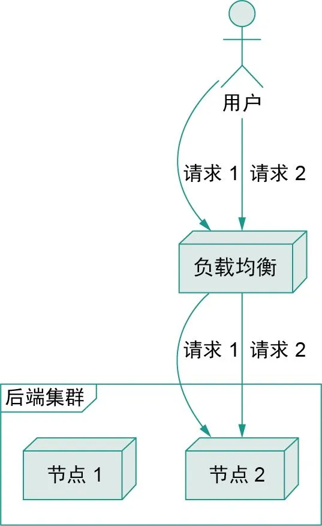
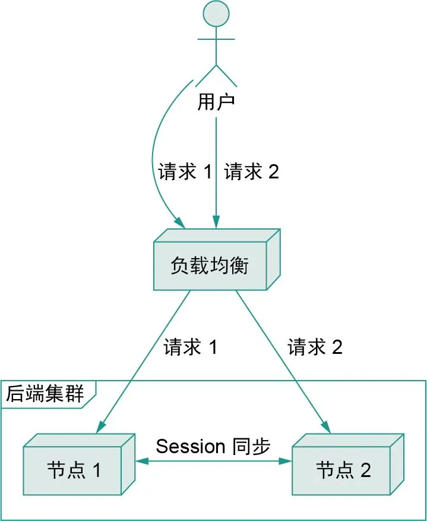
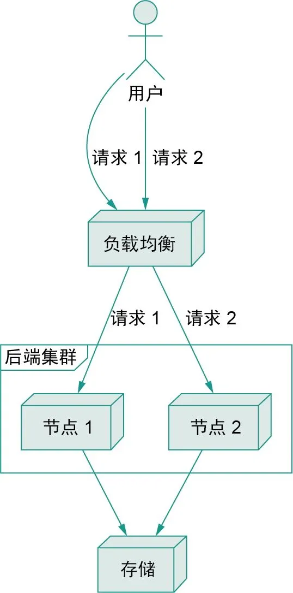
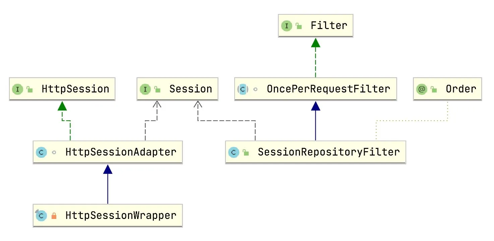

# 第11章Web开发进阶(2)

## 11.2　调整 Web 容器

在 5.3 节中我们提到过，Spring Boot 的程序通常会使用内嵌 Web 容器，不像传统的 Web 项目要跑在外置容器里。默认情况下，Spring Boot 自带 Tomcat 容器，当然，我们也可以更换容器。在这一节里，我们将看到如何在 Spring Boot 项目中更换不同的内置容器，如何微调容器的配置，最后再看看如何让系统从支持 HTTP/1.1 升级到支持 HTTP/2。

### 11.2.1　更换内嵌 Web 容器

我们在项目中通过引入 Spring Boot 的 spring-boot-starter-web 起步依赖开启了对 Web 工程的支持，这个依赖中其实已经带上了 spring-boot-starter-tomcat，因此在 Spring Boot 里默认使用 Tomcat 就是这么实现的。表 11-4 罗列了 Spring Boot 自带的 Web 容器相关的起步依赖。

表 11-4　Spring Boot 内置支持的几款 Web 容器起步依赖

起步依赖

- 说明

- 引入 Apache Tomcat 相关的依赖，这是 Spring Boot 默

spring-boot-starter-tomcat

- 认的 Web 容器

spring-boot-starter-jetty

- 引入 Eclipse Jetty 相关的依赖

spring-boot-starter-undertow

- 引入 JBoss Undertow 相关的依赖

- 引入 Netty 相关的依赖，提供响应式 Web 服务的支

spring-boot-starter-reactor-netty

- 持，后续在介绍 WebFlux 时会用到

只要没有用到什么容器特有的东西，Tomcat、Jetty 和 Undertow 三者之间就可以实现灵活切换（Reactor Netty 仅提供响应式的支持，不支持普通的 Servlet，所以没算在内），以 Tomcat

```
切换 Jetty 为例，在 pom.xml 的 <dependencies /> 中只需两步调整即可：
(1) 从 spring-boot-starter-web 中通过 <exclusions /> 排除 spring-boot-starter-tomcat 依
```

赖；

(2) 加入 spring-boot-starter-jetty 依赖。

```xml
<dependency>
   <groupId>org.springframework.boot</groupId>
   <artifactId>spring-boot-starter-web</artifactId>
   <exclusions>
       <exclusion>
           <groupId>org.springframework.boot</groupId>
           <artifactId>spring-boot-starter-tomcat</artifactId>
       </exclusion>
   </exclusions>
</dependency>
<dependency>
   <groupId>org.springframework.boot</groupId>
   <artifactId>spring-boot-starter-jetty</artifactId>
</dependency>
```

调整完毕后，运行程序，如果看到类似如下的输出，就说明已经切换到了 Jetty 容器：

```
2021-02-17 10:39:45.388 INFO 30464 --- [main] o.s.b.w.e.j.JettyServletWebServerFa
initialized with port: 8080
2021-02-17 10:39:45.391 INFO 30464 --- [main] org.eclipse.jetty.server.Server : j
built: 2020-10-20T23:39:24.803Z; git: 1be68755656cef678b79a2ef1c2ebbca99e25420; j
```

想要切换 Undertow，方法是类似的，只需把 spring-boot-starter-jetty 这个起步依赖换成spring- boot-starter-undertow 即可。运行后的日志是类似这样的：

```
2021-02-17 10:50:51.158 INFO 30637 --- [main] io.undertow : starting server: Unde
2021-02-17 10:50:51.161 INFO 30637 --- [main] org.xnio : XNIO version 3.8.0.Final
2021-02-17 10:50:51.165 INFO 30637 --- [main] org.xnio.nio : XNIO NIO Implementat
2021-02-17 10:50:51.185 INFO 30637 --- [main] org.jboss.threads : JBoss Threads v
2021-02-17 10:50:51.225 INFO 30637 --- [main] o.s.b.w.e.undertow.UndertowWebServe
on port(s) 8080 (http)
```

- 茶歇时间：不同的 Servlet 版本与对应的容器Servlet 自诞生起已经经历了好几个大版本的变迁。Servlet 3.0 是随 Java EE 6 规范一同发布的，可支持异步处理、新增了不少注解，还增强了插件能力。Servlet 4.0 是 Java EE 8中更新的，为 HTTP/2 的全面落地做好了准备，可支持服务器推送。Servlet 5.0 主要是随4Jakarta EE 9发布的，这个版本跟前面的版本相比最大的区别是更换了命名空间，从

```
javax.\* 变成了 jakarta.\*，这种不兼容升级带来的影响是巨大的，升级需谨慎。
```

- 在本书编写时，Spring Boot 2.6 需要运行在 Servlet 3.1 及以上版本的容器里，自带的 Web容器可以支持 Servlet 4.0，而 Spring Boot 3.0 兼容 Jakarta EE 9，可以支持到 Servlet5.0。以 Spring Boot 2.6.3 为例，其自带的 Tomcat 9.0.56 和 Undertow 2.2.14.Final 是能够支持Servlet 4.0 的， 而 Jetty 9.0.52 暂时只支持 Servlet 3.1。Spring Boot 3.0.0-M2 自带的Tomcat 10.0.18 和 Undertow 2.2.16.Final 都支持 Servlet 5.0，Jetty 11.0.8 更是支持到了Servlet 5.1。需要特别说明的是，由于 Jakarta EE 9 有不小的改动，很多框架和设施为它做了适配，在 Maven 的 ArtifactId 位置都加上了 -jakarta 后缀以示区别，Spring Boot3.0.0-M2 里用到的 Undertow 中就有 undertow-servlet-jakarta。

### 11.2.2　调整内嵌 Web 容器配置

之前在使用外置 Web 容器的时候，我们总会对配置文件做些调整，例如，修改默认的端口

```
号，调整处理线程数，如果要用 Web 容器来处理 HTTPS 请求，那还要配置证书等。现在虽
```

然换成了内置容器，但这些配置工作还是要做的，毕竟默认配置太“大路货”了，没办法满足我们的个性化需求。Spring Boot 作为一个如此灵活的框架，必然在默认配置之外给我们开了扇大门——可以自己手动对容器进行各种调整，配置文件如果满足不了我们的要求，还可以用代码来配置。

1. 端口配置

```
默认情况下，Spring Boot 的内置 Tomcat 会监听 8080 端口，可以通过
application.properties 中的 server.port 来指定要监听的端口号。根据 4.3.2 节
中的内容，我们也可以将这个端口的配置放在操作系统的环境变量里，用 SERVER_PORT
```

- 变量来进行配置，其效果是一样的。表 11-5 列出了这个配置可以选择的几个取值。

- 表 11-5　server.port 的几种可能的取值

- 取值说明

- 使用随机的端口，由系统自行决定，随机端口可以避免端口冲突。可

```
以通过注册自己的 ApplicationListener Bean 来获取最终使用
```

- 的端口号；如果是在单元测试中，则可以通过添加

```
@LocalServerPort int port; 成员来获得端口号
-1
```

- 仅启动 Web 容器，但不监听任何端口，更多是用在单元测试中

- 正常可用于监听的端口，但不建议直接使用，在 Linux 中非 root 用

```
1~1024
```

- 户不能使用 1024 以下的端口

```
正常可用于监听的端口，默认的 8080 就在这个范围里，像 8080、
1025 及以上
8081、8090 这些都算常用的端口号
如果服务器绑定了多个地址，例如是双网卡的机器，还可以通过 server.address 来指
```

- 定程序要绑定的地址。

2. 压缩配置浏览器在浏览网页时与服务器的 HTTP 交互通常是文本形式的，我们看到的 HTML、CSS、JavaScript 等内容其实都是文本，可以通过 GZIP 算法对文本进行压缩，节省传输的带宽。表 11-6 罗列了 Spring Boot 与 HTTP 应答压缩有关的一些配置。

- 表 11-6　HTTP 应答压缩相关配置

- 配置项默认值

```
server.compression.enabled
false
server.compression.min-response-size
2KB
```

- 对 HTML、XML、纯文本、CSS、

```
server.compression.mime-types
```

- JSON 做压缩

```
server.compression.excluded-user-agents
null，都会做压缩
假设我们希望对大于 1KB 的应答进行压缩，就可以在 application.properties 里做
```

- 如下设置：

```
server.compression.enabled=true
1
server.compression.min-response-size=1024
2
```

3. SSL 配置用明文在网上传输信息总是不太安全，类似新闻这样的普通信息也就罢了，如果是金融或者涉及敏感信息的东西，就不合适使用明文，这时使用 HTTPS 来取代 HTTP 进行通信就是必需的。

```
放到以前，我们需要配置 Tomcat 的 <Connector/> 标签，设置 SSLEnabled、
scheme、secure 和 sslProtocol 属性，但有了 Spring Boot 就容易多了，在配置文件
里加几个配置就好了。ServerProperties 中与 SSL 相关的配置有很多，具体都在
org.springframework.boot.web.server.Ssl 类里，表 11-7 中简单罗列了几个，
其中的配置项有很多会设置到 Tomcat 的 SSLHostConfig 里。
```

- 表 11-7　server.ssl.* 的一些常用配置

- 配置项说明

- 要支持的 SSL 算法，可以接受 OpenSSL 或 JSS式，一般不设，Tomcat 默认用

```
server.ssl.ciphers
HIGH:!aNULL:!eNULL:!EXPORT:!DES:!RC
D5:!kRSA
server.ssl.enabled
是否开启 SSL 支持，默认为 true
```

- 要开启的协议列表，用＋代表增加某种协议，－

```
server.ssl.enabled-protocols
```

- 5去除某种协议

```
server.ssl.protocol
SSL 使用的协议，默认为 TLS
server.ssl.key-alias
```

- 密钥库中密钥的别名

```
server.ssl.key-password
```

- 用来访问密钥的密码

- 保存了 SSL 证书的密钥库路径，通常是一个 JKS

```
server.ssl.key-store
```

- 件

```
server.ssl.key-store-password
```

- 密钥库文件的密码

- 5这里的协议是具体的 TLS、TLSv1.2 这样的协议，如果用 all，相当于开启了

```
+SSLv2Hello+TLSv1+TLSv1.1+TLSv1.2+TLSv1.3，不过目前已经不再推荐使用
```

- 1.2 版本以下的 TLS 协议了，生产环境中可以考虑禁用。

- 在 SSL 越来越普及的今天，二进制奶茶店当然也不能落伍，有必要让我们的系统也支持SSL。

- 需求描述　二进制奶茶店现在对外提供服务了，虽然菜单是公开的，但是顾客的订单属于个人隐私，应该在网上加以保护，所以我们希望能加密客户端传输过来的请求与应答。为此，服务端与客户端都需要支持 HTTPS，后续还要支持 HTTP/2。

```
一般 HTTPS 监听的端口是 443，但这个端口通常是为负载均衡准备的，背后的服务器可
```

- 6

```
以用 8443 端口，application.properties 里的配置如代码示例 11-10 所示。
```

- 代码示例 11-10　开启 HTTPS 支持的配置文件片段

```
server.port=8443
1
server.ssl.key-store=classpath:binarytea.p12
2
server.ssl.key-store-password=binarytea
3
```

- 假设我们把密钥库文件 binarytea.p12 放在 CLASSPATH 里，也就是 src/main/resources

```
里，对应的密码是 binarytea，那程序运行起来后就应该能成功监听 8443 端口。
```

- 在第 9 章的代码示例 9-37 和代码示例 9-38 中，我们使用 HttpComponents 作为

```
RestTemplate 的底层 HTTP 客户端，配置的 ClientHttpRequestFactory 会忽略证
```

- 书错误，同时也不会校验主机名，适用于自己签发但又没有导入信任证书列表的情况。当然，如果是机构签发的证书，也是适用的，就是什么东西都不校验了，但这样做不太安全，不建议用在生产环境里。

- 所以，我们可以直接用 10.4.2 节中的客户端来访问 https://localhost:8443，客户端用customer-jwt-auth 或 customer-basic-auth，这里使用前者，将

```
application.properties 中的 binarytea.url 改成下面这样就可以运行程序了：
binarytea.url=https://localhost:8443
1
如果这次我们希望能够校验证书，可以调整一下 loadTrustMaterial() 方法的参数，
```

- 7如代码示例 11-11 所示。主要是注入了证书存储和对应的密码，随后将证书信息加载到

```
SSLContext 里，不再忽略校验错误。
```

- 代码示例 11-11　加载了证书的客户端配置类代码片段

```java
@SpringBootApplication
1
@Slf4j
2
public class CustomerApplication {
3
   @Value("$")
4
   private Resource keyStore;
5
   @Value("$")
6
   private String keyStorePassword;
7
8
   @Bean
9
   public ClientHttpRequestFactory requestFactory() {
10
       // 省略部分代码
11
       SSLContext sslContext = null;
12
       try {
13
           sslContext = SSLContextBuilder.create()
14
               // 加载证书
15
               .loadTrustMaterial(keyStore.getFile(),
16
               keyStorePassword.toCharArray())
17
               .build();
18
       } catch (Exception e) {
19
           log.error("Can NOT create SSLContext", e);
20
       }
21
       if (sslContext != null) {
22
           builder.setSSLContext(sslContext) // 设置SSLContext
23
                   .setSSLHostnameVerifier(NoopHostnameVerifier.INSTANCE); //
24
       }
25
26
       return new HttpComponentsClientHttpRequestFactory(builder.build());
27
   }
28
   // 省略其他代码
29
}
30
然后，在 application.properties 里增加证书相关的配置项就可以了：
binarytea.ssl.key-store=classpath:binarytea.p12
1
binarytea.ssl.key-store-password=binarytea
2
```

- 茶歇时间：如何获得 HTTPS 证书密钥和证书

- 之类的信息对于企业和个人来说都是非常重要的资产，需要重点保护。在上面的例子中，我们使用了一个名为 binarytea.p12 的密钥库，里面就存储着配置 HTTPS 要用到的密钥。那这个密钥库又是怎么获得的呢？通常有两种方式：自己签发一个仅做学习用途或者内部使用的证书；

- 通过专门的机构申请获得证书，有些机构也会提供免费证书，但大部分是需要付费购买的。

- 我们先来尝试使用 Java 提供的 keytool 工具自己签发一个证书，具体的命令格式如下：

```
keytool -genkeypair -alias 别名
1
        -storetype 密钥库类型 -keyalg 算法 -keysize 长度
2
        -keystore 文件名
3
        -validity 有效期
4
```

- 其中，密钥库类型可以选择 JKS、JCEKS 和 PKCS12，算法可以是 RSA 或者 DSA，密钥的长度越长安全性越好，比如用 2048 位的，证书的有效期单位是天。我们例子中的binarytea.p12 文件用的命令就是：

```
▸ keytool -genkeypair -alias binarytea -storetype pkcs12 -keyalg rsa \ -keys
1
binarytea.p12 -validity 365
2
```

- 这里用了交互式的方式，需要自己输入密钥库的密码还有其他一些信息，我们例子里用

```
的密码就是 binarytea。
```

- 自己签发的证书由于无法通过浏览器等其他工具的校验，使用时存在诸多不便，而自己写程序或者使用工具时忽略证书校验错误又存在安全隐患，容易被中间人攻击，所以不推荐在生产中使用。比较合适的方式是从专门的授信机构获得证书。国内的几家大的云服务提供商，例如阿里云和腾讯云，都有提供 SSL 证书的服务。根据证书的类型和用途，会有不同的价格。8当然，我们也可以选择像 Let's Encrypt 和亚洲诚信这样的机构。它们针对单域名提供了免费的证书，目前前者的免费证书有效期是 3 个月，后者的有效期是 1 年。也有第三

- 方服务提供证书自动续签。

4. Tomcat 容器特定配置

```
server 打头的配置对应了 Spring Boot 的 ServerProperties 类，Web 容器相关的配
```

- 置基本在这里了，其中还有几个内部类，针对了不同的 Web 容器，例如

```
ServerProperties.Tomcat 是针对 Tomcat 的，ServerProperties.Jetty 是针对
Jetty 的，而 ServerProperties.Undertow 则是针对 Undertow 的。因为 Spring Boot
```

- 默认使用 Tomcat，所以这里我们来详细了解下 Tomcat 都有哪些配置，具体如表 11-8 所

```
示，也可以通过 ServerProperties 类的代码来查看。
```

- 表 11-8　server.tomcat 打头的几个常用 Tomcat 配置

- 配置项默认值说明

```
server.tomcat.threads.max
200
```

- 最大工作线

5. 其他配置

```
除了容器特定的配置外，在 Spring Boot 的 ServerProperties 里还有很多其他的配置
项，表 11-9 里简单罗列了一些，更多的内容可以直接查看 ServerProperties 的代码，
```

- 或者查阅 Spring Boot 文档的附录部分。

- 表 11-9　ServerProperties 中的一些其他配置

- 配置项默认值说明

```
server.max-http-header-size
8KB
```

- 能接受的最大 HTTP 报文

```
server.servlet.context-path
```

- 应用的上下文路径

```
server.servlet.session.timeout
30m
```

- 会话超时时间，如果不带

```
server.servlet.session.cookie.http-only
false
```

- 会话 Cookie 是否使用 H

- 会话 Cookie 的最长有效

```
server.servlet.session.cookie.max-age
```

- 单位是秒。Spring Boot

```
里 Cookie 的 maxAge 的
是否包含 exception 属
server.error.include-exception
false
```

- 启

```
何时要包含 trace 属性
server.error.include-stacktrace
never
```

- 建议在生产环境里开启

```
server.error.path
/error
```

- 显示错误信息的控制器路

```
server.error.whitelabel.enabled
true
```

- 发生错误时是否使用默认

- 9White Label 中文直译为白标，最早指不带自己的品牌，不做品牌宣传。放在这里，Spring Boot 的默认错误页面叫 White Label，大概也是因为上面没有 Spring 和系统的Logo 与信息，只有大大的 Whitelabel Error Page 和错误内容。

- 如果通过配置参数无法满足需求，Spring Boot 还提供了一个

```
WebServerFactoryCustomizer<T extends WebServerFactory> 接口，
WebServerFactoryCustomizerBeanPostProcessor 这个后置处理器会对上下文里
的每个 WebServerFactory Bean 执行后置处理，进行个性化配置。在 Spring Boot 里针
对不同的容器提供了不同的 WebServerFactory，例如
TomcatServletWebServerFactory、JettyServletWebServerFactory 和
UndertowServletWebServerFactory，响应式 Web 容器也有对应的类。如果想定制
```

- Tomcat 容器，可以像下面这样：

```java
@Component
1
public class BinaryteaTomcatWebServerCustomizer
2
       implements WebServerFactoryCustomizer<TomcatServletWebServerFactory> {
3
4
   @Override
5
   public void customize(TomcatServletWebServerFactory factory) {
6
       // 调用factory里的方法
7
       //例如addAdditionalTomcatConnectors()，可以多监听几个不同的端口
8
   }
9
}
10
```

### 11.2.3　支持 HTTP/2

我们在日常浏览网页时使用的协议大多是 HTTP/1.1，之前的例子里使用的也是这个协议。HTTP/1.1 正式发布于 1999 年，至今已经 20 余年了。这是一个优秀且伟大的协议，经住了历史的考验。但它也不是完全没有问题，HTTP/1.1 的性能就一直被人诟病，所以出现了很多看

- 10

似不太合理的优化手段，例如 CSS 雪碧图（CSS Sprites）

- 。为了优化 HTTP 的性能，

Google 在 2012 年推出了 SPDY，这也可以看成是 HTTP/2 的原型，2016 年后 Google 就不再支持 SPDY，转而拥抱 HTTP/2 了。HTTP/2 在性能方面做了不少优化，例如：

- 多路复用，能在一个连接上同时发起多个请求，不再需要等一个结束后再发起下一个；

- 二进制分帧，通过在应用层和传输层之间引入额外的一层，用二进制编码后的帧来减少传输量；

- HTTP 头压缩，之前的压缩是针对报文正文的，而在 HTTP/2 中报文头也可以用 HPack 算法压缩了；

- 服务端推送（Server Push），服务端能主动将内容推送给客户端。

Spring Boot 内置了多款 Web 容器，基本都支持 HTTP/2，只需简单的配置就可以了。但如果有条件的话，还是建议在负载均衡层面来处理 HTTP/2 和 TLS 的工作，而不是在应用服务器上。

1. 服务端支持 HTTP/2大部分情况下，我们使用的是 Tomcat，所以来看看如何开启 Tomcat 的 HTTP/2 支持。如果在使用 JDK 9 及以上的版本（例如 LTS 版本 11 和 17），那 Spring Boot 自带的 Tomcat11能直接支持 HTTP/2，只需在配置文件中增加如下配置即可：

```
server.http2.enabled=true
1
```

- 为什么这里的最低要求是 JDK 9 呢，因为 JDK 8 不支持 HTTP/2，此时 Tomcat 需要12libtcnative 的帮助才能提供 HTTP/2 服务。不过，也有不走寻常路的，Undertow 就自己实现了 HTTP/2，在 JDK 8 上也能在无须任何额外依赖的情况下支持 HTTP/2。

```
完成配置后，我们可以通过 curl 命令简单地做个测试，看到如下输出中的 h2 和 HTTP/2
就说明“走了”HTTP/2 协议，还可以加上 --http2 强制使用 HTTP/2：
▸ curl -v -k https://localhost:8443/menu/
1
2
*   Trying ::1...
3
* TCP_NODELAY set
4
* Connected to localhost (::1) port 8443 (#0)
5
* ALPN, offering h2
6
* ALPN, offering http/1.1
7
* successfully set certificate verify locations:
8
* 省略部分内容
9
* SSL connection using TLSv1.2 / ECDHE-RSA-AES256-GCM-SHA384
10
* ALPN, server accepted to use h2
11
* 省略部分内容
12
* Using HTTP2, server supports multi-use
13
* Connection state changed (HTTP/2 confirmed)
14
* Copying HTTP/2 data in stream buffer to connection buffer after upgrade: len=
15
* Using Stream ID: 1 (easy handle 0x7fe31500e800)
16
> GET /menu/ HTTP/2
17
> Host: localhost:8443
18
> User-Agent: curl/7.64.1
19
> Accept: */*
20
>
21
* Connection state changed (MAX_CONCURRENT_STREAMS == 100)!
22
< HTTP/2 200
23
< 省略部分内容
24
```

- 虽然官方不建议使用基于明文的 HTTP/2（简称 H2C），但我们还是可以在 Spring Boot 提

```
供 H2C 的服务。首先将 server.http2.enabled 设置为 false；接下来，用上一节提
到的 WebServerFactoryCustomizer<TomcatServletWebServerFactory> 做些手
```

- 13动配置，具体如代码示例 11-12 所示。使用 H2C 时记得要去掉所有 SSL 相关的配置。

- 代码示例 11-12　开启 H2C 支持的配置

```java
@SpringBootApplication
1
@EnableCaching
2
public class BinaryTeaApplication implements WebMvcConfigurer,
3
       WebServerFactoryCustomizer<TomcatServletWebServerFactory> {
4
   @Override
5
   public void customize(TomcatServletWebServerFactory factory) {
6
       factory.addConnectorCustomizers(connector -> connector.addUpgradeProtoc
7
   }
8
   // 省略其他代码
9
}
10
一样，也是用 curl 命令来做测试，但是一定要用 --http2 强制使用 HTTP/2，这时虽然显
示的协议是 HTTP/1.1，但 Upgrade: h2c 说明已经升级到了 H2C：
▸ curl --http2 -v http://localhost:8080/menu
1
*   Trying ::1...
2
* TCP_NODELAY set
3
* Connected to localhost (::1) port 8080 (#0)
4
> GET /menu HTTP/1.1
5
> Host: localhost:8080
6
> User-Agent: curl/7.64.1
7
> Accept: */*
8
> Connection: Upgrade, HTTP2-Settings
9
> Upgrade: h2c
10
> HTTP2-Settings: AAMAAABkAARAAAAAAAIAAAAA
11
>
12
< HTTP/1.1 101
13
< Connection: Upgrade
14
< Upgrade: h2c
15
< Date: Sun, 21 Feb 2021 14:18:34 GMT
16
* Received 101
17
* Using HTTP2, server supports multi-use
18
* Connection state changed (HTTP/2 confirmed)
19
* Copying HTTP/2 data in stream buffer to connection buffer after upgrade: len=
20
* Connection state changed (MAX_CONCURRENT_STREAMS == 100)!
21
< HTTP/2 200
22
```

2. 客户端支持 HTTP/2

```
聊完了服务端，再来看看客户端用 RestTemplate 如何支持 HTTP/2。在 9.4 节里我们说
过 RestTemplate 支持多种底层的 HTTP 客户端，其中用的比较多的是 Apache
```

- HttpComponents 和 OkHttp。就 HTTP/2 而言，HttpComponents 在 5.1 版本才开始支持，但在 Spring Framework 中适配的还是 4.x 的版本。OkHttp 就不存在这个问题，SpringFramework 适配的 OkHttp 3.14 版本就已经完全支持 HTTP/2 了，因此在这里我们就要把底层的客户端切换为 OkHttp。

- 首先，我们调整一下 pom.xml，将 HttpComponents 的依赖去掉，增加 OkHttp 的依赖：

```xml
<dependency>
1
   <groupId>com.squareup.okhttp3</groupId>
2
   <artifactId>okhttp</artifactId>
3
</dependency>
4
接下来，修改 CustomerApplication 的 requestFactory() 方法，原先它返回的是
HttpComponentsClientHttpRequestFactory，现在要改为
OkHttp3ClientHttpRequestFactory，相应的 SSL 配置和连接配置也要做一定的调
```

- 14整，具体如代码示例 11-13 所示。

```java
代码示例 11-13　适配 OkHttp 的 ClientHttpRequestFactory 配置
@Slf4j
1
public class CustomerApplication {
2
   @Bean
3
   public ClientHttpRequestFactory requestFactory() {
4
5
       // 构造SSLSocketFactory，配置密钥等信息
6
       SSLSocketFactory sslSocketFactory = null;
7
       TrustManagerFactory tmf = null;
8
       try {
9
           KeyStore keyStore = KeyStore.getInstance(KeyStore.getDefaultType())
10
           keyStore.load(this.keyStore.getInputStream(), keyStorePassword.toCh
11
           tmf = TrustManagerFactory.getInstance(TrustManagerFactory.getDefaul
12
           tmf.init(keyStore);
13
           SSLContext sslContext = SSLContext.getInstance("TLS");
14
           sslContext.init(null, tmf.getTrustManagers(), null);
15
           sslSocketFactory = sslContext.getSocketFactory();
16
       } catch (Exception e) {
17
           log.error("Can NOT create sslSocketFactory and ", e);
18
       }
19
20
       OkHttpClient.Builder builder = new OkHttpClient.Builder()
21
            .protocols(Arrays.asList(Protocol.HTTP_2, Protocol.HTTP_1_1)) // 默
22
            .connectTimeout(10, TimeUnit.SECONDS) // 以下3个超时默认就是10秒
23
            .callTimeout(10, TimeUnit.SECONDS)
24
            .readTimeout(10, TimeUnit.SECONDS)
25
            .connectionPool(new ConnectionPool(50, 30, TimeUnit.MINUTES));
26
27
       if (sslSocketFactory != null) {
28
           builder.connectionSpecs(Collections.singletonList(ConnectionSpec.RE
29
                   .hostnameVerifier((hostname, session) -> true) // 不验证主机
30
                   .sslSocketFactory(sslSocketFactory, (X509TrustManager) tmf
31
       }
32
33
       return new OkHttp3ClientHttpRequestFactory(builder.build());
34
   }
35
   // 省略其他代码
36
}
37
```

- 这里需要做一些说明。

```
protocols() 指定支持的协议有些限制，例如，H2_PRIOR_KNOWLEDGE 和
HTTP_1_1 必须至少有一个；用了 H2_PRIOR_KNOWLEDGE 就不能再加别的协议了；不
能使用 HTTP_1_0。
connectTimeout()、callTimeout() 和 readTimeout() 这三个超时设置为 0 表
```

- 示不超时，这里的代码示例里使用的其实就是默认值，放在这里主要是演示一下有这个配置。

```
callTimeout() 这个超时包含了整个请求过程，包括 DNS 解析、连接、发送请求、
```

- 等待服务端处理和返回应答，如果配置了重试，那重试也包含在内。因此它至少应该大于等于另两个单独步骤的超时。

```
hostnameVerifier() 设置为不验证主机完全是因为我们在演示时使用了自签证书，
```

- 在生产环境不建议这么做，存在安全隐患。

```
OkHttp 内置了一些 ConnectionSpec，例子里我们使用了 RESTRICTED_TLS，具体
```

- 的几个内置项如表 11-10 所示（根据安全性从高到低排列）。

- 表 11-10　OkHttp 内置的 ConnectionSpec

- 15

```
ConnectionSpec
```

- 支持的 TLS 版本加密套件

```
RESTRICTED_TLS
```

- TLS 1.3 与 TLS 1.2目前为止较为安全且支持较

- 15加密套件（Cipher Suite），其实是一个“四件套”，由密钥交换算法、身份验证算法、对称加密算法和信息摘要算法四个部分组成。以TLS_ECDHE_RSA_WITH_AES_256_GCM_SHA384 为例，协议是 TLS，密钥交换算法是 ECDHE，身份验证算法是 RSA_WITH_AES_256，对称加密算法是 GCM，信息摘要算法是 SHA384。

```
如果想要走 H2C 协议，在 requestFactory() 里删掉与 SSL 相关的内容，协议改为
H2_PRIOR_KNOWLEDGE 就可以了，具体如代码示例 11-14 所示。
代码示例 11-14 支持 H2C 的 ClientHttpRequestFactory 配置
@Bean
1
public ClientHttpRequestFactory requestFactory() {
2
   OkHttpClient.Builder builder = new OkHttpClient.Builder()
3
                // 只能保留一个
4
                .protocols(Arrays.asList(Protocol.H2_PRIOR_KNOWLEDGE))
5
                .connectTimeout(10, TimeUnit.SECONDS)
6
                .callTimeout(10, TimeUnit.SECONDS)
7
                .readTimeout(10, TimeUnit.SECONDS)
8
                .connectionPool(new ConnectionPool(50, 30, TimeUnit.MINUTES))
9
10
   return new OkHttp3ClientHttpRequestFactory(builder.build());
11
}
12
```

- 茶歇时间：网站提供的 HTTPS 服务到底是否安全？在这部分里我们讨论了很多 HTTPS 还有 HTTP/2 的内容，经过这一轮设置，网站的安全性得到了很大的提升。但是，我们做的到底好不好，够不够呢？总得检验一下才能放心。大公司有自己的安全团队，有钱的中小公司可以请第三方机构进行检测。那有没有既方便又不用花钱、结果还有参考价值的办法呢？

- 结论肯定是有的，这里要给大家推荐两个工具，一个是 SSL Labs 的在线 SSL 测试，另一个是亚洲诚信推出的 MySSL 检测工具。两者的作用差不多，都是根据事先预设好的检测条目，逐条进行检测，规则包括但不限于证书、支持的协议、支持的算法、是否存在已知漏洞等。然后根据检测结果进行综合打分，最后针对网站 SSL 配置的安全性做出一个评价，最高是 A+。如果存在问题，工具也会给出优化建议。可以选择其一对自己的网站进行在线测试。建议选择前者，规则会更为严格一些。

## 11.3　支持分布式 Session

在生产环境中，我们基本会要求应用以集群的方式部署，就算用 Kubernetes，也会要求最小保持两个 Pod，且两个 Pod 要在不同的物理节点上，以防止出现单点故障——这是最起码的设计要求。正常情况下，任何理由的单点都是不应该存在的。

这时就可能出现以下情况：对于用户几次连续的请求，有的请求发给了 A 服务器，有的则发给

- 16

了 B 服务器，而默认 Servlet 的 Session

- 是保存在本地的。访问不同的服务器，看到的

Session 信息是不同的。例如，一个请求访问 A 服务器，A 服务器发现本地没有该用户的Session，就直接创建了个新的，写了些信息进去；下一个请求访问了 B 服务器，也发现本地没有该用户的 Session，同样创建了一个新的，这里面当然就没有 A 服务器写进去的内容。

既然知道了会有这样的问题，那自然就要去寻找解决方案，好在我们不是行业里第一批遇到这个问题的人，前人已经为我们准备好了解决方案。

### 11.3.1　几种常见的解决方案

在介绍 Spring Session 这个 Spring 提供的解决方案之前，我们先来了解一些常见的解决方案的思路，也许这些方案就足够处理目前的场景了。能用简单的办法搞定的，为什么要选复杂的呢？

1. 使用 Cookie既然不同的机器没办法简单地使用同一个 Session，那索性就不用 Session 了。我们可以把原先需要通过 Session 来传递的信息放到 Cookie 里面。每次请求时都会从客户端读取Cookie 发送给服务端，这相当于把在不同请求间共享信息的任务交给了客户端来做，要共享的内容也都放到了客户端。

- 但这时需要注意以下两点：

- 由于 Cookie 是保存在客户端的，而且每次都需要在网上进行传输，不建议将敏感信息放在 Cookie 里，如果一定要放也必须加密存放，避免信息泄露；

- 每次请求都要在请求中包含 Cookie，如果 Cookie 很大，势必会导致请求很大，这带来了额外的传输量，所以东西能精简就精简。

2. 会话保持我们说自己的应用是个集群，那在实际的服务器之前就一定会有负载均衡设备。既然请求都会经过负载均衡，那就可以想办法让同一个用户的请求都访问同一台服务器，这样就可以一直使用同一台服务器上的 Session。这种让一次会话过程中发起的请求都发送到同一台服务器上的技术就是会话保持，有时也称为粘滞会话（Sticky Session）。大致情况如图 11-1 所示，用户发起的请求 1 和请求 2 都会被转发到同一个后端节点上。

```
以使用 Nginx 实现负载均衡为例，可以在配置 upstream 时加入 ip_hash 配置，开启基
```

- 于 IP 的会话保持。这种方案简单有效，但如果遇上 Hash 分配到的服务器宕机，会重新进行 Hash 计算，选择新的服务器，这时还是会丢失一部分的 Session。不同方案各有利弊，做出选择就意味着要接受潜在的风险。

3. 会话复制如果还是想让请求落到不同的服务器上，也可以考虑让不同的服务器拥有相同的 Session。数据库有主从复制，也有“双主”的策略，Web 容器的 Session 管理策略可以借鉴这种思想，实现会话复制（Session Replication）。在成熟的 Java Web 容器里都有集群模式，例

```
如 Tomcat 里就可以配置 SimpleTcpCluster，里面包含了集群中每个节点的信息，
```

- Session 会在整个集群中进行复制。大致情况如图 11-2 所示，节点 1 和节点 2 能双向复制Session，因此用户的请求落到哪个节点都没有太大差别。



- 图 11-1　会话保持示意图



- 图 11-2　会话复制示意图

- 当然，这个方案的问题也比较明显，在服务器之间复制大量的 Session 势必会占用服务器和网络的资源。而且数据的复制始终会有一定延时，因而就有一定的概率在节点异常关闭后

- 数据并未及时复制，导致 Session 丢失。

4. 共享存储应用的服务器是个集群，我们一直说它们需要做成无状态的，存在 Session 状态在某种意义上就是违背了无状态的原则，那么把这种状态从应用里剥离出来不就可以了吗？之前使用Cookie 就是这个思路，它把状态往前推给了客户端，这次我们要往后推，既然应用服务器是无状态的，那就把状态保存在可以存储状态的地方。例如，早期会选择 Memcached，现

```
在更多的是放在 Redis 和数据库这样的存储里。Web 容器是通过 JSESSIONID 来加载
```

- Session 的，只需修改这个加载和存储逻辑，背后使用指定的存储就可以了。大致情况如图11-3 所示，Session 都保存在同一个存储中，节点就变成无状态的了，自然可以处理全部请求。



- 图 11-3　共享存储示意图

- 这个方案可以比较理想地解决会话保持和会话复制在遇到异常时会丢失数据的问题，因为数据都在后端存储里，但代价是要部署额外的存储，还要实现一定的高可用，例如 Redis 需要用 Redis Cluster，数据库要部署主从节点。另外，这个方案需要一些额外的组件开发，好在现在有 Spring Session，它已经实现好了一套比较完善的分布式 Session 机制，背后也有多种存储可供选择。接下来，就让我们一起了解一下 Spring Session。

### 11.3.2　使用 Spring Session 实现分布式 Session

为了帮助大家处理 Session 相关的问题，Spring Session 提供了一套完备的 API，和 Spring的其他组件一样，它在不同的底层实现之上做了统一的抽象，开发时无须与特定容器绑定。

```
Spring Session 中包含了对类似 Tomcat 这种 Web 容器的 HttpSession 的支持，还提供了
```

WebSocket 和 WebFlux 的支持。它由以下一些主要模块组成：

- Spring Session Core，包含核心 API 和基础功能；

- Spring Session JDBC，提供使用 JDBC 作为 Session 存储的能力；

- Spring Session Data Redis，提供使用 Redis 作为 Session 存储的能力。

除此之外，还有 Spring Session MongoDB、Spring Session Hazelcast、Spring Session forApache Geode，分别提供了不同的底层存储能力。

Spring Boot 里自带了 Spring Session 相关的依赖，可以直接使用。如果希望使用更新版本，

```
可以在 pom.xml 的 <dependencyManagement /> 中添加如下 BOM（具体版本需要到官方
```

网站查看）：

```xml
<dependency>
   <groupId>org.springframework.session</groupId>
   <artifactId>spring-session-bom</artifactId>
   <version>2020.0.3</version>
   <type>pom</type>
   <scope>import</scope>
</dependency>
然后直接在 <dependencies /> 里引入需要的依赖，此时无须指定版本。
```

1. 实现原理

```
在开发过程中，我们基本是从 HttpServletRequest 里获取 HttpSession 进行相关的
```

- 操作，区别无非是通过自己写的代码来获取，还是由 Spring MVC 框架注入方法的参数里。

```
既然这些都是接口，对使用 HttpSession 的代码而言，无须关心它实际存储在哪里，又
```

- 是怎么取出来的。

```
Spring Session 正是基于这个思想，通过 SessionRepositoryFilter<S extends
Session> 这个 Servlet Filter 拦截了 HTTP 请求，将请求中的
HttpServletRequest 封装为
SessionRepositoryFilter<S>.SessionRepositoryRequestWrapper。从这个
Wrapper 中获取的 Session 都是 HttpSessionWrapper，它的操作都是由
SessionRepositoryFilter 里的 SessionRepository<S> 来实施的。如果背后是
JDBC，那这个 SessionRepository<S> 就是
JdbcIndexedSessionRepository<JdbcIndexedSessionRepository.JdbcSess
ion>。Spring Session 部分核心类的大致结构如图 11-4 所示。
```



- 图 11-4　Spring Session 的部分核心类

2. 基于数据库存储 Session要开启 Spring Session 的 JDBC 支持，首先要在 pom.xml 中引入如下依赖：

```xml
<dependency>
1
  <groupId>org.springframework.session</groupId>
2
  <artifactId>spring-session-jdbc</artifactId>
3
</dependency>
4
Spring Session JDBC 其实就是把 Session 信息存储在数据库的 SPRING_SESSION 和
SPRING_SESSION_ ATTRIBUTES 表里，前者保存了 Session 的信息，例如
SESSION_ID、何时创建的、最后访问时间、过期时间等信息；后者则是 Session 中的具
```

- 体属性。那这两张表的表结构如何，我们该怎么去创建它们呢？Spring Session JDBC 早就为我们准备好了，在 spring-session-jdbc 的 Jar 中，org/springframework/session/jdbc/ 目录下提供了 10 种不同数据的建表与删表语句，具体如表 11-11 所示。有了表之后，再通过

```
JdbcOperations 进行各种增删改查操作就可以了。
```

- 表 11-11　Spring Session JDBC 内置的 Schema 文件

- 数据库建表语句文件删表语句文件

- DB2schema-db2.sqlschema-drop-db2.sql

- Derbyschema-derby.sqlschema-drop-derby.sql

- H2schema-h2.sqlschema-drop-h2.sql

- HsqlDBschema-hsqldb.sqlschema-drop-hsqldb.sql

- MySQLschema-mysql.sqlschema-drop-mysql.sql

- Oracleschema-oracle.sqlschema-drop-oracle.sql

- PostgreSQLschema-postgresql.sqlschema-drop-postgresql.sql

- SQLiteschema-sqlite.sqlschema-drop-sqlite.sql

- SQLServerschema-sqlserver.sqlschema-drop-sqlserver.sql

- Sybaseschema-sybase.sqlschema-drop-sybase.sql

- 在生产环境中，DBA 通常会根据要求事先在数据库里建好对应的表。例如对于 MySQL 数据库，我们就可以把 schema-mysql.sql 里的语句拿出来给到 DBA，之前在开发时我们都选择了 H2 数据库，所以可以把 schema-h2.sql 等文件里的内容放到我们的 schema.sql 里，

```
或者像代码示例 11-15 这样手动创建一个内嵌数据源，其他类似 TransactionManager
```

- 之类的 Bean 依然交给 Spring Boot 的自动配置来为我们创建。如果我们的代码中存在多个

```
DataSource Bean，可以在用于 Spring Session 的 DataSource 声明上增加
@SpringSessionDataSource 注解加以标识。
```

- 代码示例 11-15　添加了 Spring Session JDBC 脚本的内嵌数据源配置

```java
@SpringBootApplication
1
@EnableCaching
2
@EnableJdbcHttpSession
3
public class BinaryTeaApplication implements WebMvcConfigurer {
4
   @Bean
5
   public EmbeddedDatabase dataSource() {
6
       return new EmbeddedDatabaseBuilder()
7
               .setType(EmbeddedDatabaseType.H2)
8
               .addScript("org/springframework/session/jdbc/schema-drop-h2.sql
9
               .addScript("org/springframework/session/jdbc/schema-h2.sql")
10
               .build();
11
   }
12
   // 省略其他代码
13
}
14
上面的代码中，我们还在类上添加了一个 @EnableJdbcHttpSession 注解，它的定义如
```

- 下所示：

```
@Retention(RetentionPolicy.RUNTIME)
1
@Target()
2
@Documented
3
@Import()
4
@Configuration(proxyBeanMethods = false)
5
public @interface EnableJdbcHttpSession {...}
6
它导入了 JdbcHttpSessionConfiguration，其中会为我们创建
SessionRepositoryFilter<? extends Session> 类型的
springSessionRepositoryFilter，通过它来实现 11.3.2 开头部分的封装逻辑。
Spring Boot 会自动注册上下文里的 Filter，以便对请求进行拦截，如果不是在 Spring
```

- Boot 里，或者禁用了 Spring Boot Servlet 相关的自动配置，我们可以像官方文档里那样使

```
用 AbstractHttpSessionApplicationInitializer 来完成 Filter 的注册。
用户的登录信息是放在 Session 里的，未登录用户访问 /order 会被重定向到登录页面，
```

- 登录后 Session 里就有了当前登录的信息，这时我们可以通过 JDBC 查看一下

```sql
SPRING_SESSION 和 SPRING_SESSION_ATTRIBUTES 表的内容，然后带上 Cookie 再
去访问 /order，应该就能正常访问了。具体测试代码如代码示例 11-17 所示，但在此之
前，需要先设置一下我们的 MockMvc，加入 SessionRepositoryFilter，如代码示例
11-16 所示（注意添加 Filter 的顺序）。
代码示例 11-16　在 MockMvc 里增加 SessionRepositoryFilter
@SpringBootTest
1
class OrderControllerTest {
2
   private MockMvc mockMvc;
3
   private JdbcTemplate jdbcTemplate;
4
5
   @BeforeEach
6
   void setUp(WebApplicationContext wac) {
7
       this.mockMvc = MockMvcBuilders.webAppContextSetup(wac)
8
           .addFilter(wac.getBean("springSessionRepositoryFilter", SessionRepo
9
           .apply(springSecurity())
10
           .build();
11
       jdbcTemplate = new JdbcTemplate(wac.getBean(DataSource.class));
12
   }
13
   // 省略其他代码
14
}
15
在 JdbcIndexedSessionRepository 保存完 Session 信息后会返回一个 Session ID，
SessionRepositoryFilter 会通过 HttpSessionIdResolver 将其写入指定位置，
例如，在我们的测试中就是用 CookieHttpSessionIdResolver 把 Session ID 写到了
Cookie 中。名为 SESSION 的 Cookie 中用 BASE64 的方式保存了 Session ID，类似
MDhhMDg5NWYtZTU5Ny00NzNlLTk2NzYtMzU0ZDBjZGIyOGE3，还原后就是
08a0895f-e597-473e-9676-354d0cdb28a7，用它就可以在数据库里进行查询了。
代码示例 11-17　OrderControllerTest 中针对 Spring Session JDBC 的单元测试
@Test
1
void testLoginWithJdbcSession() throws Exception {
2
   mockMvc.perform(get("/order"))
3
           .andExpect(status().is3xxRedirection());
4
5
   MvcResult result = mockMvc.perform(post("/doLogin")
6
           .param("user", "LiLei").param("pwd", "binarytea")
7
           .with(csrf())).andReturn();
8
   Cookie sessionCookie = result.getResponse().getCookie("SESSION");
9
   String sessionId = new String(Base64.getDecoder().decode(sessionCookie.getV
10
   String id = jdbcTemplate.queryForObject(
11
           "select PRIMARY_ID from SPRING_SESSION where SESSION_ID='" + sessio
12
   assertNotNull(id);
13
   int attrCount = jdbcTemplate.queryForObject(
14
           "select count(*) from SPRING_SESSION_ATTRIBUTES where SESSION_PRIMA
15
           Integer.class);
16
   assertTrue(attrCount > 0);
17
18
   mockMvc.perform(get("/order").cookie(sessionCookie))
19
           .andExpect(status().isOk());
20
}
21
```

- 其实，Spring Boot 的自动配置中提供了与 Spring Session 相关的配置，我们无须自己添加

```
@EnableJdbcHttpSession 注解，只要 CLASSPATH 中有相关的依赖，用配置文件就能
完成配置，spring.session 对应的配置属性类是 SessionProperties，而
spring.session.jdbc 对应的则是 JdbcSessionProperties。
JdbcSessionDataSourceInitializer 会根据实际数据源的类型完成数据库的初始
化，我们也不需要配置 EmbeddedDatabase 了。
在 application.properties 中添加如下配置也可以指定使用 Spring Session JDBC，
spring.session.jdbc.initialize-schema 的作用与
spring.datasource.initialization-mode 是类似的，
spring.session.jdbc.schema 是初始化数据表用的 SQL 文件，
spring.session.jdbc.table-name 则是存储 Session 的表名：
spring.session.store-type=jdbc
1
spring.session.jdbc.initialize-schema=embedded
2
spring.session.jdbc.schema=classpath:org/springframework/session/jdbc/schema-@@
3
spring.session.jdbc.table-name=SPRING_SESSION
4
```

3. 基于 Redis 存储 Session一旦理解如何使用 Spring Session JDBC 存储 Session，使用 Redis 的方法就简单多了——先是引入 Spring Session Data Redis 的依赖（如果没有引入 Spring Data Redis 相关依赖，可以一并加上）：

```xml
<dependency>
1
   <groupId>org.springframework.boot</groupId>
2
   <artifactId>spring-boot-starter-data-redis</artifactId>
3
</dependency>
4
<dependency>
5
   <groupId>org.springframework.session</groupId>
6
   <artifactId>spring-session-data-redis</artifactId>
7
</dependency>
8
```

- 然后，按照 8.2 节中的方法配置 Redis 相关的信息，剩下的交给 Spring Boot 的自动配置就好了。如果 CLASSPATH 中同时存在多个 Spring Session 的依赖，也可以在

```
application.properties 中像下面这样指定存储方式，或者在配置类上增加
@EnableRedisHttpSession 注解。spring.session.redis 对应的配置类是
RedisSessionProperties，其中需要特别说明的是
spring.session.redis.namespace 可以用来配置 Redis 中保存 Session 信息的键名
```

- 的前缀：

```
spring.session.store-type=redis
1
spring.session.redis.namespace=spring:session
2
```

- 其实还有个简单的方法可以测试是否配置好了 Redis 存储：如果使用单机的 Session 管理，Tomcat 重启后 Session 会丢失；而使用了 Spring Session Data Redis 的系统，Session 保存在 Redis 里，只要用之前的 Cookie 发起请求，依旧可以获得 Session。

[4]：Eclipse 基金会在从 Oracle 接手 Java EE 后就将其改为了 Jakarta EE，2019 年 9 月 Jakarta EE 8 是其接手后发布的首个版

- 本，和 2017 年发布的 Java EE 8 没有功能上的差异。

[6]：这个例子在 ch11/binarytea-https 项目里。[7]：这个例子在 ch11/customer-https 项目里。[8]：大家也可以通过腾讯云和七牛云申请亚洲诚信的免费证书。[10]：CSS 雪碧图就是把很多小图标整合成一个大的图片文件，不用浏览器发起大量小请求来获取图片，用一个下载大文件（其实

- 也没那么大）的请求取而代之。因为在 HTTP/1.1 里浏览器针对一个域名只会建立少数连接，而每个连接一次又只会处理一个

- 请求，大量的请求势必会造成等待，即使开启了长连接，性能也一般。

[11]：由于 HTTP/2 建议开启 SSL 增强安全性，所以我们这里讨论的情况都是加密通信，也就是说要先按照 11.2.2 节中介绍的内容

- 配置好 SSL。后面客户端的支持，说的也是带 SSL 的。

[12]：Apache Portable Runtime (APR) based Native library for Tomcat，是个本地库，可以像这样放到 JVM 路径里：。[13]：这个示例在 ch11/binarytea-h2c 项目里。[14]：这个示例在 ch11/customer-h2 项目里。[16]：Session 的中文翻译为“会话”。在日常工作中，大家通常会直接使用英文 Session，而使用“会话”有时会产生混淆，因此，我们

- 在本书中约定：强调服务器端的 Session 对象时，使用 Session；，表示交互的情况下使用“会话”。此外，在一些惯用表达中也会使用“会话”，例如会话保持。
