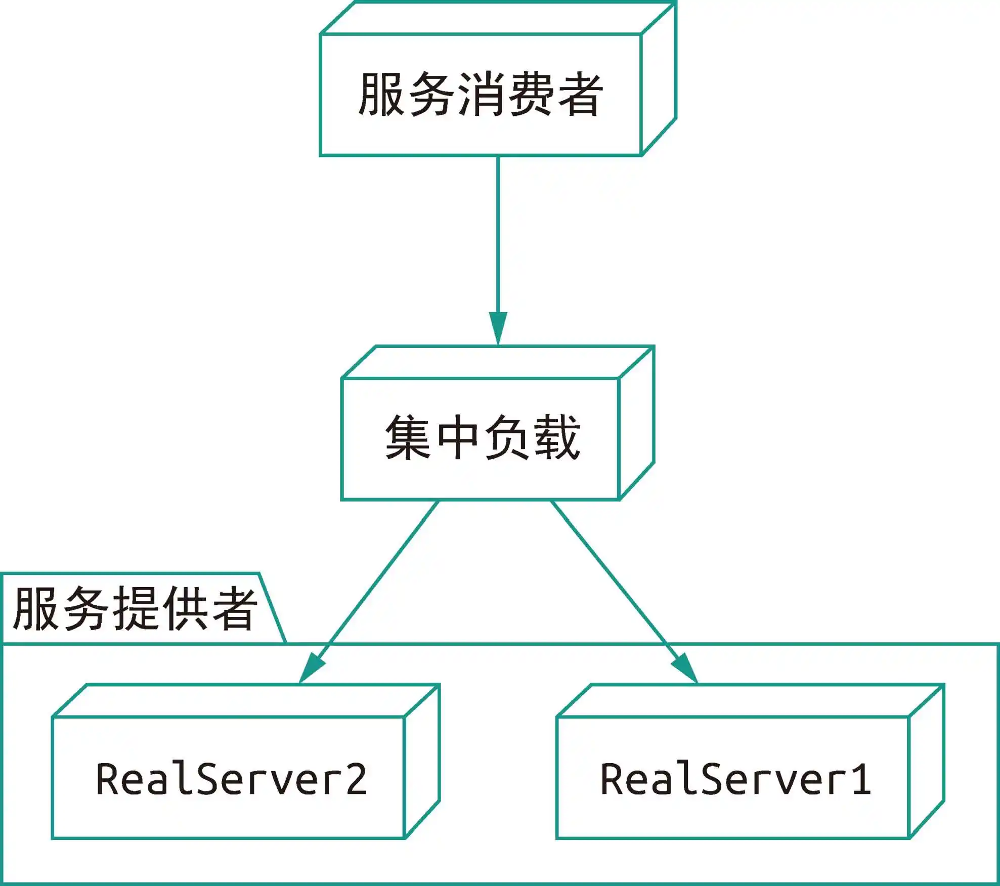
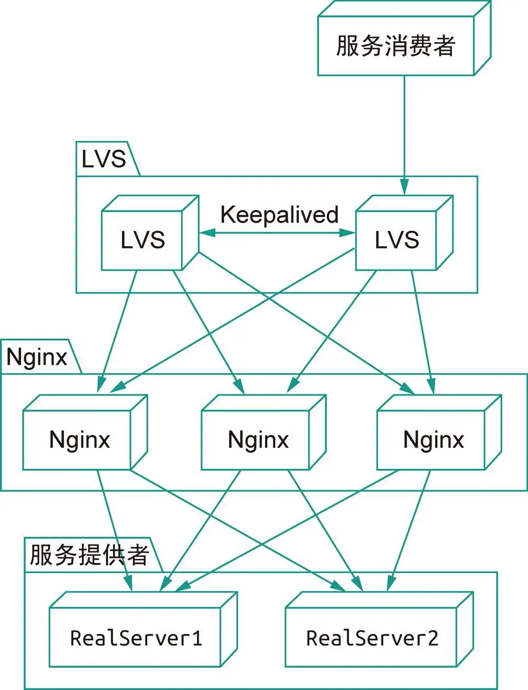
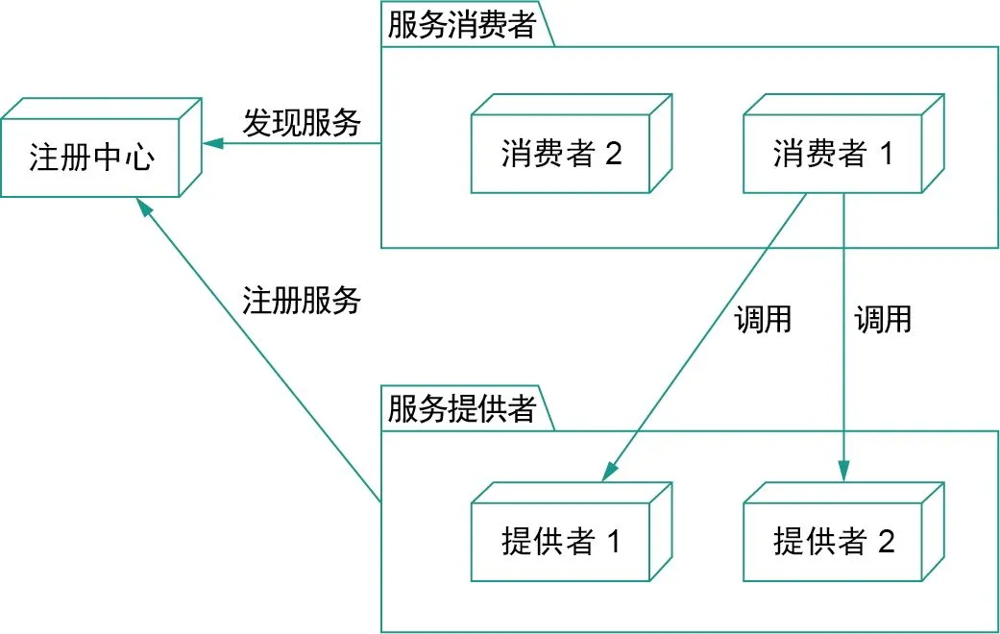

# 第13章服务注册与发现(1)

- 本章内容常见的微服务负载均衡方案

- 基于 Spring Cloud 的微服务注册与发现机制

- Spring Cloud DiscoveryClient 的实现原理

- Spring Cloud 中的几种常见服务注册中心

为了提供稳定的服务，系统通常都会采取一些高可用方案，其中集群化就是比较常用的做法。系统一般会部署为一个或者多个集群，集群内的实例都是无状态的，此时就需要考虑如何将请求合理地分发到集群中的各个实例上——这就是负载均衡。负载均衡有很多种方案，有硬件的，也有软件的，有集中式的，也有分布式的。本章就让我们来了解一下 Spring Cloud 为我们提供的微服务负载均衡方案——这是一套分布式的软负载解决方案，而且还支持多种注册中心，使用起来非常方便灵活。

## 13.1　常见的负载均衡方案

在开始接触 Spring Cloud 的负载均衡方案前，先让我们来了解一下业界一直以来所使用的负载均衡方案，其中用到的一些技术有的历史悠久，而有的算是新技术。

### 13.1.1　集中式方案

所谓集中式方案，通常会有个集中的流量入口，就像图 13-1 里画的那样。其中服务消费者就是服务的调用方，它可以是一个集群，也可以是真实用户（针对对外的服务或者页面）。负载背后真正提供服务的节点，我们可以称其为 Real Server，即真实服务器。服务消费者并不能直接访问真实的服务提供者，需要通过负载均衡器来进行中转，这里介绍的负载均衡器是集中式的，因此在图中将其标注为集中负载。



- 图 13-1　常见的集中式负载均衡方案

1. 商业硬件方案谈到商业负载均衡，比较有名的就是 F5 Networks 的 BIG-IP 了。有些时候我们在交流时甚1至会用 F5 来指代硬件负载均衡设备。F5 可以工作在 OSI的四层到七层，一般我们会使用四层负载和七层负载。四层负载直接根据 IP 和端口对请求进行负载，发送到后端的服务器上。七层负载则在四层的基础上，可以根据应用的特点再做分发，例如一个 HTTP 的负载均衡器，除了 IP 和端口，还能根据 URL、HTTP 头等信息决定请求如何负载。

- 硬件负载均衡设备的特点就是处理能力强，单台设备就能扛下巨大的流量；但缺点也很明显，成本太高，而为了保障系统的高可用性，通常还需要准备冗余的硬件，更是进一步加大了投入。除了前面提到的 F5，行业里还有些厂商也提供专业的负载均衡硬件，例如

- Array、A10 和 Citrix 等。在做商业硬件方案时，不妨货比三家，除了先期投入，后续的维保和技术支持都是不小的花销。

2. 开源软件方案有硬件方案，自然就会有软件方案；有软件方案，我们就一定会想有没有开源的方案。讲到负载均衡软件，就一定要先介绍一下 LVS（Linux Virtual Server）。LVS 是由章文嵩博士主导开发的一个开源负载均衡器项目，自 1998 年 5 月第一行 LVS 代码诞生后，已经被无数人用在了真实的项目中。而且，LVS 也早已是 Linux 内核的一部分了。LVS 在内核中实现了基于 IP 的请求负载均衡，它属于四层负载均衡，在用户访问负载均衡器后，能根据预先设定好的策略将请求发送到后端具体的某台服务器上。LVS 的常用工作模式有 NAT（Network Address Translation，网络地址转换）模式、DR（Direct Routing，直接路由）模式和 TUN（Tunneling，隧道）模式等。常用的调度策略有轮询调度（Round Robin）、最小连接调度、目标地址 Hash 调度、源地址 Hash 调度和最短期望延迟等。

- LVS 作为请求的入口，自然也要实现高可用，不然图 13-1 中的集中负载一出问题，就算后端的服务提供者都是好的，也没有办法提供服务。网上用的最多的就是搭两台 LVS，一主一备，通过 Keepalived 来监控节点的状态，一旦主节点出问题了，备节点就能自动接管。Keepalived 之所以能实现这一功能，背后靠的是 VRRP（Virtual Router RedundancyProtocol，虚拟路由冗余协议）。它把几台路由设备联合组成一台虚拟的路由设备，当主机的下一跳路由设备出现故障时，及时将业务切换到备份路由设备。这样一来，对外是同一个VIP（Virtual IP，虚拟 IP），我们无须关注背后具体连的是哪个 LVS 节点，系统会自己来保证总有可用的 LVS。

- 聊完了四层上的 LVS，再来看看常用于七层的 Nginx。Nginx 是由俄罗斯程序员 IgorSysoev 开发的一款高性能 Web 服务器和反向代理服务器，现在它早已成功取代了 ApacheHTTP Server 的位置，成为首选的 Web 服务器。Nginx 在开源七层负载均衡器中的地位似乎也已经难以撼动了。Nginx 的七层负载非常灵活，除了根据 URL、HTTP 头匹配规则，还能对请求进行改写，如果搭配 Lua 脚本，可以实现更多“神奇”的效果，可定制性极强。Nginx 同样支持多种调度策略，例如轮询、加权轮询、基于 IP Hash、基于 URL Hash 等。从 1.9.0 版本开始，Nginx 中增加了 Stream 模块，也开始支持 TCP 代理和负载均衡，能够提供四层负载均衡。

- 总体上来看，四层负载均衡只需处理底层的数据包，没有复杂的逻辑，性能更好；但七层负载均衡更贴近应用，更加灵活——两者各有利弊。在实际使用过程中，通常会将两者结合起来，最外层用 LVS 搭配 Keepalived 提供高性能高可靠的四层负载，主备 LVS 背后都挂上一组对等的 Nginx 集群提供七层负载，再在 Nginx 中配置具体的应用服务器地址和端口。具体如图 13-2 所示。



- 图 13-2　LVS 与 Nginx 搭配的负载均衡方案

- 除了上面提到的 LVS 和 Nginx，业界还有一些其他的知名开源负载均衡软件，例如HAProxy 是一款同时支持四层和七层高性能负载均衡的老牌软件，国内的爱奇艺基于DPDK 开发了一款高效的四层负载均衡器 DPVS。DPVS 全称是 DPDK-LVS，从名字中就能看出它是从 LVS 修改而来的，两者的主要区别就是 DPVS 引入了 DPDK。DPDK 的全称是 Data Plane Development Kit，能为系统提供更高效的数据包处理能力，核心思想就是DPDK 应用在 Linux 用户态直接用自己的库来收发数据包，绕过 Linux 内核协议栈的处理过程，节省了很多开销。相比传统 LVS，采用 DPDK 技术后能大幅提升数据包的转发性能。

### 13.1.2　分布式方案

13.1.1 节中介绍的方案都需要经过一个集中的点，虽然这个点也可以是一个集群，但逻辑上会有个流量进入的中心。只要存在中心点，那这个中心点就可能成为系统的瓶颈或者高危区域，我们能不能消除它呢？答案必然是肯定的。

大家可以试想一下平时下载东西的过程。当你从一个网站用 HTTP 协议下载文件时，网站就是下载过程中的中心点，一旦网站崩溃，下载就会失败。但如果用 P2P（Point-to-Point，点对点）协议来下载，例如用 BT 工具，我们只需要从 Tracker 服务器上获取目前正在下载和“做种”的节点信息，随后就能直接连上分散在各地的节点去下载，这样就不存在中心了。

在系统内部的服务调用方式上，我们也可以参考 P2P 的方案，实现分布式负载均衡。服务的提供者在启动后将自己提供的服务信息注册到服务注册中心，而服务的消费者则从注册中心获取自己需要的服务的提供者信息。在发生实际调用时，消费者直接根据策略从提供者列表中选择一个节点发起调用，具体如图 13-3 所示。与集中式方案相比，分布式方案每次调用无须经过独立的负载均衡器，而是直接请求实际的提供者。在具体实现该方案时当然情况会复杂很多，我们要考虑各种异常和特殊场景，例如如何应对注册中心整体故障，如何感知节点发生变化，等等，但整体的流程和结构大致上是这样的。



- 图 13-3　分布式负载均衡方案

Spring Cloud 早期支持 Netflix 公司开源的 Eureka 来充当服务的注册中心，后来还提供了对HashiCorp Consul 和 Apache Zookeeper 的支持，阿里巴巴也贡献了 Nacos 相关的支持。在本章的后续部分，我们会分别来看看这些组件的概况和具体使用方法。

## 13.2　使用 Spring Cloud 实现负载均衡

正如在 12.3 节中所介绍的那样，Spring Cloud 为构建云原生应用提供了一系列完整的解决方案，其中之一就是服务的注册与发现机制。Spring Cloud 可以轻松实现微服务的软负载均衡，还自带了对多种注册中心的支持。得益于 Spring 一贯强大的抽象，在切换不同的配置中心时，应用代码几乎无须改动。在接下来的部分中，让我们通过二进制奶茶店的一个例子来了解一下如何使用 Spring Cloud 实现负载均衡。

- 需求描述　我们的二进制奶茶店系统慢慢变大了，不再是单机系统，服务端变成了集群。因为不想运维集中式的硬件或者软件负载均衡设施，我们选择了分布式方案，打算用 SpringCloud 来实现服务的注册和发现。至于注册中心，先不着急决定，都试试吧。

### 13.2.1　在 Zookeeper 中注册服务

要在项目中使用 Spring Cloud 相关的能力，通常的做法是先在

```xml
<dependencyManagement/> 中导入 Spring Cloud 的 pom 文件，具体的版本可以配置在
<properties/> 中，后面用到 Spring Cloud 的依赖时，大多都需要先在这里导入 spring-
cloud-dependencies，届时就不再赘述了：
<properties>
   <spring-cloud.version>2021.0.1</spring-cloud.version>
</properties>
<dependencyManagement>
   <dependencies>
       <dependency>
           <groupId>org.springframework.cloud</groupId>
           <artifactId>spring-cloud-dependencies</artifactId>
           <version>$</version>
           <type>pom</type>
           <scope>import</scope>
       </dependency>
   </dependencies>
</dependencyManagement>
```

随后，引入所需的依赖，例如我们这里希望使用 Zookeeper 来做服务的注册中心，自动实现

```xml
服务的注册与发现，就在 pom.xml 的 <dependencies/> 中增加如下的起步依赖，版本由上
面的 spring-cloud-dependencies 统一管理：
<dependency>
   <groupId>org.springframework.cloud</groupId>
   <artifactId>spring-cloud-starter-zookeeper-discovery</artifactId>
</dependency>
```

作为服务提供者的程序在引入依赖后，不需要我们做什么改动，只需调整一些配置即可，例

- 2

```
如，在 application.properties 里增加如下内容
```

- ：

```
spring.application.name=binarytea
spring.cloud.zookeeper.connect-string=localhost:2181
第一行的 spring.application.name 是使用 Spring Cloud 的服务注册、服务发现和配置
```

管理功能等诸多功能时都需要用到的配置，代表了当前应用的应用名称。第二行的

```
spring.cloud.zookeeper.connect-string 是具体要连接的 Zookeeper 地址，这里我
们使用了监听本机 2181 端口的 Zookeeper，记得先把它启动起来，当然，也可以换别的地
```

址。如果使用 Docker 的话，可以用如下命令在本地启动一个 Zookeeper：

```
▸ docker pull zookeeper
▸ docker run --name zookeeper -p 2181:2181 -d zookeeper
```

在启动我们的 BinaryTea 程序后，Spring Cloud 会帮我们把实例注册到 Zookeeper 上，如果

```
我们用 zkCli.sh 命令连上 Zookeepr，通过命令可以查看到具体的信息，大致是这样的：
[zk: localhost:2181(CONNECTED) 3] ls /services/binarytea
[5ff82111-04c2-4b13-ba52-3c69f5468691]
[zk: localhost:2181(CONNECTED) 5] get /services/binarytea/5ff82111-04c2-4b13-ba52
{"name":"binarytea","id":"5ff82111-04c2-4b13-ba52-3c69f5468691","address":"192.16
"sslPort":null,"payload":{"@class":"org.springframework.cloud.zookeeper.discovery
"id":"binarytea","name":"binarytea","metadata":{"instance_status":"UP"}},"registr
1621778230330,"serviceType":"DYNAMIC","uriSpec":{"parts":[{"value":"scheme","vari
"://","variable":false},{"value":"address","variable":true},{"value":":","variabl
"port","variable":true}]}}
从上面的信息可以看到，服务名是 binarytea，也就是 spring.application.name 里
```

配置的值，实例 ID 默认是 Spring 上下文 ID，地址就是注册上去的本机 IP，端口是

```
server.port，当前实例的状态是 UP。
```

Spring Cloud 的 Zookeeper 支持还有些别的配置，通常用默认值也够了，但还是可以了解一下，具体如表 13-1 所示。

表 13-1　Spring Cloud Zookeeper 与服务注册与发现有关的一些配置

配置项

- 默认值说明

```
spring.cloud.service-registry.auto-
true
```

- 是否开启服务自

```
registration.enabled
spring.cloud.zookeeper.enabled
true
```

- 是否开启 Zooke

```
spring.cloud.zookeeper.connect-string
localhost:2181
```

- Zookeeper 的连

```
spring.cloud.zookeeper.connection-
15000ms
```

- Zookeeper 的连

```
timeout
spring.cloud.zookeeper.session-timeout
60000ms
```

- Zookeeper 的会

```
spring.cloud.zookeeper.discovery.regist
true
```

- 是否开启 Zooke

```
er
spring.cloud.zookeeper.discovery.enable
true
```

- 是否开启 Zooke

```
d
spring.cloud.zookeeper.discovery.prefer
false
```

- 是否优先使用 I

```
-ip-address
spring.cloud.zookeeper.discovery.root
/services
```

- 服务注册与发现

- 茶歇时间：为什么 Zookeeper 不适合做服务注册中心虽然在书中我们首先介绍了如何使用 Zookeeper 来充当服务的注册中心，在实际工作中的确也有很多人是这么用的，但这并不代表 Zookeeper 就是最合适的选择，甚至可以说它不是个理想的选择，这是为什么呢？

- 在分布式系统中有一个著名的 CAP 定理，其中 C 是指一致性（Consistency），A 是指可用性（Availability），而 P 则指分区容错性（Partition tolerance）。这条定理说的是 CAP 中的三个要素最多只能同时满足两个，不能三者兼顾。也就是说一个系统要么是 CA 的，要么是CP 的，要么是 AP 的，不可能同时满足 CAP 三个要素。Zookeeper 作为一款知名的分布式协调系统，追求一致性，满足 CP，在关键时刻会放弃可用性。这个关键的设计注定了在这个场景下它不是一个合理的选择，因为服务的注册中心需要是个 AP 系统。在极端情况下，注册中心活着往往比服务提供者和消费者的准确性更重要，少一个可用服务提供者并不会影响请求调用，但注册中心全崩溃了，所有服务都找不到自己需要调用的下游，那才是一个灾难。此外，Zookeeper 本身在选举、保持一致性方面有较高要求，官方推荐配置集群在 5 节点或者 7 节点这种规模，面对日益庞大的应用系统规模，终将面对自己的性能瓶颈，即使增加观察者模式的节点，也会很快面临需要拆分的那一天。还有类似服务健康检查等其他的问题，都让 Zookeeper 这个明星在服务注册中心场景下的表现不尽如人意。关于这个问题的讨论，阿里巴巴和 Netflix 的技术专家都曾经撰写过文章，讲述自己为何不选择 Zookeeper 而是自己开发了一套服务注册中心，感兴趣的朋友可以读读《阿里巴巴为什么不用 ZooKeeper 做服务发现？》和“Eureka! Why You Shouldn't Use ZooKeeper forService Discovery”。

### 13.2.2　使用 Spring Cloud LoadBalancer 访问服务

有了服务的提供者，自然就会有服务的消费者，在消费者这一端，同样需要引入 13.1 中的各

- 3

```
 最重要的是让 RestTemplate 支持从注册中心获取对应服务的列表，需要在声明
```

种依赖。

```
Bean 的时候增加 @LoadBalanced 注解，以便为我们的 RestTemplate 增加
LoadBalancerInterceptor，就像下面这样：
@Bean
@LoadBalanced
public RestTemplate restTemplate(RestTemplateBuilder builder) {}
```

- 茶歇时间：@LoadBalanced 是如何工作的

```
RestTemplate 扩展了 InterceptingHttpAccessor，其中包含一个
List<ClientHttpRequestInterceptor>，可以插入各种用于拦截请求进行处理的拦
截器，上面提到的 LoadBalancerInterceptor 就是其中之一。它会从请求的 URL 中取
出主机信息，将其视为服务名，随后通过 LoadBalancerRequestFactory 基于现有请
求封装一个新的 HTTP 请求，用 LoadBalancerClient 来执行请求。
```

- Spring Cloud Commons 中的自动配置类

```
LoadBalancerAutoConfiguration.LoadBalancerInterceptorConfig 中会自动
创建一个 LoadBalancerInterceptor，并通过 RestTemplateCustomizer 将前者
注入每个带有 @LoadBalanced 的 RestTemplate 中。
随后，在 RestTemplate 发起调用时，我们就可以在目标 URL 中使用目标服务名来代替具
```

体的主机与端口，例如 http://binarytea/token 就可以代替之前的 http://localhost:8080/token，

```
binarytea 会被替换成具体的目标。在 application.properties 中同样做些微调：
spring.application.name=customer
spring.cloud.zookeeper.connect-string=localhost:2181
binarytea.url=http://binarytea
这里因为存在 JwtClientHttpRequestInitializer，我们在请求时会添加 JWT 令牌，
而之前的示例中，获取令牌的动作每次会创建一个新的 RestTemplate，显然它没被
@LoadBalanced 增强过，所以 10.4 节中的 Customer 示例不能只改配置，还需对
JwtClientHttpRequestInitializer 做些微调，具体的改动如下：
直接注入一个上下文中的 RestTemplate，不再通过 ClientHttpRequestFactory 来
```

- 自己创建；

```
为了避免循环依赖，注入的 RestTemplate 上要添加 @Lazy，同时 initToken() 不能
在构建后自动执行，也就是要去掉 @PostConstruct；
由于注入的 RestTemplate 也会执行 JwtClientHttpRequestInitializer，所以针
```

- 对 /token 的请求要跳过添加令牌的动作。

- 4

大致上的代码如代码示例 13-1 所示。

```java
代码示例 13-1　修改后的 JwtClientHttpRequestInitializer
@Slf4j
public class JwtClientHttpRequestInitializer implements RestTemplateRequestCustom
   // 省略部分属性
   @Autowired
   @Lazy
   private RestTemplate restTemplate;
   // 去掉了@PostConstruct
   public void initToken() {...}
   @Override
   public void customize(ClientHttpRequest request) {
       if (request.getURI().getPath().equalsIgnoreCase("/token")) {
           // /token的路径不添加令牌
           return;
       }
       // 省略未改动的代码
   }
   private ResponseEntity<TokenResponse> acquireToken() {
       return restTemplate // 直接用RestTemplate来获取Token，这里要跳过令牌校验
               .postForEntity(binarytea + "/token",
                       new TokenRequest(username, password), TokenResponse.class
   }
}
```

通常我们都会希望开着服务发现功能，但如果出于某些原因，CLASSPATH 里存在相关依赖，

```
又希望关闭这个功能，可以配置 spring.cloud.discovery.enabled=false。其他还有
一些 spring.cloud.loadbalancer 打头的配置项，可以参考
LoadBalancerProperties 类。
```

### 13.2.3　使用 OpenFeign 访问服务

```
使用 RestTemplate 已经可以方便地调用 REST 服务了，可是在编写调用代码时多少还有些
“刻意”的味道，要专门用 RestTemplate 中与 HTTP 动作对应的方法，既要传递参数，又要
```

处理结果类型。如果能像调用普通业务逻辑代码那样来调用远程的服务，代码看起来就会舒服很多。

- 请注意　虽然这里的代码调用看上去和普通的本地方法调用没什么区别，但一定要时刻提醒自己，这是个远程调用，各种异常、时延的问题还是要处理的。

- 5

OpenFeign

- 是一款声明式的 Web 服务客户端，将 Java 代码和 HTTP 接口绑定到一起，让

开发者可以轻松地编写 Web 服务客户端。原本 OpenFeign 要求创建一个接口，随后加上OpenFeign 或者 JAX-RS 的注解来声明服务；在 Spring Cloud OpenFeign 的加持下，现在我们也可以使用 Spring MVC 的注解来做声明，还可以充分利用 Spring Cloud 提供的服务注册与发现能力。

1. OpenFeign 的基本用法这里我们仍旧以 Customer 项目为例，在 13.2 节中的例子的基础上，引入 Spring CloudOpenFeign 的依赖。关于服务负载均衡相关的能力，并不包含在这个依赖中，如果需要，

```xml
我们可以自己添加 spring-cloud-starter-loadbalancer 依赖，或者是添加间接包
含它的依赖，例如 spring-cloud-starter-zookeeper-discovery。
<dependency>
1
   <groupId>org.springframework.cloud</groupId>
2
   <artifactId>spring-cloud-starter-openfeign</artifactId>
3
</dependency>
4
<!-- 下面不是必需的 -->
5
<dependency>
6
   <groupId>org.springframework.cloud</groupId>
7
   <artifactId>spring-cloud-starter-loadbalancer</artifactId>
8
</dependency>
9
```

- 随后调整客户端代码，定义远程服务的接口。其实有了 Spring Cloud 的帮助，我们可以直接将 BinaryTea 中的控制器类复制过来，删掉具体的方法实现，按需留下带有注解的方法6声明就可以了。当然，在实际工作中，还是会稍作修改，例如代码示例 13-2就是我们迁移到客户端的订单服务。

```java
代码示例 13-2　对应了 OrderController 的 Feign 服务接口
@FeignClient(contextId = "orderService", name = "binarytea", path = "/order")
1
public interface OrderService {
2
   @GetMapping(produces = MediaType.APPLICATION_JSON_VALUE)
3
   List<Order> listOrders();
4
5
   @PostMapping(consumes = MediaType.APPLICATION_JSON_VALUE,
6
                 produces = MediaType.APPLICATION_JSON_VALUE)
7
   ResponseEntity<Order> createNewOrder(@RequestBody NewOrderForm form);
8
}
9
```

- 在上面的接口定义中，我们去除了呈现页面的部分，只留下了 REST 服务的接口。

```
@FeignClient 注解告诉 Spring Cloud 这是一个 Feign 的 Client，只需在配置类上添加
@EnableFeignClients，Spring 会自动扫描带有 @FeignClient 的接口并注册对应的
Bean，而 Bean 的 ID 就是 contextId 中所指定的。name 属性是服务名，通过它在注册
中心找到对应的服务提供者，其中可以带上 http:// 这样的协议，也可以使用 ${} 这样
的占位符。path 是接口中所有方法的路径前缀，定义方法时也可以在注解里添加自己的
path 属性，如果有公共的路径前缀就用这种方式配置，不要再配置 @RequestMapping
之类的注解。返回的 Order 对象可以直接从 BinaryTea 工程中复制过来，去掉不需要的注
```

- 解和一些属性即可，此处就不再赘述了，大家可以直接参考示例代码。

```
有了 OrderService 后，我们就不再需要用 RestTemplate 发起订单调用了，新的
OrderRunner 可以改成代码示例 13-3 这样，直接使用 OrderService 让代码逻辑看起
```

- 来更自然了。

```java
代码示例 13-3　使用了 Feign 客户端的 OrderRunner
@Component
1
@Order(5)
2
@Setter
3
@Slf4j
4
public class OrderRunner implements ApplicationRunner {
5
   @Autowired
6
   private OrderService orderService;
7
8
   @Override
9
   public void run(ApplicationArguments args) throws Exception {
10
       List<learning.spring.customer.model.Order> orders = orderService.listO
11
       log.info("调用前的订单数量: {}", orders.size());
12
       NewOrderForm form = NewOrderForm.builder()
13
           .itemIdList(Arrays.asList("1"))
14
           .discount(90).build();
15
       ResponseEntity<learning.spring.customer.model.Order> response =
16
               orderService.createNewOrder(form);
17
       log.info("HTTP Status: {}, Headers: {}", response.getStatusCode(), resp
18
       log.info("Body: {}", response.getBody());
19
   }
20
}
21
```

2. 请求拦截器

```
到目前为止，我们的 OrderRunner 还不能正常工作，因为服务端针对 /order 需要进行
JWT 令牌认证。之前我们用 RestTemplate 时写过一个
JwtClientHttpRequestInitializer 对每个请求进行定制，现在也是一样的。
OpenFeign 提供了一个 RequestInterceptor 接口，用来对请求进行拦截，我们可以写
一个类似的 JwtClientHttpRequestInterceptor，为请求添加 JWT 令牌相关的
```

- HTTP 头。具体如代码示例 13-4 所示，其主要代码与

```
JwtClientHttpRequestInitializer 几乎相同。
```

- 代码示例 13-4　处理 JWT 认证相关拦截工作的

```java
JwtClientHttpRequestInterceptor
@Slf4j
1
public class JwtClientHttpRequestInterceptor implements RequestInterceptor {
2
   // 所有要注入的属性与JwtClientHttpRequestInitializer相同，此处省略
3
   @Override
4
   public void apply(RequestTemplate requestTemplate) {
5
       if (StringUtils.isBlank(token)) {
6
           initToken();
7
       }
8
       requestTemplate.header(HttpHeaders.AUTHORIZATION, "Bearer " + token);
9
   }
10
   // initToken()等方法与JwtClientHttpRequestInitializer相同，此处省略
11
}
12
只需把这个类配置为 Bean，Spring 会自动将上下文中 RequestInterceptor 类型的
```

- Bean 注入 OpenFeign 客户端里，所以配置类大概就像代码示例 13-5 这样。现在只要启动BinaryTea 工程，让其注册到注册中心上，我们的整个客户端代码就能正常工作了。

```java
代码示例 13-5　增加了 @EnableFeignClients 和
JwtClientHttpRequestInterceptor 的配置类
@SpringBootApplication
1
@Slf4j
2
@EnableFeignClients
3
public class CustomerApplication {
4
   @Bean
5
   public JwtClientHttpRequestInterceptor jwtClientHttpRequestInterceptor() {
6
       return new JwtClientHttpRequestInterceptor();
7
   }
8
   // 省略其他内容
9
}
10
```

3. 切换不同的 HTTP 客户端

```
与 RestTemplate 一样，OpenFeign 底层也支持多种 HTTP 客户端，默认的
Client.Default 客户端实例使用 Java 自带的 HttpURLConnnection，如果
```

- 7CLASSPATH 中存在对应的客户端与封装类，就能替换客户端，具体如表 13-2 所示。

- 表 13-2　OpenFeign 支持的 HTTP 客户端

- 客户端封装类依赖配置项

```
Spring Cloud OpenFeign 的 FeignAutoConfiguration 自动配置类会根据
```

- CLASSPATH 和上下文的情况自动为我们配置对应的客户端。下面的配置代码会自动创建

```java
Apache Http Client 的 CloseableHttpClient，并用它来创建 feignClient Bean，
feign.httpclient.enabled 不配置的话默认是 true，所以也可以不写。当然，我们
也可以自己动手覆盖这些配置，比如用 HttpClientBuilder 配置一个自己的
CloseableHttpClient。
@Configuration(proxyBeanMethods = false)
1
@ConditionalOnClass(Feign.class)
2
@EnableConfigurationProperties({ FeignClientProperties.class, FeignHttpClientP
3
@Import(DefaultGzipDecoderConfiguration.class)
4
public class FeignAutoConfiguration {
5
   @Configuration(proxyBeanMethods = false)
6
   @ConditionalOnClass(ApacheHttpClient.class)
7
   @ConditionalOnMissingBean(CloseableHttpClient.class)
8
   @ConditionalOnProperty(value = "feign.httpclient.enabled", matchIfMissing =
9
   @Conditional(HttpClient5DisabledConditions.class)
10
   protected static class HttpClientFeignConfiguration {}
11
   // 省略其他代码
12
}
13
从上面的代码中可以看出只要 CLASSPATH 里存在 ApacheHttpClient 类，上下文里没
有 CloseableHttpClient 类型的 Bean，又不是 HC5 的情况，Spring Cloud 就会自动
```

- 为我们配置基于 Http Client 的 Feign 客户端，所以最简单的方法就是在 pom.xml 的

```xml
<dependencies/> 里加上下面这些依赖。在之前用 RestTemplate 时我们用过 Http
Client，而 feign-httpclient 就是包含了 ApacheHttpClient 封装类的依赖。这里
```

- 的版本需要我们根据 Spring Cloud OpenFeign 依赖的 OpenFeign 版本进行微调，例如这里用的是 11.8。

```xml
<dependency>
1
   <groupId>io.github.openfeign</groupId>
2
   <artifactId>feign-httpclient</artifactId>
3
   <version>11.8</version>
4
</dependency>
5
<dependency>
6
   <groupId>org.apache.httpcomponents</groupId>
7
   <artifactId>httpclient</artifactId>
8
</dependency>
9
```

4. OpenFeign 的常用配置在前面的例子中，我们已经看到了 Spring Cloud OpenFeign 会为我们自动应用上下文中的

```
RequestInterceptor。除了这个类型的 Bean，还有一些其他类型的 Bean 也有类似的
```

- 效果，我们在上下文里配置自己的 Bean 就行了，例如：

```
Logger.Level，OpenFeign 的日志级别，可以是 NONE、BASIC、HEADERS 和
FULL；
Retryer，重试相关的配置，默认会创建一个 Retryer.NEVER_RETRY 类型的
```

- Bean，表示不做重试；

```
Request.Options，请求相关的配置，例如连接超时、读取超时等；
Capability，可以在构建客户端时，针对部分核心能力进行自定义，例如在引入了
feign-micrometer 后自动配置的 MicrometerCapability。
```

- 当然，Spring Cloud OpenFeign 还是为我们做了大量的自动配置工作的，例如

```
FeignLoadBalancerAutoConfiguration 和前面提到的
FeignAutoConfiguration。默认的 FeignContext 中包含了很多东西，OpenFeign
中需要用到 Contract、Encoder、Decoder 和 Logger，
FeignClientsConfiguration 就分别配置了 SpringMvcContract、
SpringEncoder、ResponseEntityDecoder 和 Slf4jLogger
（DefaultFeignLoggerFactory 默认创建的就是这个 Logger）。此外，还有
Feign.Builder 和 Client 的默认值。
上面提到的默认配置都加了 @ConditionalOnMissingBean 注解，所以只需要我们在配
置类里提供自己的 Bean 就能取代默认值。如果是用于特定的 @FeignClient 中，注解里
还有一个 configuration 属性，可以提供配置类，这里为了避免配置类被自动扫描，可
以不用添加 @Configuration 注解。
```

- 除了配置类的方式，我们也可以选择用配置文件来设置 OpenFeign 的各项属性，相关属性

```
大部分都用 feign.client.config.<contextId> 开头，如果是默认属性可以用
feign.client.config.default 开头。表 13-3 罗列了一些常用的配置。
```

- 表 13-3　Spring Cloud OpenFeign 提供的一些常用配置项

- 配置项说明

- 如果同时存在配置类和配置文件，

```
feign.client.default-to-properties
```

- 件的内容

```
feign.client.config.
```

- 连接超时，单位毫秒

```xml
<contextId>.connect-timeout
feign.client.config.<contextId>.read-
```

- 读取超时，单位毫秒

```
timeout
feign.client.config.<contextId>.encoder
Encoder 类名
feign.client.config.<contextId>.decoder
Decoder 类名
feign.client.config.<contextId>.logger-
日志级别，注意是 Feign 的 Logge
level
```

- 值，不是一般的日志级别

```
feign.client.config.<contextId>.follow-
```

- 是否依据响应内容做重定向

```
redirects
更多的配置项可以参考 FeignClientProperties.FeignClientConfiguration
类，如果用了 Apache Http Client，还有一些 feign.httpclient 开头的配置项，可以参
考 FeignHttpClientProperties 类。
```

[1]：ISO/OSI 模型，即国际标准化组织的开放式通信系统互联参考模型（Open System Interconnection Reference Model），共分为

- 七层，从下往上分别是物理层、数据链路层、网络层、传输层、会话层、表示层和应用层。

[2]：这里的例子以 11.1 节的 binarytea-controller-advice 为基础，放在 ch13/binarytea-zookeeper 项目中。

[3]：在早期的 Spring Cloud 中，我们要在配置类上增加 注解，声明开启服务发现的客户端，但现在不再需要这步动作了，

- CLASSPATH 中只要存在 实现即可。

[4]：这个例子在 ch13/customer-zookeeper 项目中。[5]：Feign 早期是 Netflix 开发的一个内部项目，但在 Netflix 内部并未得到广泛使用。后来这个项目脱离了 Netflix，且工程改名为

- OpenFeign，目前 OpenFeign 是一个非常热门的开源项目。

[6]：这个例子在 ch13/customer-feign 项目中。[7]：表中依赖项的 GroupId 都是 ，这里就省略了。需要引入这些依赖和具体客户端的依赖才能开启不同客户端的支持。
