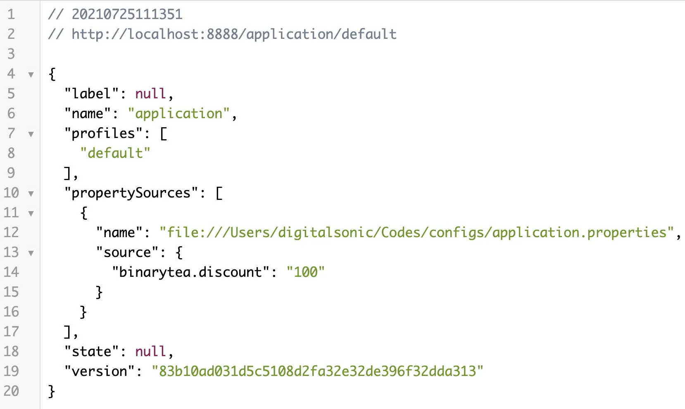

# 第14章服务配置管理(1)

- 本章内容Spring Cloud Config 的基本用法

- Spring Cloud Config 的实现原理

- 几种常用的配置中心

在一个复杂系统中，一定会存在大量的配置，特别是这个系统由大量微服务构成时，问题会更加严重，因为这些配置可能散落在各处，管理起来非常麻烦。Spring Cloud 既然是大量优秀实践的沉淀，自然也注意到了这个问题，为我们提供了一套比较成熟的解决方案。例如，在上一章介绍 Netflix OSS 时就提到了分布式配置中心 Archaius。本章中，让我们看看如何在 SpringCloud Config 的帮助下解决微服务的配置管理难题。

## 14.1　使用 Spring Cloud Config 实现配置管理

在 Spring Cloud 的常用功能中，与服务发现同等重要的应该就是服务配置管理了。本节中我们就来一起了解一下配置该如何管理，Spring Cloud 提供了哪些便于配置管理的组件，这些组件又能如何保护我们的配置项。

### 14.1.1　为何需要配置中心

“早期的系统并不复杂，开发运维也比较简单粗暴，开发者们没有太多配置的概念，所有东西硬编码一下，如果需要针对新环境做些调整，那就在代码里改改，重新打个包发上去。”如果有人是这么告诉你的，那要么他是个几十年前的“古董”程序员，完全不接触新技术，要么就是他根本不懂软件开发与运维。

```
在 Java 系统中，可以通过 -D 在命令行中传入系统参数，哪怕是启动 Tomcat 这样的容器，
也能在代码里轻松获取 -D 传入的系统参数。像数据库连接池配置这样的内容，随着环境的变
```

化一定会变，我们可以将数据源配置在容器里，然后以 JNDI（Java Naming and DirectoryInterface，Java 命名和目录接口）的方式获取数据源。所以说在 Java 系统里不缺配置的手段，只是配置起来简单一些或者复杂一些而已。

但对大部分开发者来说，更熟悉的方式应该是将需要变动的内容作为配置项抽象出来，随后将其写在一个或几个配置文件里，遇到不同的环境就选择加载不同的配置文件。通常相关功能会沉淀到开发框架里，由框架来提供这些基础的能力，开发者自己并不需要太操心。如果是个单体应用，只有一个大集群，用这个方式来管理配置还好；但到了微服务的时代，一个分布式系统涉及几十个、上百个甚至上千个微服务，每个微服务还有多个实例，这么多配置文件的管理就变成了难题，就算用 Puppet 集中管理勉强可以过得去，但新问题又接踵而至。

修改配置文件后，很多情况下需要重启应用才能让配置生效；但我们又希望配置变更能快速生效——不要重启就能生效，而且能快速应用到整个集群，这就需要配置变更推送。例如，用Zookeeper 来管理配置，客户端监听某个节点的变化，在配置变更时 Zookeeper 能主动将变更推送过来，客户端在收到变更信息后再做对应的处理。

此外，在一些应用场景中，配置项的变更还不能只是简单地把值改了。谁能修改配置需要有统一的权限管理，而改变配置这个动作本身也需要留下痕迹，可供追踪审计。再进一步，有些配置项涉及敏感信息，这些敏感信息需要按照指定的加密算法进行加密保存。诸如此类的附加功能，在金融等领域还是比较常见的。这种情况下，普通的配置文件很难满足我们的业务要求，有个专门的配置中心会更加方便。

综合上述情况，目前我们经常使用的配置方法有如下几种：环境变量、系统参数、配置文件和配置中心。在当下的微服务系统中，使用配置中心的方式往往是更合适的选择。

### 14.1.2　基于 Spring Cloud Config Server 的配置中心

Spring Cloud Config 是 Spring Cloud 中专门用来提供配置管理解决方案的组件，同时提供了服务端与客户端的支持。在服务端方面，它提供了 Spring Cloud Config Server 作为配置中心

```
（14.1.3 节会讲 Spring Cloud Config Client），只需一个 @EnableConfigServer 注解就能
开启，通过 HTTP 接口向客户端提供配置信息，可以实现应用、Profile 和标签的多重组合，
```

而且其背后支持多种不同的存储后端，具体如表 14-1 所示。

表 14-1　Spring Cloud Config Server 支持的常用存储后端存储后端

- 说明

- 默认的后端存储方式，既能支持本地 Git 仓库，也可以支持 SSH 和 HTTPS

Git

- 等方式

- 在关系型数据库中存储配置，在 Spring JDBC 的支持下，通过几张表就能

JDBC

- 实现配置的管理了

- 在 Redis 中存储配置，使用的数据结构是 Redis 的散列表，其背后的各种

Redis

- 操作是通过 Spring Data Redis 来实现的

文件系统

- 直接在某个本地目录中存储配置，适合在简单的场景中，例如本地测试

Vault

- 当存储的内容为敏感信息时，可以考虑将其存储在 HashiCorp Vault 中

接下来，让我们通过实际的例子来看看 Spring Cloud Config Server 的具体使用方式，以及如何通过它来提供配置管理服务，在例子中我们会使用目前比较基础的 Git 来存储配置。

- 需求描述　奶茶店时不时要搞一些促销活动，例如全单打折，不同的门店还可以有不同的折扣。这种需求当然可以通过在数据库里增加一张活动折扣表来实现，但我们是不是也可以把折扣视为一种配置呢？不如先搞个配置中心，把这些“配置项”集中管理起来吧！

1. 搭建基于 Git 的配置中心服务我们可以通过 Spring Initializr 来生成独立的 Spring Cloud Config Server 项目，只需勾选Config Server（Spring Cloud Config）一项依赖就行了，其他信息根据自己的情况填写即可。假设我们项目的 ArtifactId 为 config-server，我们可以在主程序

```
ConfigServerApplication 上加上 @EnableConfigServer 注解，就像代码示例 14-
```

- 11 那样。

- 代码示例 14-1　增加了 Spring Cloud Config Server 注解的类

```java
@SpringBootApplication
1
@EnableConfigServer
2
public class ConfigServerApplication {
3
   public static void main(String[] args) {
4
       SpringApplication.run(ConfigServerApplication.class, args);
5
   }
6
}
7
```

- 随后，在配置文件中做些调整，类似代码示例 14-2。我们指定了 Spring 应用名，HTTP 服

```
务监听 8888 端口，最重要的是指定了 Git 服务的 URI 地址，此处使用了 file:// 本地
目录，大家也可以用 ssh:// 或者 https:// 等前缀指定不同的地址。
代码示例 14-2　配置中心服务对应的 application.properties 文件
spring.application.name=config-server
1
2
server.port=8888
3
spring.cloud.config.server.git.uri=file://$/Codes/configs
4
```

- 在启动服务前，需要先初始化一下本地的 Git 仓库，如果你用的是远程仓库，可以设置对应

```
的 URI 和登录信息。$ 是一个系统变量，会解析为当前运行用户的用户目录，在 Linux 或
macOS 这样的系统里，类似 ~ 指代的目录。在这个目录中用 git 命令初始化仓库，再添
```

- 加一个配置文件提交即可：

```
▸ mkdir -p ~/Codes/configs
1
▸ cd ~/Codes/configs
2
▸ git init .
3
▸ echo "binarytea.discount=100" > application.properties
4
▸ git add application.properties
5
▸ git commit -m "add a default discount."
6
```

- 如果是 Windows 系统，可能会缺少一些命令，我们可以自己创建一个目录，用 Git for

```
Windows 或者 Tortoise Git 等工具完成初始化，随后编辑 application.properties 文
```

- 件再提交。

```
一切准备就绪之后，运行 ConfigServerApplication 类启动程序，我们就获得了一个
基于 Git 后端存储、监听 8888 端口的 Spring Cloud Config Server。在浏览器中访问
```

- http://localhost:8888/application/ default/ 可以看到类似图 14-1 的输出，这是 JSON 格式的，后续我们会看到如何获取 YAML 和 Properties 格式的配置项。



- 图 14-1　在浏览器中访问默认的配置项

2. 配置的获取方式

```
Spring Cloud Config Server 对外提供了一系列 REST 接口，方便大家获取指定应用的参
```

- 数，过程中需要传递三个重要参数：

- 应用名，每个应用的参数都是分开存储的，这个名字就是各自的

```
spring.application.name；
```

- Profile，同一应用不同 Profile 的配置也是分开的，可以对默认的配置进行覆盖；

```
标签（label），这是 Git 的标签，之前默认是 master，现在改成了 main，如果找不到
main 分支，则会降级使用 master 分支。
```

```
配置中心对外提供的都是 GET 接口，资源的 URI 组成非常灵活，有很多种方式，具体如表
```

- 14-2 所示。如果使用 Spring Cloud Config Client 来获取配置，我们根本就不用操心这些URI 具体怎么用。但如果是自己要用，那还是需要了解一下。

- 表 14-2　获取配置的 HTTP 资源 URI

- URI资源格式说明

```
/{ 应用名 }/[/{ 标签 }]
最后那部分 /{ 标签 } 是可选的
```

- JSON

```
/{ 应用名 }-.yml
```

- YAML各项都是必需的，就算没有 Profil

```
/{ 应用名 }-.properties
```

- Properties同上

```
/{ 标签 }/{ 应用名 }-.yml
```

- YAML各项都是必需的，就算没有标签，

```
/{ 标签 }/{ 应用名 }-.properties
```

- Properties同上

- 我们在 4.3.2 节里介绍了 Spring Boot 项目配置文件的相关细节，在 Spring Cloud Config

```
Server 使用的本地目录或者 Git 里，存储配置的方式也是类似的，用 { 应用名
}.properties 或 { 应用名 }-.properties 的文件来保存配置（.yml 文件的命名方
式也是类似的）。各应用间公共的配置被存在名为 application 的应用下，也就是放在
application.properties 或 application-.properties 里。
不同文件里的配置，在获取时会按照下面的优先级排列，{ 应用名 }-.properties 的优
先级最高。这里用的是 .properties 后缀，.yml 也是一样的：
(1) { 应用名 }-.properties
(2) { 应用名 }.properties
(3) application-.properties
(4) application.properties
```

- 为了帮助大家更好地理解配置的获取方式，让我们通过二进制奶茶店的例子来做个演示。

- 需求描述　二进制奶茶店会新开一些分店，在正式开业前期，这些店有的会暂不对外开放，有的会缩短营业时间，例如，新店试营业期间只在 9:00~19:30 营业，还能给些折

```
扣。这些配置原先放在 application.properties 里，现在请考虑将它们挪到配置
```

- 中心里。

```
需求中提到的营业时间其实就是之前的 binarytea.ready 和 binarytea.open-
hours 这两个参数：
binarytea.ready=true
1
binarytea.open-hours=8:30-22:00
2
我们在 ~/Codes/configs 目录中分别编辑 application.properties、
binarytea.properties 和 binarytea-trial.properties 三个文件并提交至 Git
```

- 仓库，它们分别代表了应用程序配置的公共默认配置、BinaryTea 项目的默认 Profile 配置

```
和 trial 试营业 Profile 配置。三个配置文件的内容请见代码示例 14-3。
```

- 代码示例 14-3　包含了门店营业时间的几个配置文件

```
# application.properties
1
binarytea.ready=false
2
binarytea.open-hours=8:30-22:00
3
binarytea.discount=100
4
5
# binarytea.properties
6
binarytea.ready=true
7
binarytea.open-hours=9:00-21:00
8
9
# binarytea-trial.properties
10
binarytea.open-hours=9:30-19:30
11
binarytea.discount=80
12
```

- 我们可以用 curl 命令来访问配置中心，先获取 BinaryTea 项目的默认配置。命令类似下面

```
这样，其中的 -default 是随便写的，不存在的 Profile 会加载默认的内容，
order.discount 是从 application.properties 获取的，而另两个则是从
binarytea.properties 获取的：
▸ curl http://localhost:8888/binarytea-default.yml
1
binarytea:
2
 ready: 'true'
3
 open-hours: 9:00-21:00
4
 discount: '100'
5
```

- 上面演示的是获取 YAML 格式的内容，接下来换成 Properties，我们来获取试营业的配

```
置。其中的 order.discount 和 binarytea.open-hours 是从 binarytea-
trial.properties 获取的，binarytea.ready 则是从 binarytea.properties
```

- 获取的。

```
▸ curl http://localhost:8888/binarytea-trial.properties
1
binarytea.ready: true
2
binarytea.open-hours: 9:30-19:30
3
binarytea.discount: 80
4
```

- Spring Cloud Config Server 本质上也是一个服务。既然是服务，那一样也可以注册到服务的注册中心里，然后通过注册中心实现配置服务的发现。使用上一章介绍的方法，就能轻松地完成注册，稍后我们会在 14.1.3 中看到如何从注册中心找到配置中心。此外，既然是HTTP 服务，那我们也可以用 Spring Security 来对这些 URL 进行必要的防护。

3. 加密保护配置项

- 类似我们示例中的配置项都是可以明文保存、即使泄露了也不会造成太大影响的内容；但是有些配置却属于敏感信息，以明文的形式保存在配置文件里不安全，这类配置包括但不限于账户、密码等信息。试想一下，我们把生产数据库的用户名和密码保存在配置文件里，而这些配置文件又被提交到了 Git 上，随后有权访问该仓库的人就都看到了这些密码，后果不堪设想。

- 作为配置中心，Spring Cloud Config Server 当然不会对这么常见的问题视而不见。它提供了配置项加密功能：可以加密存储我们的配置项，在返回前进行解密；也可以直接为客户端提供密文配置项，让客户端自行解密。但考虑到让客户端解密需要将解密用到的密钥分发出去，建议还是选择前者。

- 要加密配置项，第一步自然是配置加密用的密钥，Spring Cloud Config Server 同时支持对称和非对称加密算法，两种加密的配置方式稍有不同。对称密钥的配置相对简单，只需要一

```
个 encrypt.key 配置项就能搞定。例如，在 application.properties 中增加如下
```

- 配置：

```
encrypt.key=binarytea
1
在运行 Spring Cloud Config Server 程序后，通过 /encrypt 和 /decrypt 这两个 URL
```

- 可以进行简单的加解密。用 curl 命令来做个演示，大概就是下面这样：

```
▸ curl http://localhost:8888/encrypt/status
1
{"status":"OK"}
2
3
▸ curl http://localhost:8888/encrypt -s -d password
4
0e796a32ff53ad9d994c43cea5ebc7f9dd45e242a4144d21420a21474f9d0770
5
6
▸ curl http://localhost:8888/decrypt -s -d 0e796a32ff53ad9d994c43cea5ebc7f9dd45
7
password
8
```

- 如果后续在配置仓库中要保存加密后的密文，可以在值前增加  前缀，例如：

```
password=0e796a32ff53ad9d994c43cea5ebc7f9dd45e242a4144d21420a21474f9d0770
1
如果觉得直接在工程的 application.properties 文件中写入秘钥明文 encrypt.key
不保险，也可以选择把它放在 ENCRYPT_KEY 环境变量里——但两者本质上是一样的。可
```

- 以根据实际情况选择，毕竟总有一个地方要配置秘钥明文，而这个秘钥你有时还不得不给别人，因为他们可能要自己加密些东西。这时，选用非对称加密算法也许更合适，但它的配置就会复杂一些，涉及不少配置项，具体如表 14-3 所示。

- 表 14-3　非对称加密涉及的配置项

- 配置项说明

```
encrypt.key-store.location
```

- 密钥库文件的位置，可以是 CLASSPATH

```
encrypt.key-store.password
```

- 密钥库文件的密码，也就是打开密钥库的密码

```
encrypt.key-store.alias
```

- 密钥对的别名

```
encrypt.key-store.type
```

- 密钥库文件的类型，例如 JKS 和 PKCS12

```
encrypt.key-store.secret
```

- 获取特定别名密钥的密码

- 我们可以通过 JDK 自带的 keytool 工具来生成非对称密钥对，并将它保存到 JKS 文件里。keytool 的命令行格式大致如下：

```
keytool -genkeypair -alias 别名 -keyalg 算法 -keysize 长度 \
1
       -keystore 文件名 -storepass 密钥库密码 -keypass 密钥密码
2
```

- 例如，我们可以用下面的命令来生成一对 2048 位的 RSA 密钥对，保存到 server.jks 里。

```
输入命令后，会有些交互的提示，补充一些信息。演示的两个密码都是 binarytea，可以
```

- 考虑用一样的，但在生产中请谨慎设置：

```
▸ keytool -genkeypair -alias binarytea -keyalg RSA -keysize 2048 \
1
          -keystore server.jks -storepass binarytea -keypass binarytea
2
```

- 密钥对中的公钥会被用来加密明文，私钥则用来解密。可以考虑将公钥分发给大家，让大家分别加密自己的敏感配置，而在 Spring Cloud Config Server 的服务端部署私钥，对这几台服务器做加固即可。

- 假设我们将 server.jks 文件放在工程的 src/resources 目录里，也就是将它放在

```
CLASSPATH 中，在 application.properties 中注释掉对称密钥的配置，再做下面这
```

- 样的配置：

```
# 对称加密用的密钥
1
# encrypt.key=binarytea
2
3
# 非对称加密用的密钥库
4
encrypt.key-store.location=classpath:/server.jks
5
encrypt.key-store.password=binarytea
6
encrypt.key-store.alias=binarytea
7
encrypt.key-store.type=jks
8
重新运行我们的配置服务器，同样使用 curl 命令来加密 password 字符串，效果大概是下
```

- 面这样的：

```
▸ curl http://localhost:8888/encrypt/status
1
{"status":"OK"}
2
3
▸ curl http://localhost:8888/encrypt -s -d password
4
AQB/duN0R8Dbsi6VrNOOnoAW1x/ge/0Y/b7P0WqRt/CsYNItRNl68Tu4ah/6Cfzx5KJaIlYi41XriBH
5
90XMAj96hQwiieqF6uC4suiJuzlQU6hs29BI78LCVeMps6mT0VcqkDfB+bBvy7mrpzh7NdVElmz3rq3
6
HghakIRnBWrCFBJEsrwt4sOomIkKg29Ej7+rscv4EhxKMnCFB+Gb0wmmQ4wwQoOi0+uO+UnDyar71+v
7
LqTKkdv/MvzRXTSXm1eqWXgUn5DUXBP3Dm5z2E3riG8q6cY6gPhzV9wS73Y549vQs758p1qyE2cRRM+
8
9
▸ curl http://localhost:8888/decrypt -s -d AQB/duN0R8Dbsi6VrNOOnoAW1x/ge/0Y/b7P
10
6Cfzx5KJaIlYi41XriBHbuI8xMELU5KpYjYY3YLbUx/90XMAj96hQwiieqF6uC4suiJuzlQU6hs29BI
11
7mrpzh7NdVElmz3rq3ZhlH7hjN9A3qoWcuNKXkCeAHghakIRnBWrCFBJEsrwt4sOomIkKg29Ej7+rsc
12
Oi0+uO+UnDyar71+vhhpxyi1hxIp8VFC/A5s/LqTKkdv/MvzRXTSXm1eqWXgUn5DUXBP3Dm5z2E3riG
13
758p1qyE2cRRM+hOKZo=
14
password
15
```

- 我们可以看到密文的样式与对称的方式差别很大。

```
回到我们之前的 BinaryTea 工程里，application.properties 文件中配置过
spring.security.user.password 和 jwt.secret，这就属于需要保护的敏感信
息，再加上 spring.security.user.name，我们可以将它们搬到 Git 里的
binarytea.properties 文件中。假设用的是上面的对称密钥
encrypt.key=binarytea，那现在这个文件的内容大概会是下面这样的：
binarytea.ready=true
1
binarytea.open-hours=9:00-21:00
2
spring.security.user.name=binarytea
3
spring.security.user.password=0e687280ab9ba90be5ba59d28280b502d2b4169355e6be78a
4
jwt.secret=e6492d2828b20f613de2b006d216d90666d84172a0fd856e615902c0e9ff8f775488
5
c5f84cfad8c8ca94aacbc62790ebd4c3589f4921ef36c6f37d812e3adab903200971a5ae2ba2130
6
0d126fd8fff03cb0dbb23ea0e593ab89c
7
这里需要特别说明的是 jwt.secret 的明文加密，如果使用 curl 命令会稍有不同。由于其
中有 =，可以通过 Content-Type: text/plain 头指定请求的内容格式，用 --data-
raw 来提供内容：
```

```
▸ curl http://localhost:8888/encrypt -H "Content-Type: text/plain" -s --data-ra
1
Mk4mdJDX5rWBVlsCbKvRlWcLwNRU6+rIPcLx21x191kJgP8udtoZuHt5yUDWtgg==
2
3
e6492d2828b20f613de2b006d216d90666d84172a0fd856e615902c0e9ff8f775488d8c6e1dc577
4
bc62790ebd4c3589f4921ef36c6f37d812e3adab903200971a5ae2ba213004fdb19ec2334eb6fb2
5
23ea0e593ab89c
6
```

- 最后，我们可以用 curl 命令或者浏览器再来确认一下，加密保存的信息是否可以正常读取，例如加载 BinaryTea 工程的 YAML 格式配置：

```yaml
▸ curl http://localhost:8888/binarytea-default.yml
1
binarytea:
2
 ready: 'true'
3
 open-hours: 9:00-21:00
4
 discount: '100'
5
spring:
6
 security:
7
   user:
8
     name: binarytea
9
     password: showmethemoney
10
jwt:
11
 secret: gR6cytlUlgMfVh08nLFZf8hMk4mdJDX5rWBVlsCbKvRlWcLwNRU6+rIPcLx21x191kJgP
12
```

- 茶歇时间：加解密绕不开的 JCE在处理加解密相关的问题时，多少总会遇到一些与 JCE（Java Cryptography Extension）相关的问题。很多文章都会告诉你，默认安装的 JDK 里需要打些补丁才能使用更高位数的密钥，所以需要从 Oracle 的网站上下载 JDK 对应版本的“Java CryptographyExtension（JCE）Unlimited Strength Jurisdiction Policy Files”，例如，用于 JDK 6 的jce_policy-6.zip。解压后将 local_policy.jar 和 US_export_policy.jar 文件复制到$JAVA_HOME/jre/lib/security 目录，以便开启对应的支持。那大家有没有想过，为什么要多做这么一个步骤，为什么 Java 9 之后又不需要了呢？这还得从美国限制加密相关技术和设备出口的法律说起。自 1992 年起，美国就有相关的限制，例如，只有在北美才能使用支持 1024 或更大位数 RSA 公钥的软件，更有甚者，要求软件厂商必须在软件里添加“密钥恢复”后门，才能出口。但这些限制到了 2000 年后逐

- 2步放宽了，根据 JDK-8170157的描述，从 6u181、7u171 和 8u161 版本后，JDK 6、JDK 7 和 JDK 8 都不再需要额外覆盖 JCE 文件，当然 JDK 9 以后的也是如此。

```
在这些新版本的 JDK 里，可以通过调整安全参数 crypto.policy 的值来改变默认策
略，例如将其设置为 unlimited，就是支持高强度密钥。设置方法如下：
Security.setProperty("crypto.policy", "unlimited");。当然，新版本默
认使用的就是 unlimited，所以我们在前面的例子里没有执行任何操作。如果遇到了老
```

- 版本的 JDK，那不要忘了更换 JCE 文件。

### 14.1.3　通过 Spring Cloud Config Client 访问配置

聊完了 Spring Cloud Config Server，接下来就该聊客户端了。原先配置在客户端的

```
application.properties 里的大部分配置都能挪到配置中心里集中管理，怎么让我们的
```

程序从配置中心获取配置呢？

```xml
首先，不管我们使用何种方式，都需要先在 pom.xml 中引入所需的依赖 spring-cloud-
starter-config：
<dependency>
   <groupId>org.springframework.cloud</groupId>
   <artifactId>spring-cloud-starter-config</artifactId>
</dependency>
```

其次，要让客户端连接到 Spring Cloud Config Server，以便能够获取想要的配置信息。这时有两种方式：第一种是直接配置目标服务端地址；第二种是使用服务发现，从注册中心找到目标服务端地址。下面让我们分别看看这两种方式。

1. 直连 Spring Cloud Config Server3为了告诉 Spring 去配置中心加载配置，Spring Boot 2.4前后有两种不同的方式，现在的4

```
默认方式是使用 spring.config.import，格式是这样的
```

- ：

```
spring.config.import=[optional:]configserver:[服务端地址]
1
因为目前选择的是直连的方式，而 spring.cloud.config.uri 的默认值是
http://localhost:8888，所以这段配置默认会去连接这个地址上的 Spring Cloud
Config Server。optional: 前缀则是告诉我们的程序如果连不上配置中心就用自己的本地
```

- 配置；如果去掉这个前缀，连不上就直接报错，启动失败。目前我们用的配置中心就是这个

```
地址，所以下面的这些配置效果都是一样的（都不带 optional: 的话也是对等的），推荐
```

- 直接用第二种方式。

```
# 方式1：用默认地址
1
spring.config.import=optional:configserver:
2
3
# 方式2：明确写出地址
4
spring.config.import=optional:configserver:http://localhost:8888
5
6
# 方式3：配置spring.cloud.config.uri
7
spring.cloud.config.uri=http://localhost:8888
8
spring.config.import=optional:configserver:
9
```

- 在连上配置中心后，Spring Cloud Config Client 会根据当前配置的应用名来加载配置，也

```
就是使用 spring.application.name 配置，默认值是 application，像我们的配置
文件里就把这个配置为 binarytea，所以会去加载对应的配置。
如果你还在使用 Spring Boot 2.4 以前的版本，或者对 bootstrap.properties 或
bootstrap.yml 文件情有独钟，也可以继续使用 Bootstrap 方式。最简单的方法是在
pom.xml 中增加一个依赖，其中有一个标记类 Marker，Spring Cloud 在 CLASSPATH 中
```

- 发现它时就会重新启动对 Bootstrap 的支持：

```xml
<dependency>
1
   <groupId>org.springframework.cloud</groupId>
2
   <artifactId>spring-cloud-starter-bootstrap</artifactId>
3
</dependency>
4
```

- 如果要深入探究的话，可以看看

```
ConditionalOnBootstrapEnabled.OnBootstrapEnabledCondition 这个条件
类，它继承自 AnyNestedCondition，也就是其中包含的任意条件成立则整个条件判断
成立。OnBootstrapEnabledCondition 中有三个判断：
```

- CLASSPATH 中存在

```
org.springframework.cloud.bootstrap.marker.Marker；
存在 spring.config.use-legacy-processing 属性，且不为 false；
存在 spring.cloud.bootstrap.enabled 属性，且不为 false。
```

- 关于后两个判断里用到的属性，必须配置在环境变量、Java 系统属性或者命令行参数里，不能放在配置文件里。原因也很简单，它就是专门用来启用 Bootstrap 阶段的，这个阶段通常用来导入配置，特别是远程的配置，在此之前还没有读取配置文件，又怎么能加载到呢？

- 说到 Bootstrap，Spring Cloud 的 Bootstrap 其实也就是多加载了一些配置类，打开 spring-

```
cloud-context 的 META-INF/spring.factories 文件，可以看到类似下面的内容，其中
```

- 描述了要加载的配置类。

```
# Spring Cloud Bootstrap components
1
org.springframework.cloud.bootstrap.BootstrapConfiguration=\
2
org.springframework.cloud.bootstrap.config.PropertySourceBootstrapConfiguration
3
org.springframework.cloud.bootstrap.encrypt.EncryptionBootstrapConfiguration,\
4
org.springframework.cloud.autoconfigure.ConfigurationPropertiesRebinderAutoConf
5
org.springframework.boot.autoconfigure.context.PropertyPlaceholderAutoConfigura
6
这时，可以在 bootstrap.properties 文件中配置应用名和 Spring Cloud Config
```

- 5Server 的信息，就像代码示例 14-4那样。这时请记得去掉

```
application.properties 里的 spring.config.import。
代码示例 14-4　BinaryTea 工程中新增的 bootstrap.properties 文件
spring.application.name=binarytea
1
spring.cloud.config.uri=http://localhost:8888
2
```

2. 通过服务发现找到 Spring Cloud Config Server

```
假设我们的 Spring Cloud Config Server 程序使用 config-server 作为应用名注册到了
```

- Zookeeper 上，那我们该怎么通过基于 Zookeeper 的服务发现机制来找到它呢？

```
当然，第一步肯定是在项目中引入服务发现的依赖，例如之前一直在用的 spring-
cloud-starter-zookeeper-discovery。第二步就是配置服务的注册中心地址，这里
```

- 我们用的是 Zookeeper，所以就要配置 Zookeeper 的连接信息。最后一步是告诉 SpringCloud Config Client，通过服务注册中心去发现配置中心。

- 6具体的配置代码如代码示例 14-5所示，其中最重要的是

```
spring.cloud.config.discovery.enabled 开启了相关支持，它默认是 false；然
后通过 spring.cloud.config.discovery.service-id 给出了 Spring Cloud Config
Server 对应的服务名，它的默认值是 configserver，为了演示，我们故意在当中加了个
- 做区别。
代码示例 14-5　BinaryTea 工程中与发现配置中心有关的 application.properties
```

- 配置片段

```
spring.application.name=binarytea
1
2
spring.cloud.zookeeper.connect-string=localhost:2181
3
4
spring.config.import=configserver:
5
spring.cloud.config.discovery.enabled=true
6
spring.cloud.config.discovery.service-id=config-server
7
上面是目前推荐的使用 spring.config.import 的方式，如果想用传统的 Bootstrap 方
```

- 式也是可以的。先用前文介绍的方法开启 Bootstrap 方式支持，随后将代码示例 14-5 中的

```
配置去掉 spring.config.import，剩下的内容搬到 bootstrap.properties 中。
```

- 请注意　由于在 Bootstrap 阶段一些 Bean 已经声明过了，例如

```
zookeeperDiscoveryProperties，在后续正常启动阶段再次声明同 ID 的 Bean 时
会抛出 BeanDefinitionOverrideException 异常。如果遇到类似的问题，可以根
据错误提示信息，在 bootstrap.properties 文件中增加如下配置，开启 Bean 定义
覆盖，这个配置从 Spring Boot 2.1 开始默认为 false：
spring.main.allow-bean-definition-overriding=true
1
```

- 除了上面提到的配置，Spring Cloud Config Client 还有一些其他配置，例如超时设置，表14-4 中罗列了几个常用的配置。

- 表 14-4　Spring Cloud Config Client 的常用配置

- 配置项默认值说明

```
spring.cloud.config.enabled
true
```

- 是否开启 S

```
spring.cloud.config.uri
```

- http://localhost:8888Spring Clou

[1]：这节中配置中心 Config Server 的例子在 ch14/configserver 项目中。[2]：这是社区提的 JDK 增强需求，完整标题是“JDK-8170157 : Enable unlimited cryptographic policy by default in Oracle JDK

- builds”。

[3]：对应的 Spring Cloud 版本是 2020.0.0，所以也可以认为是从这个版本开始，Bootstrap 阶段不再默认开启了。[4]：其中的 表示这部分是可选的。[5]：这个例子在 ch14/binarytea-directly 项目中。这个例子演示了使用 Bootstrap 直连配置中心的方式。需要注意的是，其中去掉了

- 上一章的服务发现与注册支持，原因是有这个依赖对 有影响，这个功能在后面会加回去。

[6]：这个例子在 ch14/binarytea-discovery 项目中。
