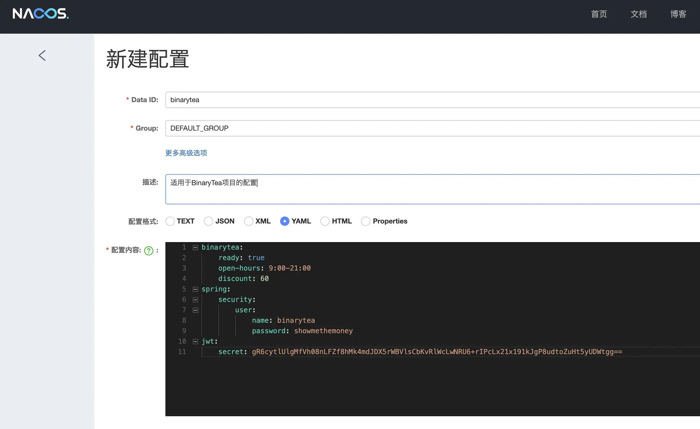

# 第14章服务配置管理(2)

## 14.2　服务配置的实现原理与应用

Spring Cloud Config 基于 Spring Boot 和 Spring Framework 提供的机制，为开发者封装了一套开箱即用的分布式配置管理解决方案。在上一节里，我们已经通过实际的例子看到了如何使用 Spring Cloud Config Server 和对应的客户端来集中管理配置，并在应用中加载远程配置。这一切是如何实现的？Spring Cloud Config 还支持用其他几种基础设施来充当配置中心，又该如何使用它们呢？

### 14.2.1　服务配置的实现原理

```
在 2.4 节中，我们介绍过 Spring Framework 的环境抽象，尤其是 PropertySource，各种
属性其实都是在一个个的 PropertySource 里查找和解析的。所以，如果用一句话来解释
Spring Cloud Config 的工作原理，那就是它在 Environment 里增加了一个或几个可以从远
端加载配置项的 PropertySource。
仍然以 Spring Cloud Config Client 为例，我们可以想象到客户端其实是用 RestTemplate
来请求服务端获取配置的，事实也是如此，但它们又是怎么变成 PropertySource 的呢？
```

1. 对 spring.config.import 的支持

```
Spring Boot 2.4 开始提供这种导入配置的方式，ConfigDataImporter 负责用
ConfigDataLoader 加载配置并存进 ConfigData，而
ConfigDataEnvironmentPostProcessor 又将 ConfigData 的属性放进
Environment，整个过程一环扣一环。
回到 Spring Cloud Config Client，META-INF/spring.factories 里有如下的定义：
# ConfigData Location Resolvers
1
org.springframework.boot.context.config.ConfigDataLocationResolver=\
2
org.springframework.cloud.config.client.ConfigServerConfigDataLocationResolver
3
4
# ConfigData Loaders
5
org.springframework.boot.context.config.ConfigDataLoader=\
6
org.springframework.cloud.config.client.ConfigServerConfigDataLoader
7
所以我们可以先去读一下 ConfigServerConfigDataLocationResolver，看到
PREFIX = "configserver:" 是否有似曾相识的感觉？没错，之前
spring.config.import=optional:configserver: 中的 configserver: 就是在
这里定义的。而且它会负责解析出 ConfigServerConfigDataResource，后续
ConfigServerConfigDataLoader 再从里面去加载配置，保存到 ConfigData 里，其
中的 MapPropertySource 名字为 configClient。感兴趣的可以看看
ConfigServerConfigDataLoader.load() 方法，它是负责加载具体配置的方法。
```

2. 对 Bootstrap 方式的支持

```
再来看看 Bootstrap 方式又是怎么实现的，同样是从 META-INF/spring.factories 里
寻找突破口，我们发现了两个配置类，ConfigServiceBootstrapConfiguration 做
基本配置，DiscoveryClientConfigServiceBootstrapConfiguration 提供一些
```

- 从服务注册中心获取 Spring Cloud Config Server 实例的配置：

```
# Bootstrap components
1
org.springframework.cloud.bootstrap.BootstrapConfiguration=\
2
org.springframework.cloud.config.client.ConfigServiceBootstrapConfiguration,\
3
org.springframework.cloud.config.client.DiscoveryClientConfigServiceBootstrapCo
4
这里最重要的就是根据 spring.cloud.config.enabled 配置注册了一个
ConfigServicePropertySourceLocator Bean，而这个 Bean 会使用
RestTemplate 从远端加载配置，并返回名为 configService 的
OriginTrackedCompositePropertySource。
```

3. 刷新配置

- 在 14.1.1 中我们说过，对于配置中心，我们有两个基本要求：其一是希望能集中管理，其二是希望能在配置变更后快速生效。我们已经知道了 Spring Cloud Config 是如何集中管理配置并让客户端按需获取配置的，那又该如何实现第二点呢？Spring Cloud Context 为我们

```
提供了一个 @RefreshScope 注解，添加了该注解的 Bean 会被放到名为 refresh 的作
用域里（对应 RefreshScope 类），其中的 Bean 能在运行时被刷新，依赖它们的组件在
```

- 下次调用其中的方法前会拿到新的实例。

```
为了触发带 @RefreshScope 注解的 Bean 的刷新，Spring Cloud Context 还提供了一个
Actuator 端点——RefreshEndpoint。如果没有调整过 Actuator 的 URL，可以通过
/actuator/refresh 来触发 ContextRefresher 刷新这些 Bean。让我们通过一个例
```

- 子来看看如何实现配置快速生效。

- 需求描述　现在流行一句话—“让听得到炮声的人来决策”。如果门店的店长发现同一条街上又新开了家奶茶店，可以临时决定调整营业时间和折扣力度，而且有权要求即刻生效。

```
在二进制奶茶店的例子中，这个需求可以翻译为“能够按需调整 binarytea.open-hours
和 binarytea.discount 的值，并且快速生效”。在 14.1.2 节里，这两个参数都已经被
```

- 我们放到 Spring Cloud Config Server 对应的仓库里了，现在要做的就是调整 BinaryTea 的7代码。

```
首先，在 binarytea.* 配置对应的 BinaryTeaProperties 里增加折扣的属性，同时
为它加上 @RefreshScope 注解以便后续可以刷新配置，具体如代码示例 14-6 所示。
代码示例 14-6　增加了注解和属性的 BinaryTeaProperties 代码片段
```

```java
@ConfigurationProperties("binarytea")
1
@RefreshScope
2
public class BinaryTeaProperties {
3
   private boolean ready;
4
   private String openHours;
5
   private int discount = 100;
6
   // 省略其他代码
7
}
8
接下来，需要调整与折扣相关的代码逻辑。本来折扣都是通过 HTTP 请求提交上来的，现
```

- 在我们要增加一个逻辑：如果请求中给出的折扣是 100（也就是不打折），而我们在后台配置了一个折扣，那就要以后台配置的折扣为准；如果前台传入了具体的折扣，则以传入的为

```
准。这段逻辑可以放在 OrderService.createOrder() 里，具体如代码示例 14-7 所
```

- 示。

```java
代码示例 14-7　增加了折扣逻辑的 OrderService
@Service
1
@Transactional
2
public class OrderService {
3
   @Autowired
4
   private OrderRepository orderRepository;
5
   @Autowired
6
   private BinaryTeaProperties binaryTeaProperties;
7
8
   @RolesAllowed({ "MANAGER", "TEA_MAKER" })
9
   public Order createOrder(List<MenuItem> itemList, int discount) {
10
       int newDiscount = discount == 100 ? binaryTeaProperties.getDiscount()
11
       Money total = itemList.stream().map(i -> i.getPrice())
12
           .collect(Collectors.collectingAndThen(Collectors.toList(),
13
               l -> Money.total(l)));
14
       Money pay = total.multipliedBy(newDiscount / 100d, RoundingMode.HALF_DO
15
16
       Amount amount = Amount.builder()
17
                               .discount(newDiscount)
18
                               .totalAmount(total)
19
                               .payAmount(pay)
20
                               .build();
21
       Order order = Order.builder()
22
                            .amount(amount)
23
                            .status(OrderStatus.ORDERED)
24
                            .items(itemList)
25
                            .build();
26
       return orderRepository.save(order);
27
   }
28
   // 省略其他代码
29
}
30
最后，为了让配置的变更能快速生效，我们打算通过 /actuator/refresh 来手动触发刷
```

- 新，为此，还需要将它暴露在 Web 端点里，所以要像代码示例 14-8 那样，调整

```
application.properties 里的端点配置，增加 refresh。
```

- 代码示例 14-8　调整后的端点配置

```
management.endpoints.web.exposure.include=health,info,shop,metrics,refresh
1
在运行程序后，一开始我们取到的折扣是 100，然后调整一下 binarytea.properties
中的 binarytea.discount 配置，像下面这样用 curl 命令强制刷新一下，程序里的折扣
```

- 就改变了：

```
▸ curl -X POST http://localhost:8080/actuator/refresh
1
```

- 像 Spring Cloud Config Client 这种主动去加载配置的客户端，想要感知配置是否发生了变化只能不断尝试加载远端的配置，这种方式比较低效。好在 Spring Cloud Config Server 在这方面也做了一些工作，对于那些支持 WebHook 发送变更通知的仓库，它可以向客户端推送通知，这里需要用到 Spring Cloud Bus。稍后在介绍其他配置中心时，我们会看到，由于那些设施本身就有监听和通知的功能，这个功能会更容易实现。

### 14.2.2　基于 Zookeeper 的配置中心

本章前面的部分一直在介绍使用 Spring Cloud Config Server 来实现服务配置的管理，其实除了它，Spring Cloud Config 还支持好几种配置中心，例如我们之前用作服务注册中心的Apache Zookeeper。在 Zookeeper 官网的介绍中，第一条就说它是一款用于维护配置信息的

- 8

集中化服务

- ，所以拿它来做配置中心应该没有太大问题。我们要做的仅仅是将之前存放在

Git 仓库里的配置按照一定的结构保存到 Zookeeper 中，让应用程序直接连上 Zookeeper 获取配置即可。

1. 客户端启用 Zookeeper 配置支持

```
在应用的 pom.xml 中，增加 spring-cloud-starter-zookeeper-config 依赖，其
```

- 中会传递依赖 Apache Curator 和 Apache Zookeeper 的库，如果这些库与正在使用的Zookeeper 有版本不兼容的情况，可以手动排除

```xml
org.apache.zookeeper:zookeeper，再引入对应的版本。
<dependency>
1
   <groupId>org.springframework.cloud</groupId>
2
   <artifactId>spring-cloud-starter-zookeeper-config</artifactId>
3
</dependency>
4
随后，在 application.properties 中配置与之前类似的
spring.config.import，只不过这次我们要用 zookeeper:，而不是
configserver:。格式大概是下面这样的，optional: 表示是否是可选配置，导入不成
```

- 功可以跳过。

```
spring.config.import=[optional:]zookeeper:[Zookeeper连接串]
1
```

- 如果同时还用 Zookeeper 来做服务注册中心，两个 Zookeeper 正好又是公用的，我们可以

```
直接使用 spring.cloud.zookeeper.connect-string 来配置连接串；如果是不同
的，那用作配置中心的 Zookeeper 连接串可以直接写在 spring.config.import 里。
```

- 9我们的 BinaryTea 项目的配置文件可以像代码示例 14-9那样稍作调整，从 Zookeeper 中获取配置。

```
代码示例 14-9　从 localhost:2181 导入配置的 application.properties 文件
```

- 片段

```
spring.application.name=binarytea
1
2
spring.config.import=zookeeper:
3
spring.cloud.zookeeper.connect-string=localhost:2181
4
# 省略其他配置
5
```

- 如果希望使用 Bootstrap 方式，和 14.1.3 里介绍的一样，选用三种启用 Bootstrap 方式中

```
的一种，随后将 spring.cloud.zookeeper.config.* 相关的配置放到
bootstrap.properties 文件里就行了。表 14-5 中罗列了一些常用的 Spring Cloud
```

- Zookeeper Config 配置项。

- 表 14-5　Spring Cloud Zookeeper Config 的常用配置项

- 配置项默认值说明

```
spring.cloud.zookeeper.config.enabled
true
```

- 是否开启 Zookee

```
spring.cloud.zookeeper.config.root
config
```

- Zookeeper 中保存

```
spring.cloud.zookeeper.config.default-
application
```

- 默认配置的应用名

```
context
spring.cloud.zookeeper.config.profile-
,
```

- Profile 分隔符

```
separator
spring.cloud.zookeeper.config.fail-fast
true
```

- 无法加载时是否快

- 请注意，此时先不要启动项目，因为我们还没有在 Zookeeper 里放配置项，也没有在

```
spring.config.import 里加 optional: 前缀，application.properties 里也
```

- 没有之前 Git 仓库里的配置，总之就是会启动失败。

2. 配置信息在 Zookeeper 中的存储结构

```
在 Zookeeper 中，我们的配置是按 /config/ 应用名 [,Profile]/key=value 的结构
```

- 来保存的，其中的 Profile 部分属于可选项，看过表 14-5 之后，相信大家应该能看出些端倪：

```
config 是 spring.cloud.zookeeper.config.root 的值，所以想改成
/configuration/ 应用名 , Profile/ 也是可以的；
应用名和 Profile 之间用 , 隔开，可以用
spring.cloud.zookeeper.config.profile-separator 来修改分隔符；
spring.cloud.zookeeper.config.default-context 默认是 application，
所以默认配置可以放在 /config/application/ 下。
```

- 10我们可以用 Zookeeper 里自带的 zkCli.sh 客户端连上 Zookeeper，通过命令方式做些配置的导入，例如下面这些命令。不像之前用的 Spring Cloud Config Server，暂时我们还不能在 Zookeeper 上实现敏感配置信息的“自动”加解密，所以只能以明文存储；如果确实有需要，请在客户端自行实现密文配置项的解密工作吧。

```
create /config/binarytea
1
create /config/binarytea/binarytea.ready true
2
create /config/binarytea/binarytea.open-hours 9:00-21:00
3
create /config/binarytea/binarytea.discount 60
4
create /config/binarytea/spring.security.user.name binarytea
5
create /config/binarytea/spring.security.user.password showmethemoney
6
create /config/binarytea/jwt.secret gR6cytlUlgMfVh08nLFZf8hMk4mdJDX5rWBVlsCbKvR
7
P8udtoZuHt5yUDWtgg==
8
如果对 Zookeeper 中的某个配置值做了变更，不用再去调用 /actuator/refresh 也能
```

- 生效，因为我们的程序会监听对应配置的 Zookeeper 节点，所以应用程序能收到

- Zookeeper 的变更推送，具体的代码在 Spring Cloud Zookeeper Config 的

```
ConfigWatcher 类中。现在可以启动前面修改过的 BinaryTea 程序了，看看它是否如预
```

- 期的那样获取到配置，并且正常运行了呢？

### 14.2.3　基于 Consul 的配置中心

看过了基于 Zookeeper 的用法，我们再来看看怎么用 Consul 来充当配置中心，要知道Consul 也是可以提供 KV 存储服务的。在 Spring Cloud Config 的统一抽象下，应用里使用Consul 和 Zookeeper 从代码层面来看几乎没有区别，修改下依赖和配置即可。

1. 客户端启用 Consul 配置支持

```xml
与之前一样，先在 pom.xml 中引入 Consul 配置相关的 spring-cloud-starter-
consul-config 依赖：
<dependency>
1
   <groupId>org.springframework.cloud</groupId>
2
   <artifactId>spring-cloud-starter-consul-config</artifactId>
3
</dependency>
4
随后，在 application.properties 中配置 Consul 相关信息，以及
spring.config.import，这次的格式是下面这样的：
spring.config.import=[optional:]consul:[Consul Agent地址]
1
```

- 如果要用 Bootstrap 的方式，先用 14.1.3 里介绍的方法启用相关的支持，随后像代码示例11

```
14-10 这样配置 bootstrap.properties。
代码示例 14-10　增加了 Consul 相关配置的 bootstrap.properties
```

```
spring.application.name=binarytea
1
2
3
spring.cloud.consul.host=localhost
4
spring.cloud.consul.port=8500
5
spring.cloud.consul.config.enabled=true
```

- 其实上面 3 个 Consul 相关的配置项都是默认值，这里只是为了做演示才写的，表 14-6 列举了常用的 Consul 服务配置有关的配置项。

- 表 14-6　Spring Cloud Consul Config 相关配置项

- 配置项默认值说明

```
spring.cloud.consul.config.enabled
true
```

- 是否开启 Consu

```
spring cloud consul config name
$
```

- Consul 中存储配

2. 配置信息在 Consul 中的存储结构

```
与 Zookeeper 相似，Consul 在保存配置项时采用类似的目录结构，形如 config/< 应用
名 >[,Profile]/。默认配置项都放在 application 应用下，类似前缀、默认应用、
```

- Profile 分隔符这些内容都可以用表 14-6 中的配置项来调整。在 Consul 中保存配置时有以

```
下 4 种格式可供选择，它们被定义在 ConsulConfigProperties.Format 枚举中，可
以通过 spring.cloud.consul.config.format 配置项进行调整。
KEY_VALUE，键值对格式，以 /config/binarytea/foo/bar/baz 的形式来表示
binarytea 应用下的 foo.bar.baz 配置项，其中的值就是配置值。
PROPERTIES，Properties 格式，binarytea 应用的配置会集中存放在
/config/binarytea/data 中，其中的 data 可以用
spring.cloud.consul.config.data-key 来修改。
YAML，YAML 格式，存放的位置与 PROPERTIES 相同，只是内容格式不同。
FILES，文件格式，在用 git2consul 这类把 Git 文件载入 Consul 的工具时使用。
我们先来演示一下如何用 KEY_VALUE 格式存储配置。在 Consul Web 界面的 Key/Value
中，按表 14-7 来创建对应的键并填值。由于 spring.cloud.consul.config.format
的默认值就是 KEY_VALUE，所以可以直接依赖默认值或者明确写出格式。运行程序查看是
```

- 否能正常获取到配置值。

- 表 14-7　用于二进制奶茶店的键值类型的 Consul 配置项

- 键对应配置

```
config/binarytea/binarytea/ready
binarytea.ready
config/binarytea/binarytea/open-hours
binarytea.open-hours
config/binarytea/binarytea/discount
binarytea.discount
config/binarytea/spring/security/user/n
spring.security.user.name
ame
随后再来看看使用 YAML 格式又该怎么存储？同样是在 Key/Value 界面中，我们直接创建
一个 config/binarytea/data 键，值的内容如代码示例 14-11 所示（注意缩进必须用
```

- 空格，不能用 Tab）。

```yaml
代码示例 14-11　config/binarytea/data 节点中写入的 YAML 配置信息
binarytea:
1
   ready: true
2
   open-hours: 9:00-21:00
3
   discount: 60
4
spring:
5
   security:
6
       user:
7
           name: binarytea
8
           password: showmethemoney
9
jwt:
10
   secret: gR6cytlUlgMfVh08nLFZf8hMk4mdJDX5rWBVlsCbKvRlWcLwNRU6+rIPcLx21x191kJ
11
这时需要将 spring.cloud.consul.config.format 的值改为 YAML，随后重新启动
```

- 程序观察运行效果。同样地，Consul 上配置内容的变更也能在应用端自动刷新。

### 14.2.4　基于 Alibaba Nacos 的配置中心

Spring Cloud 对阿里巴巴组件的支持基本都是由阿里的开发者维护的，所以 Spring CloudAlibaba Nacos Config 会和前面谈到的 Zookeeper 与 Consul 稍有不同。

1. 客户端启用 Nacos 配置支持第一步的操作，大家大同小异，都是在 pom.xml 中引入依赖，只不过这次需要在

```xml
<dependencyManagement /> 里多导入一个 pom。大概会是下面这样的，其中
spring-cloud-dependencies 是之前一直在用的，而 spring-cloud-alibaba-
dependencies 则专门用来管理 Spring Cloud Alibaba 的依赖，两者作用不同。之前在介
```

- 绍基于 Nacos 的服务注册与发现机制时介绍过了，这里再次强调一下。

```xml
<dependencyManagement>
1
   <dependencies>
2
       <dependency>
3
           <groupId>org.springframework.cloud</groupId>
4
           <artifactId>spring-cloud-dependencies</artifactId>
5
           <version>$</version>
6
           <type>pom</type>
7
           <scope>import</scope>
8
       </dependency>
9
       <dependency>
10
           <groupId>com.alibaba.cloud</groupId>
11
           <artifactId>spring-cloud-alibaba-dependencies</artifactId>
12
           <version>$</version>
13
           <type>pom</type>
14
           <scope>import</scope>
15
       </dependency>
16
   </dependencies>
17
</dependencyManagement>
18
19
<dependencies>
20
   <dependency>
21
       <groupId>com.alibaba.cloud</groupId>
22
       <artifactId>spring-cloud-starter-alibaba-nacos-config</artifactId>
23
   </dependency>
24
   <dependency>
25
       <groupId>org.springframework.cloud</groupId>
26
       <artifactId>spring-cloud-starter-bootstrap</artifactId>
27
   </dependency>
28
   <!-- 省略其他依赖 -->
29
</dependencies>
30
spring-cloud-starter-alibaba-nacos-config 是专门用来支持 Nacos 服务配置
```

- 的依赖，也是这部分的重点，由于 2.2.1.RELEASE 版本的 Spring Cloud Alibaba 暂时还不

```
支持 spring.config.import 方式，所以只能使用传统的 Bootstrap 方式，因此可以考
虑像上面那样多加一个 spring-cloud-starter-bootstrap。如果是 2021.0.1.0 版
本，则已经支持 spring.config.import 方式了，可以根据实际使用的版本来选择配置
```

- 导入的方式。

```
接下来就是配置 bootstrap.properties，其中需要配置 Nacos 服务器的地址，还有一
```

- 12些 Nacos Config 相关的配置，当然，用默认值通常也行，就像代码示例 14-12那样。

```
代码示例 14-12　开启了 Nacos Config 的 bootstrap.properties
spring.application.name=binarytea
1
2
spring.cloud.nacos.config.server-addr=http://localhost:8848
3
spring.cloud.nacos.config.enabled=true
4
spring.cloud.nacos.config.file-extension=yaml
5
```

- Spring Cloud Alibaba Nacos Config 也有很多可以设置的参数，表 14-8 就罗列了一些可能用到的配置项。

- 表 14-8　Spring Cloud Alibaba Nacos Config 的常用配置项

- 配置项默认值说明

```
spring.cloud.nacos.config.enabled
true
```

- 是否开启 Na

```
spring.cloud.nacos.config.server-addr
localhost:8848
```

- 提供配置服务

```
用来配置 da
spring.cloud.nacos.config.prefix
name，没有
spring.cloud.nacos.config.name
```

- 同上

```
spring.cloud.nacos.config.group
DEFAULT_GROUP
```

- 配置所用的组

```
spring.cloud.nacos.config.cluster-name
```

- 集群名

- Nacos 中配置

```
spring.cloud.nacos.config.namespace
```

- 间

```
spring.cloud.nacos.config.timeout
3000
```

- 连接 Nacos

```
spring.cloud.nacos.config.file-
```

- 配置内容的后

```
properties
extension
propertie
```

- 13

```
具体可以参考 NacosPropertySourceLocator 类。
```

2. 配置信息在 Nacos 中的存储结构在 Nacos 中保存配置时，也有一些与 Zookeeper 和 Consul 不同的规则，例如配置的加载顺序就是下面这样的，后面加载的配置优先级高于前面的。

```
(1) 从 spring.cloud.nacos.config.shared-configs 配置的 Config 中加载配
```

- 置。

```
(2) 从 spring.cloud.nacos.config.extension-configs 配置的 Config 中加载
```

- 配置。

```
(3) 从应用自己的 dataId 中加载配置，默认组合规则为 $[-Profile]. 后缀。
仍然以 BinaryTea 项目为例，我们可以在 Nacos 控制台中创建一个 binarytea 节点，具
```

- 体如图 14-2 所示，其中填入的 YAML 配置和代码示例 14-11 是一样的。根据代码示例 14-

```
12 的配置，我们的程序最终会在 DEFAULT_GROUP 中找到 binarytea.yaml，从这个文
```

- 件中加载配置。在开启了配置刷新功能后，Nacos 上的配置变更也能自动生效。



- 图 14-2　Nacos 里的二进制奶茶店配置

## 14.3　小结

本章我们了解了在微服务系统中如何管理服务的配置。出于各方面考虑，复杂的微服务系统需要能够方便地管理各种配置，还要让配置的变更及时生效。Spring Cloud Config 就是专门用来解决这个问题的，我们大致介绍了它的实现机制。在实践中，无论是 Spring Cloud ConfigServer、Zookeeper、Consul，还是 Nacos，抑或是本书中未展开介绍的 Apollo，都是不错的选择。

下一章，我们会切换到与高可用和稳定性相关的话题上。对于由大量微服务构成的业务，如果当中某些节点出了问题该怎么办，流量太大了该怎么办，又如何让系统自动应对这类情况呢？

- 二进制奶茶店项目开发小结到目前为止，我们的重点还是在二进制奶茶店点单系统的建设上。单实例无法满足业务量时，可以扩展为集群，变成集群后又需要负载均衡。Spring Cloud 的服务注册与发现机制14可以很好地解决集群实例管理的问题，客户端系统可以很方便地找到下单服务。系统变复杂了之后，各种配置的管理也要跟上，像改个营业时间、订单折扣，这些动作都要高效快捷。用配置文件能解决一部分问题，毕竟比什么都写死在代码里强，但还远远不够。这时引入 Spring Cloud Config，既能保留配置文件的体验，又能实现大规模系统配置集中化管理，还“顺带”实现了配置变更快速生效。无论是服务的注册与发现，还是服务的配置管理，我们都没有被绑死在特定的基础设施上—Zookeeper、Consul 和 Nacos 都在我们的候选列表里，可以根据情况选择。

[7]：这个例子在 ch14/binarytea-refresh 项目中。这个项目没有通过服务注册中心来查找 Spring Cloud Config Server，而是使用了

- 直连方式，因为在 Spring Cloud 2020.0.2 中 Spring Cloud Config Client 的依赖与基于 Zookeeper 或 Consul 的服务发现依赖并存时，刷新上下文会抛出异常，提示 。根据 GitHub 的记录，这个缺陷在 Spring Cloud 2020.0.4 版本中会得到修复。这里为了演示 2020.0.4 之前的情况，使用了直连方式。

[8]：原文是“ZooKeeper is a centralized service for maintaining configuration information...”。[9]：这个例子在 ch14/binarytea-zookeeper 项目中。[10]：如果有其他使用顺手的客户端也是可以的，例如 zkui。[11]：这个例子在 ch14/binarytea-consul 项目中。[12]：这个例子在 ch14/binarytea-nacos 项目中。[14]：如果真的变成了一个集群，记得不要再用内存数据库 H2 了，Session 管理机制也需要换掉。
