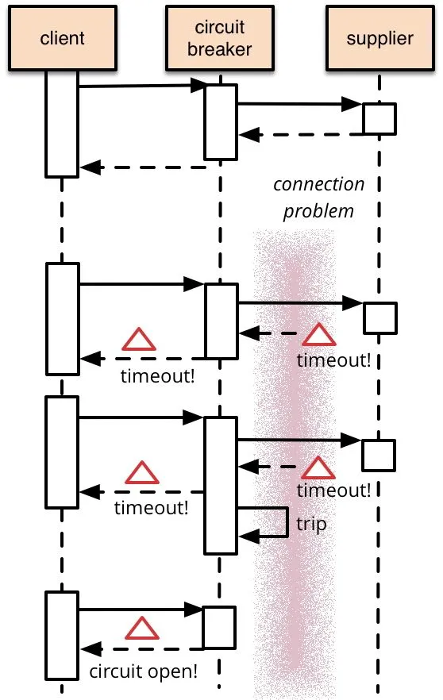

# 第15章服务容错保护(1)

- 本章内容几种常见的服务容错模式

- Resilience4j 的基本用法

- Spring Cloud CircuitBreaker 的抽象与应用

在微服务系统中，业务操作由多个服务协作完成，在这个过程中涉及的服务多了，出问题的概率自然也就变高了。如果下游服务出问题了，上游又不设防，就会被拖累；如果请求量陡增，超过服务的承受能力，也会引发问题……当我们遇到的问题多了，自然就会沉淀出不少经验，本章就让我们来看看如何基于常见的容错模式，使用一些框架来保护我们的系统。

## 15.1　常见的服务容错模式

一开始，我们不急于去介绍和使用那些帮助处理故障的工具，在知道如何借助外部力量之前，先来了解一下：为什么要实现服务容错，别人都是怎么做的，没有工具时我们又能怎么办。

- 请注意　本章所涉及的故障都是微服务链路中依赖的上下游之间发生的故障，系统本身内部的代码问题不在我们讨论的范畴内。

### 15.1.1　几种常见的容错模式

在编写代码时，我们会用设计模式，最知名的就是 GoF 23。在故障处理方面其实也有模式可以遵循（或者通俗一点说，也有自己的“套路”），我们把这些模式搬出来就能应付不少问题了。

1. 重试模式最简单粗暴的容错模式，可能就是重试（Retry）了。重试，简单而言就是出错后再试一次。但重试不是万灵药，系统支持重试有很多先决条件，例如，我们的下游服务要能保证幂等性，否则很容易造成一些重复请求的问题，而如果这笔请求是转账操作，调用一次转一笔

- 钱，无脑重试可能会给不支持幂等的下游系统带来无穷无尽的问题。由此就不难理解，为什么在很多支持重试的框架（例如 HTTP Client）中，我们要关闭重试功能。

- 而且，这里所说的重试也不能仅仅是简单地将操作放到一个有限次数的循环里。设想这样一个场景，由于突发流量，我们的下游系统无法正常提供服务，响应很慢；上游收到了访问超时的报错，直接发起重试，于是本就不堪重负的下游将会收到更多请求，而无数的重试会造成更大的流量洪峰。为此，我们可以设计一些重试策略，这些策略可以相互结合使用。

- 限制重试次数，不要无限制重试，例如最多重试 3 次。

- 一旦失败不要立刻重试，延迟一段时间后再重试。

- 增加重试的间隔时间，可以是固定的间隔，也可以是递增的时间。

- 除此以外，为了减少不必要的重试，还可以对错误进行分类。对于短时间里重试也明显不会成功的请求，直接取消，不再重试；而对于那些通过重试可能会成功的请求，可以考虑重

```
试。例如，HTTP 请求遇到了 404 Not Found 错误码，找不到想要访问的资源，那就不
```

- 用重试了；而像网络超时这种请求错误，则可以重试。

2. 断路器模式1断路器（Circuit Breaker）模式是 Michael Nygard 在 Release It!一书中提出的，而2Martin Fowler 的文章更是让它名声大作。如果说重试模式是为了让系统能够重复执行那些可能成功的操作，那断路器模式则是为了避免系统去执行那些可能失败的操作。其背后的思想如图 15-1 所示，大概的意思就是将我们要执行的操作用断路器封装起来，断路器会监控报错情况，如果报错达到阈值，断路器在一段时间内就不会再执行该操作，而是走预先设定好的逻辑，例如直接抛出异常，或者是返回一个准备好的结果。



- 图 15-1　Martin Fowler 博客中描述的断路器工作示意图

- 通常，断路器会有自己的状态机，它就是在以下这几种状态下工作的。

- 关闭，正常进行操作，过程中记录下一段时间内的报错情况，如果达到阈值则将断路器切换至“打开”状态。

- 打开，不再发起操作，直接执行预置逻辑，抛出异常或者返回准备好的结果；断路器打开一段时间后（通常会有个计时器之类的东西）会进入“半开”状态。

- 半开，在拦截大部分操作的同时，有少数操作会得到执行；如果这些操作执行成功则代表问题大概率已经解决了，断路器会切换至“关闭”状态，否则切换至“打开”状态。

- 在实际使用过程中，断路器模式同样也有不少注意事项，例如，上游要能正确处理断路器打开时的异常或者返回结果；与重试模式一样，针对下游抛出的异常，可以区别对待，有些严重的异常已经携带了足够的信息，可以快速打开断路器。

3. 舱壁模式舱壁（Bulkhead）一词源自造船技术，根据用途分成好几种，我们一般说的都是水密舱壁。它将船舱严密地分成了好几个独立的部分，就算有一两个舱破损进水，由于舱壁的存在，水不会进入其他舱，以此来保证船不会沉。

- 同样的设计思路可以运用到微服务的可用性保障上。设想这样一个场景，我们的系统会同时处理业务 A 和业务 B，两者的下游服务链路不同，在 A 的链路出现问题时，如果两者使用同一个线程池，所有线程资源有可能全都被拖死，导致原本可以不受影响的业务 B 也无法处理了。这时就可以考虑将两者的线程池分开，假设一共 100 个线程，A 分到 50 个，B 分到 50 个，虽然业务 A 依然有问题，但至少我们保住了业务 B。

- 如果一个系统中会依赖多个下游，为它们分别配置线程池或者客户端就能起到舱壁的作用。对于同一个下游服务，如果它由集群构成，甚至可以为集群中的不同实例分别构建客户端。但即使如此，我们的代码还是要处理超时等问题，而且需要能正确地处理下游的各种异常。对于向上提供服务的系统，可以通过部署多套隔离的集群来实现舱壁隔离。如果是处理消息的系统，则可以考虑不同的集群消费不同的消息队列。

- 当然，舱壁模式也是有成本的，我们需要根据业务与架构合理地规划舱壁。怎么进行隔离？无论是客户端、连接池，还是进程、线程、信号量，这些资源对系统来说都是昂贵的开销，应该尽量让它们物有所值。

4. 限流器模式系统的容量不是无限的——虽然容器技术已经十分成熟，在 Kubernetes 中按需弹性提供Pod 很方便，但应用背后的数据库却没办法像应用那样快速伸缩；又或者是一些请求需要使用昂贵的资源，但本身并不能提供太高的并发量。在这些情况下，我们能做的不是来者不拒地接受所有的请求，而是尽量将请求数量控制在能力范围内，这就是限流器（RateLimiter）模式要做的事，简单来说，限制上游请求的数量，避免服务资源被滥用。如果要和断路器做个对比，断路器是在下游服务发生故障时保证服务调用方的安全，而限流器则是要保护服务提供方的安全，避免它被上游洪峰压垮。

- 限流也有很多门道，我们可以根据不同的情况在不同的维度上进行控制，例如：

- 基于全局流量进行限流，这是比较粗放的模式，也比较容易实现，通过一个全局的计数器就能决定拦还是不拦；

- 基于特定接口进行限流，我们可以针对不同的接口设置不同的阈值，分别计数，一个接口被限流不会影响别的接口，这里还有一些变种，例如基于接口的特定参数进行限流等；

- 基于特定请求来源限流，一个系统会接收多个上游系统的请求，也许某个系统由于 Bug或者业务量陡增发起了大量请求，这时限制它的请求就好，其他上游可以正常访问系统。

- 在阈值的设置方面，可以选择周期时间内接收多少请求，如果这个周期是秒，那就是通常所说的 TPS（Transaction Per Second）或 QPS（Query Per Second）；还可以是并发请求数，也就是同一时间可以接收的请求数量，即并发数。

### 15.1.2　通过 AOP 实现简单的容错

在了解了几种常见的模式后，我们可以先自己动手，在二进制奶茶店的某些场景下实现其中的一些服务容错的模式，而非直接套用现成的框架。也许我们写的代码会有这样或那样的考虑不周，但这对理解这些服务容错的模式很有帮助。

- 需求描述　之前的奶茶店只能下单，但下单后并没有支付，不付钱自然也就不能出货，所以当务之急就是要为二进制奶茶店增加一个付款功能。现在收单通常会用智能 POS 机，而

- POS 机偶尔会因为网络等因素付款不成功，这时只能麻烦客人再重新付几次，连续失败的话，就先等等再说，不要急于反复支付。

1. 业务逻辑调整先来理解一下这个需求，跳过各种对接第三方支付的环节，我们直接把支付简化成修改订单

```
状态。7.1 节里定义了 OrderStatus 枚举，里面的五种状态分别是已下单、已支付、制作
```

- 中、已完成和已取货，这五种状态只能单向变化。为了方便做判断，我们为每个枚举值增加34一个索引值，如代码示例 15-1所示。变更时只需要判断索引值大小就好了。

```java
代码示例 15-1　修改后的 OrderStatus 代码片段
public enum OrderStatus {
1
   ORDERED(0), PAID(1), MAKING(2), FINISHED(3), TAKEN(4);
2
3
   private int index;
4
5
   OrderStatus(int index) {
6
       this.index = index;
7
   }
8
9
   public int getIndex() {
10
       return this.index;
11
   }
12
}
13
修改订单对象的状态，在 REST 接口中通常用 HTTP 的 PUT 方法实现，因此在
OrderController 中增加一个带有 @PutMapping 注解的 modifyOrderStatus() 方
法，具体定义如代码示例 15-2 所示。它的主要逻辑并不复杂，先检查提交的 StatusForm
对象内容是否正确，随后获得订单的目标状态，用它来调用 OrderService 的
modifyOrderStatus() 方法（该方法的返回值就是修改了状态的订单对象）。
代码示例 15-2　负责修改订单状态的 modifyOrderStatus() 方法代码片段
```

```java
@Controller
12
@RequestMapping("/order")
3
@Slf4j
4
public class OrderController {
5
   @ResponseBody
6
   @PutMapping(consumes = MediaType.APPLICATION_JSON_VALUE,
7
               produces = MediaType.APPLICATION_JSON_VALUE)
8
   public ResponseEntity<Order> modifyOrderStatus(@RequestBody @Valid StatusFo
9
                                                  BindingResult result) {
10
       if (result.hasErrors()) {
11
           return ResponseEntity.badRequest().body(null);
12
       }
13
       log.info("计划将ID={}的订单状态更新为{}", form.getId(), form.getStatus());
14
       OrderStatus status = OrderStatus.valueOf(form.getStatus());
15
       if (status == null) {
16
           log.warn("状态{}不正确", form.getStatus());
17
           return ResponseEntity.badRequest().body(null);
18
       }
19
       Order order = orderService.modifyOrderStatus(form.getId(), status);
20
       return order == null ? ResponseEntity.badRequest().body(null) : Respons
21
   }
22
   // 省略其他代码
23
}
StatusForm 对象就比较简单了，就传一个订单号和目标状态。通常表单对象里状态枚举
```

- 都会用字符串或者其他基础类型来表示，后续用代码将它再转成对应的枚举值。另外，类的定义上还增加了校验相关的注解，方便进行判断。具体如代码示例 15-3 所示。

```java
代码示例 15-3　表示订单状态修改请求的 StatusForm 代码片段
@Getter
1
@Setter
2
@Builder
3
public class StatusForm {
4
   @NotNull
5
   private Long id;
6
   @NotBlank
7
   private String status;
8
}
9
```

```
服务端拼图里的最后一块就是 OrderService 中修改订单状态的方法。代码示例 15-4 写
```

- 得比较简单，或者说过于简单了，只加载了指定订单号的数据，判断了之前的状态，如果满足修改的条件就修改状态并返回修改后的对象。在实际工作中，我们为了避免订单被并发修5改，通常会都会对数据加锁，例如用悲观锁先锁住订单，再修改状态；或者用乐观锁，带状态更新，如果更新失败就说明订单被其他人修改了。此外，更新数据一定要修改记录的

```
更新时间字段，此处是通过 Order.updateTime 属性上的 @UpdateTimestamp 注解来
```

- 实现更新时自动修改时间戳的。如果你用的是 MyBatis 等其他 ORM 框架，或者直接使用了JDBC，记得要做一定的修改。

```java
代码示例 15-4　修改订单状态的 modifyOrderStatus() 方法
@Service
1
@Transactional
2
@Slf4j
3
public class OrderService {
4
   public Order modifyOrderStatus(Long id, OrderStatus status) {
5
          Optional<Order> order = orderRepository.findById(id);
6
       if (!order.isPresent()) {
7
           log.warn("订单{}不存在", id);
8
           return null;
9
       }
10
       OrderStatus old = order.get().getStatus();
11
       if (status.getIndex() != old.getIndex() + 1) {
12
           log.warn("订单{}无法从状态{}改为{}", id, old, status);
13
           return null;
14
       }
15
       order.get().setStatus(status);
16
       return orderRepository.save(order.get());
17
   }
18
   // 省略其他代码
19
}
20
```

- 完成服务端的调整后，接下来就是调整对应的客户端，先是实现将订单修改为已支付状态的操作，再来添加容错功能（主要是重试和断路）。此处，以之前使用 OpenFeign 的例子作

```
为基础进行修改，在 OrderService 中增加 modifyOrderStatus()，如代码示例 15-5
```

```
所示。其中用到的 StatusForm 与代码示例 15-3 基本一致，只是不需要在属性上添加校
验的注解，也就是不需要 @NotNull 和 @NotBlank。
```

- 代码示例 15-5　增加了修改订单状态方法的 Feign 客户端接口代码片段

```java
@FeignClient(contextId = "orderService", name = "binarytea", path = "/order")
1
public interface OrderService {
2
   @PutMapping(consumes = MediaType.APPLICATION_JSON_VALUE,
3
               produces = MediaType.APPLICATION_JSON_VALUE)
4
   ResponseEntity<Order> modifyOrderStatus(@RequestBody StatusForm form);
5
   // 省略其他代码
6
}
7
随后，在处理订单的 OrderRunner 中增加支付的逻辑，其实就是拼装 StatusForm，把
它传给 modifyOrderStatus()，具体如代码示例 15-6 所示。
代码示例 15-6　增加了支付逻辑的 OrderRunner 代码片段
@Component
1
@Order(5)
2
@Setter
3
@Slf4j
4
public class OrderRunner implements ApplicationRunner {
5
   @Autowired
6
   private OrderService orderService;
7
8
   @Override
9
   public void run(ApplicationArguments args) throws Exception {
10
       // 省略之前创建订单的代码
11
       // response的类型是ResponseEntity<learning.spring.customer.model.Order>
12
       log.info("开始支付订单：{}", response.getBody().getId());
13
       StatusForm sf = StatusForm.builder()
14
           .id(response.getBody().getId())
15
           .status("PAID").build();
16
       response = orderService.modifyOrderStatus(sf);
17
       log.info("HTTP Status: {}, Headers: {}", response.getStatusCode(), resp
18
       log.info("Body: {}", response.getBody());
19
   }
20
}
21
```

2. 开发容错功能前面是最基本的先下单后支付的业务逻辑代码，现在要开始动手实现一些正常业务逻辑之外的东西了——我们打算在客户端增加简单的重试与熔断功能，以此来应对异常情况。为了能够对业务代码无侵入，并且具有通用性，我们将用 Spring AOP 的切面来实现所需的功能。由于集成服务端的 OpenFeign 接口都放在了

```
learning.spring.customer.integration 包下面，直接拦截其中的方法执行过程就
```

- 可以了。

- 请注意　这里需要强调一下，简单起见，此处的两个 AOP 切面只是用来演示重试和熔断思路的，具体在生产中使用的逻辑会更加复杂，需要考虑大量的异常场景，做很多针对性的优化。因此，千万不要简单地将它们搬去生产，而应该使用成熟的框架。

```
先来看看重试切面 RetryAspect，设定一个最大重试阈值和间隔时间，例如代码示例 15-
```

- 7 中设置的就是重试 3 次，每次间隔 100 毫秒。将具体的方法调用放在一个循环体内，如果成功执行则直接返回；抛异常的话则记录异常，在重试次数用完后抛出最后记录的异常。

- 代码示例 15-7　简单的重试切面代码片段

```java
@Aspect
1
@Slf4j
2
@Order(0)
3
public class RetryAspect {
4
   private static final int THRESHOLD = 3;
5
   private static final int DURATION = 100;
6
7
   @Around("execution(* learning.spring.customer.integration..*(..))")
8
   public Object doWithRetry(ProceedingJoinPoint pjp) throws Throwable {
9
       String signature = pjp.getSignature().toLongString();
10
       log.info("带重试机制调用{}方法", signature);
11
       Object ret = null;
12
       Exception lastEx = null;
13
       for (int i = 1; i <= THRESHOLD; i++) {
14
           try {
15
               ret = pjp.proceed();
16
               log.info("在第{}次完成了{}调用", i, signature);
17
               return ret;
18
           } catch (Exception e) {
19
               log.warn("执行失败", e);
20
               lastEx = e;
21
               try {
22
                   TimeUnit.MILLISECONDS.sleep(DURATION);
23
               } catch (InterruptedException ie) {
24
               }
25
           }
26
       }
27
       log.error("{}方法最终执行失败，抛出异常{}", signature, lastEx);
28
       throw lastEx;
29
   }
30
}
31
再来看看断路器 CircuitBreakerAspect。它的逻辑会复杂一些：我们要记录当前方法
的连续失败次数，一旦它超过阈值，就直接返回 503 Service Unavailable 报文，不
```

- 发起调用；熔断期间再记录一下熔断的次数，隔几次做个探测，如果调通了，重置所有计数器。具体如代码示例 15-8 所示。之所以选择连续失败次数作为标准，是因为它的实现最简单，但时好时坏的情况它就有可能无法应对，所以也可以考虑用一段时间内的失败次数作为打开断路器的标准。

- 代码示例 15-8　断路器切面代码片段

```java
@Aspect
1
@Slf4j
2
@Order(1)
3
public class CircuitBreakerAspect {
4
   private static final Integer THRESHOLD = 3;
5
   private Map<String, AtomicInteger> errorCounter = new ConcurrentHashMap<>()
6
   private Map<String, AtomicInteger> probeCounter = new ConcurrentHashMap<>()
7
8
   @Around("execution(* learning.spring.customer.integration..*(..))")
9
   public Object doWithCircuitBreaker(ProceedingJoinPoint pjp) throws Throwabl
10
       String signature = pjp.getSignature().toLongString();
11
       log.info("带断路保护执行{}方法", signature);
12
       Object retVal;
13
14
       try {
15
           if (!errorCounter.containsKey(signature)) {
16
               resetCounter(signature);
17
           }
18
           if (errorCounter.get(signature).get() >= THRESHOLD &&
19
               probeCounter.get(signature).get() < THRESHOLD) {
20
               log.warn("断路器打开，第{}次直接返回503",probeCounter.get(signature
21
               return ResponseEntity.status(HttpStatus.SERVICE_UNAVAILABLE).bu
22
           }
23
           retVal = pjp.proceed();
24
           resetCounter(signature);
25
       } catch (Throwable t) {
26
           log.warn("错误计数{}次，抛出{}异常", errorCounter.get(signature).incre
27
               t.getMessage());
28
           probeCounter.get(signature).set(0);
29
           throw t;
30
       }
31
       return retVal;
32
   }
33
34
   private void resetCounter(String signature) {
35
       errorCounter.put(signature, new AtomicInteger(0));
36
       probeCounter.put(signature, new AtomicInteger(0));
37
   }
38
}
39
以上就是两个切面。为了精确地控制切面的行为，我们在类上增加了 @Order 注解来指定
它们的顺序，@Order 的值越小，执行时的优先级就越高，也就是先执行。在这个例子里就
是先进入 RetryAspect 的重试逻辑，会执行 3 次调用，每次调用又是被
CircuitBreakerAspect 增强过的。
最后，将我们的两个 AOP 切面配置成 Bean，也就是在 CustomerApplication 里增加
对应的 @Bean 方法，具体如代码示例 15-9 所示。
代码示例 15-9　包含容错切面配置的 CustomerApplication 代码片段
@SpringBootApplication
1
@Slf4j
2
@EnableFeignClients
3
public class CustomerApplication {
4
   @Bean
5
   public RetryAspect retryAspect() {
6
       return new RetryAspect();
7
   }
8
9
   @Bean
10
   public CircuitBreakerAspect circuitBreakerAspect() {
11
       return new CircuitBreakerAspect();
12
   }
13
   // 省略其他代码
14
}
15
```

3. 测试容错功能现在运行客户端，理论上来说是包含一定的容错能力的，不过还是要证明一下。粗暴一点的

```
做法是直接在运行 OrderRunner 的过程中加上一些时间间隔，手动停止服务端应用，看
```

- 看效果。但这样显然不够优雅，如果能用自动化测试来验证我们的拦截器效果，那就再好不过了。

- 为了尽可能地将关注点集中在我们的 AOP 拦截器上，我们要排除各种其他依赖项和不需要的 Bean，例如就不要让 OpenFeign 真的创建一个 Bean 了，可以用 Mockito 来模拟接口

```python
实现，把模拟的对象变成 Bean，让 RetryAspect 来拦截它。代码示例 15-10 是针对
RetryAspect 的一个单元测试，不用 SpringBootTest 来启动并加载整个应用，我们
回归最原始的 Spring 程序单元测试。RetryTestConfig 作为内部测试配置类，上面加了
@TestConfiguration，开启了 AspectJ 自动代理支持，配置类里声明了两个 Bean，
orderService 就是用 Mockito.mock() 创建的 Mock 对象。
代码示例 15-10　包含了单元测试配置的 RetryAspectTest 代码片段
@SpringJUnitConfig(RetryAspectTest.RetryTestConfig.class)
1
class RetryAspectTest {
2
   @TestConfiguration
3
   @EnableAspectJAutoProxy
4
   static class RetryTestConfig {
5
       @Bean
6
       public RetryAspect retryAspect() {
7
           return new RetryAspect();
8
       }
9
10
       @Bean
11
       public OrderService orderService() {
12
           return mock(OrderService.class);
13
       }
14
   }
15
   // 省略其他代码
16
}
17
```

- 有了可以运行的最小 Spring 环境后，开始编写测试用例，可以设计两个简单的场景。

- (1) 被调用的方法正常返回，没有发生重试，直接拿到结果，Mock 对象的方法只调用了一

```
次。对应了代码示例 15-11 中的 testSuccessInvoke() 方法。
```

- (2) 被调用的方法抛出异常，发生了重试，重试最终成功返回了，Mock 对象的方法被调用

```
了好几次。对应了代码示例 15-11 中的 testDoWithRetry() 方法。
```

- 6

```
代码示例 15-11 中用的 BDDMockito 中的很多静态方法，可以用 BDD
```

- 的形式描述我们

```
的测试用例。为了方便描述，我们直接把所有方法都 import static 了进来。在实际开
发中，如有必要可以按照编码规范导入用到的方法。以 testSuccessInvoke() 为例，
BDD 的描述是给定（given()）调用 mockService.listOrders()，将返回
（willReturn()）Collections.emptyList()；实际调用了 listOrders() 后，
那么（then()）mockService 的 listOrders() 应该（should()）只被调用了一次
（once()）；再结合一些别的简单断言，这就是一个测试用例了。testDoWithRetry()
的逻辑也是类似的，CircuitBreakerAspect 的测试也可以用这样的方法，这里就不再
```

- 赘述了。

- 代码示例 15-11　针对重试切面的测试用例代码片段

```java
import static org.mockito.BDDMockito.*;
1
2
@SpringJUnitConfig(RetryAspectTest.RetryTestConfig.class)
3
class RetryAspectTest {
4
   // 省略Spring内部配置类，见代码示例15-10
5
   @Autowired
6
   private OrderService orderService;
7
   private OrderService mockService;
8
9
   @BeforeEach
10
   public void setUp() {
11
       mockService = AopTestUtils.getUltimateTargetObject(orderService);
12
       reset(mockService);
13
   }
14
15
   @Test
16
   void testSuccessInvoke() {
17
       given(mockService.listOrders()).willReturn(Collections.emptyList());
18
       List<Order> orders = orderService.listOrders();
19
       then(mockService).should(only()).listOrders();
20
       assertTrue(orders.isEmpty());
21
   }
22
23
   @Test
24
   void testDoWithRetry() {
25
       given(mockService.listOrders())
26
       .willThrow(new RuntimeException())
27
       .willThrow(new RuntimeException())
28
       .willReturn(Collections.emptyList());
29
       List<Order> orders = orderService.listOrders();
30
       then(mockService).should(times(3)).listOrders();
31
       assertTrue(orders.isEmpty());
32
   }
33
}
34
```

[1]：该书的最新版中文版书名为《发布！设计与部署稳定的分布式系统（第 2 版）》，于 2020 年由人民邮电出版社出版。[2]：2014 年，Martin Fowler 在他的博客上发表了一篇名为“CircuitBreaker”的文章。[3]：这个示例在 ch15/binarytea-aop 项目中，对应的客户端则是 ch15/customer-aop。[4]：这里再次强调一下，为了简化我们的示例，这里不包含退款、取消等状态，订单系统状态机实际是非常复杂的。[5]：对于重要内容的更新，建议遵循“一锁，二判，三更新”的顺序——先锁住记录，判断当前数据是否符合预期，再做更新，更新动

- 作执行后还要检查更新条数是否正确。

[6]：BDD 即行为驱动开发（Behavior Driven Development），是敏捷软件开发中的一种技术，用特定的 DSL 以接近结构化自然语言

- 的方式来编写可执行的测试用例。

[7]：Micronaut 是现代一站式 Java 微服务框架中的后起之秀。[8]：这个示例在 ch15/teamaker-resilience4j 项目中。[9]：这部分提到的例子都在 ch15/binarytea-resilience4j 和 ch15/customer-resilience4j 项目里。
