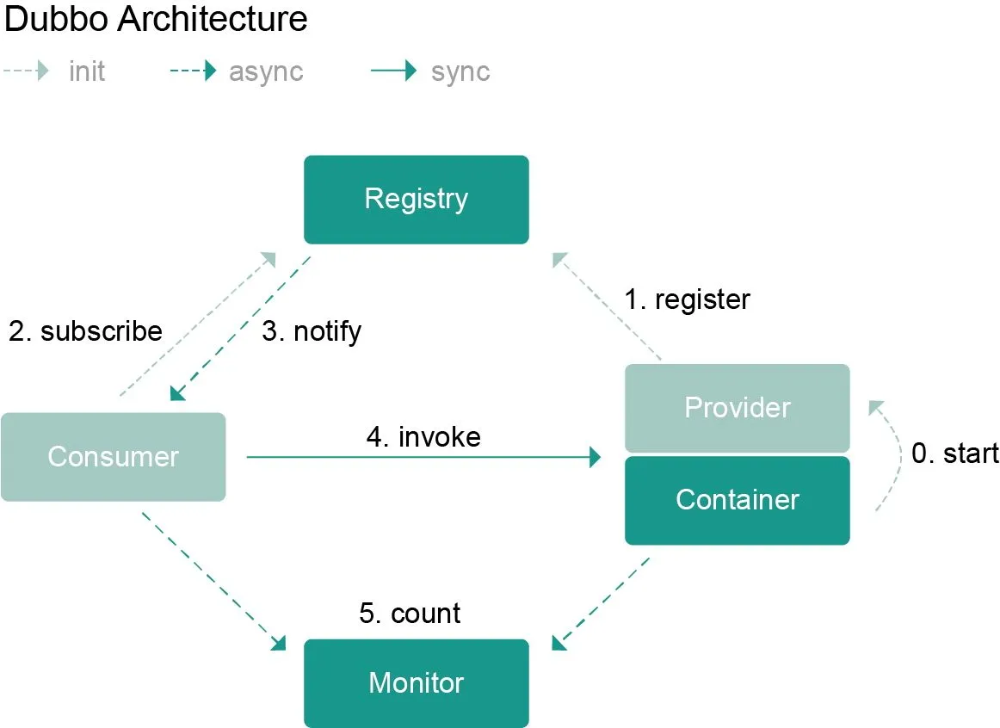
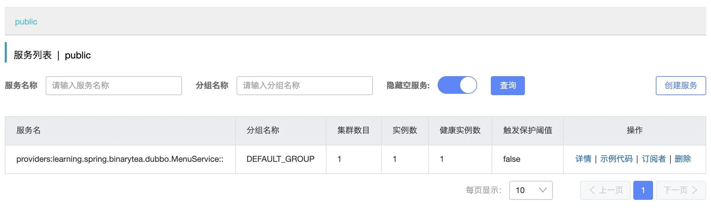

# 第16章服务集成(1)

- 本章内容使用 Dubbo 进行 RPC 通信

- 使用多种不同的消息中间件进行消息通信

- 服务链路追踪的基本原理与实现

- Spring Cloud Gateway 的基本用法

本书之前的章节中都使用基于 HTTP 的 REST 服务来进行通信。除了 REST 服务，现实生产中还有很多通信方式，同步调用可以选择 RPC，例如 Java 世界中早期的 RMI、如今阿里巴巴开源的 Dubbo 框架（国内有很多公司在使用）；如果希望使用异步通信，基于消息的形式也是很好的选择，像 Kafka、RocketMQ 和 RabbitMQ 的使用都很广泛。

此外，在对外提供服务时通常不会让微服务系统直接面对外部，而是通过微服务网关来统一对外，内部跨域服务有时也会做类似的设计。基于微服务架构的系统链路往往很复杂，一个业务请求会经过很多系统，为了搞明白请求是怎么流转的，链路追踪相关的功能在后期也是必不可少的。在本书的最后一章，就让我们来聊聊这些和服务集成有关的话题吧！

## 16.1　使用 Dubbo 进行 RPC 通信

RPC 的全称是 Remote Procedure Call，也就是远程过程调用的意思。对软件开发者来说，RPC 框架可以把一次远程调用“伪装”成一次本地调用，在使用时几乎感觉不到两者的差异。这种设计可以说是把双刃剑，好处是降低了远程调用的使用门槛，坏处则是让人忽视了远程调用与本地调用的很多差异，容易掉进“坑”里。但不管怎么说，在一个微服务架构的系统里，服务间的通信是必不可少的，RPC 被大量运用于各种场景。业内有很多优秀的开源 RPC 框架，国外有 Google 的 gRPC、Facebook 的 Thrift 和 Twitter 的 Finagle，国内则有阿里巴巴的Dubbo、百度的 bRPC 和新浪微博的 Motan。接下来就让我们一起了解一下国内广泛使用的Dubbo 框架。

### 16.1.1　Dubbo 概述

Dubbo 是一款高性能、轻量级、易扩展的开源服务框架，除了 RPC 通信能力以外，还提供了大量服务治理能力，例如服务发现、负载均衡、流量调度等。凭借在阿里巴巴超大规模集群与流量的成功落地经验，Dubbo 被国内很多公司用作内部的 RPC 框架。

虽然有无数光环在身，但 Dubbo 的一路发展也经历了一些“坎坷”。2008 年，阿里巴巴发布了Dubbo 的首个版本，是其内部的 SOA 解决方案；到 2010 年，Dubbo 已经在阿里巴巴内部全面落地；2011 年，阿里巴巴开源了 Dubbo 的源代码，受到了广泛的好评，并被大量阿里巴巴以外的公司使用；但到了 2012 年，官方停止了对 Dubbo 的更新（停留在 2.5.3 版本），只能由一些使用了 Dubbo 的公司自己维护一些分支版本，其中最出名的就是当当维护的DubboX；2017 年，阿里巴巴宣布重启 Dubbo 的维护，并在 2018 年将 Dubbo 捐献给了Apache 基金会，2019 年 Dubbo 就成为了 Apache 的顶级项目。

1. Dubbo 的架构在一个使用 Dubbo 的系统中，服务节点会分成如下几个主要角色——容器（Container）、服务提供者（Provider）、服务消费者（Consumer）、注册中心（Registry）和监控中心1（Monitor），具体如图 16-1 所示。



- 图 16-1　Dubbo 架构示意图

- 一个 Dubbo 服务的注册消费过程大概是下面这样的，其中头 3 步是初始化阶段，第 (5) 步是同步调用，其余都是异步动作（对应了图 16-1 中的 0 到 5）：

- (1) 容器负责启动服务提供者；

- (2) 服务提供者在启动时（可以是立刻也可以稍有延时），向注册中心注册服务；

- (3) 服务消费者在启动时，向注册中心订阅自己所需的服务；

- (4) 注册中心将服务提供者的地址列表返回给消费者，如果列表有变更，注册中心会主动将变更推送给消费者；

- (5) 服务消费者会基于一定的算法，从列表中选择提供者进行调用；

- (6) 服务消费者和提供者定时将调用统计信息发送给监控中心（这一步是可选的，实际部署时可以没有监控中心）。

2. 2.x 与 3.x 的差异Dubbo 3.0 已经正式发布了，这个版本带来了大量的新特性。由于在本书编写时 3.0 刚发布不久，很多周边的设施还未及时跟上，因而我们在书中还是继续使用 2.7.x 版本，但这并不妨碍大家了解两个大版本之间的差异。

- 首先是服务发现模型的变化，在 3.0 之前 Dubbo 都是以服务接口的粒度来注册的。一个应用会提供多个接口，这就导致在大规模集群中接口数量特别多，在注册中心和服务内部都要消耗大量资源来存储这些接口，变更推送的压力也很大，管理起来还很麻烦。到了 3.0，可以用应用这个粒度来注册和发现服务，瞬间要操心的东西就少了很多。

- 其次是在协议上，3.0 提供了全新的兼容 gRPC 的 Triple 协议，在跨语言的可交互性上得到了质的提升。作为一款基于 HTTP/2 构建的 RPC 协议，Triple 能很好地与各种基础设施协作，例如各种服务网格的 Sidecar 和服务网关。

- 以上两点让 Dubbo 3.0 在性能方面优于 2.x。此外，3.0 是完全拥抱云原生的，解决了之前一直困扰大家的 Dubbo 服务与资源调度平台的生命周期、地址等不一致的问题。新的流量管理策略也能很好地支持服务网格，非常轻松地就能实现蓝绿发布等功能。

### 16.1.2　Dubbo 的基础用法

Dubbo 的使用非常方便，特别是针对 Spring 项目，提供了多种配置方法——既可以使用传统的 Spring XML 文件，也可以使用 Java 注解的形式。在 Spring Boot 自动配置的帮助下，原先很多基础性的配置也不再需要开发者操心了，几乎就是“开箱即用”。让我们通过一个例子来了解一下 Dubbo 的具体用法。

- 需求描述　二进制奶茶店的系统之前都是使用 HTTP 的方式进行通信的，技术部人员进行了一些调研，想要在系统中尝试使用 Dubbo 进行通信—此处要做的就是，在保留原有服务的同时，增加一个 Dubbo 的菜单服务。

1. 引入依赖

```
在传统 Spring 项目里，我们可以引入 org.apache.dubbo:dubbo 依赖，随后进行各种
```

- 2初始化。但在 Spring Boot 项目中，我们有更好的选择，就是像下面这样引入起步依赖：

```xml
<dependency>
1
   <groupId>org.apache.dubbo</groupId>
2
   <artifactId>dubbo-spring-boot-starter</artifactId>
3
   <version>$</version>
4
</dependency>
5
它会传递引用 dubbo-spring-boot-autoconfiguration-compatible，其中提供了
与 Dubbo 相关的自动配置类 DubboAutoConfiguration 和
DubboRelaxedBindingAutoConfiguration，还有配置属性类
DubboConfigurationProperties，让我们可以用 Spring Boot 的方式使用 Dubbo。
```

- Dubbo 本身的 Jar 中只包含了自身的基本功能，我们要根据自己的需要增加各种其他依赖。例如，要使用 Zookeeper 来作为注册中心，就要引入对应的 Curator 依赖，而 Dubbo对这些依赖的版本也有要求，因此最好让 Dubbo 来管理这些版本，在

```xml
<dependencyManagement/> 加入 dubbo-dependencies-bom，就像下面这样，后续
添加对应库的依赖时就无须再写版本了。由于 dubbo-dependencies-bom 里的 Spring
```

- Framework 版本与 Spring Boot 的可能存在差异，因而这里额外再导入一下 Spring3

```xml
Framework 相关的依赖（$ 是 Spring Boot 管理版本，无须自己定义）。
<dependencyManagement>
1
   <dependencies>
2
       <!-- 省略其他Spring Cloud与Spring Cloud Alibaba的依赖 -->
3
       <dependency>
4
           <groupId>org.springframework</groupId>
5
           <artifactId>spring-framework-bom</artifactId>
6
           <version>$</version>
7
           <type>pom</type>
8
           <scope>import</scope>
9
       </dependency>
10
       <dependency>
11
           <groupId>org.apache.dubbo</groupId>
12
           <artifactId>dubbo-dependencies-bom</artifactId>
13
           <version>$</version>
14
           <type>pom</type>
15
           <scope>import</scope>
16
       </dependency>
17
   </dependencies>
18
</dependencyManagement>
19
我们如果想自己管理依赖，也可以不添加 dubbo-dependencies-bom，这个就看大家的
```

- 实际情况了。

2. 服务提供者和消费者的配置因为 Dubbo 服务都是基于接口来发布的，所以在添加好依赖之后，就该定义接口了。BinaryTea 中的菜单接口和实现相对比较简单，如代码示例 16-1 所示。由于之前已经定义

```
了一个 MenuService 类，这次的新接口需要换个包，或者换个名字，这里选择将 Dubbo
的接口和实现放在 learning.spring.binarytea.dubbo 包中。为了避免发布服务过
程中可能出现的各种问题，例如序列化、枚举变更等，我们重新定义了一个 MenuItem
```

- 类。

- 代码示例 16-1　菜单 Dubbo 接口的定义

```java
public interface MenuService {
1
   List<MenuItem> getAllMenu();
2
}
3
4
@Getter
5
@Setter
6
public class MenuItem implements Serializable {
7
   private static final long serialVersionUID = 1L;
8
9
   private Long id;
10
   private String name;
11
   private String size;
12
   private Long price;
13
   private Date createTime;
14
   private Date updateTime;
15
}
16
此处需要注意两点。首先，实现功能时引用了之前的 MenuService，因为存在同名的情
```

- 况，所以这里需要写全限定名。其次，返回的对象还需要做一下转换，方便起见，这里使用

```
了 Spring 提供的 BeanUtils.copyProperties() 方法进行两个 POJO 对象的属性复
```

- 制，如代码示例 16-2 所示。

- 代码示例 16-2　菜单 Dubbo 接口的实现

```java
@DubboService
1
public class MenuServiceDubboImpl implements MenuService {
2
   @Autowired
3
   private learning.spring.binarytea.service.MenuService menuService;
4
5
   @Override
6
   public List<MenuItem> getAllMenu() {
7
       return menuService.getAllMenu().stream().map(i -> convert(i)).collect(C
8
   }
9
10
   private MenuItem convert(learning.spring.binarytea.model.MenuItem origin) {
11
       MenuItem item = new MenuItem();
12
       BeanUtils.copyProperties(origin, item);
13
       item.setSize(origin.getSize().name());
14
       item.setPrice(origin.getPrice().getAmountMinorLong());
15
       return item;
16
   }
17
}
18
实现类上的 @DubboService 注解会告诉 Dubbo，这个类要被注册为 Spring Bean，同时
```

- 作为 Dubbo 服务发布。注解上可以做很多配置，关于配置相关的内容稍后会详细介绍，这里先用默认值。自动配置已经替我们完成了大部分配置工作，剩下的就是在

```
application.properties 里做些必要的设置，如代码示例 16-3 所示。
```

- 代码示例 16-3　Spring Boot 项目中的 Dubbo 配置

```
dubbo.protocol.name=dubbo
1
dubbo.protocol.port=12345
2
dubbo.scan.base-packages=learning.spring.binarytea.dubbo
3
dubbo.registry.address=nacos://localhost:8848
4
```

- 我们来解读一下上面的配置：

```
设置了使用 Dubbo 协议，服务发布在 12345 端口上；
要扫描 learning.spring.binarytea.dubbo 包中的各种 Dubbo 注解；
注册中心方面，配置的地址是 nacos://localhost:8848，也就是使用 Nacos 作为
注册中心，地址是 locahost:8848。
```

- 由于使用了 Nacos，在 pom.xml 中还需要增加如下依赖：

```xml
<dependency>
1
   <groupId>org.apache.dubbo</groupId>
2
   <artifactId>dubbo-registry-nacos</artifactId>
3
   <version>$</version>
4
</dependency>
5
```

- 在 Nacos 的平台上，我们可以在服务列表页面上看到服务名为

```
providers:learning.spring.binarytea.dubbo.MenuService:: 的服务，大致
```

- 如图 16-2 所示。



- 图 16-2　注册到 Nacos 上的 Dubbo 服务

- 茶歇时间：多个 copyProperties() 该如何选择在操作 POJO 对象时，我们经常要做类型转换，每次都手动取值再赋值的话，代码未免显得有些难看。因此，对于同名属性可以直接进行属性值的复制，非常省事。但 Apache

```
Commons 的 PropertyUtils.copyProperties() 和 Spring 的
BeanUtils.copyProperties() 该用哪个呢？
```

- 从功能上看，两者的作用差不多，但性能上就不太一样了，

```
PropertyUtils.copyProperties() 的速度要比 Spring 的
BeanUtils.copyProperties() 的慢很多，两者都不在一个数量级上。仔细分析两
```

- 者的代码，虽然都是用反射在两个对象中寻找属性，但后者用了如下的方法：

```java
public static PropertyDescriptor[] getPropertyDescriptors(Class<?> clazz) th
1
   return CachedIntrospectionResults.forClass(clazz).getPropertyDescriptors
2
}
3
从类名就能猜到，CachedIntrospectionResults 会缓存执行的结果，运行过一次
```

- 就能把反射的信息缓存下来，后续重复对同一个类型执行操作时就能极大地提升性能。

```
PropertyUtils 没有这个缓存，每次都是从头开始，自然性能很差。
```

- 所以，如果再有需要复制属性的情况，请选择 Spring 提供的

```
BeanUtils.copyProperties() 方法。
```

- 上面我们使用了自动配置加注解的方式来发布服务，Dubbo 也可以在 Spring XML 文件中进

```
行配置，去掉 MenuServiceDubboImpl 上的 @DubboService 注解。具体方法是在
```

- resources 里新增一个 spring 目录，然后在目录中放一个 dubbo-applicationContext.xml 配

```xml
置文件，如代码示例 16-4 所示。Dubbo 的配置都在 <dubbo:/> 标签中：
<dubbo:application/> 配置应用信息，例如应用名；<dubbo:registry/> 配置服务
注册中心信息；<dubbo:protocol/> 配置服务协议，发布服务的端口；
<dubbo:service/> 用来发布服务，interface 属性配置接口，ref 配置对应实现
Bean 的 ID；<dubbo:reference/> 用来引用服务，id 属性是生成的本地代理 Bean 的
ID，interface 属性配置要引用的服务接口。
```

- 代码示例 16-4　服务提供者的 XML 配置

```java
<?xml version="1.0" encoding="UTF-8"?>
1
<beans xmlns="http://www.springframework.org/schema/beans"
2
      xmlns:xsi="http://www.w3.org/2001/XMLSchema-instance"
3
      xmlns:dubbo="http://dubbo.apache.org/schema/dubbo"
4
      xsi:schemaLocation="http://www.springframework.org/schema/beans
5
      https://www.springframework.org/schema/beans/spring-beans.xsd
6
      http://dubbo.apache.org/schema/dubbo
7
      http://dubbo.apache.org/schema/dubbo/dubbo.xsd">
8
   <!-- 如下配置也可放在application.properties中 -->
9
   <!--
10
       <dubbo:application name="binarytea" />
11
       <dubbo:registry address="nacos://localhost:8848" />
12
       <dubbo:protocol name="dubbo" port="12345" />
13
   -->
14
   <!-- 声明需要暴露的服务接口 -->
15
   <dubbo:service interface="learning.spring.binarytea.dubbo.MenuService" ref=
16
17
</beans>
18
在 BinaryTeaApplication 上增加 @ImportResource 注解导入上述 XML 文件：
@SpringBootApplication
1
@EnableCaching
2
@EnableScheduling
3
@ImportResource("classpath:/spring/*-applicationContext.xml")
4
public class BinaryTeaApplication implements WebMvcConfigurer {...}
5
```

- 服务发布后，再简单修改下 Customer 工程，与之前一样，引入 Dubbo 和 Nacos 的依赖，

```
在 application.properties 中配置好 Dubbo 的 Nacos 信息。Dubbo 是通过接口来发
```

- 布和引用服务的，所以在实际生产中，我们通常会把服务提供者的接口和其他相关的类打在一个 Facade Jar 包中，服务消费者引入这个 Jar 包，直接使用其中的内容。在这里，我们为了演示方便，直接在 Customer 工程中创建一套与 BinaryTea 一模一样的

```
learning.spring.binarytea.dubbo.MenuService 接口。随后，编写一个调用
Dubbo 服务的 DubboMenuRunner，用 @DubboReference 注解引用 Dubbo 服务，如代
```

- 码示例 16-5 所示。

- 代码示例 16-5　Dubbo 服务的消费者

```java
@Component
1
@Slf4j
2
@Order(3)
3
public class DubboMenuRunner implements ApplicationRunner {
4
   @DubboReference
5
   private MenuService menuService;
6
7
   @Override
8
   public void run(ApplicationArguments args) throws Exception {
9
       List<MenuItem> items = menuService.getAllMenu();
10
       log.info("通过Dubbo接口获得了{}个菜单项", items.size());
11
   }
12
}
13
```

- 同样的，如果不想用注解，也可以在 XML 文件中引入服务，然后用 ID 来使用这个 Bean就可以了。

```xml
<?xml version="1.0" encoding="UTF-8"?>
1
<beans xmlns="http://www.springframework.org/schema/beans"
2
      xmlns:xsi="http://www.w3.org/2001/XMLSchema-instance"
3
      xmlns:dubbo="http://dubbo.apache.org/schema/dubbo"
4
      xsi:schemaLocation="http://www.springframework.org/schema/beans
5
      https://www.springframework.org/schema/beans/spring-beans.xsd
6
      http://dubbo.apache.org/schema/dubbo
7
      http://dubbo.apache.org/schema/dubbo/dubbo.xsd">
8
9
   <!-- 引用需要的服务接口 -->
10
   <dubbo:reference id="menuService" interface="learning.spring.binarytea.dubb
11
</beans>
12
```

- 茶歇时间：为什么对外的接口里不要用枚举

```
细心的朋友应该已经发现了，在前文 Dubbo 的例子中，我们故意将 MenuItem 里的
Size 枚举换成了 String，这是为什么呢？
试想这样一个场景，Dubbo 接口方法的返回值中包含一个 Size 枚举，服务提供者有一
天在枚举中增加了一个 XLarge，服务消费者的枚举却没有更新，在返回新增枚举值的
```

- 情况下，消费者一端必然报错。Dubbo 服务的提供者通常都会给消费者提供一个 Jar包，其中包含了服务接口和各种相关的内容。假设提供者要升级新版本，如果改动了接口中的枚举，就必须通知所有消费者评估是否需要升级 Jar 包—要升级的话，消费者就要被迫一起进行升级，对于一个被广泛使用的服务而言，消费者很多，发布一次可谓伤筋动骨。为了避免这种反序列化可能带来的问题，建议尽可能避免在接口中使用枚举类型，可以用整型、字符串等类型来代替枚举。如果有强校验逻辑，可以在内部处理时，将这些值再转换为内部枚举。对于无法识别的值编写一段默认逻辑，例如打印日志或者报警。这样一来，就可以避免很多不必要的变更和风险。

3. 支持的注册中心Dubbo 支持多种不同的服务注册中心，表 16-1 罗列了官方文档中出现的几种注册中心。

- 表 16-1　Dubbo 支持的部分注册中心

- 注册中心配置前缀依赖说明

- 自 2.7.x 版本起不再支持 zkclient，

```
zookeeper://
```

- Zookeepercurator-recipes4户端

```
nacos://
```

- Nacosdubbo-registry-nacos

```
redis://
```

- Redisjedis使用了 Redis 的 Pub/Sub 机制实现

- 不用注册中心，通过广播进行服务

```
multicast://
```

- Multicast规模的应用或者开发测试阶段

```
注册中心 SimpleRegistryServ
```

- SimpleDubbo 服务，仅用于演示，不可用

- 4Curator 的不同版本之间的兼容性不是特别好，如果同时还是用 Spring CloudZookeeper，那 Dubbo 用的版本和它可能就不一样。正因为这样，在 16.1 节的例子中我

- 们都用 Nacos 来做服务注册和配置管理。

- 除此之外，Dubbo 的新版本还支持 Consul、Etcd 和 Eureka 等其他注册中心。在实际生产5中，Zookeeper 和 Nacos 可能是使用较为广泛的。无论使用哪种注册中心，都建议用集群方式进行部署，避免因注册中心宕机影响线上服务。

4. 部分常用配置本节只是演示了 Dubbo 的最基本用法，其实 Dubbo 为开发者预留了大量配置，几乎每个地方都能按需调整；再加上强大的 SPI 机制，可以方便地进行各种扩展，可谓“只有想不到，没有做不到”。这一部分我们会挑选其中的一些配置进行介绍。

- 在介绍各种具体配置前，先来了解下 Dubbo 配置的几种方式：

```
XML，这是最传统也是功能最完整的配置方法，通过 <dubbo:/> 标签完成各种配置，
```

- 下文也会以这种方式为主来进行说明；

```
属性文件，系统会自动加载 CLASSPATH 根目录里的 dubbo.properties，也可以使
```

- 6

```
用 -Ddubbo.properties.file=xxx.properties 的方式指定
```

- ；

```
Java 系统参数，直接在启动的 -D 参数中配置 Dubbo 属性，属性名与属性文件里用的一
```

- 样；

```
注解方式，在 @DubboService 和 @DubboReference 注解上进行配置，这两个注解
```

- 上有大量的属性可以调整；

```
API 方式，通过 ApplicationConfig、RegistryConfig、ProviderConfig、
ServiceConfig 等配置类用代码来完成配置。
```

- 关于属性文件，还要再做些补充说明，文件类型是 Properties 格式，根据配置项的不同，键的格式也会有所差异：

```
应用配置，dubbo.{ 配置类型 }[. 配置 ID].{ 配置项 }= 值，例如
dubbo.application.name=binarytea；
服务生产者配置，dubbo.service.{ 接口名 }[.{ 方法名 }].{ 配置项 }= 值；
服务消费者配置，dubbo.reference.{ 接口名 }[.{ 方法名 }].{ 配置项 }=
```

- 值。

- 服务依赖检查在服务启动时，Dubbo 可以检查引用的服务是否存在，如果找不到则会报错，阻止系统启动，这样可以尽早发现问题，以免影响生产服务。但这种校验也会带来一些问题，例如非必要的启动依赖。可以通过如下方式关闭检查：

```xml
<!-- 关闭单个服务的检查 -->
1
<dubbo:reference id="menuService" interface="learning.spring.binarytea.dubbo
2
<!-- 关闭所有服务的检查 -->
3
<dubbo:consumer check="false" />
4
<!-- 关闭注册中心的检查 -->
5
<dubbo:registry check="false" />
6
如果用的是配置文件或者 -D 参数，则是这样的，其中 dubbo.reference.check 是
强制改变所有消费者的配置，而 dubbo.consumer.check 只是改变默认配置：
dubbo.reference.learning.spring.binarytea.dubbo.MenuService.check=false
1
dubbo.reference.check=false
2
dubbo.consumer.check=false
3
dubbo.registry.check=false
4
```

- 正常情况下，我们都会希望在系统完整启动且经过“预热”后才发布服务，这样可以保证提供的服务是可用的，而且首次调用耗时不会很长。在 Dubbo 2.6.5 版本之后，Dubbo 的

```
默认行为就是在监听到 ContextRefreshedEvent 事件后，也就是 Spring 容器启动成
```

- 功后才发布服务。如果我们希望在容器启动成功后再等待一段时间对外注册自己的服务，则可以进行如下的配置，其中的单位是毫秒：

```xml
<dubbo:service delay="5000" />
1
```

- 服务分组有些情况下，相同的接口会根据需要提供不同的服务，设想下面两种场景：

- 根据系统配置不同，一个查询生产库，另一个查询历史归档库；

- 根据调用方的重要级别，一个专门服务主链路，保证高可用，另一个专门提供后台系统查询，偶尔可以不可用。

- 因为服务的接口是一样的，该如何进行区分呢？这时就要用到服务分组功能，可以使用

```
group 属性来定义所需的分组：
<dubbo:service group="prod" interface="learning.spring.binarytea.dubbo.MenuS
1
<dubbo:service group="history" interface="learning.spring.binarytea.dubbo.Me
2
3
<dubbo:reference id="prodMenuService" group="prod" interface="learning.sprin
4
<dubbo:reference id="historyMenuService" group="history" interface="learning
5
在 @DubboService 和 @DubboReference 注解中也有 group 属性，如果用注解方
```

- 式，也可以在那里配置。

- 负载均衡Dubbo 的服务负载均衡使用的是去中心化的方式，由发起调用的一方决定调用的目标。Dubbo 提供了几种负载均衡策略，具体如表 16-2 所示，策略缩写都定义在了

```
LoadbalanceRules 里。
```

- 表 16-2　Dubbo 提供的负载均衡策略

- 策略实现类配置缩写说明

- 根据权

```
RandomLoadBalance
random
```

- 随机权重，

```
RoundRobinLoadBalance
roundrobin
```

- 轮询轮询每

- 活跃调

```
LeastActiveLoadBalance
leastactive
```

- 最少活跃调用数开始时

- 负载均衡策略可以配置在服务提供者一端，也可以配置在服务的消费者上，具体方法如下：

```xml
<!-- 整个服务使用同一种策略-->
1
<dubbo:service interface="..." loadbalance="roundrobin" />
2
<!-- 服务中的某个方法单独使用一种策略-->
3
<dubbo:service interface="...">
4
   <dubbo:method name="..." loadbalance="roundrobin"/>
5
</dubbo:service>
6
7
<!-- 服务消费者使用同一种策略 -->
8
<dubbo:reference interface="..." loadbalance="roundrobin" />
9
<!-- 消费者端的某个方法单独使用一种策略 -->
10
<dubbo:reference interface="...">
11
   <dubbo:method name="..." loadbalance="roundrobin"/>
12
</dubbo:reference>
13
@DubboService 和 @DubboReference 里都有 loadbalance 属性，可以配置接口
级的负载均衡策略，@Method 注解的 loadbalance 可以配置方法级的策略。
```

- 超时与重试消费者发起调用后，为了保证稳定性，一定会在调用时控制超时和重试策略。超时方面，既可以在提供者的接口和方法上配置，也可以做默认配置，在服务的消费者一端也

```
是一样的，超时的参数都是 timeout，单位是毫秒。从优先级上来看，方法上的配置优
```

- 先级最高，其次是接口，最后是全局默认配置；消费者一端的配置优先级要高于提供

- 者。通常建议在服务的提供者这边配置超时，因为提供者会更加了解自己的服务，而且服务的消费者默认就能用到服务者配置的超时，有特殊需要可以再覆盖配置。重试配置

```
用的是 retries 属性，默认会重试 2 次，0 代表不重试。大概的配置方式会是下面这
```

- 样的：

```xml
<!-- 服务使用同一个超时和重试设置 -->
1
<dubbo:service interface="..." timeout="5000" retries="0" />
2
<!-- 修改整个提供者端的默认配置 -->
3
<dubbo:provider timeout="5000" retries="0" />
4
5
<!-- 消费者使用同一个超时和重试设置 -->
6
<dubbo:reference interface="..." timeout="5000" retries="0" />
7
<!-- 修改整个消费者端的默认配置 -->
8
<dubbo:consumer timeout="5000" retries="0" />
9
此处就不再赘述方法级别的配置了。此外，几个 Dubbo 的注解上也都提供了 timeout
和 retries 属性用以配置。
```

[1]：该图取自 Dubbo 官网，是 Dubbo 的架构图，此处设计了新配色，其他未改动。[2]：这里的 可以填入对应的 Dubbo 版本，例如 2.7.15。大家可以根据实际情况调整版本，2. 和 3. 的差异较大，选择时要加以注

- 意。

[3]：中管理的依赖中可能还有与当前正在使用的 Spring Boot 等内容不相匹配的，可以根据实际情况再做调整。如果额外的依赖不

- 多，可以考虑自己管理依赖，不要用 。

[5]：Zookeeper 虽然用得多，但不代表它就适合做注册中心，原因在之前的章节里已经详细说过了，此处再提醒一下。[6]：具体的映射规则还是挺复杂的，有需要的可以参考 Dubbo 官方文件了解更多细节。
