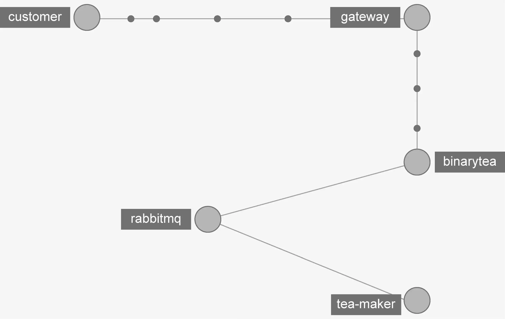

# 第16章服务集成(3)

## 16.4　基于 Spring Cloud Gateway 实现微服务网关

不同的微服务各司其职，相对独立地对外提供服务，这在组织内部也许不是个大问题，但当外部需要访问内部的服务时，这就会带来很多不便，比如外部客户端不得不感知内部的服务细节，又比如至少需要知道如何找到所需的服务，还有一系列其他问题有待解决。为此，可以在边界上引入微服务网关。这一节就让我们来聊聊微服务网关，以及如何使用 Spring CloudGateway 来实现微服务网关。

### 16.4.1　什么是微服务网关

在具体了解微服务网关之前，先看看没有它的时候究竟会存在些什么问题。以客户端的视角作为切入点，会发现下面这些问题。

- 客户端必须了解分散在不同微服务之间的各种领域和组织细节。

- 客户端的接入点过于分散，不同的服务要么是不同的域名，要么直接暴露 IP，这就增加了潜在的安全风险。

- 不同客户端对服务的粒度要求不同，服务太散会导致交互过于频繁。

- 不同的服务也许会使用不同的认证方式和通信协议，不利于客户端的接入。

服务端也有很多痛点需要解决，例如安全防护、身份认证、权限控制、审计日志、负载均衡18

- 、容错降级、监控告警等。如果这些功能都让服务自己解决，那势必会消耗大量的人力物

力，而他们本该将资源聚焦在业务上。

出于上述种种原因，微服务网关应运而生，它为内部服务提供了一个统一的入口，同时还可以提供上述提到的服务端所需的一系列横向功能，解放业务团队的生产力。微服务网关通常是一个独立的组件，根据其定位，有的网关会保持业务无关性，仅提供通用能力，有的则会包含一部分简单的业务逻辑。但总体上，建议避免将业务逻辑渗透到网关中，从而减少相互之间的耦合度。

1. 常见的微服务网关既然微服务网关这个需求如此常见，这也就意味着一定已经有了不少优秀的开源网关，我们可以先来了解一下。

- NginxNginx 通常用作网站的负载均衡设施，所以它也理所应当可以用来做微服务网关。Nginx本身就有很多插件，遇到特殊需求，还可以搭配 Lua 脚本来实现，这就慢慢延伸出了知名的 OpenResty 高性能 Web 平台。后来，在 OpenResty 基础之上诞生了 Kong 网关，它是一款灵活的轻量级云原生服务网关，面向去中心化架构，可以部署在混合云和多云环境中。Kong 可以通过插件实现对请求和响应的拦截，有点类似 AOP 或者过滤器，常用的插件包含身份认证插件、安全控制插件、流量控制插件、分析监控插件、日志应用插件、协议转换插件等。Kong 本身也提供了丰富的 API，可以通过 API 实现对集群的各种管理，而 Kong 集群的各种配置和数据则会记录在 PostgreSQL 或者 Cassandra 里，维护也很方便。

- Apache APISIXApache APISIX 是另一款基于 OpenResty 开发的微服务网关，兼具云原生、高性能、可扩展等诸多优点。APISIX 自带前端，可以方便地在界面上进行路由配置、负载均衡、限流和身份验证等各种操作。APISIX 与 Kong 在核心功能上不相上下，但在细节上似乎更胜一筹，例如，APISIX 在架构上是 Nginx 搭配 Etcd，可以实现配置变更的主动推送，而 Kong 是 Nginx 搭配数据库，需要主动轮询配置变更；Kong 的路由实现是遍历，而APISIX 是基于基数树，相对更高效。而且，APISIX 是国人开发，对国内主流的一些软件和框架的支持更加友好，例如能够搭配阿里巴巴开源的 Tengine 一同使用，支持Dubbo 协议代理。此外，作为 Apache 顶级项目，APISIX 也可谓自带光环。

- Zuul对 Java 程序员来说，如果微服务网关是 Java 写的，那肯定会是加分项。Netflix 开源的Zuul 就是一款由 Java 编写且经过大流量考验的微服务网关。而且它是 Spring Cloud 早期推荐的微服务网关，两者无缝整合，加之本身由 Netflix 出品，与 Eureka、Ribbon 和

- Hystrix 的配合更是不在话下。在之前的各种场合，Spring Cloud 都会搭配 Zuul 来进行各种演示，在实践中也一样。Zuul 的核心是请求的过滤器，通过各种过滤器来实现身份认证、审计、监控、动态路由、负载均衡等功能。此外，因为 Netflix 是大量部署在AWS 之上的，所以 Zuul 对 AWS 做了大量的优化，例如能够实现跨可用区访问，支持AWS 的 ELB（Elastic Load Balancing）等。如果我们的系统是部署在 AWS 上的，那使用 Netflix 的全套设施无疑是个好选择。

- Zuul 1.x 用的是阻塞线程，到了 Zuul 2.x，对架构做了比较大的改动，基于 Netty 实现了异步非阻塞。可惜 Zuul 2.x 并不开源，所以现在它在 Spring Cloud 中的位置逐步被Spring Cloud Gateawy 所取代。

2. Spring Cloud Gateway 概述由于 Zuul 2.x 的开发一直跳票，到后来索性宣布不再开源，而 Zuul 1.x 又是阻塞式的，长期看来并不符合大的发展趋势，因而 Spring 团队自己开发了一个微服务网关来代替 Zuul，这就是 Spring Cloud Gateway。

- Spring Cloud Gateway 是一款简单、高效的轻量级微服务网关，构建在 Spring 生态之上，用到了 Spring Framework 5、Spring Boot 2 和 Project Reactor 等项目。由于使用了Spring WebFlux，Spring Cloud Gateway 实现了非阻塞通信，相比 Zuul 1.x 在性能上有很大的提升。

- 与前文提到的微服务网关一样，Spring Cloud Gateway 也提供了不少微服务所需的公共能力，例如安全防护、监控、限流熔断等。这些能力都是由过滤器实现的，Spring Cloud

```
Gateway 内置了大量实用的过滤器，它们全是 GatewayFilter 接口的实现，通过可配置
的过滤器链（GatewayFilterChain）可以满足绝大部分日常需求。就算遇到了内置过滤
器解决不了的问题，也可以直接动手实现自己的 GatewayFilter。当一个请求到达
Spring Cloud Gateway 服务器后，RoutePredicateHandlerMapping 会根据请求去查
```

- 19

```
找对应的 Route（也就是路由配置），其中包含了路由 ID、目标 URI、断言
```

- （predicate）以及过滤器。整体上来说，Spring Cloud Gateway 的配置非常灵活，在配置服务路由信息20

```
时有两种方式可供选择，第一种是完全在 application.yml 中进行配置
```

- ，第二种是使用 Java 配置类。我们在下文详细介绍路由配置时会分别演示这两种方式。

### 16.4.2　Spring Cloud Gateway 的路由配置

Spring Cloud Gateway 并不是一个现成的独立服务，而是一个框架，我们需要自己构建一个

```
Spring Cloud 工程，配置好 spring-cloud-dependencies，像下面这样引入 spring-
cloud-starter-gateway 依赖，随后就能在配置文件或者配置类中增加对应的路由规则
```

了。如果还有服务注册与发现的需求，还可以加入对应的起步依赖，Spring Boot 会为我们完成自动配置。

```xml
<dependency>
   <groupId>org.springframework.cloud</groupId>
   <artifactId>spring-cloud-starter-gateway</artifactId>
</dependency>
```

接下来，让我们通过一个例子来具体看看应该如何进行 Spring Cloud Gateway 的路由配置。

- 需求描述　通常情况下，奶茶店系统的后端可被视为一个整体，而顾客在系统外部。因此在顾客访问二进制奶茶店时，最好能够屏蔽系统的内部细节，也就是把 BinaryTea 和TeaMaker 作为一个整体，与 Customer 隔离开，增加一个独立的服务网关似乎是个不错的选择。

1. 基础配置Spring Cloud Gateway 作为一个网关，本质上就是接收请求，然后根据预先配置的路由规则对其进行匹配并加以处理，随后转发给后端具体的服务。因此，配置路由规则、用好内置的断言和过滤器基本就是配置的所有工作了。路由的配置以

```
spring.cloud.gateway.routes 为前缀，主要包含如下几块：
id，路由的编号；
uri，要转发的 URI，可以转给特定的后端 URI，也可以是个负载均衡的服务名；
predicates，要匹配的断言内容，可以是一条，也可以是多条；
filters，在请求转发给后端前需要经过的一个或多个过滤器。
以转发 /token 请求为例，代码示例 16-20 演示了如何将 /token 请求转发给
http://localhost:8080，最后拼接的 URI 是 http://localhost:8080/token。
```

- 21

- 代码示例 16-20　最简单的路径匹配路由

```yaml
spring:
1
 cloud:
2
   gateway:
3
     routes:
4
       - id: token-route
5
         uri: http://localhost:8080
6
         predicates:
7
           - Path=/token
8
断言的配置有两种形式：一种是上面看到的简短写法，断言名称 Path 后跟一个 =，后续
内容是要传给断言的参数，用逗号 , 分隔；另一种方式是将断言完全展开，用 name 来指
定断言，args 来提供参数（每个断言用到的参数不太一样，可以参考官方文档中的说
明）。代码示例 16-21 就演示了如何用第二种方式设置 Path 断言，这里匹配 /order/**
的意思就是匹配以 /order/ 开头的所有路径；同时还用了服务发现来配置 URI，可以看到
```

- 22

```
其中的 URI 以 lb:// 开头，后面跟的是服务名。
```

- 代码示例 16-21　展开的断言配置

```yaml
spring:
1
 cloud:
2
   gateway:
3
     routes:
4
       - id: order-route
5
         uri: lb://binarytea
6
         predicates:
7
           - name: Path
8
             args:
9
               patterns: /order/**
10
完成了 /token 和 /order 的路由配置，还剩下 /menu 这个路径，这次我们换 Java 配置
类的方式。在配置类中提供一个 RouteLocator 类型的 Bean，通过
RouteLocatorBuilder 来构造我们需要的 RouteLocator，每个路由都能用
PredicateSpec 来描述。代码示例 16-22 就配置了一个 /menu/** 的路由规则，把请求
转发到 lb://binarytea 上。
```

- 代码示例 16-22　在 Java 配置类中设置路由规则

```java
@SpringBootApplication
1
public class GatewayApplication {
2
   // 省略其他代码
3
   @Bean
4
   public RouteLocator customRouteLocator(RouteLocatorBuilder builder)    {
5
       return builder.routes()
6
              .route("menu-route", r -> r.path("/menu/**")
7
              .uri("lb://binarytea"))
8
              .build();
9
   }
10
}
11
```

- 最后，要让我们的网关能顺利运行起来，还需要提供一些基础的配置，包括 Zookeeper 配置用来做服务发现与注册，Zipkin 与 Sleuth 的配置，以便能在 Zipkin 里看到实际的请求链路。大概的 YAML 配置会是下面这样的：

```
server.port: 8888
1
2
spring:
3
 application.name: gateway
4
 config.zookeeper.connect-string: "localhost:2181"
5
 zipkin.base-url: "http://localhost:9411"
6
 sleuth.sampler.probability: 1.0
7
8
management:
9
 endpoint.gateway.enabled: true
10
 endpoints.web.exposure.include: "*"
11
```

- 为了让 Customer 能通过网关来访问 BinaryTea，而非直接通过服务发现找到目标，我们可

```
以在 application.properties 中将 binarytea.url 改为 http://gateway，同
时将 OrderService 上的 @FeignClient 注解里的 name 属性值也改成 gateway。这
```

- 23

```java
里的 gateway 就是进行服务注册与发现时网关用的名称。
@FeignClient(contextId = "orderService", name = "gateway", path = "/order")
1
public interface OrderService {...}
2
```

- 现在以此运行 TeaMaker、BinaryTea、Gateway 和 Customer 就能看到实际的运行效果。通过 Zipkin 可以看到实际的请求链路，具体如图 16-9 所示。



- 图 16-9　通过网关访问的链路图

- 对于网关，通常都会设置一个向后端请求的超时时间。在 Spring Cloud Gateway 中，与后

```
端请求相关的 HTTP 配置都以 spring.cloud.gateway.httpclient 为前缀，对应的
属性类是 HttpClientProperties。其中 connect-timeout 对应了连接超时，单位
为毫秒；response-timeout 则是请求的应答超时，它的类型是 Duration，我们可以
```

- 自己指定时间单位，默认是毫秒。大概的配置可以是像下面这样的：

```yaml
spring:
1
 cloud:
2
   gateway:
3
     httpclient:
4
       connect-timeout: 1000
5
       response-timeout: 3s
6
```

- 除了统一的超时配置，也可以针对每条不同的路由规则单独设置超时时间，这些配置属于路

```
由的元数据，因此要配置在 metadata 里，元数据的属性定义在 RouteMetadataUtils
```

- 里，其实也就两个，使用时是这样的：

```yaml
spring:
1
 cloud:
2
   gateway:
3
     routes:
4
       - id: token-route
5
         uri: http://localhost:8080
6
         predicates:
7
           - Path=/token
8
         metadata:
9
           connect-timeout: 500
10
           response-timeout: 500
11
在上面的例子中，我们已经看到了针对路径进行判断的 Path 断言。Spring Cloud
```

- Gateway 中内置了很多不同的路由断言，每种断言都接受不同的参数，表 16-8 罗列了其中

```
的一些断言。路径的 URI 模板中可以添加变量，例如 /binarytea/order/，这里的变量
会被保存在 ServerWebExchange.getAttributes() 里，用的键名是
ServerWebExchangeUtils.URI_TEMPLATE_VARIABLES_ATTRIBUTE，在过滤器里
```

- 也能用到这些变量。

- 表 16-8　Spring Cloud Gateway 的一些常用路由断言

- 名称作用参数

```
name，要匹配的 Cookie 名称；
Cookie
```

- 根据特定 Cookie 值进行正则匹配值要匹配的正则表达式

```
header，要匹配的 Header 名称
Header
```

- 根据特定 HTTP Header 值进行正则匹配头的值要匹配的正则表达式

```
patterns，主机名列表，不同
Host
```

- 根据请求的主机名进行匹配隔，主机名可以使用 ANT 风格

```
methods，HTTP 方法列表，不
Method
```

- 根据 HTTP 方法进行匹配例如24如果我们的网关在负载均衡后面，可能无法直接取得实际的对端地址。通常负载均衡

```
会把真实地址放在 X-ForwardedFor 之类的 HTTP Header 里，Spring Cloud Gateway
自带一个 RemoteAddressResolver 地址解析器，可以在 Java 类配置路由断言时传
入该解析器的实例，从 X-Forwarded-For 中获取地址。
```

2. 常用过滤器前面介绍过了匹配请求用的断言，接下来再来了解一下路由配置中的另一个重点，也就是过滤器。通过过滤器可以对请求和应答进行各种调整。Spring Cloud Gateway 内置了大量的

```
过滤器，它们都是 GatewayFilter 接口的实现，有的专门处理 HTTP Header，有的专门
```

- 处理请求中的参数，还有的专门处理路径……过滤器的配置方法与断言类似，区别只是它们

```yaml
配置在 filters 下。过滤器都是用 = 来分隔过滤器名称与参数，而参数之间用 , 分隔；
也可以用完整配置的方式，name 配置过滤器名称，args 下配置各个参数对。
下面的配置会保留请求中的 HostHeader，使用的就是 PreserveHostHeader 过滤器。
spring:
1
 cloud:
2
   gateway:
3
     routes:
4
       - id: token-route
5
         uri: http://localhost:8080
6
         predicates:
7
           - Path=/token
8
         filters:
9
           - PreserveHostHeader
10
```

- 内置过滤器中有很大一部分是处理 Header 的，表 16-9 中罗列的都是针对 Header 的过滤器。

- 表 16-9　部分针对 HTTP Header 的过滤器

- 过滤器名称作用参数

```
AddRequestHeader
na
```

- 向请求中添加 Header

```
AddResponseHeader
na
```

- 向应答中添加 Header

```
RemoveRequestHeader
na
```

- 从请求中删除 Header

- 除了 HTTP Header，Spring Cloud Gateway 中还有一些用来处理路径的过滤器，如表 16-10 所示。

- 表 16-10　部分针对路径的过滤器

- 过滤器名称作用参数

```
PrefixPath
prefix，要添加的前缀
```

- 在所有匹配的请求前增加一个路径前缀

```
parts，要截掉的数量，即用 /
StripPrefix
```

- 将匹配请求的路径截去一部分数

```
regexp，要匹配的正则表达式
RewritePath
```

- 根据正则匹配替换路径内容替换成的内容

```
template，路径模板，用的就
SetPath
```

- 直接设置发送给下游的请求路径板

```yaml
我们可以像下面这样用 StripPrefix 来处理路径，去除 /binarytea/token 中的
/token。
spring:
1
 cloud:
2
   gateway:
3
     routes:
4
       - id: new-token-route
5
         uri: lb://binarytea
6
         predicates:
7
           - Path=/binarytea/token
8
           - Method=POST
9
         filters:
10
           - StripPrefix=1
11
```

- 还有几个比较有用的过滤器，如表 16-11 所示。

- 表 16-11　其他一些有用的过滤器

- 过滤器名称作用参数

```
AddRequestParameter
name，要添加的参数名；
```

- 增加请求参数

```
RemoveRequestParameter
name，要移除的参数名
```

- 移除请求参数

```
status，要返回的响应码
SetStatus
```

- 控制请求应答的 HTTP 响应码中定义的枚举值，也可以

```
200 都可以
status，传入 3xx 响应
RedirectTo
```

- 直接重定向请求URL

```
CacheRequestBody
bodyClass，请求体对应
```

- 缓存请求体

- 过滤器不仅可以配置在单条路由规则上，还可以批量配置默认的过滤器，使用

```
spring.cloud.gateway.default-filters 可以轻松地为所有路由规则配置过滤器，
比如下面这段配置会为所有路由加上 SecureHeaders 过滤器。
```

```yaml
spring:
1
 cloud:
2
   gateway:
3
     default-filters:
4
       - SecureHeaders
5
```

3. 服务容错保护在 Spring Cloud Gateway 内置的过滤器中，还有一类特殊的过滤器，需要单独拿出来做一下介绍。在第 15 章里我们介绍了如何进行容错保护，在每个服务中通过引入 Resilience4j等框架来实现基础的保护。其实，微服务网关可以统一为背后的服务提供断路、限流、重试等保护，后端服务如果没有非常强烈的特殊需要，完全可以将这些事托付给网关来处理。

- 先来说说断路保护。Spring Cloud Gateway 默认支持 Spring Cloud CircuitBreaker 提供的断路器，在 15.3 节中我们已经介绍过它了。由于 Spring Cloud Gateway 是响应式的，因

```xml
而我们要先在 pom.xml 中引入 spring-cloud-starter-circuitbreaker-
reactor-resilience4j 依赖。
<dependency>
1
   <groupId>org.springframework.cloud</groupId>
2
   <artifactId>spring-cloud-starter-circuitbreaker-reactor-resilience4j</artif
3
</dependency>
4
CircuitBreaker 过滤器有三个参数，第一个 name 设置了断路器的名称，有了名字就可
以像 15.2.2 节中那样为断路器配置各种参数；第二个参数是可选的 fallbackUri，用来
```

- 25

```
设置断路后重定向的 URI，目前仅支持以 forward:
```

- 为前缀的 URI，异常信息会被保存

```
在 ServerWebExchange 的属性里，键名是
ServerWebExchangeUtils.CIRCUITBREAKER_EXECUTION_EXCEPTION_ATTR；第
三个参数是可选的 statusCodes，这是一个 HttpStatus 列表，可以根据 HTTP 响应码
来进行断路统计。在 forward: 跳转到 fallbackUri 时，可以通过
FallbackHeaders 过滤器在 HTTP Header 中传递异常相关的信息（如果有异常信息的
```

- 话），Header 名可以用表 16-12 中的参数进行设置。

- 表 16-12　FallbackHeaders 可以传递的异常信息

- 参数默认值

```
executionExceptionTypeHeaderName
Execution-Exception-Type
executionExceptionMessageHeaderName
Execution-Exception-Message
rootCauseExceptionTypeHeaderName
Root-Cause-Exception-Type
rootCauseExceptionMessageHeaderName
Root-Cause-Exception-Message
我们以 /menu/** 的请求为例，在出现 500 Internal Server Error 时希望能够降
级到一个特定的 /fallbackURI 上，menu-route 的配置大概会是代码示例 16-23 这样
```

- 的。

- 代码示例 16-23　包含熔断降级功能的菜单路由配置

```java
spring:
1
 cloud:
2
   gateway:
3
     routes:
4
       - id: menu-route
5
         uri: lb://binarytea
6
         predicates:
7
           - Path=/menu/**
8
         filters:
9
           - FallbackHeaders
10
           - name: CircuitBreaker
11
             args:
12
               name: menu-cb
13
               fallbackUri: forward:/fallback
14
               statusCodes:
15
                 - INTERNAL_SERVER_ERROR
16
我们需要在 Gateway 工程中添加一个 /fallback 的 WebFlux 控制器，如代码示例 16-24
所示，它直接返回一个 {}JSON 字符串，把所有的 HTTP Header 打印在日志里。
代码示例 16-24　/fallback 控制器
@RestController
1
@Slf4j
2
public class FallbackController {
3
   @RequestMapping("/fallback")
4
   public Mono<String> fallback(ServerHttpRequest request) {
5
       request.getHeaders().forEach((k, v) -> log.info("Header [{}] : {}",
6
           k, v.stream().collect(Collectors.joining(","))));
7
       return Mono.just("{}");
8
   }
9
}
10
假设我们稍微修改一下 BinaryTea 中 /menu/ 的代码，会直接抛出一个
RuntimeException，在没有设置 CircuitBreaker 过滤器时，curl 命令访问的输出
```

- 是这样的：

```
▸ curl -v http://localhost:8888/menu/1
1
*   Trying ::1:8888...
2
* Connected to localhost (::1) port 8888 (#0)
3
> GET /menu/1 HTTP/1.1
4
> Host: localhost:8888
5
> User-Agent: curl/7.77.0
6
> Accept: */*
7
>
8
< HTTP/1.1 500 Internal Server Error
9
< transfer-encoding: chunked
10
省略很多HTTP Header……
11
< X-Permitted-Cross-Domain-Policies: none
12
<
13
* Connection #0 to host localhost left intact
14
{"timestamp":"2021-12-28T15:14:45.994+00:00","status":500,"error":"Internal Se
15
而按照代码示例 16-23 配置后，输出的效果则变成了返回 200 OK，说明我们的断路保护
```

- 生效了。

```
▸ curl -v http://localhost:8888/menu/1
1
*   Trying ::1:8888...
2
* Connected to localhost (::1) port 8888 (#0)
3
> GET /menu/1 HTTP/1.1
4
> Host: localhost:8888
5
> User-Agent: curl/7.77.0
6
> Accept: */*
7
>
8
< HTTP/1.1 200 OK
9
< Content-Type: text/plain;charset=UTF-8
10
< Content-Length: 2
11
<
12
* Connection #0 to host localhost left intact
13
{}%
14
对于限流的场景，Spring Cloud Gateway 提供了 RequestRateLimiter 过滤器。它通过
RateLimiter 来判断当前请求是否可以通过，如果不能，则默认返回 429 Too Many
Requests 响应码。我们可以用 keyResolver 参数传入 Bean ID，形式是 #
{@BeanID}。这是一个 KeyResolver 的实现，告诉 RequestRateLimiter 如何从请
求中解析出限流用的键名，默认会用 PrincipalNameKeyResolver，它将从
ServerWebExchange 里取得的 Principal 名称作为键名。如果取不到键名，默认会返
回 403 Forbidden 拒绝当前请求，也可以通过调整
spring.cloud.gateway.filter.request-rate-limiter.deny-empty-
key=false 和 spring.cloud.gateway.filter.request-rate-
limiter.empty-key-status-code=200 改变默认设置。需要注意的是，这个过滤器
```

- 必须使用完整配置的方式来配置，不支持简单方式配置。

```
在现实场景中，集群限流的需求也很强烈，因此 RequestRateLimiter 还支持基于
Redis 的令牌桶算法，通过 Redis 在集群间共享令牌。对 Redis 的支持是由 spring-
boot-starter-data-redis-reactive 来提供的，所以网关需要添加这个依赖。相关
```

- 的参数如表 16-13 所示，不同的搭配能产生不同的限流效果。例如，只允许 1 秒处理 1 个

```
请求可以设置 replenishRate=1、burstCapacity=1 和 requestedTokens=1，如
果是 1 分钟处理 1 个请求，则是 replenishRate=1、burstCapacity=60 和
requestedTokens=60。
```

- 表 16-13　Redis 限流的参数

- 参数默认值说明

```
redis-rate-limiter.replenishRate
```

- 填充令牌桶的速率，也就是每秒

```
redis-rate-limiter.burstCapacity
```

- 令牌桶的最大容量

```
redis-rate-limiter.requestedTokens
1
```

- 每次请求从令牌桶中取出的令牌

```yaml
假设我们希望对 /menu 下的请求进行全局限流，每 30 秒只能请求 1 次，可以像下面这样
配置 Redis 限流。注意，由于 YAML 格式的原因，keyResolver 的值需要加引号。
spring:
1
 redis:
2
   host: localhost
3
   port: 6379
4
 cloud:
5
   gateway:
6
     routes:
7
       - id: menu-route
8
         uri: lb://binarytea
9
         predicates:
10
           - Path=/menu/**
11
         filters:
12
           - name: RequestRateLimiter
13
             args:
14
               keyResolver: "#{@pathKeyResolver}"
15
               redis-rate-limiter.replenishRate: 1
16
               redis-rate-limiter.burstCapacity: 30
17
               redis-rate-limiter.requestedTokens: 30
18
为了针对路径进行限流，我们专门配置了一个 pathKeyResolver Bean，它的配置如代
```

- 码示例 16-25 所示，此处直接从请求中取出路径作为键名。

```java
代码示例 16-25　GatewayApplication 中的 pathKeyResolver 配置
@SpringBootApplication
1
public class GatewayApplication {
2
   @Bean
3
   public KeyResolver pathKeyResolver() {
4
       return exchange -> Mono.just(exchange.getRequest()
5
              .getPath().toString());
6
   }
7
   // 省略其他代码
8
}
9
用 curl 命令访问 /menu/1，可以观察一下应答的内容，其中包含了限流相关的信息。
▸ curl -v http://localhost:8888/menu/1
1
*   Trying ::1:8888...
2
* Connected to localhost (::1) port 8888 (#0)
3
> GET /menu/1 HTTP/1.1
4
> Host: localhost:8888
5
> User-Agent: curl/7.77.0
6
> Accept: */*
7
>
8
< HTTP/1.1 200 OK
9
< X-RateLimit-Remaining: 0
10
< X-RateLimit-Requested-Tokens: 30
11
< X-RateLimit-Burst-Capacity: 30
12
< X-RateLimit-Replenish-Rate: 1
13
< ETag: "028ff1e8fd36bd1f2a847a91b06f668ee"
14
……
15
{"id":1,"name":"Java咖啡","size":"MEDIUM","price":{"amount":12.00,"currency":"C
16
"2022-01-02T11:53:56.868+00:00","updateTime":"2022-01-02T11:53:56.868+00:00"}%
17
在 30 秒内连续访问后，响应码会变为 429 Too Many Requests，也就是被限流了。
……
1
< HTTP/1.1 429 Too Many Requests
2
< X-RateLimit-Remaining: 3
3
< X-RateLimit-Requested-Tokens: 30
4
< X-RateLimit-Burst-Capacity: 30
5
< X-RateLimit-Replenish-Rate: 1
6
……
7
```

- 在发生非正常响应时，通常可以让服务的上游自行处理。对于时间在可接受的范围内、下游又支持重试的情况，让网关发起重试也不失为一种好的选择。Spring Cloud Gateway 提供

```
了 Retry 过滤器，可以精确地控制网关的重试动作。表 16-14 罗列了 Retry 过滤器的参
```

- 数，通过这几个参数可以控制重试次数以及何时重试。

- 表 16-14　Retry 过滤器的参数

- 参数默认值说明

```
retries
3
```

- 重试次数

```
statuses
```

- 要重试的 HTTP 响应码列表，枚

```
methods
GET
```

- 要重试的HTTP 方法列表枚举

```
如果希望两次重试之间的时间间隔能呈指数级递增，可以配置 backoff 参数。这个参数默
认是关闭的，下面有多个参数配合，表 16-15 是 backoff 中可以配置的参数。如果
basedOnPreviousValue 为 true，间隔时间是上次间隔时间 * factor；如果为
false，则为 firstBackoff * (factor ^ n)，n 为迭代数，间隔时间的计算方式可
以参考 Backoff.exponential() 方法。
```

- 表 16-15　backoff 中包含的参数

- 参数默认值说明

```
firstBackoff
5ms
```

- 首次间隔时间

```
maxBackoff
```

- 最大的间隔时间，为空则没有上限

```
factor
2
```

- 指数级递增的因子

```
basedOnPreviousValue
true
```

- 是否基于上一次的间隔时间进行计算

```
下面针对 /token 这个路径的 POST 请求配置了一个重试策略：重试 5 次；间隔时间第 1
```

- 次为 10 毫秒，第 2 次为 20 毫秒，第 3 次为 40 毫秒，第 4 次为 50 毫秒，第 5 次为 50 毫秒，算上第一次正常请求，一共会有 6 次调用。

```yaml
spring:
1
 cloud:
2
   gateway:
3
     routes:
4
       - id: token-route
5
         uri: http://localhost:8080
6
         predicates:
7
           - Path=/token
8
         filters:
9
           - name: Retry
10
             args:
11
               retries: 5
12
               methods: POST
13
               series: CLIENT_ERROR
14
               backoff:
15
                 firstBackoff: 10ms
16
                 maxBackoff: 50ms
17
basedOnPreviousValue: false
18
这里为了方便演示，专门针对 4XX 的应答进行了重试配置。用下面的 curl 命令请求后，可
以观察 BinaryTea 的日志，能看到有 6 次响应码是 400 的请求。
▸ curl -v -X POST -H "Content-Type: application/json" -d "{}" http://localhost
1
```

## 16.5　小结

本章我们着重了解了一些与服务集成有关的知识，例如，在 REST 服务这种方式以外，还可以使用 Apache Dubbo 进行 RPC 通信，通过消息中心进行异步的消息通信。在复杂的微服务架构里，如何在 OpenZipkin 的帮助下了解服务的全貌。市面上几乎所有的服务链路治理工具都受到了 Dapper 论文的影响，Trace ID 和 Span ID 十分重要。最后我们还看了下 SpringCloud Gateway。在 Spring Cloud 的早期版本中，微服务网关是 Zuul 1.x，但现在已经是以Spring Cloud Gateway 为主了。作为一款简单易用的微服务网关，它很好地嵌入了 Spring 生态。

- 二进制奶茶店项目开发小结在本章中，针对二进制奶茶店的系统，我们尝试用 Dubbo RPC 服务来代替 REST 服务。对于下面两个更适合用异步通知的场景，还用 MQ 消息代替了 HTTP 服务：支付后通知调茶师开始制作订单；

- 订单制作完毕通知前台。

- 为了应对不断增长的复杂性，我们引入了 Spring Cloud Sleuth 来进行服务链路分析，帮助我们理解一个订单的处理链路。针对要对外提供服务的微服务，通常还会在服务的前面增加微服务网关，我们用 Spring Cloud Gateway 配置了一个最基础的网关。纵观整个二进制奶茶店的例子，它为我们演示了很多功能，包括但不限于：Spring Framework 与 Spring Boot 的基础使用方法；

- 通过 JDBC 与 ORM 框架来操作数据库；

- Redis 的基础用法；

- 基于 Spring MVC 的 Web 开发方法；

- 发布与调用 RESTful 风格的 Web 服务；

- 通过 Spring Security 保护 Web 服务；

- 生产并消费基于消息中间件的消息；

- 基于 Spring Cloud 实现服务注册与发现、服务配置与服务容错。

- 这个例子相对简单，并不能直接放到生产中使用，但它已经足够用来说明框架与组件的使用方法了。

[18]：之前我们介绍过服务注册与发现机制可以用来解决负载均衡的问题，但服务注册中心通常是在内部使用的，不会暴露到组织外

- 部，因此一般情况下这种方案不适用于外部的客户端，外部还是得要通过事先约定好的域名或 IP 来访问服务。

[19]：遵从业内的惯用翻译，将 predicate 翻译为断言。在本节，断言特指 predicate，本书其他章节的断言为 assertion。[20]：因为路由配置可能会很复杂，因此在这里建议使用表现力更强的 YAML，而非 Properties 文件。[21]：这部分的示例在第 16 章的 gateway 工程里，对应修改的客户端示例则是 customer-gateway。[22]：如果用到服务发现与注册机制，不要忘记添加相关的依赖。[23]：如果是外部访问内部服务，通常都不会用服务发现机制，而是通过域名或 IP 来访问负载均衡设施。在内部服务访问时，可以

- 考虑示例中的方式。

[25]：在 9.3.1 中介绍过这个前缀，这是一个服务器端的重定向，可以带着请求上下文跳转。
