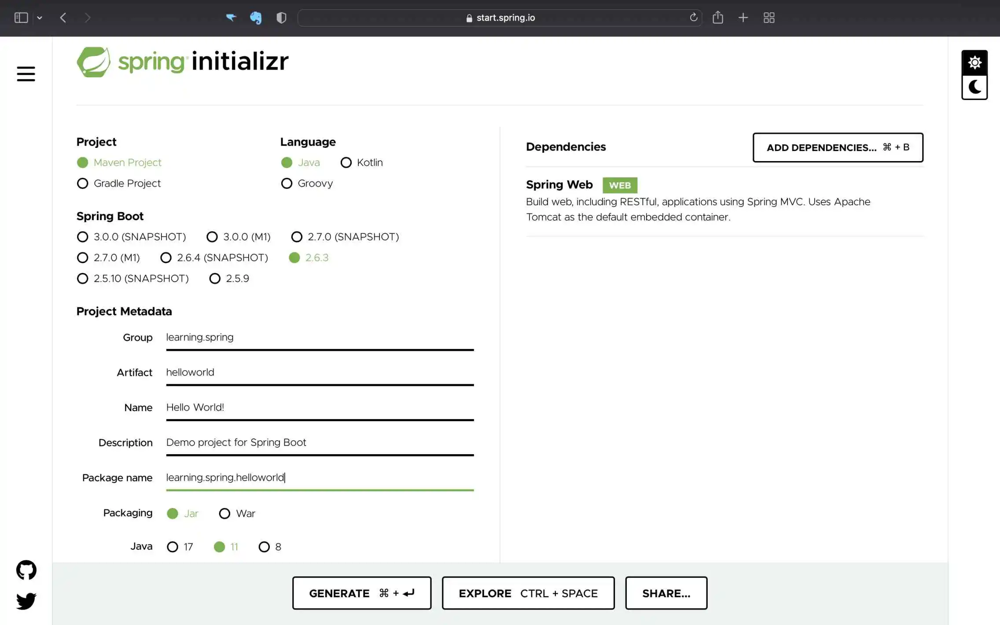
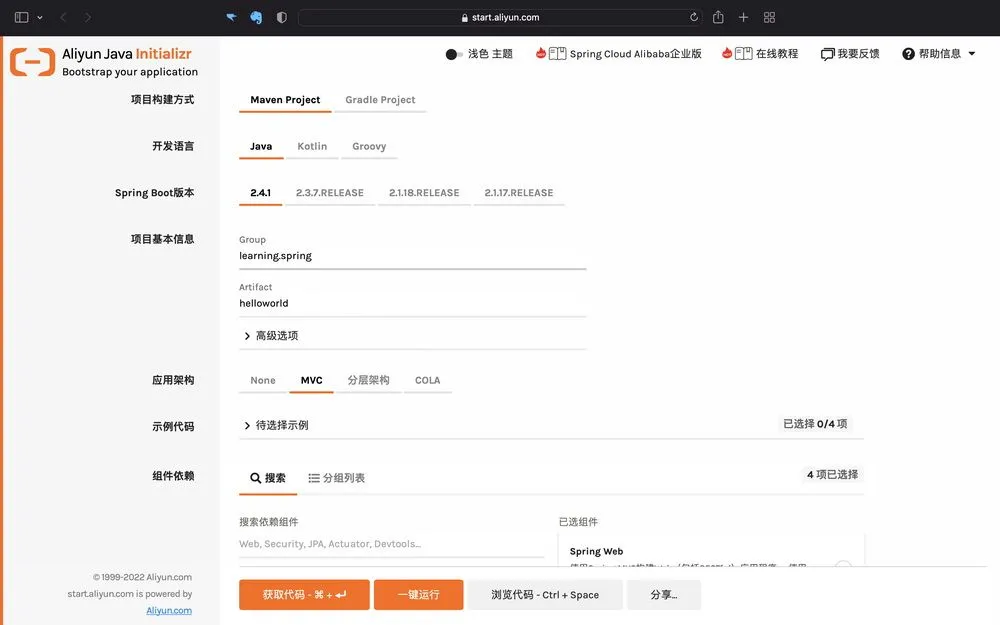
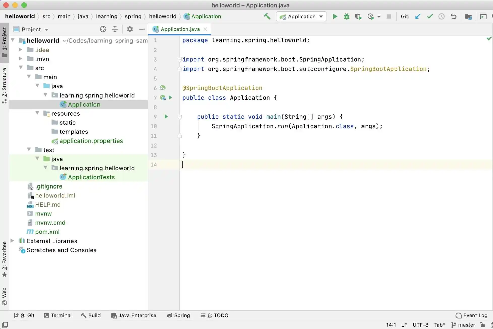
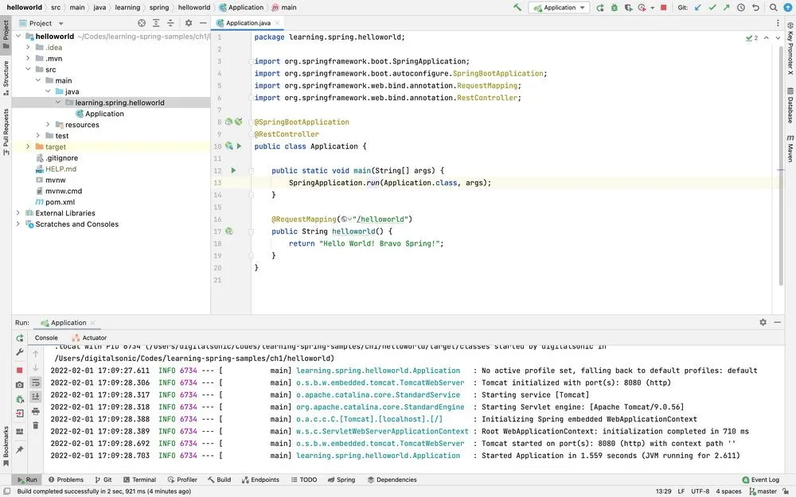
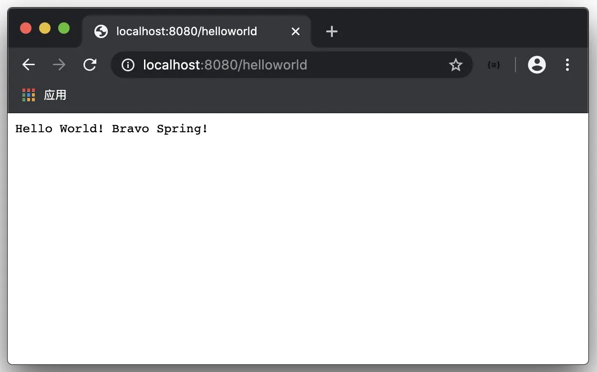
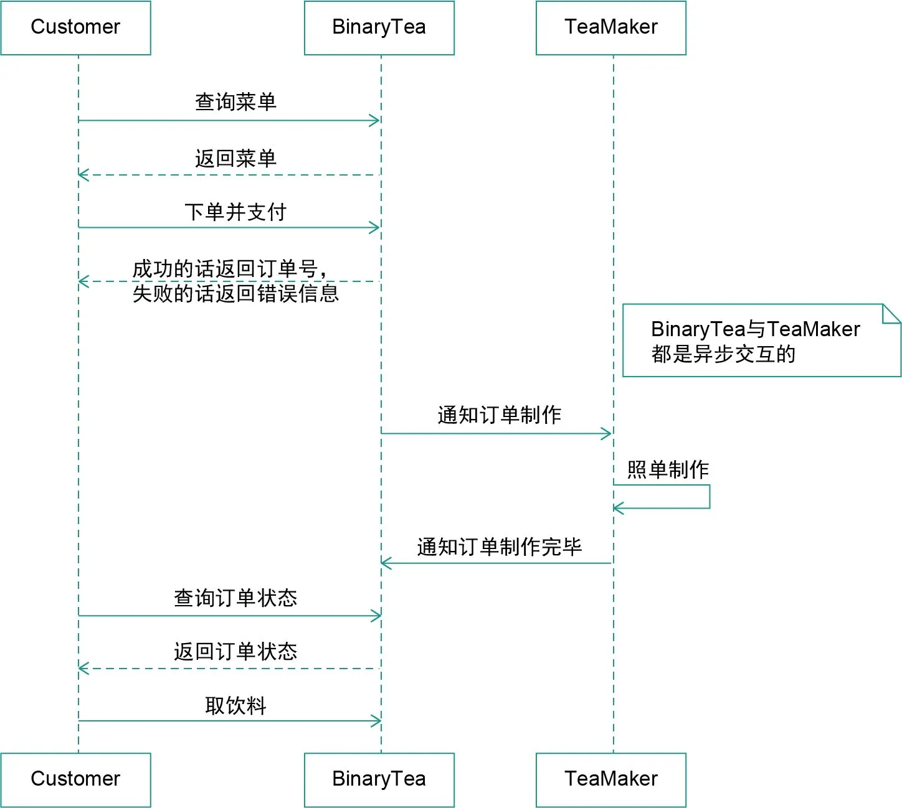
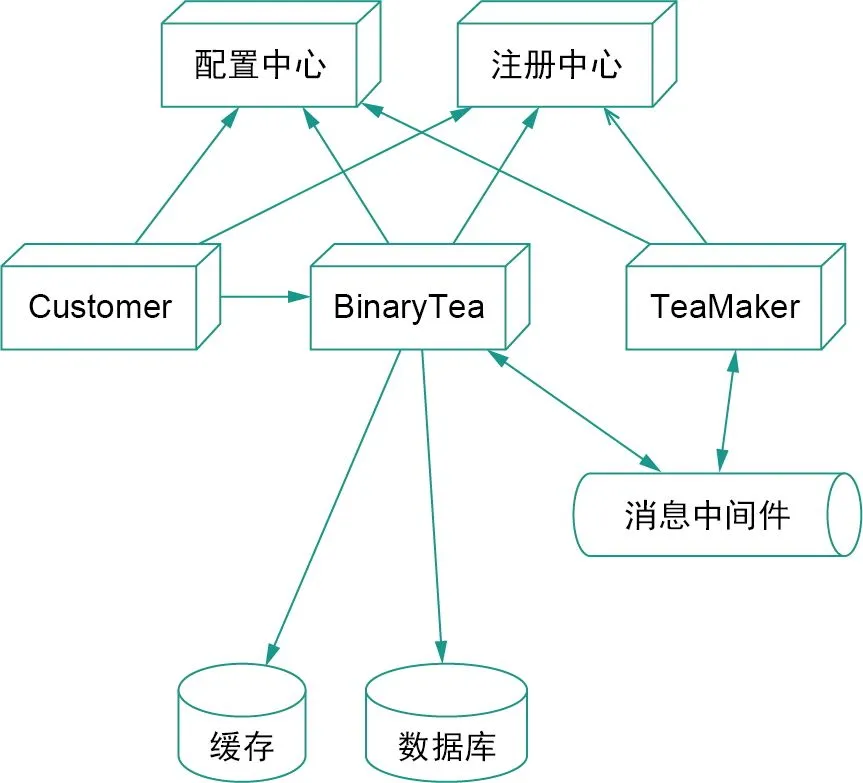
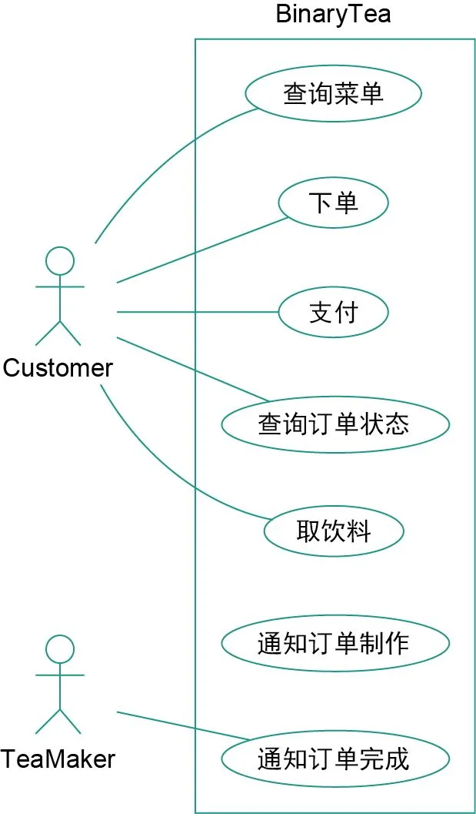

# 第1章初识Spring

- 本章内容Spring 发展历史概述

- Spring 家族主要成员介绍

- 编写一个简单的 Spring 程序

- 全书实战案例概述

希望本书能够系统地帮助各位透彻掌握 Spring 在实际开发中的应用，具体而言包括 SpringFramework、Spring Boot 与 Spring Cloud 等重要组件。在展开学习各个部分之前，大家很有必要先了解一下 Spring 的发展历史，同时对 Spring 家族的全貌有一个大致认识。书中还有一个贯穿全书的实战案例，在本章，我们也会对这个案例做个大概的说明。

## 1.1　认识 Spring 家族

不知从何时开始，Spring 这个词开始频繁地出现在 Java 服务端开发者的日常工作中，很多Java 开发者从工作的第一天开始就在使用 Spring Framework，甚至有人调侃“不会 Spring 都不好意思自称是个 Java 开发者”。既然 Spring 这么重要，在本书一开始的这一节我们就来学习一下 Spring 的发展历史，认识下 Spring 家族的主要成员。

### 1.1.1　Spring 发展历史

Java 平台分为针对移动应用的 J2ME、针对普通应用的 J2SE，以及针对企业应用的 J2EE（三者现在分别称为 Java ME、Java SE 与 Java EE）。随着开发需求的日益增长，J2EE 也

- 1

变得越来越复杂，其中一项重要工作就是编写 EJB，如果没有类似 JBuilder

- 等 IDE 工具的

支援，EJB 2.x 的开发经历可谓“令人抓狂”。

- 2

2002 年，Rod Johnson

- 出版了著名的 Expert One-on-One J2EE Design and

Development，而后又在 2004 年出版了 Expert One-on-One J2EE Development without EJB3

- 。这两本书对 J2EE 当时存在的各种问题进行了深入剖析，还提出了一套解决方案——

Spring Framework，它正是对 Rod Johnson 一系列思想的实践。

- 4

Spring Framework 成型于 2003 年，其 1.0 正式版于 2004 年 3 月 24 日发布

- 。从一开始，

Spring Framework 就没有打算站在 J2EE 的对立面上，而是对它进行补充——不仅是依赖注入（Dependency Injection）和 AOP（Aspect Oriented Programming，面向切面编程），它的大量模块都让 J2EE 应用的开发变得轻松了。虽然后续的 EJB 3.x 也开始走轻量化的路线，但Spring Framework 已然成了行业的事实标准，但凡大家聊到 J2EE 或者 Java EE，一定会包含 Spring Framework。

在国内，开发者们也紧跟行业的步伐，持续关注 Spring Framework 的发展。一群对技术充满

- 5

热情的人创建了 Spring 中文用户组

- ，翻译了 Spring Framework 1.x 的官方文档和 Rod6

Johnson 的“Introduction to the Spring Framework”等材料。满江红技术社区

- 与 Spring 官方

取得了联系，连续翻译了 Spring Framework 2.0 与 2.5 两个版本的官方文档。此外，满江红还在 2006 年翻译出版了 Pro Spring 中文版《Spring 专业开发指南》。在知名技术论坛

- 7

JavaEye

- 上，也有很多热烈讨论 Java EE 与 Spring Framework 的内容，甚至不乏开发者之

间激烈的论战；前文中提到的《Expert One-on-One J2EE Development without EJB 中文版》也是由 JavaEye 论坛的几位成员一同翻译的。正是大家的这些努力，对 Spring Framework 在国内的发展起到了极大的推动作用。

Spring Framework 的模块化设计得非常出色，用户可以根据实际情况分别引入自己需要的模块。在早期版本中，它还会贴心地提供一个包含所有内容的 Jar 包，但后来取消了这个做法。这就导致了什么问题呢？每当用户在决定要依赖什么模块时，只能自行判断该模块还需要哪些下游依赖，但又不确定不同的依赖、不同版本的依赖是否有不兼容的情况。后来的 SpringBoot 解决了这个问题，加之强大的自动配置与面向生产的各种能力，让应用的开发如虎添翼。如今的新工程，几乎都是基于 Spring Boot 进行开发的。在云计算已成为标配的大背景下，Spring Cloud 也应运而生，为开发云原生 Java 应用提供了很好的支持。

随着 Spring 家族日益壮大，Spring 这个名字的含义也在发生着变化。早期的 Spring 仅指代Spring Framework，后来基于 Spring Framework 孵化出了大量的项目，Spring 的含义变成了指代 Spring 家族。为了避免理解上的歧义，本书也按后者进行表述，大部分情况下不会将Spring Framework 或其他任何特定项目缩写为 Spring。

### 1.1.2　Spring 家族主要成员

Spring 家族早期就只有少数几个围绕 Spring Framework 的项目。随着各种功能的不断演进，很多模块从 Spring Framework 中脱离出来以独立项目的形式发展，也有些项目从一开始就是在 Spring Framework 的基础上单独开发的。为了让大家能对 Spring 家族的项目有个大概的印象，下面我们先简单介绍一下家族中的几个主要成员。

1. Spring Framework首先要介绍的当然是 Spring 家族中的第一位成员——Spring Framework，它为现代 Java企业应用提供了一整套完整的开发与配置模型。正如前文所述，它的出现改变了 Java EE项目的开发方式。

- Spring Framework 的功能非常丰富，除了核心的依赖注入、AOP、资源管理等特性，还有完善的数据访问能力，在事务管理、ORM 框架支持等方面都有不错的表现。在 Web 开发8方面，Spring MVC 早已取代了 SSH 组合中的 Struts，成为 Java Web 的主流框架；Spring Framework 5 推出的响应式 Web 框架 Spring WebFlux 也逐步崭露头角。除此之外，Spring Framework 中还有很多非常实用的功能，例如调度任务支持、缓存抽象等。

- Spring Framework 的成功与其设计哲学密不可分。在基于 Spring Framework 开发的项目中，开发者拥有很高的灵活度，框架为多种相似功能的第三方组件提供了一致的抽象，选择Hibernate 还是 MyBatis 真的不是个大问题。Spring Framework 的开发团队对代码质量的要求相当严苛，不仅在 API 的设计上追求精益求精，就连源码生成出来的 JavaDoc 文档读起来都令人赏心悦目。

- Spring Framework 总是紧跟技术发展，开发者社区也很活跃，所支持的 JDK 和组件一直在升级，每 3~4 年会有个重大版本发布。在本书编写时，当前的主要版本是 5.3.x，而新一代的 6.0 版本也已经发布了 SNAPSHOT，各主要版本的信息如表 1-1 所示。SpringFramework 各版本之间的兼容性还是比较好的，特别是核心的那些功能，几乎可以说在升级时能无缝平移。但升级也不是没有代价——抛开依赖的各种库的版本变化，框架自己的一些配置默认值有可能变化，有些功能可能会被淘汰。因此，如果你进行了版本升级，尤其是大版本升级，最好对系统做一轮完整的回归测试。

- 9表 1-1　Spring Framework 各主要版本的信息

- 支持的 JDK 版本官方 EOL版本

- 6.0.xJDK 17~21（预期）

- 5.3.xJDK 8~19（预期）2024 年 12 月

- 5.2.xJDK 8~152021 年 12 月

- 5.1.xJDK 8~152020 年 12 月

- 5.0.xJDK 8~102020 年 12 月

- 4.3.xJDK 6~82020 年 12 月

- 以升级到 6.0.0 为例，由于对 Java EE 的支持整体升级到了 Jakarta EE 9，很多注解和类

```
的包名发生了变化。像 @Inject、@PostConstruct 和 @PreDestroy 都放到了
jakarta 包下，但框架还能兼容 javax 包里的注解；不过数据访问层
javax.persistence 里的东西就没办法兼容了，需要调整代码，使用
jakarta.persistence 中的对应内容。此外，也要注意 Maven 中的依赖，各种组件需
要替换为带有 -jakarta 后缀的。虽然看起来有点麻烦，但对比 Python 2.x 升级到
```

- Python 3.x，这已经很幸福了。

- Spring Framework 是 Spring 家族所有成员的基础。各位想要学透 Spring，就必须要掌握Spring Framework 的核心要点和开发实践。

2. Spring Boot

```
如果说 Spring Framework 提升了 Java EE 项目的开发体验，那么 Spring Boot 则
降低了开发生产级 Spring 应用的门槛。只需轻松几步就能构建一个可以投产的应用，其
```

- 中包含了健康检查、监控、度量指标、外化配置等生产所需的功能。

- Spring Boot 提供的起步依赖（starter dependency）很好地解决了 Spring 应用的依赖管理困境——按功能组织依赖，降低了开发者的心智负担。此外，Spring Boot 的依赖经过了严格的兼容性测试，开发者再也不用为到底该加什么依赖而犯愁了。

- Spring Boot 的另一大亮点是自动配置。该功能减少了 Spring 应用的配置量，极端情况下甚至可以做到零配置。Spring Boot 可以根据多种条件自动判断是否需要做相应的配置，开发者也可以自行进行微调。Spring 团队曾开发过一个名为 Spring Roo 的项目，其目的就是帮助开发者生成所需的代码和配置。有一次我与 Spring 团队的 Josh Long 聊到自动配置，他说：“如果一段配置可以生成，那为什么还要让开发者来配置呢？”相信这也是 Spring Boot自动配置功能背后的哲学。

- 与 Spring Framework 类似，Spring Boot 的开发也很活跃，并且遵循一定的发布周期：大概每 6 个月会有一个版本发布，其间如有需要会安排发布相关的补丁版本。大版本通常会支持 3 年以上的时间，小版本则会提供至少 12 个月的支持。在 Spring Boot 2.4.0 之前，版本都带后缀，例如 2.3.5.RELEASE；从 2.4.0 版本开始，版本直接就是 2.4.0。在本书编写时，当前版本为 2.6.x，而 2.7.x 和 3.0.0 的 Spring Boot 已经发布了 SNAPSHOT。表 1-2 罗列了 Spring Boot 各主要版本的一些信息。

- 表 1-2　Spring Boot 各主要版本的信息

- 支持的 JDK 版本对应的 Spring Framework 版本官方 EOL版本

- 3.0.xJDK 17~21（预期）6.0.x

- 2.7.xJDK 8~19（预期）5.3.x2023 年 5 月

- 2.6.xJDK 8~19（预期）5.3.x2022 年 11 月

- 2.5.xJDK 8~19（预期）5.3.x2022 年 5 月

- 2.4.xJDK 8~19（预期）5.3.x2021 年 11 月

3. Spring Cloud随着云计算、微服务等概念的普及，大量应用程序逐步从单体应用发展到了分布式系统，但开发一套分布式系统又谈何容易。大公司有庞大的基础设施团队维护各种中间件，提供各种底层支持，让业务团队能聚焦在业务逻辑上，不用操心基础的分布式系统能力；小公司往往没有大公司的资源，需要自己在各种设施上摸爬滚打，各种踩坑。现在有了 Spring

- Cloud，一切都变得简单了，无论是谁都可以站在巨人的肩膀上，用简单的代码就可以实现高可靠的分布式系统。

- Spring Cloud 构建在 Spring Boot 提供的各种功能之上，例如用到了起步依赖与自动配置。两者在实践中会有一些对应关系，为了避免出现一些兼容性的问题，官方也给出了一个推荐10的版本指南。早期的 Spring Cloud 采用伦敦的地铁车站作为 Release Train 号，按字母顺序从前往后排列，但这的确不便于记忆，所以后来又增加了年份加数字的方式。表 1-3 罗列了最近几个 Spring Cloud 版本对应的 Spring Boot 版本。

- 表 1-3　最近几个 Spring Cloud 版本对应的 Spring Boot 版本

- Spring Cloud 版本对应的 Spring Boot 版本

- 2021.0（别名为 Jubilee）2.6.x

- 2020.0（别名为 Ilford）2.4.x，从 2020.0.3 开始对应 2.5.x

- Hoxton2.2.x，从 SR5 开始对应 2.3.x

- Greenwich2.1.x

- Finchley2.0.x

- Spring Cloud 并不是一个模块，而是一系列模块的集合，它们分别实现了服务发现、配置管理、服务路由、服务熔断、链路追踪等具体的功能。早期的 Spring Cloud 大量借鉴并引入了 Netflix 的最佳实践，Spring Cloud Netflix 就是基于 Netflix 的开源设施进行开发的。随后，在 Spring Cloud 的统一编程模型下，也出现了 Spring Cloud Zookeeper、SpringCloud Consul 等基于流行开源设施的模块，并在这些设施之上提供服务发现、服务配置等功能。

- 表 1-4 为大家筛选了一些主要的 Spring Cloud 子模块并加以简单说明（按字母序排序）。各子模块都有自己的独立版本，因此各模块版本的 EOL 等信息可以在官网各模块的

```
SUPPORT 板块里查看。
```

- 表 1-4　Spring Cloud 部分子模块

- 项目名功能

- 提供一个基于分布式消息的事件总线，可以方便地在集群Spring Cloud Bus中传播状态变更

- Spring Cloud Config提供一个基于 Git 仓库的集中式配置中心

- Spring Cloud Consul基于 Hashicorp Consul 实现服务发现与服务配置能力

- 提供了一套完整的云原生服务编排功能，包含简单易用的Spring Cloud Data FlowDSL、拖曳式的 GUI 和 REST-API，支持海量数据的批处理和流式处理

- Spring Cloud Gateway提供基于 Project Reactor 的智能服务路由的能力

- 整合大量 Netflix 的开源设施，比如 Eureka、Hystrix、ZuulSpring Cloud Netflix等

- 基于 OpenFeign，通过声明式 REST 客户端来访问分布式Spring Cloud OpenFeign系统中的服务

- Spring Cloud Sleuth提供分布式服务请求链路分析的能力

- 提供轻量级的事件驱动能力，通过声明式的方式来使用Spring Cloud StreamApache Kafka 或者 RabbitMQ 收发消息

- Spring Cloud Zookeeper基于 Apache Zookeeper 实现服务发现与服务配置能力

4. Spring DataSpring Framework 为传统的关系型数据库操作提供了统一的抽象，无论是事务管理还是数据访问模板，使用起来都让人得心应手。随着数据库技术的不断发展，涌现了大量的新技术和新产品，如果把对它们的支持都放入 Spring Framework 中，会导致框架十分臃肿，于是就有了 Spring Data。

- Spring Data 与 Spring Cloud 一样包含了相当多的子模块，其中的内容非常丰富，囊括了JDBC 增强功能、JPA 支持、不同类型的 NoSQL 支持以及对 REST 资源的支持。虽然底层的数据库种类繁多，但 Spring Data 还是在此之上提供了诸如仓库（Repository）和模板（Template）这样的统一抽象，确保了 RDBMS、Redis、MongoDB 等数据库的操作都具有相似的编程模型。

- 表 1-5 为大家筛选了一些主要的 Spring Data 子模块并加以简单说明（按字母序排序），其中有些是 Spring 官方提供的，有些则是由社区维护的。

- 表 1-5　Spring Data 部分子模块

- 项目名功能

## 1.2　编写第一个 Spring 程序

Spring 虽然功能丰富，项目繁多，但大家也不用担心无从下手，因为 Spring 程序的开发也可以非常简单。本节就先带大家一步步地开发一个简单的程序，让大家对 Spring 的开发过程有个直观的体验。

### 1.2.1　基础环境准备

因为我们要开发的是 Java 应用，所以需要先在电脑上准备 Java 开发环境。Java 开发环境需要安装的软件如表 1-6 所示。

表 1-6　Java 开发环境需要安装的软件

软件名称

- 说明

- 11Java 开发工具包（Java Development Kit），建议使用 LTS版本，即

JDK

- Java 8、11 和 17

Maven

- 开源项目管理与构建工具，帮助管理依赖与项目构建过程

IDE

- 集成开发环境，可以选择 IntelliJ IDEA 或者 Eclipse

1. 安装 JDK12提到 JDK，大家会先想到 Oracle JDK。由于 Oracle 的商业策略调整，自 2019 年 4 月16 日起的 Oracle JDK 版本不可免费用于商业目的，如有需要可以订阅其服务。如果出于13个人学习目的，我们可以继续使用 Oracle JDK，但也可以使用 OpenJDK。本书主要使用OpenJDK，同时会在需要的地方介绍 Oracle JDK。

- 请注意　如无特殊说明，本书的示例将全部运行于 Java 11 之上，因为书中示例都使用了 Spring Boot 2.6.x。从 Spring Boot 3.0 开始，JDK 的最低版本变为了 Java 17，这时请安装 OpenJDK 17 或其他对应的版本。

- Mac 与 Linux在 macOS 和 Linux 上，有很多包管理工具可以帮助我们安装 JDK，比如 macOS 上的

```
HomeBrew（使用 brew cask install java11 命令）。为了方便安装和管理，我们
```

- 在两个平台上都使用 SDKMAN 来安装 JDK。

- 在终端窗口中输入如下命令安装 SDKMAN：

```
▸ curl -s "https://get.sdkman.io" | bash
1
```

- 安装完成后，再打开一个终端，输入：

```
▸ source "$HOME/.sdkman/bin/sdkman-init.sh"
1
通过 sdk version 命令可检验安装是否成功。如果正常的话，可以看到类似下面的输
```

- 出：

```
==== BROADCAST =============================================================
1
* 2022-01-28: groovy 4.0.0 available on SDKMAN!
2
* 2022-01-27: micronaut 3.3.0 available on SDKMAN!
3
* 2022-01-27: ki 0.4.5 available on SDKMAN! https://github.com/Kotlin/kotlin
4
============================================================================
5
6
SDKMAN 5.12.4
7
```

- 在 https://sdkman.io/jdks 页面上可以看到 SDKMAN 支持的 JDK 版本信息。也可以通

```
过 sdk list java 命令获得当前操作系统可用的 JDK 信息。我们使用如下命令安装
```

- 14OpenJDK 11.0.2（注意，安装时会进行下载操作，可能比较慢）：

```
▸ sdk install java 11.0.2-open
1
```

- 正常的话，应该会看到如下输出：

```
Downloading: java 11.0.2-open
1
2
In progress...
3
4
############################################################################
5
###################################### 100.0%
6
7
Repackaging Java 11.0.2-open...
8
9
Done repackaging...
10
Cleaning up residual files...
11
12
Installing: java 11.0.2-open
13
Done installing!
14
15
16
Setting java 11.0.2-open as default.
17
```

- 如果已经在本地安装好了一个 JDK，也可以让 SDKMAN 来进行托管。例如，之前通过HomeBrew 在 Mac 的 /Library/Java/JavaVirtualMachines/jdk1.8.0_192.jdk 目录中安装了 OracleJDK 1.8.0_192，可以使用如下命令将其添加到 SDKMAN 中：

```
▸ sdk install java 1.8.0_192 /Library/Java/JavaVirtualMachines/jdk1.8.0_192.
1
随后，使用 sdk use java 1.8.0_192 在当前终端中切换 JDK 版本。使用 sdk
default java 1.8.0_192 切换默认 JDK 版本，如要将默认 JDK 版本切换回 11.0.2
的 OpenJDK，就执行 sdk default java 11.0.2-open 命令。运行 java -
version 命令可确认当前 JDK 版本，输出内容如下：
openjdk version "11.0.2" 2019-01-15
1
OpenJDK Runtime Environment 18.9 (build 11.0.2+9)
2
OpenJDK 64-Bit Server VM 18.9 (build 11.0.2+9, mixed mode)
3
```

- Windows在 Windows 上，无法直接使用 SDKMAN。大家需要事先安装 Windows Subsystem forLinux（WSL）或者 Cygwin，随后才能安装使用 SDKMAN，具体步骤可以参考SDKMAN 安装指南的 Windows Installation 部分。

- 我们也可以手动安装 OpenJDK，具体步骤如下：

- (1) 从 https://jdk.java.net/java-se-ri/11 下载 OpenJDK 11 的 ZIP 包，例如 build 11+28的压缩包是 openjdk-11+28_windows-x64_bin.zip；

- (2) 将 ZIP 文件解压到某个目录中，解压后获得 jdk-11 目录，将其移动到 C:\Program15Files\OpenJDK；

```
(3) 新增 Windows 环境变量 JAVA_HOME，它的值为上一步解压的目录，例如
```

- C:\Program Files\OpenJDK；

```
(4) 新增或修改 Windows 环境变量 PATH，它的值为 %JAVA_HOME%\bin;%PATH%。
设置后，可打开 CMD 命令行终端，执行 java -version 命令确认是否安装成功。
```

- 如果选择 Oracle JDK，则从 https://www.oracle.com/java/technologies/javase-downloads.html 下载 Java SE 11 安装包，可以选择 Windows x64 Installer 可执行文件

```
安装，随后设置 JAVA_HOME 和 PATH 环境变量；也可以选择 Windows x64
```

- Compressed Archive（ZIP 压缩包），按照上述相同的步骤安装。

2. 安装 Maven

- Spring 项目支持使用 Maven 与 Gradle 来管理项目的依赖配置与打包等流程。本书的所有示例均选择 Maven，因此需要安装 Maven。如果选择使用 IDEA 作为 IDE，IDEA 中自带了Maven，可以跳过安装的步骤，但还是建议单独安装最新版本的 Maven。

- 在 macOS 和 Linux 中，可以使用各操作系统的包管理工具安装 Maven，也可以与“安装JDK”部分中一样，使用 SDKMAN 来进行安装。Spring Boot 官方要求使用的 Maven 版本

```
必须在 3.3 以上，可以通过 sdk ls maven 命令找到可以安装的版本，也可以直接使用如
```

- 下命令安装最新版本的 Maven：

```
▸ sdk install maven
1
```

- 顺利的话，会看到类似下面的输出：

```
Downloading: maven 3.6.3
1
2
In progress...
3
4
###############################################################################
5
###################### 100.0%
6
7
Installing: maven 3.6.3
8
Done installing!
9
10
11
Setting maven 3.6.3 as default.
12
安装完成后，建议使用 mvn -v 命令验证安装是否成功。
```

- 在 Windows 中，可以通过如下步骤手动安装 Maven：

- (1) 从 https://maven.apache.org/ 下载对应版本的二进制压缩包，例如 apache-maven-3.6.3-bin.zip；

- (2) 解压，应该会得到一个 apache-maven-3.6.3 目录，将其复制到指定位置，例如C:\Program Files\apache-maven-3.6.3；

```
(3) 将解压得到的 bin 目录配置到 PATH 中，例如将 C:\Program Files\apache-maven-
3.6.3\bin 添加到 PATH 中。
请注意　无论是什么操作系统，在使用 Maven 的 mvn 命令前，都要确保正确安装了
JDK，并且设置了 JAVA_HOME 环境变量。
```

- Maven 默认使用官方仓库，在国内访问时可能会比较慢，因此建议配置一个国内的仓库镜像，比如阿里云的镜像。可以访问 https://maven.aliyun.com/，根据其使用指南进行配

```xml
置，即将如下内容添加到 Maven 安装目录的 conf/settings.xml 文件的 <mirrors>
</mirrors> 标签中：
<mirror>
1
   <id>aliyunmaven</id>
2
   <mirrorOf>*</mirrorOf>
3
   <name>阿里云公共仓库</name>
4
   <url>https://maven.aliyun.com/repository/public</url>
5
</mirror>
6
```

- 也可以在用户目录的 .m2 子目录中（比如 macOS 或 Linux 的 ~/.m2，Windows 的C:\Users\ 用户名 .m2）创建 settings.xml，文件内容如下：

```xml
<?xml version="1.0" encoding="UTF-8"?>
1
<settings xmlns="http://maven.apache.org/POM/4.0.0"
2
         xmlns:xsi="http://www.w3.org/2001/XMLSchema-instance"
3
         xsi:schemaLocation="http://maven.apache.org/POM/4.0.0
4
             http://maven.apache.org/xsd/settings-1.0.0.xsd">
5
   <mirrors>
6
       <mirror>
7
           <id>aliyunmaven</id>
8
           <mirrorOf>*</mirrorOf>
9
           <name>阿里云公共仓库</name>
10
           <url>https://maven.aliyun.com/repository/public</url>
11
       </mirror>
12
   </mirrors>
13
</settings>
14
```

3. 安装 IDE开发本书示例所用的 IDE 是 IntelliJ IDEA，社区版（Community 版本）搭配插件就能完全满足需求，如果使用付费的商业版（Ultimate 版本）也是没问题的。

- 可以从 JetBrains 官网下载对应操作系统的 IntelliJ IDEA 安装包，直接安装即可。使用

```
macOS 的读者，也可以通过 HomeBrew 安装对应的版本（使用 brew cask install
intellij-idea-ce 命令安装社区版）。值得一提的是，从 2020.1 版本开始，IDEA 开始
```

- 官方支持中文语言了，需要的话可以自行从 Marketplace（插件市场）中安装中文插件。

- 在完成安装后，还需要做一些额外的操作。

- 16首先，根据机器配置调整 IDEA 的启动参数，让 IDE 的运行更流畅。在菜单中找到

```
Help → Edit Custom VM Options，在打开的 idea.vmoptions 文件中调整 -Xms 和 -Xmx
```

- 等 JVM 相关参数，例如：

```
-Xms1024m
1
-Xmx2048m
2
-XX:+UseConcMarkSweepGC
3
-Djava.net.preferIPv4Stack=true
4
-Dfile.encoding=UTF-8
5
```

- 其次，安装一些插件。本书会使用 Lombok，因此必须要安装 Lombok 插件。此外，为了方便查看 Maven 的 POM 文件，也建议安装 Maven Helper 插件。可以通过Preferences 窗口的 Plugins 页面进入 Marketplace，查找到这两个插件，安装即可。

### 1.2.2　通过 Spring Initializr 创建工程

在正式编码前，需要创建一个工程骨架，完成一些最基本的初始化工作，比如搭建目录结构、初始化 Maven 的 pom.xml 文件（如果使用 Gradle 的话则是初始化 build.gradle 文件）以及生成启动类，等等。Spring 官方为我们提供了一个新工程的初始化工具——Spring Initializr（https://start.spring.io），可以通过它快速创建一个空白工程。

在浏览器中访问 https://start.spring.io，填写具体的信息：

(1) Project（项目），选择 Maven Project；

(2) Language（语言），选择 Java；

(3) Spring Boot，选择一个版本（这里只会出现最近的几个版本，例如，2.6.3 版本）；

(4) Project Metadata（项目元数据），填写基本的 Maven 工程信息（见图 1-1）；

(5) Packaging（打包方式），选择 Jar；

(6) Java，选择 11（即使用 Java 11 版本）；

(7) Dependencies（依赖），点击 ADD DEPENDENCIES（添加依赖），增加 Spring Web 依赖项。

具体设置如图 1-1 所示。

填写完所有信息后，点击 GENERATE（生成），即可下载 helloworld.zip 压缩包。

- 17

阿里云基于 Spring Initializr 的代码制作了一套 Aliyun Java Initializr

- ，在国内访问速度较快，

而且是中文界面，其中还包括了一些 Spring Cloud Alibaba 和阿里云的依赖项，如图 1-2 所示。不过，阿里云的 Aliyun Java Initializr 在版本更新上会稍微落后于 Spring Initializr，大家可以根据情况自行选择。本书的示例代码均使用 Spring Initializr 来生成。



- 图 1-1　在 Spring Initializr 中初始化新工程



- 图 1-2　Aliyun Java Initializr

在下载完 helloworld.zip 后，将其解压到某个目录中。在 ~/Codes 中建立一个 learning-spring-samples 目录，后续的示例都会按章节目录存放，例如 ~/Codes/learning-spring-samples/ch1/helloworld 中就是本节创建的 helloworld 示例。

在 IDEA 的欢迎界面点击 Open or Import（打开或导入），选择 ~/Codes/learning-spring-samples/ ch1/helloworld，就可以打开这个工程了。通过 IDEA 菜单的 File → Open 也可以用同样的方式打开工程。打开后的工程如图 1-3 所示。



- 图 1-3　在 IDEA 中打开 helloworld 工程

可以看到，这是一个标准的 Maven 工程结构，生成的骨架主要包含以下内容：

- 包含工程元数据、依赖和插件配置的 pom.xml；

- 工程的入口程序 Application（名字可能会有所不同）；

- 工程的配置文件 application.properties；

```
测试类 ApplicationTests。
```

### 1.2.3　编写简单的 REST 服务

在 Spring Framework 和 Spring Boot 的帮助下，我们可以很方便地编写可执行的 REST 服

```
务。如代码示例 1-1 所示，可以简单地在 Application 类中增加一些注解和方法。
```

- 代码示例 1-1　HelloWorld 演示

```java
package learning.spring.helloworld;
import org.springframework.boot.SpringApplication;
import org.springframework.boot.autoconfigure.SpringBootApplication;
import org.springframework.web.bind.annotation.RequestMapping;
import org.springframework.web.bind.annotation.RestController;
@SpringBootApplication
@RestController
public class Application {
   public static void main(String[] args) {
       SpringApplication.run(Application.class, args);
   }
   @RequestMapping("/helloworld")
   public String helloworld() {
       return "Hello World! Bravo Spring!";
   }
}
这个程序的作用就是处理 /helloworld 的请求，输出一段文本。Application 类成功执
行后，可以看到如图 1-4 所示的日志，图片中的“Tomcat started on port(s):
8080”日志说明 Tomcat 启动成功，监听了 8080 端口；“Started Application in
1.559 seconds”日志说明程序启动成功，耗时 1.559 秒。
```



```
图 1-4　Application 类的执行日志
```

在浏览器中访问 http://localhost:8080/helloworld 就能看到程序的输出，如图 1-5 所示。



- 图 1-5　程序输出

## 1.3　实战案例说明

本书设计了一个贯穿全书的实战案例，接下来我们会对这个案例的需求、模块设计等内容做个详细的说明，以便大家可以更好地理解，从而学会设计自己的案例。

### 1.3.1　需求描述

曾几何时，同事们一起开玩笑说，如果哪天不写程序了，就在高科技公司集中的园区附近找个

- 18

店面，开家奶茶店。鉴于目前大家依然很热爱程序员这个行当，所以一直没有转行

- ，但这

不影响我们拿奶茶店来做例子，我们就给这家店起名为“二进制奶茶”（BinaryTea）吧。

既然是程序员开的奶茶店，整个交互系统自然要“高端、大气、上档次”——没有现金交易，没有收银员，下单与支付的全部流程让顾客（Customer）通过程序（BinaryTea）完成。收到订单后，店铺系统通知调茶师（TeaMaker）按订单制作奶茶，操作实在有困难的到店顾客，可以让服务员通过 Web 页面帮忙下单。制作完毕后，顾客再根据订单号领取饮料。大致的流程如图 1-6 所示。



- 图 1-6　二进制奶茶店一笔订单的时序图

图 1-6 中列出的只是最基本的流程，在实际生产中还有很多问题要考虑，比如根据调茶师的人数调节接收订单的频率，调茶师如何登录到 BinaryTea 中告诉系统自己准备好开工了，等等。

### 1.3.2　模块说明

在我们的实战案例系统中，共有三个模块。

- BinaryTea，核心模块，用于处理订单，协调顾客和调茶师的各种行为。

- Customer，顾客端，用于模拟顾客的行为。

- TeaMaker，调茶师端，用于模拟调茶师的行为。

此外，这些模块要想正常运作，还要依赖数据库和缓存；在进入 Spring Cloud 章节后，还会增加诸如注册中心、配置中心、消息中间件等基础设施。这时候，系统的大致部署结构如图 1-7 所示。



- 图 1-7　实战案例部署结构

BinaryTea 是整个案例的核心，也是我们从一开始就要创建的模块，它的主要用例如图 1-8 所示。



- 图 1-8　BinaryTea 用例图

从图 1-8 可以看到，Customer 和 TeaMaker 都会与 BinaryTea 交互——本书前半段示例基本是围绕 Customer 与 BinaryTea 展开的，进入 Spring Cloud 相关章节后再引入 TeaMaker。

Customer 模块主要是模拟顾客的行为。简单起见，每个 Customer 同一时间只能存在一笔未完成的订单。在介绍 Spring MVC 时，我们也会为 BinaryTea 增加 Web 页面，可以通过 Web页面进行查询菜单与下单的操作。

TeaMaker 模块主要是模拟调茶师的行为。调茶师根据订单进行奶茶的制作。为了更真实一

```
些，每次制作奶茶会运行 sleep()，增加延时。完成订单后再通知 BinaryTea。
```

## 1.4　小结

通过本章，大家先对 Spring 有了一个总体认识。

我们不仅聊了 Spring 诞生的背景，还聊了它在国内的发展历程。

鉴于 Spring 早已不是单一的 Spring Framework 了，我们还介绍了 Spring 家族的几个主要成员，在后续章节中大家会进一步接触到关于它们的更多内容。

作为全书的第 1 章，内容以铺垫为主，我们带大家一起准备了后续示例所需的环境，并写了个简单的小程序热热身。你发现了吗？编写一段可以运行的代码，也不是那么高不可攀的事，在现代框架和 IDE 的支持下，一切都可以很简单。

最后，本章还对贯穿全书的实战案例做了个说明，这样大家能更好地理解后续我们要通过这个案例实现哪些功能，从而学以致用。

下一章就开始我们的 Spring Framework 学习之旅，去了解一下它的核心——IoC 容器。

[1]：Borland 公司开发的一款 Java 开发工具，曾经风靡一时。Borland 还有其他几款著名的产品，比如 Delphi。[2]：Rod Johnson，Spring Framework 的发明者，多个 JSR 规范的专家，拥有相当丰富的技术背景。Rod 在 2004 年创办了专业的

- Spring 咨询公司 Interface21（后更名为 SpringSource）。2009 年，SpringSource 被 VMWare 收购。目前，Rod 担任软件交付自动化公司 Atomist 的 CEO。

[3]：中文版《J2EE 设计开发编程指南》和《Expert One-on-One J2EE Development without EJB 中文版》，由电子工业出版社分别

- 于 2003 年和 2005 年出版。

[4]：相关介绍详见“Spring Framework 1.0 Final Released”，大家可以通过 Spring 官方网站查看了解。[5]：创始人为杨戈。后来 Spring 中文用户组的很多文档翻译工作都合并到了满江红技术社区。[6]：创始人为曹晓钢。满江红技术社区翻译了大量优秀开源项目的文档，除了 Spring Framework，还有 JBoss Seam 等很多文档。

- 当时社区的成员天南海北，大家通过邮件列表、wiki 和即时通信工具等方式进行沟通，完成了文档的翻译、一审和二审。在Spring Framework 3.0 发布时，考虑到国内已经有了大量的学习材料，且大家已经接受了 Spring Framework 作为行业标准，就没有继续翻译的工作。

[7]：创始人为范凯。随着论坛的发展，JavaEye 的讨论内容逐渐由单一的 Java 过渡到 Java 与 Ruby on Rails 相结合。论坛于 2010

- 年被 CSDN 收购，后更名为 ITeye。

[8]：SSH 的三个字母分别指代 Spring Framework、Struts 和 Hibernate。SSH 组合曾风靡一时，不过 Struts 逐步淡出了人们的视

- 野。其中的原因，除了 Spring MVC 的强势崛起，Struts 本身的问题也非常之多，比如 Struts 存在大量的安全漏洞。

[9]：因为本书编写时 JDK 的最新版本是 18，所以对于 5.3. 和 6.0. 所支持的最大 JDK 版本，官方只给了个预期。EOL 是 end-of-life

- 的简写，代表了官方维护的最后时间，在此之后不会再提供任何升级。需要注意的是，这里指的是开源版的 EOL，对于商用版，在此时间之后，官方还可以提供一段时间的商业支持。

[10]：Release Train 可以直译为发布火车。由于现在软件的一个版本发布会涉及不同的产品，条线众多，产品之间需要互相协调，

- 不少公司就引入了火车发版模型——如果多个产品能赶上同一时间发布就“上车”，如果某个产品赶不上就“下车”，不跟这次发布，也不会影响别的产品。Spring Cloud 是个庞大的项目，下面有大量的子项目，所以也采用了类似的发布机制。此外，每个大的 Release Train 里还会分多个小版本，即 Service Release（SR）。

[11]：LTS（Long Term Support），即长期支持，Oracle 会对 LTS 版本提供长期付费支持，Oracle JDK 8 最长支持到 2030 年 12

- 月，Oracle JDK 11 最长支持到 2026 年 9 月，Oracle JDK 17 最长支持到 2029 年 9 月。

[12]：详见“Oracle Technology Network License Agreement for Oracle Java SE”。[13]：可以从 OpenJDK 官网下载源码，也可以从 Adoptium 下载预先编译好的安装包。Adoptium 的前身是 AdoptOpenJDK，后者

- 于 2021 年 7 月 24 日加入 Eclipse 基金会，改名为 Adoptium，成为顶级项目。Adoptium 的 OpenJDK 发行版名称是 EclipseTemurin。

[14]：由于网络原因，下载速度可能会比较慢，SDKMAN 的下载文件都放在 ~/.sdkman/tmp 中了。在执行 命令后，打开另外的终

- 端，通过 找到下载的进程，其中有下载源地址与保存的目标文件路径。你可以使用其他下载软件事先下载好文件放到~/.sdkman/tmp 中，实现安装过程的加速。

[15]：jdk-11 目录中包含 bin、lib 等子目录，将这些子目录复制到 C:\Program Files\OpenJDK 目录中；或者将 jdk-11 目录复制到

- C:\Program Files，再重命名为 OpenJDK。

[16]：一些参数需要根据电脑的实际情况进行调整，比如 和 就是指定 JVM 堆内存的初始大小和最大值的。[17]：可以先访问 ，随后选择其中的“Java 工程脚手架”。或者直接访问 。[18]：实际上，当时参与讨论的那些同事也都还奋战在互联网系统开发和运维工作的第一线，谁都没成为奶茶店老板。
