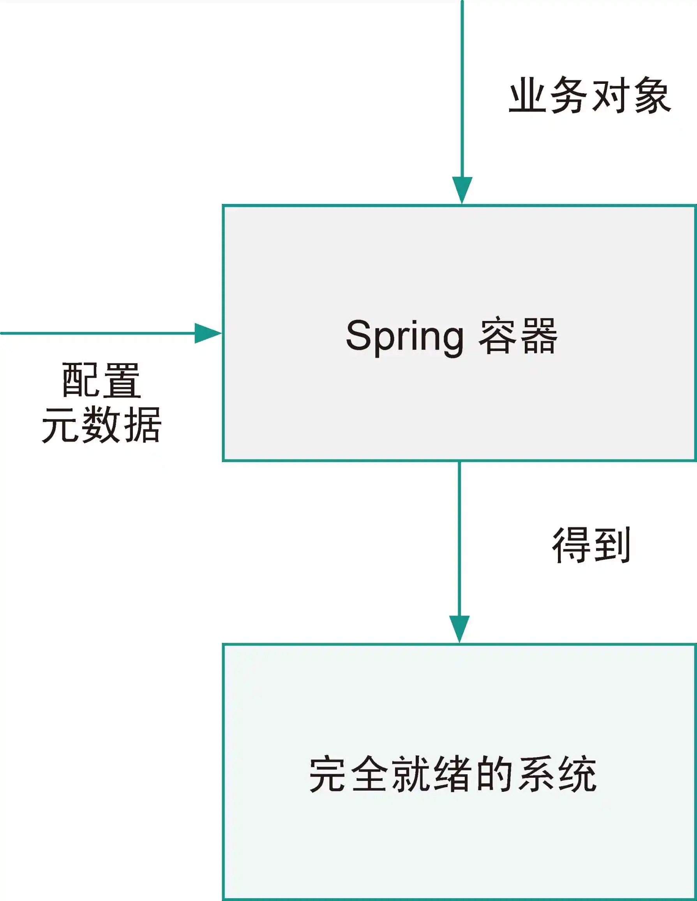

# 第2章SpringFramework中的IoC容器(1)

- 本章内容IoC 容器的基础知识

- Spring Bean 的基础知识

- 如何感知并自定义一些行为

- 环境与任务的抽象

控制反转（Inversion of Control，IoC）与面向切面编程（Aspect Oriented Programming，AOP）是 Spring Framework 中最重要的两个概念，本章会着重介绍前者，内容包括 IoC 容器以及容器中 Bean 的基础知识。容器为我们预留了不少扩展点，让我们能定制各种行为，本章的最后我会和大家一起了解一些容器提供的抽象机制。通过这些介绍，希望大家可以对 IoC 容器有个大概的认识。

## 2.1　IoC 容器基础知识

Spring Framework 为 Java 开发者提供了强大的支持，开发者可以把底层基础的杂事抛给Spring Framework，自己则专心于业务逻辑。本节我们会聚焦在 Spring Framework 的核心能力上，着重了解 IoC 容器的基础知识。

### 2.1.1　什么是 IoC 容器

在介绍 Spring Framework 的 IoC 容器前，我们有必要先理解什么是“控制反转”。控制反转是一种决定容器如何装配组件的模式。只要遵循这种模式，按照一定的规则，容器就能将组件组装起来。这里所谓的容器，就是用来创建组件并对它们进行管理的地方。它牵扯到组件该如何定义、组件该何时创建、又该何时销毁、它们互相之间是什么关系等——这些本该在组件内部管理的东西，被从组件中剥离了出来。

需要着重指出一点，组件之间的依赖关系原先是由组件自己定义的，并在其内部维护，而现在这些依赖被定义在容器中，由容器来统一管理，并据此将其依赖的内容注入组件中。在好莱坞，演艺公司具有极大的控制权，艺人将简历投递给演艺公司后就只能等待，被动接受演艺公司的安排。这就是知名的好莱坞原则，它可以总结为这样的一句话“不要给我们打电话，我们会打给你的”（Don't call us, we'll call you）。IoC 容器背后的思想正是好莱坞原则，即所有的组件都要被动接受容器的控制。

- 1

Martin Fowler

- 那篇著名的“Inversion of Control Containers and the Dependency Injection2

pattern”

- 中提到“控制反转”不能很好地描述这个模式，“依赖注入”（Dependency Injection）

能更好地描述它的特点。正因如此，我们经常会看到这两个词一同出现。

- 3

Spring Framework、Google Guice、PicoContainer 都提供了这样的容器

- ，后文中我们也会

把 Spring Framework 的 IoC 容器称为 Spring 容器。

图 2-1 是 Spring Framework 的官方文档中的一幅图，它非常直观地表达了 Spring IoC 容器的作用，即将业务对象（也就是组件，在 Spring 中这些组件被称为 Bean，2.2 节会详细介绍Bean 的内容）和关于组件的配置元数据（比如依赖关系）输入 Spring 容器中，容器就能为我们组装出一个可用的系统。



- 图 2-1　Spring IoC 容器

Spring Framework 的模块按功能进行了拆分，spring-core 和 spring-beans 模块提供了最基础

```
的功能，其中就包含了 IoC 容器。BeanFactory 是容器的基础接口，我们平时使用的各种容
```

器都是它的实现，后文中会看到这些实现的具体用法与区别。

### 2.1.2　容器的初始化

从图 2-1 中可以看到，Spring 容器需要配置元数据和业务对象，因此在初始化容器时，我们需要提供这些信息。早期的配置元数据只能以 XML 配置文件的形式提供，从 2.5 版本开始，官方逐步提供了 XML 文件以外的配置方式，比如基于注解的配置和基于 Java 类的配置，本书中的大部分示例将采用后两种方式进行配置。

容器初始化的大致步骤如下（在本章后续的几节中，我们会分别介绍其中涉及的内容）。

(1) 从 XML 文件、Java 类或其他地方加载配置元数据。

```
(2) 通过 BeanFactoryPostProcessor 对配置元数据进行一轮处理。
```

(3) 初始化 Bean 实例，并根据给定的依赖关系组装对象。

```
(4) 通过 BeanPostProcessor 对 Bean 进行处理，期间还会触发 Bean 被构造后的回调方
```

法。

- 4

比如，我们有一个如代码示例 2-1

- 所示的业务对象，它会返回一个字符串，可以看到它就是

一个最普通的 Java 类。

```
代码示例 2-1　最基本的 Hello 类
```

```java
package learning.spring.helloworld;
public class Hello {
   public String hello() {
       return "Hello World!";
   }
}
在没有 IoC 容器时，我们需要像代码示例 2-2 那样自己管理 Hello 实例的生命周期，通常是
在代码中用 new 关键字新建一个实例，然后把它传给具体要调用它的对象，下面的代码只是
个示意，所以就使用 new 关键字创建实例后直接调用方法了。
代码示例 2-2　手动创建并调用 Hello.hello() 方法
public class Application {
   public static void main(String[] args) {
       Hello hello = new Hello();
       System.out.println(hello.hello());
   }
}
```

如果是把实例交给 Spring 容器托管，则可以将它配置到一个 XML 文件中，让容器来管理它的

```
相关生命周期。可以看到代码示例 2-3 只是一个普通的 XML 文件，通过 <beans/> 这个
```

Schema 来配置 Spring 的 Bean（Bean 的配置会在 2.2.2 节详细展开）。为了使用 Spring 的

```
容器，需要在 pom.xml 文件中引入 org.springframework:spring-beans 依赖。
```

- 代码示例 2-3　配置 hello Bean 的 beans.xml 文件

```xml
<?xml version="1.0" encoding="UTF-8"?>
<beans xmlns="http://www.springframework.org/schema/beans"
      xmlns:xsi="http://www.w3.org/2001/XMLSchema-instance"
      xsi:schemaLocation="http://www.springframework.org/schema/beans
       https://www.springframework.org/schema/beans/spring-beans.xsd">
   <bean id="hello" class="learning.spring.helloworld.Hello" />
</beans>
最后像代码示例 2-4 那样，将配置文件载入容器。BeanFactory 只是一个最基础的接口，我
```

们需要选择一个合适的实现类——在实际工作中，更多情况下会用到

```
ApplicationContext 的各种实现。此处，我们使用 DefaultListableBeanFactory
这个实现类，它并不关心配置的方式，XmlBeanDefinitionReader 能读取 XML 文件中的
```

元数据，我们通过它加载 CLASSPATH 中的 beans.xml 文件，将其保存到

```
DefaultListableBeanFactory 中，随后就可以通过 BeanFactory 的 getBean() 方
```

法取得对应的 Bean 了。

```
getBean() 方法有很多不同的参数列表，例子里就有两种，一种是取出 Object 类型的
```

Bean，然后自己做类型转换；另一种则是在参数里指明返回 Bean 的类型，如果实际类型不

```java
同的话则会抛出 BeansException。
代码示例 2-4　加载配置文件并执行的 Application 类代码片段
public class Application {
   private BeanFactory beanFactory;
   public static void main(String[] args) {
       Application application = new Application();
       application.sayHello();
   }
   public Application() {
       beanFactory = new DefaultListableBeanFactory();
       XmlBeanDefinitionReader reader =
               new XmlBeanDefinitionReader((DefaultListableBeanFactory) beanFact
       reader.loadBeanDefinitions("beans.xml");
   }
   public void sayHello() {
       // Hello hello = (Hello) beanFactory.getBean("hello");
       Hello hello = beanFactory.getBean("hello", Hello.class);
       System.out.println(hello.hello());
   }
}
在这个例子的 sayHello() 方法中，我们完全不用关心 Hello 这个类的实例是如何创建
```

的，只需获取实例对象然后使用即可。虽然看起来比代码示例 2-3 的行数要多，但当工程复杂度增加之后，IoC 托管 Bean 生命周期的优势就体现出来了。

### 2.1.3　BeanFactory 与 ApplicationContext

spring-context 模块在 spring-core 和 spring-beans 的基础上提供了更丰富的功能，例如事件

```
传播、资源加载、国际化支持等。前面说过，BeanFactory 是容器的基础接口，
ApplicationContext 接口继承了 BeanFactory，在它的基础上增加了更多企业级应用
```

所需要的特性，通过这个接口，我们可以最大化地发挥 Spring 上下文的能力。表 2-1 列举了

```
常见的一些 ApplicationContext 实现。
```

表 2-1　常见的 ApplicationContext 实现

类名

- 说明

- 从 CLASSPATH 中加载 XML 文件来配置

```
ClassPathXmlApplicationContext
ApplicationContext
```

- 从文件系统中加载 XML 文件来配置

```
FileSystemXmlApplicationContext
ApplicationContext
AnnotationConfigApplicationContext
根据注解和 Java 类配置 ApplicationCon
相比 BeanFactory，使用 ApplicationContext 也会更加方便一些，因为我们无须自己
去注册很多内容，例如 AnnotationConfigApplicationContext 把常用的一些后置处理
```

器都直接注册好了，为我们省去了不少麻烦。所以，在绝大多数情况下，建议大家使用

```
ApplicationContext 的实现类。
如果要将代码示例 2-4 中的 Application.java 从使用 BeanFactory 修改为使用
```

ApplicationContext，只需做两处改动：

- 5

```
，把引入的 org.springframework:spring-beans 修改为
```

(1) 在 pom.xml 文件中

```
org.springframework: spring-context；
(2) 在 Application.java 中，使用 ClassPathXmlApplicationContext 代替
DefaultListableBeanFactory 和 XmlBeanDefinitionReader 的组合，具体见代码
```

示例 2-5。

```java
代码示例 2-5　调整后的 Application 类代码片段
public class Application {
   private ApplicationContext applicationContext;
   public static void main(String[] args) {
       Application application = new Application();
       application.sayHello();
   }
   public Application() {
       applicationContext = new ClassPathXmlApplicationContext("beans.xml");
   }
   public void sayHello() {
       Hello hello = applicationContext.getBean("hello", Hello.class);
       System.out.println(hello.hello());
   }
}
```

### 2.1.4　容器的继承关系

Java 类之间有继承的关系，子类能够继承父类的属性和方法。同样地，Spring 的容器之间也存在类似的继承关系，子容器可以继承父容器中配置的组件。在使用 Spring MVC 时就会涉及容器的继承。

- 6

```
（修改自上一节的 HelloWorld），Hello 类在输出
```

先来看一个例子，如代码示例 2-6 所示的字符串中加入一段注入的信息。

```java
代码示例 2-6　可以输出特定信息的 Hello 类
package learning.spring.helloworld;
public class Hello {
   private String name;
   public String hello() {
       return "Hello World! by " + name;
   }
   public void setName(String name) {
       this.name = name;
   }
}
```

随后，我们也要调整一下 XML 配置文件，父容器与子容器分别用不同的配置，ID 既有相同的，也有不同的，具体如代码示例 2-7 与代码示例 2-8 所示。

- 代码示例 2-7　父容器配置 parent-beans.xml 文件

```xml
<?xml version="1.0" encoding="UTF-8"?>
<beans xmlns="http://www.springframework.org/schema/beans"
      xmlns:xsi="http://www.w3.org/2001/XMLSchema-instance"
      xsi:schemaLocation="http://www.springframework.org/schema/beans
       https://www.springframework.org/schema/beans/spring-beans.xsd">
   <bean id="parentHello" class="learning.spring.helloworld.Hello">
       <property name="name" value="PARENT" />
   </bean>
   <bean id="hello" class="learning.spring.helloworld.Hello">
       <property name="name" value="PARENT" />
   </bean>
</beans>
```

- 代码示例 2-8　子容器配置 child-beans.xml 文件

```xml
<?xml version="1.0" encoding="UTF-8"?>
<beans xmlns="http://www.springframework.org/schema/beans"
      xmlns:xsi="http://www.w3.org/2001/XMLSchema-instance"
      xsi:schemaLocation="http://www.springframework.org/schema/beans
       https://www.springframework.org/schema/beans/spring-beans.xsd">
   <bean id="childHello" class="learning.spring.helloworld.Hello">
       <property name="name" value="CHILD" />
   </bean>
   <bean id="hello" class="learning.spring.helloworld.Hello">
       <property name="name" value="CHILD" />
   </bean>
</beans>
在 Application 类中，我们尝试从不同的容器中获取不同的 Bean（关于 Bean 的内容，我
```

们会在 2.2 节展开），以测试继承容器中 Bean 的可见性和覆盖情况，具体如代码示例 2-9 所示。

```java
代码示例 2-9　修改后的 Application 类代码片段
public class Application {
   private ClassPathXmlApplicationContext parentContext;
   private ClassPathXmlApplicationContext childContext;
   public static void main(String[] args) {
       new Application().runTests();
   }
   public Application() {
       parentContext = new ClassPathXmlApplicationContext("parent-beans.xml");
       childContext = new ClassPathXmlApplicationContext(
               new String[] {"child-beans.xml"}, true, parentContext);
       parentContext.setId("ParentContext");
       childContext.setId("ChildContext");
   }
   public void runTests() {
       testVisibility(parentContext, "parentHello");
       testVisibility(childContext, "parentHello");
       testVisibility(parentContext, "childHello");
       testVisibility(childContext, "childHello");
       testOverridden(parentContext, "hello");
       testOverridden(childContext, "hello");
   }
   private void testVisibility(ApplicationContext context, String beanName) {
       System.out.println(context.getId() + " can see " + beanName + ": "
                          + context.containsBean(beanName));
   }
   private void testOverridden(ApplicationContext context, String beanName) {
       System.out.println("sayHello from " + context.getId() +": "
                          + context.getBean(beanName, Hello.class).hello());
   }
}
```

这段程序的运行结果如下：

```
ParentContext can see parentHello: true
ChildContext can see parentHello: true
ParentContext can see childHello: false
ChildContext can see childHello: true
sayHello from ParentContext: Hello World! by PARENT
sayHello from ChildContext: Hello World! by CHILD
```

通过这个示例，我们可以得出如下关于容器继承的通用结论——它们和 Java 类的继承非常相似，二者的对比如表 2-2 所示。

表 2-2　容器继承 vs.Java 类继承

- Java 类继承

容器继承

```
子类可以看到父类的 protected 和
```

子上下文可以看到父上下文中定义的 Bean，反之则不行

- 方法，父类看不到子类的

子上下文中可以定义与父上下文同 ID 的 Bean，各自

- 子类可以覆盖父类定义的属性和方法

都能获取自己定义的Bean

关于同 ID 覆盖 Bean，有时也会引发一些意料之外的问题。如果希望关闭这个特性，也可以考

```
虑禁止覆盖，通过容器的 setAllowBeanDefinitionOverriding() 方法可以控制这一行
```

为。

## 2.2　Bean 基础知识

Bean 是 Spring 容器中的重要概念，这一节就让我们来着重了解一下 Bean 的概念、如何注入Bean 的依赖，以及如何在容器中进行 Bean 的配置。

### 2.2.1　什么是 Bean

- 78

Java 中有个比较重要的概念叫做“JavaBeans”

- ，维基百科中有如下描述：

- JavaBeans 是 Java 中一种特殊的类，可以将多个对象封装到一个对象（Bean）中。特点

```
是可序列化，提供无参构造器，提供 Getter 方法和 Setter 方法访问对象的属性。名称
```

- 中的 Bean 是用于 Java 的可重用软件组件的惯用叫法。

从中可以看到：Bean 是指 Java 中的可重用软件组件，Spring 容器也遵循这一惯例，因此将容器中管理的可重用组件称为 Bean。容器会根据所提供的元数据来创建并管理这些 Bean，其中也包括它们之间的依赖关系。Spring 容器对 Bean 并没有太多的要求，无须实现特定接口或依赖特定库，只要是最普通的 Java 对象即可，这类对象也被称为 POJO（Plain Old JavaObject）。

一个 Bean 的定义中，会包含如下部分：

```
Bean 的名称，一般是 Bean 的 id，也可以为 Bean 指定别名（alias）；
```

- Bean 的具体类信息，这是一个全限定类名；9Bean 的作用域，是单例（singleton）还是原型（prototype）；

- 依赖注入相关信息，构造方法参数、属性以及自动织入（autowire）方式；

- 创建销毁相关信息，懒加载模式、初始化回调方法与销毁回调方法。

我们可以自行设定 Bean 的名字，也可以让 Spring 容器帮我们设置名称。Spring 容器的命名

```
方式为类名的首字母小写，搭配驼峰（camel-cased）规则。比如类型为 HelloService 的
Bean，自动生成的名称就为 helloService。
```

### 2.2.2　Bean 的依赖关系

所谓“依赖注入”，很重要的一块就是管理依赖。在 Spring 容器中，“管理依赖”主要就是管理

```
Bean 之间的依赖。有两种基本的注入方式——基于构造方法的注入和基于 Setter 方法的注
```

入。

所谓基于构造方法的注入，就是通过构造方法来注入依赖。仍旧以 HelloWorld 为例，如代码

- 10

示例 2-10 所示

- 。

```java
代码示例 2-10　通过构造方法传入字符串的 Hello 类
package learning.spring.helloworld;
public class Hello {
   private String name;
   public Hello(String name) {
       this.name = name;
   }
   public String hello() {
       return "Hello World! by " + name;
   }
}
```

```
对应的 XML 配置文件需要使用 <constructor-arg/> 传入构造方法所需的内容，如代码示
```

例 2-11 所示。

- 代码示例 2-11　通过构造方法配置 Bean 的 XML 文件

```xml
<?xml version="1.0" encoding="UTF-8"?>
<beans xmlns="http://www.springframework.org/schema/beans"
      xmlns:xsi="http://www.w3.org/2001/XMLSchema-instance"
      xsi:schemaLocation="http://www.springframework.org/schema/beans
       https://www.springframework.org/schema/beans/spring-beans.xsd">
   <bean id="hello" class="learning.spring.helloworld.Hello">
       <constructor-arg value="Spring"/>
   </bean>
</beans>
<constructor-arg> 中有不少属性可以配置，具体如表 2-3 所示。
```

表 2-3　<constructor-arg/> 的可配置属性

属性

- 作用

```
value
```

- 要传给构造方法参数的值

```
ref
```

- 要传给构造方法参数的 Bean ID

```
type
```

- 构造方法参数对应的类型

```
index
```

- 构造方法参数对应的位置，从 0 开始计算

```
name
```

- 构造方法参数对应的名称

```
基于 Setter 方法的注入，顾名思义，就是通过 Bean 的 Setter 方法来注入依赖。我们在
```

第 2.1.4 节已经看到了对应的例子，具体可以参考代码示例 2-6 与代码示例 2-7。

```xml
<property/> 中的 value 属性是直接注入的值，用 ref 属性则可注入其他 Bean。也可以
```

- 11

像代码示例 2-12 这样来为属性注入依赖

- 。

```xml
代码示例 2-12　<property/> 的用法演示
<bean id="..." class="...">
   <property name="xxx">
       <!-- 直接定义一个内部的Bean -->
       <bean class="..."/>
   </property>
   <property name="yyy">
       <!-- 定义依赖的Bean -->
       <ref bean="..."/>
   </property>
   <property name="zzz">
       <!-- 定义一个列表 -->
       <list>
           <value>aaa</value>
           <value>bbb</value>
       </list>
   </property>
</bean>
```

手动配置依赖在 Bean 少时还能接受，当 Bean 的数量变多后，这种配置就会变得非常繁琐。在合适的场合，可以让 Spring 容器替我们自动进行依赖注入，这种机制称为自动织入。自动织入有几种模式，具体见表 2-4。

表 2-4　自动织入的模式

名称

- 说明

```
no
```

- 不进行自动织入

```
byName
```

- 根据属性名查找对应的 Bean 进行自动织入

```xml
在 <bean/> 中可以通过 autowire 属性来设置使用何种自动织入方式，也可以在
<beans/> 中设置 default-autowire 属性指定默认的自动织入方式。在使用自动织入
```

时，需要注意以下事项：

- 开启自动织入后，仍可以手动设置依赖，手动设置的依赖优先级高于自动织入；

- 自动织入无法注入基本类型和字符串；

- 对于集合类型的属性，自动织入会把上下文里找到的 Bean 都放进去，但如果属性不是集合类型，有多个候选 Bean 就会有问题。

```
为了避免第三点中说到的问题，可以将 <bean/> 的 autowire-candidate 属性设置为
false，也可以在你所期望的候选 Bean 的 <bean/> 中将 primary 设置为 true，这就表
```

明在多个候选 Bean 中该 Bean 是主要的（如果使用基于 Java 类的配置方式，我们可以通过

```
选择 @Primary 注解实现一样的功能）。
```

最后，再简单提一下如何指定 Bean 的初始化顺序。一般情况下，Spring 容器会根据依赖情况自动调整 Bean 的初始化顺序。不过，有时 Bean 之间的依赖并不明显，容器可能无法按照我

```
们的预期进行初始化，这时我们可以自己来指定 Bean 的依赖顺序。<bean/> 的 depends-
on 属性可以指定当前 Bean 还要依赖哪些 Bean（如果使用基于 Java 类的配置方式，
@DependsOn 注解也能实现一样的功能）。
```

### 2.2.3　Bean 的三种配置方式

Spring Framework 提供了多种不同风格的配置方式，早期仅支持 XML 配置文件的方式，Spring Framework 2.0 引入了基于注解的配置方式，到了 3.0 则又增加了基于 Java 类的配置方式。这几种方式没有明确的优劣之分，选择合适的或者喜欢的方式就好，很多时候我们也会混合使用这几种配置方式。

鉴于 Spring 容器的元数据配置本质上就是配置 Bean（AOP 和事务的配置背后也是配置各种Bean），因此我们会在本节中详细展开说明如何配置 Bean。

1. 基于 XML 文件的配置12

```
Spring Framework 提供了 <beans/> 这个 Schema
```

- 来配置 Bean，前文中已经用过了XML 文件方式的配置，这里再简单回顾一下。

```xml
我们通过 <bean/> 可以配置一个 Bean，id 指定 Bean 的标识，class 指定 Bean 的全
限定类名，一般会通过类的构造方法来创建 Bean，但也可以使用一个静态的 factory-
method，比如下面就使用了 create() 静态方法：
<bean id="xxx" class="learning.spring.Yyy" factory-method="create" />
1
<constructor-arg/> 和 <property/> 用来注入所需的内容。如果是另一个 Bean 的
依赖，一般会用 ref 属性，2.2.3 节中已经有过说明，此处就不再赘述了。
<bean/> 中还有几个重要的属性，scope 表明当前 Bean 是单例还是原型，lazy-init
是指当前 Bean 是否是懒加载的，depends-on 明确指定当前 Bean 的初始化顺序，就像
```

- 下面这样：

```
<bean id="..." class="..." scope="singleton" lazy-init="true" depends-on="xxx"/
1
```

2. 基于注解的配置13

```
Spring Framework 2.0 引入了 @Required 注解
```

- ，Spring Framework 2.5 又引入了

```
@Autowired、@Component、@Service 和 @Repository 等重要的注解，使用这些注
```

- 14解能简化 Bean 的配置。我们可以像代码示例 2-13 那样开启对这些注解的支持。

- 代码示例 2-13　启用基于注解的配置

```xml
<?xml version="1.0" encoding="UTF-8"?>
1
<beans xmlns="http://www.springframework.org/schema/beans"
2
   xmlns:xsi="http://www.w3.org/2001/XMLSchema-instance"
3
   xmlns:context="http://www.springframework.org/schema/context"
4
   xsi:schemaLocation="http://www.springframework.org/schema/beans
5
       https://www.springframework.org/schema/beans/spring-beans.xsd
6
       http://www.springframework.org/schema/context
7
       https://www.springframework.org/schema/context/spring-context.xsd">
8
9
   <context:component-scan base-package="learning.spring"/>
10
11
</beans>
12
上述配置会扫描 learning.spring 包内的类，在类上添加如下四个注解都能让 Spring
```

- 容器把它们配置为 Bean，如表 2-5 所示。

- 表 2-5　Bean 创建相关注解

- 注解说明

```
@Component
```

- 将类标识为普通的组件，即一个 Bean

```
@Service
```

- 将类标识为服务层的服务

- 将类标识为数据层的数据仓库，一般是 DAO（Data Access

```
@Repository
```

- Object）

- 将类标识为 Web 层的 Web 控制器（后来针对 REST 服务又增加

```
@Controller
了一个 @RestController 注解）
```

- 如果不指定 Bean 的名称，Spring 容器会自动生成一个名称，当然，也可以明确指定名称，比如：

```java
@Component("helloBean")
1
public class Hello {...}
2
```

- 如果要注入依赖，可以使用如下的注解，如表 2-6 所示。

- 表 2-6　可注入依赖的注解

- 注解说明

```
@Autowired
根据类型注入依赖，可用于构造方法、Setter 方法和成员变量
```

- 15

```
@Resource
```

- JSR-250 的注解，根据名称注入依赖

```
@Inject
JSR-330 的注解，同 @Autowired
```

- 15

```
从 Spring Framework 6.0 开始，@Resource、@PostConstruct 和 @PreDestroy
注解都换了新的包名，建议使用 jakarta.annotation 包里的注解，但也兼容
javax.annotation 包中的注解；@Inject 注解则是建议使用 jakarta.inject 包里的，但也
```

- 兼容 javax.inject 包中的。

```
@Autowired 注解比较常用，下面的例子中可以指定是否必须存在依赖项，并指定目标依
```

- 16赖的 Bean ID：

```java
@Autowired(required = false)
1
@Qualifier("helloBean")
2
public void setHello(Hello hello) {...}
3
除此之外，还可以使用 @Value 注解注入环境变量、Properties 或 YAML 中配置的属性和
```

- 17

```
 的计算结果。JSR-250 中还有 @PostConstruct 和 @PreDestroy 注
```

- SpEL 表达式

- 解，把这两个注解加在方法上用来表示该方法要在初始化后调用或者是在销毁前调用，在聊到 Bean 的生命周期时我们还会看到它们。

3. 基于 Java 类的配置从 Spring Framework 3.0 开始，我们可以使用 Java 类代替 XML 文件，使用

```
@Configuration、@Bean 和 @ComponentScan 等一系列注解，基本可以满足日常所
```

- 需。

```
通过 AnnotationConfigApplicationContext 可以构建一个支持基于注解和 Java 类
```

- 的 Spring 上下文：

```
ApplicationContext ctx = new AnnotationConfigApplicationContext(Config.class);
1
其中的 Config 类就是一个加了 @Configuration 注解的 Java 类，它可以是代码示例
```

- 2-14 这样的。

- 代码示例 2-14　Java 配置类示例

```java
@Configuration
1
@ComponentScan("learning.spring")
2
public class Config {
3
   @Bean
4
   @Lazy
5
   @Scope("prototype")
6
   public Hello helloBean() {
7
       return new Hello();
8
   }
9
}
10
类上的 @Configuration 注解表明这是一个 Java 配置类，@ComponentScan 注解指定
了类扫描的包名，作用与 <context:component-scan/> 类似。在 @ComponentScan
中，includeFilters 和 excludeFilters 可以用来指定包含和排除的组件，例如官方
```

- 文档中就有如下示例：

```java
@Configuration
1
@ComponentScan(basePackages = "org.example",
2
       includeFilters = @Filter(type = FilterType.REGEX,
3
                              pattern = ".*Stub.*Repository"),
4
       excludeFilters = @Filter(Repository.class))
5
public class AppConfig { ... }
6
如果 @Configuration 没有指定扫描的基础包路径或者类，默认就从该配置类的包开始
```

- 扫描。

```
Config 类中的 helloBean() 方法上添加了 @Bean 注解，该方法的返回对象会被当做容
器中的一个 Bean，@Lazy 注解说明这个 Bean 是延时加载的，@Scope 注解则指定了它是
原型 Bean。@Bean 注解有如下属性，如表 2-7 所示。
```

- 表 2-7　@Bean 注解的属性

- 属性默认值说明

```
name
{}
```

- Bean 的名称

```
value
{}
同 name
autowire
Autowire.NO
```

- 自动织入方式

```
autowireCandidate
true
```

- 是否是自动织

```
initMethod
""
```

- 初始化方法名

- 18

```
destroyMethod
AbstractBeanDefinition.INFER_METHOD
```

- 销毁方法名

- 18

```
自动推测销毁 Bean 时该调用的方法，会自动去调用修饰符为 public、没有参数且方
法名是 close 或 shutdown 的方法。如果类实现了 java.lang.AutoCloseable 或
java.io.Closeable 接口，也会调用其中的 close() 方法。
```

- 在 Java 配置类中指定 Bean 之间的依赖关系有两种方式，通过方法的参数注入依赖，或者

```
直接调用类中带有 @Bean 注解的方法。
代码示例 2-15 中，foo() 创建了一个名为 foo 的 Bean，bar() 方法通过参数 foo 注入
了 foo 这个 Bean，baz() 方法内则通过调用 foo() 获得了同一个 Bean。
```

- 代码示例 2-15　依赖示例

```java
@Configuration
1
public class Config {
2
   @Bean
3
     public Foo foo() {
4
       return new Foo();
5
   }
6
7
   @Bean
8
   public Bar bar(Foo foo) {
9
       return new Bar(foo);
10
   }
11
12
   @Bean
13
   public Baz baz() {
14
       return new Baz(foo());
15
   }
16
}
17
需要重点说明的是，Spring Framework 针对 @Configuration 类中带有 @Bean 注解的
```

- 方法通过 CGLIB（Code Generation Library）做了特殊处理，针对返回单例类型 Bean 的方法，调用多次返回的结果是一样的，并不会真的执行多次。

- 在配置类中也可以导入其他配置，例如，用 @Import 导入其他配置类，用@ImportResource 导入配置文件，就像下面这样：

```java
@Configuration
1
@Import({ CongfigA.class, ConfigB.class })
2
@ImportResource("classpath:/spring/*-applicationContext.xml")
3
public class Config {}
4
```

[1]：Martin Fowler，知名企业级应用专家、技术作家与演说家、ThoughtWorks 公司首席科学家。他是《敏捷软件开发宣言》的提

- 出者之一，著有《重构》和《企业应用架构模式》等多部经典著作。

[2]：英文原文详见 Martin Fowler 的个人网站，中文译文由熊节翻译，可在“Thoughtworks 洞见”网站搜索“IoC 容器和 Dependency

- Injection 模式”。

[3]：详情请见 GitHub 的 Google Guice 官网、PicoContainer 官网。[4]：这部分的示例在 ch2/helloworld 项目中。[5]：具体的 pom.xml 内容，可以查看 ch2/helloworld-context 项目。[6]：这部分的例子在 ch2/context-inherit 项目中。[7]：JavaBeans 有自己的规范，详见 Oracle 官网 JavaBeans Spec 文档。[8]：详见维基百科的 JavaBeans 的词条。[9]：关于单例和原型的区别，前者每次获取返回的是同一个 Bean，而后者每次获取返回的是一个新的对象。[10]：在示例仓库中的位置为 ch2/helloworld-constructor。[11]：关于如何在属性中注入集合（List、Map 和 Set 等），可以参考 Spring Framework 5.2.6 官方文档的 1.4.2 节“Dependencies

- and Configuration in Detail”。请注意，不同的版本文档的小节编号可能有所差异。

[12]：早期 http://www.springframework.org/schema/beans 这个 Schema 对应的位置是

- http://www.springframework.org/schema/beans/spring-beans.xsd；为了统一支持 HTTPS，后来的版本也开始支持https://www.springframework.org/schema/beans/spring-beans.xsd。如果你还在使用老版本的 Spring Framework，要注意老版本是不支持这里的 HTTPS 的。

[13]：不建议用这个注解，有必要的话，可以通过构造器注入的方式来强制要求注入依赖。[14]：会隐式地配置 ，后者其实替我们注册了一堆 。[16]：实际 @Qualifier 是根据 Bean 上配置的标识符（Qualifier）来匹配的，而 Bean 的 ID 正好是默认的标识符。[17]：本书不会详细讲述 SpEL 表达式，有兴趣的读者可以自行查阅 Spring Framework 文档。
