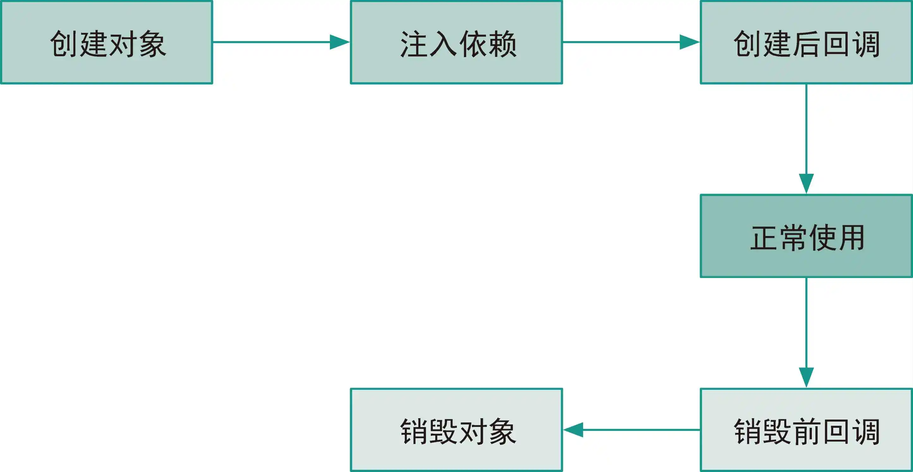

# 第2章SpringFramework中的IoC容器(2)

## 2.3　定制容器与 Bean 的行为

通常，Spring Framework 包揽了大部分工作，替我们管理 Bean 的创建与依赖，将各种组件装配成一个可运行的应用。然而，有些情况下，我们会有自己的特殊需求。例如，在 Bean 的依赖被注入后，我们想要触发 Bean 的回调方法做一些初始化；在 Bean 销毁前，我们想要执行一些清理工作；我们想要 Bean 感知容器的一些信息，拿到当前的上下文自行进行判断或处理……

这时候，怎么做？Spring Framework 为我们预留了发挥空间。本节我们就来探讨一下如何根据自己的需求来定制容器与 Bean 的行为。

### 2.3.1　Bean 的生命周期

Spring 容器接管了 Bean 的整个生命周期管理，具体如图 2-2 所示。一个 Bean 先要经过

```
Java 对象的创建（也就是通过 new 关键字创建一个对象），随后根据容器里的配置注入所需
```

的依赖，最后调用初始化的回调方法，经过这三个步骤才算完成了 Bean 的初始化。若不再需要这个 Bean，则要进行销毁操作，在正式销毁对象前，会先调用容器的销毁回调方法。



- 图 2-2　Bean 的生命周期

由于一切都是由 Spring 容器管理的，所以我们无法像自己控制这些动作时那样任意地在 Bean创建后或 Bean 销毁前增加某些操作。为此，Spring Framework 为我们提供了几种途径，在这两个时间点调用我们提供给容器的回调方法。可以根据不同情况选择以下三种方式之一：

```
实现 InitializingBean 和 DisposableBean 接口；
使用 JSR-250 的 @PostConstruct 和 @PreDestroy 注解；
在 <bean/> 或 @Bean 里配置初始化和销毁方法。
```

- 创建 Bean 后的回调动作如果我们希望在创建 Bean 后做一些特别的操作，比如查询数据库初始化缓存等，Spring

```
Framework 可以提供一个初始化方法。InitializingBean 接口有一个
afterPropertiesSet() 方法——顾名思义，就是在所有依赖都注入后自动调用该方
法。在方法上添加 @PostConstruct 注解也有相同的效果。
```

- 也可以像下面这样，在 XML 文件中进行配置：

```xml
<bean id="hello" class="learning.spring.helloworld.Hello" init-method="init" />
1
```

- 或者在 Java 配置中指定：

```
@Bean(initMethod="init")
1
public Hello hello() {...}
2
```

- 销毁 Bean 前的回调动作Spring Framework 既然有创建 Bean 后的回调动作，自然也有销毁 Bean 前的触发操作。

```
DisposableBean 接口中的 destroy() 方法和添加了 @PreDestroy 注解的方法都能
```

- 实现这个目的，如代码示例 2-16 所示。

```java
代码示例 2-16　实现了 DisposableBean 接口的类
package learning.spring.helloworld;
1
2
import org.springframework.beans.factory.DisposableBean;
3
4
public class Hello implements DisposableBean {
5
   public String hello() {
6
       return "Hello World!";
7
   }
8
9
   @Override
10
   public void destroy() throws Exception {
11
       System.out.println("See you next time.");
12
   }
13
}
14
当然，也可以在 <bean/> 中指定 destroy-method，或者在 @Bean 中指定
destroyMethod。
```

- 生命周期动作的组合如果我们混合使用上文提到的几种不同的方式，而且这些方式指定的方法还不尽相同，那就需要明确它们的执行顺序了。

- 无论是初始化还是销毁，Spring 都会按照如下顺序依次进行调用：

```
(1) 添加了 @PostConstruct 或 @PreDestroy 的方法；
(2) 实现了 InitializingBean 的 afterPropertiesSet() 方法，或
DisposableBean 的 destroy() 方法；
(3) 在 <bean/> 中配置的 init-method 或 destroy-method，@Bean 中配置的
initMethod 或 destroyMethod。
```

- 19在代码示例 2-17的 Java 类中，同时提供了三个销毁的方法。

```java
代码示例 2-17　添加了多个销毁方法的 Hello 类
package learning.spring.helloworld;
1
2
import javax.annotation.PreDestroy;
3
import org.springframework.beans.factory.DisposableBean;
4
5
public class Hello implements DisposableBean {
6
   public String hello() {
7
       return "Hello World!";
8
   }
9
10
   @Override
11
   public void destroy() throws Exception {
12
       System.out.println("destroy()");
13
   }
14
15
   public void close() {
16
       System.out.println("close()");
17
   }
18
19
   @PreDestroy
20
   public void shutdown() {
21
       System.out.println("shutdown()");
22
   }
23
}
24
在对应的 XML 文件中配置 destroy-method，要用 <context:annotation-config
/> 开启注解支持，如代码示例 2-18 所示。
```

- 代码示例 2-18　对应的 beans.xml 文件

```xml
<?xml version="1.0" encoding="UTF-8"?>
1
<beans xmlns="http://www.springframework.org/schema/beans"
2
      xmlns:xsi="http://www.w3.org/2001/XMLSchema-instance"
3
      xmlns:context="http://www.springframework.org/schema/context"
4
      xsi:schemaLocation="http://www.springframework.org/schema/beans
5
       https://www.springframework.org/schema/beans/spring-beans.xsd
6
       http://www.springframework.org/schema/context
7
       https://www.springframework.org/schema/context/spring-context.xsd">
8
9
   <context:annotation-config />
10
11
   <bean id="hello" class="learning.spring.helloworld.Hello" destroy-method="c
12
</beans>
13
```

- 代码示例 2-19 对运行类简单做了些调整，增加了关闭容器的动作，以便能让我们观察到Bean 销毁的动作。

```java
代码示例 2-19　启动用的 Application 类代码片段
public class Application {
1
   private ClassPathXmlApplicationContext applicationContext;
2
3
   public static void main(String[] args) {
4
       Application application = new Application();
5
       application.sayHello();
6
       application.close();
7
   }
8
9
   public Application() {
10
       applicationContext = new ClassPathXmlApplicationContext("beans.xml");
11
   }
12
13
   public void sayHello() {
14
       Hello hello = (Hello) applicationContext.getBean("hello");
15
       System.out.println(hello.hello());
16
   }
17
18
   public void close() {
19
       applicationContext.close();
20
   }
21
}
22
```

- 这段代码运行后的输出即代表了三个方法的调用顺序，是与上述顺序一致的：

```
Hello World!
1
shutdown()
2
destroy()
3
close()
4
```

- 当然，在一般情况下，我们并不会在一个 Bean 上写几个作用不同的初始化或销毁方法。这种情况并不常见，大家了解即可。

### 2.3.2　Aware 接口的应用

在大部分情况下，我们的 Bean 感知不到 Spring 容器的存在，也无须感知。但总有那么一些场景中我们要用到容器的一些特殊功能，这时就可以使用 Spring Framework 提供的很多

```
Aware 接口，让 Bean 能感知到容器的诸多信息。此外，有些容器相关的 Bean 不能由我们
```

自己来创建，必须由容器创建后注入我们的 Bean 中。

例如，如果希望在 Bean 中获取容器信息，可以通过如下两种方式：

```java
实现 BeanFactoryAware 或 ApplicationContextAware 接口；
用 @Autowired 注解来注入 BeanFactory 或 ApplicationContext。
两种方式的本质都是一样的，即让容器注入一个 BeanFactory 或 ApplicationContext
对象。ApplicationContextAware 是下面这样的：
public interface ApplicationContextAware {
   void setApplicationContext(ApplicationContext applicationContext) throws Bean
}
在拿到 ApplicationContext 后，就能操作该对象，比如调用 getBean() 方法取得想要
的 Bean。能直接操作 ApplicationContext 有时可以带来很多便利，因此这个接口相比其
他的 Aware 接口“出镜率”更高一些。
如果 Bean 希望获得自己在容器中定义的 Bean 名称，可以实现 BeanNameAware 接口。这
个接口的 setBeanName() 方法就是注入一个代表名称的字符串，也算是一个依赖，因此会
```

在 2.3.1 节提到的初始化方法前被执行。

在 2.3.3 节中会提到 Spring 容器的事件机制，这时就会用到

```
ApplicationEventPublisher 来发送事件，可以实现
ApplicationEventPublisherAware 接口，从容器中获得
ApplicationEventPublisher 实例。
Spring Framework 中还有很多其他 Aware 接口，感兴趣的话，大家可以查阅官方文档了解更
```

多详情。

### 2.3.3　事件机制

```
ApplicationContext 提供了一套事件机制，在容器发生变动时我们可以通过
ApplicationEvent 的子类通知到 ApplicationListener 接口的实现类，做对应的处
```

- 20

```
理。例如，ApplicationContext 在启动、停止、关闭和刷新
```

- 时，分别会发出

```
ContextStartedEvent、ContextStoppedEvent、ContextClosedEvent 和
ContextRefreshedEvent 事件，这些事件就让我们有机会感知当前容器的状态。
我们也可以自己监听这些事件，只需实现 ApplicationListener 接口或者在某个 Bean 的
```

- 21

```
方法上增加 @EventListener 注解即可，例如代码示例 2-20 和代码示例 2-21
```

- 就用以上两

```java
种方式分别处理了 ContextClosedEvent 事件。
代码示例 2-20　用 ApplicationListener 接口处理 ContextClosedEvent 事件的
ContextClosedEventListener 类代码片段
@Component
@Order(1)
public class ContextClosedEventListener implements ApplicationListener<ContextClo
   @Override
   public void onApplicationEvent(ContextClosedEvent event) {
       System.out.println("[ApplicationListener]ApplicationContext closed.");
   }
}
代码示例 2-21　用 @EventListener 注解处理 ContextClosedEvent 事件的
ContextClosedEventAnnotationListener 类代码片段
@Component
public class ContextClosedEventAnnotationListener {
   @EventListener
   @Order(2)
   public void onEvent(ContextClosedEvent event) {
       System.out.println("[@EventListener]ApplicationContext closed.");
   }
}
在运行 ch2/helloworld-event 中的 Application 后会得到如下输出：
上略……
[ApplicationListener]ApplicationContext closed.
[@EventListener]ApplicationContext closed.
可以看到两个类都处理了 ContextClosedEvent 事件，我们通过 @Order 可以指定处理的
```

顺序。

这套机制不仅适用于 Spring Framework 的内置事件，也非常方便我们定义自己的事件，不过

```java
该事件必须继承 ApplicationEvent，而且产生事件的类需要实现
ApplicationEventPublisherAware，还要从上下文中获取到
ApplicationEventPublisher，用它来发送事件。代码示例 2-22 是事件生产者
CustomEventPublisher 类的代码片段。
代码示例 2-22　生产事件的 CustomEventPublisher 类代码片段
@Component
public class CustomEventPublisher implements ApplicationEventPublisherAware {
   private ApplicationEventPublisher publisher;
   public void fire() {
       publisher.publishEvent(new CustomEvent("Hello"));
   }
   @Override
   public void setApplicationEventPublisher( ApplicationEventPublisher applicati
       this.publisher = applicationEventPublisher;
   }
}
```

对应的事件监听代码也非常简单，对应方法如下：

```java
@EventListener
public void onEvent(CustomEvent customEvent) {
   System.out.println("CustomEvent Source: " + customEvent.getSource());
}
在运行 ch2/helloworld-event 中的 Application 后会得到如下输出：
上略……
CustomEvent Source: Hello
下略……
@EventListener 还有一些其他的用法，比如，在监听到事件后希望再发出另一个事件，这
时可以将方法返回值从 void 修改为对应事件的类型；@EventListener 也可以与 @Async
注解结合，实现在另一个线程中处理事件。关于 @Async 注解，我们会在 2.4.2 节中进行说
```

明。

### 2.3.4　容器的扩展点

Spring 容器是非常灵活的，Spring Framework 中有很多机制是通过容器自身的扩展点来实现的，比如 Spring AOP 等。如果我们想在 Spring Framework 上封装自己的框架或功能，也可以充分利用容器的扩展点。

```
BeanPostProcessor 接口是用来定制 Bean 的，顾名思义，这个接口是 Bean 的后置处理
```

器，在 Spring 容器初始化 Bean 时可以加入我们自己的逻辑。该接口中有两个方法，

```
postProcessBeforeInitialization() 方法在 Bean 初始化前执行，
postProcessAfterInitialization() 方法在 Bean 初始化之后执行。如果有多个
BeanPostProcessor，可以通过 Ordered 接口或者 @Order 注解来指定运行的顺序。代
```

- 22

```
 演示了 BeanPostProcessor 的基本用法。
```

码示例 2-23

```java
代码示例 2-23　打印信息的 HelloBeanPostProcessor 类代码片段
public class HelloBeanPostProcessor implements BeanPostProcessor {
   @Override
   public Object postProcessBeforeInitialization(Object bean, String beanName) t
       if ("hello".equals(beanName)) {
           System.out.println("Hello postProcessBeforeInitialization");
       }
       return bean;
   }
   @Override
   public Object postProcessAfterInitialization(Object bean, String beanName) th
       if ("hello".equals(beanName)) {
           System.out.println("Hello postProcessAfterInitialization");
       }
       return bean;
   }
}
我们在对应的 Hello 中，也增加一个带 @PostConstruct 注解的方法，执行
ch2/helloworld-processor 中的 Application 类，验证一下方法的执行顺序是否与大家预想
```

的一样：

```
Hello postProcessBeforeInitialization
Hello PostConstruct
Hello postProcessAfterInitialization
如果说 BeanPostProcessor 是 Bean 的后置处理器，那 BeanFactoryPostProcessor
就是 BeanFactory 的后置处理器，我们可以通过它来定制 Bean 的配置元数据，其中的
postProcessBeanFactory() 方法会在 BeanFactory 加载所有 Bean 定义但尚未对其进
行初始化时介入。它的用法与 BeanPostProcessor 类似，此处就不再赘述了。需要注意的
是，如果用 Java 配置类来注册，那么方法需要声明为 static。2.4.1 节中会讲到的
PropertySourcesPlaceholderConfigurer 就是一个 BeanFactoryPostProcessor
```

的实现。

```
需要重点说明一下，由于 Spring AOP 也是通过 BeanPostProcessor 实现的，因此实现该
```

接口的类，以及其中直接引用的 Bean 都会被特殊对待，不会被 AOP 增强。此外，

```
BeanPostProcessor 和 BeanFactoryPostProcessor 都仅对当前容器上下文的 Bean
```

有效，不会去处理其他上下文。

### 2.3.5　优雅地关闭容器

```
Java 进程在退出时，我们可以通过 Runtime.getRuntime().addShutdownHook() 方法
```

添加一些钩子，在关闭进程时执行特定的操作。如果是 Spring 应用，在进程退出时也要能正确地执行一些清理的方法。

```
ConfigurableApplicationContext 接口扩展自 ApplicationContext，其中提供了
一个 registerShutdownHook()。AbstractApplicationContext 类实现了该方法，
正是调用了前面说到的 Runtime.getRuntime().addShutdownHook()，并且在其内部
调用了 doClose() 方法。
设想在生产代码里有这么一种情况：一个 Bean 通过 ApplicationContextAware 注入了
ApplicationContext，业务代码根据逻辑判断从 ApplicationContext 中取出对应名
```

称的 Bean，再进行调用；问题出现在应用程序关闭时，容器已经开始销毁 Bean 了，可是这段业务代码还在执行，仍在继续尝试从容器中获取 Bean，而且代码还没正确处理此处的异常……这该如何是好？

```
针对这种情况，我们可以借助 Spring Framework 提供的 Lifecycle 来感知容器的启动和停
```

止，容器会将启动和停止的信号传播给实现了该接口的组件和上下文。为了让例子能够简单一

```
些，我们把问题简化一下：Hello.hello() 在容器关闭前后返回不同的内容，如代码示例
```

- 23

2-24

- 所示。

```java
代码示例 2-24　实现了 Lifecycle 接口的 Hello 类代码片段
public class Hello implements Lifecycle {
   private boolean flag = false;
   public String hello() {
       return flag ? "Hello World!" : "Bye!";
   }
   @Override
   public void start() {
       System.out.println("Context Started.");
       flag = true;
   }
   @Override
   public void stop() {
       System.out.println("Context Stopped.");
       flag = false;
   }
   @Override
   public boolean isRunning() {
       return flag;
   }
}
我们将对应的 Application 类也做相应调整，具体如代码示例 2-25 所示。
代码示例 2-25　调整后的 Application 类代码片段
@Configuration
public class Application {
   public static void main(String[] args) {
       AnnotationConfigApplicationContext applicationContext =
           new AnnotationConfigApplicationContext(Application.class);
       applicationContext.start(); // 这会触发Lifecycle的start()
       Hello hello = applicationContext.getBean("hello", Hello.class);
       System.out.println(hello.hello());
       applicationContext.close(); // 这会触发Lifecycle的stop()
       System.out.println(hello.hello());
   }
   @Bean
   public Hello hello() {
       return new Hello();
   }
}
```

上述代码的执行结果如下：

```
Context Started.
Hello World!
Context Stopped.
Bye!
```

除此之外，我们还可以借助 Spring Framework 的事件机制，在上下文关闭时会发出

```
ContextClosedEvent，监听该事件也可以触发业务代码做对应的操作。
```

- 茶歇时间：Linux 环境下如何关闭进程

```
在 Linux 环境下，大家常用 kill 命令来关闭进程，其实是 kill 命令给进程发送了一个
信号（通过 kill -l 命令可以查看信号列表）。不带参数的“kill 进程号”发送的是
SIGTERM(15)，一般程序在收到这个信号后都会先释放资源，再停止；但有时程序可能还
是无法退出，这时就可以使用“kill -9 进程号”，发送 SIGKILL(9)，直接杀死进程。
一般不建议直接使用 -9，因为非正常地中断程序可能会造成一些意料之外的情况，比如业
```

- 务逻辑处理到一半，恢复手段不够健全的话，可能需要人工介入处理那些执行到一半的内容。

## 2.4　容器中的几种抽象

Spring Framework 针对研发和运维过程中的很多常见场景做了抽象处理，比如本节中会讲到的针对运行环境的抽象，后续章节中会聊到的事务抽象等。正是因为存在这些抽象层，SpringFramework 才能为我们屏蔽底层的很多细节。

### 2.4.1　环境抽象

自诞生之日起，Java 程序就一直宣传自己是“Write once, run anywhere”，但往往现实并非如此——虽然有 JVM 这层隔离，但我们的程序还是需要应对不同的运行环境细节：比如使用了WebLogic 的某些特性会导致程序很难迁移到 Tomcat 上；此外，程序还要面对开发、测试、预发布、生产等环境的配置差异；在云上，不同可用区（availability zone）可能也有细微的差异。Spring Framework 的环境抽象可以简化大家在处理这些问题时的复杂度，代表程序运行

```
环境的 Environment 接口包含两个关键信息——Profile 和 Properties，下面我们将详细展
```

开这两项内容。

1. Profile 抽象假设我们的系统在测试环境中不需要加载监控相关的 Bean，而在生产环境中则需要加载；亦或者针对不同的客户要求，A 客户要求我们部署的系统直接配置数据库连接池，而 B 客户要求通过 JNDI 获取连接池。此时，就可以利用 Profile 帮我们解决这些问题。

```
如果使用 XML 进行配置，可以在 <beans/> 的 profile 属性中进行设置。如果使用
Java 类的配置方式，可以在带有 @Configuration 注解的类上，或者在带有 @Bean 注
解的方法上添加 @Profile 注解，并在其中指定该配置生效的具体 Profile，就像代码示例
```

- 2-26 那样。

- 代码示例 2-26　针对开发和测试环境的不同 Java 配置

```java
@Configuration
1
@Profile("dev")
2
public class DevConfig {
3
   @Bean
4
   public Hello hello() {
5
       Hello hello = new Hello();
6
       hello.setName("dev");
7
       return hello;
8
   }
9
}
10
11
@Configuration
12
@Profile("test")
13
public class TestConfig {
14
   @Bean
15
   public Hello hello() {
16
       Hello hello = new Hello();
17
       hello.setName("test");
18
       return hello;
19
   }
20
}
21
```

- 通过如下两种方式可以指定要激活的 Profile（多个 Profile 用逗号分隔）：

```
ConfigurableEnvironment.setActiveProfiles() 方法指定要激活的 Profile
（通过 ApplicationContext.getEnvironment() 方法可获得 Environment）；
spring.profiles.active 属性指定要激活的 Profile（可以用系统环境变量、JVM
参数等方式指定，能通过 PropertySource 找到即可，在第 4 章会详细介绍 Spring
```

- Boot 的属性加载机制）。

```
例如，启动程序时，在命令行中增加 spring.profiles.active：
▸ java -Dspring.profiles.active="dev" -jar xxx.jar
1
Spring Framework 还提供了默认的 Profile，一般名为 default，但也可以通过
ConfigurableEnvironment.setDefaultProfiles() 和
spring.profiles.default 来修改这个名称。
```

2. PropertySource 抽象Spring Framework 中会频繁用到属性值，而这些属性又来自于很多地方，

```
PropertySource 抽象就屏蔽了这层差异，例如，可以从 JNDI、JVM 系统属性（-D 命
令行参数，System.getProperties() 方法能取得系统属性）和操作系统环境变量中加
```

- 载属性。

```
在 Spring 中，一般属性用小写单词表示并用点分隔，比如 foo.bar，如果是从环境变量
中获取属性，会按照 foo.bar、foo_bar、FOO.BAR 和 FOO_BAR 的顺序来查找。4.3.2
```

- 节还有加载属性相关的内容，届时还会进一步说明。

```java
我们可以像下面这样来获得属性 foo.bar：
public class Hello {
1
   @Autowired
2
   private Environment environment;
3
4
   public void hello() {
5
       System.out.println("foo.bar: " + environment.getProperty("foo.bar"));
6
   }
7
}
8
我们在 2.2.3 节中看到过 @Value 注解，它也能获取属性，获取不到时则返回默认值：
public class Hello {
1
   @Value("$") // :后是默认值
2
   private String value;
3
4
   public void hello() {
5
       System.out.println("foo.bar: " + value);
6
   }
7
}
8
${} 占位符可以出现在 Java 类配置或 XML 文件中，Spring 容器会试图从各种已经配置了
的来源中解析属性。要添加属性来源，可以在 @Configuration 类上增加
@PropertySource 注解，例如：
@Configuration
1
@PropertySource("classpath:/META-INF/resources/app.properties")
2
public class Config {...}
3
```

- 如果使用 XML 进行配置，可以像下面这样：

```
<context:property-placeholder location="classpath:/META-INF/resources/app.prope
1
```

- 通常我们的预期是一定能找到需要的属性，但也有这个属性可有可无的情况，这时将注解的

```
ignoreResourceNotFound 或者 XML 文件的 ignore-resource-not-found 设置为
true 即可。如果存在多个配置，则可以通过 @Order 注解或 XML 文件的 order 属性来
```

- 指定顺序。

- 也许大家会好奇，Spring Framework 是如何实现占位符解析的，这一切要归功于

```
PropertySourcesPlaceholderConfigurer 这个 BeanFactoryPostProcessor。
如果使用 <context:property-placeholder/>，Spring Framework 会自动注册一个
```

- 24

```
PropertySourcesPlaceholderConfigurer
```

- ，如果是 Java 配置，则需要我们自己

```java
用 @Bean 来注册一个，例如：
@Bean
1
public static PropertySourcesPlaceholderConfigurer configurer() {
2
   return new PropertySourcesPlaceholderConfigurer();
3
}
4
在它的 postProcessBeanFactory() 方法中，Spring 会尝试用找到的属性值来替换上
```

- 下文中的对应占位符，这样在 Bean 正式初始化时我们就不会再看到占位符，而是实际替换后的值。

```
我们也可以定义自己的 PropertySource 实现，将它添加到
ConfigurableEnvironment.getPropertySources() 返回的 PropertySources
```

- 中即可，Spring Cloud Config 其实就使用了这种方式。

### 2.4.2　任务抽象

看过了与环境相关的抽象后，我们再来看看与任务执行相关的内容。Spring Framework 通过

```
TaskExecutor 和 TaskScheduler 这两个接口分别对任务的异步执行与定时执行进行了抽
```

象，接下来就让我们一起来了解一下。

1. 异步执行

```
Spring Framework 的 TaskExecutor 抽象是在 2.0 版本时引入的，Executor 是 Java 5
对线程池概念的抽象，如果了解 JUC（java.util.concurrent）的话，一定会知道
java.util.concurrent.Executor 这个接口，而 TaskExecutor 就是在它的基础上
```

- 又做了一层封装，让我们可以方便地在 Spring 容器中配置多线程相关的细节。

```xml
TaskExecutor 有很多实现，例如，同步的 SyncTaskExecutor；每次创建一个新线程
的 SimpleAsyncTaskExecutor；内部封装了 Executor，非常灵活的
ConcurrentTaskExecutor；还有我们用的最多的 ThreadPoolTaskExecutor。
我们可以像下面这样直接配置一个 ThreadPoolTaskExecutor：
<bean id="taskExecutor" class="org.springframework.scheduling.concurrent.Thread
1
   <property name="corePoolSize" value="4"/>
2
   <property name="maxPoolSize" value="8"/>
3
   <property name="queueCapacity" value="32"/>
4
</bean>
5
也可使用 <task:executor/>，下面是一个等价的配置：
<task:executor id="taskExecutor" pool-size="4-8" queue-capacity="32"/>
1
```

- 茶歇时间：该怎么配置线程池

```
如果要在程序中使用线程，请不要自行创建 Thread，而应该尽可能考虑使用线程池，
```

- 并且明确线程池的大小—不能无限制地创建线程。网上有这样的建议，对于 CPU 密集型的系统，要尽可能减少线程数，建议线程池大小配置为“CPU 核数 +1”；对于 IO 密集型系统，为了避免 CPU 浪费在等待 IO 上，建议线程池大小为“CPU 核数 ×2”。当然，这只是一个建议值，具体还是可以根据情况来做调整的。

```
线程池的等待队列默认为 Integer.MAX_VALUE，这样可能会造成任务的大量堆积，所
```

- 以设置一个合理的等待队列大小后，就要应对“队列满”的情况。“队列满”时的处理策略是

```
由 RejectedExecutionHandler 决定的，默认是
ThreadPoolExecutor.AbortPolicy，即直接抛出一个
RejectedExecutionException 异常。如果我们能接受直接抛弃任务，也可以将策
略设置为 ThreadPoolExecutor.DiscardPolicy 或
ThreadPoolExecutor.DiscardOldestPolicy。
此外，ThreadPoolTaskExecutor 还有一个 keepAliveSeconds 的属性，通过它
```

- 可以调整空闲状态线程的存活时间。如果当前线程数大于核心线程数，到存活时间后就会清理线程。

```java
在配置好了 TaskExecutor 后，可以直接调用它的 execute() 方法，传入一个
Runnable 对象；也可以在方法上使用 @Async 注解，这个方法可以是空返回值，也可以
返回一个 Future：
@Async
1
public void runAsynchronous() {...}
2
为了让该注解生效，需要在配置类上增加 @EnableAsync 注解，或者在 XML 文件中增加
<task:annotation-driven/> 配置，开启对它的支持。
默认情况下，Spring 会为 @Async 寻找合适的线程池定义：例如上下文里唯一的
TaskExecutor；如果存在多个，则用 ID 为 taskExecutor 的那个；前面两个都找不到
的话会降级使用 SimpleAsyncTaskExecutor。当然，也可以在 @Async 注解中指定一
```

- 个。

- 请注意　对于异步执行的方法，由于在触发时主线程就返回了，我们的代码在遇到异常时可能根本无法感知，而且抛出的异常也不会被捕获，因此最好我们能自己实现一个

```
AsyncUncaughtExceptionHandler 对象来处理这些异常，最起码打印一个异常日
```

- 志，方便问题排查。

2. 定时任务定时任务，顾名思义，就是在特定的时间执行的任务，既可以是在某个特定的时间点执行一次的任务，也可以是多次重复执行的任务。

```
TaskScheduler 对两者都有很好的支持，其中的几个 schedule() 方法是处理单次任务
的，而 scheduleAtFixedRate() 和 scheduleWithFixedDelay() 则是处理多次任
务的。scheduleAtFixedRate() 按固定频率触发任务执行，
scheduleWithFixedDelay() 在第一次任务执行完毕后等待指定的时间后再触发第二次
```

- 任务。

```
TaskScheduler.schedule() 可以通过 Trigger 来指定触发的时间，其中最常用的就
```

- 25

```
 的 CronTrigger 了，可以像下面这样在周一到周五的下午 3 点 15
```

- 是接收 Cron 表达式分触发任务：

```java
scheduler.schedule(task, new CronTrigger("0 15 15 * * 1-5"));
1
与 TaskExecutor 类似，Spring Framework 也提供了不少 TaskScheduler 的实现，其
中最常用的也是 ThreadPoolTaskScheduler。上述例子中的 scheduler 就可以是一
个注入的 ThreadPoolTaskScheduler Bean。
我们可以选择用 <task:scheduler/> 来配置 TaskScheduler：
<task:scheduler id="taskScheduler" pool-size="10" />
1
也可以使用注解，默认情况下，Spring 会在同一上下文中寻找唯一的 TaskScheduler
Bean，有多个的话用 ID 是 taskScheduler 的，再不行就用一个单线程的
TaskScheduler。在配置任务前，需要先在配置类上添加 @EnableScheduling 注解或
在 XML 文件中添加 <task:annotation-driven/> 开启注解支持：
@Configuration
1
@EnableScheduling
2
public class Config {...}
3
随后，在方法上添加 @Scheduled 注解就能让方法定时执行，例如：
@Scheduled(fixedRate=1000) // 每隔1000ms执行
1
public void task1() {...}
2
3
@Scheduled(fixedDelay=1000) // 每次执行完后等待1000ms再执行下一次
4
public void task2() {...}
5
6
@Scheduled(initialDelay=5000, fixedRate=1000) // 先等待5000ms开始执行第一次，后续每
7
public void task3() {...}
8
9
@Scheduled(cron="0 15 15 * * 1-5") // 按Cron表达式执行
10
public void task4() {...}
11
```

- 茶歇时间：本地调度 vs. 分布式调度上文提到的调度任务都是在一个 JVM 内部执行的，一般我们的系统都是以集群方式部署的，因此并非所有任务都需要在每台服务器上执行，同一时间，集群中的一台服务器能执行就够了。这时，仅有本节所提供的调度任务支持是不够的，我们还可以借助其他调度服务来实现我们的需求，例如，当当开源的 ElasticJob。举个例子，为了提升性能，我们会使用多级缓存，代码优先读取 JVM 本地缓存，没有命中的话再去读取 Redis 分布式缓存。缓存要靠定时任务来刷新，此时本地调度任务就用来刷新 JVM 缓存，而分布式调度任务就用来刷新 Redis 缓存。当然，我们也可以通过分布式调度来管理每台机器上的调度任务。甚至在一些场景中我们还需要对调度任务进行复杂的拆分：一台机器接收到任务被触发，接着进行一系列的准备工作，随后将任务分发到集群中的其他节点上进行后续处理，以此充分发挥集群的作用。总之，调度任务可以是非常复杂的，本节只是简单地引入这个话题，感兴趣的话，大家可以再深入研究。

## 2.5　小结

通过本章的学习，我们对 Spring Framework 的核心容器及 Bean 的概念已经有了一个大概的了解。不仅知道了如何去使用它们，更是深入了解了如何对一些特性进行定制，如何通过类似事件通知这样的机制来应对某些问题。

Spring Framework 为了让大家专心于业务逻辑，为我们提供了很多抽象来屏蔽底层的实现。本章中的环境抽象和任务抽象就是很好的例子。

下一章，我们将看到 Spring Framework 中的另一个重要内容——AOP 支持。

[19]：这个示例位于 ch2/helloworld-lifecycle 项目中。[20]：仅适用于支持刷新的 实现，有的容器可以支持多次刷新。[21]：这部分的例子在 ch2/helloworld-event 项目中。[22]：这个示例在 ch2/helloworld-processor 项目中。[23]：这个示例在 ch2/helloworld-shutdown 项目中。[24]：是 Spring Framework 3.1 引入的，之前大家一直使用 ，相比之下，后者有诸多不便。本书建议无论什么情况下都使用前者。[25]：Cron 是 Linux 系统下的一个服务，可以根据配置在特定时间执行特定任务，执行时间就是用 Cron 表达式来配置的。关于

- Cron 表达式的详细说明，大家可以在网上搜到大量资料，本书就不详细展开了。
