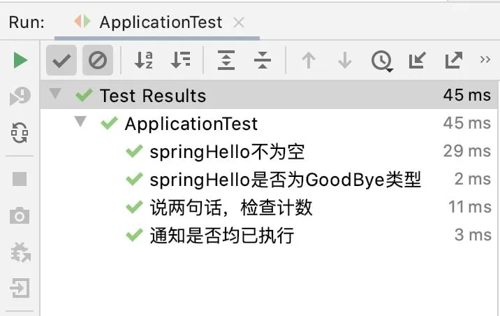

# 第3章SpringFramework中的AOP

- 本章内容AOP 的概念

- Spring AOP 的实现原理

- 基于注解的 AOP 配置方式

- 基于 XML Schema 的 AOP 配置方式

讲完了 IoC，我们再来聊聊 Spring Framework 中的另一个重要内容——面向切面编程，即AOP。它是框架中众多功能的基础，例如声明式事务就是依靠 AOP 来实现的。此外，Spring还为我们提供了简单的方式来使用 AOP，这有助于简化业务代码中一些共性功能的开发。本章我们会一起去了解 AOP 的基本概念，以及 AOP 在 Spring Framework 中的实现，并学习如何通过使用注解和 XML 文件的方式来配置 AOP 相关的功能。

## 3.1　Spring 中的 AOP

为了能更好地理解 AOP，本节会先带大家了解一下什么是 AOP，它能做什么，随后展开解释其中的一些核心概念，最后再剖析一下 Spring Framework 中 AOP 的实现原理。

### 3.1.1　AOP 的核心概念

AOP 是 Aspect Oriented Programming（面向切面编程）的首字母缩写，是一种编程范式，它的目的是通过分离横切关注点（cross-cutting concerns）来提升代码的模块化程度。AOP 的

- 1

概念最早是由 Xerox PARC

- 提出的，我第一次接触到这个概念则是在 2004 年左右，当时我

还在上大学，恰逢学院的一位博士生导师来给本科生上课，课程中他向我们介绍了 AOP，那

- 2

时主要的 AOP 框架还是 AspectJ

- 。

AOP 中提到的关注点，其实就是一段特定的功能，有些关注点出现在多个模块中，就称为横切关注点。这么说可能有点抽象，举个例子，一个后台客服系统的每个模块都需要记录客服的操作日志，这就是一个能从业务逻辑中分离出来的横切关注点，完全不用交织在每个模块的代码中，可以作为一个单独的模块存在。

整理一下，可以发现 AOP 解决了两个问题：第一是代码混乱，核心的业务逻辑代码还必须兼顾其他功能，这就导致不同功能的代码交织在一起，可读性很差；第二是代码分散，同一个功能的代码分散在多个模块中，不易维护。在引入 AOP 之后，一切就变得不一样了。

虽然 AOP 同 OOP（Object-Oriented Programming，面向对象编程）一样，都是一种编程范式，但它并非站在 OOP 的对立面，而是对 OOP 的一个很好的补充。Spring Framework 就是一个例子，它很好地将两者融合在了一起。

在 AOP 中有几个重要的概念，在开始实践前，我们先通过表 3-1 来了解一下这些概念。

表 3-1　AOP 中的几个重要概念

概念

- 说明

切面（aspect）

- 按关注点进行模块分解时，横切关注点就表示为一个切面

- 3

连接点（join point）

- 程序执行的某一刻，在这个点上可以添加额外的动作

通知（advice）

- 切面在特定连接点上执行的动作

- 切入点是用来描述连接点的，它决定了当前代码与连接点是否

切入点（pointcut）

- 匹配

借助表 3-1，我们可以将这些概念串联起来：通过切入点来匹配程序中的特定连接点，在这些连接点上执行通知，这种通知可以是在连接点前后执行，也可以是将连接点包围起来。

### 3.1.2　Spring AOP 的实现原理

在 Spring Framework 中，虽然 Spring AOP 的使用方式发生过很大的变化，但其背后的核心技术却从未改变，那就是动态代理技术。代理模式是 GoF 提出的 23 种经典设计模式之一，我们可以为某个对象提供一个代理，控制对该对象的访问，代理可以在两个有调用关系的对象之间起到中介的作用——代理封装了目标对象，调用者调用了代理的方法，代理再去调用实际的目标对象，如图 3-1 所示。


- 图 3-1　代理模式示意图

动态代理就是在运行时动态地为对象创建代理的技术。在 Spring 中，由 AOP 框架创建、用来

- 4

实现切面的对象被称为 AOP 代理（AOP Proxy），一般采用 JDK 动态代理或者是 CGLIB

- 代

理，两者在使用时的区别具体如表 3-2 所示。

表 3-2　JDK 动态代理与 CGLIB 代理的区别

```
支持拦截 public 方法
支持拦截 protected 方法
```

- 必须要实现接口拦截

JDK 动态代理

- 是是否否

CGLIB 代理

- 否是是是

```
虽然 CGLIB 支持拦截非 public 作用域的方法调用，但在不同对象之间交互时，建议还是以
public 方法调用为主。
```

Spring 容器在为 Bean 注入依赖时，会自动将被依赖 Bean 的 AOP 代理注入进来，这就让我们感觉是在使用原始的 Bean，其实不然。

被切面拦截的对象称为目标对象（target object）或通知对象（advised object），因为 Spring用了动态代理，所以目标对象就是要被代理的对象。

- 6

以 JDK 动态代理为例，假设我们希望在代码示例 3-1

- 的方法执行前后增加两句日志，可以

```
采用下面这套代码，先实现调用 Hello 的主流程。
```

- 代码示例 3-1　要被动态代理的 Hello 接口及其实现片段

```java
public interface Hello {
   void say();
}
public class SpringHello implements Hello {
   @Override
   public void say() {
       System.out.println("Hello Spring!");
   }
}
随后，我们可以像代码示例 3-2 那样设计一个 InvocationHandler，于是对代理对象的调
用都会转为调用 invoke 方法，传入的参数中就包含了所调用的方法和实际的参数。
代码示例 3-2　在 Hello.say() 前后打印日志的 InvocationHandler
public class LogHandler implements InvocationHandler {
   private Hello source;
   public LogHandler(Hello source) {
       this.source = source;
   }
   @Override
   public Object invoke(Object proxy, Method method, Object[] args) throws Throw
       System.out.println("Ready to say something.");
       try {
           return method.invoke(source, args);
       } finally {
           System.out.println("Already say something.");
       }
   }
}
最后，再通过 Proxy.newProxyInstance() 为 Hello 实现类的 Bean 实例创建使用
LogHandler 的代理，如代码示例 3-3 所示。
```

- 代码示例 3-3　创建 JDK 动态代理并调用方法

```java
public class Application {
   public static void main(String[] args) {
       Hello original = new SpringHello();
       Hello target = (Hello) Proxy.newProxyInstance(Hello.class.getClassLoader(
           original.getClass().getInterfaces(), new LogHandler(original));
       target.say();
   }
}
```

这段代码的运行效果如下：

```
Ready to say something.
Hello Spring!
Already say something.
```

Spring AOP 的实现方式与我们的例子大同小异，相信通过这个例子大家已经能够对其背后的

```
实现原理了解一二了。感兴趣的朋友可以阅读一下 ProxyFactoryBean 的源码，若是采用
JDK 动态代理，AopProxyFactory 会创建 JdkDynamicAopProxy；若是采用 CGLIB 代
理，则是创建 ObjenesisCglibAopProxy，前者的逻辑就和我们的例子差不多。
```

- 茶歇时间：使用代理模式过程中的小坑

```
在上面的例子中，我们调用的是代理对象 target 上的方法，并不直接操作原始对象。在
```

- Spring AOP 中，为了能用到被 AOP 增强过的方法，我们应该始终与代理对象交互。如果存在一个类的内部方法调用，这个调用的对象不是代理，而是其本身，则无法享受 AOP 增强的效果。

```
比如，下面这个类中的 foo() 方法调用了 bar()，哪怕 Spring AOP 对 bar() 做了拦
```

- 截，由于调用的不是代理对象，因而看不到任何效果，大家需要特别注意这种情况。

```java
public class Hello {
1
   public void foo() {
2
       bar();
3
   }
4
5
   public void bar() {...}
6
}
7
```

## 3.2　基于 @AspectJ 的配置

回想我第一次接触 AOP 时，AspectJ 的使用体验并不理想。AspectJ 不仅需要编写单独的

```
Aspect 代码，还要通过 ajc 命令做编译。当然，尽管现在的 AspectJ 也有了长足进步，但
```

Spring AOP 中所有的东西都是 Java 类，对开发者来说用起来更为统一，体验更好。Spring

```
Framework 同时支持 @AspectJ 注解和 XML Schema 两种方式来使用 AOP，虽然官方并没
```

有明显的偏好，但个人认为注解的方式更贴近 Java 的风格，所以先来介绍一下基于注解的方式。

```java
首先，需要引入 org.springframework:spring-aspects 依赖，以便使用 AspectJ 相
关的注解和功能。要开启 @AspectJ 支持，可以在 Java 配置类上增加
@EnableAspectJAutoProxy 注解，比如像下面这样：
@Configuration
@EnableAspectJAutoProxy
public class Config {...}
```

```
@EnableAspectJAutoProxy 有两个属性，proxyTargetClass 用于选择是否开启基于
类的代理（是否使用 CGLIB 来做代理）；exposeProxy 用于选择是否将代理对象暴露到
```

- 7

```
AopContext 中，两者默认值都是 false。
```

我们也可以通过 XML Schema 的方式来实现相同的效果，如代码示例 3-4 所示，注意要正确

```xml
地引入 aop 命名空间。
代码示例 3-4　通过 <aop:aspectj-autoproxy/> 开启 @AspectJ 支持
<?xml version="1.0" encoding="UTF-8"?>
<beans xmlns="http://www.springframework.org/schema/beans"
   xmlns:xsi="http://www.w3.org/2001/XMLSchema-instance"
   xmlns:aop="http://www.springframework.org/schema/aop"
   xsi:schemaLocation="
       http://www.springframework.org/schema/beans https://www.springframework.o
       http://www.springframework.org/schema/aop https://www.springframework.org
   <aop:aspectj-autoproxy/>
</beans>
接下来，在完成配置后，我们就可以使用 @Aspect 注解来声明切面了，将这个注解加到类上
```

即可：

```java
@Aspect
public class MyAspect {...}
```

- 注意　有两点内容需要重点说明。

```
(1) 添加 @Aspect 注解只是告诉 Spring“这个类是切面”，但并没有把它声明为 Bean，因此
需要我们手动进行配置，例如添加 @Component 注解，或者在 Java 配置类中进行声明。
(2) Spring Framework 会对带有 @Aspect 注解的类做特殊对待，因为其本身就是一个切
```

- 面，所以不会被别的切面自动拦截。

在声明了切面后，我们就可以配置具体的切入点和通知了，本章的后面会对这些做具体的展开。

### 3.2.1　声明切入点

注解方式的切入点声明由两部分组成——切入点表达式和切入点方法签名。前者用来描述要匹配的连接点，后者可以用来引用切入点，方便切入点的复用，具体如代码示例 3-5 所示。

- 代码示例 3-5　一些简单的切入点声明

```java
package learning.spring.helloworld;
public class HelloPointcut {
   @Pointcut("target(learning.spring.helloworld.Hello)")
   public void helloType() {} // 目标对象是learning.spring.helloworld.Hello类型
   @Pointcut("execution(public * say())")
   public void sayOperation() {} // 执行public的say()方法
   @Pointcut("helloType() && sayOperation()") // 复用其他切入点
   public void sayHello() {} // 执行Hello类型中public的say()方法
}
@Pointcut 注解中使用的就是 AspectJ 5 的表达式，其中一些常用的 PCD（pointcut
```

designator，切入点标识符）如表 3-3 所示。

表 3-3　@Pointcut 中的一些常用 PCD

PCD

- 说明

```
execution
```

- 最常用的一个 PCD，用来匹配特定方法的执行

```
within
```

- 匹配特定范围内的类型，可以用通配符来匹配某个 Java 包内的所有类

```
因为 execution 用得非常多，下面详细描述一下它的表达式，[] 代表可选项，<> 代表必
```

选项：

```
execution([修饰符] <返回类型> [全限定类名.]<方法>(<参数>) [异常])
```

其中，

```
每个部分都可以使用 * 通配符
类名中使用 .* 表示包中的所有类，..* 表示当前包与子包中的所有类
```

- 参数主要分为以下几种情况：

```
() 表示方法无参数
(..) 表示有任意个参数
(*) 表示有一个任意类型的参数
(String) 表示有一个 String 类型的参数
(String,String) 代表有两个 String 类型的参数
```

在 Java 中，为了方便标识，我们也经常使用注解，如果类上带了特定的注解，也可以用表 3-4 中的这些 PCD。

表 3-4　针对注解的常用 PCD

PCD

- 说明

```
@target
```

- 执行的目标对象带有特定类型注解

```
@args
```

- 传入的方法参数带有特定类型注解

切入点表达式支持与、或、非运算，运算符分别为 &&、||和 !，还可以进行灵活组合。

最后，我们再提供一些示例：

```bash
// learning.spring.helloworld及其子包中所有类里的say方法
// 该方法可以返回任意类型，第一个参数必须是String，后面可以跟任意参数
execution(* learning.spring.helloworld..*.say(String,..))
// learning.spring.helloworld及其子包
within(learning.spring.helloworld..*)
// 方法的参数仅有一个String
args(java.lang.String)
// 目标类型为Hello及其子类
target(learning.spring.helloworld.Hello+)
// 类上带有@AopNeeded注解
@target(learning.spring.helloworld.AopNeeded)
```

- 茶歇时间：Spring AOP 与 AspectJ 中 PCD 的不同之处Spring AOP 中虽然使用了 AspectJ 5 的切入点表达式，也共用了不少 AspectJ 的 PCD，但其实两者还是有区别的。比如，Spring AOP 中仅支持有限的 PCD，AspectJ 中还有很多PCD 是 Spring AOP 不支持的。由于 Spring AOP 的实现基于动态代理，因而只能匹配普通方法的执行，像静态初始化、静态方法、构造方法、属性赋值等操作都是拦截不到的。所以说相比 AspectJ 而言，SpringAOP 的功能弱很多，但在大部分场景下也基本够用。

```
出于上述差异，在表 3-4 中我们并没有列出 @within 这个 PCD，因为在 Spring AOP
中，@target 与 @within 两者在使用上感受不到什么区别。前者要求运行时的目标对象
带有注解，这个注解的 @Retention 是 RetentionPolicy.RUNTIME，即运行时的；后
者要求被拦截的类上带有 @Retention 是 RetentionPolicy.CLASS 的注解。但
Spring AOP 只能拦截到非静态 public 方法的执行，两个 PCD 的效果一样，所以还是老
```

- 8

```
老实实用 @target 吧。
```

### 3.2.2　声明通知

Spring AOP 中有多种通知类型，可以帮助我们在方法的各个执行阶段进行拦截，例如，可以在方法执行前、返回后、抛出异常后添加特定的操作，也可以完全替代方法的实现，甚至为一个类添加原先没有的接口实现。

1. 前置通知

```
@Before 注解可以用来声明一个前置通知，注解中可以引用事先定义好的切入点，也可以
```

- 直接传入一个切入点表达式，在被拦截到的方法开始执行前，会先执行通知中的代码：

```java
@Aspect
1
public class BeforeAspect {
2
   @Before("learning.spring.helloworld.HelloPointcut.sayHello()")
3
   public void before() {
4
       System.out.println("Before Advice");
5
   }
6
   // 同一个切面类里还可以有其他通知方法
7
   // 这就是一个普通的Java类，没有太多限制
8
}
9
```

- 前置通知的方法没有返回值，因为它在被拦截的方法前执行，就算有返回值也没地方使用，

```java
但是它可以对被拦截方法的参数进行加工，通过 args 这个 PCD 能明确参数，并将其绑定
到前置通知方法的参数上。例如，要在 sayHello(AtomicInteger) 这个方法前对
AtomicInteger 类型的参数进行数值调整，就可以这样做：
@Before("learning.spring.helloworld.HelloPointcut.sayHello() && args(count)")
1
public void before(AtomicInteger count) {
2
   // 操作count
3
}
4
要是同时存在多个通知作用于同一处，可以让切面类实现 Ordered 接口，或者在上面添加
@Order 注解。指定的值越低，优先级则越高，在最终的代理对象执行时也会先执行优先级
```

- 高的逻辑。

2. 后置通知在方法执行后，可能正常返回，也可能抛出了异常。如果想要拦截正常返回的调用，可以使用

```java
@AfterReturing 注解。例如像下面这样：
@AfterReturning("execution(public * say(..))")
1
public void after() {}
2
3
@AfterReturning(pointcut = "execution(public * say(..))", returning = "words")
4
public void printWords(String words) {
5
   System.out.println("Say something: " + words);
6
}
7
printWords() 方法的参数 words 就是被拦截方法的返回值，而且此处限定了该通知只
拦截返回值是 String 类型的调用。需要提醒的是，returning 中给定的名字必须与方
```

- 法的参数名保持一致。

```
如果想要拦截抛出异常的调用，可以使用 @AfterThrowing 注解，这个注解的用法与
@AfterReturing 极为类似。例如：
```

```java
@AfterThrowing("execution(public * say(..))")
1
public void afterThrow() {}
2
3
@AfterThrowing(pointcut = "execution(public * say(..))", throwing = "exception
4
public void printException(Exception exception) {}
5
如果不关注执行是否成功，只是想在方法结束后做些动作，可以使用 @After 注解：
@After("execution(public * say(..))")
1
public void afterAdvice() {}
2
添加了 @After 注解的方法必须要能够处理正常与异常这两种情况，但它又获取不到返回
```

- 值或异常对象，所以一般只被用来做一些资源清理的工作。

3. 环绕通知还有一种通知类型是环绕通知，它的功能比较强大，不仅可以在方法执行前后加入自己的逻辑，甚至可以完全替换方法本身的逻辑，或者替换调用参数。我们可以添加 @Around 注解来声明环绕通知，这个方法的签名需要特别注意，它的第一个参数必须是ProceedingJoinPoint 类型的，方法的返回类型是被拦截方法的返回类型，或者直接用Object 类型。

```
例如，我们希望统计 say() 方法的执行时间，可以像代码示例 3-6 那样来声明环绕通知。
```

- 代码示例 3-6　统计方法耗时的环绕通知

```java
@Aspect
1
public class TimerAspect {
2
   @Around("execution(public * say(..))")
3
   public Object recordTime(ProceedingJoinPoint pjp) throws Throwable {
4
       long start = System.currentTimeMillis();
5
       try {
6
           return pjp.proceed();
7
       } finally {
8
           long end = System.currentTimeMillis();
9
           System.out.println("Total time: " + (end - start) + "ms");
10
       }
11
   }
12
}
13
其中的 pjp.proceed() 就是调用具体的连接点进行的处理，proceed() 方法也接受
Ojbect[] 参数，可以替代原先的参数。
```

- 环绕通知虽然很强大，但在日常开发过程中，我们选择能满足需求的通知类型就好，如果

```
@After 够用，那就不用 @Around 了。
```

4. 引入通知与前面介绍的几种相比，下面要介绍的最后一种 Spring AOP 通知不太常用。我们可以为Bean 添加新的接口，并为新增的方法提供默认实现，这种操作被称为引入（Introduction）9。在切面类里声明一个成员属性，该属性的类型就是要引入的类型，在上面添加

```java
@DeclareParents 注解就可以声明引入，可以像下面这样为 Hello 及其子类实现
GoodBye 接口：
@Aspect
1
public class MyAspect {
2
   @DeclareParents(value = "learning.spring.helloworld.Hello+", defaultImpl =
3
   private GoodBye goodBye;
4
}
5
引入其实是针对类型进行的增强，value 中仅可填入要匹配的类型，可以使用 AspectJ 类
```

- 型匹配模式。引入声明后，在 Spring 容器中取到的 Bean 就已经完成了增强，哪怕在前置通知中也是如此。

### 3.2.3　基于 @AspectJ 的示例

```
为了便于大家能更好地掌握 Spring AOP 的用法，本节为大家准备了一个基于 @AspectJ 注
```

- 10

```
，如代码示例 3-7 所示，假设这里我们有一个 Hello 接口及其对应实现
```

解的 AOP 示例

```java
SpringHello。
代码示例 3-7　Hello 接口及其实现代码片段
public interface Hello {
   // 为了方便演示改变参数内容，此处使用StringBuffer
   String sayHello(StringBuffer words);
}
@Component
public class SpringHello implements Hello {
   @Override
   public String sayHello(StringBuffer words) {
       return "Hello! " + words;
   }
}
第一个切面拦截 Hello 类型中的方法执行，我们在传入的 StringBuffer 中追加了一段文
字，为了演示多个通知的执行顺序，还增加了 @Order 注解，如代码示例 3-8 所示。
代码示例 3-8　HelloAspect 切面代码片段
@Aspect
@Component
@Order(1)
public class HelloAspect {
   @Before("target(learning.spring.helloworld.Hello) && args(words)")
   public void addWords(StringBuffer words) {
       words.append("Welcome to Spring! ");
   }
}
```

```
第二个切面 SayAspect 中有三部分内容（如代码示例 3-9 所示）：
```

- 11

```
(1) 拦截所有 say 打头的方法，在 StringBuffer 参数中追加目前为止说过的话的计数
```

- ；

```
(2) 为 learning.spring.helloworld 包内的类引入了一个 GoodBye 接口；
(3) 通过环绕通知改变了 sayHello() 方法的执行结果，追加了对引入的 GoodBye 接口的调
```

用。

```java
代码示例 3-9　SayAspect 切面代码片段
@Aspect
@Component
@Order(2)
public class SayAspect {
   @DeclareParents(value = "learning.spring.helloworld.*",
                   defaultImpl = DefaultGoodBye.class)
   private GoodBye bye;
   private int counter = 0;
   @Before("execution(* say*(..)) && args(words)")
   public void countSentence(StringBuffer words) {
       words.append("[" + ++counter + "]\n");
   }
   @Around("execution(* sayHello(..)) && this(bye)")
   public String addSay(ProceedingJoinPoint pjp, GoodBye bye)
       throws Throwable {
       return pjp.proceed() + bye.sayBye();
   }
   public void reset() {
       counter = 0;
   }
   public int getCounter() {
       return counter;
   }
}
这个切面中所引入的 GoodBye 接口及其默认实现内容如代码示例 3-10 所示。
代码示例 3-10　GoodBye 接口及其实现的代码片段
public interface GoodBye {
   String sayBye();
}
public class DefaultGoodBye implements GoodBye {
   @Override
   public String sayBye() {
       return "Bye! ";
   }
}
```

为了验证这个示例的运行结果是否如我们预期的那样，可以编写一个执行类，直接去调用

```
SpringHello 的 sayHello() 方法。但在实际工作中，大家要写的代码远比例子中的复
```

杂，而且很多时候需要进行各种测试来做验证——有了充分的单元测试，才能保障代码质量。因此，从本节开始，我们的示例中会加入测试用例来验证代码是否符合预期。接下来，就让我们来看看这两种方式的代码该如何编写。

1. 直接运行代码

```
我们通过 AnnotationConfigApplicationContext 可以构建一个基于注解的 Spring
```

- 容器，再配合简单的 Java 配置类，这个代码就能运行了，如代码示例 3-11 所示。

```java
代码示例 3-11　Application 类的代码片段
@Configuration
1
@EnableAspectJAutoProxy
2
@ComponentScan("learning.spring.helloworld")
3
public class Application {
4
   public static void main(String[] args) {
5
       AnnotationConfigApplicationContext applicationContext =
6
               new AnnotationConfigApplicationContext(Application.class);
7
8
       Hello hello = applicationContext.getBean("springHello", Hello.class);
9
       System.out.println(hello.sayHello(new StringBuffer("My Friend. ")));
10
       System.out.println(hello.sayHello(new StringBuffer("My Dear Friend. "))
11
   }
12
}
13
```

- 上述代码的执行输出如下：

```
Hello! My Friend. Welcome to Spring! [1]
1
Bye!
2
Hello! My Dear Friend. Welcome to Spring! [2]
3
Bye!
4
```

2. 单元测试直接运行代码，然后通过肉眼查看输出内容来判断逻辑是否正确，这种方法虽然简单直观，但不具备在大规模项目中使用的条件——每次改动代码都要人肉测试，既不高效，又浪费人12力资源。所以，能用代码来验证的事，我们就要把它们写成自动化测试。

```
Maven 工程默认将生产代码和测试代码分开了，生产代码在 main 目录中，而测试代码则
写在 test 目录中。为了在项目中使用 JUnit 5 进行单元测试，pom.xml 文件需要引入
```

- 13

```xml
spring-test 和 junit-jupiter 依赖，就像下面这样：
<dependencies>
1
   <!-- 省略其他内容 -->
2
   <dependency>
3
       <groupId>org.springframework</groupId>
4
       <artifactId>spring-test</artifactId>
5
       <version>5.3.15</version>
6
       <scope>test</scope>
7
   </dependency>
8
   <dependency>
9
       <groupId>org.junit.jupiter</groupId>
10
       <artifactId>junit-jupiter</artifactId>
11
       <version>5.8.2</version>
12
       <scope>test</scope>
13
   </dependency>
14
</dependencies>
15
下面我们编写一个 ApplicationTest 类，通过其中的断言（assertion）来判断结果，如
```

- 代码示例 3-12 所示。

```java
代码示例 3-12　ApplicationTest 类的代码片段
@ExtendWith(SpringExtension.class)
1
@ContextConfiguration(classes = Application.class)
2
// 这个@SpringJUnitConfig可以代替上述两行
3
// @SpringJUnitConfig(Application.class)
4
public class ApplicationTest {
5
   @Autowired
6
   private Hello hello;
7
   @Autowired
8
   private SayAspect sayAspect;
9
10
   @BeforeEach
11
   public void setUp() {
12
       // Spring容器是同一个，因此SayAspect也是同一个
13
       // 重置计数器，方便进行断言判断
14
       sayAspect.reset();
15
   }
16
17
   @Test
18
   @DisplayName("springHello不为空")
19
   public void testNotEmpty() {
20
       assertNotNull(hello);
21
   }
22
23
   @Test
24
   @DisplayName("springHello是否为GoodBye类型")
25
   public void testIntroduction() {
26
       assertTrue(hello instanceof GoodBye);
27
   }
28
29
   @Test
30
   @DisplayName("通知是否均已执行")
31
   public void testAdvice() {
32
       StringBuffer words = new StringBuffer("Test. ");
33
       String sentence = hello.sayHello(words);
34
       assertEquals("Test. Welcome to Spring! [1]\n", words.toString());
35
       assertEquals("Hello! Test. Welcome to Spring! [1]\nBye! ", sentence);
36
   }
37
38
   @Test
39
   @DisplayName("说两句话，检查计数")
40
   public void testMultipleSpeaking() {
41
       assertEquals("Hello! Test. Welcome to Spring! [1]\nBye! ",
42
                    hello.sayHello(new StringBuffer("Test. ")));
43
       assertEquals("Hello! Test. Welcome to Spring! [2]\nBye! ",
44
                    hello.sayHello(new StringBuffer("Test. ")));
45
   }
46
}
47
```

- 在 IDEA 中执行测试后，可以看到如图 3-2 的测试结果。如果某项测试失败，那么对应测试就不会有绿色的对勾。大家可以通过点击选中某项测试，查看其具体执行情况。



- 图 3-2　IDEA 中的测试结果

- 也可以在命令行中通过 Maven 来执行测试，由于 JUnit 5 对 Maven 及其插件的版本有要求，测试者最好安装 3.6.0 版本以上的 Maven，并在 pom.xml 中修改 maven-surefire-plugin 的版本，比如使用 2.22.0 以上的版本，像下面这样：

```xml
<build>
1
   <plugins>
2
       <!-- 为了支持JUnit 5， 使用2.22.0的插件 -->
3
       <plugin>
4
           <groupId>org.apache.maven.plugins</groupId>
5
           <artifactId>maven-surefire-plugin</artifactId>
6
           <version>2.22.0</version>
7
       </plugin>
8
   </plugins>
9
</build>
10
随后在工程目录中执行 mvn test 命令，如果一切顺利，我们就可以在输出中看到类似如
```

- 下的内容（如果有断言失败，也会在输出中有所提示）：

```
[INFO] Tests run: 4, Failures: 0, Errors: 0, Skipped: 0, Time elapsed: 0.523 s
1
   helloworld.ApplicationTest
2
[INFO]
3
[INFO] Results:
4
[INFO]
5
[INFO] Tests run: 4, Failures: 0, Errors: 0, Skipped: 0
6
```

## 3.3　基于 XML Schema 的配置

```
Spring Framework 除了支持以 @AspectJ 注解的方式来配置 AOP，还支持通过 <aop/>
```

XML Schema 的方式。如果大家习惯使用 XML，也可以考虑采用这种方式。

```
Spring AOP 相关的 XML 配置，都放在 <aop:config/> 中，比如要声明切面，就可以像代
```

码示例 3-13 那样。切面类的内容和上一节介绍的类似，但无须添加注解。

```xml
代码示例 3-13　用 <aop:aspect/> 声明切面
<?xml version="1.0" encoding="UTF-8"?>
<beans xmlns="http://www.springframework.org/schema/beans"
       xmlns:xsi="http://www.w3.org/2001/XMLSchema-instance"
       xmlns:aop="http://www.springframework.org/schema/aop"
       xsi:schemaLocation="http://www.springframework.org/schema/beans https://w
   <aop:config>
       <aop:aspect id="helloAspect" ref="aspectBean">
           <!-- 其他内容省略 -->
       </aop:aspect>
   </aop:config>
   <bean id="aspectBean" class="..." />
</beans>
```

### 3.3.1　声明切入点

```xml
在 <aop:config/> 中，我们可以通过 <aop:pointcut/> 来配置切入点。它既可以配置在
<aop:config/> 中，也可以出现在 <aop:aspect/> 中。切入点的 id 可以方便复用，
expression 中的切入点表达式就和 3.2.1 节中介绍的一致。例如像下面这样：
<aop:config>
   <aop:aspect id="helloAspect" ref="aspectBean">
       <aop:pointcut id="helloType" expression="target(learning.spring.helloworl
       <!-- 其他内容省略 -->
   </aop:aspect>
</aop:config>
<aop:pointcut/> 的 expression 中既可以直接写表达式，也可以写带有 @Pointcut 注
解的全限定方法。表达式同样支持运算，可以用 &&、|| 和 !，或者 and、or 和 not 进行
组合，考虑到 XML 中用前一种方式比较麻烦，这里建议大家还是尽量使用 and、or 和
not。需要注意一点，组合表达式中不能通过 id 来引用其他已经定义的切入点。
```

### 3.3.2　声明通知

```xml
在 XML 中的通知也和 @AspectJ 注解的类似，只不过换成了 <aop:before/>、
<aop:after-returning/> 等 XML 而已。如果有多个通知要执行，可以让切面类实现
Ordered 接口或者添加 @Order 注解，<aop:aspect/> 中有一个 order 属性也可以配置
```

切面的顺序。

1. 前置通知

```xml
<aop:before/> 可以用来声明前置通知，method 属性的值是切面的具体方法，其中包
含了前置通知的代码逻辑；pointcut 属性的值是切入点表达式，也可以通过 pointcut-
ref 属性来使用事先定义好的切入点。例如，代码示例 3-7 的前置通知，可以改写为如下
```

- XML 格式：

```bash
<aop:aspect id="beforeAspect" ref="beforeAspectBean">
1
   <aop:before pointcut="learning.spring.helloworld.HelloPointcut.sayHello()"
2
</aop:aspect>
3
在 pointcut 中也可以使用绑定的方式向方法传递参数，比如用 args()、this() 或
target()。
```

2. 后置通知

```xml
与基于 @AspectJ 注解的方式一样，基于 XML Schema 的后置通知同样分为三类。
正常返回：<aop:after-returning/>。
抛出异常：<aop:after-throwing/>。
无所谓正常返回还是抛出异常：<aop:after/>。
三个标签中都有 pointcut、pointcut-ref 和 method 属性，其作用与
<aop:before/> 中介绍的一样。
<aop:after-returning/> 中还有一个 returning 属性，用来将方法的执行返回传递
```

- 到通知方法中，属性值需要与方法的参数名一致。当然，我们也可以忽略这个属性，不关心返回值。3.2.2 节中的例子可以改写成下面这样：

```xml
<aop:after-returning pointcut="execution(public * say(..))"
1
                      returning="words"
2
                      method="printWords" />
3
<aop:after-throwing/> 中也与注解一样，有一个 throwing 属性，用来向通知方法
```

- 中传递抛出的异常。3.2.2 节中的例子同样可以改写成下面这样：

```xml
<aop:after-throwing pointcut="execution(public * say(..))"
1
                     method="afterThrow" />
2
3
<aop:after-throwing pointcut="execution(public * say(..))"
4
                     throwing="exception"
5
                     method="printException" />
6
<aop:after/> 则相对简单，没有额外的属性可以配置。上面的例子改写为 XML 后就像
```

- 下面这样：

```xml
<aop:after pointcut="execution(public * say(..))" method="afterAdvice" />
1
```

3. 环绕通知

```xml
环绕通知的代码实现与使用 @AspectJ 注解时是一样的，只不过将注解换成了
<aop:around/> 的 XML，代码示例 3-8 的声明可以改写成如下 XML：
<aop:around pointcut="execution(public * say(..))" method="recordTime" />
1
```

- 至于具体的方法定义，可以回顾一下 3.2.2 节中的相关内容和代码示例 3-8。

4. 引入通知

```
XML 中同样也可以声明引入，在 <aop:aspect/> 中通过 <aop:declare-parents/>
就可以实现和 @DeclareParents 注解一样的效果，<aop:declare-parents/> 里有
```

- 三个属性。

```xml
types-matching：用来匹配类型，比如 learning.spring.helloworld.*+。
implement-interface：要引入的接口。
default-impl：接口的默认实现。
3.2.2 节中的 @DeclareParents 示例可以改写成下面这样：
<aop:aspect id="myAspect" ref="myAspectBean">
1
   <aop:declare-parents types-matching="learning.spring.helloworld.Hello+"
2
       implement-interface="learning.spring.helloworld.GoodBye"
3
       default-impl="learning.spring.helloworld.DefaultGoodByeImpl"/>
4
   <!-- 其他省略 -->
5
</aop:aspect>
6
```

### 3.3.3　通知器

```xml
如果觉得 XML Schema 的配置方式比较繁琐，在 <aop:config/> 中又有
<aop:aspect/>，又有 <aop:pointcut/>，还有各种通知。为此，Spring Framework 为
我们提供了一套通知器（advisor）的 XML 元素，通过 <aop:advisor/> 可以简单地配置出
```

一个仅包含单个通知的切面，通知器中引用的 Bean 要实现如下的 AOP 通知接口。

```
MethodInterceptor：环绕通知。
MethodBeforeAdvice：前置通知。
AfterReturningAdvice：正常返回的后置通知。
ThrowsAdvice：抛出异常的后置通知。
```

随后，可以像下面这样来定义通知器：

```xml
<aop:config>
   <aop:pointcut id="sayMethod" expression="execution(public * say(..))" />
   <aop:advisor pointcut-ref="sayMethod" advice-ref="aroundAdvice" />
</aop:config>
<bean id="aroundAdvice" class="learning.spring.helloworld.SayMethodInterceptor" /
```

### 3.3.4　基于 XML Schema 的示例

与 3.2 节一样，本节也提供了一个示例帮助大家理解并掌握基于 XML Schema 的 AOP 使用方

```
式。有了 3.2.3 节的基础，本节的例子可以基本照搬 3.2.3 节中的代码，去除所有 @AspectJ
```

- 14

相关的注解，同时将 Bean 配置方式从注解换成 XML。

```
在项目的 resources 目录中添加一个 applicationContext.xml，内容如代码示例 3-14 所示。
```

可以看到 XML 文件可以完全取代注解来实现 AOP 相关的配置。

```xml
代码示例 3-14　完整的 applicationContext.xml 文件
<?xml version="1.0" encoding="UTF-8"?>
<beans xmlns="http://www.springframework.org/schema/beans"
       xmlns:xsi="http://www.w3.org/2001/XMLSchema-instance"
       xmlns:aop="http://www.springframework.org/schema/aop"
       xsi:schemaLocation="
       http://www.springframework.org/schema/beans
       https://www.springframework.org/schema/beans/spring-beans.xsd
       http://www.springframework.org/schema/aop
       https://www.springframework.org/schema/aop/spring-aop.xsd">
   <aop:config>
       <aop:aspect ref="helloAspect" order="1">
           <aop:before pointcut="target(learning.spring.helloworld.Hello) and ar
                       method="addWords"/>
       </aop:aspect>
       <aop:aspect ref="sayAspect" order="2">
           <aop:before pointcut="execution(* say*(..)) and args(words)" method="
           <aop:around pointcut="execution(* sayHello(..)) and this(bye)" method
           <aop:declare-parents types-matching="learning.spring.helloworld.*"
               implement-interface="learning.spring.helloworld.GoodBye"
               default-impl="learning.spring.helloworld.DefaultGoodBye" />
       </aop:aspect>
   </aop:config>
   <bean id="springHello" class="learning.spring.helloworld.SpringHello" />
   <bean id="helloAspect" class="learning.spring.helloworld.HelloAspect" />
   <bean id="sayAspect" class="learning.spring.helloworld.SayAspect" />
</beans>
由于容器的配置使用了 XML 文件，所以在 Application 类中也要使用对应的类来加载容器
配置，本次我们选择了 ClassPathXmlApplicationContext，具体的执行代码如代码示
```

例 3-15 所示。运行后可以看到与 3.2.3 中一样的输出。

```java
代码示例 3-15　Application 类的代码片段
public class Application {
   public static void main(String[] args) {
       ApplicationContext applicationContext = new ClassPathXmlApplicationContex
       Hello hello = applicationContext.getBean("springHello", Hello.class);
       System.out.println(hello.sayHello(new StringBuffer("My Friend. ")));
       System.out.println(hello.sayHello(new StringBuffer("My Dear Friend. ")));
   }
}
对于单元测试，我们需要做的改动也非常小，之前的 @ContextConfiguration 中给的是
```

Java 配置类，这次将其改为提供 CLASSPATH 中的 XML 配置文件，其余不动，具体如下所示：

```java
@ExtendWith(SpringExtension.class)
@ContextConfiguration("classpath:applicationContext.xml")
public class ApplicationTest {
   // 省略
}
```

- 茶歇时间：超简洁的 JUnit 单元测试入门在这两节的例子中，我们都使用了 JUnit 5 来进行自动化测试。有了自动化测试的保障，我们就可以在每次修改代码后快速进行验证，这样既能保障质量，又能节省大量人力。因此，很有必要为系统编写测试代码，其中单元测试和集成测试缺一不可。

```
通过代码示例 3-12 可以看到，带有 @Test 注解的方法会被视为测试方法，在测试方法中
```

- 务必使用断言进行判断，而不要用输出日志的方式进行人工观察，否则测试代码的价值会大

```
打折扣。org.junit.jupiter.api.Assertions 类中提供了大量的断言静态方法，比
```

- 如：

```
判断两者是否相等的 assertEquals() 和 assertNotEquals()；
判断布尔值的 assertTrue() 和 assertFalse()；
判断对象是否为空的 assertNull() 和 assertNotNull()。
在每个测试方法执行前后，都可以执行一些初始化和清理的逻辑：添加了 @BeforeEach
和 @AfterEach 的方法会分别在测试方法执行前后被 JUnit 执行；如果要在所有测试方法
执行前进行总的初始化，可以使用 @BeforeAll 注解，对应的还有所有测试方法执行后执
行的 @AfterAll。
JUnit 5 可以通过 @ExtendWith 注解来添加扩展，在我们的例子中，
@ExtendWith(SpringExtension.class) 就添加了 Spring 的测试支持，
@ContextConfiguration 注解指定了用来初始化 Spring 容器的配置类或配置文件。
值得一提的是，JUnit 4 和 JUnit 5 在 API 层面存在不少差异，比如 @Before 和 @After
分别对应了 @BeforeEach 和 @AfterEach，@RunWith 对应了 @ExtendWith，两个版
本的 assertXxx() 静态方法放在了不同的类里等。如果大家还在使用 JUnit 4，可以查阅
```

- 官方文档了解具体的用法。鉴于 JUnit 5 在功能上更胜一筹，如果可以的话，建议大家还是使用 JUnit 5，在本书后面的章节也会有更多关于 Spring 的测试支持的例子。

## 3.4　小结

通过本章的学习，相信大家已经对 Spring AOP 有了一个基本的认识：了解了 AOP 的核心概念以及 Spring Framework 中 AOP 的实现原理；学习了 Spring Framework 提供的两种配置方

```
式，大家可以根据实际情况选择使用基于 @AspectJ 注解的方式，或者基于 <aop/>XML
```

Schema 的方式（无论哪种方式，其中对切面、切入点和通知的定义大同小异）。

```
此外，本章的两个 Hello 示例，都提供了基于 JUnit 5 的自动化测试代码，演示了如何通过
```

单元测试来验证代码的逻辑。希望大家在日常工作中能更多地使用这种测试方式，本书后续章节也会有更多这方面的内容。

下一章，我们会从 Spring Framework 进入 Spring Boot 的领域，为大家介绍 Spring Boot 的几个核心功能。

[1]：Xerox PARC（施乐帕罗奥多研究中心）是施乐公司成立的最重要的研究机构。在个人电脑崛起的时代，Xerox PARC 是当之无

- 愧的技术先锋。

[2]：AspectJ 是 Eclipse 基金会下的一个项目，是知名的 AOP 框架，详情可见 Eclipse 官网。[3]：关于连接点模型（JPM，join point model）的更多内容，可以访问 AOP 的 wiki 页面。AspectJ 的连接点模型与此还有所区别，

- 具体可以查看 AspectJ 的文档。

[4]：CGLIB，这是一个生成与转换 Java 字节码的高阶 API，广泛应用于各种框架中。在 Spring Framework 中，为了避免类冲突，

- Spring 团队直接在编译时将 CGLIB 打包进了框架里，同时调整了包名。

[5]：如果不加 、 或 修饰符，在 Java 中即为默认作用域，在同一个包内可见。[6]：这个示例在 ch3/helloworld-jdkproxy 项目中。[7]：在 Spring Boot 中，会自动配置使用基于类的代理。[8]：关于 Spring AOP 中 与 的差异，StackOverflow 上有一篇名为“Difference between @target and @within (Spring AOP)”的文章

- 说得比较清楚，感兴趣的同学可以参考。

[9]：也有的地方称为引介。[10]：完整代码放在了本书配套代码示例的 ch3/helloworld-annotation-sample 目录中。如果想要自己动手编写，项目的 Maven

- POM 文件中需要引入 、 和 这几个依赖。

[11]：此处可以关注两个 通知的执行顺序。此外，这里并没有考虑并发的情况，因此计数是不准确的，仅做演示之用。[12]：目前主流的 Java 单元测试框架是 JUnit 和 TestNG。从使用人数上看，JUnit 4 用得比较广泛；而从功能上来说，JUnit 5 和

- TestNG 更为丰富。此外，Spring Framework 5 也支持 JUnit 5，因此本书的示例会使用 JUnit 5。关于 JUnit 5 的用法，本书不做说明，简单的使用会直接放在例子中，而复杂的用法，请大家参考官方文档。关于 Spring Framework 的测试支持，将会穿插在本书的各个章节里，不安排独立章节说明。

[13]：这里的版本视实际情况而定，在使用了 Spring Boot 后，可以让 Spring Boot 来管理这些版本。[14]：完整代码放在了本书配套代码示例的 ch3/helloworld-xml-sample 目录中。
