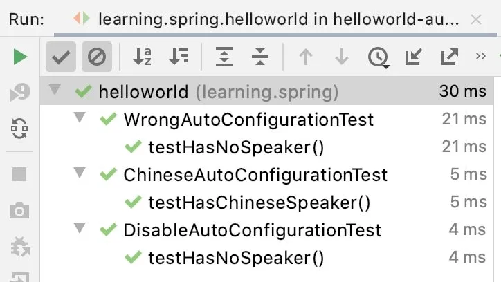

# 第4章从SpringFramework到SpringBoot(2)

## 4.3　自动配置

Spring Boot 可以根据 CLASSPATH、配置项等条件自动进行常规配置，省去了我们自己动手把一模一样的配置复制来复制去的麻烦。既然框架能猜到你想这么配，那它自己就能帮你搞定，如果它的配置不是我们想要的，再做些手动配置就好了。

```
我们已经在代码示例 1-1 中看到过 @SpringBootApplication 注解了，查看这个注解，可
以发现它上面添加了 @EnableAutoConfiguration，它可以开启自动配置功能。这两个注
解上都有 exclude 属性，我们可以在其中排除一些不想启用的自动配置类。如果不想启用自
```

动配置功能，也可以在配置文件中配置

```
spring.boot.enableautoconfiguration=false，关闭该功能。
```

### 4.3.1　自动配置的实现原理

```
自动配置类其实就是添加了 @Configuration 的普通 Java 配置类，它利用 Spring
Framework 4.0 加入的条件注解 @Conditional 来实现“根据特定条件启用相关配置类”，注
解中传入的 Condition 类就是不同条件的判断逻辑。Spring Boot 内置了很多条件注解，表
4-2 中列举了 org.springframework.boot.autoconfigure.condition 包中的条件
```

注解。

表 4-2　Spring Boot 内置的条件注解

条件注解

- 生效条件

- 存在特定名称、特定类型、特定泛型参数或带有

```
@ConditionalOnBean
```

- 注解的 Bean

```
@ConditionalOnMissingBean
```

- 与前者相反，不存在特定 Bean

```
@ConditionalOnClass
```

- 存在特定的类

```
@ConditionalOnMissingClass
```

- 与前者相反，不存在特定类

- 运行在特定的云平台上，截至 2.6.3 版本，代表云台的枚举类支持无云平台、CloudFoundry、Her

```
@ConditionalOnCloudPlatform
```

- SAP、Kubernetes 和 Azure，可以通过

```
spring.main.cloud-platform 配置强制使
```

- 云平台

```
@ConditionalOnExpression
```

- 指定的 SpEL 表达式为真

- 运行在满足条件的 Java 上，可以比指定版本新，

```
@ConditionalOnJava
```

- 可以比指定版本旧

- 指定的 JNDI 位置必须存在一个，如没有指定，则

```
@ConditionalOnJndi
要存在 InitialContext
```

- 属性值满足特定条件，比如给定的属性值都不能

```
@ConditionalOnProperty
false
@ConditionalOnResource
```

- 存在特定资源

```
@ConditionalOnSingleCandidate
```

- 当前上下文中，特定类型的 Bean 有且仅有一个

```
以 @ConditionalOnClass 注解为例，它的定义如下所示，@Target 指明该注解可用于类
型和方法定义，@Rentention 指明注解的信息在运行时也能获取到，而其中最关键的就是
OnClassCondition 条件类，里面是具体的条件计算逻辑：
@Target({ ElementType.TYPE, ElementType.METHOD })
@Retention(RetentionPolicy.RUNTIME)
@Documented
@Conditional(OnClassCondition.class)
public @interface ConditionalOnClass {
   Class<?>[] value() default {};
   String[] name() default {};
}
```

了解了条件注解后，再来看看它们是如何与配置类结合使用的。以后续章节中会用到的

```java
JdbcTemplateAutoConfiguration 为例，它的完整类定义代码如下所示：
@Configuration(proxyBeanMethods = false)
@ConditionalOnClass({ DataSource.class, JdbcTemplate.class })
@ConditionalOnSingleCandidate(DataSource.class)
@AutoConfigureAfter(DataSourceAutoConfiguration.class)
@EnableConfigurationProperties(JdbcProperties.class)
@Import({ JdbcTemplateConfiguration.class, NamedParameterJdbcTemplateConfiguratio
public class JdbcTemplateAutoConfiguration {}
可以看到这个配置类的生效条件是存在 DataSource 和 JdbcTemplate 类，且在上下文中
只能有一个 DataSource。此外，这个自动配置需要在 DataSourceAutoConfiguration
之后再配置（可以用 @AutoConfigureBefore、@AutoConfigureAfter 和
@AutoConfigureOrder 来控制自动配置的顺序）。这个配置类还会同时导入
JdbcTemplateConfiguration 和 NamedParameterJdbcTemplateConfiguration
```

里的配置。

- 茶歇时间：通过 ImportSelector 选择性导入配置普通的配置类需要被扫描到才能生效，可是自动配置类并不在我们项目的扫描路径中，它们又是怎么被加载上来的呢？

```
秘密在于 @EnableAutoConfiguration 上的
@Import(AutoConfigurationImportSelector.class)，其中的
AutoConfigurationImportSelector 类是 ImportSelector 的实现，这个接口的
作用就是根据特定条件决定可以导入哪些配置类，接口中的 selectImports() 方法返回
```

- 的就是可以导入的配置类名。

```
AutoConfigurationImportSelector 通过 SpringFactoriesLoader 来加载
```

- 14

```
/META-INF/spring.factories 里配置的自动配置类列表
```

- ，所用的键是

```
org.springframework.boot.autoconfigure.EnableAutoConfiguration，值
```

- 是以逗号分隔的自动配置类全限定类名（包含了完整包名与类名）清单。

```
所以，只要在我们的类上增加 @SpringBootApplication 或者
@EnableAutoConfiguration 后，Spring Boot 就会自动替我们加载所有的自动配置
```

- 类。

自动配置固然帮我们做了很多事，降低了配置的复杂度，但总有些情况我们会想要强制禁用某些自动配置，这时就需要做以下处理：

```
在配置文件中使用 spring.autoconfigure.exclude 配置项，它的值是要排除的自动
```

- 配置类的全限定类名；

```
在 @SpringBootApplication 注解中添加 exclude 配置，它的值是要排除的自动配置
```

- 类。

### 4.3.2　配置项加载机制详解

如果自动配置的东西不满足我们的需要，我们可以自己动手进行配置，但在动手之前，可以先了解下 Spring Boot 的自动配置是否有给我们留下什么“开关参数”，用来定制配置内容。以

```
AOP 的配置为例，它就可以通过 spring.aop.proxy-target-class 属性来做微调：
@Configuration(proxyBeanMethods = false)
@EnableAspectJAutoProxy(proxyTargetClass = false)
@ConditionalOnProperty(prefix = "spring.aop", name = "proxy-target-class", having
                      matchIfMissing = false)
static class JdkDynamicAutoProxyConfiguration {}
@Configuration(proxyBeanMethods = false)
@EnableAspectJAutoProxy(proxyTargetClass = true)
@ConditionalOnProperty(prefix = "spring.aop", name = "proxy-target-class", having
                      matchIfMissing = true)
static class CglibAutoProxyConfiguration {}
在 2.3.1 节中，我们了解过了 Spring Framework 的 PropertySource 抽象机制，Spring
```

Boot 将它又向前推进了一大步。

1. Spring Boot 的属性加载优先级15Spring Boot 有 18 种方式来加载属性，且存在覆盖关系，本节根据优先级列出其中的一部分：

```
(1) 测试类上的 @TestPropertySource 注解；
(2) 测试类上的 @SpringBootTest 注解中的 properties 属性，还有些其他
@...Test 注解也有该属性；
```

- (3) 命令行参数（在 5.3 节中会讨论如何获取命令行参数）；

```
(4) java:comp/env 中的 JNDI 属性；
(5) System.getProperties() 中获取到的系统属性；
```

- (6) 操作系统环境变量；

```
(7) RandomValuePropertySource 提供的 random.* 属性（比如 $、$、$ 和 $）；
```

- (8) 应用配置文件（有好几个地方可以配置，下面会详细说明）；

```
(9) 配置类上的 @PropertySource 注解。
如果存在同名的属性，越往前的位置优先级越高，例如 my.prop 出现在命令行上，又出现
```

- 在配置文件里，那最终会使用命令行里的值。

2. Spring Boot 的配置文件

```
Spring Boot 还为我们提供了一套配置文件，默认以 application 作为主文件名，支持
```

- 16

```
Properties 格式（文件以 .properties 结尾）和 YAML
 格式（文件以 .yml 结尾）。
Spring Boot 会按如下优先级加载属性（以 .properties 文件为例，.yml 文件的顺序是
```

- 一样的）：

```
(1) 打包后的 Jar 包以外的 application-.properties；
(2) 打包后的 Jar 包以外的 application.properties；
(3) Jar 包内部的 application-.properties；
(4) Jar 包内部的 application.properties。
```

- 可以看到 Jar 包外部的文件比内部的优先级高，特定 Profile 的文件比公共的文件优先级高。

- 在 Spring Boot 2.4.0 之前，上述第 2 和第 3 个文件的优先级顺序是反的，所有application-.properties 文件的顺序都要高于 application.properties，无论是否在 Jar 包外。

```
从 2.4.0 开始，调整为 Jar 包外部的文件优先级更高。可以设置 spring.config.use-
legacy-processing=true 来开启兼容逻辑，Spring Boot 3.0 里会移除这个开关。
Spring Boot 会在如下几处位置寻找 application.properties 文件，并将其中的内容
添加到 Spring 的 Environment 中：
当前目录的 /config 子目录；
```

- 当前目录；

```
CLASSPATH 中的 /config 目录；
```

- CLASSPATH 根目录。

- 17

```
如果我们不想用 application 来做主文件名，可以通过 spring.config.name
```

- 来改

```
变默认值。通过下面的方式可以将 application.properties 改为
spring.properties：
▸ java -jar foo.jar --spring.config.name=spring
1
还可以通过 spring.config.location 来修改查找配置文件的路径，默认是下面这样
```

- 的，用逗号分隔，越靠后的优先级越高：

```
classpath:/,classpath:/config/,file:./,file:./config/*/,file:./config/
1
如果同时存在 .propertries 文件和 .yml 文件，那么后者中配置的属性优先级更高。
```

3. 类型安全的配置属性

```
通常，我们会在类中用 @Value("${}") 注解来访问属性，或者在 XML 文件中使用 ${}
```

- 占位符。在配置中，可能会有大量的属性需要一一对应到类的成员变量上，Spring Boot 提供了一种结构化且类型安全的方式来处理配置属性（configuration properties）——使用

```java
@ConfigurationProperties 注解。
下面的代码是 DataSourceProperties 类的一部分，这是一个典型的配置属性类（当
然，它也是一个 POJO），Spring Boot 会把环境中以 spring.datasource 打头的属性都
绑定到类的成员变量上，并且完成对应的类型转换。例如，spring.datasource.url 就
会绑定到 url 上。
@ConfigurationProperties(prefix = "spring.datasource")
1
public class DataSourceProperties implements BeanClassLoaderAware, Initializing
2
   private ClassLoader classLoader;
3
   private String name;
4
   private boolean generateUniqueName = true;
5
   private Class<? extends DataSource> type;
6
   private String driverClassName;
7
   private String url;
8
   // 以下省略
9
}
10
如果为类加上 @ConstructorBinding 注解，还可以通过构造方法完成绑定，不过这种
```

- 做法相对而言并不常用。

```
ConfigurationPropertiesAutoConfiguration 自动配置类添加了
@EnableConfigurationProperties 注解，开启了对
@ConfigurationProperties 的支持。我们可以通过添加
@EnableConfigurationProperties (DataSourceProperties.class) 注解这样
的方式将绑定后的 DataSourceProperties 注册为 Bean，此时的 Bean 名称为“属性前
缀 - 配置类的全限定类名”，例如 spring.datasource-
org.springframework.boot.autoconfigure.jdbc.DataSourceProperties；
也可以直接用 @Component 注解或其他标准 Bean 配置方式将其注册为 Bean，以供其他
```

- Bean 注入使用。

```
除了添加到类上，@ConfigurationProperties 注解也可以被加到带有 @Bean 注解的
```

- 方法上，这样就能为方法返回的 Bean 对象绑定上下文中的属性了。

- Spring Boot 在绑定属性时非常灵活，几乎可以说怎么写都能绑上，它一共支持四种属性命名形式：

```
短横线分隔，推荐的写法，比如 spring.datasource.driver-class-name；
驼峰式，比如 spring.datasource.driverClassName；
下划线分隔，比如 spring.datasource.driver_class_name；
全大写且用下划线分隔，比如 SPRING_DATASOURCE_DRIVERCLASSNAME。
前三种形式多用于 .properties 文件、.yml 文件和 Java 系统属性的配置方式，第四种
```

- 18

```
。而 @ConfigurationProperties 中的 prefix 属
```

- 则更多出现在系统的环境变量中

- 性只能使用第一种形式。

## 4.4　编写我们自己的自动配置与起步依赖

既然 Spring Boot 为我们提供了这么灵活强大的自动配置与起步依赖功能，那我们是否也可以参考其实现原理，实现专属于自己的自动配置与起步依赖呢？答案是肯定的。不仅如此，我们还可以对实现稍作修改，让它适用于非 Spring Boot 环境，甚至是低版本的 SpringFramework 环境。

### 4.4.1　编写自己的自动配置

根据 4.3.1 节的描述，我们很容易就能想到，要编写自己的自动配置，只需要以下三个步骤：

(1) 编写常规的配置类；

(2) 为配置类增加生效条件与顺序；

```
(3) 在 /META-INF/spring.factories 文件中添加自动配置类。
```

从第 4 章的例子开始，我们将正式开始开发二进制奶茶店的代码。作为贯穿全书的案例，它几乎会串联起全书所有的重要知识点，方便大家理解并加深印象。

- 需求描述　二进制奶茶店新店开张，有很多准备工作要做，因此在尚未做好对外营业的准备时，不能开门迎客。现在，我们需要将具体的准备情况和每天的营业时间信息找个地方统一管理起来，以便合理安排门店的营业工作。

在 Spring Initializr 中，选择新建一个 Spring Boot 2.6.3 版本的 Maven 工程，具体信息如表 4-

```
3 所示。点击生成按钮后，就能获得一个 binarytea.zip 压缩文件，这个文件被解压后即
```

是原始工程。我们将这个工程放在 ch4/binarytea 目录中。

表 4-3　BinaryTea 的项目信息

条目

- 内容

- Maven Project

项目

- Java

语言

Spring Boot 版本

- 2.6.3

```
learning.spring
```

Group

```
binarytea
```

Artifact

- BinaryTea

名称

```
learning.spring.binarytea
```

Java 包名

- Jar

打包方式

1. 编写配置类并指定条件考虑到在 Spring Boot 项目里可以很方便地从配置文件里加载配置，我们可以把具体的准备情况和每天的营业时间都放在配置文件里，通过对应配置项来控制程序的运行逻辑。

```java
编写一个简单的 ShopConfiguration 类，上面增加了 @Cofiguration 注解，表示这
是一个配置类。这个配置类生效的条件是 binarytea.ready 属性的值为 true，也就是
店铺已经准备就绪了，除此之外的值或者不存在该属性时 ShopConfiguration 都不会生
效。ShopConfiguration 类的代码大致如代码示例 4-2 所示。
代码示例 4-2　ShopConfiguration 自动配置类定义
package learning.spring.config;
1
2
// 省略import部分
3
4
@Configuration
5
@EnableConfigurationProperties(BinaryTeaProperties.class)
6
@ConditionalOnProperty(name = "binarytea.ready", havingValue = "true")
7
public class ShopConfiguration {
8
}
9
它的作用是创建一个 BinaryTeaProperties 的 Bean，并将就绪状态和营业时间绑定到
Bean 的成员上。BinaryTeaProperties 的代码大致如代码示例 4-3 所示。
代码示例 4-3　BinaryTeaProperties 代码片段
@ConfigurationProperties("binarytea")
1
public class BinaryTeaProperties {
2
   private boolean ready;
3
   private String openHours;
4
   // 省略Getter和Setter
5
}
6
以 binarytea 打头的属性值会被绑定到 BinaryTeaProperties 的 ready 和
openHours 成员上。例如，application.properties 文件包含如下内容，它们就会
```

- 被绑定上去：

```
binarytea.ready=true
1
binarytea.open-hours=8:30-22:00
2
```

2. 配置 spring.factories 文件

```
为了让 Spring Boot 能找到我们写的这个配置类，我们需要在工程的 src/resources 目
录中创建 META-INF/spring.factories 文件，其内容如下：
org.springframework.boot.autoconfigure.EnableAutoConfiguration=learning.spring
1
```

```
由于工程生成的包名是 learning.spring.binarytea，所以默认会扫描这个包下的
类。出于演示的目的，我们不希望 Spring Boot 工程自动扫描到 ShopConfiguration
类，所以特意将它放在 learning.spring.config 包中。Spring Boot 的自动配置机制
会通过 spring.factories 文件里的配置，找到我们的 ShopConfiguration 类。
```

3. 测试要测试我们的自动配置是否生效，只要看 Spring 上下文中是否存在

```
BinaryTeaProperties 类型的 Bean。@SpringBootTest 注解提供了基本的 Spring
Boot 工程测试能力，classes 属性的值是该测试类依赖的配置类，properties 属性中
```

- 以键值对的形式提供了属性配置，代替了在测试文件夹中提供的

```
application.properties，我们还可以根据测试需要调整属性值。
```

- 如果店铺已经准备好开门营业了，规定每天的营业时间是早 8 点 30 分至晚 10 点，检查整个自动配置功能是否符合预期的测试代码应该如代码示例 4-4 所示。

```java
代码示例 4-4　ShopConfigurationEnableTest 测试类
package learning.spring.config;
1
2
// 省略import部分
3
4
@SpringBootTest(classes = BinaryTeaApplication.class, properties = {
5
    "binarytea.ready=true",
6
    "binarytea.open-hours=8:30-22:00"
7
})
8
public class ShopConfigurationEnableTest {
9
   @Autowired
10
   private ApplicationContext applicationContext;
11
12
   @Test
13
   void testPropertiesBeanAvailable() {
14
       assertNotNull(applicationContext.getBean(BinaryTeaProperties.class));
15
       assertTrue(applicationContext
16
               .containsBean("binarytea-learning.spring.binarytea.BinaryTeaPro
17
   }
18
19
   @Test
20
   void testPropertyValues() {
21
       BinaryTeaProperties properties = applicationContext.getBean(BinaryTeaP
22
       assertTrue(properties.isReady());
23
       assertEquals("8:30-22:00", properties.getOpenHours());
24
   }
25
}
26
其中，testPropertiesBeanAvailable() 方法的作用是检查 Spring 上下文中是否存
在 BinaryTeaProperties 类型的 Bean，Bean 的名字是否如 4.3.2 节所描述的那样；
testPropertyValues() 方法的作用是检查属性内容是否被正确绑定到成员变量中。
```

- 如果店铺还没准备好，那么自动配置类不应该生效。我们可以通过

```
ShopConfigurationDisableTest 类来测试，其中会检查 binarytea.ready 属性
值，并确认上下文中不存在 BinaryTeaProperties 类型的 Bean，具体代码如代码示例
```

- 4-5 所示。

```java
代码示例 4-5　ShopConfigurationDisableTest 测试类代码片段
@SpringBootTest(classes = BinaryTeaApplication.class, properties = {
1
   "binarytea.ready=false"
2
})
3
public class ShopConfigurationDisableTest {
4
   @Autowired
5
   private ApplicationContext applicationContext;
6
7
   @Test
8
   void testPropertiesBeanUnavailable() {
9
       assertEquals("false", applicationContext.getEnvironment().getProperty(
10
       assertFalse(applicationContext.containsBean("binarytea-learning.spring
11
   }
12
}
13
算上生成工程时自动生成的 BinaryTeaApplicationTests 类中的 contextLoads()
测试方法，通过 mvn test 命令执行测试后，如果测试全部成功，我们可以看到类似下面
```

- 的结果：

```
[INFO] Results:
1
[INFO]
2
[INFO] Tests run: 4, Failures: 0, Errors: 0, Skipped: 0
3
[INFO]
4
[INFO] ------------------------------------------------------------------------
5
[INFO] BUILD SUCCESS
6
[INFO] ------------------------------------------------------------------------
7
```

### 4.4.2　脱离 Spring Boot 实现自动配置

上一节中，我们依赖 Spring Boot 提供的一些能力，实现了一个自动配置类。可是，如果没有Spring Boot，又该怎么办？甚至出于某些原因，我们要在 Spring Framework 4.x 或者更低的版本上也做些自动配置，又该怎么办呢？

这里需要解决两个问题：

- 如何找到配置类；

- 如何实现配置类上的条件。

第一个问题相对容易解决，只需要根据当前工程的情况进行调整，让我们的配置类位于工程会

```
扫描的包里（比如 @ComponentScan 配置的扫描目标里），或者把我们的配置类追加到工程
```

的扫描范围里。第二个问题则要复杂一些，如果我们用的是 4.x 版本的 Spring Framework，

```
那么它本身就有 @Conditional 注解，我们完全可以按照 Spring Boot 中那些条件注解的实
```

现，按需复制过来；如果用的是 3.x 版本的 Spring Framework，就只能通过自定义

```
BeanFactoryPostProcessor，根据一定的条件，再决定是否用编程的方式注册 Bean。
```

- 19

```
假设我们根据配置来决定 HelloWorld 程序输出的语言种类
```

- ，如代码示例 4-6，在

```java
learning.spring.speaker 包中定义接口与类。
代码示例 4-6　Speaker 接口及其实现代码片段
public interface Speaker {
   String speak();
}
public class ChineseSpeaker implements Speaker {
   @Override
   public String speak() {
       return "你好，我爱Spring。";
   }
}
public class EnglishSpeaker implements Speaker {
   @Override
   public String speak() {
       return "Hello, I love Spring.";
   }
}
```

1. 定义配置类并实现条件判断

```
如果工程的 Spring Bean 扫描路径是 learning.spring.helloworld，那就在这个包
```

- 下放一个配置类，具体如代码示例 4-7 所示，其中创建了

```
SpeakerBeanFactoryPostProcessor，同时也让容器加载了
```

- 20

```
application.properties 文件
```

- 。

```java
代码示例 4-7　用于添加 BeanFactoryPostProcessor 的配置类代码片段
@Configuration
1
@PropertySource("classpath:/application.properties")
2
public class AutoConfiguration {
3
   @Bean
4
   public static SpeakerBeanFactoryPostProcessor speakerBeanFactoryPostProcess
5
       return new SpeakerBeanFactoryPostProcessor();
6
   }
7
}
8
SpeakerBeanFactoryPostProcessor 的工作比较多，有如下几种。
根据 spring.speaker.enable 开关确定是否自动配置 speaker Bean。
根据 spring.speaker.language 动态确定使用哪个 Speaker 接口的实现。
将确定的 Speaker 实现注册到 Spring 上下文中。
```

- 具体获取属性进行判断和注册的代码如代码示例 4-8 所示。

```java
代码示例 4-8　SpeakerBeanFactoryPostProcessor 处理逻辑
public class SpeakerBeanFactoryPostProcessor implements BeanFactoryPostProcesso
1
   private static final Log log = LogFactory.getLog(SpeakerBeanFactoryPostProc
2
   // 为了获得配置属性，注入Environment
3
   private Environment environment;
4
5
   @Override
6
   public void postProcessBeanFactory(ConfigurableListableBeanFactory beanFact
7
       // 获取属性值
8
       String enable = environment.getProperty("spring.speaker.enable");
9
       String language = environment.getProperty("spring.speaker.language", "E
10
       String clazz = "learning.spring.speaker." + language + "Speaker";
11
12
       // 开关为true则注册Bean，否则结束
13
       if (!"true".equalsIgnoreCase(enable)) {
14
           return;
15
       }
16
       // 如果目标类不存在，结束处理
17
       if (!ClassUtils.isPresent(clazz, SpeakerBeanFactoryPostProcessor.class
18
           return;
19
       }
20
21
       if (beanFactory instanceof BeanDefinitionRegistry) {
22
           registerBeanDefinition((BeanDefinitionRegistry) beanFactory, clazz)
23
       } else {
24
           registerBean(beanFactory, clazz);
25
       }
26
   }
27
       // 省略其他代码
28
}
29
代码示例 4-8 的 postProcessBeanFactory() 方法最后，根据 BeanFactory 的类型
选择了不同的 Bean 注册方式，实际情况中会更倾向于使用 BeanDefinitionRegistry
```

- 来注册 Bean 定义。两种不同的注册方法如代码示例 4-9 所示。

```java
代码示例 4-9　SpeakerBeanFactoryPostProcessor 中的 Bean 注册逻辑
public class SpeakerBeanFactoryPostProcessor implements BeanFactoryPostProcesso
1
   // 如果是BeanDefinitionRegistry，可以注册BeanDefinition
2
   private void registerBeanDefinition(BeanDefinitionRegistry beanFactory, St
3
       GenericBeanDefinition beanDefinition = new GenericBeanDefinition();
4
       beanDefinition.setBeanClassName(clazz);
5
       beanFactory.registerBeanDefinition("speaker", beanDefinition);
6
   }
7
8
   // 如果只能识别成ConfigurableListableBeanFactory，直接注册一个Bean实例
9
   private void registerBean(ConfigurableListableBeanFactory beanFactory, Stri
10
       try {
11
           Speaker speaker = (Speaker) ClassUtils.forName(clazz, SpeakerBeanFa
12
                                 getClassLoader()).getDeclaredConstructor().ne
13
           beanFactory.registerSingleton("speaker", speaker);
14
       } catch (Exception e) {
15
           log.error("Can not create Speaker.", e);
16
       }
17
   }
18
       // 省略其他代码
19
}
20
```

2. 运行与测试

```
为了简化演示工程，假设 learning.spring.helloworld 中是需要运行的代码，我们
可以直接在 main() 方法中创建 Spring 上下文，具体如代码示例 4-10 所示。
代码示例 4-10　Application 类定义
```

```java
@Configuration
1
@ComponentScan("learning.spring.helloworld")
2
   public class Application {
3
   public static void main(String[] args) {
4
       AnnotationConfigApplicationContext applicationContext =
5
               new AnnotationConfigApplicationContext(Application.class);
6
       Speaker speaker = applicationContext.getBean("speaker", Speaker.class)
7
       System.out.println(speaker.speak());
8
   }
9
}
10
配套的 application.properties 文件仅包含两个配置，具体如下：
spring.speaker.enable=true
1
spring.speaker.language=Chinese
2
```

- 程序的运行效果就是输出一句中文：

```
你好，我爱Spring。
1
如果将 spring.speaker.language 删除，或者改为 English，输出则为英文：
Hello, I love Spring.
1
```

- 与之前一样，我们也提供了基本的测试代码。由于配置内容不同，不同的组合需要我们编写不同的测试类，比如，和上述的运行一样，要求正常输出中文，可以使用代码示例 4-11 的测试代码。

```java
代码示例 4-11　ChineseAutoConfigurationTest 中文测试类
@SpringJUnitConfig(AutoConfiguration.class)
1
@TestPropertySource(properties = {
2
   "spring.speaker.enable=true",
3
   "spring.speaker.language=Chinese"
4
})
5
public class ChineseAutoConfigurationTest {
6
   @Autowired
7
   private ApplicationContext applicationContext;
8
9
   @Test
10
   void testHasChineseSpeaker() {
11
       assertTrue(applicationContext.containsBean("speaker"));
12
       Speaker speaker = applicationContext.getBean("speaker", Speaker.class)
13
       assertEquals(ChineseSpeaker.class, speaker.getClass());
14
   }
15
}
16
@SpringJUnitConfig 注解是 Spring 的测试框架提供的组合注解，可以代替之前看到过
的 @ExtendWith(SpringExtension.class)，同时配置一些 Spring 相关的内容。
@TestPropertySource 注解可以指定属性文件的位置，也可以直接提供属性键值对。
```

- 如果要关闭开关，则可以像代码示例 4-12 那样。

```
代码示例 4-12　DisableAutoConfigurationTest 关闭开关的测试
```

```java
@SpringJUnitConfig(AutoConfiguration.class)
1
@TestPropertySource(properties = {"spring.speaker.enable=false"})
2
public class DisableAutoConfigurationTest {
3
   @Autowired
4
   private ApplicationContext applicationContext;
5
6
   @Test
7
   void testHasNoSpeaker() {
8
       assertFalse(applicationContext.containsBean("speaker"));
9
   }
10
}
11
如果 spring.speaker.language 的值我们不支持，那只需要调整
@TestPropertySource 中提供的属性值，其他测试代码和断言逻辑与
DisableAutoConfigurationTest 完全一样，具体如代码示例 4-13 所示。
代码示例 4-13　WrongAutoConfigurationTest 错误语言的测试
@SpringJUnitConfig(AutoConfiguration.class)
1
@TestPropertySource(properties = {
2
   "spring.speaker.enable=true",
3
   "spring.speaker.language=Japanese"
4
})
5
public class WrongAutoConfigurationTest {
6
   // 具体代码省略，同DisableAutoConfigurationTest
7
}
8
```

- 在 IDEA 中运行所有这些测试类的效果如图 4-1 所示。



- 图 4-1　IDEA 中的测试运行效果

### 4.4.3　编写自己的起步依赖

在通常情况下，起步依赖主要由两部分内容组成：

(1) 所需要管理的依赖项；

(2) 对应功能的自动配置。

1. 依赖项该如何管理如 4.2.2 节所述，Spring Boot 的起步依赖本身就是一个 Maven 模块，所以将要管理的依赖

```
项直接放在它的 pom.xml 中即可，即放在 <dependencies/> 中。对于自动配置，我们
一般都会单独编写一个模块，把相关自动配置类和 spring.factories 等文件放在一
起。前者就是起步依赖自身，即 starter 模块，后者就是 autoconfigure 模块。
由于 Spring Boot 官方的起步依赖都使用 spring-boot 开头，因而我们的自定义起步依
```

- 赖需要避免使用这个前缀。大家可以根据要实现的功能，或者要引入的内容来设计前缀，后

```
缀使用 -spring-boot-starter，例如 binarytea-spring-boot-starter。
```

2. 自动配置模块该如何定义

```
在 autoconfigure 模块中一般还会包含所需的属性配置，通常是带有
@ConfigurationProperties 的类，这些属性的前缀最好和 starter 中的保持一致，
不要和 Spring Boot 内置的自动配置使用的 spring、server 等前缀混在一起。而
autoconfigure 模块的命名后缀可以使用 -spring-boot-autoconfigure，例如
binarytea-spring-boot-autoconfigure。
在准备完自动配置模块 binarytea-spring-boot-autoconfigure 后，务必将它也放
到 binaryteaspring-boot-starter 的 <dependencies/> 中去，这样就能和其他
起步依赖一样，在使用时只需引入 starter 模块就可以了。当然，如果两者的内容都十分
简单，也可以将它们合并到一起，直接放到 starter 中。
```

- 顺便再强调一下，起步依赖本身就是一个普通的 Maven 模块，因此无论是否用在 SpringBoot 工程里，它的实现和功能都不会有太大差异。

## 4.5　小结

本章我们了解了为何在 Spring Framework 已经成为事实行业标准的情况下，Spring 团队仍然孕育出了 Spring Boot 这么一个炙手可热的项目，大有“不用 Spring Boot 就不算开发 Spring项目”的意思。我们也一同学习了 Spring Boot 中使用最广泛的两个功能——起步依赖与自动配置，了解了它们的基本使用和二者背后的实现原理。在此过程之中，对于 Spring Boot 是如何加载配置项的，它的加载位置与优先级顺序等一系列问题，我们都做了简单的说明。

章节的最后，大家一起动手解决了几个问题，即如何编写自己的起步依赖与自动配置，还把问题延展了一下：如果没有 Spring Boot 又该如何实现呢？

下一章，我们会进一步展开说明 Spring Boot 中与生产运行相关的功能，并学习 Spring BootActuator、监控与部署相关的一些话题。

- 二进制奶茶店项目开发小结本章我们正式开始搭建二进制奶茶店的示例工程，主要做了两件事：

- (1) 通过 Spring Initializr 初始化了二进制奶茶店的 BinaryTea 工程，完成了项目骨架的搭建；(2) 编写了一个读取是否开门营业和营业时间配置的自动配置类。这只是整个示例的“第一步”，后续章节中的演示都会基于本章的工程展开。

[14]：从 Spring Boot 2.7 开始， 不再从 加载自动配置类，而是开始使用新的 文件，直接在里面添加自动配置类的全限定类名即

- 可。

[15]：想了解完整的优先级信息，可以参考 Spring Boot 官方文档的 Spring Boot Features 章节中关于外置配置的内容。[16]：YAML 是种非常灵活的标记语言，在 Spring Boot 中可以用它来代替 Properties 文件，更多详情请见其官网。[17]：因为要用这个属性来加载配置文件，所以它显然不能写在配置文件里，但是我们可以把它放在系统环境变量、Java 系统属性

- 或命令行参数这样的环境属性中。 这个属性的情况也是类似的。

[18]：*nix 对环境变量名的支持有限，我们可以把属性名中的 换成 ，将 全部去除，再全部转为大写，这样 Spring Boot 就能把这个

- 环境变量绑定到属性上。

[19]：具体的工程配置文件 pom.xml 与代码请见本书代码示例 ch4/helloworld-autoconfig。其中只引入了 Spring Framework 和测试

- 相关的依赖。

[20]：这是为了模拟 Spring Boot，把配置内容外置到文件里，可以回顾一下 2.4.1 节说的 抽象。
