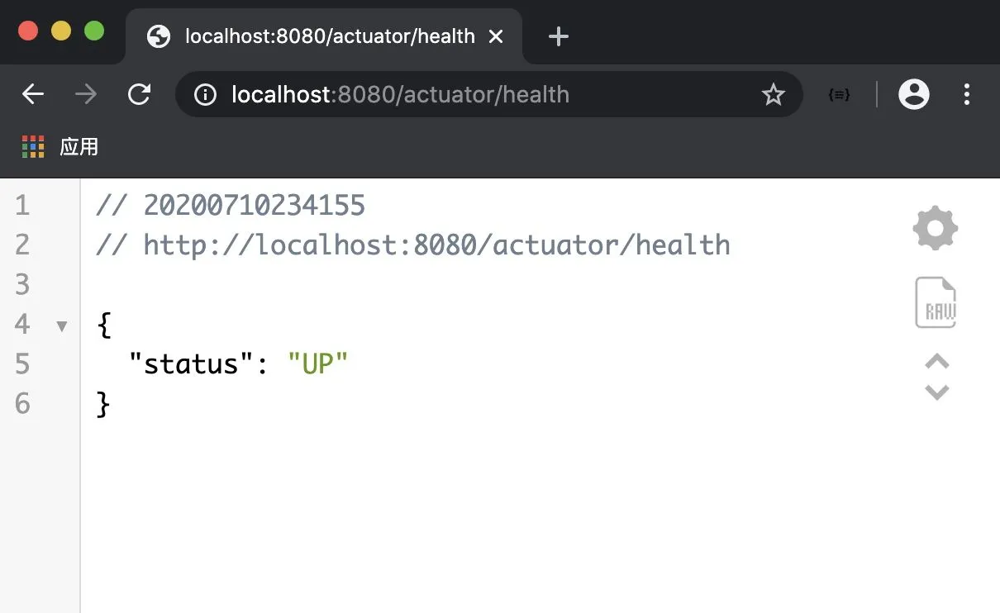
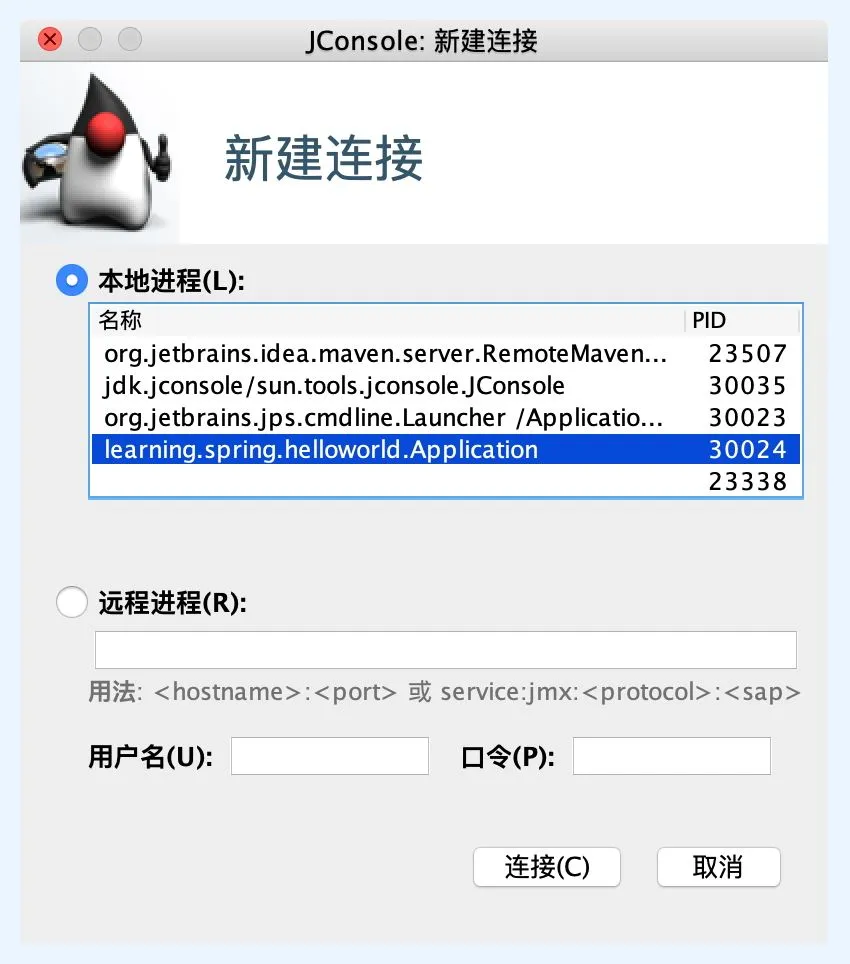
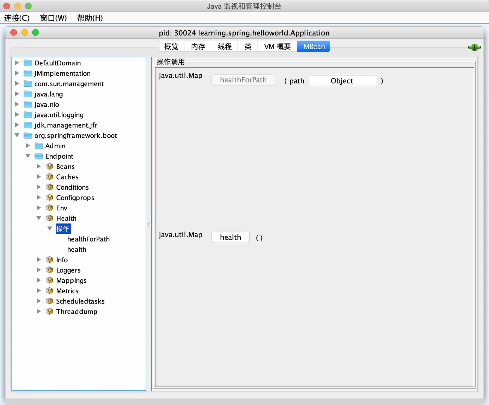

# 第5章面向生产的SpringBoot(1)

- 本章内容通过 Spring Boot Actuator 了解运行情况

- 定制 Spring Boot Actuator 的端点

- 使用 Micrometer 输出度量数据

- Spring Boot 应用程序的部署及原理

在 4.1.2 节中，我们介绍了 Spring Boot 的四大核心组成部分，第 4 章主要介绍了其中的起步依赖与自动配置，本章将重点介绍 Spring Boot Actuator，包括如何通过 Actuator 提供的各种端点（endpoint）了解系统的运行情况，使用 Micrometer 为各种监控系统提供度量指标数据，最后还要了解如何打包部署 Spring Boot 应用程序。

## 5.1　Spring Boot Actuator 概述

Spring Boot Actuator 是 Spring Boot 的重要功能模块，能为系统提供一系列在生产环境中运行所必需的功能，比如监控、度量、配置管理等。只需引入

```
org.springframework.boot:spring-boot-starter-actuator 起步依赖后，我们
```

就可以通过 HTTP 来访问这些功能（也可以使用 JMX 来访问）。Spring Boot 还为我们预留了很多配置，可以根据自己的需求对 Spring Boot Actuator 的功能进行定制。

### 5.1.1　端点概览

不知道大家有没有尝试解决过类似下面的问题：

- Spring 上下文中到底存在哪些 Bean

- Spring Boot 中的哪些自动配置最终生效了

- 应用究竟获取到了哪些配置项

- 系统中存在哪些 URL，它们又映射到了哪里

在没有 Spring Boot Actuator 的时候，获取这些信息还是需要费一番功夫的；但现在就不一样了，Spring Boot Actuator 内置了大量的端点，这些端点可以帮助大家了解系统内部的运行情况，并针对一些功能做出调整。

根据功能的不同，我们可以将这些端点划分成四类：信息类端点、监控类端点、操作类端点、集成类端点，其中部分端点需要引入特定的依赖，或者配置特定的 Bean。接下来我们会依次介绍这四类端点，首先是用于获取系统运行信息的端点，如表 5-1 所示。

表 5-1　Spring Boot Actuator 中的信息类端点列表

端点 ID

- 默认开启 HTTP默认开启 JMX端点说明

```
auditevents
```

- 否是提供系统的审计信息

```
beans
```

- 提供系统中的 Bean 列表否是

第二类端点是监控与度量相关的端点，具体如表 5-2 所示。

表 5-2　Spring Boot Actuator 中的监控类端点列表

端点 ID

- 默认开启 HTTP默认开启 JMX端点说明

```
health
```

- 是是提供系统运行的健康状态

```
metrics
```

- 否是提供系统的度量信息

```
prometheus
```

- 提供 Prometheus 系统可解析的度量信息否无此功能

```
我们对第 1 章的 helloworld 示例稍作调整，在其 pom.xml 的 <dependencies/> 中增加
```

如下内容即可引入 Spring Boot Actuator 的依赖：

```xml
<dependency>
   <groupId>org.springframework.boot</groupId>
   <artifactId>spring-boot-starter-actuator</artifactId>
</dependency>
从上述两张表中我们可以发现，默认只有 info 和 health 两个端点是开启了 HTTP 访问
```

的，因此在运行程序后，通过浏览器或者其他方式访问

```
http://localhost:8080/actuator/health 就能访问到 health 端点的信息。如果在
```

- 1

```
macOS 或 Linux 上，我们可以使用 curl 命令
```

- ，具体运行结果如下：

```
▸ curl -v http://localhost:8080/actuator/health
*   Trying ::1...
* TCP_NODELAY set
* Connected to localhost (::1) port 8080 (#0)
> GET /actuator/health HTTP/1.1
> Host: localhost:8080
> User-Agent: curl/7.64.1
> Accept: */*
>
< HTTP/1.1 200
< Content-Type: application/vnd.spring-boot.actuator.v3+json
< Transfer-Encoding: chunked
< Date: Fri, 10 Jul 2020 15:38:54 GMT
<
* Connection #0 to host localhost left intact
{"status":"UP"}* Closing connection 0
```

- 2

如果使用浏览器，访问的效果如图 5-1 所示

- 。



```
图 5-1　通过 Chrome 浏览器查看 health 端点
```

第三类端点可以执行一些实际的操作，例如调整日志级别，具体如表 5-3 所示。

表 5-3　Spring Boot Actuator 中的操作类端点列表

端点 ID

- 默认开启 HTTP默认开启 JMX端点说明

```
heapdump
```

- 执行 Heap Dump 操作否无此功能

```
loggers
```

- 否是查看并修改日志信息

- 针对使用了 Spring Session 的系统，可获取

```
sessions
```

- 否是户的 Session

```
shutdown
```

- 否否优雅地关闭系统

```
threaddump
```

- 执行 Thread Dump 操作否是

```
最后一类端点比较特殊，它的功能与集成有关，就只有一个 jolokia，见表 5-4。
```

表 5-4　Spring Boot Actuator 中的集成类端点列表

端点 ID

- 默认开启 HTTP默认开启 JMX端点说明

```
jolokia
```

- 通过 HTTP 来发布 JMX Bean否无此功能

### 5.1.2　端点配置

在了解了 Spring Boot 提供的端点后，我们就要将它们投入具体的生产使用当中了。SpringBoot Actuator 非常灵活，它提供了大量的开关配置，还有两种不同的访问方式可供我们选择。接下来大家就来一起了解一下这些配置。

1. 开启或禁用端点

```
默认情况下，除了 shutdown 以外，所有的端点都是处于开启状态的，只是访问方式不
```

- 同，或者保护状态不同。如果要开启或者禁用某个端点，可以调整

```
management.endpoint.<id>.enabled 属性。例如，想要开启 shutdown 端点，就
```

- 可以这样配置：

```
management.endpoint.shutdown.enabled=true
1
也可以调整默认值，禁用所有端点，随后开启指定端点。例如，只开启 health 端点：
management.endpoints.enabled-by-default=false
1
management.endpoint.health.enabled=true
2
```

2. 通过 HTTP 访问端点

```
默认仅有 health 和 info 端点是可以通过 HTTP 方式来访问的，在 5.1.1 节中，我们已
经看到了如何通过 curl 命令和浏览器来访问 health 端口。那如何才能开启其他端点的
HTTP 访问功能呢？可以使用 management.endpoints.web.exposure.include 和
management.endpoints.web.exposure.exclude 这两个属性来控制哪些端点可以通
过 HTTP 方式发布，哪些端点不行。前者的默认值为 health,info，后者的默认值为
```

- 空。

```
例如，我们希望在原有基础上再增加 beans 和 env 端点，就可以这样来设置：
management.endpoints.web.exposure.include=beans,env,health,info
1
```

- 如果希望放开所有的端点，让它们都能通过 HTTP 方式来访问，我们就可以将上述属性设3

```
置为 *
```

- ：

```
management.endpoints.web.exposure.include=*
1
```

```
要是一个端点同时出现在 management.endpoints.web.exposure.include 和
management.endpoints.web.exposure.exclude 这两个属性里，那么后者的优先级
```

- 会高于前者，也就是说该端点会被排除。

```
如果我们希望了解 HTTP 方式可以访问哪些端点，可以直接访问 /actuator 地址，会得
```

- 到类似下面的 JSON 信息：

```json
{
1
   "_links": {
2
       "health": {
3
           "href": "http://localhost:8080/actuator/health",
4
           "templated": false
5
       },
6
       "health-path": {
7
           "href": "http://localhost:8080/actuator/health/{*path}",
8
           "templated": true
9
       },
10
       "info": {
11
           "href": "http://localhost:8080/actuator/info",
12
           "templated": false
13
       },
14
       "self": {
15
           "href": "http://localhost:8080/actuator",
16
           "templated": false
17
       }
18
   }
19
}
20
其中 templated 为 true 的 URL 可以用具体的值去代替 {} 里的内容，比如，
http://localhost:8080/actuator/metrics/ 的  就可以用
http://localhost:8080/actuator/metrics 里所罗列的名称代替。
```

- 需要特别说明一点，要发布 HTTP 端点，必须要有 Web 支持，因此项目需要引入

```
spring-boot-starter-web 起步依赖。
```

3. 通过 JMX 访问端点

- 与 HTTP 方式类似，JMX 也有两个属性，即

```
management.endpoints.jmx.exposure.include 和
management.endpoints.jmx.exposure.exclude。前者的默认值为 *，后者的默认
```

- 值为空。

- 有不少工具可以用来访问 JMX 端点，比如 JVisualVM 和 JConsole，它们都是 JDK 自带的工具。以 JConsole 为例，启动 JConsole 后会弹出新建连接界面，从中可以选择想要连接的本地 Java 进程，也可以通过指定信息连接远程的进程，具体如图 5-2 所示。



- 图 5-2　JConsole 的新建连接界面

- 选中目标进程后，点击连接按钮，稍过一段时间后，就能连上目标进程了。随后选中

```
MBean 标签页，在 org.springframework.boot 目录下找到 Endpoint，其中列出的
就是可以访问的 JMX 端点。图 5-3 就是选择了 Health 后界面的样子，点击 health 按
```

- 钮即可获得健康检查的 JSON 结果。



```
图 5-3　通过 JMX 方式访问 health 端点
```

4. 保护端点如果在工程中引入了 Spring Security，那么 Spring Boot Actuator 会自动对各种端点进行保护，例如，默认通过浏览器访问时，浏览器会显示一个页面，要求输入用户名和密码。如果我们没有配置过相关信息，那么在系统启动时，可以在日志中查找类似下面的日志：

```
Using generated security password: 4fbc8059-fdb8-46f9-a54e-21d5cb2e9eb2
1
默认的用户名是 user，密码就是上面这段随机生成的内容。关于 Spring Security 的更多
```

- 细节，我们会在第 10 章中详细展开。此处，给出两个示例，它们都需要在 pom.xml 中增

```
加 spring-boot-starter-actuator 和 spring-boot-starter-security 起步依
赖。这里先来演示如何不用登录页，而是使用 HTTP Basic 的方式进行验证（但 health
```

- 4

```
，注意其中的 EndpointRequest 用的是
```

- 端点除外），具体的配置如代码示例 5-1 所示

```
org.springframework.boot.actuate.autoconfigure.security.servlet.En
dpointRequest。
```

- 代码示例 5-1　需要认证才可访问端点的配置代码片段

```java
@Configuration
1
public class ActuatorSecurityConfigurer extends WebSecurityConfigurerAdapter {
2
   @Override
3
   protected void configure(HttpSecurity http) throws Exception {
4
       http.requestMatcher(EndpointRequest.toAnyEndpoint().excluding("health")
5
authorizeRequests((requests) -> requests.anyRequest().authenticated());
6
       http.httpBasic();
7
   }
8
}
9
```

- 第二个演示针对所有端点，可以提供匿名访问，具体如代码示例 5-2 所示。

- 代码示例 5-2　可匿名访问端点的配置代码片段

```java
@Configuration
1
public class ActuatorSecurityConfigurer extends WebSecurityConfigurerAdapter {
2
   @Override
3
   protected void configure(HttpSecurity http) throws Exception {
4
       http.requestMatcher(EndpointRequest.toAnyEndpoint()).authorizeRequests
5
anyRequest().anonymous());
6
       http.httpBasic();
7
   }
8
}
9
```

- 茶歇时间：针对 Web 和 Actuator 使用不同端口的好处

- 试想一下，我们的系统在对外提供 HTTP 服务，一般会在集群前增加一个负载均衡设备

```
（比如 Nginx），将外部对 80 端口的请求转发至系统的 8080 端口。如果 Spring Boot
Actuator 的端口也在 8080，而我们又没对端点做足够的保护，黑客很轻松地就能获取系
```

- 统的信息。就算做了保护，黑客也能通过端点信息推断出这个系统是通过 Spring Boot 实现的、可能存在哪些漏洞。

```
一般我们都会在系统启动后，通过 health 端点来判断系统的健康情况，如果对这个端
```

- 点做了过多保护，反而不便于获取健康检查结果。一种做法是在防火墙或者负载均衡层面，禁止外部访问 Spring Boot Actuator 的 URL，

```
例如，直接禁止访问 /actuator 及其子路径。另一种做法，就是索性让 Actuator 的端
点暴露在与业务代码不同的 HTTP 端口上，比如，不再共用 8080 端口，而是单独提供
一个 8081 端口，而防火墙和负载均衡设备只知道 8080 端口的存在，也只会转发请求
到 8080 端口，就不用担心外部能访问到 8081 端口的问题了。
通过 management.server.port=8081 能实现设置 Actuator 专属端口的功能。更进
一步，我们还可以使用 management.server.base-path 属性（以前是
management.server.servlet.context-path）为 Spring Boot Actuator 设置
Servlet 上下文，默认为空；使用 management.endpoints.web.base-path 属性来
调整 /actuator 这个默认的基础路径。如果像下面这样来做设置，就能将 health 端
点访问的 URL 调整为 http://localhost:8081/management/my-
actuator/health 了：
management.server.port=8081
1
management.server.base-path=/management
2
management.endpoints.web.base-path=/my-actuator
3
```

### 5.1.3　定制端点信息

Spring Boot Actuator 中的每个端点或多或少会有一些属于自己的配置属性，大家可以在

```
org.springframework.boot:spring-boot-actuator-autoconfigure 包中查看各
种以 Properties 结尾的属性类，也可以直接通过 configprops 端点来查看属性类。
例如，EnvironmentEndpointProperties 就对应了 management.endpoint.env 中
的属性，其中的 keysToSanitize 就是环境中要过滤的自定义敏感信息键名清单，根据代码
```

注释，其中可以设置匹配的结尾字符串，也可以使用正则表达式。在设置了

```
management.endpoint.env.keys-to-sanitize=java.*,sun.* 后，env 端点返回
的属性中，所有 java 和 sun 打头的属性值都会以 * 显示。
Spring Boot Actuator 默认为 info 和 health 端点开启了 HTTP 访问支持，那么就让我们来
```

详细了解一下这两个端点有哪些可以定制的地方吧。

1. 定制 info 端点信息

```
根据 InfoEndpointAutoConfiguration 可以得知，InfoEndpoint 中会注入 Spring
上下文中的所有 InfoContributor Bean 实例。
InfoContributorAutoConfiguration 自动注册了 env、git 和 build 这三个
InfoContributor，Spring Boot Actuator 提供的 InfoContributor 列表如表 5-5 所
```

- 示。

- 表 5-5　内置 InfoContributor 列表

- 类名默认开启说明

```
提供 BuildProperties 的信息，通
BuildInfoContributor
spring.info.build 来设置，默认
```

- 是

```
INF/build-info.properties
EnvironmentInfoContributor
将配置中以 info 打头的属性通过端
```

- 是

```
提供 GitProperties 的信息，通过
GitInfoContributor
spring.info.git 来设置，默认读
```

- 是

```
git.properties
InfoPropertiesInfoContributor
抽象类，一般作为其他 InfoContri
```

- 否

```
MapInfoContributor
将内置 Map 作为信息输出
```

- 否

```
SimpleInfoContributor
```

- 否仅包含一对键值对的信息

- 假设在配置文件中设置了如下内容：

```
info.app=HelloWorld
1
info.welcome=Welcome to the world of Spring.
2
```

- 再提供如下的 Bean：

```
@Bean
1
public SimpleInfoContributor simpleInfoContributor() {
2
   return new SimpleInfoContributor("simple", "HelloWorld!");
3
}
4
```

- 那 info 端点输出的内容大致如下所示：

```json
{
1
   "app": "HelloWorld",
2
   "simple": "HelloWorld!",
3
   "welcome": "Welcome to the world of Spring."
4
}
5
```

2. 定制 health 端点信息健康检查是一个很常用的功能，可以帮助我们了解系统的健康状况，例如，系统在启动后是否准备好对外提供服务了，所依赖的组件是否已就绪等。

- 5

```
健康检查主要是依赖 HealthIndicator
```

- 的各种实现来完成的。Spring Boot Actuator

```
内置了近 20 种不同的实现，表 5-6 列举了一些常用的 HealthIndicator 实现，基本可
```

- 以满足日常使用的需求。

- 表 5-6　常用的 HealthIndicator 实现

- 实现类作用

- 检查 Spring 上下文中能取到的所有 `DataSource` 是`DataSourceHealthIndicator`否健康

- `DiskSpaceHealthIndicator`检查磁盘空间

- 检查系统的存活（Liveness）情况，一般用于`LivenessStateHealthIndicator`Kubernetes 中

- 检查系统是否处于就绪（Readiness）状态，一般用`ReadinessStateHealthIndicator`于 Kubernetes 中

- `RedisHealthIndicator`检查所依赖的 Redis 健康情况

```
每个 HealthIndicator 检查后都会有自己的状态信息，Spring Boot Actuator 最后会根
```

- 据所有结果的状态信息综合得出系统的最终状态。

```
org.springframework.boot.actuate.health.Status 定义了几种默认状态，按照
优先级降序排列分别为 DOWN、OUT_OF_SERVICE、UP 和 UNKNOWN，所有结果状态中优
先级最高的状态会成为 health 端点的最终状态。如果有需要，我们也可以通过
management.endpoint.health.status.order 来更改状态的优先级。
Spring Boot Actuator 默认开启了所有的 HealthIndicator，它们会根据情况自行判断是
否生效，也可以通过 management.health.defaults.enabled=false 开关（默认关
闭），随后使用 management.health.<name>.enabled 选择性地开启
HealthIndicator。例如，DataSourceHealthContributorAutoConfiguration
```

- 是这样定义的：

```java
@Configuration(proxyBeanMethods = false)
1
@ConditionalOnClass({ JdbcTemplate.class, AbstractRoutingDataSource.class })
2
@ConditionalOnBean(DataSource.class)
3
@ConditionalOnEnabledHealthIndicator("db")
4
@AutoConfigureAfter(DataSourceAutoConfiguration.class)
5
public class DataSourceHealthContributorAutoConfiguration extends
6
   CompositeHealthContributorConfiguration
7
<AbstractHealthIndicator, DataSource>
8
   implements InitializingBean {}
9
```

- 那么它的生效条件是这样的：

```
CLASSPATH 中存在 JdbcTemplate 和 AbstractRoutingDataSource 类；
Spring 上下文中存在 DataSource 类型的 Bean；
默认开关打开，或者 management.health.db.enabled=true，此处
```

- 6

```
@ConditionalOnEnabledHealthIndicator 中的 db 就是 name
```

- 。

```
知道了 health 中的各个 HealthIndicator 后，怎么才能看到结果呢？我们可以通过配
置 management.endpoint.health.show-details 和
management.endpoint.health.show-components 的属性值来查看结果，默认是
never，将其调整为 always 后就会始终显示具体内容了。如果依赖中存在 Spring
Security，也可以仅对授权后的用户开放，将属性值配置为 when-authorized，这时我
们可以通过 management.endpoint.health.roles 来设置可以访问的用户的角色。一
般情况下，可以考虑将其调整为 always。
```

- 如今越来越多的系统运行在 Kubernetes 环境中，而 Kubernetes 需要检查系统是否存活，

```
是否就绪，对此，health 端点也提供了对应的 LivenessStateHealthIndicator 和
ReadinessStateHealthIndicator，默认 URL 分别为
/actuator/health/liveness 和 /actuator/health/readiness。
```

### 5.1.4　开发自己的组件与端点

在上一节中，我们看到的基本都是对现有端点与组件的配置，Spring Boot Actuator 提供了让我们自己扩展端点或者实现新端点的功能。例如，在进行健康检查时，我们可以加入自己的检

```
查逻辑，只需实现 HealthIndicator 即可。
```

1. 开发自己的 HealthIndicator为了增加自己的健康检查逻辑，我们可以定制一个 HealthIndicator 实现，通常会选择扩展

```python
AbstractHealthIndicator 类，实现其中的 doHealthCheck() 方法。
根据 HealthEndpointConfiguration 类的代码，我们可以知道
healthContributorRegistry 会从 Spring 上下文获取所有 HealthContributor 类
型（HealthIndicator 继承了这个接口）的 Bean，并进行注册，所以我们也只需要把
写好的 HealthIndicator 配置为 Bean 即可。
@Configuration(proxyBeanMethods = false)
1
class HealthEndpointConfiguration {
2
@Bean
3
   @ConditionalOnMissingBean
4
   HealthContributorRegistry healthContributorRegistry(ApplicationContext appl
5
           HealthEndpointGroups groups) {
6
       Map<String, HealthContributor> healthContributors = new LinkedHashMap<>
7
           .getBeansOfType(HealthContributor.class));
8
       if (ClassUtils.isPresent("reactor.core.publisher.Flux", applicationCont
9
           healthContributors.putAll(new AdaptedReactiveHealthContributors(app
10
       }
11
       return new AutoConfiguredHealthContributorRegistry(healthContributors,
12
   }
13
   // 省略其他代码
14
}
15
```

- 接下来，我们以第 4 章的 BinaryTea 项目作为基础，在其中添加自己的

```
HealthIndicator。在 ShopReadyHealthIndicator 上添加 @Component 注解，以
便在扫描到它后就能将其注册为 Bean。通过构造方法注入 BinaryTeaProperties，检
查时如果没有 binaryTeaProperties 或者属性中的 ready 为 false，检查即为失
```

- 7败，除此之外都算成功。具体如代码示例 5-3 所示。

```java
代码示例 5-3　ShopReadyHealthIndicator 健康检查器
@Component
1
public class ShopReadyHealthIndicator extends AbstractHealthIndicator{
2
   private BinaryTeaProperties binaryTeaProperties;
3
4
   public ShopReadyHealthIndicator(ObjectProvider<BinaryTeaProperties> binaryT
5
       this.binaryTeaProperties = binaryTeaProperties.getIfAvailable();
6
   }
7
8
   @Override
9
   protected void doHealthCheck(Health.Builder builder) throws Exception {
10
       if (binaryTeaProperties == null || !binaryTeaProperties.isReady()) {
11
           builder.down();
12
       } else {
13
           builder.up();
14
       }
15
   }
16
}
17
```

- 运行代码前还需要在 pom.xml 中加入 Spring Web 和 Spring Boot Actuator 的依赖，具体如下：

```xml
<dependency>
1
   <groupId>org.springframework.boot</groupId>
2
   <artifactId>spring-boot-starter-web</artifactId>
3
</dependency>
4
<dependency>
5
   <groupId>org.springframework.boot</groupId>
6
   <artifactId>spring-boot-starter-actuator</artifactId>
7
</dependency>
8
同时在 application.properties 中增加 management.endpoint.health.show-
details=always，以便可以看到 ShopReadyHealthIndicator 的效果。运行
BinaryTeaApplication 后，在浏览器中访问 http://localhost:8080/actuator/health，就
```

- 能看到类似下面的 JSON 输出：

```json
{
1
   "components": {
2
       // 省略部分内容
3
       "ping": {
4
           "status": "UP"
5
       },
6
       "shopReady": {
7
           "status": "UP"
8
       }
9
   },
10
   "status": "UP"
11
}
12
为了能够进行自动测试，我们还可以在 ShopConfigurationEnableTest 和
ShopConfigurationDisableTest 中分别加入对应的测试用例，再写个测试检查是否
```

- 注册了对应的信息，如代码示例 5-4 所示。

```java
代码示例 5-4　针对 ShopReadyHealthIndicator 的各种单元测试用例
// ShopConfigurationEnableTest中的测试用例
1
@Test
2
void testIndicatorUp() {
3
   ShopReadyHealthIndicator indicator = applicationContext.getBean(ShopReadyHe
4
   assertEquals(Status.UP, indicator.getHealth(false).getStatus());
5
}
6
7
// ShopConfigurationDisableTest中的测试用例
8
@Test
9
void testIndicatorDown() {
10
   ShopReadyHealthIndicator indicator = applicationContext.getBean(ShopReadyHe
11
   assertEquals(Status.DOWN, indicator.getHealth(false).getStatus());
12
}
13
14
// 独立的ShopReadyHealthIndicatorTest，测试是否注册了shopReady
15
@SpringBootTest
16
public class ShopReadyHealthIndicatorTest {
17
   @Autowired
18
   private HealthContributorRegistry registry;
19
20
   @Test
21
   void testRegistryContainsShopReady() {
22
       assertNotNull(registry.getContributor("shopReady"));
23
   }
24
}
25
如果一切顺利，执行 mvn test 后我们应该就能看到测试通过的信息了：
```

```
[INFO] Results:
1
[INFO]
2
[INFO] Tests run: 7, Failures: 0, Errors: 0, Skipped: 0
3
[INFO]
4
[INFO] ------------------------------------------------------------------------
5
[INFO] BUILD SUCCESS
6
[INFO] ------------------------------------------------------------------------
7
```

- 茶歇时间：为什么要优先通过 ObjectProvider 获取 Bean

```
当我们需要从 Spring 上下文中获取其他 Bean 时，最直接的方法是使用 @Autowired
```

- 注解，但系统运行时的不确定性太多了，比如不确定是否存在需要的依赖，这时就需要

```
加上 required=false ；也有可能目标类型的 Bean 不止一个，而我们只需要一个；
```

- 构造方法有多个参数……

```
这时就该 ObjectProvider<T> 上场了，它大多用于构造方法注入的场景，让我们有
能力处理那些尴尬的场面，其中的 getIfAvailable() 方法在存在对应 Bean 时返回
对象，不存在时则返回 null；getIfUnique() 方法在有且仅有一个对应 Bean 时返
回对象，Bean 不存在或不唯一，且不唯一时没有标注 Primary 的情况下返回 null。
```

- 再加上一些检查和遍历的方法，通过明确的编码，我们就可以确保自己的代码获取到必要的依赖，或判断出缺少的东西，并加以处理。

2. 开发自己的端点如果内置的端点无法满足我们的需求，那最后一招就是写一个自己的端点。好在 SpringBoot Actuator 支持到位，只需简单几步就能帮助我们实现一个端点。

```
首先，在 Bean 上添加 @Endpoint 注解，其中带有 @ReadOperation、
@WriteOperation 和 @DeleteOperation 的方法能被发布出来，而且能通过 JMX 或
```

- 者 HTTP 的方式访问到这些方法

```
接下来，如果我们希望限制只用其中的一种方式来发布，则可以将 @Endpoint 替换为
@JmxEndpoint 或 @WebEndpoint。
```

```sql
如果是通过 HTTP 方式访问的，默认的 URL 是 /actuator/<id>，其中的 id 就是
@Endpoint 注解中指定的 id，而 @ReadOperation、@WriteOperation 和
@DeleteOperation 的方法分别对应了 HTTP 的 GET、POST 和 DELETE 方法。HTTP
的响应码则取决于方法的返回值，如果存在返回内容，则响应码是 200 OK，否则
@ReadOperation 方法会返回 404 Not Found，而另两个则返回 204 No Content；
对于需要参数但又获取不到的情况，方法会返回 400 Bad Request。
```

- 我们为 BinaryTea 编写了一个返回商店状态的端点，具体如代码示例 5-5 所示，大部分逻

```java
辑与 ShopReadyHealthIndicator 是类似的，这里就不再赘述了。
代码示例 5-5　ShopEndpoint 代码片段
@Component
1
@Endpoint(id = "shop")
2
public class ShopEndpoint {
3
   private BinaryTeaProperties binaryTeaProperties;
4
5
   public ShopEndpoint(ObjectProvider<BinaryTeaProperties> binaryTeaProperties
6
       this.binaryTeaProperties = binaryTeaProperties.getIfAvailable();
7
   }
8
9
   @ReadOperation
10
   public String state() {
11
       if (binaryTeaProperties == null || !binaryTeaProperties.isReady()) {
12
           return "We're not ready.";
13
       } else {
14
           return "We open " + binaryTeaProperties.getOpenHours() + ".";
15
       }
16
   }
17
}
18
为了能访问到我们的端点，需要在 application.properties 中允许它以 Web 形式发
```

- 布：

```
management.endpoints.web.exposure.include=health,info,shop
1
启动系统后，通过 http://localhost:8080/actuator/shop 即可访问
ShopEndpoint 的输出。
```

## 5.2　基于 Micrometer 的系统度量

系统在生产环境中运行时，我们需要通过各种方式了解系统的运作是否正常。之前提到的

```
health 端点只能判断最基本的情况，至于更多细节，还需要获取详细的度量指标，
metrics 端点就是用来提供系统度量信息的。
```

### 5.2.1　Micrometer 概述

- 8

从 2.0 版本开始，Spring Boot 就把 Micrometer 作为默认的系统度量指标获取途径了

- ，因

此本节也先从 Micrometer 讲起。

Java 开发者应该都很熟悉 SLF4J（Simple Logging Facade for Java），它提供了一套日志框架的抽象，屏蔽了底层不同日志框架（比如 Commons Logging、Log4j 和 Logback）实现上的差异，让开发者能以统一的方式在代码中打印日志。如果说 Micrometer 的目标就是成为度量界的 SLF4J，相信大家就能理解 Micrometer 是干什么的了。

Micrometer 为很多主流的监控系统提供了一套简单且强大的客户端门面，先是定义了一套 SPI（Service Provider Interface），再为不同的监控系统提供实现。接入 Micrometer 后，开发者通过 Micrometer 进行埋点时就不会被绑定在某个特定的监控系统上。它支持的监控系统，以及这些系统的特性，如表 5-7 所示。

表 5-7　Micrometer 支持的监控系统清单

- 9

监控系统

- 是否支持多维度数据聚合方式数据获取方式

AppOptics

- 是客户端聚合客户端推

Atlas

- 是客户端聚合客户端推

Azure Monitor

- 是客户端聚合客户端推

Cloudwatch

- 是客户端聚合客户端推

Datadog

- 是客户端聚合客户端推

Datadog StatsD

- 是客户端聚合服务端拉

Dynatrace

- 是客户端聚合客户端推

Elastic

- 是客户端聚合客户端推

Etsy StatsD

- 否客户端聚合服务端拉

Ganglia

- 否客户端聚合客户端推

Graphite

- 否客户端聚合客户端推

Humio

- 是客户端聚合客户端推

Influx

- 是客户端聚合客户端推

JMX

- 否客户端聚合客户端推

KairosDB

- 是客户端聚合客户端推

New Relic

- 是客户端聚合客户端推

Prometheus

- 是服务端聚合服务端拉

SignalFx

- 是客户端聚合客户端推

Sysdig StatsD

- 是客户端聚合服务端拉

```
Micrometer 通过 Meter 接口来收集系统的度量数据，由 MeterRegistry 来创建并管理
Meter，Micrometer 支持的各种监控系统都有自己的 MeterRegistry 实现。内置的
Meter 实现分为几种，具体如表 5-8 所示。
```

表 5-8　几种主要的 Meter 实现

```
Meter 类型
```

- 说明

```
Timer
```

- 计时器，用来记录一个事件的耗时

```
Counter
```

- 计数器，用来表示一个单调递增的值

```
计量仪，用来表示一个变化的值，通常能用 Counter 就不
Gauge
用 Gauge
```

- 分布统计，用来记录事件的分布情况，可以设置一个范围，

```
DistributionSummary
```

- 获取范围内的直方图和百分位数

- 长任务计时器，记录一个长时间任务的耗时，可以记录已经

```
LongTaskTimer
```

- 耗费的时间

```
FunctionCounter
```

- 函数计数器，追踪某个单调递增函数的计数器

- 函数计时器，追踪两个单调递增函数，一个计数，另一个计

```
FunctionTimer
```

- 时

```
要创建 Meter，既可以通过 MeterRegistry 上的方法，例如
registry.timer("foo")，也可以通过 Fluent 风格的构建方法，例如
Timer.builder("foo").tags("bar").register(registry)。Meter 的命名采用以
. 分隔的全小写单词组合，不同的监控系统功能有不同的命名方式，Micrometer 会负责将
Meter 的名称转为合适的方式，在官方文档中就给出了这样一个例子：
```

```
registry.timer("http.server.requests");
在使用 Prometheus 时，这个 Timer 的名字就会被转为
http_server_requests_duration_seconds。
标签也遵循一样的命名方式，Micrometer 同样也会负责帮我们将 Timer 的标签转换成不同监
控系统所推荐的名称。下面的标签名为 uri，值为 /api/orders：
registry.timer("http.server.requests", "uri", "/api/orders");
针对通用的标签，Micrometer 还贴心地提供了公共标签的功能，在 MeterRegistry 上设置
```

标签：

```
registry.config().commonTags("prod", "region", "cn-shanghai-1");
```

### 5.2.2　常用度量指标

```
Spring Boot Actuator 中提供了 metrics 端点，通过 /actuator/metrics 我们可以获取
```

系统的度量值。而且 Spring Boot 还内置了很多实用的指标，可以直接拿来使用。

首先介绍的是 Micrometer 本身支持的 JVM 相关指标，具体见表 5-9。

表 5-9　Micrometer 支持的 JVM 度量指标

度量指标

- 说明

```
ClassLoaderMetrics
```

- 收集加载和卸载的类信息

```
JvmMemoryMetrics
```

- 收集 JVM 内存利用情况

```
JvmGcMetrics
```

- 收集 JVM 的 GC 情况

```
用下面的语句就能绑定一个 ClassLoaderMetrics：
new ClassLoaderMetrics().bindTo(registry);
```

但在 Spring Boot Actuator 的帮助下，我们无须自己来绑定这些度量指标，Spring Boot 中

```
JvmMetricsAutoConfiguration 之类的自动配置类已经替我们做好了绑定的工作。此
```

外，它还在此基础上提供了 Spring MVC、Spring WebFlux、HTTP 客户端和数据源等其他度量指标。

```
仍然以 5.1.4 节的 binarytea-endpoint 为例，我们在 application.properties 中做些修
改，将 metrics 端点加入 Web 可访问的端点中：
management.endpoints.web.exposure.include=health,info,shop,metrics
启动程序后，通过 http://localhost:8080/actuator/metrics 可以看到类似下面这
样的一个清单，其中列举的 names 就是具体的度量指标名称：
{
   "names": [
       "http.server.requests",
       "jvm.buffer.count",
       "jvm.buffer.memory.used",
       "jvm.buffer.total.capacity",
       "jvm.classes.loaded",
       "jvm.classes.unloaded",
       "jvm.gc.live.data.size",
       "jvm.gc.max.data.size",
       "jvm.gc.memory.allocated",
       "jvm.gc.pause",
       "jvm.memory.max",
       "jvm.memory.used",
       "jvm.threads.live",
       "jvm.threads.peak",
       "logback.events",
       "process.cpu.usage",
       "process.files.max",
       "process.start.time",
       "process.uptime",
       "system.cpu.usage",
       "system.load.average.1m",
       "tomcat.sessions.active.current",
       "tomcat.sessions.active.max",
       "tomcat.sessions.rejected"
       // 列表中省略了一些内容
   ]
}
```

在 URI 后增加具体的名称，例如，

```
http://localhost:8080/actuator/metrics/jvm.classes.loaded，就能查看具
```

体的度量信息：

```json
{
   "availableTags": [
   ],
   "baseUnit": "classes",
   "description": "The number of classes that are currently loaded in the Java v
   "measurements": [
       {
       "statistic": "VALUE",
       "value": 7232.0
       }
   ],
   "name": "jvm.classes.loaded"
}
```

1. Spring MVC默认所有基于 Spring MVC 的 Web 请求都会被记录下来，通过

```
/actuator/metrics/http.server.requests 我们可以查看类似下面这样的输出，
```

- 其中包含了大量的信息，比如用过的 HTTP 方法、访问过的地址、返回的 HTTP 响应码、请求的总次数和总耗时，以及最大单次耗时等：

```json
{
1
   "availableTags": [
2
       { "tag": "exception", "values": ["None"] },
3
       { "tag": "method", "values": ["GET"] },
4
       {
5
           "tag": "uri",
6
           "values": [
7
               "/actuator/metrics/",
8
               "/actuator/metrics"
9
           ]
10
       },
11
       { "tag": "outcome", "values": ["SUCCESS"] },
12
       { "tag": "status", "values": ["200"] }
13
   ],
14
   "baseUnit": "seconds",
15
   "description": null,
16
   "measurements": [
17
       { "statistic": "COUNT", "value": 5.0 },
18
       { "statistic": "TOTAL_TIME", "value": 0.085699938 },
19
       { "statistic": "MAX", "value": 0.042694752 }
20
   ],
21
   "name": "http.server.requests"
22
}
23
management.metrics.web.server.request.autotime.enabled 默认为 true，
它能自动统计所有的 Web 请求，如果我们将它设置为 false，则需要自己在类上或者方法
```

- 10

```
上添加 @Timed 来标记要统计的 Controller 方法
，@Timed 注解可以做些更精细的
```

- 设置，例如，添加额外的标签，计算百分位数，等等：

```java
@Controller
1
public class SampleController {
2
   @RequestMapping("/")
3
   @Timed(extraTags = { "region", "cn-shanghai-1" }, percentiles = 0.99)
4
   public String foo() {}
5
}
6
```

2. HTTP 客户端11

```
当使用 RestTemplate 和 WebClient 访问 HTTP 服务时
```

- ，Spring Boot Actuator 提供了针对 HTTP 客户端的度量指标，但这并不是自动的，还需要做一些配置它们才能生效。

```
这里建议通过如下方式来创建 RestTemplate：
@Bean
1
public RestTemplate restTemplate(RestTemplateBuilder builder) {
2
   return builder.build();
3
}
4
使用 RestTemplateBuilder 来构建 RestTemplate 时，会对其应用所有配置在
Spring 上下文里的 RestTemplateCustomizer，而其中就有与度量相关的
MetricsRestTemplateCustomizer。针对 WebClient 也是一样的，可以用
WebClient.Builder。
如果大家有通过 RestTemplate 访问过 HTTP 服务，访问
/actuator/metrics/http.client.requests 后就能看到类似下面这样的输出：
{
1
   "availableTags": [
2
       { "tag": "method", "values": [ "GET" ] },
3
       { "tag": "clientName", "values": [ "localhost" ] },
4
       { "tag": "uri", "values": [ "/actuator/metrics" ] },
5
       { "tag": "outcome", "values": [ "SUCCESS" ] },
6
       { "tag": "status", "values": [ "200" ] }
7
   ],
8
   "baseUnit": "seconds",
9
   "description": "Timer of RestTemplate operation",
10
   "measurements": [
11
       { "statistic": "COUNT", "value": 1.0 },
12
       { "statistic": "TOTAL_TIME", "value": 0.115555898 },
13
       { "statistic": "MAX", "value": 0.115555898 }
14
   ],
15
   "name": "http.client.requests"
16
}
17
```

3. 数据源对于那些使用了数据库的系统，了解数据源的具体情况是非常有必要的，例如，当前的连接池配置的大小是什么样的，有多少个连接处于活跃状态等。如果连接池经常被占满，导致业务代码无法获取连接，那么无论是让业务线程等待连接，还是等待超时后报错都可能影响业务。

- 12

```
只要在 Spring 上下文中存在 DataSource
```

- Bean，Spring Boot Actuator 就会自动配置对应的度量指标，如果我们使用的是 HikariCP，还会有额外的信息。访问

```
/actuator/metrics 后能看到下面这些显示：
{
1
   "names": [
2
       "hikaricp.connections",
3
       "hikaricp.connections.acquire",
4
       "hikaricp.connections.active",
5
       "hikaricp.connections.creation",
6
       "hikaricp.connections.idle",
7
       "hikaricp.connections.max",
8
       "hikaricp.connections.min",
9
       "hikaricp.connections.pending",
10
       "hikaricp.connections.timeout",
11
       "hikaricp.connections.usage",
12
       "jdbc.connections.max",
13
       "jdbc.connections.min"
14
       // 省略其他无关的内容
15
   ]
16
}
17
而具体到 /actuator/metrics/hikaricp.connections 则是这样的：
{
1
   "availableTags": [
2
       { "tag": "pool", "values": [ "HikariPool-1" ] }
3
   ],
4
   "baseUnit": null,
5
   "description": "Total connections",
6
   "measurements": [
7
       { "statistic": "VALUE", "value": 10.0 }
8
   ],
9
   "name": "hikaricp.connections"
10
}
11
```

- 通过这些度量指标，我们可以轻松地掌握系统中数据源的大概情况，在遇到问题时更好地进行决策。

### 5.2.3　自定义度量指标

Spring Boot Actuator 内置的度量指标可以帮助我们掌握系统的情况，但光了解系统是远远不够的，系统运行正常，但业务指标却一路下滑的情况并不少见，因此还需要针对各种业务做对应的数据埋点，通过业务指标我们也可以反过来进一步了解系统的情况。

```
有两种绑定 Meter 的方法，一般可以考虑使用后者：
注入 Spring 上下文中的 MeterRegistry，通过它来绑定 Meter；
让 Bean 实现 MeterBinder，在其 bindTo() 方法中绑定 Meter。
```

下面，让我们通过二进制奶茶店项目中的一个例子来了解一下如何自定义度量指标。

- 需求描述　门店开始营业后，我们要频繁关注经营情况，像订单总笔数、总金额、客单价等都是常见的经营指标，最好能有个地方可以让经营者方便地看到这些信息。

以 5.1.4 节的 binarytea-endpoint 作为基础，增加如表 5-10 所示的三个经营指标，用来记录自开始营业起的经营情况，相信是个经营者都关心自己的店是不是赚钱吧？大家可以在本书配套示例的 ch5/binarytea-metrics 目录中找到这个例子。

表 5-10　三个经营指标

指标名称

- 类型含义

```
order.count
Counter
```

- 总订单数

```
order.amount.sum
Counter
```

- 总订单金额

```
order.amount.average
Gauge
```

- 客单价

```
除此之外，为了演示 DistributionSummary 的用法，我们还额外增加了一个
```

- 13

```java
order.summary 的指标，可以输出 95 分位的订单情况
。对应的 Meter 配置与绑定代码
如代码示例 5-6 所示，其中绑定了四个 Meter（为了方便演示，客单价使用了一个整数），还
提供了一个新的下订单方法，用来改变各 Meter 的值。
代码示例 5-6　SalesMetrics 的代码片段
@Component
public class SalesMetrics implements MeterBinder {
   private Counter orderCount;
   private Counter totalAmount;
   private DistributionSummary orderSummary;
   private AtomicInteger averageAmount = new AtomicInteger();
   @Override
   public void bindTo(MeterRegistry registry) {
       this.orderCount = registry.counter("order.count", "direction", "income");
       this.totalAmount = registry.counter("order.amount.sum", "direction", "inc
       this.orderSummary = registry.summary("order.summary", "direction", "incom
       registry.gauge("order.amount.average", averageAmount);
   }
   public void makeNewOrder(int amount) {
       orderCount.increment();
       totalAmount.increment(amount);
       orderSummary.record(amount);
       averageAmount.set((int) orderSummary.mean());
   }
}
由于现阶段还没有开发下单的客户端，我们可以在 BinaryTeaApplication 这个主程序中
```

通过 2.4.2 节中介绍的定时任务来定时下单，如代码示例 5-7 所示，其中金额为 0 至 100 元内

- 14

的随机整数

- ，每隔 5 秒会下一单并打印日志。

- 代码示例 5-7　可以定时下单的主程序代码片段

```java
@SpringBootApplication
@EnableScheduling
public class BinaryTeaApplication {
   private static Logger logger = LoggerFactory.getLogger(BinaryTeaApplication.c
   private Random random = new Random();
   @Autowired
   private SalesMetrics salesMetrics;
   public static void main(String[] args) {
       SpringApplication.run(BinaryTeaApplication.class, args);
   }
   @Scheduled(fixedRate = 5000, initialDelay = 1000)
   public void periodicallyMakeAnOrder() {
       int amount = random.nextInt(100);
       salesMetrics.makeNewOrder(amount);
       logger.info("Make an order of RMB {} yuan.", amount);
   }
}
此时，通过 /actuator/metrics 我们会看到多出了如下几个指标：
   "names": [
       "order.amount.average",
       "order.amount.sum",
       "order.count",
       "order.summary",
       // 省略其他内容
   ]
}
具体访问 /actuator/metrics/order.summary 则能看到类似下面这样的输出：
{
   "availableTags": [
       { "tag": "direction", "values": [ "income" ] }
   ],
   "baseUnit": null,
   "description": null,
   "measurements": [
       { "statistic": "COUNT", "value": 168.0 },
       { "statistic": "TOTAL", "value": 7890.0 },
       { "statistic": "MAX", "value": 95.0 }
   ],
   "name": "order.summary"
}
```

Spring Boot Actuator 中可以对 Micrometer 的度量指标做很多定制，我们既可以按照

```
Micrometer 的官方做法用 MeterFilter 精确地进行调整，也可以简单地使用配置来做些常
```

规的改动。

```
例如，可以像下面这样来设置公共标签，将 region 标签的值设置为 cn-shanghai-1：
management.metrics.tags.region=cn-shanghai-1
针对每个 Meter 也有一些对应的属性，如表 5-11 所示，表中给出的是前缀，在其后面带上
```

具体的度量指标名称后，即可有针对性地进行设置了，例如

```
management.metrics.enable.order.amount.average=false。
```

表 5-11　部分针对单个 Meter 的属性前缀

属性前缀

- 说明适用

```
management.metrics.enable
```

- 是否开启全部

```
management.metrics.distribution.minimum
Ti
```

- 分布统计时范围的最小值

```
-expected-value
management.metrics.distribution.maximum
Ti
```

- 分布统计时范围的最大值

```
-expected-value
management.metrics.distribution.percent
Ti
```

- 分布统计时希望计算的百分位值

```
iles
```

如果希望输出 95 分位的订单情况，可以像代码示例 5-8 那样修改

```
application.properties 文件。
代码示例 5-8　修改后的 application.properties
binarytea.ready=true
binarytea.open-hours=8:30-22:00
management.endpoint.health.show-details=always
management.endpoints.web.exposure.include=health,info,shop,metrics
management.metrics.distribution.percentiles.order.summary=0.95
配置后会多出一个 order.summary.percentile 的度量指标，具体的内容大致如下所示：
{
   "availableTags": [
       { "tag": "phi", "values": [ "0.95" ] },
       { "tag": "direction", "values": [ "income" ] }
   ],
   "baseUnit": null,
   "description": null,
   "measurements": [
       { "statistic": "VALUE", "value": 87 }
   ],
   "name": "order.summary.percentile"
}
```

- 茶歇时间：性能分析时的 95 线与 99 线是什么含义说到衡量一个接口的耗时怎么样，大家的第一反应大多是使用平均响应时间。的确，平均耗时能代表大部分情况下接口的表现。假设一个接口的最小耗时为 4 毫秒，平均耗时为 8 毫秒—看起来性能挺好的，但如果经常会有那么几个请求的时间超过 1000 毫秒，那我们是否应该继续去优化它呢？答案是肯定的，对于这类长尾的请求，我们还需要去做进一步的分析，这其中必然隐藏着一些问题。在性能测试中，我们往往会更多地关注 TP95 或者 TP99（TP 是 Top Percentile的缩写），也就是通常所说的 95 线和 99 线指标。在 100 个请求中，按耗时从小到大排序，第 95 个就是耗时的 95 线，95% 的请求都能在这个时间内完成。还有更苛刻的条件是要去分析 TP9999，也就是 99.99% 的情况，这样才能确保绝大部分请求的耗时都达到要求。

### 5.2.4　度量值的输出

```
通过 /actuator/metrics 虽然可以看到每个度量值的情况，但我们无法一直盯着这个 URI
```

看输出。在实际生产环境中，我们需要一个更成熟的度量值输出和收集的方案。好在Micrometer 和 Spring Boot 早已经考虑到了这些，为我们准备好了。

1. 输出到日志

```
Micrometer 提供了几个基本的 MeterRegistry，其中之一就是
LoggingMeterRegistry，它可以定时将系统中的各个度量指标输出到日志中。有了结
```

- 构化的日志信息，就能通过 ELK（Elasticsearch、Logstash 和 Kibana）等方式将它们收集起来，并加以分析。即使不做后续处理，把这些日志放着，作为日后回溯的材料也是可以的。

- 15

```
前一节的例子中，在 BinaryTeaApplication 里加上代码示例 5-9 的代码
```

- ，用来定义

```
一个组合的 MeterRegistry，其中添加了基础的 SimpleMeterRegistry 和输出日志
的 LoggingMeterRegistry。
代码示例 5-9　组合多个 MeterRegistry 的定义
@Bean
1
public MeterRegistry customMeterRegistry() {
2
   CompositeMeterRegistry meterRegistry = new CompositeMeterRegistry();
3
   meterRegistry.add(new SimpleMeterRegistry());
4
   meterRegistry.add(new LoggingMeterRegistry());
5
   return meterRegistry;
6
}
7
```

- 运行后，过一段时间就能在控制台输出的日志中看到类似下面的内容：

```
2022-02-06 22:44:00.029 INFO 50342 --- [trics-publisher] i.m.c.i.logging.Loggin
1
pause throughput=0.033333/s mean=0.012s max=0.012s
2
2022-02-06 22:44:00.030 INFO 50342 --- [trics-publisher] i.m.c.i.logging.Loggin
3
summary throughput=0.133333/s mean=40.125 max=84
4
在生产环境中使用时，我们可以调整日志的配置文件，将 LoggingMeterRegistry 输出
```

- 的日志打印到单独的日志中，方便管理。

2. 输出到 Prometheus在介绍 Mircometer 时，我们提到过它支持多种不同的监控系统，将度量信息直接输出到监控系统也是一种常见做法。下面以 Prometheus 为例，介绍一下它在 Spring Boot 系统中该如何操作。

- 首先，需要在项目的 pom.xml 中添加 Micrometer 为 Prometheus 编写的

```xml
MeterRegistry 依赖，有了这个依赖，后面的事交给 Spring Boot 的自动配置即可：
<dependency>
1
   <groupId>io.micrometer</groupId>
2
   <artifactId>micrometer-registry-prometheus</artifactId>
3
</dependency>
4
随后，在 application.properties 中放开对对应端点的控制，让 prometheus 端点
```

- 可以通过 Web 访问：

```
management.endpoints.web.exposure.include=health,info,shop,metrics,prometheus
1
再次运行我们的程序，在浏览器中访问 /actuator/prometheus 就能看到一个文本输
```

- 出，Prometheus 在经过适当配置后会读取其中的内容，可以看到其中的名称已经从Micrometer 的以点分隔，变为了 Prometheus 的下划线分隔，这也是 Micrometer 实现的：

```
# 省略了很多内容，以下仅为片段
1
jvm_memory_max_bytes 2.44105216E8
2
# HELP order_count_total
3
# TYPE order_count_total counter
4
order_count_total 7.0
5
# HELP order_summary_max
6
# TYPE order_summary_max gauge
7
order_summary_max 76.0
8
# HELP order_summary
9
# TYPE order_summary summary
10
order_summary 79.5
11
order_summary_count 7.0
12
order_summary_sum 347.0
13
# HELP tomcat_sessions_active_current_sessions
14
# TYPE tomcat_sessions_active_current_sessions gauge
15
tomcat_sessions_active_current_sessions 0.0
16
```

[1]：在 Windows 上，我们也可以通过 Cygwin 来安装 命令。

[2]：本书示例中使用了 Chrome 浏览器，并安装了 JSON Viewer 插件以方便查看 JSON 格式的输出。[3]：在 YAML 中有特殊含义，我们如果要使用 YAML 格式来配置文件，就需要使用 的格式来表示。[4]：这部分与端点相关的示例，包括 5.1.3 中的例子都在 ch5/helloworld-actuator 工程中。[5]：接口的两个重要的子接口分别是 和 ，一般我们都直接使用 ， 用于组合一些 的结果。[6]：通常情况下， 是 Bean 的名称去除 或 后缀后的内容。[7]：可以在本书示例的 ch5/binarytea-endpoint 项目中找到这个例子。[8]：Micrometer 也是 Pivotal 开发的，所以 Spring Boot 对它会有一定的偏好。[9]：度量指标的名称是否支持配置多个标签。[10]：关于 Spring MVC 类和相关注解的内容会在第 11 章中详细介绍。[11]：是以同步方式访问 HTTP 服务的，而 是以非阻塞方式访问的，关于 的内容会在第 11 章中详细介绍。[12]：接口的实现基本是某个数据库连接池，比如 Spring Boot 默认的 HikariCP，以及我们会介绍到的 Alibaba Druid 连接池。[13]：其实计数、求和与平均值都可以通过一个 来实现，但这里为了演示，没有合并。[14]：金额的表示很有讲究，用浮点数来表示金额是个很糟糕的做法。通常建议使用专门的 类，最不济也要选择最小的单位从而尽

- 可能用整数来表示金额，例如，以分作为单位，用 来表示金额。本书的后续章节会介绍 Joda Money 的用法。

[15]：5.2.4 节中的示例在 ch5/binarytea-export 项目中。
