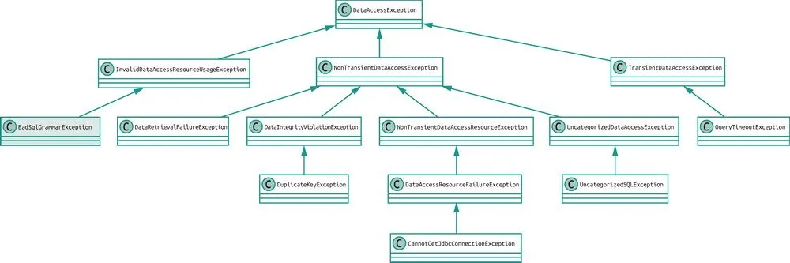
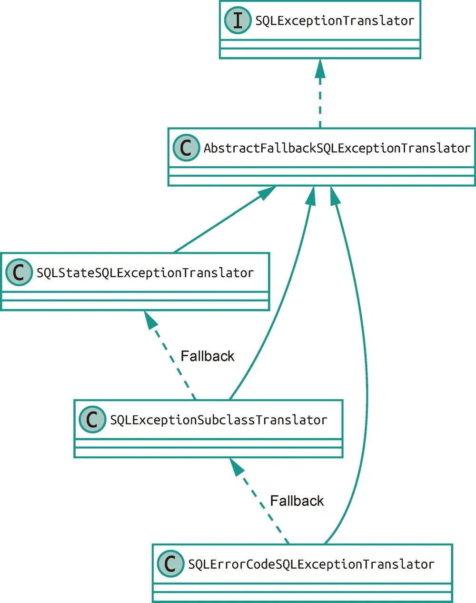

# 第6章Spring中的JDBC(2)

## 6.3　事务管理

- 11

说起数据库事务，相信大家一定不会陌生，网上是这么解释它的

- ：

- 数据库事务是访问并可能操作各种数据项的一个数据库操作序列，这些操作要么全部执行，要么全部不执行，是一个不可分割的工作单位。事务由事务开始与事务结束之间执行的全部数据库操作组成。

我们平时接触的系统一般都需要与数据库打交道，管理好操作中的事务就是一道绕不过去的“坎”。直接使用 JDBC 的话，同样会有很多模板化的代码。Spring Framework 又一次展现出了自己在问题抽象上的能力，为我们提供了一套统一的事务抽象，它有声明式和编程式两种使用方式。本节，就让我们来了解一下 Spring Framework 是如何管理事务的。

### 6.3.1　Spring Framework 的事务抽象

在 Java EE 环境中，事务可以是使用 JTA（Java Transaction API）这样的全局事务，也可以是基于 JDBC 连接的本地事务。实际上，大家日常工作中使用的大多是本地事务。随着分布式系统的发展，很多人会聊到分布式事务的话题，这时可以使用两阶段提交，常见的选择是

- 12

TCC

- 。但如果可以的话，还是建议避免分布式事务，降低系统的复杂度。如无特殊说明，本

书中提到的所有事务均指本地事务。

为了消除不同事务对代码的影响，Spring Framework 对事务管理做了一层抽象：无论是全局事务还是本地事务，无论 JDBC 直接操作 SQL 还是对象关系映射，都能在一个模型中去理解

```
和管理事务。这个抽象的核心是事务管理器，即 TransactionManager，它是一个空接
口，通常都会将 PlatformTransactionManager 作为核心接口，其中包含了获取事务、
```

提交事务和回滚事务的方法。它的定义是这样的：

```java
public interface PlatformTransactionManager extends TransactionManager {
   TransactionStatus getTransaction(@Nullable TransactionDefinition definition)t
   void commit(TransactionStatus status) throws TransactionException;
   void rollback(TransactionStatus status) throws TransactionException;
}
DataSourceTransactionManager、JtaTransactionManager 和
HibernateTransactionManager 这些底层事务管理器都实现了上述接口。对上层业务来
说，只要知道能调用 PlatformTransaction-Manager 接口的这几个方法来操作事务就
```

行，事务的差异就这样被屏蔽了。以本地数据源的事务为例，可以像下面这样来配置

```xml
DataSourceTransactionManager：
<bean id="transactionManager" class="org.springframework.jdbc.datasource.DataSour
   <property name="dataSource" ref="dataSource"/>
</bean>
用来描述事务定义的 TransactionDefinition 接口中包含了几个与事务密切相关的属
```

性：

- 传播性

- 隔离级别

- 超时时间

- 是否只读

“超时时间”和“是否只读”比较容易理解，而“传播性”和“隔离级别”需要再展开说明一下。

1. 传播性

```
事务传播性分为 7 个级别，对应的，在 TransactionDefinition 中定义了 7 个常量，
```

- 具体信息如表 6-7 所示。

- 表 6-7　事务传播性的相关定义与说明

- 传播性值描述

- 当前有事务就用当前事务，没有事务就新启动一个

```
PROPAGATION_REQUIRED
0
```

- 务

```
PROPAGATION_SUPPORTS
1
```

- 事务不是必需的，可以有事务，也可以没有

```
PROPAGATION_MANDATORY
2
```

- 一定要存在一个事务，不然就报错

```
PROPAGATION_REQUIRES_NEW
3
```

- 新启动一个事务，如果当前存在一个事务则将其挂

```
PROPAGATION_NOT_SUPPORTED
4
```

- 不支持事务，以非事务的方式运行

```
PROPAGATION_NEVER
5
```

- 不支持事务，如果当前存在一个事务则抛异常

- 如果当前存在一个事务，则在该事务内再启动一个

```
PROPAGATION_NESTED
6
```

- 务

```
默认的事务传播性会使用 PROPAGATION_REQUIRED，正常情况下这就够了。在上面的 7
种情况中，需要再特殊说明一下 PROPAGATION_REQUIRES_NEW 和
PROPAGATION_NESTED 的异同点：它们都会启动两个事务，但前者的两个事务是不相关
的，而后者的两个事务存在包含关系。假设使用 PROPAGATION_NESTED 时两个事务分别
```

- 为事务 A 和事务 B，事务 A 包含事务 B，事务 B 如果回滚了，事务 A 可以不受事务 B 的影响继续提交，但如果事务 A 回滚了，哪怕事务 B 是提交状态也会被回滚。

2. 事务隔离级别数据库的事务有 4 种隔离级别，隔离级别越高，不同事务相互影响的概率就越小，具体就是出现脏读、不可重复读和幻读的情况。这三种情况的具体描述如下。

- 脏读：事务 A 修改了记录 1 的值但未提交事务，这时事务 B 读取了记录 1 尚未提交的值，但后来事务 A 回滚了，事务 B 读到的值并不会存在于数据库中，这就是脏读。

- 不可重复读：事务 A 会读取记录 1 两次，在两次读取之间，事务 B 修改了记录 1 的值并提交了，这时事务 A 第一次与第二次读取到的记录 1 的内容就不一样了，这就是不可重复读。

- 幻读：事务 A 以某种条件操作了数据表中的一批数据，这时事务 B 往表中插入并提交了1 条记录，正好也符合事务 A 的操作条件，当事务 A 再次以同样的条件操作这批数据

```sql
时，就会发现操作的数据集变了，这就是幻读。以 SELECT count(*) 为例，发生幻读
```

- 时，如果两次以同样的条件来执行，结果值就会不同。

- 不可重复读与幻读看起来很像，但不可重复读强调的是同一条数据在两次读取之间被修改了，而幻读强调的是数据集发生了数据增加或数据删除的情况。

```
同样的，TransactionDefinition 中也对事务隔离级别做了具体的定义，引用了 JDBC
Connection 中的常量，具体信息如表 6-8 所示。
```

- 表 6-8　事务隔离级别的相关定义与说明

- 隔离性值脏读不可重复读幻读

```
ISOLATION_READ_UNCOMMITTED
1
```

- 存在存在存在

```
ISOLATION_READ_COMMITTED
2
```

- 不存在存在存在

```
ISOLATION_REPEATABLE_READ
3
```

- 不存在不存在存在

```
ISOLATION_SERIALIZABLE
4
```

- 不存在不存在不存在

```
TransactionDefinition 中的默认隔离级别设置为 -1，使用底层数据源的配置，比
如，MySQL 默认的隔离级别是 REPEATABLE_READ，Oracle 默认的隔离级别则是
READ_COMMITTED。
```

### 6.3.2　Spring 事务的基本配置

```java
通过 6.3.1 节的介绍，我们知道 Spring Framework 的核心类是 TransactionManager，并
且在上下文中需要一个 PlatformTransactionManager Bean，例如，
DataSourceTransactionManager 或者 JpaTransactionManager。可以像下面这样
来定义一个 PlatformTransactionManager：
@Configuration
public class TransactionConfiguration {
   @Bean
   public DataSourceTransactionManager transactionManager(DataSource dataSource)
       return new DataSourceTransactionManager(dataSource);
   }
}
```

这节的标题没有用 Spring Framework 是有原因的—— Spring Boot 为我们提供了一整套事务的自动配置，这远比自己动手配置方便。主要的自动配置类是

```java
DataSourceTransactionManagerAutoConfiguration 和
TransactionAutoConfiguration。
DataSourceTransactionManagerAutoConfiguration 的作用主要是自动配置
DataSourceTransactionManager，具体代码如下所示：
@Configuration(proxyBeanMethods = false)
@ConditionalOnClass({ JdbcTemplate.class, TransactionManager.class })
@AutoConfigureOrder(Ordered.LOWEST_PRECEDENCE)
@EnableConfigurationProperties(DataSourceProperties.class)
public class DataSourceTransactionManagerAutoConfiguration {
   @Configuration(proxyBeanMethods = false)
   @ConditionalOnSingleCandidate(DataSource.class)
   static class DataSourceTransactionManagerConfiguration {
       @Bean
       @ConditionalOnMissingBean(TransactionManager.class)
       DataSourceTransactionManager transactionManager(Environment environment,
           ObjectProvider<TransactionManagerCustomizers> transactionManagerCusto
           // 省略具体代码
       }
       // 省略部分代码
   }
}
当 Spring 上下文中提供了明确的一个 DataSource（只有一个或者标明了一个主要的
Bean），且没有配置 PlatformTransactionManager 时，Spring Boot 会自动创建一个
DataSourceTransactionManager。这里需要特别说明一下
TransactionManagerCustomizers，它是 Spring Boot 的自动配置留下的扩展点，可以
让我们通过创建 TransactionManagerCustomizers 来对自动配置的
DataSourceTransactionManager 进行微调。在 Spring Boot 中类似的 XXXCustomizer
还有很多，比如在 Web 相关章节里会看到的 RestTemplateCustomizer。
TransactionAutoConfiguration 会为事务再提供进一步的配置，它主要做了两件事：
第一是创建了编程式事务需要用到的 TransactionTemplate；第二是开启了基于注解的事
务支持，这部分是由内部类 EnableTransactionManagementConfiguration 来定义
```

的，具体代码如下：

```java
@Configuration(proxyBeanMethods = false)
@ConditionalOnBean(TransactionManager.class)
@ConditionalOnMissingBean(AbstractTransactionManagementConfiguration.class)
public static class EnableTransactionManagementConfiguration {
   @Configuration(proxyBeanMethods = false)
   @EnableTransactionManagement(proxyTargetClass = false)
   @ConditionalOnProperty(prefix = "spring.aop", name = "proxy-target-class", ha
       matchIfMissing = false)
   public static class JdkDynamicAutoProxyConfiguration {}
   @Configuration(proxyBeanMethods = false)
   @EnableTransactionManagement(proxyTargetClass = true)
   @ConditionalOnProperty(prefix = "spring.aop", name = "proxy-target-class", ha
       matchIfMissing = true)
   public static class CglibAutoProxyConfiguration {}
}
在配置类上添加 @EnableTransactionManagement 注解就能开启事务支持。Spring
```

Framework 的声明式事务是通过 AOP 来实现的，因此根据 AOP 配置的不同，需要选择是否

```
开启对类的代理。当 spring.aop.proxy-target-class=true 时，可以直接对没有实现
```

接口的类开启声明式事务支持，这也是默认的配置。

```
实际上，如果我们去翻看 AopAutoConfiguration 的代码，也能看到其中有类似的自动配
```

置。可见，在 Spring Boot 中基于 CGLIB 的 AOP 就是默认的 AOP 代理方式：

```java
@Configuration(proxyBeanMethods = false)
@ConditionalOnProperty(prefix = "spring.aop", name = "auto", havingValue = "true"
public class AopAutoConfiguration {
   @Configuration(proxyBeanMethods = false)
   @ConditionalOnClass(Advice.class)
   static class AspectJAutoProxyingConfiguration {
       @Configuration(proxyBeanMethods = false)
       @EnableAspectJAutoProxy(proxyTargetClass = false)
       @ConditionalOnProperty(prefix = "spring.aop", name = "proxy-target-class"
           matchIfMissing = false)
       static class JdkDynamicAutoProxyConfiguration {}
       @Configuration(proxyBeanMethods = false)
       @EnableAspectJAutoProxy(proxyTargetClass = true)
       @ConditionalOnProperty(prefix = "spring.aop", name = "proxy-target-class"
           matchIfMissing = true)
       static class CglibAutoProxyConfiguration {}
   }
   // 其他内容省略
}
TransactionProperties 是事务的属性配置，其中只有两个配置：
spring.transaction.default-timeout 用于配置默认超时时间，默认单位为秒；
spring.transaction.rollback-on-commit-failure 配置在提交失败时是否回滚。
```

### 6.3.3　声明式事务

通常在没有特殊需求的情况下，我们建议使用 Spring Framework 的声明式事务来管理事务。而且如果有一大堆类需要配置事务，声明式事务也会比编程式事务更方便一些。所以，我们会着重介绍声明式事务的使用方式。

1. 基于注解的方式13

```
Spring Framework 提供了一个 @Transactional 注解，它可以在类型和方法上
```

- 标注

```
与事务相关的信息。同时，我们也可以使用 JTA 中的 @Transactional 注解（在
javax.transaction 包里），两者的作用基本是一样的。在注解中可以设置很多事务属
```

- 性，具体如表 6-9 所示。

- 表 6-9　@Transactional 注解可以设置的事务属性

- 属性默认值

```
transactionManager
默认会找名为 transactionManage
propagation
Propagation.REQUIRED
isolation
Isolation.DEFAULT
timeout
-1，即由具体的底层实现来设置
readOnly
false
rollbackFor / rollbackForClassName
```

- 空

```
noRollbackFor / noRollbackForClassName
```

- 空

```
请注意　默认情况下，事务只会在遇到 RuntimeException 和 Error 时才会回滚，
```

- 碰到受检异常（checked exception）时并不会回滚。例如，我们定义了一个业务异常

```
BizException，它继承的是 Exception 类，在代码抛出这个异常时，事务不会自己
回滚，但我们可以手动设置回滚，或者在 rollbackFor 中进行设置。
```

- 要开启注解驱动的事务支持，有两种方式，在上一节里已经看到过了在配置类上添加

```xml
@EnableTransactionManagement 的方式，这里来介绍一下第二种：通过
<tx:annotation-driven/> 这个 XML 标签来启用注解支持，具体如下所示：
<?xml version="1.0" encoding="UTF-8"?>
1
<beans xmlns="http://www.springframework.org/schema/beans"
2
   xmlns:xsi="http://www.w3.org/2001/XMLSchema-instance"
3
   xmlns:tx="http://www.springframework.org/schema/tx"
4
   xsi:schemaLocation="
5
       http://www.springframework.org/schema/beans
6
       https://www.springframework.org/schema/beans/spring-beans.xsd
7
       http://www.springframework.org/schema/tx
8
       https://www.springframework.org/schema/tx/spring-tx.xsd">
9
10
   <!-- 开启事务注解支持，可以明确设置一个TransactionManager -->
11
   <tx:annotation-driven transaction-manager="txManager"/>
12
</beans>
13
在开启注解驱动事务支持时，除了配置 TransactionManager，还可以进行一些其他配
置。@EnableTransactionManagement 和 <tx:annotation-driven/> 拥有一些共
```

- 同的配置，如表 6-10 所示。

- 表 6-10　注解驱动事务支持的部分配置

- 配置项默认值

```
mode
proxy
order
Ordered.LOWEST_PRECEDENCE
proxyTargetClass / proxy-target-class
false
```

- （XML）

- 14

```
虽然这里的默认值是 false，但通过 6.3.2 节的介绍，我们已经知道了在 Spring Boot
```

- 中，默认会使用 CGLIB 的方式来做拦截。

```
在 <tx:annotation-driven/> 中还有一个 transacation-manager 属性，在事务
管理器的名字不是 transactionManager 时用来指定事务要使用的事务管理器。但
@EnableTransactionManagement 里却没有这一属性，它会根据类型来做注入。如果
希望明确指定使用哪个 TransactionManager，可以让 @Configuration 类实现
TransactionManagementConfigurer 接口，在
annotationDrivenTransactionManager() 方法里返回希望使用的那个
TransactionManager。
在介绍事务传播性时，我们有讲到 PROPAGATION_REQUIRED、
PROPAGATION_REQUIRES_NEW 和 PROPAGATION_NESTED 的区别。下面我们通过基于
```

- 注解的声明式事务来实际感受一下它们之间的差别。

- 15通过 Spring Initializr 创建一个新工程，依赖项选择 JDBC API、H2 和 Lombok。在src/main/resources 目录中创建 schema.sql，添加代码示例 6-23 中的建表语句。

- 代码示例 6-23　schema.sql 中的建表语句

```sql
create table t_demo (
1
   id bigint auto_increment,
2
   name varchar(128),
3
   create_time timestamp,
4
   update_time timestamp,
5
   primary key (id)
6
);
7
接下来我们的试验就是操作 t_demo 表，在不同的事务传播性下插入记录，查看结果，对
```

- 表的操作如代码示例 6-24 所示。三个插入方法分别使用不同的事务传播性，

```java
showNames() 方法返回表中所有的 name 内容。
代码示例 6-24　提供不同事务传播性插入方法的 DemoService 类
package learning.spring.transaction;
1
2
// 省略import
3
4
@Service
5
public class DemoService {
6
   public static final String SQL =
7
       "insert into t_demo (name, create_time, update_time) values(?, now(), n
8
   @Autowired
9
   private JdbcTemplate jdbcTemplate;
10
11
   @Transactional(readOnly = true)
12
   public String showNames() {
13
       return jdbcTemplate.queryForList("select name from t_demo;", String.cla
14
           .stream().collect(Collectors.joining(","));
15
   }
16
17
   @Transactional(propagation = Propagation.REQUIRED)
18
   public void insertRecordRequired() {
19
       jdbcTemplate.update(SQL, "one");
20
   }
21
22
   @Transactional(propagation = Propagation.REQUIRES_NEW)
23
   public void insertRecordRequiresNew() {
24
       jdbcTemplate.update(SQL, "two");
25
   }
26
27
   @Transactional(propagation = Propagation.NESTED)
28
   public void insertRecordNested() {
29
       jdbcTemplate.update(SQL, "three");
30
       throw new RuntimeException(); // 让事务回滚
31
   }
32
}
33
```

- 再用另一个类来组合几个插入方法，不同的组合会有不同的效果，如代码示例 6-25 所示。

```java
代码示例 6-25　调用插入方法的 MixService 类
package learning.spring.transaction;
1
2
// 省略import
3
4
@Service
5
public class MixService {
6
   @Autowired
7
   private DemoService demoService;
8
9
   @Transactional
10
   public void trySomeMethods() {
11
       demoService.insertRecordRequired();
12
       try {
13
           demoService.insertRecordNested();
14
       } catch(Exception e) {}
15
   }
16
}
17
工程的主类就比较简单了，执行 MixService 的 trySomeMethods() 方法，如代码示例
```

- 6-26 所示。

```java
代码示例 6-26　AnnotationDemoApplication 类代码片段
@SpringBootApplication
1
@Slf4j
2
public class AnnotationDemoApplication implements ApplicationRunner {
3
   @Autowired
4
   private MixService mixService;
5
   @Autowired
6
   private DemoService demoService;
7
8
   public static void main(String[] args) {
9
       SpringApplication.run(AnnotationDemoApplication.class, args);
10
   }
11
12
   @Override
13
   public void run(ApplicationArguments args) throws Exception {
14
       try {
15
           mixService.trySomeMethods();
16
       } catch (Exception e) {}
17
       log.info("Names: {}", demoService.showNames());
18
   }
19
}
20
在目前的 trySomeMethods() 中，程序会输出 Names: one，内嵌事务回滚不影响外部
事务。如果将 trySomeMethods() 调整为下面这样：
@Transactional
1
public void trySomeMethods() {
2
   demoService.insertRecordRequired();
3
   demoService.insertRecordRequiresNew();
4
   throw new RuntimeException();
5
}
6
那输出就会是 Names: two，Propagation.REQUIRES_NEW，会新启动一个与当前事务
```

- 无关的事务，提交后如果当前事务回滚了，不会影响已提交内容。

- 茶歇时间：通常事务加在哪层比较合适？Spring Framework 虽然为我们提供了声明式的事务，可以将事务与代码剥离，但它并没有告诉我们究竟将事务拦在哪里更合适。通常情况下，我们会对应用进行分层，划分出 DAO 层、Service 层、View 层等。如果了解过领域驱动设计（Domain-Driven Design，DDD），就会知道其中也有 Repository 和Service 的概念。一次业务操作一般都会涉及多张表的数据，因此在单表的 DAO 或Repository 上增加事务，粒度太细，并不能实现业务的要求。而在对外提供的服务接口上增加事务，整个事务的范围又太大，一个请求从开始到结束都在一个大事务里，着实又有些浪费。所以，事务一般放在内部的领域服务上，也就是 Service 层上会是比较常见的一个做法，其中的一个方法，也就对应了一个业务操作。

2. 基于 XML 的方式看过了注解驱动的事务，再来了解一下如何通过 XML 配置实现相同的功能。

```
@Transactional 注解需要添加在代码里，而 XML 则可以从业务代码剥离，将事务配置
```

- 与业务逻辑解耦。

```
Spring Framework 提供了一系列 <tx/> 的 XML 来配置事务相关的 AOP 通知。有了 AOP
```

- 通知后，我们就可以像普通的 AOP 配置那样对方法的执行进行拦截和增强了。

```
其中，<tx:advice/> 用来配置事务通知，如果事务管理器的名字是
transactionManager，那就可以不用设置 transaction-manager 属性了。具体的事
务属性则通过 <tx:attributes/> 和 <tx:method/> 来设置。<tx:method/> 可供设
置的属性和 @Transactional 注解的基本一样，具体见表 6-11。
```

- 表 6-11　<tx:method/> 的属性清单

- 属性默认值含义

```
name
```

- 无要拦截的方法名称，可以带通配符，是唯一的必选项

```
propagation
REQUIRED
```

- 事务传播性

```
isolation
DEFAULT
```

- 事务隔离性

```
timeout
-1
```

- 事务超时时间，单位为秒

```
read-only
false
```

- 是否是只读事务

- 会触发回滚的异常清单，以逗号分隔，可以是全限定

```
rollback-for
```

- 无类名，也可以是简单类名

- 不触发回滚的异常清单，以逗号分隔，可以是全限定

```
no-rollback-for
```

- 无类名，也可以是简单类名

```
可以将前面提到的 annotation-demo 修改一下，去掉所有的 @Transactional 注解，改
```

- 用 XML 的方式来配置事务，代码放在示例的 ch6/xml-transaction-demo 中。具体的 XML配置如代码示例 6-27 所示。由于用到了 AspectJ 的切入点，工程中还需要引入

```xml
org.springframework.boot:spring-boot-starter-aop 依赖。
代码示例 6-27　完整的 applicationContext.xml 配置示例
<?xml version="1.0" encoding="UTF-8"?>
1
<beans xmlns="http://www.springframework.org/schema/beans"
2
       xmlns:xsi="http://www.w3.org/2001/XMLSchema-instance"
3
       xmlns:aop="http://www.springframework.org/schema/aop"
4
       xmlns:tx="http://www.springframework.org/schema/tx"
5
       xsi:schemaLocation="
6
       http://www.springframework.org/schema/beans
7
       https://www.springframework.org/schema/beans/spring-beans.xsd
8
       http://www.springframework.org/schema/tx
9
       https://www.springframework.org/schema/tx/spring-tx.xsd
10
       http://www.springframework.org/schema/aop
11
       https://www.springframework.org/schema/aop/spring-aop.xsd">
12
13
   <tx:advice id="demoTxAdvice">
14
       <tx:attributes>
15
           <tx:method name="showNames" read-only="true"/>
16
           <tx:method name="insertRecordRequired" propagation="REQUIRED"/>
17
           <tx:method name="insertRecordRequiresNew" propagation="REQUIRES_NEW
18
           <tx:method name="insertRecordNested" propagation="NESTED"/>
19
       </tx:attributes>
20
   </tx:advice>
21
22
   <tx:advice id="mixTxAdvice">
23
       <tx:attributes>
24
           <tx:method name="*" />
25
       </tx:attributes>
26
   </tx:advice>
27
28
   <aop:config>
29
       <aop:pointcut id="demoServiceMethods"
30
           expression="execution(* learning.spring.transaction.DemoService.*(
31
       <aop:pointcut id="mixServiceMethods"
32
           expression="execution(* learning.spring.transaction.MixService.*(.
33
       <aop:advisor advice-ref="demoTxAdvice" pointcut-ref="demoServiceMethods
34
       <aop:advisor advice-ref="mixTxAdvice" pointcut-ref="mixServiceMethods"/
35
   </aop:config>
36
</beans>
37
上面的 XML 中，针对 DemoService 的不同方法配置了不同的传播性，而 DemoService
和 MixService 的事务配置也有所不同。我们可以在工程主类，或者其他带有
@Configuration 注解的配置类上增加
@ImportResource("applicationContext.xml")，导入 XML 配置。程序的运行效
```

- 果与之前注解驱动的事务一模一样。

- 茶歇时间：声明式事务背后的原理Spring Framework 的声明式事务，其本质是对目标类和方法进行了 AOP 拦截，并在方法的执行前后增加了事务相关的操作，比如启动事务、提交事务和回滚事务。既然是通过 AOP 实现的，那它就必定遵循了 AOP 的各种规则和限制。SpringFramework 的 AOP 增强通常都是通过代理的方式来实现的，这就意味着事务也是在代

- 理类上的。我们必须调用增强后的代理类中的方法，而非原本的对象，这样才能拥有事

```java
务。也就是说调用下面的 methodWithoutTx() 并不会启动一个事务：
public class Demo {
1
   @Trasactional
2
   public void methodWithTx() {...}
3
4
   public void methodWithoutTx() {
5
       this.methodWithTx();
6
   }
7
}
8
```

- 我们在第 3 章的基于代理的“小坑”中也提到过类似的场景，请务必注意避免这种情况。

```
如果一定要调用自己的方法，可以从 ApplicationContext 中获取自己的代理对象，
操作这个对象上的方法，而不是使用 this。或者，也可以在适当配置下，通过
AopContext.currentProxy() 来获得当前的代理。
```

### 6.3.4　编程式事务

在看过了声明式事务之后，理解编程式事务就不是什么难事了。正如本节标题字面上的意思，

```java
Spring Framework 还支持用编程的方式来控制事务，但绝不是简单地调用 Connection 的
setAutoCommit(false) 来启动事务，结束时调用 commit() 或 rollback() 提交或回
滚事务，而是将这些流程固化到了模板类中。和 JdbcTemplate 类似，Spring Framework
为事务提供了一个 TransacationTemplate。
Spring Boot 在 TransactionAutoConfiguration 中包含了一个内部类
TransactionTemplateConfiguration，会自动基于明确的
PlatformTransactionManager 创建 TransactionTemplate，手动创建也很简单：
@Configuration
public class TxConfiguration {
   @Bean
   public TransactionTemplate transactionTemplate(PlatformTransactionManager tra
       return new TransactionTemplate(transactionManager);
   }
}
在使用时，我们主要用它的 execute() 和 executeWithoutResult() 方法，方法的声明
```

形式如下所示：

```java
public <T> T execute(TransactionCallback<T> action) throws TransactionException;
public void executeWithoutResult(Consumer<TransactionStatus> action) throws Trans
TransactionCallback 接口就一个 doInTransaction() 方法，通常都是直接写个匿名
```

类，或者是 Lambda 表达式。我们简单修改一下代码示例 6-24 中的几个方法，看看编程式事

```
务该怎么写。查询类方法 showNames() 可以改写成代码示例 6-28 的样子。
```

- 代码示例 6-28　查询方法示例

```sql
// Lambda形式
public String showNamesProgrammatically() {
   return transactionTemplate.execute(
           status -> jdbcTemplate.queryForList("select name from t_demo;", Strin
                   .stream().collect(Collectors.joining(",")));
}
// 匿名类形式
public String showNamesProgrammatically() {
   return transactionTemplate.execute(new TransactionCallback<String>() {
       @Override
       public String doInTransaction(TransactionStatus status) {
           return jdbcTemplate.queryForList("select name from t_demo;", String.c
                   .stream().collect(Collectors.joining(","));
       }
   });
}
```

```
如果是更新类的操作，则没有返回值，比如 insertRecordRequired()，可以改写为代码
```

示例 6-29 的样子。通过这两个例子，相信大家一定发现了，Lambda 表达式比起匿名类的形式要简洁很多，因此建议大家平时多多考虑 Lambda 表达式。

- 代码示例 6-29　没有返回值的示例

```java
// Lambda形式
public void insertRecordRequiredProgrammatically() {
   transactionTemplate.executeWithoutResult(status -> jdbcTemplate.update(SQL, "
}
// 匿名类形式
public void insertRecordRequiredProgrammatically() {
   transactionTemplate.execute(new TransactionCallbackWithoutResult() {
       @Override
       protected void doInTransactionWithoutResult(TransactionStatus status) {
           jdbcTemplate.update(SQL, "one");
       }
   });
}
如果希望修改事务的属性，可以直接调用 TransactionTemplate 的对应方法，或者在创建
```

时将其作为 Bean 属性配置进去，这里建议使用对应的常量，而非写成固定的一个数字。这些

```
属性是设置在对象上的，如果要在不同的代码中复用同一个 TransactionTemplate 对象，
```

请确认它们可以使用相同的配置。

```
在代码中设置传播性与隔离性，可以使用 setPropagationBehavior() 和
setIsolationLevel() 方法，如果是在 XML 配置中设置 Bean 属性，则可以选择对应的
propagationBehaviorName 和 isolationLevelName 属性。
```

## 6.4　异常处理

在使用传统的 JDBC 操作数据库时，我们不得不面对异常处理的问题，只捕获

```
SQLException 的粒度太粗，根据其中的 SQLState 和 ErrorCode 可以大致分析出特定数
```

据库的错误，但换了一个数据库，错误码一改就得重头来过。

```
不同数据库的 JDBC 驱动中也会定义一些 SQLException 的子类，只是捕获特定数据库的异
```

常类就会把代码和底层数据库彻底“绑死了”，万一遇到变更底层数据库类型的情况，就会非常

- 16

被动，例如碰上了公司要“去 O”

- ，那这些异常处理逻辑几乎得重写。

Spring Framework 为我们提供了一套统一的数据库操作异常体系，它独立于具体的数据库产品，甚至也不依赖 JDBC，支持绝大多数常用数据库。它能将不同数据库的返回码翻译成特定的类型，开发者只需捕获并处理 Spring Framework 封装后的异常就可以了。

### 6.4.1　统一的异常抽象

```
Spring Framework 的数据库操作异常抽象从 DataAccessException 这个类开始，所有的
```

异常都是它的子类。无论是使用 JDBC，还是后续要介绍到的对象关系映射，都会涉及这套抽象，图 6-1 展示了其中部分常用的异常类。



- 图 6-1　统一数据库操作异常抽象中部分常用的异常类

可以看到，这套异常覆盖了绝大部分的常见异常，例如，违反了唯一性约束就会抛出的

```
DataIntegrityViolationException，针对主键冲突的异常，还有一个
DuplicateKeyException 子类，我们可以根据这些异常清晰地判断究竟发生了什么问题。
```

那 Spring Framework 又是怎么来理解和翻译这么多不同类型的数据库异常的呢？这背后的核

```
心接口就是 SQLExceptionTranslator，它负责将不同的 SQLException 转换为
DataAccessException。SQLExceptionTranslator 及其重要实现类的关系如图 6-2 所
```

示。



```
图 6-2　SQLExceptionTranslator 及其重要实现类的关系
图中的 SQLStateSQLExceptionTranslator 会分析异常中的 SQLState，根据标准
SQLState 和常见的特定数据库 SQLState 进行转换；
SQLExceptionSubclassTranslator 根据 java.sql.SQLException 的子类类型进行
转换；而 SQLErrorCodeSQLExceptionTranslator 则是根据异常中的错误码进行转换
```

的。

```
JdbcTemplate 中会创建一个默认的 SQLErrorCodeSQLExceptionTranslator，根据
```

数据库类型选择不同配置来进行实际的异常转换，所以让我们来具体看看它的实现。

```
SQLErrorCodeSQLExceptionTranslator 会通过 SQLErrorCodesFactory 来获取特
定数据库的错误码信息，SQLErrorCodesFactory 默认从 CLASSPATH 的
```

org/springframework/jdbc/support/sql-error-codes.xml 文件中加载错误码配置，这是一个

```
Bean 的配置文件，其中都是 SQLErrorCodes 类型的 Bean。这个文件中包含了 MySQL、
```

Oracle、PostgreSQL、MS-SQL 等 10 余种常见数据库的错误码信息，例如下面就是 MySQL的配置，可以看到它将错误码与具体的异常类型关联了起来：

```xml
<bean id="MySQL" class="org.springframework.jdbc.support.SQLErrorCodes">
   <property name="databaseProductNames">
       <list>
           <value>MySQL</value>
           <value>MariaDB</value>
       </list>
   </property>
   <property name="badSqlGrammarCodes">
       <value>1054,1064,1146</value>
   </property>
   <property name="duplicateKeyCodes">
       <value>1062</value>
   </property>
   <property name="dataIntegrityViolationCodes">
       <value>630,839,840,893,1169,1215,1216,1217,1364,1451,1452,1557</value>
   </property>
   <property name="dataAccessResourceFailureCodes">
       <value>1</value>
   </property>
   <property name="cannotAcquireLockCodes">
       <value>1205,3572</value>
   </property>
   <property name="deadlockLoserCodes">
       <value>1213</value>
   </property>
</bean>
SQLErrorCodeSQLExceptionTranslator 会先尝试 SQLErrorCodes 中的
customSqlExceptionTranslator 来转换，接着再尝试 SQLErrorCodes 中的
customTranslations，最后再根据配置的错误码来判断。如果最后还是匹配不上，就降级
到其他 SQLExceptionTranslator 上。
```

### 6.4.2　自定义错误码处理逻辑

Spring Framework 针对常见数据库异常的处理已经比较完善了，但在一些特殊场景中，默认的逻辑并不能满足我们的需求。假设在公司内部有一套自己的数据库代理中间件，能在应用与实际的数据库之间提供连接收敛、请求路由、分库分表等功能，对外提供 MySQL 协议，但又扩展了一些其他的功能：通过特定的错误码向上返回某些扩展的状态，这些错误码超出了默认的范围。

在看过了 Spring Framework 处理数据库错误码的逻辑之后，我们很快就能想到去扩展

```
SQLErrorCodes。SQLErrorCodesFactory 其实也预留了扩展点，它会加载
```

CLASSPATH 根目录中的 sql-error-codes.xml 文件，用其中的配置覆盖默认配置。

```
CustomSQLErrorCodesTranslation 提供了根据错误码来映射异常的功能，代码示例 6-
```

30 演示了如何通过它来扩展 MySQL 的异常配置。

```xml
代码示例 6-30　使用 CustomSQLErrorCodesTranslation 来扩展 MySQL 异常码逻辑
<bean id="MySQL" class="org.springframework.jdbc.support.SQLErrorCodes">
   <property name="databaseProductNames">
       <list>
           <value>MySQL</value>
           <value>MariaDB</value>
       </list>
   </property>
   <property name="badSqlGrammarCodes">
       <value>1054,1064,1146</value>
   </property>
   <property name="duplicateKeyCodes">
       <value>1062</value>
   </property>
   <property name="dataIntegrityViolationCodes">
       <value>630,839,840,893,1169,1215,1216,1217,1364,1451,1452,1557</value>
   </property>
   <property name="dataAccessResourceFailureCodes">
       <value>1</value>
   </property>
   <property name="cannotAcquireLockCodes">
       <value>1205,3572</value>
   </property>
   <property name="deadlockLoserCodes">
       <value>1213</value>
   </property>
   <property name="customTranslations">
       <bean class="org.springframework.jdbc.support.CustomSQLErrorCodesTranslat
           <property name="errorCodes" value="123456" />
           <property name="exceptionClass" value="learning.spring.data.DbSwitchi
       </bean>
   </property>
</bean>
当然，还有另一种做法，即直接继承 SQLErrorCodeSQLExceptionTranslator，覆盖其
中的 customTranslate(String task, @Nullable String sql, SQLException
sqlEx) 方法，随后在 JdbcTemplate 中直接注入我们自己写的类实例。不过，在大部分情
```

况下，前一种方法已经能够满足我们的需求了，大家可以根据实际情况来选择具体的方案。

## 6.5　小结

本章我们学习了 Spring Framework 中数据库操作的基础知识，尤其是聚焦在了数据源配置、JDBC 基础操作、事务管理和异常处理这四点上。

其中，我们详细了解了 Spring Boot 2.x 推荐的 HikariCP 数据库连接池及其配置，以及如何用Druid 来替换 HikariCP。并且我们还了解了 Spring 是如何帮助我们来简化 JDBC 操作的，

```
JdbcTemplate 在各种场景中都非常好用。在事务管理和异常处理部分，不仅学习到了怎么
```

运用这些东西，更是深入了解了它们背后的实现逻辑。

下一章，我们将从 JDBC 切换到通过对象关系映射来操作数据库，看看在 Spring 中如何来使用 Hibernate 与 MyBatis。

- 二进制奶茶店项目开发小结本章我们为二进制奶茶店的核心服务 BinaryTea 增加了一个数据源，在其中存储了店铺中的菜单信息。此外，还为菜单表提供了相应的增加、删除和查询方法，并且在启动工程时还会初始化菜单并打印菜单的内容。在实际工作中，直接使用 JDBC 来做增删改查操作并不友好，更多的情况下还是会使用对象关系映射框架，下一章会对本章的 JDBC 代码进行比较大的重构。

[11]：摘自百度百科“数据库事务”词条。[12]：TCC 是 try-confirm-cancel 的缩写，即针对每个事务操作都要提供对应的确认和撤销操作，用于实现最终一致性。[13]：建议在具体的类而非接口上添加 注解。在方法上添加该注解时，也请只用在修饰符为 的方法上。[15]：这个示例位于 ch6/annotaion-demo 项目中。[16]：这里的 O 指的是 Oracle 数据库，为了支持海量业务，早期大公司都会使用昂贵的商业硬件和软件，后来国内掀起了去 IOE 的

- 浪潮，这里就是指在系统中去除 IBM 小型机、Oracle 数据库和 EMC 高端存储。
