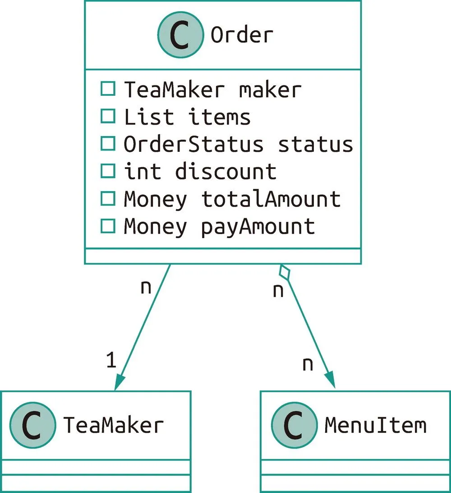

# 第7章对象关系映射(1)

- 本章内容Hibernate 与 JPA 的基础知识

```
通过 Spring Data 的 Repository 操作数据库
```

- MyBatis 的基本用法

- 通过工具提升 MyBatis 的使用体验

在第 6 章中，我们大概了解了如何通过 JDBC 来进行简单的数据库操作。通过 SQL 来执行操作虽然不算复杂，但在面向对象的语言中，这类操作多少显得有些格格不入，毕竟我们都是在与“对象”打交道。把对象与关系型数据库关联起来，就有了我们要讨论的对象关系映射（Object-Relational Mapping，ORM）。而 Hibernate 和 MyBatis 是目前较为主流的两种ORM 框架，本章主要介绍如何在项目中使用它们。

## 7.1　通过 Hibernate 操作数据库

如果我们希望用 Java 来开发一个 MVC 模型的应用，就一定离不开 SSH 组合。早期三个字母SSH 分别代表了应用的核心框架 Spring Framework、开发 Web 功能的 Struts，以及开发数

- 1

据层的 Hibernate ORM

- 。随着时间的推移，Struts 慢慢淡出了人们的视野，Spring MVC 取2

代了这个 S 的位置

- ，新的 SSH 变为 Spring Framework、Spring MVC 与 Hibernate。在这

个组合中，Hibernate 的角色与地位一直没有发生过变化，因此，本章我们会先来了解一下Hibernate。由于本书的主要对象是 Spring 而非 Hibernate，所以这里我们不会过多地深入讨论，对 Hibernate 感兴趣的同学，可以访问它的官网了解更多细节。

### 7.1.1　Hibernate 与 JPA

Hibernate 是一款基于 Java 语言的开源对象关系映射框架。所谓对象关系映射，简单来说就是将面向对象的领域模型与关系型数据库中的表互相映射起来。对象关系映射很好地解决了对

- 3

象与关系间的阻抗不匹配（impedance mismatch）问题

- 。虽然有一些不太协调的地方，但

两者之间还是可以相互融合的，表 7-1 简单进行了一些对比。

表 7-1　面向对象与关系型数据库的简单对比

对比维度

- 面向对象概念关系型数据库

粒度

- 接口、类表、视图

继承与多态

- 有没有

```
a == b 或 a.equals(b)
```

唯一性

- 主键

关联关系

- 引用外键

Hibernate 不仅将 Java 对象与数据表互相映射起来，还建立了 Java 数据类型到 SQL 数据类型的映射，提供了数据查询与操作的能力，能够自动根据操作来生成 SQL 调用。它将开发者从大量繁琐的数据层操作中释放了出来，提升了大家的开发效率。

说到 Hibernate 的历史，还得追溯到 2001 年。当时开发 Java EE（那时还叫 J2EE）应用程序需要使用 EJB，而澳大利亚程序员 Gavin King 对 EJB 中的实体 Bean 并无好感，于是他在2001 年开发了 Hibernate 的第一个版本。后来随着 Spring Framework 创始人 Rod Johnson的那本 Expert One-on- One J2EE Development without EJB 的出版，作为轻量级框架代表之一的 Hibernate 也逐步得到了大家的认可。

2006 年，Java 的持久化标准 JPA（Java Persistent API，Java 持久化 API）正式发布。它的目标就是屏蔽不同持久化 API 之间的差异，简化持久化代码的开发工作。当时的 JPA 标准基本就是以 Hibernate 作为蓝本来制定的，而 Gavin King 也当仁不让地在这个规范的专家组中。Hibernate 从 3.2 版本开始兼容 JPA。2010 年，Hibernate 3.5 成为了 JPA 2.0 的认证实现。表 7-2 对 Hibernate 与 JPA 的接口做了一个比较。

表 7-2　Hibernate 与 JPA 接口的对应关系与实现JPA 接口

- Hibernate 接口实现类作用

```
EntityManagerFactory
SessionFactory
SessionFactoryImpl
```

- 管理领域模型与

```
EntityManager
Session
SessionImpl
```

- 基本的工作单元

```
EntityTransaction
Transaction
TransactionImpl
```

- 用来抽象底层的

```
虽然 SessionFactory 或 EntityManagerFactory 的创建成本比较高，好在它们是线程
```

安全的。一般应用程序中只有一个实例，而且会在程序中共享。

Spring Framework 对 Hibernate 提供了比较好的支持，后来有了 Spring Data JPA 项目，更是

```
提供了统一的 Repository 操作封装，开发者只需定义接口就能自动实现简单的操作。在后
```

续的内容中，我们会了解到相关的使用方法。现在，第一步要做的就是在 pom.xml 的

```xml
<dependencies/> 中引入 Hibernate 与 JPA 相关的依赖。这一步通过 Spring Boot 的起步
```

依赖就能做到：

```xml
<dependency>
   <groupId>org.springframework.boot</groupId>
   <artifactId>spring-boot-starter-data-jpa</artifactId>
</dependency>
```

### 7.1.2　定义实体对象

在早期，开发者们都是通过 XML 来做各种配置的，其中也包括 Hibernate 的映射配置。但时至今日，大家早就习惯了使用注解来进行配置，甚至会“约定优于配置”（convention overconfiguration），追求“零”配置。在这一节中，我们只会涉及注解的配置方式，看看如何通过

- 4

JPA 的注解

- 来进行常规的配置，其中还会结合少许 Hibernate 的特有注解。

1. 实体及主键既然是对象关系映射，那自然需要定义清楚“对象”与“关系”之间的关系。这层关系是由实体对象及其上添加的注解来承载的，表 7-3 中展示了用来定义实体及其主键的四个注解。

- 表 7-3　定义实体及其主键的注解

- 注解作用重点属性说

```
name，默认
@Entity
```

- query langu标识类是实体类体

```
name，默认
```

- 指定实体对应的数据表，不加的话默认将类名作为表

```
@Table
```

- Schema名

```
@Id
```

- 指定字段是实体的主键

```
strategy
TABLE、S
@GeneratedValue
```

- 指定主键的生成策略

```
generato
SEQUENCE
我们可以将之前的 MenuItem 类稍作修改，用 JPA 注解来进行标注，具体如代码示例 7-1
```

- 56所示。类上共有六个注解，前四个注解都是 Lombok 的，用来减少模板化的代码，为

```
类增加构建器、构造方法、Getter 与 Setter 等方法；@Entity 说明这是一个实体类；
@Table 指定该实体类对应的数据表是 t_menu。id 上的注解表明了它是表的主键，并且
```

- 是自动生成主键值的——通常像 MySQL 这样的数据库我们都会定义一个自增主键，默认策

```java
略就是 IDENTITY。
代码示例 7-1　增加了 JPA 注解的 MenuItem 类代码片段
@Builder
1
@Data
2
@AllArgsConstructor
3
@NoArgsConstructor
4
@Entity
5
@Table(name = "t_menu")
6
public class MenuItem {
7
   @Id
8
   @GeneratedValue
9
   private Long id;
10
   // 以下省略
11
}
12
除了自增主键，还可以用 @SequenceGenerator 和 @TableGenerator 来指定基于序
列和表生成主键。以 @SequenceGenerator 为例，假设我们有个序列 seq_menu，上面
的 MenuItem 可以调整成代码示例 7-2 这样。至于 @TableGenerator，就留给大家查阅
```

- 文档去了解吧。

```java
代码示例 7-2　根据注解生成主键的 MenuItem 类片段
@Builder
1
@Data
2
@AllArgsConstructor
3
@NoArgsConstructor
4
@Entity
5
@Table(name = "t_menu")
6
public class MenuItem {
7
   @Id
8
   @GeneratedValue(strategy = GenerationType.SEQUENCE, generator = "sequence-g
9
   @SequenceGenerator(name = "sequence-generator", sequenceName = "seq_menu")
10
   private Long id;
11
   // 以下省略
12
}
13
```

2. 字段在定义完实体和主键后，就该轮到各个字段了。表 7-4 罗列了一些字段相关的常用注解。

- 表 7-4　一些字段相关的常用注解

- 注解作用重点属

- 映射简单类型，例如 Java 原子类型及其封装类、日

```
@Basic
```

- 期时间类型等，一般不用添加该注解，默认就有同样的效果

```
name，
一；nu
@Column
```

- 描述字段信息出现在

```
UPDAT
value
@Enumerated
```

- 映射枚举类型序号，

```
type，
@Type
```

- 定义 Hibernate 的类型映射，这是 Hibernate 的注解

```
param
value
映射日期与时间类型，适用于 java.util.Date 和
@Temporal
java.
java.util.Calendar
TIMES
在了解了映射字段信息的注解后，我们再对 MenuItem 类做进一步的调整，具体改动后的
```

- 情况如代码示例 7-3 所示。

```java
代码示例 7-3　新增的杯型 Size 枚举与修改后的 MenuItem 类
public enum Size {
1
   SMALL, MEDIUM, LARGE
2
}
3
4
@Builder
5
@Data
6
@AllArgsConstructor
7
@NoArgsConstructor
8
@Entity
9
@Table(name = "t_menu")
10
public class MenuItem {
11
   @Id
12
   @GeneratedValue
13
   private Long id;
14
   private String name;
15
16
   @Enumerated(EnumType.STRING)
17
   private Size size;
18
19
   @Type(type = "org.jadira.usertype.moneyandcurrency.joda.PersistentMoneyMino
20
           parameters = {@org.hibernate.annotations.Parameter(name = "currency
21
   private Money price;
22
23
   @Column(updatable = false)
24
   @Temporal(TemporalType.TIMESTAMP)
25
   @CreationTimestamp
26
   private Date createTime;
27
28
   @Temporal(TemporalType.TIMESTAMP)
29
   @UpdateTimestamp
30
   private Date updateTime;
31
}
32
```

- 上面的代码有几处具体的变动。

```
(1) size 从 String 类型改为了枚举。通过 @Enumerated(EnumType.STRING) 指明
用枚举值来做映射，也就是说数据库里的值会是 SMALL、MEDIUM 和 LARGE。
```

- 7

```
(2) price 从 BigDecimal 换成了 Joda-Money 库
 中的 Money 类型。通过 @Type 声
明了如何将数据库中 Long 类型的值转换为 Money，这里用到了一个开源的转换类，如果
数据库里存的是小数类型，可以考虑把 PersistentMoneyMinorAmount 替换为
PersistentMoneyAmount。
(3) createTime 标记为不可修改的，在创建时会填入当前时间戳。
@CreationTimestamp 是 Hibernate 的注解，在此处
@Temporal(TemporalType.TIMESTAMP) 其实是可以省略的。
(4) updateTime 会在每次修改时填入当前时间戳。@UpdateTimestamp 是 Hibernate 的
注解，在此处 @Temporal(TemporalType.TIMESTAMP) 也是可以省略的。
关于 Joda-Money 和对应的 Hibernate 类型 PersistentMoneyMinorAmount，两者均需
```

- 要在 pom.xml 中加入下面两个依赖：

```xml
<dependency>
1
   <groupId>org.joda</groupId>
2
   <artifactId>joda-money</artifactId>
3
   <version>1.0.1</version>
4
</dependency>
5
<dependency>
6
   <groupId>org.jadira.usertype</groupId>
7
   <artifactId>usertype.core</artifactId>
8
   <version>6.0.1.GA</version>
9
</dependency>
10
usertype.core 里还有不少其他有用的类，实用性非常强。
```

- 茶歇时间：为什么一定要用 Money 类来表示金额

```
在处理金额时，千万不要想当然地使用 float 或者 double 类型。原因是在遇到浮点
数运算时，精度的丢失可能带来巨大的差异，甚至会造成资金损失。虽然 BigDecimal
```

- 在计算时能顺利过关，但金额的内容却不止是一个数值，还有与之关联的币种（ISO-4217）、单位等内容。

```
以人民币为例，标准的币种简写是 CNY，最小单位（代码中用 Minor 表示）是分，主
要单位（代码中用 Major 表示）是元。美元、欧元、日元等货币都有各自的规范。在不
```

- 同的货币之间，还有货币转换的需求。所以说，我们需要一个专门用来表示金额的类，而 Joda-Money 就是一个好的选择。举个例子，我们可以通过

```
Money.ofMinor(CurrencyUnit.of("CNY"), 1234)，创建代表人民币 12.34 元
的对象，Money.of(CurrencyUnit.of("CNY"), 12.34) 与之等价。
```

3. 关联关系我们在学习数据库的范式时，为了适当地降低冗余，提升操作效率，会去设计不同的表之间的关系。在做对象关系映射时，这种关系也需要体现出来。表 7-5 中罗列了常用的几种关系及其对应的注解。

- 表 7-5　常见关系及其对应的注解

- 关系数据库的实现方式注解

```
@OneToOne
```

- 1:1外键

```
@OneToMany、@JoinColumn、@OrderBy
```

- 1:n外键

```
@ManyToOne、@JoinColumn
```

- n:1外键

```
@ManyToMany、@JoinTable、@OrderBy
```

- n:n关联表

- 为了方便大家理解这些注解的用法，我们结合二进制奶茶店的例子来看看。

```
需求描述　在二进制奶茶店中，我们会将顾客点单的信息记录在订单（即 Order）里。
```

- 店内主要流转的信息就是订单，我们通过订单来驱动后续的工作。一个订单会有多个条8

```
目（即 MenuItem），每个订单又会由一名调茶师（即 TeaMaker）负责完成。
```

- 它们之间的关系如图 7-1 所示，订单与调茶师是多对一关系，而订单与条目是多对多关系。



- 图 7-1　订单类与其他类的主要关联关系

```java
其中，TeaMaker 类的代码如代码示例 7-4 所示，大部分内容与 MenuItem 大同小异，但
其中有一个一对多关系的 orders 属性需要特别说明一下。orders 属性可以直接获取与
当前调茶师关联的订单列表。@OneToMany 的获取方式默认是懒加载，即在使用时才会加
载，mappedBy 标明了根据 Order.maker 属性来进行映射。@OrderBy 会对取得的结果
进行排序，默认按主键排序，也可以指定多个字段，用逗号分隔，默认是升序（即 asc）。
代码示例 7-4　TeaMaker 的主要代码
@Builder
1
@Getter
2
@Setter
3
@AllArgsConstructor
4
@NoArgsConstructor
5
@Entity
6
@Table(name = "t_tea_maker")
7
public class TeaMaker {
8
   @Id
9
   @GeneratedValue
10
   private Long id;
11
   private String name;
12
13
   @OneToMany(mappedBy = "maker")
14
   @OrderBy("id desc")
15
   private List<Order> orders = new ArrayList<>();
16
17
   @Column(updatable = false)
18
   @CreationTimestamp
19
   private Date createTime;
20
21
   @UpdateTimestamp
22
   private Date updateTime;
23
}
24
```

- 接着，让我们来定义订单对象。每笔订单都有自己的状态，因此要先定义一个枚举来表示订

```
单的状态机。OrderStatus 中有五种状态，分别是已下单、已支付、制作中、已完成和已
```

- 取货，实际情况中可能还有退款、取消等状态，在本例中就一切从简了。订单及其枚举的定义如代码示例 7-5 所示。

- 代码示例 7-5　订单对象及订单状态枚举

```java
public enum OrderStatus {
1
   ORDERED, PAID, MAKING, FINISHED, TAKEN;
2
}
3
4
@Builder
5
@Getter
6
@Setter
7
@AllArgsConstructor
8
@NoArgsConstructor
9
@Entity
10
@Table(name = "t_order")
11
public class Order {
12
   @Id
13
   @GeneratedValue
14
   private Long id;
15
16
   @ManyToOne(fetch = FetchType.LAZY)
17
   @JoinColumn(name = "maker_id")
18
   private TeaMaker maker;
19
20
   @ManyToMany
21
   @JoinTable(name = "t_order_item", joinColumns = @JoinColumn(name = "item_id
22
           inverseJoinColumns = @JoinColumn(name = "order_id"))
23
   @OrderBy
24
   private List<MenuItem> items;
25
26
   @Embedded
27
   private Amount amount;
28
29
   @Enumerated
30
   private OrderStatus status;
31
32
   @Column(updatable = false)
33
   @CreationTimestamp
34
   private Date createTime;
35
36
   @UpdateTimestamp
37
   private Date updateTime;
38
}
39
maker 指向了订单的调茶师，通过 @ManyToOne 指定了多对一的关系，这里的 fetch 默
认是积极加载（EAGER）的，我们将其设定为了懒加载（LAZY）。@JoinColumn 标明了
数据表中记录映射关系的字段名称。items 是订单中的具体内容，与 MenuItem 是多对多
关系，二者通过关联表 t_order_item 进行关联，我们指定了表中用到的具体字段，还要
求对 List 进行排序。
```

```
请注意　Lombok 的 @Data 注解相当于添加了好多注解。其中之一是 @ToString 注
解，即提供了更可读的 toString() 方法，输出的内容会包含成员变量的内容。为了避
免 toString() 触发 Hibernate 加载那些懒加载的对象，在 TeaMaker 和 Order 上将
@Data 改为了 @Getter 和 @Setter。
订单的金额信息被我们剥离到了单独的一个对象里，此时的 amount 就是一个嵌套对象，
用 @Embedded 来加以说明。而在 Amount 对象上也需要加上 @Embeddable，说明它是
```

- 可以被嵌套到其他实体中的。具体见代码示例 7-6，其中也用到了前面说到的金额类型转换

```
器 PersistentMoneyMinorAmount。
```

- 代码示例 7-6　订单的金额信息

```java
@Builder
1
@Data
2
@AllArgsConstructor
3
@NoArgsConstructor
4
@Embeddable
5
public class Amount {
6
   @Column(name = "amount_discount")
7
   private int discount;
8
9
   @Column(name = "amount_total")
10
   @Type(type = "org.jadira.usertype.moneyandcurrency.joda.PersistentMoneyMino
11
           parameters = {@org.hibernate.annotations.Parameter(name = "currency
12
   private Money totalAmount;
13
14
   @Column(name = "amount_pay")
15
   @Type(type = "org.jadira.usertype.moneyandcurrency.joda.PersistentMoneyMino
16
           parameters = {@org.hibernate.annotations.Parameter(name = "currency
17
   private Money payAmount;
18
}
19
```

- 茶歇时间：OpenSessionInView 问题Hibernate 的懒加载机制有时就像一把双刃剑，虽然性能有所提升，但偶尔也会带来些麻烦，比如 OpenSessionInView 这个问题。

- 所谓 OpenSessionInView，是指 Hibernate 在加载时并未把数据加载上来就关闭了Session，在要用到这些数据时，Hibernate 就会尝试使用之前的 Session，但此时Session 已经关闭，所以会导致报错。这种情况在传统的 MVC 结构应用中会比较常见，OpenSessionInView 中的 View 指的就是 MVC 中的视图层，也就是视图层会尝试加载之前被延时加载的内容，随后报错。Spring Framework 为我们提供了对应的解决方案：在 web.xml 中配置

```
OpenSessionInViewFilter，或者在 Spring 的 Web 上下文中配置
OpenSessionInViewInterceptor，两者都可以实现在视图层处理结束后才关闭
```

- Session 的效果。如果用的是 JPA，那 Spring Framework 中也有对应的

```
OpenEntityManagerInViewInterceptor 拦截器可供开发者使用。
```

### 7.1.3　通过 Hibernate API 操作数据库

有了定义好的实体对象后，就可以通过对应的 API 来操作它们，从而实现对数据库的操作。但在使用前，我们需要先在 Spring 上下文中做一些简单的配置。由于 Hibernate 也是 JPA 的参考实现，两者有很多配置都是相似的，因而表 7-6 将 Hibernate 与 JPA 所需的配置放到一起来展示。

表 7-6　Hibernate 与 JPA 需要配置的内容

- HibernateJPA

配置内容

```
LocalEntityManagerFactoryBean
LocalSessionFactoryBean
```

会话工厂

```
LocalContainerEntityManagerFa
HibernateTransactionManager
JpaTransactionManager
```

事务管理器

```
Spring Boot 的 HibernateJpaConfiguration 提供了一整套完整的自动配置。如果我们不
想自己动手，可以把配置的工作交给 Spring Boot，只需要确保有一个明确的主 DataSource
```

Bean 即可。代码示例 7-7 演示了如何手动配置 Hibernate 的相关 Bean，

```
LocalSessionFactoryBean 中设置了要扫描的包路径，在这个路径中查找要映射的实
```

体，除此之外，还设置了一些 Hibernate 的属性：

```
hibernate.hbm2ddl.auto，自动根据实体类生成 DDL 语句并执行。一般在生产环境
```

- 中，数据库都是由 DBA 来运维的，不会用程序创建表结构，但开发者在开发时偶尔还是会用到这个功能。在本节的演示中我们就需要靠它来生成表结构；

```
hibernate.show_sql，打印 Hibernate 具体执行的 SQL 语句；
hibernate.format_sql，对要打印的 SQL 进行格式化。
```

Hibernate 有很多可以设置的属性，各位读者如果想要了解更多内容，可以查询 Hibernate 的官方文档。

- 代码示例 7-7　手动在主类中配置 Hibernate 相关 Bean

```java
@SpringBootApplication
public class BinaryTeaApplication {
   public static void main(String[] args) {
       SpringApplication.run(BinaryTeaApplication.class, args);
   }
   @Bean
   public LocalSessionFactoryBean sessionFactory(DataSource dataSource) {
       Properties properties = new Properties();
       // 在H2内存数据库中生成对应表结构
       properties.setProperty("hibernate.hbm2ddl.auto", "create-drop");
       properties.setProperty("hibernate.show_sql", "true");
       properties.setProperty("hibernate.format_sql", "true");
       LocalSessionFactoryBean factoryBean = new LocalSessionFactoryBean();
       factoryBean.setDataSource(dataSource);
       factoryBean.setHibernateProperties(properties);
       factoryBean.setPackagesToScan("learning.spring.binarytea.model");
       return factoryBean;
   }
   @Bean
   public PlatformTransactionManager transactionManager(SessionFactory sessionFa
       return new HibernateTransactionManager(sessionFactory);
   }
}
```

在第 6 章中，我们介绍了 Spring Framework 为各种模板化的操作提供了模板类，事务操作有

```
TransactionTemplate，JDBC 操作有 JdbcTemplate，而 Hibernate 操作也有专门的
HibernateTemplate。为了方便使用，Spring Framework 还更进一步提供了一个
HibernateDaoSupport 辅助类。代码示例 7-8 和代码示例 7-9 演示了如何通过 Spring
```

Framework 的辅助类进行增删改查操作。

```java
代码示例 7-8　通过 Hibernate 重新实现 MenuRepository 的查询操作
@Repository
@Transactional
public class MenuRepository extends HibernateDaoSupport {
   // 传入SessionFactory
   public MenuRepository(SessionFactory sessionFactory) {
       super.setSessionFactory(sessionFactory);
   }
   public long countMenuItems() {
       // 这里的是HQL，不是SQL语句
       return getSessionFactory().getCurrentSession()
               .createQuery("select count(t) from MenuItem t", Long.class).getSi
   }
   public List<MenuItem> queryAllItems() {
       return getHibernateTemplate().loadAll(MenuItem.class);
   }
   public MenuItem queryForItem(Long id) {
       return getHibernateTemplate().get(MenuItem.class, id);
   }
   // 省略插入、修改、删除方法
}
上面的代码演示了通过 getHibernateTemplate() 获取 HibernateTemplate 后进行的
各种查询类操作，而 countMenuItems() 里则直接可以获取 Session（通过 HQL 语句进行
操作）。我们在 MenuRepository 上添加了 @Transactional 注解，开启了事务。实践中
```

我们一般会把事务加在 Service 层上，这里也只是为了演示，此外，

```
getCurrentSession() 也需要运行在事务里。代码示例 7-9 是 MenuRepository 中的增
```

加、修改和删除操作。

```java
代码示例 7-9　通过 Hibernate 重新实现 MenuRepository 的增删改操作
@Repository
@Transactional
public class MenuRepository extends HibernateDaoSupport {
   public void insertItem(MenuItem item) {
       getHibernateTemplate().save(item);
   }
   public void updateItem(MenuItem item) {
       getHibernateTemplate().update(item);
   }
   public void deleteItem(Long id) {
       MenuItem item = getHibernateTemplate().get(MenuItem.class, id);
       if (item != null) {
           getHibernateTemplate().delete(item);
       }
   }
}
为了演示这个 MenuRepository 的使用效果，我们需要一个简单的单元测试，可以对
MenuRepositoryTest 稍作修改。代码示例 7-10 是对插入操作的测试。这个测试的逻辑大
致是这样的：先通过 MenuRepository 来进行操作，随后再用 JdbcTemplate 执行 SQL
语句来验证执行的效果。testInsertItem() 先插入了 3 条记录，通过 Lombok 生成的
Builder 来创建 MenuItem。在设置 price 时，我们演示了如何创建代表人民币 12 元的
Money 对象。明细核对的方法被单独放在了 assertItem() 里，以便后面的用例中能够复
```

用。此处，与第 6 章的例子有一个区别，当时我们使用 schema.sql 和 data.sql 来初始化表结构和数据，这里为了保证测试数据不受外部影响，Spring Boot 的初始化，由 Hibernate 来实现表结构的初始化。

```java
代码示例 7-10　MenuRepositoryTest 中针对插入操作的单元测试
@SpringBootTest(properties = {"spring.sql.init.mode=never", "spring.jpa.hibernate
@TestMethodOrder(MethodOrderer.OrderAnnotation.class)
class MenuRepositoryTest {
   @Autowired
   private MenuRepository menuRepository;
   @Autowired
   private DataSource dataSource;
   private JdbcTemplate jdbcTemplate;
   @BeforeEach
   public void setUp() {
       jdbcTemplate = new JdbcTemplate(dataSource);
   }
   @AfterEach
   public void tearDown() {
       jdbcTemplate = null;
   }
   @Test
   @Order(1)
   void testInsertItem() {
       List<MenuItem> items = Stream.of("Go橙汁", "Python气泡水", "JavaScript苏打水
               .map(n -> MenuItem.builder().name(n).size(Size.MEDIUM)
                       .price(Money.ofMinor(CurrencyUnit.of("CNY"), 1200)).build
               .peek(m -> menuRepository.insertItem(m)).collect(Collectors.toLis
       for (int i = 0; i < 3; i++) {
           assertEquals(i + 1, items.get(i).getId());
           assertItem(i + 1L, items.get(i).getName());
       }
   }
   private void assertItem(Long id, String name) {
       Map<String, Object> result = jdbcTemplate.queryForMap("select * from t_me
       assertEquals(name, result.get("name"));
       assertEquals(Size.MEDIUM.name(), result.get("size"));
       assertEquals(1200L, result.get("price"));
   }
   // 省略其他测试用例
}
```

代码示例 7-11 是针对查询方法的相关测试，我们可以看到其中的核对大部分复用了

```python
assertItem()。
代码示例 7-11　MenuRepositoryTest 中针对查询操作的单元测试
@SpringBootTest(properties = {"spring.sql.init.mode=never", "spring.jpa.hibernate
@TestMethodOrder(MethodOrderer.OrderAnnotation.class)
class MenuRepositoryTest {
   @Test
   @Order(2)
   void testCountMenuItems() {
       assertEquals(3, menuRepository.countMenuItems());
   }
   @Test
   @Order(3)
   void testQueryForItem() {
       MenuItem item = menuRepository.queryForItem(1L);
       assertNotNull(item);
       assertItem(1L, "Go橙汁");
   }
   @Test
   @Order(4)
   void testQueryAllItems() {
       List<MenuItem> items = menuRepository.queryAllItems();
       assertNotNull(items);
       assertFalse(items.isEmpty());
       assertEquals(3, items.size());
   }
   // 省略其他代码
}
代码示例 7-12 是与修改和删除相关的测试用例：testUpdateItem() 中先查出了 ID 为 1
的菜单项，将其中的价格修改为了 11 元，更新回数据库后又用 jdbcTemplate 把记录查询
出来进行了核对；testDeleteItem() 则比较简单，直接删除 ID 为 2 的记录，随后再通过
```

查询操作来看一下数据在不在。

```sql
代码示例 7-12　MenuRepositoryTest 中针对修改和删除操作的单元测试
@SpringBootTest(properties = {"spring.sql.init.mode=never", "spring.jpa.hibernate
@TestMethodOrder(MethodOrderer.OrderAnnotation.class)
class MenuRepositoryTest {
   @Test
   @Order(5)
   void testUpdateItem() {
       MenuItem item = menuRepository.queryForItem(1L);
       item.setPrice(Money.ofMinor(CurrencyUnit.of("CNY"), 1100));
       menuRepository.updateItem(item);
       Long price = jdbcTemplate.queryForObject("select price from t_menu where
       assertEquals(1100L, price);
   }
   @Test
   @Order(6)
   void testDeleteItem() {
       menuRepository.deleteItem(2L);
       assertNull(menuRepository.queryForItem(2L));
   }
   // 省略其他代码
}
```

需要注意两点：第一，这个测试必须按照指定的顺序执行，因为测试数据是通过

```
testInsertItem() 插入的；第二，这只是一个演示用的单元测试，在实际工作中，我们还
```

要考虑各种边界条件。

Spring Framework 针对涉及数据库的操作还提供了专门的测试支持，可以在每个测试执行后回滚数据库中的各种修改，此处暂且通过简单的方式来做。更复杂的用法大家可以通过 SpringFramework 的官方手册进行了解。

### 7.1.4　通过 Spring Data 的 Repository 操作数据库

虽然与直接使用 SQL 的方式相比，Hibernate 方便了不少，但广大开发者对效率的追求是无止境的。不少日常增删改查操作的代码都“长得差不多”，而且对关系型数据库、NoSQL 数据库都有类似的操作，那么是否还可以进一步简化呢？答案是肯定的，Spring Data 项目就为不同的常见数据库提供了统一的 Repository 抽象层。我们可以通过约定好的方式定义接口，使用其中的方法来声明需要的操作，剩下的实现工作完全交由 Spring Data 来完成。Spring Data

```java
的核心接口是 Repository<T, ID>，T 是实体类型，ID 是主键类型，一般我们会使用它
的子接口 CrudRepository<T, ID> 或者 PagingAndSortingRepository<T, ID>。
CrudRepository<T, ID> 的定义如下所示：
@NoRepositoryBean
public interface CrudRepository<T, ID> extends Repository<T, ID> {
   <S extends T> S save(S var1);
   <S extends T> Iterable<S> saveAll(Iterable<S> var1);
   Optional<T> findById(ID var1);
   boolean existsById(ID var1);
   Iterable<T> findAll();
   Iterable<T> findAllById(Iterable<ID> var1);
   long count();
   void deleteById(ID var1);
   void delete(T var1);
   void deleteAll(Iterable<? extends T> var1);
   void deleteAll();
}
```

可以看到其中已经包含了一些通用的方法，比如新增和删除实体，还有根据 ID 查找实体等。

```
PagingAndSortingRepository<T, ID> 则是在此基础之上又增加了分页和排序功能。
```

Spring Data JPA 是专门针对 JPA 的。在 pom.xml 中引入

```
org.springframework.boot:spring-boot-starter-data-jpa 就能添加所需的依
赖。其中提供了一个专属的 JpaRepository<T, ID> 接口，可以在配置类上增加
@EnableJpaRepositories 来开启 JPA 的支持，通过这个注解还可以配置一些个性化的信
息，比如要扫描 Repository 接口的包。
Spring Boot 的 JpaRepositoriesAutoConfiguration 提供了 JpaRepository 相关的
自动配置，只要符合条件就能完成配置。它通过 @Import 注解导入了
JpaRepositoriesRegistrar 类，其中直接定义了一个静态内部类
EnableJpaRepositoriesConfiguration，上面添加了 @EnableJpaRepositories，
```

所以在 Spring Boot 项目里无须自己添加该注解，只要有相应的依赖，Spring Boot 的自动配置就能帮忙完成剩下的工作：

```java
@Configuration(proxyBeanMethods = false)
@ConditionalOnBean(DataSource.class)
@ConditionalOnClass(JpaRepository.class)
@ConditionalOnMissingBean({ JpaRepositoryFactoryBean.class, JpaRepositoryConfigEx
@ConditionalOnProperty(prefix = "spring.data.jpa.repositories", name = "enabled",
   matchIfMissing = true)
@Import(JpaRepositoriesRegistrar.class)
@AutoConfigureAfter({ HibernateJpaAutoConfiguration.class, TaskExecutionAutoConfi
public class JpaRepositoriesAutoConfiguration { ... }
要定义自己的 Repository 只需扩展 CrudRepository<T, ID>、
PagingAndSortingRepository<T, ID> 或 JpaRepository<T, ID>，并明确指定泛
```

- 9

```
型类型即可。例如，MenuItem 和 TeaMaker 的 Repository 大概就是代码示例 7-13
```

- 这

样的。

```java
代码示例 7-13　MenuItem 和 TeaMaker 的 Repository 定义
public interface MenuRepository extends JpaRepository<MenuItem, Long> {}
public interface TeaMakerRepository extends JpaRepository<TeaMaker, Long> {}
```

通用的方法基本能满足大部分需求，但是总会有一些业务所需的特殊查询需要是通用的方法所不能满足的。在 Spring Data 的帮助下，我们只需要根据它的要求定义方法，无须编写具体的实现，这就省却了很多工作。以下几种形式的方法名都可以视为有效的查询方法：

- find...By...

- read...By...

- query...By...

- get...By...

```
如果只是想要统计数量，不用返回具体内容，可以使用 count...By... 的形式。
```

```
其中，第一段“...”的内容是限定返回的结果条数，比如用 TopN、FirstN 表示返回头 N 个
结果，还可以用 Distinct 起到 SQL 语句中 distinct 关键词的效果。第二段“...”的内容
是查询的条件，也就是 SQL 语句中 where 的部分，条件所需的内容与方法的参数列表对
应，可以通过 And、Or 关键词组合多个条件，用 Not 关键词取反。Spring Data 方法支持多
```

种形式的条件，具体见表 7-7。

表 7-7　Spring Data 查询方法支持的关键词

作用

- 关键词例子

```
Is、Equals，不写的话默认就是相等
findBy
```

相等

```
LessThan、LessThanEqual、GreaterThan、
findBy
```

比较

```
GreaterThanEqual
findBy
Between，用于日期时间的比较
```

比较

```
d2)
Before、After，用于日期时间的比较
findBy
```

比较

```
Null、IsNull、NotNull、IsNotNull
findBy
```

是否为空

```
Like、NotLike
findBy
```

相似

```
StartingWith、EndingWith、Containing
findBy
```

字符串判断

```
findBy
IgnoreCase、AllIgnoreCase
```

忽略字符串大小写进行判断

```
(Strin
In、NotIn
findBy
```

集合

```
True、False
findBy
```

布尔判断

```
对于会返回多条结果的方法，可以在方法名结尾处增加 OrderBy 关键词指定排序的字段，通
过 Asc 和 Desc 指定升序或者降序（默认为 Asc）。例如
findByNameOrderByIdDesc(String name)，这里也支持多个字段排序的组合，例如
findByNameOrderByUpdateTimeDescId(String name)。也可以在参数中增加一个
Sort 类型的参数来灵活地传入期望的排序方式，例如：
Sort sort = Sort.by("name").descending().and(Sort.by("id").ascending());
另一个常见的需求是分页。方法的返回值可以是 Page<T> 或集合类型，通过传入 Pageable
```

类型的参数来指定分页信息。

```
Spring Data 的 Repository 接口方法支持很多种返回类型：单个返回值的，除了常见的 T
类型，也可以是 Optional<T>；集合类型除了 Iterable 相关的类型，还可以是
Streamable 的，方便做流式处理。
既然这里用的是 JPA 的 Repository 接口，自然就要用 JPA 相关的配置。之前我们做的
```

Hibernate 的配置就可以替换一下，最简单的就是把配置都删了，完全靠 Spring Boot 的自动

```
配置。之前 Hibernate 配置的一些属性，可以写到 application.properties 里，如代码
```

示例 7-14 所示。

```
代码示例 7-14　application.properties 中的一些配置片段
spring.jpa.hibernate.ddl-auto=create-drop
spring.jpa.properties.hibernate.format_sql=true
#spring.jpa.properties.hibernate.show_sql=true
spring.jpa.show-sql=true
```

这三个配置的效果，等同于代码示例 7-7 中用代码做的配置，其中

```
spring.jpa.properties.hibernate.show_sql 与 spring.jpa.show-sql 的效果
```

相同。

```
对于订单的操作，我们可以定义一个 OrderRepository 接口，具体如代码示例 7-15 所
```

示。

```java
代码示例 7-15　操作订单的 OrderRepository 接口
public interface OrderRepository extends JpaRepository<Order, Long> {
   List<Order> findByStatusOrderById(OrderStatus status);
   List<Order> findByMaker_NameLikeIgnoreCaseOrderByUpdateTimeDescId(String name
}
上面的第一个方法根据 Order.status 进行查找，结果按照 id 升序排列；第二个方法比较
复杂，根据 Order.maker.name 进行相似匹配，且忽略大小写，结果先按照 updateTime
降序排列，如果相同再按 id 升序排列。对于 Order.maker.name 这样的属性，可以像上面
这样用 _ 明确地表示 name 是 Maker 的属性，也可以不加 _，让 Spring Data 自行判断。大
```

家可以尝试写一下这个接口的单元测试，也可以参考我们提供的代码示例中的

```
OrderRepositoryTest 类，此处就不再展开了。在取到 Order 后，其中懒加载的内容有
```

可能没有被加载上来，因此我们在访问时需要增加一个事务，保证在操作时能够取得当前会话。

如果有一些公共的方法希望能剥离到公共接口里，但又不希望这个公共接口被创建成

```java
Repository 的 Bean，这时就可以在接口上添加 @NoRepositoryBean 注解。
JpaRepository 接口就是这样的：
@NoRepositoryBean
public interface JpaRepository<T, ID> extends PagingAndSortingRepository<T, ID>,
这里，我们同样要为 OrderRepository 中的两个方法添加一些简单的单元测试，这些测试
需要用到一些测试数据，它们可以和 TeaMakerRepository 的测试复用，因此可以将测试
数据的准备工作单独剥离出来，放到 src/test/java 对应的位置，代码内容具体如代码示
例 7-16 所示。具体的逻辑是先插入 3 条 MenuItem 和 2 条 TeaMaker 记录，随后用它们来
```

创建订单，两条订单之间间隔 200 毫秒，这样在按照订单时间排序时可以有明确的顺序。

```java
代码示例 7-16　进行测试数据准备的 DataInitializationRunner 类
public class DataInitializationRunner implements ApplicationRunner {
   @Autowired
   private TeaMakerRepository makerRepository;
   @Autowired
   private MenuRepository menuRepository;
   @Autowired
   private OrderRepository orderRepository;
   @Override
   @Transactional
   public void run(ApplicationArguments args) throws Exception {
       List<MenuItem> menuItemList = Stream.of("Go橙汁", "Python气泡水", "JavaScri
               .map(n -> MenuItem.builder().name(n).size(Size.MEDIUM)
                       .price(Money.ofMinor(CurrencyUnit.of("CNY"), 1200)).build
               .map(m -> {
            menuRepository.save(m);
            return m;
       }).collect(Collectors.toList());
       List<TeaMaker> makerList = Stream.of("LiLei", "HanMeimei")
               .map(n -> TeaMaker.builder().name(n).build())
               .map(m -> {
           makerRepository.save(m);
           return m;
       }).collect(Collectors.toList());
       Order order = Order.builder().maker(makerList.get(0))
                                    .amount(Amount.builder()
                                    .discount(90).totalAmount(Money.ofMinor(Curr
                                    .payAmount(Money.ofMinor(CurrencyUnit.of("CN
                                    .items(List.of(menuItemList.get(0))).status(
       orderRepository.save(order);
       try {
           Thread.sleep(200);
       } catch (InterruptedException e) {
       }
       order = Order.builder().maker(makerList.get(0)).amount(Amount.builder().d
               .totalAmount(Money.ofMinor(CurrencyUnit.of("CNY"), 1200))
               .payAmount(Money.ofMinor(CurrencyUnit.of("CNY"), 1200)).build())
           .items(List.of(menuItemList.get(1)))
           .status(OrderStatus.ORDERED).build();
       orderRepository.save(order);
   }
}
上面的 DataInitializationRunner 类上并未添加任何 Spring Bean 相关的注解，所以它
并不会被自动扫描加载为 Bean。由于代码示例 7-12 中的 MenuRepositoryTest 并不需要
```

它的数据，让它跑起来反而还会破坏原来的测试，所以我们可以有条件地选择性执行这段初始

```java
化逻辑。代码示例 7-17 就是对应的配置类，通过 @ConditionalOnProperty 可以实现根
据 data.init.enable 属性的值来确定是否创建 DataInitializationRunner Bean：
只有值为 true 时才会创建，为其他值或没有设置时都不会有任何效果。
代码示例 7-17　根据特定属性生效的 DataInitializationConfig 配置类
@Configuration
@ConditionalOnProperty(name = "data.init.enable", havingValue = "true")
public class DataInitializationConfig {
   @Bean
   public DataInitializationRunner dataInitializationRunner() {
       return new DataInitializationRunner();
   }
}
代码示例 7-18 就是针对 OrderRepository 的测试类，在 @SpringBootTest 上增加了一
个 data.init.enable=true 的属性配置，这样就能用上前面准备的测试数据初始化逻辑
```

了。随后的两个测试方法内容比较直观，就不再做过多说明了。

```java
代码示例 7-18　针对 OrderRepository 的测试类
@SpringBootTest(properties = {"data.init.enable=true",
       "spring.sql.init.mode=never", "spring.jpa.hibernate.ddl-auto=create-drop"
@TestMethodOrder(MethodOrderer.OrderAnnotation.class)
class OrderRepositoryTest {
   @Autowired
   private OrderRepository orderRepository;
   @Test
   @Transactional
   public void testFindByStatusOrderById() {
       assertTrue(orderRepository.findByStatusOrderById(OrderStatus.FINISHED).is
       List<Order> list = orderRepository.findByStatusOrderById(OrderStatus.ORDE
       assertEquals(2, list.size());
       assertEquals("Go橙汁", list.get(0).getItems().get(0).getName());
       assertEquals("Python气泡水", list.get(1).getItems().get(0).getName());
       assertTrue(list.get(0).getId() < list.get(1).getId());
       assertEquals("LiLei", list.get(0).getMaker().getName());
       assertEquals("LiLei", list.get(1).getMaker().getName());
   }
   @Test
   public void testFindByMaker_NameLikeOrderByUpdateTimeDescId() {
       assertTrue(orderRepository.findByMaker_NameLikeIgnoreCaseOrderByUpdateTim
       List<Order> list = orderRepository.findByMaker_NameLikeIgnoreCaseOrderByU
       assertEquals(2, list.size());
       assertTrue(list.get(0).getUpdateTime().getTime() >= list.get(1).getUpdate
       assertTrue(list.get(0).getId() > list.get(1).getId());
   }
}
```

- 茶歇时间：JpaRepository 背后的原理

```
在正文中有提到，Spring Boot 的自动配置导入了 JpaRepositoriesRegistrar，这个
类的内部类添加了 @EnableJpaRepositories，开启了对 JPA Repository 的支持。
相关的扩展配置则是由 JpaRepositoryConfigExtension 提供的，其中注册了很多
```

- Bean，例如：EntityManagerBeanDefinitionRegistrarPostProcessor

- JpaMetamodelMappingContextFactoryBean

- PersistenceAnnotationBeanPostProcessor

- DefaultJpaContext

- JpaMetamodelCacheCleanup

- JpaEvaluationContextExtension

```
此外，扫描找到的 Repository 接口都会对应地配置一个
JpaRepositoryFactoryBean 类型的工厂 Bean。可以通过这个工厂 Bean 来获得具体
的 JpaRepositoryFactory，它是 RepositoryFactorySupport 的子类，其中的
getRepository(Class<T> repositoryInterface, RepositoryFragments
fragments) 会返回最终的 Repository 实现。
getRepository() 方法为我们的接口创建了一个扩展了 SimpleJpaRepository<T,
ID> 的实现，它包含了最基础的增删改查方法的实现。另外 getRepository() 返回的
```

- Bean 还添加了一层动态代理，其中添加了一些 AOP 通知，根据不同情况，可能会有以下几种：MethodInvocationValidator

- ExposeInvocationInterceptor

- DefaultMethodInvokingMethodInterceptor

- QueryExecutorMethodInterceptor

- ImplementationMethodExecutionInterceptor

```java
在这些通知中，QueryExecutorMethodInterceptor 就负责为我们自定义的各种查询
方法提供实现。PartTree 定义了查询方法该如何解析，关键词信息如下：
private static final String KEYWORD_TEMPLATE = "(%s)(?=(\\p|\\P))";
1
private static final String QUERY_PATTERN = "find|read|get|query|search|stream
2
private static final String COUNT_PATTERN = "count";
3
private static final String EXISTS_PATTERN = "exists";
4
private static final String DELETE_PATTERN = "delete|remove";
5
Part 类中的内部枚举 Type 中定义了各式条件：
```

```java
private static final List<Part.Type> ALL = Arrays.asList(IS_NOT_NULL, IS_NULL,
1
   LESS_THAN_EQUAL, GREATER_THAN, GREATER_THAN_EQUAL, BEFORE, AFTER, NOT_LIKE
2
   STARTING_WITH, ENDING_WITH, IS_NOT_EMPTY, IS_EMPTY, NOT_CONTAINING, CONTAIN
3
   NEAR, WITHIN, REGEX, EXISTS, TRUE, FALSE, NEGATING_SIMPLE_PROPERTY, SIMPLE_
4
AbstractJpaQuery 子类中的 execute(Object[] parameters) 方法负责执行具体
```

- 的查询。

```
经过这样的一路分析，可以发现整个 JPA 的 Repository 的实现并没有太多高深的地方，
```

- 依靠动态代理和对各种情况的预先编码，最后的效果就是我们看到的：通过定义接口来实现格式操作。

[1]：Hibernate ORM，通常简称为 Hibernate。早期 Hibernate 下只有 ORM 工具一个项目，后来才逐步发展出了很多子项目，例如

- Hibernate Validator、Hibernate Search 等。在 Hibernate 4.1 版本发布前，它还叫 Hibernate Core，后来改名为 HibernateORM。出于习惯，我们还是经常用 Hibernate 来表示 Hibernate ORM。

[2]：Struts 还存在大量的安全问题，即使不用 Spring MVC，也不建议大家再使用 Struts 框架。[3]：详细的内容可以在维基百科上查看（Object-relational impedance mismatch）。[4]：JPA 注解都在 包里。从 Spring Framework 6.0 开始，Spring 要兼容 Jakarta EE 9 就需要使用 包里的注解了，无法零修改实现

- 兼容。本书使用的还是 Spring Framework 5.3，所以对应注解仍在 里。

[5]：本小节的示例都放在 ch7/binarytea-hibernate 项目中。[6]：相当于添加了 、、、 和 注解，因此我们需要额外再加一个 来提供无参数的构造方法。[7]：Joda Project 提供了不少实用的工具库，比如处理货币的 Joda-Money，处理时间的 Joda-Time，后者成了 JDK 的一部分。[8]：实际情况下，通常一个奶茶店有多名员工，一张订单会由多人一起制作完成。此外，由于订单里的商品会随着时间的变化而发

- 生变化，因而保险起见，应该在订单中保存商品的快照，而不是用商品 ID 来做记录。但我们这里是做演示，先忽略这些细节。

[9]：本节中 Spring Data JPA 的示例都在 ch7/binarytea-jpa 项目中。
