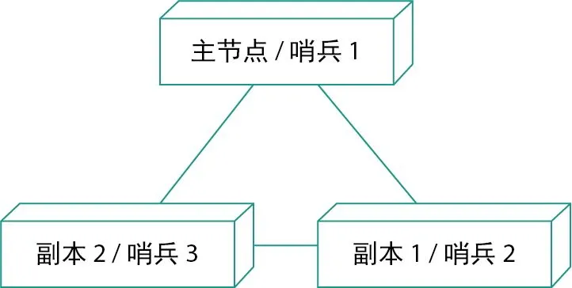
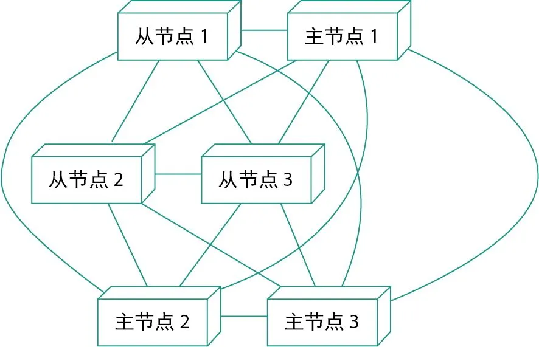

# 第8章数据访问进阶(1)

- 本章内容适用于生产环境的连接池配置技巧

- 在 Spring 工程中使用 Redis 的方法

- 通过 Spring 的缓存抽象简化缓存的使用

前两章我们都在讨论如何实现基本的数据库操作：直接使用 JDBC，或者通过 ORM 框架。但在实际的生产环境中，仅仅实现基本的操作是不够的，甚至只用关系型数据库也是不够的，我们还需要 NoSQL 的帮助，遇到热点数据，还要增加缓存为数据库减负。所以，在这一章里，我们就要来聊聊这些进阶的内容。

## 8.1　连接池的实用配置

在之前的章节里，我们基本都是在使用 Spring Boot 提供的默认数据库连接池配置，它能满足基本的需求。但在生产环境中会遇到很多实际的问题，光靠基本配置就有点捉襟见肘了，例如，连接数据库用的密码属于需要保护的敏感信息，不能直接放在配置文件里该怎么办？为了方便排查问题，希望能记录执行的所有 SQL 该怎么办？

### 8.1.1　保护敏感的连接配置

连接数据库所需的信息包括三个要素——JDBC URL、用户名和密码。数据库密码是需要重点保护的信息，所以像第 6 章的代码示例那样以明文方式将密码写在

```
application.properties 里显然是不合适的。也许你会说：“为配置文件设置一个普通用
```

户不可读的权限，只有运维人员能查看其中的内容行不行？”负责安全的工作人员会告诉你：“不行！”

在本节中，我们先来了解一下如何为 HikariCP 和 Druid 实现密码加密功能，而在后续的第 14章，我们还会聊到 Spring Cloud Config 的配置项加密功能。如果你正在使用 Spring CloudConfig，集中式地管理加密密码会是一个相对更好的选择。

1. 结合 HikariCP 与 Jasypt 实现密码加密HikariCP 的作者一心想做好高性能连接池，把所有其他工作都“外包”了出去，所以配置项加密这个差事显然就需要其他工具来帮忙了。Jasypt 的全称是 Java Simplified Encryption，一看这个名字就知道它是在 Java 环境里处理加解密的，Jasypt 可以很方便地与 Spring 项目集成到一起，究竟有多方便呢？它直接提供了一个

```
EncryptablePropertiesPropertySource，可以直接解密属性值中用 ENC() 括起来
```

- 的密文。而且它还有一个 Spring Boot Starter，几乎就是“开箱即用”。

```xml
第一步，在 pom.xml 中添加 jasypt-spring-boot-starter 依赖：
<dependency>
1
   <groupId>com.github.ulisesbocchio</groupId>
2
   <artifactId>jasypt-spring-boot-starter</artifactId>
3
   <version>3.0.3</version>
4
</dependency>
5
```

- 因为我们都会开启自动配置，所以这个起步依赖会自己完成剩下的配置。如果没有开启自动

```
配置，则需要在配置类上增加 @EnableEncryptableProperties 注解。
```

- 第二步，修改配置文件，增加 Jasypt 的配置，并将明文密码改为密文。主要是配置加解密

```
使用的算法和密钥，两者分别是 jasypt.encryptor.algorithm 和
jasypt.encryptor.password，默认的算法是 PBEWITHHMACSHA512ANDAES_256。
```

- 其主要的配置如表 8-1 所示。

- 表 8-1　jasypt-spring-boot-starter 的一些默认配置

- 配置项默认值

```
jasypt.encryptor.algorithm
PBEWITHHMACSHA512ANDAES_2
jasypt.encryptor.provider-name
SunJCE
```

- 要进行加密，可以直接用 Jasypt 的 Jar 包，调用 CLI 的类。在 macOS 中，可以在~/.m2/repository 的 Maven 本地仓库里找到 jasypt-1.9.3.jar，执行如下命令：

```
▸ java -cp ./jasypt-1.9.3.jar org.jasypt.intf.cli.JasyptPBEStringEncryptionCLI
1
algorithm=PBEWITHHMACSHA512ANDAES_256 ivGeneratorClassName=org.jasypt.iv.Random
2
saltGeneratorClassName=org.jasypt.salt.RandomSaltGenerator
3
假设给的明文和密钥都是 binary-tea，那执行的输出应该会是下面这样的（OUTPUT 部
```

- 分就是加密后的密文）：

```
----ARGUMENTS-------------------
1
2
input: binary-tea
3
password: binary-tea
4
saltGeneratorClassName: org.jasypt.salt.RandomSaltGenerator
5
ivGeneratorClassName: org.jasypt.iv.RandomIvGenerator
6
algorithm: PBEWITHHMACSHA512ANDAES_256
7
----OUTPUT----------------------
8
9
X401LMpOiBz7+4gOXybK9cQdDOYlqX7mWXmmj6aGZPGWwjqcbf/80hj0vQWqhaqa
10
在 application.properties 中，将 spring.datasource.password 修改为
ENC(X401LMpOiBz7+4gOXybK9cQdDOYlqX7mWXmmj6aGZPGWwjqcbf/80hj0vQWqha
qa) 就完成了配置的修改。
```

```
第三步，在运行时提供解密的密钥。如果把密钥也写在 application.properties 里，
```

- 那等于把保险箱钥匙和保险箱放在了一起，所以，至少密钥应该放在另一个单独的文件里。

```
借助 Spring Boot 的能力，可以将 jasypt.encryptor.password 放在命令行参数或者
```

- 环境变量里。由于命令行参数可以通过命令行直接观察到，所以环境变量

```
JASYPT_ENCRYPTOR_PASSWORD 会是个更好的选择。
```

2. 使用 Druid 内置功能实现密码加密Druid 的思路与 HikariCP 截然相反，连接池可能会用到的各种相关功能，它都自己实现了，可谓“Druid 在手，连接无忧”。Druid 内置了数据库密码的加密功能，使用 RSA 非对称算法来进行加解密，我们无须操心各种加解密的细节，它能够自己全部封装好，例如，具体

```
操作时内部使用 RSA/ECB/PKCS1Padding。只要用它的工具生成公私钥对，并加密好明
```

- 文就可以了。

- 使用 Druid 提供的命令行工具来生成密钥和密文，和 Jasypt 一样，在本机的 Maven 仓库里找到 Druid 的 Jar 包。例如，在我的 Mac 上，1.2.8 版本 Jar 包的位置是~/.m2/repository/com/alibaba/druid/1.2.8，在这个目录里执行下面的命令：

```
▸ java -cp druid-1.2.8.jar com.alibaba.druid.filter.config.ConfigTools 密码明文
1
假设密码明文是 binary-tea，则输出会类似下面这样，公私钥和密文会有所不同：
privateKey:MIIBUwIBADANBgkqhkiG9w0BAQEFAASCAT0wggE5AgEAAkEAggg3wZKK1/bzA4M4JQ8C
1
UEKacWbw2C0vym+WMMSMgm6R+kCrliJqZ6r8MbYuwIDAQABAkAwntQCTEIgOJVrVdBTgwZXq0aIJzhV
2
8zEpptF7VCckVEzQDsOY2zzTmCJO0bRAiEAwUqm7RxrVlyKJ2DEoPIzpXbL+g/aW+FO4KA4pVkDq8MC
3
BuCL59ovLZUcmkBIbtVnqQIgYTjvZWxaAQJi6xOdU2b/20Y5qvm2V2ioiAuO8nwngIkCIAquleBpWjq
4
coxi33+fKpAiAyiVc+QJCtRAZrf8Q5KKi8K2wP5TzxopIWAi7l15MSow==
5
publicKey:MFwwDQYJKoZIhvcNAQEBBQADSwAwSAJBAIIIN8GSitf28wODOCUPAraF+PPuaaASxVLzC
6
jDEjIJukfpAq5Yiameq/DG2LsCAwEAAQ==
7
password:gTCrgZfRos9fKw3OOyhkWKaKeiwDrUCTkwIskdB+MdxMQF9CGwVY4wIiIm131Aivt4nEXE
8
```

```
接下来，要在 application.properties 中开启密码加密功能，需要让 Druid 加载
```

- 1

```
ConfigFilter 这个过滤器，并配置解密用的密钥，就像下面这样
```

- ：

```
spring.datasource.password=gTCrgZfRos9fKw3OOyhkWKaKeiwDrUCTkwIskdB+MdxMQF9CGwVY
1
2
spring.datasource.druid.filters=config
3
spring.datasource.druid.connection-properties=config.decrypt=true;config.decryp
4
5
publicKey=MFwwDQYJKoZIhvcNAQEBBQADSwAwSAJBAIIIN8GSitf28wODOCUPAraF+PPuaaASxVLzC
6
7
# 省略其他配置
8
```

- 同样的，把解密的密钥和密文放在一起也不太安全，有两种方式可供选择。

```
在命令行上设置系统属性 -Ddruid.config.decrypt.key= 密钥。
在 Druid 专属的配置文件里设置解密密钥 config.decrypt.key= 密钥和 password=
密码密文，同时要修改 application.properties 中的连接属性，就像下面这样：
spring.datasource.druid.connection-properties=config.decrypt=true;config.file=外
1
Druid 配置加密的逻辑基本都在 ConfigFilter 里，它的大致逻辑是这样的：
(1) 在 Druid 加载 Filter 时，会调用其中的 init() 初始化方法；
(2) init() 会从 DruidDataSource 的 connectProperties 属性，以及指定的配置
```

- 文件中获取配置；

- (3) 判断是否需要解密密码；

- (4) 如果需要解密，再从第 (2) 步的两个位置获取解密的密钥；

- (5) 解密获得密码明文并进行设置。

### 8.1.2　记录 SQL 语句执行情况

通常在遇到请求处理缓慢的情况时，我们会对执行的每一步进行分析，看看究竟慢在哪里。如果是执行 SQL 语句，那就要找到较慢的 SQL 进行优化，这时需要记录慢 SQL 日志，DBA 一般也会监控数据库端的慢 SQL。还有另一种场景，数据库里的记录内容与预期的不符，这种时候，如果能记录下每条执行的 SQL 语句，再回过头来分析问题就能方便很多。因此，不管什么情况，如果能够详细地记录程序执行的 SQL 语句，在后续各种性能优化和问题分析时都

- 2

会非常有用。

1. 结合 HikariCP 与 P6SPY 实现 SQL 记录3HikariCP 本身并没有提供 SQL 日志的功能，因此需要借助 P6SPY来记录执行的 SQL。P6SPY 是一套可以无缝拦截并记录 SQL 执行情况的框架，它工作在 JDBC 层面，所以无论我们使用什么连接池，是否使用 ORM 框架，都能通过 P6SPY 来进行拦截。

- 首先，在 pom.xml 中引入 P6SPY 的依赖：

```xml
<dependency>
1
   <groupId>p6spy</groupId>
2
   <artifactId>p6spy</artifactId>
3
   <version>3.9.1</version>
4
</dependency>
5
```

- 接下来，调整连接池的配置，将 JDBC 驱动类名指定为

```
com.p6spy.engine.spy.P6SpyDriver，并修改 URL：
spring.datasource.driver-class-name=com.p6spy.engine.spy.P6SpyDriver
1
spring.datasource.url=jdbc:p6spy:h2:mem:testdb
2
```

```
P6SPY 的 URL 形式基本可以归纳为在原先的 JDBC URL 的基础上，在 jdbc: 后插入一
段 p6spy:，其他与使用数据库原生 JDBC 驱动一致。如果是 MySQL，则 URL 类似
jdbc:p6spy:mysql://localhost:3306/test?
useUnicode=true&characterEncoding=UTF-8。
```

- 最后，我们还需要一个 P6SPY 的配置文件。在 CLASSPATH 里放一个

```
spy.properties，其中是 P6SPY 的相关配置 a。表 8-2 列举了一些基本的配置。
```

- 表 8-2　P6SPY 配置文件中的基本配置项4

- 配置项默认值

- 5为了方便排版，这一列的类只写了类名，而在实际配置时需要使用全限定类名。

```
假设我们的 spy.properties 是下面这样的：
appender=com.p6spy.engine.spy.appender.Slf4JLogger
1
dateformat=yyyyMMdd'T'HH:mm:ss
2
```

- 在之前的 binarytea-jpa 中完成上述所有的修改，关闭 Hibernate 的 SQL 输出，运行程序，就能在日志中看到类似下面的输出，其中包含了 SQL 执行时间、耗时和 SQL 等内容，一6般建议把 P6SPY 的日志单独配置到一个日志里去，方便查看：

```sql
2022-02-26 14:27:29.922 INFO 67257 --- [main] p6spy : 20220226T14:27:29|0|state
1
url jdbc:p6spy:h2:mem:testdb|select count(*) as col_0_0_ from t_menu menuitem0_
2
col_0_0_ from t_menu menuitem0_
3
```

2. 使用 Druid 内置功能实现 SQL 记录Druid 就不需要什么额外的库支持了，它自己就内置了详尽的日志与统计功能，与密码加密

```
功能一样，这些功能也是通过 Filter 来实现的。
先是日志过滤器 LogFilter，Druid 一共内置了四个针对不同日志框架的 LogFilter 子
```

- 类，在配置时可以使用它们的别名。

```
对应 Log4j 1.x 的 Log4jFilter，别名 log4j。
对应 Log4j 2.x 的 Log4j2Filter，别名 log4j2。
对应 Commongs Logging 的 CommonsLogFilter，别名 commonlogging。
对应 SLF4J 的 Slf4jLogFilter，别名 slf4j。
Druid 的日志过滤器打印的信息很多，它们分别使用了不同的 Logger。我们可以针对不同
的 Logger 做不同的日志配置，在实际使用时建议挑选其中的一些打印就可以了。例如，
```

- 根据不同的日志级别，将日志输出到不同的文件，具体的日志框架配置可以参考它们的文

```
档。表 8-3 罗列了一些与 LogFilter 相关的配置。
```

- 表 8-3　LogFilter 中用到的 Logger 名称和配置

```
Logger 名称
```

- 配置项说明

```
druid.sql.DataSource
打印关于 D
druid.sql.Connection
druid.log.conn=true
打印关于 C
druid.sql.Statement
druid.log.stmt=true
打印关于 S
在开启了 S
druid.sql.Statement
druid.log.stmt.executableSql=false
```

- SQL

```
druid.sql.ResultSet
druid.log.rs=true
打印关于 R
```

- 子类，在配置时可以使用它们的别名：查看。要在打印的一大堆 SQL 里找到慢 SQL，还是

```
需要一点时间的。为此，Druid 还贴心地提供了一个慢 SQL 统计的过滤器 StatFilter，
别名是 stat。它有三个参数：
druid.stat.logSlowSql，是否打印慢 SQL，默认值为 false；
druid.stat.slowSqlMillis，用来定义多慢的 SQL 属于慢 SQL，默认值为
3000，单位毫秒；
druid.stat.mergeSql，在统计时是否合并 SQL，默认值为 false。
在 application.properties 中，可以配置多个过滤器，就像下面示例的第二行代码这
样，用逗号分隔，随后再配置一些属性。由于 Druid 中正常的 SQL 输出使用的是 DEBUG
级别，所以我们还要调整一下相关 Logger 的日志级别才能输出日志。下面是直接在
application.properties 里修改日志级别的代码，但实践中更建议在日志框架的配置
```

- 文件里修改，和其他日志配置放一起：

```
logging.level.druid.sql.*=debug
1
2
spring.datasource.druid.filters=config,slf4j,stat
3
spring.datasource.druid.connection-properties=druid.log.stmt.executableSql=true
4
logSlowSql=true;druid.stat.mergeSql=true
5
```

- 执行程序时，我们可以在日志里找到大量与数据库操作相关的日志，其中会有类似下面这样

```sql
的日志，打印出了 PreparedStatement 的 SQL、参数值的类型，以及执行耗时：
2020-10-07 23:16:43.174 DEBUG 68289 --- [main] druid.sql.Statement :
1
created. select * from t_menu where id = ?
2
2020-10-07 23:16:43.174 DEBUG 68289 --- [main] druid.sql.Statement :
3
Parameters : [1]
4
2020-10-07 23:16:43.174 DEBUG 68289 --- [main] druid.sql.Statement :
5
Types : [BIGINT]
6
2020-10-07 23:16:43.175 DEBUG 68289 --- [main] druid.sql.Statement :
7
query executed. 0.293573 millis. select * from t_menu where id = ?
8
```

### 8.1.3　Druid 的 Filter 扩展

```
Druid 的 Filter 是个非常有用的机制，可以拦截 DruidDataSource、Connection、
Statement、PreparedStatement、CallableStatement、ResultSet、
ResultSetMetaData、Wrapper 和 Clob 上方法的执行。这其中使用了责任链模式，也就
```

是将不同的过滤器串联在一起，以实现不同的功能。

```
前文提到的数据库密码加密、数据库执行日志都是 Filter 的例子，在 Druid 里还有一个非
常有用的 Filter，那就是 SQL 注入防火墙，即 WallFilter，别名是 wall。它能够有效
```

地控制通过 Druid 执行的 SQL，避免恶意行为。通常情况下，自动识别的配置就已经够用

```sql
了。在 Spring Boot 中，Filter 除了像 8.1.1 节和 8.1.2 节中那样配置之外，还可以借助
Druid Spring Boot Starter 的帮助，直接在 application.properties 里像下面这样来配
置，具体的配置实现可以参考 DruidFilterConfiguration 类：
spring.datasource.druid.filter.wall.enabled=true
spring.datasource.druid.filter.wall.db-type=h2
spring.datasource.druid.filter.wall.config.delete-allow=false
spring.datasource.druid.filter.wall.config.drop-table-allow=false
spring.datasource.druid.filter.wall.config.create-table-allow=false
spring.datasource.druid.filter.wall.config.alter-table-allow=false
不光很多内置功能是通过 Filter 实现的，我们自己也可以通过它做出很多扩展。要开发自
己的 Filter，可以直接实现 Filter 接口。但这么做太麻烦，有太多的方法需要我们提供
空实现，而我们往往只关心其中的几个，所以继承 FilterAdapter 或者
FilterEventAdapter 会是更好的选择。
FilterAdapter 为每个方法都提供了默认实现，可以直接调用方法参数中传入的
FilterChain 的对应方法，继续执行责任链中的其他过滤器方法。例如，
preparedStatement_executeUpdate() 方法的实现是下面这样的：
public int preparedStatement_executeUpdate(FilterChain chain, PreparedStatementPr
throws SQLException {
   return chain.preparedStatement_executeUpdate(statement);
}
FilterEventAdapter 是 FilterAdapter 的子类，它在执行责任链的基础之上，又增加
了执行前后的动作，以 statement_execute() 为例，它的实现是下面这样的：
public boolean statement_execute(FilterChain chain, StatementProxy statement, Str
String columnNames[]) throws SQLException {
   statementExecuteBefore(statement, sql);
   try {
       boolean firstResult = super.statement_execute(chain, statement, sql, colu
       this.statementExecuteAfter(statement, sql, firstResult);
       return firstResult;
   } catch (SQLException error) {
       statement_executeErrorAfter(statement, sql, error);
       throw error;
   } catch (RuntimeException error) {
       statement_executeErrorAfter(statement, sql, error);
       throw error;
   } catch (Error error) {
       statement_executeErrorAfter(statement, sql, error);
       throw error;
   }
}
我们可以根据自己的需要，选择性覆盖 statementExecuteBefore()、
statementExecuteAfter() 或 statement_executeErrorAfter() 方法，达到在
```

SQL 语句执行前、执行后、抛异常时运行自定义逻辑的目的。

```
现在，假设我们希望在执行 Connection 的连接动作前后打印一些日志，可以像代码示例 8-
```

7

```
 那样，继承 FilterEventAdapter，覆盖 connection_connectBefore() 和
```

1

```
connection_connectAfter，并在里面添加自己的逻辑就可以了。
代码示例 8-1　ConnectionConnectFilter 类代码片段
```

```java
@Slf4j
@AutoLoad // 这个注解稍后解释
public class ConnectionConnectFilter extends FilterEventAdapter {
   @Override
   public void connection_connectBefore(FilterChain chain, Properties info) {
       log.info("Trying to create a new Connection.");
       super.connection_connectBefore(chain, info);
   }
   @Override
   public void connection_connectAfter(ConnectionProxy connection) {
       super.connection_connectAfter(connection);
       log.info("We have a new connected Connection.");
   }
}
在加载 Filter 时有三种方式，第一种是在配置文件中通过别名来选择要加载的 Filter。
```

别名与具体类的对应关系配置在 META-INF/druid-filter.properties 里，内置的文件内容如下所示：

```
druid.filters.default=com.alibaba.druid.filter.stat.StatFilter
druid.filters.stat=com.alibaba.druid.filter.stat.StatFilter
druid.filters.mergeStat=com.alibaba.druid.filter.stat.MergeStatFilter
druid.filters.counter=com.alibaba.druid.filter.stat.StatFilter
druid.filters.encoding=com.alibaba.druid.filter.encoding.EncodingConvertFilter
druid.filters.log4j=com.alibaba.druid.filter.logging.Log4jFilter
druid.filters.log4j2=com.alibaba.druid.filter.logging.Log4j2Filter
druid.filters.slf4j=com.alibaba.druid.filter.logging.Slf4jLogFilter
druid.filters.commonlogging=com.alibaba.druid.filter.logging.CommonsLogFilter
druid.filters.commonLogging=com.alibaba.druid.filter.logging.CommonsLogFilter
druid.filters.wall=com.alibaba.druid.wall.WallFilter
druid.filters.config=com.alibaba.druid.filter.config.ConfigFilter
可以看到，键是 druid.filters. 别名，值是具体的全限定类名，所以前面可以用
config、stat 和 slf4j 这样的别名来加载 Filter。
```

我们可以在自己的工程里也创建一个 META-INF/druid-filter.properties 文件，内容是之前

```
ConnectionConnectFilter 的映射：
druid.filters.connectLog=learning.spring.binarytea.support.ConnectionConnectFilte
第二种方式是让 Druid 自动加载 Filter。DruidDataSource 在通过 init() 初始化时，
会调用 initFromSPIServiceLoader() 方法，使用 Java 的 ServiceLoader 来加载
Filter 的实现类。如果类上加了 @AutoLoad 注解，则自动加载该 Filter。
ServiceLoader 会查找 META-INF/services/com.alibaba.druid.filter.Filter 文件，并从文件中
```

获取具体的全限定类名，因此我们需要把扩展的类写在这个文件里。在工程中创建这个文件，内容如下：

```
learning.spring.binarytea.support.ConnectionConnectFilter
第三种方式，就是直接在 Spring 上下文中配置 Filter 对应的 Bean，随后将它赋值给
DruidDataSource 的 proxyFilters 属性。这种方式最为灵活，可以根据情况对 Bean 做
```

各种调整，但配置时相对麻烦一些。

## 8.2　在 Spring 工程中访问 Redis

如果对系统的性能有所要求，通常都会在系统中引入分布式缓存，在一些极端的情况下甚至会

- 8

抛弃传统的关系型数据库，将大量数据直接持久化在类似 Redis 这样的 NoSQL

- 中。Redis

9

- 是一款优秀的开源 KV 存储方案，与 Memcached 仅支持简单的 KV 类型和操作不同，

Redis 支持很多不同的数据结构，例如列表、集合、散列等，还支持不少复杂的操作，因此Redis 在实践中得到了广泛的应用。本节我们就来了解一下如何在 Spring 工程中方便地使用Redis。

### 8.2.1　配置 Redis 连接

要使用 Redis，自然少不了 Java 的 Redis 客户端。表 8-4 中展示了目前比较主流的三个Redis 客户端，这三个也是 Redis 官方推荐的。

表 8-4　主流的 Redis 客户端

- IO 方式API线程安全

Jedis

- 较底层，与 Redis 命令对应阻塞否

Lettuce

- 非阻塞是有较高抽象

Redission

- 非阻塞是有较高抽象

在项目中，我们可以直接使用 Redis 客户端来进行操作，只需将其配置为容器中的 Bean，然

```
后注入需要使用它的对象中即可。以 Jedis 为例，在 Spring 容器中配置好 JedisPool
Bean，将它注入需要的 Bean 中，操作时从 JedisPool 里取出一个 Jedis 实例就可以了。
```

如果只有这种方式，那我们也不用在这里讨论了。和之前的 ORM 框架一样，Spring 为我们提供了一套对应的抽象——Spring Data Redis，它屏蔽了不同客户端之间的差异，让我们能用相似的方式来配置并操作 Redis。

Spring Data Redis 支持 Redis 2.6 及以上版本，在客户端方面，支持 Jedis 和 Lettuce，后者是默认客户端。工程的 pom.xml 会通过如下方式引入相关依赖，具体的版本由 Spring Boot 来

```xml
控制，它会传递引入 spring-data-redis 和 lettuce-core 这两个依赖：
<dependency>
   <groupId>org.springframework.boot</groupId>
   <artifactId>spring-boot-starter-data-redis</artifactId>
</dependency>
```

1. Spring Data Redis 的模型抽象Spring Data Redis 通过几层抽象来为开发者提供统一的使用体验，屏蔽底层差异，下面列出的这些接口还有一些扩展，就不在此一一列举了。

```
RedisCommands，针对命令的抽象。
RedisConnection，针对连接的抽象。
RedisConnectionFactory，针对连接创建工厂的抽象。
从 RedisConnectionFactory 这个名字就能看出，此处使用了工厂模式来构造 Redis 连
接，该接口有两个实现类——LettuceConnectionFactory 和
JedisConnectionFactory，分别对应了 Lettuce 和 Jedis 两个不同的客户端。
RedisCommands 和 RedisConnection 的情况也是类似的，最终都会提供针对这两种客
```

- 户端的实现。

- 既然 Lettuce 是默认的客户端，那就让我们先来看看它的配置。Spring Boot 在 spring-boot-autoconfigure 中提供了 Redis 相关的自动配置，Lettuce 的配置类是

```python
LettuceConnectionConfiguration，如果 CLASSPATH 中存在 Lettuce 的
RedisClient，则说明用的是 Lettuce 客户端，否则该配置不生效。这个配置类最终会创
建两个 Bean，一个是提供构建客户端所需配置及资源的 lettuceClientResources，
另一个就是对应 Lettuce 的 redisConnectionFactory：
@Configuration(proxyBeanMethods = false)
1
@ConditionalOnClass(RedisClient.class)
2
class LettuceConnectionConfiguration extends RedisConnectionConfiguration {
3
   @Bean(destroyMethod = "shutdown")
4
   @ConditionalOnMissingBean(ClientResources.class)
5
   DefaultClientResources lettuceClientResources() {...}
6
7
   @Bean
8
   @ConditionalOnMissingBean(RedisConnectionFactory.class)
9
   LettuceConnectionFactory redisConnectionFactory(
10
           ObjectProvider<LettuceClientConfigurationBuilderCustomizer> builde
11
           ClientResources clientResources)
12
       throws UnknownHostException {...}
13
14
   // 省略其他方法
15
}
16
```

```
LettuceClientConfigurationBuilderCustomizer 是用来定制
LettuceClientConfigurationBuilder 的，我们可以调整其中的一些属性，例如，
```

- 让 Lettuce 优先读取从节点的数据。

- 根据配置的不同，自动配置可以为单机模式、哨兵模式和集群模式的 Redis 创建合适的

```
RedisConnectionFactory，具体的配置由 RedisProperties 类实现，配置的前缀为
spring.redis。主要的配置项如表 8-5 所示。
```

- 表 8-5　Spring Data Redis 的主要配置项

- 配置项默认值说明

```
spring.redis.host
localhost
```

- Redis 服务器主机名

```
spring.redis.port
6379
```

- Redis 服务器端口

```
spring.redis.password
```

- Redis 服务器密码

```
spring.redis.timeout
60s
```

- 连接超时时间

```
spring.redis.sentinel.master
```

- Redis 服务器名称

- 哨兵节点列表，节点用“主机

```
spring.redis.sentinel.nodes
```

- 之间用逗号分割

```
spring.redis.sentinel.password
```

- 哨兵节点密码

- 集群节点列表，节点可以自发

```
spring.redis.cluster.nodes
```

- 节点

```
spring.redis.cluster.maxRedirects
5
```

- 在集群中执行命令时的最大

```
spring.redis.jedis.pool.\*
```

- Jedis 连接池配置

```
spring.redis.lettuce.\*
```

- Lettuce 特定的配置

- 茶歇时间：Redis 的几种部署模式单机版本的 Redis 仅能用于开发和测试，在生产环境中还是需要做很多高可用的保障的。Redis 官方为我们提供了两种高可用方案—哨兵模式（redis sentinel）和集群模式（redis cluster）。哨兵模式，即在原有的 Redis 主从节点之外，再搭建一组哨兵节点，通过哨兵来实现对Redis 节点的监控，在发生问题时进行通知并自动执行故障迁移。新版本的哨兵模式中客户端也可以通过哨兵来获取当前的主节点。出于可用性方面的考虑，搭建高可用的哨兵模式至少需要三个节点，具体如图 8-1 所示。



- 图 8-1　Redis 哨兵模式集群模式，比哨兵模式更为强大。在哨兵模式中，Redis 数据过大后需要由开发者来负责数据分片，而集群模式则会自动进行分片。通过建立 16 384 个虚拟槽，每个槽映射一部分分片范围，再将这些槽分布到节点上就实现了数据分片。集群模式下，所有节点之间都会相互通信，连上一个节点就能找到整个集群。为了保证高可用性，其中也加入了主从模式，某个主节点出问题后，集群会把对应的从节点提升为主节点。一种可能的Redis 集群模式如图 8-2 所示。



- 图 8-2　Redis 集群模式如果集群节点的数量发生变化，那么槽也会进行迁移，这时原先缓存在客户端的槽分布信息就有可能不准确，收到命令的节点会让客户端重定向到正确的节点，这就是不建议把最大重定向次数设置为 0 的原因。为了最大化地利用集群资源，我们可以将部分读请求发送给从节点。Jedis 对 Redis 集群的读写分离支持得很不好，建议有这方面需求的开发者可以使用 Lettuce。在 SpringData Redis 里可以配置一个

```
LettuceClientConfigurationBuilderCustomizer，设置优先通过从节点读取
```

- 数据：

```
@Bean
1
public LettuceClientConfigurationBuilderCustomizer customizer() {
2
   return builder -> builder.readFrom(ReadFrom.SLAVE_PREFERRED);
3
}
4
```

- 另外，因为 Redis 用的是异步复制，所以如果有数据写到主节点，但还来不及同步到从节点上，这时主节点的故障就会导致部分数据丢失。如果数据非常重要，不能丢失，那

- 建议还是不要仅存放在 Redis 里，至少应该再备一份到其他存储上。

2. 将 Lettuce 替换为 Jedis如果希望使用 Jedis 而非 Lettuce，只需简单调整 pom.xml 文件中的依赖，就能完成替换。比如像下面这样，先排除 spring-boot-starter-data-redis 里的 Lettuce 依赖，随后添加 Jedis的依赖，所有的版本都交由 Spring Boot 的依赖负责管理：

```xml
<dependency>
1
   <groupId>org.springframework.boot</groupId>
2
   <artifactId>spring-boot-starter-data-redis</artifactId>
3
   <exclusions>
4
       <exclusion>
5
           <groupId>io.lettuce</groupId>
6
           <artifactId>lettuce-core</artifactId>
7
       </exclusion>
8
   </exclusions>
9
</dependency>
10
11
<dependency>
12
   <groupId>redis.clients</groupId>
13
   <artifactId>jedis</artifactId>
14
</dependency>
15
Jedis 的自动配置是由 JedisConnectionConfiguration 实现的，它的生效条件是
```

- CLASSPATH 中同时存在 Apache 的 Commons Pool2、Spring Boot Data Redis 和 Jedis相关类（Commons Pool2 是由 Jedis 传递依赖进来的）。这个自动配置类会根据情况注册

```
一个 redisConnectionFactory Bean：
```

```python
@Configuration(proxyBeanMethods = false)
1
@ConditionalOnClass({ GenericObjectPool.class, JedisConnection.class, Jedis.cla
2
class JedisConnectionConfiguration extends RedisConnectionConfiguration {
3
   @Bean
4
   @ConditionalOnMissingBean(RedisConnectionFactory.class)
5
   JedisConnectionFactory redisConnectionFactory(ObjectProvider<JedisClientCon
6
builderCustomizers) throws UnknownHostException {...}
7
   // 省略其他方法
8
}
9
```

- 通过这个自动配置类，后续我们就能使用 Jedis 作为底层客户端来进行操作了。其中

```
JedisClientConfigurationBuilderCustomizer 的作用与之前提到的
LettuceClientConfigurationBuilderCustomizer 类似。
```

### 8.2.2　Redis 的基本操作

```
前面在介绍数据库操作时，我们接触到了 TransactionTemplate、JdbcTemplate 等模
```

板类，Spring 把各类可以固化的代码都封装成了模板。其实，Redis 的操作也很符合这个特

```
征，并且 Redis 的操作“界面”也很符合模板模式，常用操作都被封装进了 RedisTemplate
```

类中，直接操作这个类就能完成 Redis 的操作了。

```java
Spring Boot 的 RedisAutoConfiguration 为我们自动配置好了两个 RedisTemplate，
其中有一个专门用于字符串类型的 Redis 操作。而创建这些 RedisTemplate 所需的
RedisConnectionFactory，就是由上文提到的部分所提供的：
@Configuration(proxyBeanMethods = false)
@ConditionalOnClass(RedisOperations.class)
@EnableConfigurationProperties(RedisProperties.class)
@Import({ LettuceConnectionConfiguration.class, JedisConnectionConfiguration.clas
public class RedisAutoConfiguration {
   @Bean
   @ConditionalOnMissingBean(name = "redisTemplate")
   public RedisTemplate<Object, Object> redisTemplate(RedisConnectionFactory red
           throws UnknownHostException {
       RedisTemplate<Object, Object> template = new RedisTemplate<>();
       template.setConnectionFactory(redisConnectionFactory);
       return template;
   }
   @Bean
   @ConditionalOnMissingBean
   public StringRedisTemplate stringRedisTemplate(RedisConnectionFactory redisCo
           throws UnknownHostException {
       StringRedisTemplate template = new StringRedisTemplate();
       template.setConnectionFactory(redisConnectionFactory);
       return template;
   }
}
其中，RedisConnection 提供了与 Redis 交互的底层能力，RedisTemplate 则在前者的
```

基础上提供了序列化与连接管理能力。根据数据结构的不同，具体的操作上也做了一定的抽象，详情如表 8-6 所示。

表 8-6　RedisTemplate 中封装的操作类型

操作

- 绑定键名操作描述

```
ClusterOperations
```

- Redis 集群的相关操作无

```
GeoOperations
BoundGeoOperations
```

- Redis 地理位置的相关操作

```
HashOperations
BoundHashOperations
```

- Redis Hash 类型的相关操作

- 10

```
HyperLogLogOperations
```

- Redis HyperLogLog 类型的无

```
ListOperations
BoundListOperations
```

- Redis 列表类型的相关操作

```
SetOperations
BoundSetOperations
```

- Redis 集合类型的相关操作

- 11

```
StreamOperations
BoundStreamOperations
```

- Redis 流的相关操作

```
ValueOperations
BoundValueOperations
```

- Redis 值类型的相关操作

```
ZSetOperations
BoundZSetOperations
```

- Redis 有序结合类型的相关操作

```sql
当我们要进行某种数据结构的操作时，调用 RedisTemplate 的 opsForXxx() 方法获得对
应的操作对象，然后就能进行操作了。例如，要对 foo 集合做操作，可以调用
opsForSet() 方法，随后就能使用其中的 add()、remove() 和 pop() 等方法了。如果
要对同一个键名的数据做多次操作，则可以使用 boundXxxOps() 来获取
BoundKeyOperations 对象，再执行后续操作。
此外，RedisTemplate 中还直接提供了一些操作，大多是用于那些和数据结构无关的情
况，例如删除、设置过期时间和判断数据是否存在等，这些操作会直接调用 delete()、
expire() 和 hasKey() 方法，无须再获取操作对象了。
```

回到二进制奶茶店的例子，我们来看看 Redis 作为一种缓存是如何在工程中发挥作用的。

- 需求描述　奶茶店里的菜单虽然会有更新，但频率不高，通常一个月甚至一个季度才会根据情况对品类和价格做些调整。如果进店的顾客比较多，大家一起查看菜单，对菜单的请求量就会直线上升，类似情况下数据库迟早会成为瓶颈，这时，我们就需要引入新的解决方案了。

通常对于那些不太会变的东西，我们不会每次访问都去查询数据库，而是将它们缓存起来，从

- 12

而实现在提升性能的同时降低数据库的压力。在这个例子

- 中，我们完全可以将整个菜单缓

存到 Redis 里。

- 13

```
，监听 6379 端口，后续就会将该
```

第一步，让我们使用 Docker 在本地启动一个 RedisRedis 作为缓存：

```
▸ docker pull redis
▸ docker run --name redis -d -p 6379:6379 redis
第二步，修改 MenuItem 的代码，因为 RedisTemplate 会将该对象序列化后存储到 Redis
```

里，所以它必须实现 Serializable 接口：

```java
public class MenuItem implements Serializable {
   private static final long serialVersionUID = 8585684450527309518L;
   // 其他代码省略
}
```

第三步，在启动时增加一个“加载菜单并存储到 Redis”的动作，这里我们同样使用

```java
ApplicationRunner，具体如代码示例 8-2 所示。它从数据库中获得所有的菜单项，再将
其序列化存入 Redis 的集合中，并将过期时间设置为 300 秒。这里演示了 opsForList()
和 expire() 的用法。
代码示例 8-2　MenuCacheRunner 代码片段
@Component
@Slf4j
@Order(1)
public class MenuCacheRunner implements ApplicationRunner {
   @Autowired
   private RedisTemplate redisTemplate;
   @Autowired
   private MenuRepository menuRepository;
   @Override
   public void run(ApplicationArguments args) throws Exception {
       List<MenuItem> itemList = menuRepository.findAll();
       log.info("Load {} MenuItems from DB, ready to cache.", itemList.size());
       redisTemplate.opsForList().leftPushAll("binarytea-menu", itemList);
       redisTemplate.expire("binarytea-menu", 300, TimeUnit.SECONDS);
   }
}
第四步，修改之前的 MenuPrinterRunner。原本它只能从数据库中取得信息并输出，而新
```

的版本会优先从 Redis 中获取数据，如果没有的话再从数据库加载。具体如代码示例 8-3 所

```java
示。为了保证 MenuCacheRunner 在 MenuPrinterRunner 之前运行，两个类上都增加了
@Order 注解，并配置了执行顺序。
代码示例 8-3　修改后的 MenuPrinterRunner 代码片段
@Component
@Slf4j
@Order(2)
public class MenuPrinterRunner implements ApplicationRunner {
   @Autowired
   private MenuRepository menuRepository;
   @Autowired
   private RedisTemplate redisTemplate;
   @Override
   public void run(ApplicationArguments args) throws Exception {
       long size = 0;
       List<MenuItem> menuItemList = null;
       if (redisTemplate.hasKey("binarytea-menu")) {
           BoundListOperations<String, MenuItem> operations = redisTemplate.boun
           size = operations.size();
           menuItemList = operations.range(0, -1);
           log.info("Loading menu from Redis.");
       } else {
           size = menuRepository.count();
           menuItemList = menuRepository.findAll();
           log.info("Loading menu from DB.");
       }
       log.info("共有{}个饮品可选。", size);
       menuItemList.forEach(i -> log.info("饮品：{}", i));
   }
}
Spring Boot 的自动配置默认就会连接 localhost:6379 的 Redis，因此我们无须在
application.properties 中做额外配置。如果不是用这个地址，也可以自己设置，例
```

如：

```
spring.redis.host=127.0.0.1
spring.redis.port=6379
```

程序执行的输出大致会是这样的：

```
2022-02-26 22:11:31.498 INFO 97964 --- [main] l.s.binarytea.runner.MenuCacheRunne
from DB, ready to cache.
2022-02-26 22:11:31.701 INFO 97964 --- [main] l.s.binarytea.runner.MenuPrinterRun
from Redis.
2022-02-26 22:11:31.701 INFO 97964 --- [main] l.s.binarytea.runner.MenuPrinterRun
2022-02-26 22:11:31.701 INFO 97964 --- [main] l.s.binarytea.runner.MenuPrinterRun
MenuItem(id=2, name=Java咖啡, size=LARGE, price=CNY 15.00, createTime=2022-02-26 2
updateTime=2022-02-26 22:11:30.570549)
2022-02-26 22:11:31.705 INFO 97964 --- [main] l.s.binarytea.runner.MenuPrinterRun
MenuItem(id=1, name=Java咖啡, size=MEDIUM, price=CNY 12.00, createTime=2022-02-26
updateTime=2022-02-26 22:11:30.567212)
```

如果这时用客户端连上 Redis，查看我们保存进去的数据，会看到下面这样的一大串内容。如果不做特殊配置，Spring Data Redis 默认会使用 JDK 自带的序列化机制进行序列化和反序列化。如果有不同语言的系统共用这些缓存数据，那会在很大程度上影响缓存的使用，所以可以考虑改用 JSON 来进行序列化：

```
\xac\xed\x00\x05sr\x00(learning.spring.binarytea.model.MenuItemw&z\x84\xd3Fn\xce\
ncreateTimet\x00\x10L......
RedisTemplate 默认使用 JdkSerializationRedisSerializer，如果要改变这个方
式，就要自己来创建 RedisTemplate，调整序列化方式。Spring Data Redis 内置了几种实
现了 RedisSerializer 接口的序列化器，具体如表 8-7 所示，其中两个 JSON 的序列化器
```

都是基于 Jackson2 来实现的。

表 8-7　Spring Data Redis 内置的序列化器

序列化器

- 快捷方式说明

```
JdkSerializationRedisSerializer
RedisSerializer.java()
```

- 使用

```
ByteArrayRedisSerializer
RedisSerializer.byteArray()
```

- 直接

```
StringRedisSerializer
RedisSerializer.string()
```

- 根据

- 依赖

```
GenericToStringSerializer<T>
```

- 串

```
GenericJackson2JsonRedisSerializer
RedisSerializer.json()
```

- 按照

```
Jackson2JsonRedisSerializer<T>
```

- 根据

假设我们针对键和值使用不同的序列化方式，可以像下面这段代码一样来配置自己的

```
RedisTemplate：
@Bean
public RedisTemplate redisTemplate(RedisConnectionFactory connectionFactory) {
   RedisTemplate redisTemplate = new RedisTemplate();
   redisTemplate.setConnectionFactory(connectionFactory);
   redisTemplate.setKeySerializer(RedisSerializer.string());
   redisTemplate.setValueSerializer(RedisSerializer.json());
   return redisTemplate;
}
但往往只这么做是不够的，因为总有些 Jackson2 的 ObjectMapper 无法直接序列化的类
型，比如 Money 类型就需要做些特别的处理。Jackson2 提供了标准的序列化和反序列化接
```

口，我们只需实现这些接口就能实现特定类型的转换，而在 Spring Boot 提供的

```
@JsonComponent 注解的支持下，带了这个注解的类会直接被注册为 Bean，并注入 Spring
Boot 维护的 ObjectMapper 中，省去了我们自己配置的麻烦。
其实，在整个序列化和反序列化的过程中，最重要的就是有一个合适的 ObjectMapper，如
```

果我们希望把控其中的细节，还可以注册自己的

```
Jackson2ObjectMapperBuilderCustomizer，通过它来进行个性化配置。代码示例 8-4
```

- 14

```java
提供了一套简单的处理 Money 类型的代码。
代码示例 8-4　简单的 Money 类型处理代码
@JsonComponent
public class MoneySerializer extends StdSerializer<Money> {
   protected MoneySerializer() {
       super(Money.class);
   }
   @Override
   public void serialize(Money money, JsonGenerator jsonGenerator,
                         SerializerProvider serializerProvider) throws IOExcepti
       jsonGenerator.writeNumber(money.getAmount());
   }
}
@JsonComponent
public class MoneyDeserializer extends StdDeserializer<Money> {
   protected MoneyDeserializer() {
       super(Money.class);
   }
   @Override
   public Money deserialize(JsonParser jsonParser,
                         DeserializationContext deserializationContext)
           throws IOException, JsonProcessingException {
       return Money.of(CurrencyUnit.of("CNY"), jsonParser.getDecimalValue());
   }
}
实际上，考虑到 Joda Money 的使用很广泛，Jackson JSON 官方提供了一个针对 Money 类
```

的序列化类型，无须我们自己来实现序列化与反序列化器，只需添加如下依赖就能引入

- 15

jackson-datatype-joda-money：

```xml
<dependency>
   <groupId>com.fasterxml.jackson.datatype</groupId>
   <artifactId>jackson-datatype-joda-money</artifactId>
   <version>2.13.1</version>
</dependency>
随后在 Spring 配置类中注册这个 JSON 模块，让 Spring Boot 在自动配置 ObjectMapper
时自动注册它，也可以手动在自己的 ObjectMapper 中注册这个模块：
@Bean
public JodaMoneyModule jodaMoneyModule() {
   return new JodaMoneyModule();
}
接下来，再调整一下 redisTemplate()，指定我们要处理的泛型类型，让它专门来处理键
为 String 值为 MenuItem 的类型，序列化与反序列化都是用 Spring Boot 自动配置的
ObjectMapper。具体如代码示例 8-5 所示。
代码示例 8-5　为 MenuItem 提供个性化的 RedisTempalte
@Bean
public RedisTemplate<String, MenuItem> redisTemplate(RedisConnectionFactory conne
                                                    ObjectMapper objectMapper) {
   Jackson2JsonRedisSerializer<MenuItem> serializer = new Jackson2JsonRedisSeria
   serializer.setObjectMapper(objectMapper);
   RedisTemplate<String, MenuItem> redisTemplate = new RedisTemplate<>();
   redisTemplate.setConnectionFactory(connectionFactory);
   redisTemplate.setKeySerializer(RedisSerializer.string());
   redisTemplate.setValueSerializer(serializer);
   return redisTemplate;
}
程序执行后，再到 Redis 里用 LRANGE "binarytea-menu" 0 0 查看数据，看到的 JSON
```

输出大概是类似下面这样的：

```
{\"id\":2,\"name\":\"Java\xe5\x92\x96\xe5\x95\xa1\",\"size\":\"LARGE\",\"price\":
\"2020-10-15T16:59:26.037+00:00\",\"updateTime\":\"2020-10-15T16:59:26.037+00:00\
```

- 茶歇时间：本地缓存 vs. 分布式缓存读多写少的情况下就可以用缓存，比如读写比为 10:1 的情况就很合适。本节聊到的 Redis很适合做缓存，这其实是把 Redis 集群当做分布式缓存集群在用。一个应用集群访问同一个缓存，一般不会出现缓存数据不一致的情况（如果要较真一些，还是有概率会出现数据不一致的情况，例如 Redis 主从同步有延时，从不同节点读取数据时就可能会有问题）。但分布式缓存也是有代价的，例如，网络交互的开销和序列化的开销，如果缓存的对象很大，或者访问量很高，也不排除会有打满带宽的情况。总之，没有哪种方案是包治百病还零成本的。与其相对应的是本地缓存，即将数据缓存在应用本地。以 Java 应用为例，可以将数据缓存在 JVM 的堆内存里。这样做的好处是可以不用经过网络，无须序列化，直接就能获取需要的数据。但这样做的弊端也很明显，假设应用集群有 10 台服务器，每台服务器的缓存可能存在差异，何时更新缓存就是一门学问了。因此如果使用本地缓存，就必须考虑不同服务器缓存不一致的情况，要能够容忍这样的差异。不过，这两种方式并非水火不容，不妨考虑适当结合两者。例如，我们可以接受缓存数据在更新后 15 秒内的不一致，假设应用集群有 100 台服务器，如果每台机器都每隔 10 秒查询一下数据库，那么这个压力也不小。怎么解决呢？可以在本地做 10 秒的缓存，然后每隔10 秒查询分布式缓存，并在更新数据库时将分布式缓存的值直接写到缓存里。

### 8.2.3　通过 Repository 操作 Redis

```
在介绍 JPA 时，Spring Data JPA 的 Repository 十分惊艳，让人印象深刻，只需定义接口
```

和方法就能实现各种常用操作。其实，这并非 JPA 所独有的，Spring Data Redis 也有类似的

```
机制，只要 Redis 服务器的版本在 2.8.0 以上，不用事务，就可以通过 Repository 实现各
```

种常用操作了。

1. 定义实体既然是个仓库，就有对应要操作的领域对象，所以我们需要先定义这些对象。表 8-8 罗列了定义 Redis 领域对象时会用到的一些注解。

- 表 8-8　定义 Redis 领域对象常用的注解

- 注解说明

```
与 @Entity 类似，用来定义 Redis 的 Repository 操作的领域对
象，其中的 value 定义了不同类型对象存储时使用的前缀，也叫做
@RedisHash
键空间（keyspace），默认是全限定类名，timeToLive 用来定义
```

- 缓存的秒数

```
@Id
```

- 定义对象的标识符

```
@Indexed
```

- 定义二级索引，加在属性上可以将该属性定义为查询用的索引

- 缓存对象引用，一般引用的对象也会被展开存储在当前对象中，添

```
@Reference
```

- 加了该注解后会直接存储该对象在 Redis 中的引用

```
假设我们希望通过 Repository 来缓存菜单，可以像代码示例 8-6 那样定义一个用于
Redis 的菜单对象，其中我们指定了存储时的前缀是 menu，缓存 60 秒，id 为标识符，还
```

- 16

```java
有一个二级索引是 name。
代码示例 8-6　用于 Redis 的 RedisMenuItem 类代码片段
@RedisHash(value = "menu", timeToLive = 60)
1
@Getter
2
@Setter
3
public class RedisMenuItem implements Serializable {
4
   private static final long serialVersionUID = 4442333144469925590L;
5
6
   @Id
7
   private Long id;
8
   @Indexed
9
   private String name;
10
   private Size size;
11
   private Money price;
12
}
13
```

- 这里有一个地方需要注意，如果不是用的 Java 序列化，而是 Jackson JSON，则无法自动

```java
处理 Money 类型，我们必须定义两个 Converter 处理 Money 与 byte[] 的互相转换。
就像代码示例 8-7 那样，通过上下文里的 ObjectMapper 和
Jackson2JsonRedisSerializer 来进行序列化与反序列化，@ReadingConverter
标注的 BytesToMoneyConverter 负责在读取时将字节转换为 Money，写进 Redis 时则
使用 @WritingConverter 标注的 MoneyToBytesConverter。
代码示例 8-7　用于处理 Money 类型的 Converter 代码片段
@ReadingConverter
1
public class BytesToMoneyConverter implements Converter<byte[], Money> {
2
   private Jackson2JsonRedisSerializer<Money> serializer;
3
4
   public BytesToMoneyConverter(ObjectMapper objectMapper) {
5
       serializer = new Jackson2JsonRedisSerializer<Money>(Money.class);
6
       serializer.setObjectMapper(objectMapper);
7
   }
8
9
   @Override
10
   public Money convert(byte[] source) {
11
       return serializer.deserialize(source);
12
   }
13
}
14
15
@WritingConverter
16
public class MoneyToBytesConverter implements Converter<Money, byte[]>{
17
   private Jackson2JsonRedisSerializer<Money> serializer;
18
19
   public MoneyToBytesConverter(ObjectMapper objectMapper) {
20
       serializer = new Jackson2JsonRedisSerializer<Money>(Money.class);
21
       serializer.setObjectMapper(objectMapper);
22
   }
23
24
   @Override
25
   public byte[] convert(Money source) {
26
       return serializer.serialize(source);
27
   }
28
}
29
```

- 这两个类需要做个简单的注册，即需要在上下文中配置一个

```
RedisCustomConversions，将它们添加进去，如代码示例 8-8 所示。
代码示例 8-8　配置 RedisCustomConversions Bean
@Bean
1
public RedisCustomConversions redisCustomConversions(ObjectMapper objectMapper)
2
   return new RedisCustomConversions( Arrays.asList(new MoneyToBytesConverter
3
new BytesToMoneyConverter(objectMapper)));
4
}
5
这时使用的 RedisTemplate 可以不用指定泛型类型，用
GenericJackson2JsonRedisSerializer 就够了。我们还是把键序列化成字符串，值
```

- 序列化成 JSON，如代码示例 8-9 所示。

```
代码示例 8-9　定制 RedisTemplate Bean
@Bean
1
public RedisTemplate redisTemplate(RedisConnectionFactory connectionFactory,Obj
2
   GenericJackson2JsonRedisSerializer serializer = new GenericJackson2JsonRedi
3
   RedisTemplate redisTemplate = new RedisTemplate();
4
   redisTemplate.setConnectionFactory(connectionFactory);
5
   redisTemplate.setKeySerializer(RedisSerializer.string());
6
   redisTemplate.setValueSerializer(serializer);
7
   return redisTemplate;
8
}
9
```

2. 定义接口

```
用于 Redis 的 Repository 接口的定义与 JPA 的如出一辙，基本就是一个模子里刻出来
```

- 的，继承一样的父接口，用一样的规则来定义接口，如果你不太记得的话，可以回顾一下

```java
7.1.4 节。代码示例 8-10 定义了一个针对 RedisMenuItem 的 Repository 接口。
代码示例 8-10　针对 Redis 修改过的 Repository 接口定义
public interface RedisMenuRepository extends CrudRepository<RedisMenuItem, Long
1
   List<RedisMenuItem> findByName(String name);
2
}
3
要激活针对 Redis 的 Repository 接口支持，需要在配置类上添加
@EnableRedisRepositories 注解。与 JPA 一样，Spring Boot 的自动配置类
RedisRepositoriesAutoConfiguration（确切地说是它导入的
RedisRepositoriesRegistrar）已经自动添加了这个注解，只要满足条件，就不用我
```

- 们自己动手了。

```java
接下来，我们来改造一下之前的 MenuCacheRunner 和 MenuPrinterRunner，从直接
使用 RedisTemplate 改为使用 RedisMenuRepository 来操作 Redis。代码示例 8-11
是 MenuCacheRunner 类，它从 MenuRepository 中获取全部的菜单项，转换为
RedisMenuItem 后保存进 Redis。
代码示例 8-11　改造后的 MenuCacheRunner 类
@Component
1
@Slf4j
2
@Order(1)
3
public class MenuCacheRunner implements ApplicationRunner {
4
   @Autowired
5
   private MenuRepository menuRepository;
6
   @Autowired
7
   private RedisMenuRepository redisMenuRepository;
8
9
   @Override
10
   public void run(ApplicationArguments args) throws Exception {
11
       List<MenuItem> itemList = menuRepository.findAll();
12
       log.info("Load {} MenuItems from DB, ready to cache.", itemList.size())
13
14
       itemList.forEach(i -> {
15
           RedisMenuItem rmi = new RedisMenuItem();
16
           BeanUtils.copyProperties(i, rmi);
17
           redisMenuRepository.save(rmi);
18
       });
19
   }
20
}
21
代码示例 8-12 是 MenuPrinterRunner 类：redisMenuRepository 中如果存储了内
容，则 count() 会返回存储的对象数量，大于 0 就走缓存，否则就走数据库。
代码示例 8-12　改造后的 MenuPrinterRunner 类
@Component
1
@Slf4j
2
@Order(2)
3
public class MenuPrinterRunner implements ApplicationRunner {
4
   @Autowired
5
   private MenuRepository menuRepository;
6
   @Autowired
7
   private RedisMenuRepository redisMenuRepository;
8
9
   @Override
10
   public void run(ApplicationArguments args) throws Exception {
11
       long size = 0;
12
       Iterable<?> menuList;
13
       if (redisMenuRepository.count() > 0) {
14
           log.info("Loading menu from Redis.");
15
           size = redisMenuRepository.count();
16
           menuList = redisMenuRepository.findAll();
17
           log.info("Java咖啡缓存了{}条", redisMenuRepository.findByName("Java咖
18
       } else {
19
           log.info("Loading menu from DB.");
20
           size = menuRepository.count();
21
           menuList = menuRepository.findAll();
22
       }
23
       log.info("共有{}个饮品可选。", size);
24
       menuList.forEach(i -> log.info("饮品：{}", i));
25
   }
26
}
27
```

- 程序运行后，在 Redis 里查询到的内容会是类似下面这样的：

```
▸ redis-cli
1
127.0.0.1:6379> keys *
2
1) "menu:1:phantom"
3
2) "menu:2"
4
3) "menu:1:idx"
5
4) "menu:2:idx"
6
5) "menu"
7
6) "menu:2:phantom"
8
7) "menu:1"
9
8) "menu:name:Java\xe5\x92\x96\xe5\x95\xa1"
10
11
127.0.0.1:6379> hgetall menu:1
12
1) "_class"
13
2) "learning.spring.binarytea.model.RedisMenuItem"
14
3) "id"
15
4) "1"
16
5) "name"
17
6) "Java\xe5\x92\x96\xe5\x95\xa1"
18
7) "size"
19
8) "MEDIUM"
20
9) "price"
21
10) "{\"amount\":12.00,\"currency\":\"CNY\"}"
22
127.0.0.1:6379>
23
```

- 茶歇时间：多种不同的 Repository 如何共存

```
不知道大家有没有这样的疑问：工程里同时存在 JPA 和 Redis 两种类型的 Repository
```

- 接口，Spring Data 怎么知道它们分别适用于什么类型的存储，又该如何实例化呢？Spring Data 中定义了如下一些规则，来帮助我们区分。(1) 领域对象上添加的注解。通过这条基本就已经可以充分区分了，JPA 的领域对象用

```
@Entity，Redis 的领域对象用 @RedisHash，还有 MongoDB 的领域对象用
@Document。
```

- (2) 接口继承的父接口。Spring Data 中有一些针对特定底层技术的接口，例如针对 JPA

```
的 JpaRepository 或者针对 MongoDB 的 MongoRepository。都用了这些接口
```

- 了，那一定是适配这些技术的。

```
(3) 包路径。@EnableJpaRepositories 和 @EnableRedisRepositories 注解里
都有 basePackage 属性用于配置扫描的包路径，通过它可以明确地区分不同的接口。
```

- 如果可以的话，建议使用第 (1) 条规则，因为它最为清晰明了。

[1]：通常 RSA 加解密，都用公钥加密，私钥解密。此处考虑到是用来加密密码，随后将密文和解密用的密钥分发到各服务器上，所

- 以反转了一下，用私钥加密，公钥解密。在 中，有这么一段注释——“因为 IBM JDK 不支持私钥加密公钥解密，所以要反转公私钥。也就是说对于解密，可以通过公钥的参数伪造一个私钥对象欺骗 IBM JDK”。可见这个机制在实践中还是踩过坑的。

[2]：对性能有追求的各位一定很想知道，每条 SQL 都用日志打印出来会不会很慢。答案是一定会比不打印日志慢，但也不至于太夸

- 张。毕竟天下没有免费的午餐，与它带来的好处相比，付出这点慢的代价还是值得的。为了确保日志对性能的影响不会太大，建议一定对 SQL 日志开启异步日志支持。

[3]：官方主页见 GitHub（p6spy/p6spy）。[4]：详细的配置信息可以访问官方说明（）。[6]：这个例子在 ch8/binarytea-jpa-p6spy 项目中。[7]：这个例子在 ch8/binary-jpa-druid 项目里。[8]：NoSQL 这个名字是为了与传统的关系型数据库 SQL 有所区分，一般解释为非关系型数据库。它分为几大类型，分别是键值型

- （Key Value，简称 KV）数据库，例如 Redis 和 Memcached；文档型数据库，例如 MongoDB 和 CouchDB；列存储数据库，例如 HBase 和 Cassandra；图数据库，例如 Neo4j。

[9]：具体见 Redis 的官网。[10]：HyperLogLog 是 Redis 2.8.9 版本发布时加入的数据结构，专门用来做基数统计，虽然不能 100% 准确地计算基数，但它的优

- 点是只需要很少的空间就能完成对大量数据的统计。

[11]：是 Redis 5.0 版本发布时加入的类型。这里所谓的流，其实更像是一个消息队列，就连 Redis 的作者本人也承认在设计这部分

- 时很大程度上借鉴了 Kafka。

[12]：这个例子放在代码示例的 ch8/binarytea-redis 中，本例基于之前的 binarytea-jpa 进行修改，但禁用了 Hibernate 的 DDL 生成

- （配置 ），改用了第 6 章中使用的 schema.sql 和 data.sql 来初始化数据。

[13]：关于 Redis 的镜像，可以查看 Docker Hub 的对应页面。[14]：代码示例 8-4 和代码示例 8-5 放在代码示例的 ch8/binarytea-redis-json 中，基于之前的 binarytea-redis 稍作修改。[15]：这里的 jackson-datatype-joda-money 的版本建议与使用的 Jackson2 版本保持一致。例如，Spring Boot 2.6.3 管理的

- Jackson2 版本为 2.13.1，所以我们也要引入 2.13.1 的 jackson-datatype-joda-money。

[16]：这部分的例子放在了 ch8/binarytea-redis-repository 中。
