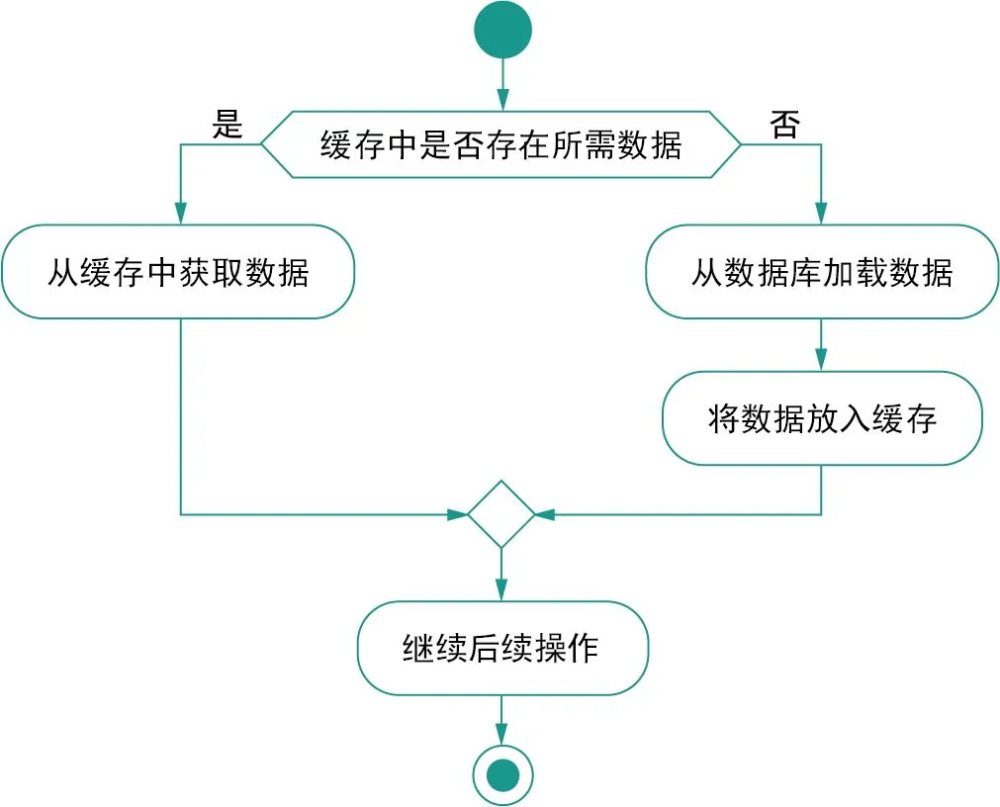

# 第8章数据访问进阶(2)

## 8.3　Spring 的缓存抽象

我们一般是按照图 8-3 的步骤来使用缓存数据的：第一次进入代码段，判断缓存中是否有需要的数据，如果存在就用缓存里的，如果不存在就从数据库或其他地方读取数据并放入缓存，这样下次就能从缓存获取数据了。当然，这里还要考虑缓存内容过期、超过缓存上限时内容淘汰、数据写入缓存时是否加锁等问题。



- 图 8-3　一般的缓存操作流程

我们将这个过程抽象一下，缓存的常见操作无非就是判断是否存在、读取、写入和淘汰，真希望有一套框架能自动缓存特定方法的返回值，这样就不用我们再自己写代码了。SpringFramework 恰好就提供了这么一层缓存抽象。

### 8.3.1　基于注解的方法缓存

Spring Framework 3.1 引入了一套缓存抽象，它通过注解或者 XML 的方式配置到方法上，每次执行方法就会在缓存里做一次检查，看看是否已经用当前参数调用过这个方法了，如果调用过并且有结果在缓存里了，就不再执行实际的方法调用，而是直接返回缓存值；如果没调用过，就进行调用，并缓存结果。这样一来，就可以自动避免反复执行一些开销很大的方法了。

- 请注意　这里有两点需要着重说明一下：这套缓存抽象背后是通过 AOP 来实现的，即在实际对象外面包了一层代理，由代理来完成缓存操作，所以必须访问代理后的对象；

- 只有那些可幂等操作的方法才适用于这套抽象，因为必须要保证相同的参数拥有一样的返回值。

从 Spring Framework 4.1 版本开始，这套缓存抽象还提供了对 JSR-107 注解的支持。在本节中，我们就着重讨论基于注解的方法缓存。

1. 常用注解介绍表 8-9 中列举了在 Spring 的缓存抽象中提供的注解，以及它们与 JSR-107 注解的对应关系。

- 表 8-9　Spring 的缓存抽象中提供的注解

- Spring 注解JSR-107 对应注解说明

- 从缓存中获取对应的缓存值，

```
缓存，然后返回，其中 sync
@Cacheable
@CacheResult
```

- 方法时会锁住缓存，相同的参算，其他线程等待结果

```
@CachePut
@CachePut
```

- 直接用方法返回更新缓存，不

```
清除缓存，其中的allEntri
这些注解中有很多一样的属性（除了 @Caching），具体如下。
cacheNames，用来设置操作的缓存列表，例如 cacheNames="menu"。
key，计算缓存键名的 SpEL 表达式，如果不设置，默认值是 ""，即所有参数都参与计
算，共同决定键名。通过 {#root.args[0]} 来引用方法的第 1 个参数，此处也可以替
换为参数名，例如 #foo；#result 可以访问方法的返回对象，如果注解有
beforeInvocation 属性，配置为 true 时 #result 不可用；#root.methodName
和 #root.targetClass 可以访问方法名和目标类的类名，相应地，#root.method
和 #root.target 则访问对应的对象；#root.caches 可以获得要操作的缓存列表。
keyGenerator，自定义的 KeyGenerator Bean 名称，用来生成缓存键名，与 key
```

- 属性互斥。

- cacheManager，缓存管理器的 Bean 名称，负责管理实际的缓存。

```
cacheResolver，缓存解析器的 Bean 名称，与 cacheManager 属性互斥。
```

- condition，操作缓存的条件，也是用 SpEL 表达式来计算的。

```
前面说过，key 和 keyGenerator 是用来计算缓存键名的，默认情况下，
SimpleKeyGenerator 会根据参数来生成键名，策略如下。
如果没有参数，直接返回 SimpleKey.EMPTY。
如果只有一个参数，且参数不为 null，也不是数组类型，直接返回这个参数。
如果是其他情况，返回包含所有参数的 SimpleKey 实例。
condition 用来计算操作条件，它可以是这样的：
@Cacheable(cacheNames="menu", condition="#name.length() < 16")
1
public MenuItem findByName(String name) {...}
2
还有一个 unless 参数，并不是所有注解都有，它是用来投否决票的。unless 仅在方法
执行后有效，可以拿到执行结果 #result。当 unless 的表达式计算为 true 时则不放入
```

- 缓存。

2. 如何激活缓存抽象了解了上面的这些注解后，又该怎么激活 Spring Framework 对它们的支持呢？激活的方法

```java
与事务类似，可以在配置类上增加 @EnableCaching 注解，例如下面这样：
@Configuration
1
@EnableCaching
2
public class Config {}
3
也可以在 XML 配置文件中使用 <cache:annotation-driven/> 标签，例如：
```

```xml
<beans xmlns="http://www.springframework.org/schema/beans"
1
       xmlns:xsi="http://www.w3.org/2001/XMLSchema-instance"
2
       xmlns:cache="http://www.springframework.org/schema/cache"
3
       xsi:schemaLocation="
4
       http://www.springframework.org/schema/beans
5
       https://www.springframework.org/schema/beans/spring-beans.xsd
6
       http://www.springframework.org/schema/cache
7
       https://www.springframework.org/schema/cache/spring-cache.xsd">
8
9
   <cache:annotation-driven/>
10
</beans>
11
前文提到的各种注解都可以在 <cache/> 中找到对应的配置方法，此处就不展开了，我们
```

- 还是以注解的用法为主。

- 现在，回到二进制奶茶店的例子中，8.2 节的需求描述中已经说明了菜单是长时间的，属于读多写少的内容，因此非常适合做缓存。我们可以将整个菜单缓存起来，减少对数据库的操17

```
 先添加一个菜单服务类 MenuService，用它来封装 Repository 的操作，同时在
```

- 作。其方法上添加相应的注解，如代码示例 8-13 所示。其实，一般都推荐将业务逻辑封装到Service 中，一个服务在具体实现过程中可能会涉及多个不同表的操作，所以我们将事务

```java
也添加在 Service 上。
代码示例 8-13　MenuService 及 MenuRepository 的代码片段
@Service
1
@CacheConfig(cacheNames = "menu")
2
public class MenuService {
3
   @Autowired
4
   private MenuRepository menuRepository;
5
6
   @Cacheable
7
   public List<MenuItem> getAllMenu() {
8
       return menuRepository.findAll();
9
   }
10
11
   @Cacheable(key = "#root.methodName + '-' + #name + '-' + #size")
12
   public Optional<MenuItem> getByNameAndSize(String name, Size size) {
13
       return menuRepository.findByNameAndSize(name, size);
14
   }
15
}
16
17
// MenuRepository稍做调整，增加了一个方法
18
public interface MenuRepository extends JpaRepository<MenuItem, Long>{
19
   Optional<MenuItem> findByNameAndSize(String name, Size size);
20
}
21
上面这段代码中，类上添加的 @CacheConfig 注解配置了公共的 cacheNames，因此就
不用再在两个方法上做配置了；getByNameAndSize() 上的 @Cacheable 注解中配置了
key 属性，此处将方法名、name 参数与 size 参数用“-”拼接在一起作为缓存的键名。
```

- 有了菜单服务，接下来需要初始化一下我们的缓存，做个“预热”，代码示例 8-14 就起到了

```
这个作用。先调用 getAllMenu() 缓存完整的菜单列表，再调用
getByNameAndSize() 缓存单个菜单项。一般情况下在有了完整数据后，可以通过简单
```

- 处理来获得里面的内容，这里出于演示的目的又加了些其他方法，在实践中可以酌情考虑合理使用缓存。

```java
代码示例 8-14　用于“预热”缓存的 MenuCacheRunner 代码片段
@Component
1
@Order(1)
2
@Slf4j
3
public class MenuCacheRunner implements ApplicationRunner {
4
   @Autowired
5
   private MenuService menuService;
6
7
   @Override
8
   public void run(ApplicationArguments args) throws Exception {
9
       log.info("从数据库加载菜单列表，后续应该就在缓存里了");
10
       List<MenuItem> list = menuService.getAllMenu();
11
       log.info("共取得{}个条目。", list.size());
12
       menuService.getByNameAndSize("Java咖啡", Size.MEDIUM).ifPresent(m -> lo
13
   }
14
}
15
```

- 缓存“预热”后，再遇到调用对应方法的情况，只要缓存未失效，就不会执行真正的调用，而

```
是直接返回缓存的值。调整后的 MenuPrinterRunner 会使用 MenuService 来获取菜
单信息，加载到 data.sql 中预先插入的两条数据后，再重新通过 getByNameAndSize()
来做遍历，这时因为在 MenuCacheRunner 中缓存过“中杯 Java 咖啡”，它会直接从缓存
```

- 中获取，而大杯咖啡则还需要访问数据库，如代码示例 8-15 所示。

```java
代码示例 8-15　经过调整的 MenuPrinterRunner 代码片段
@Component
1
@Order(2)
2
@Slf4j
3
public class MenuPrinterRunner implements ApplicationRunner {
4
   @Autowired
5
   private MenuService menuService;
6
7
   @Override
8
   public void run(ApplicationArguments args) throws Exception {
9
       log.info("再次加载菜单列表，应该不会访问数据库");
10
       List<MenuItem> list = menuService.getAllMenu();
11
       log.info("共有{}个饮品可选。", list.size());
12
       list.forEach(i -> log.info("重新查询菜单项({})：{}", i.getId(),
13
           menuService.getByNameAndSize(i.getName(), i.getSize())));
14
   }
15
}
16
```

- 由于开启了 Hibernate 的 SQL 打印功能，在运行程序时，通过观察日志中的 SQL 执行情况，就可以很方便地判断是否命中缓存。

### 8.3.2　替换不同的缓存实现

在上一节的例子中，我们使用了 Spring Framework 提供的默认缓存，它的背后是 Java 的

```
ConcurrentHashMap。其实 Spring 的缓存抽象能够支持多种不同的后端缓存实现，它有一
层 CacheManager 抽象，在其中维护了多个 Cache，我们要缓存的内容就是保存在 Cache
里的，而之前注解的 cacheNames 中指定的就是这里的 Cache。
```

```
只需选择不同的 CacheManager 实现类，就能替换具体使用的缓存。表 8-9 列出了 Spring
Framework 中内置的几个 CacheManager 实现。
```

表 8-10　内置的 CacheManager 实现

实现类

- 底层实现说明

```
ConcurrentMapCacheManager
ConcurrentHashMap
```

- 建议仅用于测试目的

```
NoOpCacheManager
```

- 无不做任何缓存操作，可以视为关

```
用于组合多个不同的 CacheMa
CompositeCacheManager
```

- 无历要找的缓存

```
EhCacheCacheManager
```

- EhCache适用于 EhCache

```
CaffeineCacheManager
```

- Caffeine适用于 Caffeine

```
JCacheCacheManager
```

- JCache适用于遵循 JSR-107 规范的缓

spring-context 这个 Jar 包中只有几个简单的实现，像 EhCache、Caffeine 和 JCache 这样的支持都在 spring-context-support 里。我们可以手动引入后者，但在 Spring Boot 的帮助下，缓存抽象的引入也变得和其他各种能力一样，有对应的起步依赖：

```xml
<dependency>
   <groupId>org.springframework.boot</groupId>
   <artifactId>spring-boot-starter-cache</artifactId>
</dependency>
```

而 Spring Boot 的自动配置支持的缓存类型就更多了，除了表 8-10 中提到的，还有下面的几种：

- Redis

- Couchbase

- Hazelcast

- Infinispan

```
CacheProperties 提供了一些基本的配置，在配置文件中使用的前缀是 spring.cache，
例如 spring.cache.type=redis 可以指定缓存的类型，spring.cache.cache-
names=foo,bar 可以限定只用 foo 和 bar 这两个缓存名称，不能动态创建其他的缓存。
```

1. 替换为 Caffeine

```
要将默认的 ConcurrentMapCacheManager 替换为 CaffeineCacheManager，首先
```

- 需要在 pom.xml 中引入 Caffeine 的依赖，具体的版本交给 Spring Boot 来管理（当然，也可以由我们自己指定）：

```xml
<dependency>
1
   <groupId>com.github.ben-manes.caffeine</groupId>
2
   <artifactId>caffeine</artifactId>
3
</dependency>
4
Spring Boot 的自动配置 CaffeineCacheConfiguration 会在下面的条件下生效，创建
一个 CaffeineCacheManager：
@Configuration(proxyBeanMethods = false)
1
@ConditionalOnClass({ Caffeine.class, CaffeineCacheManager.class })
2
@ConditionalOnMissingBean(CacheManager.class)
3
@Conditional({ CacheCondition.class })
4
class CaffeineCacheConfiguration {}
5
在配置文件中可以像这样来设置缓存，具体的 spec 内容可以参考 CaffeineSpec 类：
```

```
spring.cache.caffeine.spec=initialCapacity=10,maximumSize=50,expireAfterAccess=
1
```

- 8.3.1 节中的例子，只需做如上的调整，就能直接使用 Caffeine 运行起来，在代码层面实现18我们也可以写一个代码示例 8-16 这样的测试用例，看看是否真的自动使用了零改动。

```
Caffeine 做了缓存。由于我们的测试在运行前会先运行 MenuCacheRunner，所以我们只
需要在单元测试里做些简单的判断就行了，比如是不是用了 CaffeineCacheManager，
```

- 缓存里有没有之前存进去的内容等。

```python
代码示例 8-16　针对 Caffine 的 MenuCacheRunnerTest 测试类
@SpringBootTest
1
class MenuCacheRunnerTest {
2
   @Autowired
3
   private CacheManager cacheManager;
4
5
   @Test
6
   void testCache() {
7
       Cache cache = cacheManager.getCache("menu");
8
       assertTrue(cacheManager instanceof CaffeineCacheManager);
9
       assertTrue(cache instanceof CaffeineCache);
10
       assertNotNull(cache.get("getByNameAndSize-Java咖啡-MEDIUM"));
11
   }
12
}
13
```

2. 替换为 Redis如果要将缓存抽象的底层缓存实现更换为 Redis，方法和之前类似：引入 Spring Data

```
Redis 的依赖，随后 Spring Boot 的自动配置类 RedisCacheConfiguration 会根据条
件生效，在上下文中注册一个 RedisCacheManager Bean。
CacheProperties 中针对 Redis 有一些配置，可以参考 CacheProperties.Redis 这
```

- 个内部类，具体如表 8-11 所示。

- 表 8-11　spring.cache.redis 配置

- 配置项默认值说明

```
spring.cache.redis.time-to-live
```

- 不过期过期时间

```
spring.cache.redis.cache-null-values
true
```

- 是否可以缓存空值

```
spring.cache.redis.key-prefix
```

- 无前缀缓存中键的前缀

```
spring.cache.redis.use-key-prefix
true
```

- 写入缓存时是否添加键的前缀

- 19与前面使用 Caffeine 时一样，先修改 pom.xml，将 Caffeine 的依赖换掉：

```xml
<dependency>
1
   <groupId>org.springframework.boot</groupId>
2
   <artifactId>spring-boot-starter-data-redis</artifactId>
3
</dependency>
4
```

- 我们可以像 8.2 节那样对 Redis 的操作进行设置，调整序列化方式，这里的演示就不做过

```
多的调整了。除了 spring.cache.redis.time-to-live=60s 以外，其他配置先全部
使用默认值，连接监听在 localhost:6379 上的 Redis。在运行程序后，可以访问 Redis
```

- 缓存，查看数据，看到的结果会与下面的输出类似：

```
# redis-cli
1
127.0.0.1:6379> keys *
2
1) "menu:name:Java\xe5\x92\x96\xe5\x95\xa1"
3
2) "menu::getByNameAndSize-Java\xe5\x92\x96\xe5\x95\xa1-MEDIUM"
4
3) "menu::SimpleKey []"
5
4) "menu::getByNameAndSize-Java\xe5\x92\x96\xe5\x95\xa1-LARGE"
6
5) "menu:1:idx"
7
6) "menu:2:idx"
8
7) "menu"
9
127.0.0.1:6379> type "menu::getByNameAndSize-Java\xe5\x92\x96\xe5\x95\xa1-MEDIU
10
string
11
127.0.0.1:6379>
12
这里的序列化方式其实都是在 RedisCacheConfiguration 中配置的，其中的
keySerializationPair 和 valueSerializationPair 默认是用
RedisSerializer.string() 和 RedisSerializer.java() 来构造的。要对它们进
```

- 行调整有两种方式，具体如下所示（如果是要调整序列化方式，建议用第一种）：

```
(1) 在上下文中配置一个我们自己的 RedisCacheConfiguration Bean，在里面完成自
```

- 定义；

```
(2) 在上下文中配置一个我们自己的 RedisCacheManagerBuilderCustomizer 实现，
对 RedisCacheManager 进行调整。
代码示例 8-16 的测试类也要稍做调整，Cache 应该判断是否为 RedisCache 的实例，具
```

- 体如代码示例 8-17 所示。

```python
代码示例 8-17　针对 Redis 改写的 MenuCacheRunnerTest 测试类
@SpringBootTest
1
class MenuCacheRunnerTest {
2
   @Autowired
3
   private CacheManager cacheManager;
4
5
   @Test
6
   void testCache() {
7
       Cache cache = cacheManager.getCache("menu");
8
       assertTrue(cacheManager instanceof RedisCacheManager);
9
       assertTrue(cache instanceof RedisCache);
10
       assertNotNull(cache.get("getByNameAndSize-Java咖啡-MEDIUM"));
11
   }
12
}
13
```

## 8.4　小结

在这一章里，我们更多地还是在聊一些与数据操作实战相关的话题，例如，在实际生产环境中，数据库连接池除了管理连接，还应该搭配哪些功能——可能是其内置的功能，也可能是与其他组件结合，像密码加密就是个必备的能力。除了关系型数据库，我们还会在工程中大量地使用非关系型数据库，Redis 就是其中比较常用的。你应该体会到了，在 Spring Boot 和Spring Data Redis 的帮助下，Redis 的使用既轻松又惬意。最后我们还聊了聊 SpringFramework 提供的缓存抽象，它在一定程度上简化了方法返回值缓存的复杂性，在工作中十分好用。

本章我们聊完了数据库相关的话题，下一章将要开启一个新篇章 —— 怎么实现 Web 相关的需求。

- 二进制奶茶店项目开发小结到这一章为止，Spring 中的数据操作部分就结束了，阶段性地小结一下二进制奶茶店目前的情况。在第 5 章小结的基础上，目前 BinaryTea 工程在技术层面又实现了如下功能：菜单、订单等对象建模，结合 JPA 注解与 Lombok 注解，Model 层的对象可以直接通过ORM 框架与数据库中的表建立映射关系；

```
常规关系型数据库操作，Spring Data 的 Repository 可以方便地实现最基本的增删改
```

- 查操作，定义接口即能实现扩展；

- 菜单数据缓存，通过 Spring 的缓存抽象，能够透明地更换底层的缓存实现。

- 在项目进展过程中，我们还交替演示了 JDBC、Hibernate 及 MyBatis 的基本使用方法；在演示 Spring Data Redis 时，也切换了 Lettuce 和 Jedis 客户端；介绍缓存抽象时，将基于

```
ConcurrentHashMap 的缓存替换为了 Caffeine 和 Redis。在 Spring 家族各种组件的帮
```

- 助下，这种切换几乎是无缝的，对业务代码的改动微乎其微。

[17]：这里的例子在 ch8/binarytea-cache 中。[18]：这个例子在 ch8/binarytea-cache-caffine 中。[19]：这个例子在 ch8/binarytea-cache-redis 中。
