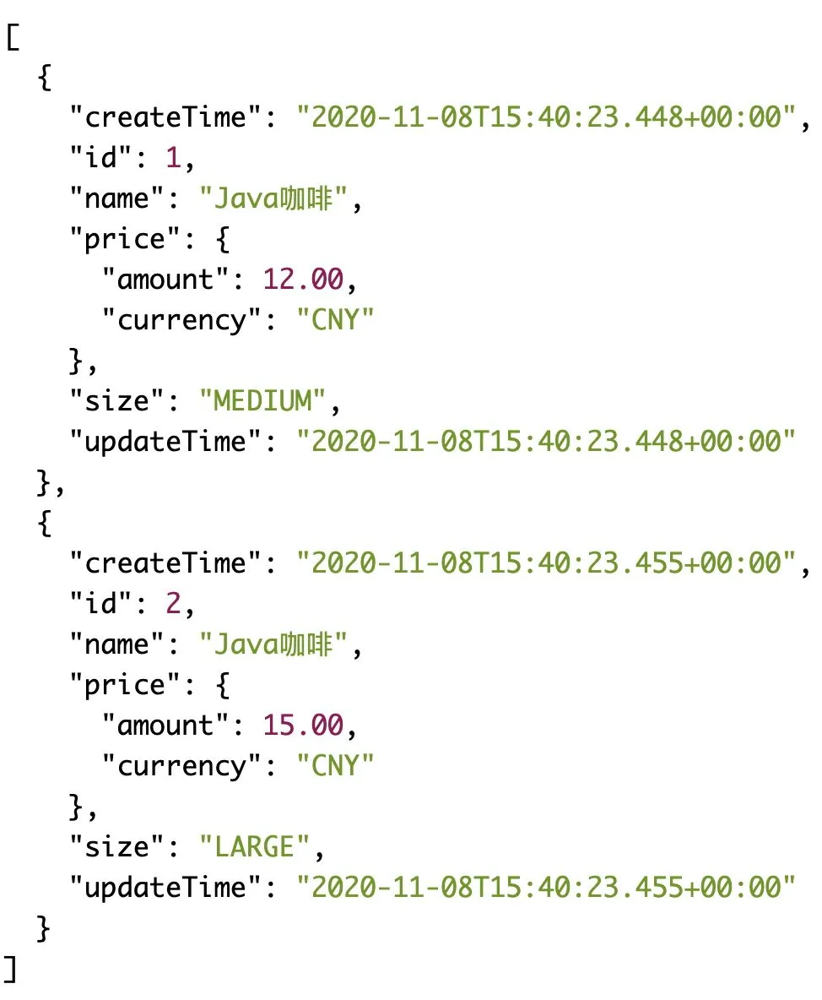

# 第9章SpringMVC实践(1)

- 本章内容Spring MVC 的基本用法

- Spring MVC 的请求处理逻辑

- Spring MVC 的视图相关知识

- RestTemplate 的各类用法

大家在日常工作中或多或少会接触到一些与 Web 相关的内容。早期也许是开发一个 Web 网站，随着大前端技术的发展，在前后端分离之后，后端 Java 系统只需要向前端提供 REST 接

```
口就好了。在系统内部，分布式系统的交互也有可能是通过 REST 接口来实现的——因此掌握
```

基本的 Web 开发能力还是很有必要的。本章我们会学习如何使用 Spring Framework 提供的Spring MVC 来开发 Web 系统。

## 9.1　简单上手 Spring MVC

在早期的 Java EE 项目开发中，大家经常会提到“SSH”组合，其中的第二个“S”指的是 WebMVC 框架 Struts。但随着时间的推移，Struts 早早地就退出了历史的舞台，同一时期的WebWork 框架也已少人问津，这第二个“S”早就被 Spring MVC 取代了。现在再提起 Struts，多数是老项目要修复安全漏洞。无论是开发 Web 页面，还是 RESTful Web 服务，都可以使用 Spring MVC 轻松实现。本节就让我们先简单了解一下 Spring MVC 的大概用法。

### 9.1.1　Spring MVC 概览

- 1

Spring MVC 能帮助我们方便地开发符合 MVC 模式

- 的 Web 应用，MVC 即 Model-View-

Controller（模型——视图——控制器），是一种软件架构模式。开始时，MVC 适用于桌面端程序，在 B/S 结构的应用兴起后，MVC 模式也被逐渐引入 Web 应用。简单说起来，MVC 的主要目标就是对用户界面与业务逻辑进行解耦，提升系统代码的可扩展性、可复用性和可维护性。模型层封装了业务逻辑，视图层则是暴露给用户的界面，控制器层则在两者之间充当黏合剂（所以控制器层一般会很薄，没有太多的逻辑），视图层把数据给到控制器，由控制器去调

```
用模型层对应的服务。Spring MVC 里就有一个重要的 ModelAndView 类，请求处理完毕后
```

都会返回这个类型的对象，其中就包含了模型与视图的信息，而代表控制器的类都会带上

```
@Controller 注解。因此可以说，ModelAndView 对应了 MVC 中的模型与视图，而带有
@Controller 注解的类则对应了 MVC 中的控制器。
Spring MVC 的设计是围绕 DispatcherServlet 展开的，它是整个 Spring MVC 的核心，
```

跟它配合的组件主要有下面这些：

```
控制器，我们编写的各种 Controller；
```

- 各类校验器，例如，Spring MVC 内置了对 Hibernate Validator 的支持；

```
各类解析器，例如，视图解析器 ViewResolver、异常解析器
HandlerExceptionResolver 和 Multipart 解析器 MultipartResolver；
处理器映射，HandlerMapping 定义了请求该如何找到对应的处理器，例如，根据 Bean
名称的 BeanNameUrlHandlerMapping，以及根据 @RequestMapping 注解的
RequestMappingHandlerMapping；
处理器适配器，DispatcherServlet 在收到请求时，通过 HandlerAdapter 来调用被
```

- 映射的处理器。

在后文中，我们会详细介绍 Spring MVC 中的几个主要部分，这里先来了解一下其中的一些常用注解，具体如表 9-1 所示。

表 9-1　Spring MVC 中的常用注解

注解

- 说明

```
@Controller
定义控制器类，与 @Service 和 @Repository 类似
```

- 定义 REST 服务的控制器类，这是个快捷方式注解，其实就是

```
@RestController
结合了 @Controller 和 @ResponseBody
定义请求的处理类和方法，其中的 path 属性是映射的 URL，
method 是 RequestMethod 枚举中的 HTTP 方法，对于后
@RequestMapping
者，还可以使用一些快捷注解，例如 @GetMapping、
@PostMapping、@PutMapping、@DeleteMapping 和
```

### 9.1.2　编写一个简单的控制器

Linus Torvalds 有一句名言：

- Talk is cheap. Show me the code.

要想明白如何编写 Spring MVC 的应用，开发 MVC 的控制器，最好的办法还是动手写一个控制器。以二进制奶茶店为例，我们来看这么一个需求。

- 需求描述　顾客到店后一般会先浏览菜单。有的顾客会查看完整的菜单，然后从中挑选自己喜欢的饮品；有的顾客会直接报饮品名称；甚至有些熟客能够直接报饮品编号。光顾我们二进制奶茶店的顾客主要是程序员，他们不直接报 0 和 1 组成的编码就是万幸了。所以我们需要提供一些服务，以便到店的顾客可以方便地完成下面三件事：(1) 找到完整的菜单；(2) 根据名称找到饮品；(3) 根据编号找到饮品。

1. 开发控制器及其依赖代码因为要开发 Web 相关的代码，所以 pom.xml 中必须引入 Web 相关的依赖，可以像下面这样：

```xml
<dependency>
1
   <groupId>org.springframework.boot</groupId>
2
   <artifactId>spring-boot-starter-web</artifactId>
3
</dependency>
4
```

- 2代码示例 9-1是菜单的 MVC 控制器代码片段，其中的几个方法分别实现了如下的功能

```java
—— getAllMenu() 能获取全部菜单项，getById() 可以根据编号获取指定菜单项，
getByName() 可以根据名称获取菜单项。
代码示例 9-1　菜单的 MVC 控制器 MenuController
@Controller
1
@ResponseBody
2
@RequestMapping("/menu")
3
public class MenuController {
4
   @Autowired
5
   private MenuService menuService;
6
7
   @GetMapping(params = "!name")
8
   public List<MenuItem> getAll() {
9
       return menuService.getAllMenu();
10
   }
11
12
   @GetMapping(path = "/", produces = MediaType.APPLICATION_JSON_VALUE)
13
   public Optional<MenuItem> getById(@PathVariable Long id) {
14
       return menuService.getById(id);
15
   }
16
17
   @RequestMapping(params = "name", method = RequestMethod.GET)
18
   public List<MenuItem> getByName(@RequestParam String name) {
19
       return menuService.getByName(name);
20
   }
21
}
22
详细分析一下这段代码，MenuController 类上添加了 @Controller 注解，表明这个
类是 MVC 控制器。@ResponseBody 可以写在类上，也可以写在方法上，表示将方法的返
回值作为响应的正文。Spring MVC 提供了 @RestController 注解，在同时使用
@Controller 和 @ResponseBody 的情况下可以用它来代替。类上的
@RequestMapping 注解设置了整个类里的公共属性，在这里是设置了 URL 映射的基础路
径 /menu，下面的方法在写路径时就可以不用再加这段前缀了。
方法上的几个注解用来建立方法和请求的映射关系，@GetMapping 相当于
@RequestMapping(method = RequestMethod.GET)，表 9-1 中提到的其他几个
```

- 3

```
@XxxMapping 注解也是类似的情况。
在 Spring MVC 中，@RequestMapping 是一个非常重要的注解，所以要详细介绍一下，
```

- 表 9-2 列出了它的所有属性。

- 表 9-2　@RequestMapping 注解的属性

- 属性类型说明

- 为映射定义一个名称，当类上和方法上的注解里都定

```
name
String
义了名称，会用 # 将它们连接起来
```

- 指定映射的 URL，也是本注解的默认属性，类上的

```
path 会作为方法上的 path 的前缀，如果路径中用
path
String[]
了占位符 {}，可以用 @PathVariable 注解来取得
```

- 对应占位符的值

- 指定可以接受的HTTP 方法用来缩小映射的范围

```java
这个控制器用到的 MenuService 与上一章里的基本类似，但增加了一些方法和注解，例
如，根据 ID 和名称获取 MenuItem 的方法，另外，事务一般配置在服务层上，所以这里
还增加了 @Transactional 注解，具体见代码示例 9-2。
代码示例 9-2　增加了所需方法和注解的 MenuService
@Service
1
@Transactional
2
@CacheConfig(cacheNames = "menu")
3
public class MenuService {
4
   @Autowired
5
   private MenuRepository menuRepository;
6
7
   @Cacheable
8
   public List<MenuItem> getAllMenu() {
9
       return menuRepository.findAll();
10
   }
11
12
   public Optional<MenuItem> getById(Long id) {
13
       return menuRepository.findById(id);
14
   }
15
16
   public List<MenuItem> getByName(String name) {
17
       return menuRepository.findAll(Example.of(MenuItem.builder().name(name)
18
   }
19
20
   @Cacheable(key = "#root.methodName + '-' + #name + '-' + #size")
21
   public Optional<MenuItem> getByNameAndSize(String name, Size size) {
22
       return menuRepository.findByNameAndSize(name, size);
23
   }
24
}
25
此外，由于会返回 Money 类型和 Hibernate 的某些类型（我们直接返回了数据库里查找的
```

- 对象，有些是 Hibernate 包装过的），所以需要对我们的 Jackson JSON 做些配置。本来我们需要自己编写各种序列化和反序列化组件，但好在 Jackson 社区早就为各种常用的库编4写好了所需的设施。只需在 pom.xml 中引入需要的数据类型绑定依赖就可以了，例如：

```java
<dependencies>
1
   <dependency>
2
       <groupId>com.fasterxml.jackson.datatype</groupId>
3
       <artifactId>jackson-datatype-joda-money</artifactId>
4
       <version>2.13.1</version>
5
   </dependency>
6
   <dependency>
7
       <groupId>com.fasterxml.jackson.datatype</groupId>
8
       <artifactId>jackson-datatype-hibernate5</artifactId>
9
       <version>2.13.1</version>
10
   </dependency>
11
   <!-- 省略其他依赖 -->
12
</dependencies>
13
随后，Spring Boot 会收集上下文中配置的 Module，注册到自动配置的 Jackson JSON
ObjectMapper 里，我们要做的就是配置几个 Bean，就像代码示例 9-3 那样。
代码示例 9-3　修改过的 BinaryTeaApplication 代码片段
@SpringBootApplication
1
@EnableCaching
2
public class BinaryTeaApplication {
3
4
   public static void main(String[] args) {
5
       SpringApplication.run(BinaryTeaApplication.class, args);
6
   }
7
8
   @Bean
9
   public JodaMoneyModule jodaMoneyModule() {
10
       return new JodaMoneyModule();
11
   }
12
13
   @Bean
14
   public Hibernate5Module hibernate5Module() {
15
       return new Hibernate5Module();
16
   }
17
}
18
运行工程，默认 Spring Boot 的应用会监听 8080 端口，随后通过浏览器或者任何可以访问
```

- Web 的方式来访问 http://localhost:8080/menu 就能看到完整的菜单了，图 9-1 就是在Chrome 浏览器中装上 JSON View 插件后看到的效果。



- 图 9-1　完整的菜单 JSON 输出

2. 通过 MockMvc 对控制器进行单元测试

- 用浏览器查看输出是一种简单的测试方法，通过这种方式，我们可以直观地看到程序运行的效果，但如果希望后续能反复不断地运行测试，做到测试的自动化，那显然需要换一种测试方法，例如，用对应的单元测试来发起请求并检查结果。

```
对于 Spring MVC，Spring Framework 提供了一个好用的 MockMvc，可以让我们方便地构
```

- 建各种 HTTP 请求，并设置期望的返回值，做各种校验。我们可以像代码示例 9-4 这样来

```python
构建 MockMvc。
代码示例 9-4　MenuControllerTest 中关于 MockMvc 初始化的部分
@SpringBootTest
1
class MenuControllerTest {
2
   private MockMvc mockMvc;
3
4
   @BeforeEach
5
   void setUp(WebApplicationContext wac) {
6
       this.mockMvc = MockMvcBuilders.webAppContextSetup(wac).alwaysExpect(sta
7
   }
8
9
   @AfterEach
10
   void tearDown() {
11
       mockMvc = null;
12
   }
13
   // 省略其他部分
14
}
15
上面的代码通过传入 WebApplicationContext 来构建 MockMvc，随后设置 MockMvc
每次都期望返回 HTTP 200 OK 的返回码（这里的 alwaysExpect() 也可以不加断言，
```

- 在具体的测试方法里再添加）。在测试过程中会用到很多静态方法，所以最好先根据需要用

```python
import static 导入一些方法，例如：
```

- MockMvcBuilders.*

- MockMvcRequestBuilders.*

- MockMvcResultMatchers.*

- MockMvcResultHandlers.*

```
此外，我们也可以针对特定 Controller 初始化 MockMvc，例如像下面这样，但这样需
```

- 要自己处理各种依赖，所以建议使用上面的方法。

```
this.mockMvc = MockMvcBuilders.standaloneSetup(new MenuController()).build();
1
getAll() 方法的测试代码如代码示例 9-5 所示，其中有以下几个步骤。
(1) 通过 MockMvcRequestBuilders.get() 发起一个针对 /menu 的 GET 请求，类似
的还有 post() 等方法。
(2) andExpect() 用来设置期望的检查项，这里先用
MockMvcResultMatchers.handler() 取得了处理器，随后判断它是不是
MenuController 类的 getAll() 方法，检查映射是否正确。
```

- 5(3) 通过 JsonPath对返回的正文进行校验，这里检查了 JSON 是一个数组，数组长度是6

```
2，所有的 name 属性中都有“Java 咖啡”。在匹配时用到了 Hamcrest
```

- ，可以在

```python
Matchers 里找到大量现成的匹配器。
代码示例 9-5　MenuControllerTest 中关于 getAll() 测试的部分
@SpringBootTest
1
class MenuControllerTest {
2
   // 省略其他部分
3
   @Test
4
   void testGetAll() throws Exception {
5
       mockMvc.perform(get("/menu"))
6
               // 判断处理方法
7
               .andExpect(handler().handlerType(MenuController.class))
8
               .andExpect(handler().methodName("getAll"))
9
               // 判断返回JSON内容
10
               .andExpect(jsonPath("$").isArray())
11
               .andExpect(jsonPath("$.length()").value(2))
12
               .andExpect(jsonPath("$..name").value(Matchers.hasItem("Java咖啡
13
   }
14
}
15
接下来，再测试一下 getById() 方法，具体如代码示例 9-6 所示，这里多了用
MockMvcResultMatchers.content() 来检查返回的 Content-Type 头和返回的消息
正文，因为只返回单个对象，所以在没有结果时序列化的值为 null。我们分别用两个测试
方法测试了两种场景。其实，在没有找到菜单项时应该将 HTTP 响应码设置为 404，这样
```

- 才更符合 RESTful Web Service 的风格，我们在后续内容会介绍如何进行设置。

```python
代码示例 9-6　MenuControllerTest 中关于 getById() 测试的部分
@SpringBootTest
1
class MenuControllerTest {
2
   // 省略其他部分
3
   @Test
4
   void testGetById() throws Exception {
5
       mockMvc.perform(get("/menu/1"))
6
               // 判断响应头
7
               .andExpect(content().contentType(MediaType.APPLICATION_JSON))
8
               // 判断处理方法
9
               .andExpect(handler().handlerType(MenuController.class))
10
               .andExpect(handler().methodName("getById"))
11
               // 判断返回的JSON内容
12
               .andExpect(jsonPath("$.name").value("Java咖啡"))
13
               .andExpect(jsonPath("$.size").value("MEDIUM"));
14
   }
15
16
   @Test
17
   void testGetByIdWithWrongId() throws Exception {
18
       mockMvc.perform(get("/menu/100"))
19
               .andExpect(content().string("null"));
20
   }
21
}
22
最后，再来测试 getByName() 方法，具体的代码如代码示例 9-7 所示。这里通过
get().param() 方法设置了请求的参数，当传入的参数查不到内容时，返回的数组为
```

- 空。

```python
代码示例 9-7　MenuControllerTest 中关于 getByName() 测试的部分
@SpringBootTest
1
class MenuControllerTest {
2
   // 省略其他部分
3
   @Test
4
   void testGetByName() throws Exception {
5
       mockMvc.perform(get("/menu").param("name", "Java咖啡"))
6
               .andExpect(handler().handlerType(MenuController.class))
7
               .andExpect(handler().methodName("getByName"))
8
               .andExpect(jsonPath("$.length()").value(2));
9
   }
10
11
   @Test
12
   void testGetByNameWithWrongName() throws Exception {
13
       mockMvc.perform(get("/menu").param("name", "Java"))
14
               .andExpect(jsonPath("$").isEmpty());
15
   }
16
}
17
```

- JsonPath 非常灵活，有很多操作符和函数，我们可以在其官方主页查看基本的用法，表 9-

```
3 列出了一些常用的操作符。JsonPath 的常用函数有运算类的 max()、min()、avg()
和 sum()，都是用于数组的，此外数组的 length() 可以返回数组长度。
```

- 表 9-3　JsonPath 的常用操作符

- 操作符说明

```
$
```

- JSON 的根元素

```
@
```

- 正在处理的当前节点

[1]：根据维基百科的介绍，MVC 模式最早是在 1978 年由 Trygve Reenskaug 提出的。MVC 模式的目的是实现一种动态的程序设

- 计，旨在简化后续对程序的修改和扩展，并且实现对程序中某些部分的重复利用。MVC 模式在分离系统各部分的同时，也赋予了它们应有的功能。

[2]：这个示例放在第 9 章的目录里，具体位置是 ch9/binarytea-simple-controller。[3]：请注意，本来应该为展现层编写用于向调用方返回的视图对象的，但这里仅是演示，就直接返回了底层数据库映射的对象。在

- 实际生产环境中，并不推荐这种做法。

[4]：版本需要根据 Spring Boot 管理的 Jackson JSON 的版本来设置。[5]：JSONPath 是一种读取 JSON 文档的 Java DSL。[6]：Hamcrest 是单元测试利器，可以帮助我们灵活地创建各种匹配表达式，不仅有针对 Java 的版本，也支持很多其他的语言。
