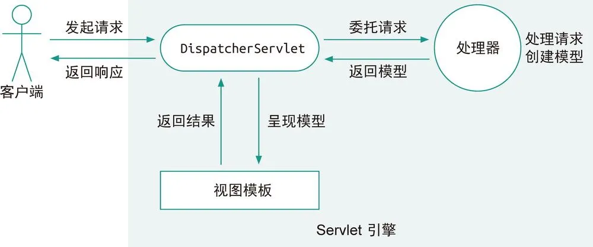
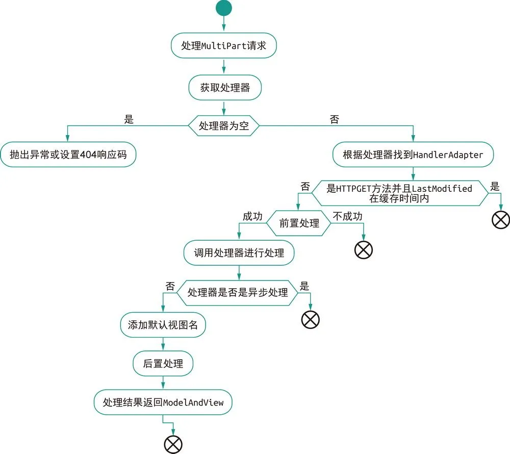
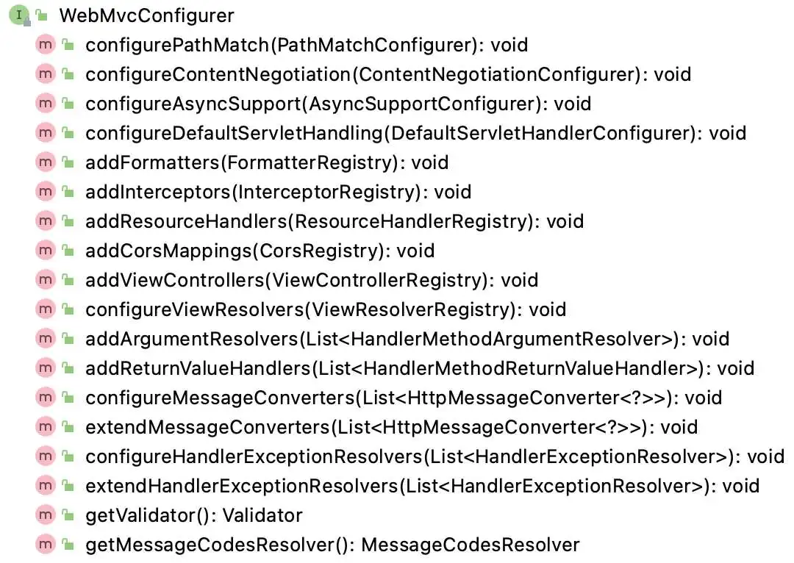
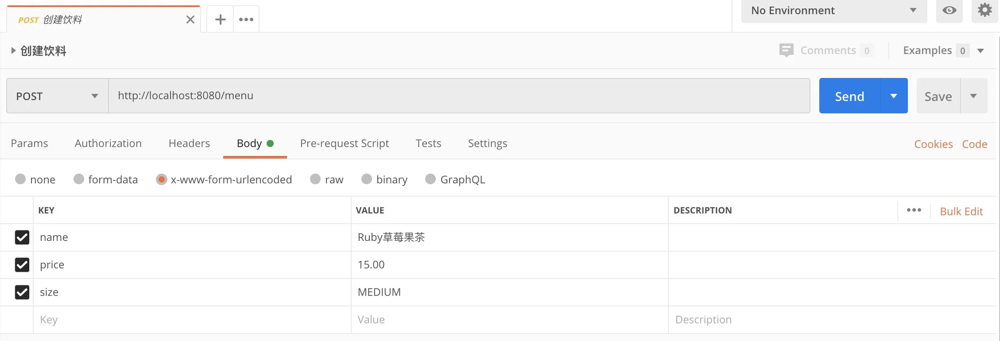
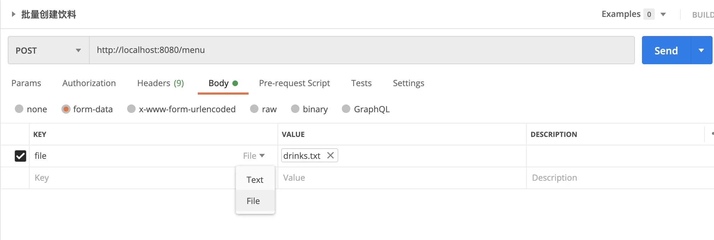
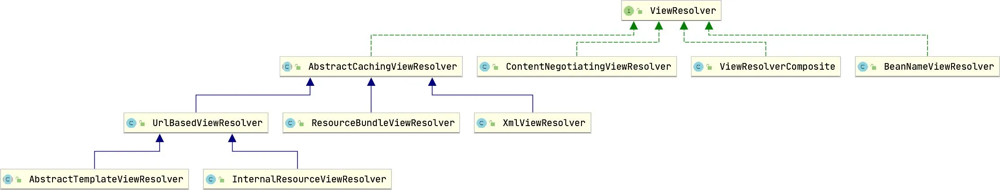
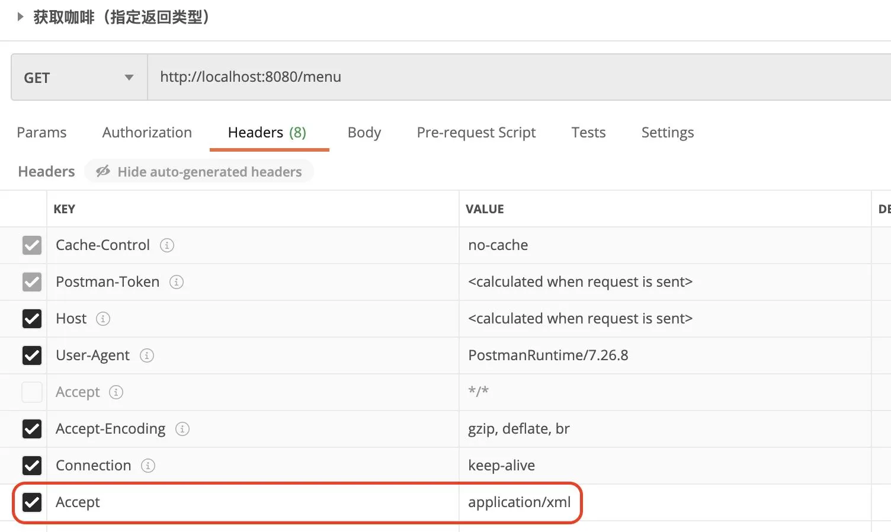
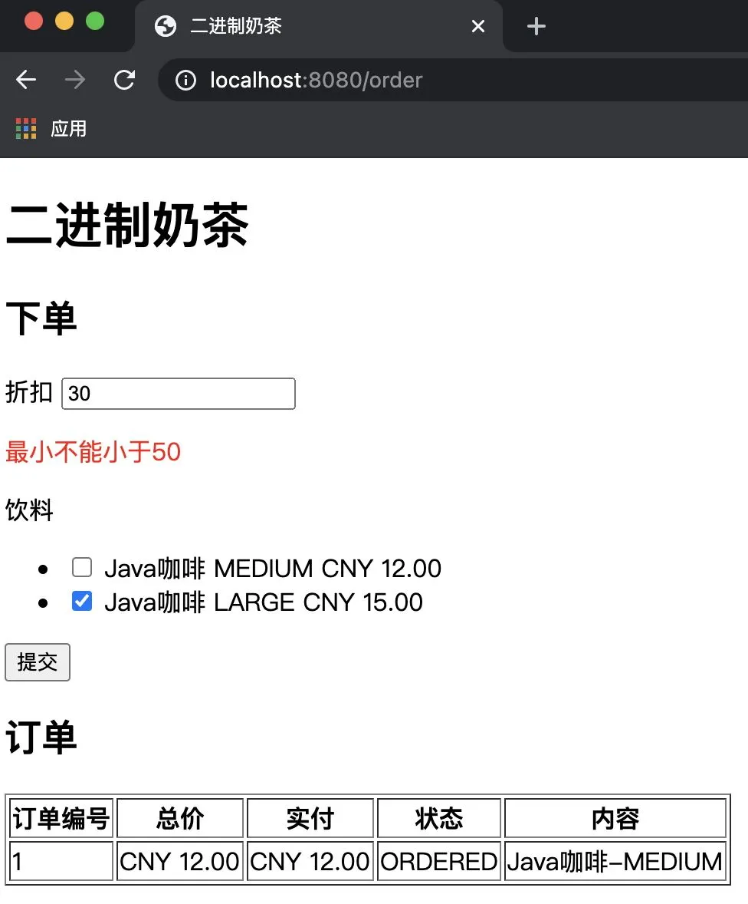

# 第9章SpringMVC实践(2)

## 9.2　Spring MVC 的请求处理逻辑

在看过了如何编写一个简单的 Spring MVC 程序后，大家心中应该会有一些好奇：这背后到底发生了什么？Spring MVC 是怎么把这些功能串联起来的？我们只是写了一个控制器而已，HTTP 请求是怎么转换为控制器方法的调用的？结果又是怎么变成 JSON 的……这一节就让我们一点一点来解释其中的逻辑。

### 9.2.1　请求的处理流程

- 7

现代 Java Web 项目在处理 HTTP 请求时基本都遵循一样的规范，即 Java Servlet 规范（JSR 340）。其处理流程都是 Servlet 容器（例如 Tomcat 或者 Jetty）收到一个请求，接着找到合适的 Servlet 进行处理，随后返回响应。在 Spring MVC 中，这个处理请求的 Servlet 就

```
是前面提到过的 DispatcherServlet。根据配置，Servlet 容器会将指定的请求都交由它来
处理，在收到请求后，DispatcherServlet 会在 Spring 容器中找到合适的处理器（大部分
情况下是控制器，即带有 @Controller 注解的类）来处理请求，处理结果经过视图模板后
```

- 8

得到可以呈现（render）的响应内容，最后再返回给用户，图 9-2

- 展示了上述大致的过程。



- 图 9-2　Spring MVC 的请求处理流程概要

1. DispatcherServlet 的初始化

```java
既然 DispatcherServlet 是一个 Servlet 的实现，那就会遵循其生命过程，例如会在创
建后进行初始化。HttpServletBean.init() 方法调用了子类的方法
FrameworkServlet.initServletBean()，其中做了 Web 应用上下文的初始化，用
的就是 initWebApplicationContext()。在初始化 Web 应用上下文或者是上下文更
新时，都会调用 DispatcherServlet.onRefresh()，而这个方法就一句话，直接调用
了下面的 initStrategies() 方法。
protected void initStrategies(ApplicationContext context) {
1
   initMultipartResolver(context);
2
   initLocaleResolver(context);
3
   initThemeResolver(context);
4
   initHandlerMappings(context);
5
   initHandlerAdapters(context);
6
   initHandlerExceptionResolvers(context);
7
   initRequestToViewNameTranslator(context);
8
   initViewResolvers(context);
9
   initFlashMapManager(context);
10
}
11
```

- 这段代码不难理解，就是在初始化 Spring MVC 的很多特殊类型的 Bean，表 9-4 对这些Bean 做了一个简单的说明。

- 表 9-4　Spring MVC 中的特殊 Bean 类型

- Bean 类型说明

```
用来解析 MultiPart 请求的解析器，通常是上传文
MultipartResolver
件的请求，MultipartResolver 这层抽象的背后
```

- 会有多种实现，例如基于 Commons FileUpload

- 和语言环境有关的解析器，通常用于国际化相关的场

```
LocaleResolver
```

- 景中，包含时区、语言等多种信息

- 主题（Theme）解析器，选择应用程序的外观界面，

```
ThemeResolver
```

- 主题通常是一组静态资源

- 用于将请求映射到处理器上，过程中还包括各种前置与后置处理，两个主要的实现类是

```
HandlerMapping
RequestMappingHandlerMapping 和
SimpleUrlHandlerMapping
```

- 用于触发执行处理器，通过这层抽象，

```
HandlerAdapter
DispatcherServlet 可以不用关心具体如何执行
```

2. 请求的处理过程

```
DispatcherServlet 在收到请求后，会交由 doService() 方法来进行处理，其中包含
```

- 了两个主要的步骤：第一步，向请求中设置 Spring MVC 相关的一些属性；第二步，调用

```
doDispatch() 将请求分派给具体的处理器执行实际的处理。表 9-5 罗列了第一步里主要
```

- 设置的几个属性。

- 9表 9-5　doService() 方法中设置到 HttpServletRequest 里的几个属性

- 9属性名说明

```
WEB_APPLICATION_CONTEXT_ATTRIBUTE
WebApplicationContext，即 Web 的应
处理请求时可能会需要用到的 LocaleRes
LOCALE_RESOLVER_ATTRIBUTE
```

- 如果没有国际化需求，可以忽略它

```
用来决定使用哪个显示主题的 ThemeReso
THEME_RESOLVER_ATTRIBUTE
```

- 果没有这个需求，也可以忽略它

```
用来获取主题的 ThemeSource，默认是当
THEME_SOURCE_ATTRIBUTE
WebApplicationContext
上个请求传递过来暂存到Fl
hM
M
```

- 9这里都是定义的常量名，并非具体的值。

```
doDispatch() 方法的大致处理逻辑如图 9-3 所示，DispatcherServlet 会尝试根据
请求来找到合适的处理器，再通过 HandlerAdapter 来执行处理器的逻辑，经过前置处
理、处理器处理和后置处理等多个步骤，最终返回一个 ModelAndView。
RequestMappingHandlerAdapter 是专门用来调用 @RequestMapping 注解标记的处
```

- 理器的。在处理结果的那一步，如果有异常就处理异常，例如交给专门的

```
HandlerExceptionResolver 来处理；如果没有异常就看 ModelAndView，不为空则
```

- 呈现具体的视图，不存在也不用担心，因为请求可能已经处理完成了。

```
通读了 DispatcherServlet 的 doService() 和 doDispatch() 方法之后，我们能
```

- 大致了解整个请求的处理过程。如果感兴趣的话，你还可以通过 IDE 一步步调试一个请求

```
的处理过程。例如，将端点加在 doDispatch() 的下面这行上，进入内部就能看到
DispatcherServlet 具体是如何从一个 HttpServletRequest 找到对应的处理器
```

- 的：

```
mappedHandler = getHandler(processedRequest);
1
```



```
图 9-3　doDispatch() 方法的大致处理逻辑
```

- 需要特别说明的是，在调用处理器逻辑处理的过程中，针对方法的返回值，会调用

```
HandlerMethodReturnValueHandler 进行处理——根据不同的情况，会有不同的实现
来做处理，例如，加了 @ResponseBody 的方法，返回值就直接被
RequestResponseBodyMethodProcessor 处理掉了，选择合适的
HttpMessageConverter 将对象直接序列化为相应的内容；而返回字符串作为视图名的
情况，则是由 ViewNameMethodReturnValueHandler 来处理的。
```

3. 配置 Spring MVC在 9.1 节中，我们没有做任何配置，只是引入了 Web 相关的依赖，靠着 Spring Boot 的自动配置，就能直接开发 Spring MVC 的代码。Spring Boot 是先用 Spring 的配置启动，随后

- 再启动内嵌的 Web 容器；如果没有 Spring Boot，就需要使用外置的 Web 容器，或者说Servlet 容器了。

- 因为现在大部分情况下会使用 Spring Boot，而 Spring Boot 又有完善的自动配置机制，我们不用太操心配置，所以在这部分就简单介绍一下如何在没有 Spring Boot 的情况下配置Spring MVC。在传统的 Web 工程里，基本都会有一个 web.xml，我们可以把

```xml
DispatcherServlet 配置在这个文件里，例如：
<web-app>
1
   <!-- 配置应用上下文 -->
2
   <listener>
3
       <listener-class>org.springframework.web.context.ContextLoaderListener</
4
   </listener>
5
6
   <context-param>
7
       <param-name>contextConfigLocation</param-name>
8
       <param-value>/WEB-INF/applicationContext.xml</param-value>
9
   </context-param>
10
   <!-- 配置Servlet -->
11
   <servlet>
12
       <servlet-name>dispatcher</servlet-name>
13
       <servlet-class>org.springframework.web.servlet.DispatcherServlet</servl
14
       <init-param>
15
           <param-name>contextConfigLocation</param-name>
16
           <param-value>classpath:dispatcher-servlet.xml</param-value>
17
       </init-param>
18
       <load-on-startup>1</load-on-startup>
19
   </servlet>
20
21
   <servlet-mapping>
22
       <servlet-name>dispatcher</servlet-name>
23
       <url-pattern>/</url-pattern>
24
   </servlet-mapping>
25
26
</web-app>
27
在上面的配置中，ContextLoaderListener 会加载指定的 XML 文件创建一个上下文，
DispatcherServlet 再加载自己的配置文件，创建 Servlet 并映射到 /，两个上下文的
```

- 关系就如 2.1.4 节中描述的那样，是继承关系。

- 在 Servlet 3.0 以上的容器里，还可以通过 Java 类的方式来注册并初始化

```
DispatcherServlet，只要实现 WebApplicationInitializer 接口，容器会自动找
```

- 到它。例如：

```java
public class WebInitializer implements WebApplicationInitializer {
1
   @Override
2
   public void onStartup(ServletContext container) {
3
       XmlWebApplicationContext appContext = new XmlWebApplicationContext();
4
       appContext.setConfigLocation("classpath:dispatcher-servlet.xml");
5
6
       ServletRegistration.Dynamic registration = container.addServlet("dispat
7
           new DispatcherServlet(appContext));
8
       registration.setLoadOnStartup(1);
9
       registration.addMapping("/");
10
   }
11
}
12
```

- 在上面的代码中，我们还需要自己配置 Spring 的上下文，Spring MVC 提供了一个实现了

```
WebApplicationInitializer 的抽象类
AbstractDispatcherServletInitializer，通过它的子类
AbstractAnnotationConfigDispatcherServletInitializer 和
AbstractDispatcherServletInitializer 可以轻松地配置基于 Java 配置类的
DispatcherServlet 和基于 XML 文件的 DispatcherServlet。在实践时，更推荐使
```

- 用这两个子类。

- 在配置完 Servlet 后，就该配置 Spring MVC 了，同样有 XML 和 Java 类两种配置方式。在

```
XML 文件中，使用 <mvc:annotation-driven/> 来开启 Spring MVC，就像下面这
```

- 样：

```xml
<?xml version="1.0" encoding="UTF-8"?>
1
<beans xmlns="http://www.springframework.org/schema/beans"
2
       xmlns:mvc="http://www.springframework.org/schema/mvc"
3
       xmlns:xsi="http://www.w3.org/2001/XMLSchema-instance"
4
       xsi:schemaLocation="http://www.springframework.org/schema/beans
5
                             https://www.springframework.org/schema/beans/spri
6
                             http://www.springframework.org/schema/mvc
7
                             https://www.springframework.org/schema/mvc/spring
8
9
   <mvc:annotation-driven/>
10
11
</beans>
12
基于 Java 类的配置大概是下面这样的。我们需要在配置类上添加 @EnableWebMvc 注
解，为了实现更精准的配置，还可以让配置类实现 WebMvcConfigurer 接口。在 Java 8
```

- 里，接口的方法可以带有默认实现，而 Spring Framework 5.0 开始支持的最低 Java 版本就是 Java 8，所以我们可以直接实现这个接口，不需要以前的

```java
WebMvcConfigurerAdapter 抽象类了。
@Configuration
1
@EnableWebMvc
2
public class WebConfig implements WebMvcConfigurer {
3
   // 按需实现对应方法
4
}
5
图 9-4 列出了 WebMvcConfigurer 接口的各个方法，覆盖这些方法就能实现对 Spring
```

- MVC 的精准配置。



```
图 9-4　WebMvcConfigurer 接口的各个方法
```

- 最后，再让我们回到 Spring Boot，Spring Boot 的

```
DispatcherServletAutoConfiguration 提供了针对 DispatcherServlet 的自动
配置，而 WebMvcAutoConfiguration 则提供了 Spring MVC 的自动配置。后者的配置
```

- 能满足绝大部分的系统需求，在 Spring 的默认配置基础之上还增加了很多额外的功能，例

```
如，自动注册 Converter、GenericConverter、Formatter、
HttpMessageConverters 和 MessageCodesResolver 类型的 Bean，支持静态资源
```

- 等。

- 如果希望在保留自动配置的基础上再做一些 Spring MVC 的定制，可以添加一个实现了

```
WebMvcConfigurer 的配置类，但一定不要加 @EnableWebMvc 注解，因为这样会破坏
```

- Spring Boot 对 Spring MVC 的自动配置。如果希望定制

```
RequestMappingHandlerMapping、RequestMappingHandlerAdapter 和
ExceptionHandlerExceptionResolver，可以声明一个 WebMvcRegistrations 类
```

- 型的 Bean，把那些对象塞到这个 Bean 里。

- 如果希望完全由自己来控制 Spring MVC 的配置，可以选择关闭自动配置，或者定义一个带

```
有 @EnableWebMvc 注解的配置类。在没有特殊理由的情况下，不建议这么操作，就让
```

- Spring Boot 的自动配置替我们操心一切吧！

- 茶歇时间：Servlet 的基础知识早期的 Web 只是简单地提供静态资源，例如页面和图片。随着技术的发展，逐步出现了一些动态技术，能够通过调用服务器上的一些程序动态地响应用户的请求。1993 年美国国家超级电脑应用中心（NCSA）提出了 CGI（Common Gateway Interface，通用网关接口）的概念并成功开发了一套 CGI 程序。后来 CGI 就成为了服务器和请求处理程序之间的一种标准，像 Perl、Python、PHP 等很多语言都能拿来开发 CGI 程序。不过，当时开发一个 CGI 程序还是比较麻烦的，用 Java 从头开发一个 CGI 程序也一样。为了规范 Java Web 程序，提升开发效率，Java EE（以前叫 J2EE）中诞生了 JavaServlet 技术。Oracle 官方是这样来介绍它的——Java Servlet 技术为 Web 开发者提供了一套既简单又一致的机制，可以用来扩展 Web 服务器的功能，访问现有的业务系统。通常情况下，运行在 Servlet 容器（例如 Tomcat）里的 Servlet 能够完全实现 CGI 程序的功能，甚至有过之而无不及。Servlet 规范定义了如何接收请求，如何返回响应，如何处理表单，如何处理异常，如何处理 Cookie，如何处理 Session……总之，其中定义了在日常 Web 开发时会遇到的绝大部分内容，只要我们遵循这个规范，使用它的实现，Web 的开发工作相比之前就能轻松不少。

```
所有的 Servlet 都必须实现 Servlet 接口，其中有 5 个方法，分别是：
init()，初始化方法；
getServletConfig()，获得 Servlet 的配置，例如名称、初始化参数等；
getServletInfo()，获得 Servlet 的信息，例如作者、版本等；
service()，主要的执行方法；
destroy()，销毁方法。
但在实际开发时，我们更多地会使用 HttpServlet 这个抽象类，去实现里面的
doXxx() 方法，例如 doGet() 就是用来处理 GET 请求的。
```

- 再后来，Java 程序员不满足于直接开发 Servlet，于是出现了各种 Web 开发框架，尤其是 MVC 模式的框架—Struts、WebWork 就是早期流行的 MVC 框架。当然，后来出现的

- Spring MVC 超越了它们，成为了事实上的行业标准。

### 9.2.2　请求处理方法

```
在 9.1.2 节中，我们已经看过了如何编写简单的控制器，其中介绍了 @RequestMapping 的
```

用法。其实，Spring MVC 的控制器方法定义非常灵活，可以有各种参数和返回值，接下来就让我们详细了解一下具体的情况。

1. 方法的定义

```
添加了 @RequestMapping 的方法就是用来处理 HTTP 请求的，所以可以通过方法的参数
```

- 获得请求的各种信息，可以是原始的，也可以是经过处理的。表 9-6 列出了一些常用的参数类型，更多的内容可以参考 Spring Framework 官方文档中 Spring MVC 相关的章节。

- 表 9-6　Spring MVC 请求处理方法的常用参数类型

- 参数类型说明

- 获取当前对应的请求与响应，可以是这两个接

```
类型，例如 HttpServletRequest，对这些
ServletRequest、ServletResponse
```

- 操作是最灵活的，但如果没有特殊原因，不建

```
操作 ServletRequest 和 ServletRespo
```

- 获取当前请求的 HTTP 头和请求体，请求体会

```
HttpEntity<T> 与 RequestEntity<T>
HttpMessageConverter 转换成对应的泛
```

- 除了上述类型，还可以在参数上增加一些注解，获取特定的信息，常用的注解如表 9-7 所示。

- 表 9-7　Spring MVC 请求处理方法的常用参数注解

- 注解说明

- 上面提到的这些参数，大部分内容都会被转换成参数对应的类型，如果没有匹配到表 9-6 的

```
类型，也没有带表 9-7 的注解，并且是简单类型（例如原子类型及其包装类、String
等），那就会被当做带有 @RequestParam 注解，否则就当做带有 @ModelAttribute 注
```

- 解。

- 聊完了方法的参数，再来看看方法的返回值，表 9-8 中列出了一些常见的返回值类型，基本都是围绕着呈现结果需要的模型与视图展开的，或者直接给出响应正文。

- 表 9-8　Spring MVC 请求处理方法的常见返回值类型

- 返回值类型说明

```
@ResponseBody
```

- 方法的返回值会直接序列化为响应的消息正

```
ModelAndView
```

- 返回最终呈现结果时会用到的模型与视图

- 返回的数据会被加入模型中，用来最终呈现

```
Map 与 Model
RequestToViewNameTranslator 来决定
View
```

- 返回视图对象，结合模型呈现最终内容

```
返回一个视图名，ViewResolver 要从中解
String
```

- 图，再结合模型呈现最终内容

```
HttpEntity<T> 与 ResponseEntity<T>
```

- 返回的对象就是完整的响应，包含了头和正

```
HttpHeaders
```

- 响应只有 HTTP 头，没有消息正文

```
如果方法的返回值类型是 void，那么下面几种情况意味着请求已经被处理：
有 ServletResponse 和 OutputStream 参数；
有 @ResponseStatus 注解设置了返回的 HTTP 响应码；
做过 HTTP 缓存处理，例如检查过 E-TAG 没变化。
其他情况下，void 类型的返回值会用 RequestToViewNameTranslator 来解析获得视
```

- 图的名称，再呈现结果。至于简单类型的返回值就不做解析，保留原样。

- 茶歇时间：请求处理过程中遇到的几个作用范围在处理 HTTP 请求时，我们经常会获取一些信息，有时是从请求中，有时是从 Session中，有时是从 Cookie 中，那它们又有哪些区别呢？请求的参数或正文里取得的内容，仅在当前这一次请求中有效，请求处理结束后它们也就随之消亡了。一个 Web 用户在正常操作时往往不会只请求一次，而是会与 Web 系统进行交互，这就是会话。会话期间会发生多次请求，这些请求彼此之间要共享一些信息，这些信息就可以放在 Session 里。Session 的信息是存储在服务器端的，用户的请求里带有名为

```
JSESSIONID 的 Cookie 值，通过这个值就能在服务器上找到对应的 Session 信息。这
```

- 里面可以存储不同类型的数据，但出于服务器性能考虑一般不会存太多内容。Session保存在服务器上，换一台服务器信息就没有了，因此在无状态的集群环境中，我们通常会将 Session 存储在共享存储里，例如放进关系型数据库或者 Redis，本书后面的章节里会再聊到分布式 Session 这个话题。Cookie 的本质是一个小型的文本文件，存放在客户端，单个 Cookie 文件的大小不超过4KB，在指定的有效期内 Cookie 中存储的信息都会一直存在。如果在发起请求时带上客户端的 Cookie，处理时我们就能获取上传的 Cookie 信息了。

```
在 Spring MVC 中，也有几个 Bean 的作用范围，在 Spring 容器基本的 singleton 和
prototype 的基础上，Web 应用程序上下文里还有如表 9-9 所示的 4 种特殊范围。
```

- 表 9-9　Web 应用程序上下文中所特有的作用范围

- 范围说明

```
不过这几种作用范围相比 singleton 和 prototype 而言实在是太小众了，通常没有
```

- 特殊情况不建议做专门的配置。

2. 请求内容的转换

```
前面有提到好几个参数类型都带有泛型，此外 @RequestBody 和 @RequestPart 也会对
```

- 请求的内容进行转换，将它们转换为各种不同的类型传到参数中，这里的转换其实就是由

```
HttpMessageConverter 来实现的。在 Spring MVC 中，框架为我们内置了大量的转换
```

- 器，例如之前已经用到过的 Jackson JSON 的转换，其他默认的常用

```
HttpMessageConverter 如表 9-10 所示。
```

- 表 9-10　Spring MVC 内置的常用HttpMessageConverter 列表

- 类名生效条件

- 其中 XML 和 JSON 的优先顺序都是自上而下的，也就是如果存在 Jackson 的依赖，会先用 Jackson 来处理。

```
在 Spring MVC 里，相关的判断和初始化设置都是在 WebMvcConfigurationSupport
```

- 里做的，例如判断依赖是否满足，就是下面这样的：

```java
static {
1
   ClassLoader classLoader = WebMvcConfigurationSupport.class.getClassLoader()
2
   romePresent = ClassUtils.isPresent("com.rometools.rome.feed.WireFeed", clas
3
   jaxb2Present = ClassUtils.isPresent("javax.xml.bind.Binder", classLoader);
4
   jackson2Present = ClassUtils.isPresent("com.fasterxml.jackson.databind.Obje
5
       && ClassUtils.isPresent("com.fasterxml.jackson.core.JsonGenerator", cla
6
   jackson2XmlPresent = ClassUtils.isPresent("com.fasterxml.jackson.dataformat
7
   jackson2SmilePresent = ClassUtils.isPresent("com.fasterxml.jackson.dataform
8
   jackson2CborPresent = ClassUtils.isPresent("com.fasterxml.jackson.dataforma
9
   gsonPresent = ClassUtils.isPresent("com.google.gson.Gson", classLoader);
10
   jsonbPresent = ClassUtils.isPresent("javax.json.bind.Jsonb", classLoader);
11
}
12
我们可以实现 WebMvcConfigurer 接口，覆盖 configureMessageConverters() 方
法来配置自己的 HttpMessageConverter。但在 Spring Boot 里，还有更简单的方法，
有一个 HttpMessageConvertersAutoConfiguration 自动配置类，大致代码如下：
@Configuration(proxyBeanMethods = false)
1
@ConditionalOnClass(HttpMessageConverter.class)
2
@Conditional(NotReactiveWebApplicationCondition.class)
3
@AutoConfigureAfter({ GsonAutoConfiguration.class, JacksonAutoConfiguration.cla
4
   JsonbAutoConfiguration.class })
5
@Import({
6
JacksonHttpMessageConvertersConfiguration.class,
7
GsonHttpMessageConvertersConfiguration.class,
8
JsonbHttpMessageConvertersConfiguration.class
9
})
10
public class HttpMessageConvertersAutoConfiguration {
11
   static final String PREFERRED_MAPPER_PROPERTY = "spring.mvc.converters.pref
12
13
   @Bean
14
   @ConditionalOnMissingBean
15
   public HttpMessageConverters messageConverters(ObjectProvider<HttpMessageCo
16
       return new HttpMessageConverters(converters.orderedStream().collect(Col
17
   }
18
   // 省略其他代码
19
}
20
```

- 其中，除了有相关依赖的导入和自动配置执行顺序设置，更重要的是它还会从上下文里获取

```java
HttpMessageConverter 并设置到 HttpMessageConverters 对象中。而这个对象会
被 Spring MVC 的自动配置类 WebMvcAutoConfiguration 所使用，其内部类
WebMvcAutoConfigurationAdapter 的 configureMessageConverters() 就会从
HttpMessageConverters 中取出所有的 HttpMessageConverter。
public void configureMessageConverters(List<HttpMessageConverter<?>> converters
1
   this.messageConvertersProvider
2
       .ifAvailable((customConverters) -> converters.addAll(customConverters.g
3
}
4
```

- 综上所述，在 Spring Boot 的加持下，我们只需要把自己定制好的

```
HttpMessageConverter 对象配置为 Spring 上下文中的 Bean，剩下的就不用操心了。
```

- 茶歇时间：Spring Boot 自动配置预埋的扩展点通常，Spring Boot 针对它内置的自动配置都会提供一些扩展点，我们希望在调整某些配置时，不必彻底禁用相关自动配置，而是找到这些扩展点。以 JSON 配置为例，如果我们希望对 Jackson JSON 的配置做些小修改，例如调整几个序列化参数，可以不用自己

```
新配一个 ObjectMapper，而是看看前面代码中出现的
JacksonAutoConfiguration。
```

- 通读其中的逻辑，可以发现下面这几个细节：

```
自动配置中的 JacksonObjectMapperConfiguration，使用
Jackson2ObjectMapperBuilder 来创建 ObjectMapper；
Jackson2ObjectMapperBuilder 是由
JacksonObjectMapperBuilderConfiguration 提供的；
自动配置的 Jackson2ObjectMapperBuilder 在创建后会使用上下文中的
Jackson2ObjectMapperBuilderCustomizer 来做个性化配置。
因此，如果我们想要调整 ObjectMapper，只需要在上下文中提供自己的
Jackson2ObjectMapperBuilderCustomizer Bean 就行了。它可以定制序列化
```

- 器、反序列化器、Jackson JSON 的各种 Feature 等。除此之外，其他还有很多自动配

```
置也有类似的扩展点，例如，后面会接触到的 RestTemplate，它的
RestTemplateAutoConfiguration 也有提供 RestTemplateCustomizer 来做个
```

- 性化配置。

3. 绑定与校验之前有提到过，在定义控制器方法时，不少参数的取值都是绑定了请求中的内容。如果是将

```
完整的请求转换成对象，可以用 HttpMessageConverter 来处理类型转换，那类似
```

- HTTP 表单这样的，将某个属性绑定到参数对象里，又是通过什么来实现类型转换的呢？

```
在 Spring MVC 中可以通过带有 @InitBinder 注解的方法来初始化 WebDataBinder，
```

- 它能将请求参数（表单或查询数据）绑定到模型对象上；将请求中的字符串转换为控制器方法中的各种参数类型；在呈现 HTML 表单时，将模型对象中的值格式化为字符串。虽说

```java
WebDataBinder 可以注册 PropertyEditor 做转化，但个人更倾向注册 Converter
和 Formatter，官方文档中有这么一段例子，非常简单：
@Controller
1
public class FormController {
2
   @InitBinder
3
   protected void initBinder(WebDataBinder binder) {
4
       binder.addCustomFormatter(new DateFormatter("yyyy-MM-dd"));
5
   }
6
   // ...
7
}
8
```

- 自 3.0 开始，Spring Framework 提供了一套类型转换机制，其核心就是上面讲到的

```java
Converter<S, T> 接口，它能将一个类型转换为另一个，具体的接口定义如下所示：
public interface Converter<S, T> {
1
   T convert(S source);
2
}
3
这个接口十分通用，能够处理各种类型，但在 Web 中，我们更多是在与 String 打交道，
所以可以用 Formatter 来实现上面 Converter 的功能，可以说前者是后者的一个特
例。Formatter 的定义如下所示：
public interface Formatter<T> extends Printer<T>, Parser<T> {}
1
Printer<T> 和 Parser<T> 都是针对 String 和类型 T 的，一个将 T 变为 String，
```

- 10

```
另一个则反过来。以 Money 类为例，我们可以像代码示例 9-8
```

- 那样来做处理。这里只做了最基本的判断，不能用于生产环境，在转换为文本时只输出了金额，没有带币种，从文本

```java
转为 Money 时，使用了 org.apache.commons:commons-lang3 中的 NumberUtils
对数字进行了判断，如果是数字再将其转为 BigDecimal，用它来创建人民币。
代码示例 9-8　简单的 Money 类型转换
@Component
1
public class MoneyFormatter implements Formatter<Money> {
2
   @Override
3
   public Money parse(String text, Locale locale) throws ParseException {
4
       if (NumberUtils.isParsable(text)) {
5
           return Money.of(CurrencyUnit.of("CNY"), NumberUtils.createBigDecima
6
       }
7
       throw new ParseException(text, 0);
8
   }
9
10
   @Override
11
   public String print(Money object, Locale locale) {
12
       return object.getAmount().toString();
13
   }
14
}
15
在 Spring Boot 中，我们无须去手动初始化 WebDataBinder，注册 MoneyFormatter，
Spring Boot 的 MVC 自动配置会收集上下文中的 Converter 和 Formatter，自动完成
注册。我们只需通过 @Component 或其他方式将它们声明为 Bean 就可以了。
```

- 在将请求内容绑定到参数上之后，一般还会做一些内容的校验，Spring Framework 中就支持 Jakarta Bean Validation API，Hibernate Validator 就是它的一种实现。可以通过注解来标记一些属性，为它加上约束，表 9-11 列举了一些常用注解，这些注解在11

```
javax.validation.constraints 包里
```

- 。可以在 pom.xml 中引入 HibernateValidator 的依赖：

```xml
<dependency>
1
    <groupId>org.hibernate.validator</groupId>
2
    <artifactId>hibernate-validator</artifactId>
3
</dependency>
4
```

- 表 9-11　Jakarta Bean Validation API 中的一些常用注解

- 注解说明

```
@Null、@NotNull、@NotBlank、@NotEmpty
各种 null、非 null、非空白、非
@Email
```

- 是否为电子邮件地址

```
@Digits
```

- 是否是指定范围和类型的数字

```
在对象的属性上添加了上述注解后，还需要在控制器方法的对应参数上增加 @Valid 注
解，声明这个参数需要进行绑定校验。紧随其后的参数必须是 Errors 或
BindingResult 类型的，以便我们能够获得校验的错误信息。
```

- 在了解了绑定与校验的基本内容后，让我们通过实际的例子来看看具体该如何使用这些功能。

- 需求描述　二进制奶茶店的菜单中有一部分饮品是根据季节调整的。店员需要有途径来新增饮品，例如，草莓上市的季节，就可以推出草莓主题的水果茶。为此，我们需要开发一个接口，让店员能方便地新增菜单项。

- 在 9.1 节中，我们已经看过了如何使用 JSON 来做交互，这里，我们换种方式，用 HTTP的 Form 表单来提交一些表单。表单对象如代码示例 9-9 所示。

```
代码示例 9-9　表单对象 NewMenuItemForm
```

```java
@Getter
1
@Setter
2
public class NewMenuItemForm {
3
   @NotBlank
4
   private String name;
5
   @NotNull
6
   private Money price;
7
   @NotNull
8
   private Size size;
9
}
10
处理新建表单请求的 createByForm() 方法，如代码示例 9-10 所示，它接收发往
/menu 的 POST 请求（请求的媒体类型是 application/x-www-form-
urlencoded），将表单绑定到 NewMenuItemForm 后再进行校验，如果
result.hasErrors() 为 true，说明有问题，这时将 HTTP 的响应码设置为 400 Bad
Request；如果没有问题，则调用 MenuService 的 save() 方法。
代码示例 9-10　增加了 createByForm() 方法后的 MenuController
@Controller
1
@ResponseBody
2
@RequestMapping("/menu")
3
@Slf4j
4
public class MenuController {
5
   @Autowired
6
   private MenuService menuService;
7
8
   @PostMapping(consumes = MediaType.APPLICATION_FORM_URLENCODED_VALUE)
9
   public Optional<MenuItem> createByForm(@Valid NewMenuItemForm form, Binding
10
                                          HttpServletResponse response) {
11
       if (result.hasErrors()) {
12
           log.warn("绑定参数错误：{}", result.getAllErrors());
13
           response.setStatus(HttpStatus.BAD_REQUEST.value());
14
           return Optional.empty();
15
       }
16
       MenuItem item = MenuItem.builder().name(form.getName())
17
               .price(form.getPrice()).size(form.getSize()).build();
18
       return menuService.save(item);
19
   }
20
   // 省略其他内容
21
}
22
MenuService 中要增加一个保存 MenuItem 的方法，具体如代码示例 9-11 所示，就是
简单地调用了 MenuRepository 的同名方法。
代码示例 9-11　增加了 save() 方法的 MenuService
@Service
1
@Transactional
2
@CacheConfig(cacheNames = "menu")
3
public class MenuService {
4
   @Autowired
5
   private MenuRepository menuRepository;
6
7
   public Optional<MenuItem> save(MenuItem menuItem) {
8
       return Optional.ofNullable(menuRepository.save(menuItem));
9
   }
10
   // 省略其他内容
11
}
12
```

- 由于我们目前使用的是 H2 内存数据库，Spring Data JPA 在映射时会将自增主键自动配置

```java
为从序列中获取 ID。我们可以考虑稍作调整，在 @GeneratedValue 中将生成策略设置为
GenerationType.IDENTITY，直接使用 H2 的自增主键。代码示例 9-12 是 MenuItem
的 id 属性，其他几个类也需要调整一下注解。
代码示例 9-12　设置了 GenerationType.IDENTITY 策略的 MenuItem
@Builder
1
@Data
2
@AllArgsConstructor
3
@NoArgsConstructor
4
@Entity
5
@Table(name = "t_menu")
6
public class MenuItem implements Serializable {
7
   private static final long serialVersionUID = 8585684450527309518L;
8
9
   @Id
10
   @GeneratedValue(strategy = GenerationType.IDENTITY)
11
   private Long id;
12
   // 省略其他内容
13
}
14
表单 POST 请求不太好用浏览器模拟，这时就需要引入新的工具了，本书将使用 Postman
```

- 12来发送 HTTP 请求。在其主界面上，通过 New 按钮打开菜单，选择 Request 来创建新请求，也可以新建 Collection，将请求分门别类地收纳在集合中。现在，假设我们创建了一

```
个“创建饮料”的请求，在 Body 中选择 x-www-form-urlencoded 作为正文类型，输入表
```

- 单中对应的内容，如图 9-5 所示。



- 图 9-5　Postman 中创建的“创建饮料”请求

```
在 BinaryTeaApplication 程序运行后，点击 Send 按钮，后端服务就能收到我们发往
http://localhost:8080/menu 的 POST 请求，返回的内容是个 JSON，大致如下所示：
{
1
   "id": 4,
2
   "name": "Ruby草莓果茶",
3
   "size": "MEDIUM",
4
   "price": {
5
       "amount": 15.00,
6
       "currency": "CNY"
7
   },
8
   "createTime": "2020-11-23T16:57:10.562+00:00",
9
   "updateTime": "2020-11-23T16:57:10.563+00:00"
10
}
11
```

4. 文件上传

```
除了常见的请求，HTTP 也支持上传文件，使用的媒体类型是 multipart/form-data 或
者 multipart/mixed，在定义方法时，我们可以通过 MultipartFile 这个参数类型来
获得上传的文件，从中取得 InputStream 读取内容，接下来看个例子。
```

- 需求描述　在之前的二进制奶茶店例子中，一次新建一个条目的做法虽然简单直接，但在遇到需要添加大量菜单项的时候不免效率低下，最好能够一次性编辑好要添加的内容，完成添加的动作。这时，我们就可以选择先编写文件，然后将文件全部上传，从而实现批量添加的操作。

```
代码示例 9-13 是用来批量创建菜单条目的方法，在 @PostMapping 注解中标记了该方法
接受 multipart/form-data 这种媒体类型，用 @RequestParam 注解将请求中的文件
部分绑定给了 file 参数，该方法主要做了这么一些动作：
```

- (1) 获取当前请求的 URI 地址，以便在后面构造返回对象时使用；

```
(2) 判断获取的文件是否为空，如果为空则返回 400 Bad Request 响应；
(3) 取得文件的输入流，逐行读取内容，并转换为 MenuItem 对象；
(4) 将 MenuItem 集合一起保存到数据库，返回 201 Created 响应，并带上保存后的对
```

- 象；

```
(5) 如果发生异常，则返回 500 Internal Server Error 响应。
代码示例 9-13　MenuController 中的 createBatch() 方法
```

```
@PostMapping(consumes = MediaType.MULTIPART_FORM_DATA_VALUE)
12
public ResponseEntity<List<MenuItem>> createBatch(@RequestParam("file") Multipa
3
   List<MenuItem> menuItemList = new ArrayList<>();
4
   URI uri = ServletUriComponentsBuilder.fromCurrentRequestUri().build().toUri
5
   log.info("Current URI: {}", uri);
6
   if (file == null || file.isEmpty()) {
7
       log.warn("File can NOT be null or empty.");
8
       return ResponseEntity.badRequest().body(menuItemList);
9
   }
10
   try (BufferedReader reader = new BufferedReader(new InputStreamReader(file
11
       menuItemList = reader.lines().map(l -> StringUtils.split(l))
12
       .filter(f -> f != null && f.length == 3)
13
       .map(f -> MenuItem.builder()
14
       .name(f[0])
15
       .size(Size.valueOf(f[1]))
16
       .price(Money.of(CurrencyUnit.of("CNY"), NumberUtils.createBigDecimal(f
17
       .build()).collect(Collectors.toList());
18
       return ResponseEntity.created(uri).body(menuService.save(menuItemList))
19
   } catch (Exception e) {
20
       log.error("Exception occurred while creating menu list.", e);
21
       return ResponseEntity.status(HttpStatus.INTERNAL_SERVER_ERROR).body(men
22
   }
23
}
这段代码里，我们用到了 ResponseEntity<T>，通过它可以方便地设置返回的 HTTP 响
应码；用到了 try-with-resource 的语法，这样可以不用操心资源的关闭问题；还用到
了 Lambda 表达式过滤并转换读取的文本内容。代码中调用的 save() 方法如代码示例 9-
```

- 14 所示，在控制器的方法里只做一些校验和转换工作，实际的保存逻辑建议还是放在

```
Service 类中。再者，Service 类上增加了事务注解，可以保证这批对象要么一起保存
成功，要么一起失败。如果在 createBatch() 方法中循环调用单个对象的保存，则有可
```

- 能出现部分成功，部分失败的情况。

```
代码示例 9-14　MenuService 中用来批量保存 MenuItem 的 save() 方法
public List<MenuItem> save(List<MenuItem> items) {
1
   return menuRepository.saveAll(items);
2
}
3
```

- 我们使用的文件就是普通的文本，格式如下所示，用空格分隔，内容依次是名称、大小规格、价格：

```
Ruby草莓果茶 SMALL 12.00
1
Ruby草莓果茶 MEDIUM 15.00
2
Ruby草莓果茶 LARGE 18.00
3
在 Postman 中，可以新建一个请求，HTTP 方法选择 POST，填上地址，Body 部分的格式
选择 form-data，请求内容 KEY 为 file，类型为文件 File，这时 VALUE 就是一个文
```

- 件选择按钮，可以选择事先准备好的文本，例如，把上面的三行文字保存为一个drinks.txt，如图 9-6 所示。



- 图 9-6　上传文件到 http://localhost:8080/menu 的 Postman 请求

- 发送这个请求，就能得到如下的 JSON 响应了：

```json
[
1
   {
2
       "id": 3,
3
       "name": "Ruby草莓果茶",
4
       "size": "SMALL",
5
       "price": {
6
           "amount": 12.00,
7
           "currency": "CNY"
8
       },
9
       "createTime": "2020-11-27T09:53:18.041+00:00",
10
       "updateTime": "2020-11-27T09:53:18.041+00:00"
11
   },
12
   // 省略另外两个饮品的信息
13
]
14
```

- 如果用单元测试来验证是否上传了空内容，那就会像代码示例 9-15 那样，大家记得把构建

```
时的 alwaysExpect(status().isOk()) 注释掉，因为这里我们返回的是 400 Bad
Request。
```

- 代码示例 9-15　对于上传空内容的测试

```python
@SpringBootTest
1
class MenuControllerTest {
2
   // 省略其他内容
3
   @Test
4
   void testCreateBatchWithEmptyFile() throws Exception {
5
       mockMvc.perform(multipart("/menu")
6
               .file("file", null))
7
               .andExpect(status().isBadRequest())
8
               .andExpect(content().string("[]"));
9
   }
10
}
11
```

## 9.3　Spring MVC 的视图机制

在控制器处理完请求之后，需要向前端来呈现最终的结果，这时就会涉及视图的解析，以及解析得到的视图的最终呈现。这个过程总共分为三步：第一步，得到视图名；第二步，根据视图名获取对应的视图对象；第三步，通过视图对象呈现视图。最后一步的实现与具体的视图技术有关，这里就不再详细展开，我们将关注的重点放在前两步上。

### 9.3.1　视图解析

在讨论控制器的方法定义时，我们聊到有如下几种常用的返回值能指定视图名称，即

```
String、ModelAndView 和 View，这三种类型都直接指定了视图。在没有明确指定的情况
下，DispatcherServlet 会尝试根据请求设置默认的视图，这项工作是由
RequestToViewNameTranslator 接口来实现的。
DispatcherServlet 在初始化时，会先尝试从上下文中查找名称为
viewNameTranslator 的 Bean，没有找到的话就初始化一个
DefaultRequestToViewNameTranslator 实例。它的逻辑非常简单，去掉 URI 里开头和
```

结尾的斜杠，以及文件扩展名，剩下的部分拼上指定的前后缀作为视图名返回。

```
有了视图名之后，就该根据它来解析出视图对象了，这个步骤依靠 ViewResolver 来实现，
```

- 13

图 9-7

- 展示了该接口及其部分实现类的关系，表 9-12 对其中的一些类做了说明。



```
图 9-7　ViewResolver 及其部分实现类的关系
```

表 9-12　ViewResolver 的部分实现类

类名

- 说明

```
BeanNameViewResolver
```

- 将视图名称作为 Bean 名称在上下文中查找视图

- 支持内容协商的视图解析器，可以根据 HTTP 的

```
ContentNegotiatingViewResolver
Accept 头或者请求参数来确定视图
```

- 组合视图解析器，能够按照指定顺序逐一进行视图

```
ViewResolverComposite
Spring Boot 的 WebMvcAutoConfiguration 自动配置类默认提供了
InternalResourceViewResolver、BeanNameViewResolver 和
ContentNegotiatingViewResolver 的 Bean 配置，如果存在可以支持的模板引擎，也
```

会做对应的处理，后面的常用视图部分会再展开。

```
在 WebMvcConfigurationSupport 里其实也有视图解析器相关的逻辑，
mvcViewResolver() 中通过 ViewResolverRegistry 来收集配置上下文里的视图解析
器，随后创建了一个 ViewResolverComposite，按顺序尝试解析最合适的视图。
```

### 9.3.2　常用视图类型

Spring MVC 支持多种不同的视图，例如，模板语言 Thymeleaf、FreeMarker、GroovyMarkup 等，只要是支持 JSR-223 的脚本引擎（Nashron、JRuby、Jython 等），Spring MVC都能正确地将脚本结果作为视图；此外，还支持 PDF、Excel、RSS 和 Atom，上文也提到了JSP 与 JSTL；如果是作为 REST 服务，还会经常用到 JSON 和 XML 来作为响应，SpringMVC 对主流的 JSON 和 XML 的库也有很好的支持，比如 Jackson 和 Gson 等。

之前的章节中，我们已经多次使用过 JSON 了，在本节中就分别介绍一下如何在 Spring MVC中使用 XML 和 Thymeleaf 模板。

1. XML在基于 SOAP 的 WebService 流行的时候，XML 是分布式系统交互的重要格式之一，虽然后来越来越多的系统开始使用 JSON 和更高效的二进制协议（例如 Google 的 Protobuf）进行交互，但 XML 的地位依然十分重要。

- Spring MVC 中内置了对 Jackson XML 的支持，我们可以通过它来序列化 XML。

```
MappingJackson2XmlView 与 MappingJackson2JsonView 都是继承自
AbstractJackson2View 的，拥有几乎一致的处理逻辑，只是输出的 Content-Type
不同。它们会在代表返回 Model 的 Map 中查找键为 JsonView.class.getName() 对应
```

- 的对象，然后对其做序列化输出。

```
在 9.2.1 节中，我们还介绍过添加了 @ResponseBody 注解的方法，其返回值会直接被
HttpMessageConverter 序列化为对应的格式，无须再通过一系列视图解析和呈现的过
```

- 程（也就是和视图没什么关系），两种方式其实都能帮我们实现相同的目的。在前后端分离、后端以提供 REST 服务为主的大前提下，这种方式似乎使用得更多一些。

- 我们可以在 pom.xml 中像下面这样加入 Jackson 的 XML 格式支持：

```xml
<dependency>
1
   <groupId>com.fasterxml.jackson.dataformat</groupId>
2
   <artifactId>jackson-dataformat-xml</artifactId>
3
</dependency>
4
Spring Boot 的 JacksonHttpMessageConvertersConfiguration 配置类会帮助我们
处理剩下的工作，像下面这样，在 CLASSPATH 里有 XmlMapper 类，上下文里存在
Jackson2ObjectMapperBuilder 类型的 Bean 时，为我们创建一个
MappingJackson2XmlHttpMessageConverter：
```

```java
@Configuration(proxyBeanMethods = false)
1
@ConditionalOnClass(XmlMapper.class)
2
@ConditionalOnBean(Jackson2ObjectMapperBuilder.class)
3
protected static class MappingJackson2XmlHttpMessageConverterConfiguration {
4
   @Bean
5
   @ConditionalOnMissingBean
6
   public MappingJackson2XmlHttpMessageConverter mappingJackson2XmlHttpMessage
7
       Jackson2ObjectMapperBuilder builder) {
8
       return new MappingJackson2XmlHttpMessageConverter(builder.createXmlMapp
9
   }
10
}
11
```

- 代码部分无须任何改动，我们就可以让 binarytea-form-controller 这个例子根据请求的

```
Accept 头来指定返回 JSON 还是 XML。除了下面这个方法，其他都能直接支持返回
XML，因为我们在 produces 里指定了只支持返回 JSON，可以去掉这个限制，或者将其
```

- 改为 ，同时支持两种格式。一般如果没有特殊的要求，不太会限制返回类型：

```
@GetMapping(path = "/", produces = MediaType.APPLICATION_JSON_VALUE)
1
public Optional<MenuItem> getById(@PathVariable Long id) {}
2
在 Postman 中，我们可以像图 9-8 那样来指定 Accept 头，Postman 会自动生成一些
头，且不允许修改，所以我们把自动生成的 Accept 去掉，手动添加一个值为
application/xml 的 Accept 头。
```



```
图 9-8　在 Postman 中指定请求的 Accept 头
```

- 上述请求返回的就是一段 XML，大概会是下面这样的：

```xml
<List>
1
   <item>
2
       <id>1</id>
3
       <name>Java咖啡</name>
4
       <size>MEDIUM</size>
5
       <price>
6
           <amount>12.00</amount>
7
           <currency>CNY</currency>
8
       </price>
9
       <createTime>2020-11-30T12:08:08.545+00:00</createTime>
10
       <updateTime>2020-11-30T12:08:08.545+00:00</updateTime>
11
   </item>
12
   <!-- 省略其他部分 -->
13
</List>
14
如果明确希望返回 JSON 格式，可以将 Accept 头设置为 application/json。在没有
设置，或者将 Accept 设置为 */* 时，则会根据可产生的应答类型，选择第一顺位的那个
```

- 来做输出。

- 通过 Accept 头来做选择有时不太方便，Spring Boot 还为我们提供了另外的途径，在

```
application.properties 里进行如下配置，可以根据 URL 后的 format 参数（这个
参数默认的名字是 format）来设置需要的格式，例如：
http://localhost:8080/menu?format=xml。
spring.mvc.contentnegotiation.favor-parameter=true
1
spring.mvc.contentnegotiation.parameter-name=format
2
```

- 也可以换种方式，像下面这样配置，直接在 URL 里添加文件的后缀，上面的请求 URL 就

```
变成了 http://localhost:8080/menu.xml。不过现在 Spring Boot 中这两个参数已
经被打上了 @Deprecated 注解，不再推荐使用了：
spring.mvc.contentnegotiation.favor-path-extension=true
1
spring.mvc.pathmatch.use-registered-suffix-pattern=true
2
Spring Boot 默认的推荐顺序是优先使用 Accept 头，通过配置可以开启 format 参数的
```

- 支持，不建议使用后缀名的方式。

2. Thymeleaf

```
JSON 与 XML 可能更多地还是通过 HttpMessageConverter 来做输出，基于模板的呈
```

- 现就必须使用视图相关的技术了。说到模板引擎，早期 Apache Velocity 非常流行，但后来因为一直缺少维护，就逐步淡出了人们的视野，Spring MVC 中也将它直接排除掉了。此外，以前比较流行的模板引擎还有 FreeMarker。与前两位相比，Thymeleaf 算是一个后起之秀，它应该算是面向 HTML 的模板，最大的好处是可以在不用服务端的情况下，直接通过浏览器预览到模板的呈现效果，更重要的是目前它还非常活跃，持续有人在对这个项目进行维护。

- Spring Boot 的项目中，只需在 pom.xml 中引入 Thymeleaf 依赖，相关配置都可以交由相

```xml
关的 ThymeleafAutoConfiguration 自动配置类来完成，例如配置
SpringResourceTemplateResolver、SpringTemplateEngine 和
ThymeleafViewResolver 等一系列的 Bean。
<dependency>
1
   <groupId>org.springframework.boot</groupId>
2
   <artifactId>spring-boot-starter-thymeleaf</artifactId>
3
</dependency>
4
```

- 所需要的模板文件默认放在 src/main/resources/templates 目录里，这个位置可以通过配置文件中的配置进行调整，表 9-13 就罗列了 Spring Boot 中关于 Thymeleaf 的一些常用配置。

- 表 9-13　Spring Boot 关于 Thymeleaf 的一些常用配置

- 配置项默认值说明

```
spring.thymeleaf.enabled
true
```

- 是否

```
spring.thymeleaf.encoding
UTF-8
```

- 模板

- 目前 Spring Boot 一共支持四种模板引擎，分别是 FreeMaker、Groovy、Mustache 和Thyemleaf，它们的使用方式大同小异。下面，让我们通过一个例子来详细了解下如何在项目中使用 Thyemleaf 编写 Web 页面。

- 需求描述　奶茶店差不多可以正式对外营业了，但光有菜单可不够，顾客看了菜单总得要能点单吧？这就需要有个可以操作的界面，让服务员能做些手动下单的操作。为了满足这个需求，我们可以设计一个下单页面，让服务员可以在页面中勾选顾客订单中包含的饮品，同时在页面还可以展示所有的订单。此外，当订单填写有问题时，还要能提示具体的错误。

- 在开始编写相关的控制器前，先做些基本的准备工作，与菜单类似，我们需要准备一个订单

```java
的 Service 类，提供查询所有订单还有创建订单的方法，具体如代码示例 9-16 所示。
代码示例 9-16　提供订单相关服务的 OrderService 类
@Service
1
@Transactional
2
public class OrderService {
3
   @Autowired
4
   private OrderRepository orderRepository;
5
6
   public List<Order> getAllOrders() {
7
       return orderRepository.findAll();
8
   }
9
   // 传入订单内容对应的MenuItem，以及整单折扣
10
   public Order createOrder(List<MenuItem> itemList, int discount) {
11
       Money total = itemList.stream().map(i -> i.getPrice()).collect(Collecto
12
               (Collectors.toList(),l -> Money.total(l)));
13
       Money pay = total.multipliedBy(discount / 100d, RoundingMode.HALF_DOWN)
14
15
       Amount amount = Amount.builder().discount(discount).totalAmount(total)
16
       Order order = Order.builder().amount(amount).status(OrderStatus.ORDERED
17
       return orderRepository.save(order);
18
   }
19
}
20
具体的订单控制器如代码示例 9-17 所示，处理器映射到 /order，主要由以下几个部分组
```

- 成：

```
整个控制器的方法在处理时公用的 @ModelAttribute，用来存放菜单内容；
处理 /order 的 GET 请求的方法，返回 ModelAndView，指定使用 order 视图，还
```

- 向 Model 中设置了两个属性，第一个不指定名字，会用非全限定性类名，首字母小写；

```java
处理 /order 的 POST 请求的方法，收到的表单绑定后还会进行校验，根据表单里的 ID
获取 MenuItem 再去调用创建订单的方法，这个方法直接返回视图名称，所需的 Model
内容由方法参数里的 modelMap 来传递。
代码示例 9-17　订单处理器 OrderController 类
@Controller
1
@RequestMapping("/order")
2
@Slf4j
3
public class OrderController {
4
   @Autowired
5
   private OrderService orderService;
6
   @Autowired
7
   private MenuService menuService;
8
9
   @ModelAttribute("items")
10
   public List<MenuItem> items() {
11
       return menuService.getAllMenu();
12
   }
13
14
   @GetMapping
15
   public ModelAndView orderPage() {
16
       return new ModelAndView("order").addObject(new NewOrderForm())
17
           .addObject("orders", orderService.getAllOrders());
18
   }
19
20
   @PostMapping
21
   public String createNewOrder(@Valid NewOrderForm form, BindingResult result
22
       if (result.hasErrors()) {
23
           modelMap.addAttribute("orders", orderService.getAllOrders());
24
           return "order";
25
       }
26
       List<MenuItem> itemList = form.getItemIdList().stream().map(i -> Numbe
27
           .collect(Collectors.collectingAndThen(Collectors.toList(),list -> m
28
       Order order = orderService.createOrder(itemList, form.getDiscount());
29
       log.info("创建新订单，Order={}", order);
30
       modelMap.addAttribute("orders", orderService.getAllOrders());
31
       return "order";
32
   }
33
}
34
表单对应的 NewOrderForm 如代码示例 9-18 所示，上面做了些基本的校验，折扣只能在
```

- 50 到 100 的范围内。

```java
代码示例 9-18　新订单表单对应的 NewOrderForm 类
@Getter
1
@Setter
2
public class NewOrderForm {
3
   @NotEmpty
4
   private List<String> itemIdList;
5
   @Min(50)
6
   @Max(100)
7
   private int discount;
8
}
9
order 视图对应了 src/main/resources/templates/order.html 文件。Thymeleaf 的好处之一
就是可以直接在浏览器里看到模板文件处理后的效果，它只是在 HTML 中增加了一些 th
标签。例如，我们的表单会绑定上 newOrderForm 对象；th:if 可以做些判断，在某些
属性有问题时显示对应的内容；th:each 能够处理循环，如代码示例 9-19 所示。关于
```

- Thymeleaf 的具体语法，我们就不在这里展开了，大家可以查询官方文档了解更多细节。

- 代码示例 9-19　订单页面使用的 order.html

```xml
<!DOCTYPE html>
1
<html lang="zh_CN" xmlns:th="http://www.thymeleaf.org">
2
   <head>
3
       <meta charset="UTF-8">
4
       <title>二进制奶茶</title>
5
   </head>
6
   <body>
7
       <h1>二进制奶茶</h1>
8
       <h2>下单</h2>
9
       <div>
10
           <form action="#" th:action="@{/order}" th:object="$" method="post">
11
               <p>
12
                   <label>折扣</label>
13
                   <input type="number" th:field="*" th:value="*" />
14
               </p>
15
               <p>
16
                   <p th:if="${#fields.hasErrors('discount')}" th:errors="*"
17
                       style="color:red">折扣错误</p>
18
                   <label>饮料</label>
19
                   <ul>
20
                       <li th:each="item : $">
21
                           <input type="checkbox" th:field="*" th:value="$" />
22
                           <label th:text="$">Java咖啡</label>
23
                           <label th:text="$">MEDIUM</label>
24
                           <label th:text="$">CNY 12.00</label>
25
                       </li>
26
                   </ul>
27
               </p>
28
               <p th:if="${#fields.hasErrors('itemIdList')}" th:errors="*"
29
                   style="color:red">点单错误</p>
30
               <p>
31
                   <input type="submit" value="提交"/>
32
               </p>
33
           </form>
34
       </div>
35
       <h2>订单</h2>
36
       <div>
37
           <table border="1px">
38
               <thead>
39
                   <tr>
40
                       <th>订单编号</th>
41
                       <th>总价</th>
42
                       <th>实付</th>
43
                       <th>状态</th>
44
                       <th>内容</th>
45
                   </tr>
46
               </thead>
47
               <tbody>
48
                   <tr th:each="order : $">
49
                       <td th:text="$">1</td>
50
                       <td th:text="$">CNY 12.0</td>
51
                       <td th:text="$">CNY 12.0</td>
52
                       <td th:text="$">ORDERED</td>
53
                       <td>
54
                           <div th:each="item : $">
55
                               <label th:text="$">Java咖啡</label>-<label th:t
56
                                   "$">MEDIUM</label><br/>
57
                           </div>
58
                       </td>
59
                   </tr>
60
               </tbody>
61
           </table>
62
       </div>
63
   </body>
64
</html>
65
```

- 将程序运行起来后，我们访问 http://localhost:8080/order 就能看到订单页面了。如果提交了一个错误的订单，你能看到如图 9-9 所示的结果。



- 图 9-9　提交错误订单后的效果

### 9.3.3　静态资源与缓存

现在基本上中大型系统都采用了前后端分离的开发模式，前后端通过接口进行交互，前端所有的资源都会放在静态资源服务器上，而且用户对静态资源的访问都会先经过 CDN。但对一些小系统，可能还是会将静态资源放在 Servlet 容器里，性能虽然不好，但勉强够用就行。Spring MVC 不仅能够处理动态请求，也为静态资源提供了一定的支持。这一节我们就来简单了解一下 Spring MVC 的静态资源与缓存支持。

1. 静态资源在 Spring Boot 中，可以通过配置来调整静态资源的设置，相关的属性在

```
ResourceProperties 类中，例如表 9-14 中列举的这些。
```

- 表 9-14　部分静态资源相关配置

- 配置默认值

```
spring.mvc.static-path-pattern
/**
[classpath:/META-INF/resour
spring.web.resources.static-locations
classpath:/resources/,
classpath:/static/, classpa
spring.web.resources.cache.period
```

- 也就是说，我们可以把项目中的静态资源都放到 CLASSPATH 的 /META-INF/resources/、/resources/、/static/ 和 /public/ 这四个位置中，也就是src/main/resources 里的四个目录，Spring Boot 已经做好了配置。

- 如果没有在 Spring Boot 中，或者我们希望自己配置静态资源，那也可以使用 Spring MVC原生的配置方式，例如，想把静态资源都映射到 /static/ 下，XML 的配置是这样的：

```java
<mvc:resources mapping="/static/**"
1
   location="/static, classpath:/static/"
2
   cache-period="600" />
3
对应的 Java 配置，需要在 WebMvcConfigurer 的实现类里覆盖
addResourceHandlers() 方法，就像下面这样：
@Configuration
1
@EnableWebMvc
2
public class WebConfig implements WebMvcConfigurer {
3
   @Override
4
   public void addResourceHandlers(ResourceHandlerRegistry registry)    {
5
       registry.addResourceHandler("/static/**")
6
                .addResourceLocations("/static", "classpath:/static/")
7
                .setCachePeriod(600);
8
   }
9
}
10
```

- 而在 Spring Boot 中，只需在配置文件里添加如下几行，相比之下是不是简单多了：

```
spring.mvc.static-path-pattern=/static/**
1
spring.web.resources.static-locations=/static,classpath:/static/
2
spring.web.resources.cache.period=600
3
```

- 除了 JavaScript 和 CSS 这类静态资源，一些静态的页面，尤其是错误页面，也可以放在静态资源目录里，在下面添加一个 error 子目录，文件名为具体的 HTTP 响应码，例如，404.html 或者 5xx.html。代码示例 9-20 展示的就是一个最简单的 404 错误页的 HTML 代码。当我们用浏览器访问二进制奶茶店在线网站上一个不存在的页面时，就会显示这个页面。

- 代码示例 9-20　src/main/resources/static/error/404.html

```xml
<!DOCTYPE html>
1
<html lang="en">
2
<head>
3
   <meta charset="UTF-8">
4
   <title>二进制奶茶</title>
5
</head>
6
<body>
7
   <p>啊呀，没找到页面啊</p>
8
</body>
9
</html>
10
```

- 此外，如果有欢迎页，也就是浏览器地址栏里未添加路径直接访问系统域名时会自动跳转的页面，可以将其放在静态资源目录里，用 index.html 作为文件名，Spring Boot 会优先找

```
它，如果没有找到，再用 index 作为视图名进行查找。
```

2. 缓存对于静态资源，为了提升性能，通常浏览器或者一些代理服务器会对其进行缓存处理，如果

```
命中缓存，服务器会直接返回不带正文的 304 Not Modified 应答。如果使用静态资源
```

- 服务器，那这个缓存的设置由静态资源服务器来完成。如果通过 Spring MVC 的应用程序来提供静态资源，那有两种选择，一是由程序来处理缓存，另一个是交由前端的负载均衡（例如 Nginx）来处理。这里我们就来看看 Spring MVC 的程序是如何处理缓存的。

```
在 HTTP 中，使用 Cache-Control 这个响应头来标识相关的缓存配置，RFC 7234 对这
```

- 个响应头做了详细的规定。在上一部分里，我们已经看到了如何为静态资源设置一个 600

```
秒的缓存了。其实，除了 spring.web.resources.cache.period，Spring Boot 可以
```

- 对静态资源缓存做更精细的控制，相关的配置就在

```
WebProperties.Resources.Cache.Cachecontrol 这个内部类里，对应的就是
spring.web.resources.cache.cachecontrol.* 的配置项，用来直接控制 Cache-
Control，表 9-15 罗列了其中的一些配置项。
```

- 表 9-15　Cachecontrol 的部分配置项

- 配置项说明

```
spring.web.resources.cache.cachecontrol
最大的可缓存时间，例如 3600s，
.max-age
```

- 单位，默认为秒

```
spring.web.resources.cache.cachecontrol
是否可缓存，取值为 true 和 fal
.no-store
spring.web.resources.cache.cachecontrol
```

- 是否是公开缓存，所有地方都可进

```
.cache-public
true 和 false
spring.web.resources.cache.cachecontrol
```

- 是否是针对单个用户的私有缓存，

```
.cache-private
进行缓存，取值为 true 和 false
spring.web.resources.cache.cachecontrol
```

- 缓存或其他中介不能对响应内容进

```
在 application.properties 中，可以像下面这样设置静态资源缓存：
spring.web.resources.cache.cachecontrol.max-age=7200
1
spring.web.resources.cache.cachecontrol.cache-public=true
2
```

- 除了静态资源，Spring MVC 控制器的返回对象也能做缓存，Spring Framework 提供了一

```
个 CacheControl 类，帮助我们方便地构建 Cache-Control 响应头，例如，与上面的
```

- 配置相对应的代码可以是下面这样的：

```
// "Cache-Control: max-age=7200, public"
1
CacheControl cc = CacheControl.maxAge(2, TimeUnit.HOURS).cachePublic();
2
```

- 如果不希望客户端缓存响应，可以像下面这样：

```
// "Cache-Control: no-store"
1
2
CacheControl cc = CacheControl.noStore();
有了 CacheControl 对象后，将其设置到要返回的 ResponseEntity 里去，像下面这
```

- 样：

```
ResponseEntity.ok().cacheControl(cc).body(menu);
1
在 Cache-Control 响应头之外，HTTP 还有 Last-Modified 和 ETag 头。Last-
Modified 的内容是服务器资源的最后修改时间，后续发起请求时用 If-Modify-Since
头将之前保存的最后修改时间再发给服务器，如果资源没有再修改过，则直接返回 304
Not Modified。在代码中，可以通过 WebRequest.checkNotModified() 方法来判
```

- 断是否有更新。

```
ETag 是在 Last-Modified 之后再出现的头，前者更强调资源版本的变更，而后者则关
注修改的时间，文件可能定时刷新，但刷新的内容是一样的。请求时带上 If-Match 或者
If-None-Match 头，内容就是之前返回的 ETag 值，服务器会在判断后决定是否返回
304 Not Modified。Spring MVC 提供了一个 ShallowEtagHeaderFilter 过滤器，
可以方便地基于返回的内容来生成 ETag。
```

- 茶歇时间：时间 vs. 空间在一个系统中，总会有很多非功能性指标，例如，耗时、CPU 使用率、吞吐量、内存占用量、磁盘使用量、带宽、IOPS（Input/Output Operations Per Second，每秒读写次数）……在一定的条件下，鱼和熊掌不可兼得，为了满足某些要求，我们需要放弃另外一些。最常见的就是大家熟悉的“用空间换时间”，以及“用时间换空间”。缓存是典型的“用空间换时间”。以前流行的 Memcached 就是用大量内存来存储计算后的数据，节省了反复计算的时间和 CPU 开销，我们在之前介绍过的 JVM 内部缓存、Redis也基本是这个思路。而大家日常用的文件压缩就是“用时间换空间”。通过压缩算法的计算将大文件压缩成小文件，随后存储在磁盘中或者在网络中进行传输。传输的内容越少，传输的速度就越快，

- 从而节省了传输时间。

```
本节中谈到的 ShallowEtagHeaderFilter 本质上并不会减少服务器端的计算工作
```

- 量，所有的操作都会发生，它对发送给客户端的数据进行了额外的计算，产生一个

```
ETag，如果这个值与客户端传过来的值一样，就不再传输内容，直接告诉客户端没有变
```

- 化，用以前的就行。因此，它是用额外的服务端 CPU 时间优化了网络传输和客户端感受到的耗时。

```
在 Spring Boot 项目中，要注册 Servlet、Filter 或者 Listener，最简单的办法就是
```

- 把它们配置为 Bean。如果需要做更多定制，就注册对应的

```java
ServletRegistrationBean、FilterRegistrationBean 和
ServletListenerRegistrationBean。以 ShallowEtagHeaderFilter 为例，可
以在 BinaryTeaApplication 中添加一个 Bean 定义，如代码示例 9-21 所示。
代码示例 9-21　添加了 ShallowEtagHeaderFilter 的配置类
@SpringBootApplication
1
@EnableCaching
2
public class BinaryTeaApplication {
3
   // 省略其他内容
4
5
   @Bean
6
   public ShallowEtagHeaderFilter shallowEtagHeaderFilter() {
7
       return new ShallowEtagHeaderFilter();
8
   }
9
}
10
```

[7]：截至本书编写时，Java Servlet 规范是 3.1 版本的，大家可以从 JCP 的官网查询到 JSR 340 的信息。[8]：这张图取自 Spring Framework 的官方文档，简单进行了翻译与微调。[10]：这部分的代码示例都在 ch9/binarytea-form-controller 项目中。[11]：Jakarta Validation API 2. 的包名是 ，到了 3. 后包名改为了 ，所以 Spring Framework 6.0 遵循 Jakarta EE 9 后也要用后面的

- 包名了。

[12]：Postman 本来只是一款 Chrome 插件，用来发送 HTTP 请求，但它简单好用，逐步发展为了 REST 接口的测试利器，也开发

- 了独立应用。

[13]：图中的虚线是对接口的实现，实线是对类的继承。
