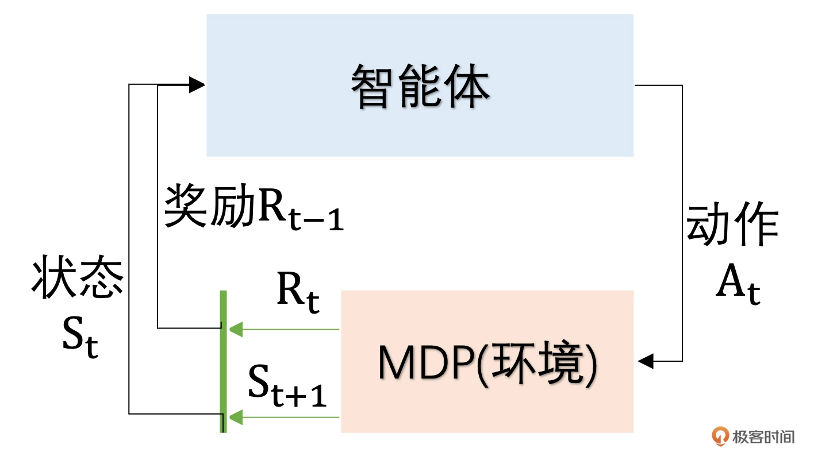
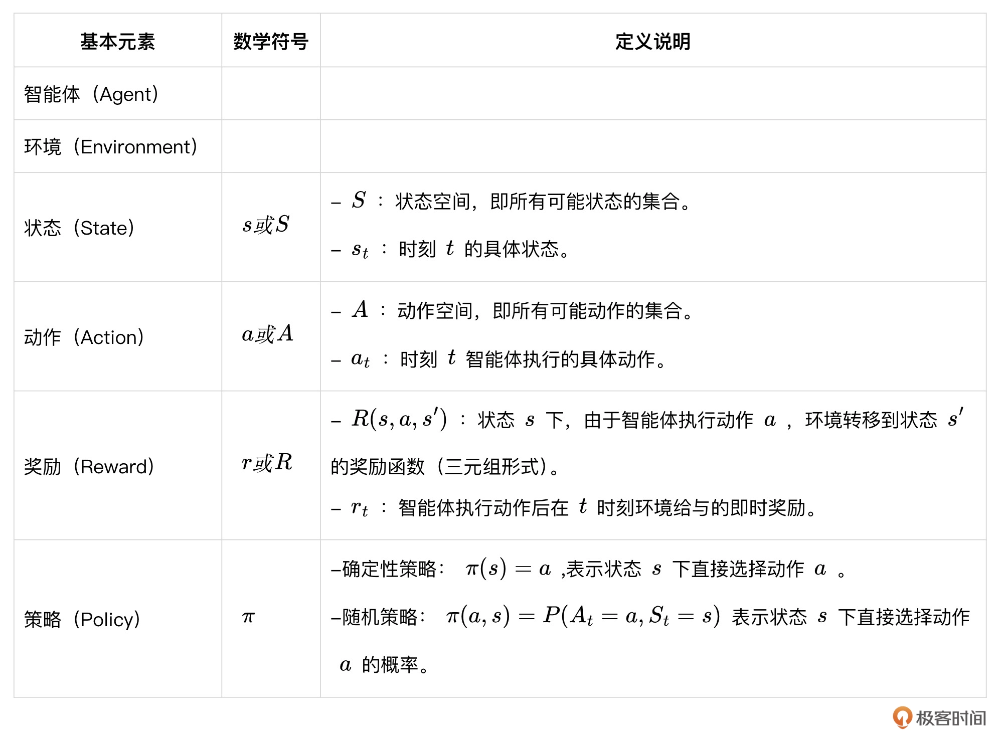
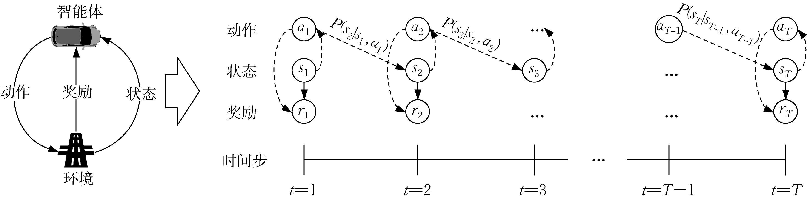
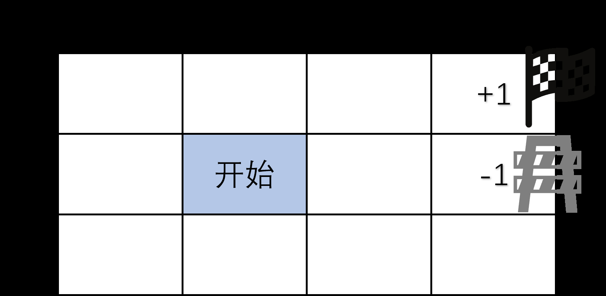
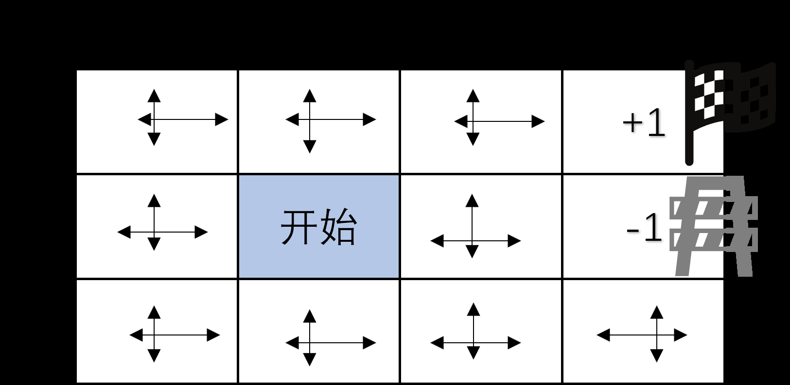
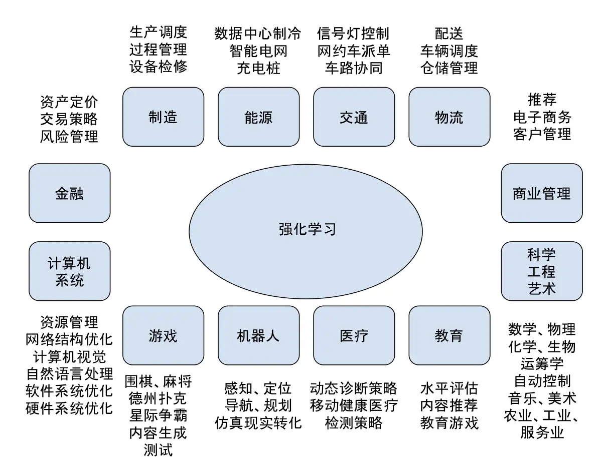

# 01 | 强化学习概述：从马尔可夫决策过程到智能体与环境交互

欢迎来到强化学习的入门课程！本节课将带你走进强化学习的世界，通过清晰的概念讲解、直观的案例分析和实用的代码演示，帮助你建立对强化学习的基础认知。完成本节课的学习后，你将能够：

- 理解强化学习的核心概念、基本框架和价值

- 掌握马尔可夫决策过程的数学建模方法

- 通过代码示例直观感受强化学习的工作流程

## 一、强化学习的基础知识

在正式开启强化学习的知识探索前，不妨先回想两个生活场景：小朋友学骑自行车时，会在“保持平衡前进”时收获成就感（正向反馈），在“摔倒”时得到教训（负向反馈），逐渐掌握控制车身的技巧；棋手对弈时，每一步落子后，都会根据棋盘局势判断“这步是否让自己更接近胜利”，并调整后续策略。这些“通过尝试获取反馈、依据反馈优化行为”的过程，其实和强化学习的核心逻辑高度相似。

从机器学习的大类来看，监督学习需要大量“输入 - 标签”的配对数据，无监督学习专注于从无标注数据中挖掘隐藏规律，而强化学习则独辟蹊径——它不依赖预设的“标准答案”，而是让智能体（如同学骑车的小朋友、对弈的棋手）在与环境（如同自行车、棋盘）的动态交互中，通过“试错”积累经验，再以“奖励 / 惩罚”为导向优化决策，最终学会如何实现长期目标。

正是这种“自主探索、目标驱动”的特性，让强化学习在解决复杂序贯决策问题时展现出独特优——从 AlphaGo 击败围棋世界冠军，到自动驾驶车辆在复杂路况中规划路径，再到工业生产中优化调度策略，其应用场景正不断突破边界。而要理解这些复杂应用的底层逻辑，我们需要先从强化学习的基础概念、数学建模框架和核心特性入手，逐步搭建起这门学科的知识框架。接下来，就让我们从“什么是强化学习”开始，揭开它的神秘面纱。

## 1.1 什么是强化学习

你可能会好奇，机器是如何像人类一样通过“尝试 - 反馈”来学习技能的？强化学习（Reinforcement Learning，RL）正是这样一种机器学习技术——它能训练程序在特定环境中通过不断尝试，学会做出最优决策以实现目标。

强化学习是一种植根于试错学习（Trial-and-error learning）思想的智能化方法，其核心逻辑是通过与环境的持续交互不断优化系统决策能力，而这一技术的形成与发展走过了漫长的演进历程。

“强化”这一概念的起源可追溯至 1927 年，最初被用于描述巴甫洛夫条件反射实验中动物行为模式的增强现象。直到 20 世纪 60 年代，“强化”及“强化学习”等术语才正式进入工程领域，被用于定义基于试错机制的学习方法。进入 20 世纪 80 年代，强化学习算法迎来关键突破——在马尔可夫决策过程（Markov Decision Processes，MDP）框架下逐步构建起相对严谨的数学理论基础，为技术的规范化发展奠定了核心支撑，并在实际应用中开始展现突破性价值。

在后续的研究进程中，强化学习的应用边界不断拓展：一方面被广泛用于控制、优化及博弈等工程技术领域，解决复杂场景下的决策问题；另一方面也深入心理学、认知科学、神经科学等基础学科，为解析人类及动物的学习机制、行为规律等科学问题提供了全新的研究视角与方法工具。

近年来，强化学习算法持续迭代升级，在诸多挑战性领域实现了突破性进展。2016 年，DeepMind 研发的围棋程序 AlphaGo 力克世界围棋冠军，惊艳全球；此后，OpenAI 推出的人工智能算法又在竞技游戏《Dota 2》中击败人类顶尖选手，再次彰显了该技术的强大潜力。

除了在竞技领域的高光表现，强化学习算法已在实际场景中展现出广泛的应用价值：在智能控制领域优化决策逻辑，在车间调度中提升生产效率，在工业制造环节降低资源损耗，在能源管理系统中实现供需动态平衡，为各行业的优化决策提供了高效解决方案。

值得关注的是，随着大语言模型技术的快速发展，强化学习在模型后训练阶段的融合应用——如通过人类反馈强化学习（RLHF）优化模型输出质量——已成为当前人工智能领域的研究热点，为技术落地开辟了新的探索方向。

强化学习的核心魅力在于智能体（Agent）与环境（Environment）的动态交互。想象一下：当你教小狗做动作时，小狗（智能体）做出指令动作后，你（环境）会给予奖励（比如零食）；做错时可能会有轻微惩罚。小狗通过这些反馈逐渐学会正确行为——这就是强化学习的基本逻辑。

如图 1-1 所示，强化学习的基本循环是：

1. 智能体处于某个环境状态中；

2. 智能体执行特定动作；

3. 环境状态随之改变；

4. 环境给予智能体相应奖励；

5. 智能体根据奖励调整策略。



- 图1-1 强化学习示意图

总结来说，强化学习（Reinforcement learning，RL）是一种机器学习技术，可以训练程序在给定的环境，做出相应的决策，以实现最佳结果。强化学习的核心在于智能体（Agent）与环境（Environment）之间交互。这个智能体在与环境互动的过程中，根据奖励信号的指引，得到成长和学习。

强化学习的最终目标很明确：最大化累积奖励——也就是让智能体多做能带来“好结果”的事，少做导致“坏结果”的事。

## 1.2 强化学习的数学建模基础

这里有个关键知识点需要你重点理解：强化学习的学习过程通常被建模为马尔可夫决策过程（Markov Decision Process，MDP）。

你可能听说过马尔可夫随机过程，它有个重要特性：下一个时刻的状态只取决于当前状态，与

## P(S

- ​∣S​) =

## P(S

- ​∣S​, ..., S​)

过去状态无关。用数学公式表示就是：

- 。t+1t+11tt

而在强化学习中，我们需要考虑动作的影响，所以扩展为马尔可夫决策过程：下一个状态取决

## P(S

- ​∣S​, A​)

于当前状态和当前动作，公式为：

- 。t+1tt

这是强化学习的理论基石，为什么这个概念如此重要？因为它简化了问题的复杂度——我们不需要记住所有历史信息，只需要关注当前状态和动作就能预测未来，这大大降低了学习难度。

让我们梳理一下强化学习的基本构成要素，这些是你理解后续内容的关键。



- 表1-1 强化学习基本元素的数学符号定义

关键符号的延伸说明：

1. ′

## s′

## P(s ∣s, a)

## s

## a

- 状态与转移概率：用表示，指在状态 执行动作 后转移到状态的概率，

## P(S

- ′′

## P(s ∣s, a) =

- ​ =

## s ∣

- ​ =

## s, A

- ​ =

## a)

## S

- 即：。t+1tt

## G

2. 奖励与回报（Return）：指从某一时刻开始的所有奖励的累积折扣和，用表示，折扣因​t∞2 t+3

## (0 ≤γ ≤1)

- ​ =​ +​ +​ +

## ... =

- k t+k+1

## ∑k=0

## γ

## G

## r

## γr

## γ r

- ​ γ r子为。即，。t+1t+2t​价值函数（Value Function）

- ​(s)​(s) =

## v

## π

## s

## v

- 表示在策略 下，从状态 出发的期望回报，即状态价值函数：ππ

## E

- ​[G​∣S​ =

## s]

- πtt

- ​(s, a)

## q

## π

## s

## a

- 表示在策略 下，从状态 执行动作 后的期望回报，即动作价值函数：π

## E

- ​(s, a) =​[G​∣S​ =

## s, A

- ​ =

## a]

## q

- ππttt

## π∗

4. ∗

## π (s) =

## arg max

- ​(s, a)​ q是使所有状态价值函数最大化的策略，满足最优策略：，aπ∗∗∗

## ∀s ∈S

## v (s)

## q (s, a)

## v (s) =

- 。且最优状态价值函数和最优动作价值函数满足a ∗∗′∗′​q (s, a)

## q (s, a) =

## r(s, a) + γ

- ​ P(s ∣s, a)v (s )

## ∑s′

## max

- ，。

特别要注意价值函数的概念：在强化学习中，很多奖励是延迟的（比如游戏到最后才得分），所以我们需要用价值函数来评估某个状态或动作的长期价值。

- ​(s)

## v

## π

## s

- 状态价值函数：表示在策略 下，从状态 出发的长期期望奖励；π​(s, a)

## q

## π

## s

## a

- 动作价值函数：表示在策略 下，从状态 执行动作 后的长期期望奖励。π

上述概念我们会在本章后续部分更细致地重温。

强化学习是人工智能的重要分支，它具有以下几个特点：

- 适应性：强化学习系统能够适应环境的变化，并能在新的环境下学习新的策略；

- 目标导向：智能体的行为是为了达到特定的目标，即最大化累积奖励；

- 自主性：在某些情况下，智能体能够在没有人类干预的情况下做出决策。

## 1.3 强化学习的瓶颈与挑战

了解基础后，我们也要清醒认识到强化学习目前面临的挑战。

2019 年，强化学习之父，阿尔伯塔大学教授 Richard Sutton 发表了后来被 AI 领域奉为经典的苦涩教训（The Bitter Lesson）。在这篇文章中，Richard 指出，过去 70 年来，AI 研究的一大教训，是过于重视人类既有经验和知识，利用大规模算力才是王道。这一思想很快引起了OpenAI 首席科学家 Ilya Sutskever 的共鸣。某种程度上，它也启发了大模型领域所信奉的扩展法则（Scaling Law）。

从控制角度看，强化学习的的核心瓶颈可以这样简化理解。

传统控制理论的一大智慧，是明确“什么情况下任务根本做不到”——这类限制往往源于数学上的隐函数定理，告诉你系统的能力边界在哪里。但强化学习目前还缺乏这种对“可行性边界”的底层支撑，关键问题就出在对学习模式的依赖上。

机器学习中，监督学习需要明确的“标准答案”（比如已知输入对应的最优输出），靠拟合这种显式映射来学习；而无监督学习则能从无标注数据中自主挖掘规律，帮系统理解环境的底层逻辑，这正是“系统级综合”（从整体上设计系统能力）所必需的。

但现在的强化学习框架，核心依赖的是类似监督学习的逻辑：它需要环境给出明确的奖励信号（相当于“标准答案”的简化版），通过拟合“状态→动作”的映射来优化策略。可无监督学习那种自主挖掘环境规律、构建系统级认知的能力，还没有很好地融入强化学习。

这就导致一个问题：强化学习能在给定场景下优化单个控制器的策略，但很难像传统控制那样进行“系统级综合”——比如预判场景变化、应对未知限制、从整体上设计鲁棒的系统能力。因为它缺乏无监督学习带来的“环境全局认知”，只能依赖显式的奖励信号去试错，自然支撑不了更宏观的系统级设计。

这就是强化学习从控制角度看的关键瓶颈：过度依赖监督式的显式反馈，缺失无监督的隐式环境认知，导致难以实现系统级综合设计。

接下来，我们介绍当前强化学习，本身框架的瓶颈。

模拟器（环境）问题，就是如何将模拟器和现实世界对齐，尽可能覆盖各种可能性。例如在自动驾驶场景，大规模场景生成一直都是问题，这里面参与的变量太多，行人、车辆和他们的运动的规律、道路结构、天气、时间，这都很难做到全面覆盖。

现实世界优化目标难以确定，就是在于现实环境中情况太复杂。拿自动驾驶举例，比较常见的错车、超车可以通过规则编写获取优化目标，但在那种小巷子里突然出来一个人，前面有个小摊等，这种很难抽象为一个统一的优化目标。这不仅是强化学习遇到的问题，也是所有的最优化方法都会遇到的问题。

梯度的稳定性，在 PPO 或 DPO 模型中，策略函数的描述函数在 A 和 C 两个网络里有 2 组或4 组参数。在做梯度上升以最大化奖励值的过程中，会不可避免地遇到梯度稳定性问题——即到目前为止所产生的经验，是不是朝着最大化奖励值方向前进，还是模型已经“走上崎岖的不归路”——仍然没有保证。目前能做的代偿方案有，比如让梯度更新慢一些，采样后再更新参数以求得稳定的梯度方向。不过仍然不存在严格的保障。

## 二、强化学习的数学基础：马尔可夫决策过程

在前面的内容中，我们已经建立了对强化学习的基本认知：它是一种让智能体通过与环境交互、从奖励中学习最优决策的机器学习方法。核心是智能体通过不断尝试动作，根据环境反馈的奖励信号调整策略，最终实现累积奖励最大化的目标。

但这里有个关键问题：我们如何用数学语言精确描述这个学习过程？如何保证学习过程是可计算、可优化的？当环境状态复杂、动作空间庞大时，我们需要一个严谨的理论框架来规范问题描述，这就像盖房子需要先搭好框架一样重要。

为什么需要这样的框架？想象一下：如果智能体每次决策都要考虑所有历史状态，计算量会大到无法想象；如果状态之间的关系没有规律，智能体也很难从经验中总结规律。所以我们需要一种简化问题的方式——既要抓住问题本质，又要降低求解难度。

这就是我们接下来要重点学习的马尔可夫决策过程（MDP）的价值所在。它为强化学习提供了数学建模的“通用语言”，让我们能把各种复杂的决策问题转化为统一的数学形式。

具体来说，马尔可夫决策过程解决了三个核心问题：

1. 状态简化：利用马尔可夫性质，让我们只需关注当前状态而非全部历史；

2. 过程建模：用状态转移概率描述动作如何影响环境；

3. 目标量化：通过价值函数将长期奖励目标转化为可计算的数学问题。

可以说，不理解马尔可夫决策过程，就无法真正掌握强化学习的理论基础。接下来，我们就深入这个核心框架，看看它如何将强化学习的直观概念转化为精确的数学表达，为后续的算法学习铺平道路。

## 2.1 随机过程

随机过程（stochastic process）是概率论的“动力学”部分。概率论的研究对象是静态的随机现象，而随机过程的研究对象是随时间演变的随机现象（例如气温随时间的变化）。在随机过程

## t

## S

中，随机现象在某时刻 的取值是一个随机向量，用

- 表示，所有可能的状态组成状态集合​t

## S

。

## t

## S

## t

随机现象便是状态的变化过程。在某时刻 的状态

- 通常取决于 时刻之前的状态。我们将​t

## (S

- ​, S​, ..., S​)

## S

已知历史信息

- 时，下一时刻状态为的概率表示成12t+1t​

## P(S

- ​∣S​, S​, ..., S )。t+112t

## 2.2 马尔可夫性质

当且仅当某时刻的状态只取决于上一时刻的状态时，一个随机过程被称为具有马尔可夫性质，

## P(S

- ​∣S​) =

## P(S

- ​∣S​, S​, ..., S​)

用公式表示为

- 。也就是说，当前状态是未来的充分统t+1t+112tt

计量，即下一个状态只取决于当前状态，而不会受到过去状态的影响。例如：下棋时，当前棋盘状态已包含所有历史走棋信息，无需记忆每一步的落子顺序。

需要明确的是，具有马尔可夫性并不代表这个随机过程就和历史完全没有关系。因为虽然

## t + 1

## t −1

## t

- 时刻的状态只与时刻的状态有关，但是时刻 的状态其实包含了时刻的状态的信

息，通过这种链式的关系，历史的信息被传递到了现在。马尔可夫性可以大大简化运算，因为只要当前状态可知，所有的历史信息都不再需要了，利用当前状态信息就可以决策未来。

## 2.3 马尔可夫决策过程

在强化学习中，学习和决策者称为智能体（Agent），智能体之外所有与其相互作用的事物称为

## t

## s

环境。智能体与环境的交互可以描述为如下过程：智能体在 时刻感知环境的状态

- 并选择​t

## a

## s

## R

要执行的动作

- ，环境从当前状态转移到一个新的状态, 然后将相应的即时奖励反t+1t+1​t​​

馈给智能体。智能体的目标是学习一个策略来合理地选择动作，以实现长期的累积奖励（又称回报）最大化。

强化学习问题的马尔可夫性是指系统在下一时刻的状态只与当前时刻的状态和动作有关, 而与之前的状态无关。对于环境（系统）状态变化和奖励更新具有马尔可夫性质的序贯决策问题,人们通常将其建模为马尔可夫决策过程。

## S, A, P, R, γ

马尔可夫决策过程是强化学习的数学框架，其核心元素符号化表示为五元组（）, 其中：

## S

- ：状态空间

## A

- ：动作空间′

## P(s ∣s, a)

## P

- ：状态转移概率矩阵′

## R(s, a, s )

## R

- ：奖励函数

## γ

- ：折扣因子

## P

除了对于环境的状态转化模型

- 这个因素做马尔可夫假设外，还需要对强化学习的策略

## π

## s

## a

## s

（Policy） 也做马尔可夫假设。即在状态 时采取动作 的概率仅与当前状态 有关。可用

## π(a∣s) = P(A

- ​ =

## a∣S

- ​ =

## s)

公式表达为

- 。tt

- ​ E

## π∗

## max

- ​[G​]

MDP 的目标是找到最优策略

- ，使从初始状态开始的累积折扣奖励最大化：0ππ2 t+3​ =​ +​ +​ +

## ...

## G

## r

## γr

## γ r

，其中

- 是未来奖励的累积折扣和。t+1t+2t

折扣因子是 MDP 建模的标配。这里解释一下为何要引入折扣因子（或称为衰减因子）。所谓折扣，就是对未来回报的价值进行折现。折扣因子的引入是为了区分短期回报和长期回报，对“未来的回报”根据其获得时间而打折。它的作用机制类比于储蓄产生的利息。设想我们将 100元存入银行，存的越久，利息越低。为何会这样呢？因为“未来的”100 元比起当前的 100 元是贬值的，而这个“贬值”的比例，就是用折扣因子来建模。

- 注：当折扣因子越接近于 1 越关注未来收益，越接近于 0 越关注当前收益。

- ​(s)

## v

强化学习引入 MDP，那么价值函数

- ，也仅依赖于当前的状态。价值函数可表示为：π

## E

## s] = E

- 2​(s) =​[G​∣S​ =​[R​ +​ +​ +

## ...∣S

- ​ =

## s]

## v

## γR

## γ R

## G

- 代表。其中，t+1t+2t+3

π

- πttπt​t

## S

累积奖励，是一个 MDP 中从某一个状态

- 开始采样直到终止状态时所有奖励的带折扣累加​t

和。

强化学习的核心逻辑（状态感知→动作选择→环境反馈→策略优化）可转化为数学上的最优化

## E

- ​[G​]

## π

问题。马尔可夫策略优化目标：最大化期望回报

- ，即通过调整策略 ，使从初始状态0π

开始的累计的折扣奖励最大。

## t

马尔可夫决策过程中的学习步骤示例如图 1-2 所示。在每个时间步 ，智能体从环境中接收状

## π(a

- ​∣s​)

## s

## a

## s

## a

态

- ，并依据策略选取最优动作。该策略是从状态到动作的映射。在执行​ttt​t​t​t

## a

## r

## a

动作

- 后，状态会相应更新，同时智能体从环境中获取奖励，此奖励用于评估动作的​t​t​t

优劣。



- 图1-2 马尔可夫决策过程（出自同济大学何逸煦等人的《强化学习在自动驾驶技术中的应用与挑战》）

- ​ =

## s

## G

在上述过程里，智能体的目标是最大化从每个状态

- 起始的期望折扣奖励，记作​tt∞k t+k

## ∑k=0

- ​ γ r。这表明智能体在考量即时奖励的同时，还需兼顾未来可能得到的奖励，而折​

## γ

扣因子 决定了智能体对未来奖励的重视程度。

## 2.4 直观理解：网格世界示例

如图 1-3 所示，机器人在网格世界中，从任意一点出发，目的地是网格中的 <4,1>，其回报为+1。在该问题中，马尔可夫决策过程的各元组可以建模如下。

## S

## S

- ：集合对应网格中 12 个可能到达的位置。

## A

- ：机器人可以做的动作，向东（E）、向南（S）、向西（W），向北（N）。

## P(S

- ​∣S​, a)

## S

## a

## S

- ：状态转移函数，表示在状态执行动作 后转移到状态的概率。t+1t+1t​t​

## R(s, a)

## s

## a

## R

- ：奖励函数，此函数取决于状态 和动作 ，并且还被称为即时奖励，因为是不考虑未来状态，只考虑当前动作的状态下，环境给予的奖励。机器人奖励规则如下：

## r = +1

- 目的地是格子 <1,4>，用来奖励。

## r = −1

- 要避开格子 <2,4>，用来惩罚。

## r = −0.02

- 其它格子，模拟耗电，避免空跑。

- 蓝色的格子是一个障碍（不能位于该单元）。

## γ = 0.9

## γ

- ：折扣因子。



- 图1-3 网格世界

```python
import numpy as np
# 定义网格世界的状态，用坐标 (行, 列) 表示，这里行范围 1-3，列范围 1-4
states = [(i, j) for i in range(1, 4) for j in range(1, 5)]
# 定义动作，上下左右，用字典表示方向变化
actions = {
   'up': (-1, 0),
   'down': (1, 0),
   'left': (0, -1),
   'right': (0, 1)
}
# 定义奖励，根据你给的网格，(1,4) 奖励 +1，(2,4) 奖励 -1，其他位置可先设为 0，后续也可调整
rewards = np.zeros((3, 4))
rewards[0, 3] = 1  # (1,4) 对应数组索引 (0,3)
rewards[1, 3] = -1  # (2,4) 对应数组索引 (1,3)
# 定义障碍物坐标(2, 4)
obstacles = [(2, 4)]
# 状态转移函数，输入当前状态和动作，返回下一个状态（处理边界和障碍物）
def transition(state, action):
   i, j = state
   di, dj = actions[action]
   new_i, new_j = i + di, j + dj
   # 检查是否在网格内，行 1-3 对应索引 0-2，列 1-4 对应索引 0-3
   if 1 <= new_i <= 3 and 1 <= new_j <= 4:
       # 检查是否为障碍物
       if (new_i, new_j) not in obstacles:
           return (new_i, new_j)
   # 如果超出边界或遇到障碍物，留在原地
   return (i, j)
# 简单的随机策略，每个状态下随机选择一个动作
def random_policy(state):
   return np.random.choice(list(actions.keys()))
# 模拟智能体在网格中按照策略行动的过程，这里简单跑几步示例
current_state = (2, 2)  # 起始点修改为(2,2)，对应网格中的S位置
num_steps = 5
for _ in range(num_steps):
   action = random_policy(current_state)
   next_state = transition(current_state, action)
   reward = rewards[next_state[0] - 1, next_state[1] - 1]  # 转换为数组索引
   print(f"当前状态: {current_state}, 动作: {action}, 下一个状态: {next_state}, 奖励
   current_state = next_state
```

运行这段代码，你会看到机器人如何在网格中随机探索，以及环境如何给予奖励反馈。这就是强化学习最基本的交互模式。

## 2.5 求解 MDP：价值迭代算法

强化学习往往具有延迟回报的特点，例如，在第 n 步走到了终点，那么只有状态

## R(s

- ​, a​) =

## 1

## s

## a

- ，前面所有状态即时奖励均为 0。即时奖励对于之前的任意状态 和 ，奖励nn

## R(s

- ​, a​)

## π

函数

- 无法说明策略的好坏。因此需要定义价值函数来表明当前状态下策略 的长nn

期影响。

## π(a∣s)

## s

## a

## π

策略（Policy）函数

- ，表示在状态 下选择动作 的概率，且 不随时间变化。图 1-

## π

4 展示了机器人在网格世界中每个格子根据策略 可采取的动作。



- 图1-4 机器人在网格中的策略

以下是一个简单的马尔可夫决策过程（MDP）在网格环境中的 Python 实现示例，针对你提供的网格结构（包含奖励、可行动作等），我们用价值迭代（Value Iteration）算法来求解最优价值函数和最优策略。

定义网络环境参数：

```python
import numpy as np
# 网格行数和列数
rows = 3
cols = 4
# 定义奖励矩阵，对应网格中每个状态的即时奖励
rewards = np.array([
   [-0.02, -0.02, -0.02, 1],
   [-0.02, -0.02, -0.02, -np.inf],  # 障碍物区域设为负无穷大表示不可达
   [-0.02, -0.02, -0.02, -0.02]
])
# 定义动作，上下左右，分别用 0,1,2,3 表示
actions = [0, 1, 2, 3]  # 0:上, 1:下, 2:左, 3:右
action_symbols = ["↑", "↓", "←", "→"]  # 用于展示策略
# 折扣因子
gamma = 0.9
# 价值函数初始化，初始时所有状态价值为 0
value_function = np.zeros((rows, cols))
```

定义状态转移函数：

```python
def transition(state, action):
   """
   状态转移函数，根据当前状态和动作，返回下一个状态
   :param state: 当前状态 (row, col)
   :param action: 动作
   :return: 下一个状态 (new_row, new_col)
   """
   row, col = state
   if action == 0:  # 上
       new_row = max(row - 1, 0)
       new_col = col
   elif action == 1:  # 下
       new_row = min(row + 1, rows - 1)
       new_col = col
   elif action == 2:  # 左
       new_row = row
       new_col = max(col - 1, 0)
   else:  # 右
       new_row = row
       new_col = min(col + 1, cols - 1)
   # 检查是否是障碍区域（这里简单判断奖励为负无穷的情况，实际可根据需求调整）
   if rewards[new_row, new_col] == -np.inf:
       return (row, col)  # 留在原状态
   return (new_row, new_col)
```

价值迭代算法实现：

```
# 价值迭代迭代次数，相邻两次迭代的价值函数差值小于某个阈值（如 1e-6)时，可认为收敛
iterations = 100
for _ in range(iterations):
   new_value_function = np.copy(value_function)
   for i in range(rows):
       for j in range(cols):
           if rewards[i, j] == -np.inf:
               continue  # 障碍区域不更新
           q_values = []
           for action in actions:
               next_state = transition((i, j), action)
               next_row, next_col = next_state
               q_value = rewards[i, j] + gamma * value_function[next_row, next_c
               q_values.append(q_value)
           new_value_function[i, j] = max(q_values)
   value_function = new_value_function
```

获取最优策略：

```
# 提取最优策略
optimal_policy = np.zeros((rows, cols), dtype=int)
for i in range(rows):
   for j in range(cols):
       if rewards[i, j] == -np.inf:
           optimal_policy[i, j] = -1  # 障碍区域标记
           continue
       q_values = []
       for action in actions:
           next_state = transition((i, j), action)
           next_row, next_col = next_state
           q_value = rewards[i, j] + gamma * value_function[next_row, next_col]
           q_values.append(q_value)
       optimal_policy[i, j] = np.argmax(q_values)
```

结果展示：

```python
# 展示价值函数
print("价值函数:")
print(value_function)
# 找到并展示一条最优路径
def find_optimal_path(start_state, goal_state):
   """
   根据最优策略找到从起始状态到目标状态的路径
   :param start_state: 起始状态 (row, col)
   :param goal_state: 目标状态 (row, col)
   :return: 路径列表，每个元素是 (状态, 动作)
   """
   path = []
   current_state = start_state
   # 防止无限循环，设置最大步数
   max_steps = rows * cols
   steps = 0
   while current_state != goal_state and steps < max_steps:
       row, col = current_state
       action = optimal_policy[row, col]
       # 如果是障碍物，跳出循环
       if action == -1:
           break
       # 记录当前状态和动作
       path.append((current_state, action_symbols[action]))
       # 移动到下一个状态
       current_state = transition(current_state, action)
       steps += 1
   # 添加目标状态
   if current_state == goal_state:
       path.append((current_state, "目标"))
   return path
# 设置起始点和目标点
start_state = (1, 1)  # (2,2) 对应数组索引 (1,1)
goal_state = (0, 3)   # (1,4) 对应数组索引 (0,3)
# 找到最优路径
optimal_path = find_optimal_path(start_state, goal_state)
# 创建一个空的网格，用于显示最优路径
path_grid = np.full((rows, cols), '.', dtype=str)  # 使用点表示未访问的格子
# 标记障碍物
for i in range(rows):
   for j in range(cols):
       if rewards[i, j] == -np.inf:
           path_grid[i, j] = 'X'  # 障碍物
# 标记路径上的动作
for i in range(len(optimal_path) - 1):
   state, action = optimal_path[i]
   row, col = state
   path_grid[row, col] = action
# 标记起点和终点
if optimal_path:
   start_row, start_col = optimal_path[0][0]
   path_grid[start_row, start_col] = 'S'  # 起点
   end_row, end_col = optimal_path[-1][0]
   path_grid[end_row, end_col] = 'G'  # 终点
# 展示价值函数
print("价值函数:")
print(value_function)
# 展示最优路径
print("\n最优路径:")
for i, (state, action) in enumerate(optimal_path):
   if i == 0:
       print(f"起始点 ({state[0]+1},{state[1]+1}) -> {action}")
   elif action == "目标":
       print(f"到达目标 ({state[0]+1},{state[1]+1})")
   else:
       print(f"({optimal_path[i-1][0][0]+1},{optimal_path[i-1][0][1]+1}) -> {act
# 展示最优策略网格
print("\n最优策略网格 (S=起点, G=目标, X=障碍物, .=未访问):")
for row in path_grid:
   print(' '.join(row))
# 最优策略网格 (S=起点, G=目标, X=障碍物, .=未访问):
# . → → G
# . S . X
#
```

上述代码实现了一个基本的马尔可夫决策过程在给定网格环境中的价值迭代求解。代码中：

- 首先定义了网格的基本参数，如行数、列数、奖励矩阵、动作集合等；

- 状态转移函数用于根据当前状态和动作确定下一个状态；

- 通过价值迭代算法不断更新价值函数，使其收敛到最优价值函数；

- 最后根据最优价值函数提取出每个状态下的最优策略并进行展示。

## 三、强化学习的历史、学科定位与未来发展

强化学习作为人工智能的核心分支，其发展与多个学科深度交织，既具有深厚的理论根基，又展现出广泛的跨学科应用潜力。

## 3.1 强化学习思想的起源

强化学习的思想源远流长，其理论根基可追溯至 20 世纪初的心理学研究，并在随后的认知科学、人工智能与神经科学的交叉发展中逐步演化为一门系统的计算学习范式。其核心思想——通过与环境交互、依据奖励信号调整行为以实现目标——并非凭空产生，而是建立在多个学科长期探索的基础之上。

### 3.1.1 行为主义心理学：强化学习的哲学源头

强化学习最根本的思想起源于行为主义心理学。以巴甫洛夫（Pavlov）的经典条件反射、华生（Watson）的行为主义理论以及斯金纳（Skinner）的操作性条件反射为代表，这一学派提出了“刺激 - 反应 - 强化”的学习机制，强调行为是通过奖励（正强化）与惩罚（负强化）不断塑造的结果。这种“奖励驱动行为”的理念，正是现代强化学习中“奖励函数”设计的哲学基础。

斯金纳的“斯金纳箱”实验直观展示了动物如何通过试错与反馈学习最优行为策略，这与强化学习中智能体通过探索与利用来最大化累积回报的过程高度一致，为后续算法设计提供了重要的启发。

### 3.1.2 试错学习的复兴：从心理学到人工智能

20 世纪 60 至 70 年代，试错学习（Trial-and-Error Learning）在人工智能领域逐渐受到关注。Harry Klopf 是这一思想复兴的关键人物。他指出，当时主流研究过度聚焦于监督学习，忽视了生物体通过自主探索与环境互动实现自适应行为的能力。Klopf 强调，“行为的快乐方面”——即从环境中获得积极结果、控制环境趋向期望状态——是智能行为的核心驱动力。

Klopf 的工作深刻影响了 Richard Sutton 和 Andrew Barto，促使他们系统性地反思监督学习与强化学习的本质区别，并最终将研究重心转向强化学习。他的思想为后续将试错机制形式化为可计算的学习算法奠定了基础。

### 3.1.3 时序差分学习的萌芽：从心理学到机器实现

强化学习发展的另一条关键线索是时序差分学习（Temporal Difference Learning, TDLearning），其思想源于对动物学习心理机制的观察，尤其是“次级强化物”（SecondaryReinforcers）的概念。次级强化物（如金钱、信号）本身不具生存价值，但通过与食物、痛苦等初级强化物的关联而获得激励作用。

马文·明斯基（Marvin Minsky）在 1954 年就敏锐地意识到，这种心理机制对构建人工学习系统具有重要意义，可能是最早提出该观点的学者之一。1959 年，Arthur Samuel 在其著名的国际跳棋程序中首次实现了包含时序差分思想的学习机制。他设计了一个可在线调整的评估函数，并通过自我对弈不断优化策略，这被视为 TD 学习的早期工程实践。Samuel 的工作受到克劳德·香农关于计算机下棋研究的启发。

1961 年，明斯基进一步指出 Samuel 的方法与次级强化物之间的理论联系。此后，Klopf 在1972 年首次将试错学习与时序差分思想结合起来，为后续形式化建模铺平了道路。

### 3.1.4 统一框架的形成：Sutton 与 Barto 的奠基性贡献

1978 年，Richard Sutton 深入研究 Klopf 的思想，特别是其与动物学习的关联，提出了基于连续时间预测误差的学习规则，正式将时序差分学习发展为一种可用于预测的通用算法框架。他与 Andrew Barto 持续合作，构建了基于 TD 学习的经典条件反射心理模型，进一步强化了算法与生物学习机制的对应关系。

1981 年，Sutton 和 Barto 提出行动者 - 评价者架构（Actor-Critic Architecture），将策略优化（行动者）与价值评估（评价者）分离，成功融合了试错学习与时序差分学习两大思想，成为现代强化学习的核心架构之一。Sutton 在 1984 年的博士论文中系统阐述了这一方法。

1988 年，Sutton 在其里程碑论文中将时序差分学习从控制任务中抽象出来，确立其作为通用预测方法的地位，并提出多步 TD 算法（如 TD(λ)），显著提升了学习的稳定性与效率。

### 3.1.5 现代强化学习的诞生：三大线索的融合

1989 年，Chris Watkins 提出 Q-learning 算法，标志着强化学习三大思想线索的最终融合：

- 来自心理学的试错学习

- 来自动物学习的时序差分机制

- 来自最优控制理论的动态规划思想

Q-learning 是一种无模型、离策略的强化学习算法，能够在未知环境模型的情况下直接学习最优策略，成为现代强化学习的基石之一。

此后，强化学习迅速在人工智能领域掀起研究热潮。1992 年，Gerry Tesauro 成功将 TD 学习与神经网络结合，开发出 TD-Gammon 程序，在西洋双陆棋（Backgammon）上达到接近人类顶尖选手的水平，极大提升了强化学习的影响力。

### 3.1.6 神经科学的印证与反哺

一个令人振奋的发现是，多巴胺神经元的活动模式与 TD 学习中的“奖赏预测误差”（RewardPrediction Error）高度一致。Dayan 等人研究表明，大脑中多巴胺的释放量并非对应实际奖励本身，而是奖励与预期之间的偏差，这正是 TD 学习的核心机制。

这一发现不仅为强化学习算法提供了生物学依据，也催生了计算神经科学中“神经强化学习”这一新兴领域。Google 开源的强化学习实验框架 Dopamine 正是以此命名，向这一跨学科洞见致敬。

此外，经验回放（Experience Replay）等关键技术的思想，也受到脑科学中记忆巩固机制的启发，体现了人工智能与神经科学的双向互动。

强化学习的思想并非一蹴而就，而是历经百年，从心理学的行为观察，到人工智能的算法实现，再到神经科学的机制验证，逐步融合而成。其发展脉络清晰地展现了跨学科交叉的力量：行为主义提供了哲学基础，试错学习赋予了探索精神，时序差分学习构建了数学框架，而神经科学则为其提供了生物学合理性。正是这些思想的汇聚，最终催生了现代强化学习的理论体系，并在 Sutton 与 Barto 于 1998 年出版《强化学习导论》后走向系统化与成熟化，成为人工智能的核心支柱之一。

## 3.2 强化学习与其他学科的交织

强化学习处于多个领域的交叉节点：基于来源于心理学的基本思想，先驱们基于数学与工程理论，包括随机过程、控制论（如贝尔曼方程与动态规划）、优化理论以及统计计算等等工具将强化学习问题形式化，并提供了各种高效的计算手段；下游则依赖计算机科学与硬件实现，尤其是神经网络与高性能计算平台，使得深度强化学习得以在不同领域大展身手。同时，强化学习也与其他人工智能学科、机器人学、管理学与神经科学密切互动，既为这些领域提供建模工具，又从其中汲取理论灵感。

强化学习广泛应用于科学、工程、艺术等领域，如图 1-5 所示。



- 图1-5 强化学习与其他学科的交织（出自知乎 Yuxi Li《强化学习应用简述》）

## 3.3 强化学习自身的理论演进

随着深度强化学习在 Atari 游戏等领域的成功应用日益广泛，各行业专家纷纷探索其在本领域的潜在价值，并取得了丰硕成果。例如，基于强化学习的 GRPO（Guided ReinforcementLearning for Pre-training Optimization）方法显著提升了大语言模型的后训练能力。然而，传统的深度强化学习在应对复杂任务时仍面临诸多挑战，尤其是在奖励函数设计方面存在较大局限，常因奖励稀疏或设计偏差导致学习效率低下、收敛困难。

为应对这些挑战，研究者提出了多种高级强化学习算法。当环境状态空间维度极高时，传统方法易遭遇“维度灾难”，难以有效学习。为此，分层强化学习（Hierarchical ReinforcementLearning, HRL）应运而生。该方法借鉴了算法设计中“分治”思想，将复杂的决策问题分解为多个层次化的子任务，逐层求解，显著提升了在大规模强化学习问题中的表现。

此外，针对传统强化学习通常从零开始学习、样本效率低的问题，元强化学习（Meta-Reinforcement Learning, Meta-RL）通过在大量相关任务中进行预训练，提取通用先验知识，使智能体在面对新任务时能够快速适应，实现更高效的学习与更强的泛化能力。目前，元强化学习已在少样本学习、跨任务迁移等场景中展现出卓越性能。

尽管上述方法不断演进，强化学习的核心难题之一——回报函数的设计——仍未完全解决。现有方法大多依赖人工设计，具有较强的主观性和经验性，而回报函数的质量直接关系到策略的收敛性与最终性能。为此，逆向强化学习（Inverse Reinforcement Learning, IRL）被提出，其核心思想是从专家示范中反推潜在的奖励函数，从而自动学习更符合人类意图的奖励机制。在此基础上，学徒学习（Apprenticeship Learning）与最大熵逆强化学习（Maximum EntropyIRL）等方法进一步拓展了该范式，为奖励建模提供了新的思路。

与此同时，受博弈论中二人零和博弈的启发，生成对抗网络（Generative AdversarialNetworks, GANs）通过生成器与判别器之间的对抗机制，在图像生成等领域实现了突破性进展。这一“对抗式学习”思想也被引入强化学习，催生了诸如对抗模仿学习（AdversarialImitation Learning）等新方法，成为推动强化学习发展的重要借鉴。

值得一提的是，模仿学习（Imitation Learning）与进化算法（Evolutionary Strategies）作为经典的学习范式，依然在当前研究中占据重要地位。前者通过学习专家行为实现策略迁移，后者模拟自然选择过程优化策略参数，二者均为现代强化学习算法提供了重要的理论基础与实践启示。

近年来，随着计算能力的飞速提升，自动化机器学习（AutoML）在强化学习领域展现出巨大潜力。特别是在策略网络、值函数网络等神经网络结构的设计中，神经架构搜索（NAS）与超参数优化技术正逐步实现模型结构的自动演化，推动强化学习向更高层次的自适应与智能化迈进。

回顾强化学习的发展历程，其已从早期的动态规划方法演进为现代基于值函数与策略优化的统一框架。Sutton 与 Barto 所著《强化学习导论》系统地整合了该领域的理论体系，被誉为该领域的“圣经”，标志着强化学习走向系统化与成熟化。时序差分学习（TD Learning）、策略梯度方法以及 Actor-Critic 架构等一系列关键突破，逐步构建起现代强化学习的算法基石。近年来，策略梯度类算法的兴起与分布式强化学习框架的发展，更将该领域推向了新的高度。

## 3.4 强化学习未来的发展

关于这一点，我们非常推荐你看一下 Sutton 在 RLC 2025 年的 talk “The OaK Architecture: Avision of Superintelligence from Experience”。强化学习正朝着更通用、更高效的方向演进。关键挑战包括样本效率的提升、奖励函数的设计、多智能体协同与对抗，以及与现实世界的安全交互。

与此同时，强化学习与大型神经网络、元学习、世界模型等结合，有望构建出具备长期规划与泛化能力的智能系统，成为实现更广泛人工智能愿景的重要路径。

## 总结

本节课我们围绕强化学习的基础展开，你应该已经掌握了：

1. 核心概念：强化学习可以抽象为智能体与环境的交互，在奖励信号指导下学习最优策略。

## (S, A, P, R, γ)

2. 数学基础：马尔可夫决策过程（MDP）是强化学习的基本框架，用五元组描述。

3. 关键思想：价值函数用于评估长期收益，解决延迟奖励问题。

4. 算法示例：通过网格世界案例和价值迭代算法，直观理解强化学习的工作流程。

强化学习的核心是学习如何在与环境的交互中做出最优决策，而马尔可夫决策过程为这种学习提供了坚实的数学基础。下一节课，我们将深入探讨更复杂的强化学习算法及其应用场景。

## 思考题

## γ = 0

## γ = 1

## γ

1. 为什么说折扣因子 很重要？如果或会对学习过程产生什么影响？

2. 在网格世界例子中，如果我们希望机器人不仅要到达目标，还要尽可能收集路上的“金币”（增加中间奖励），应该如何修改代码？

希望你通过今天的学习，对强化学习有了清晰的认识。如果有任何疑问，欢迎在讨论区留言交流！
