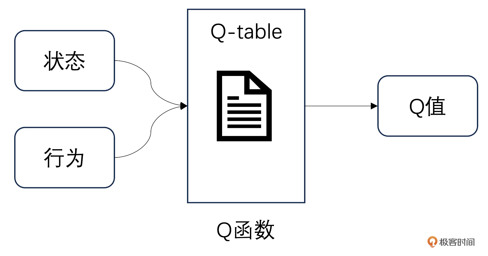
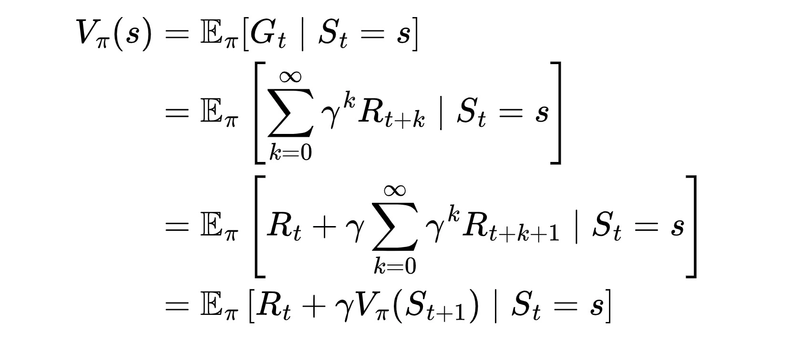
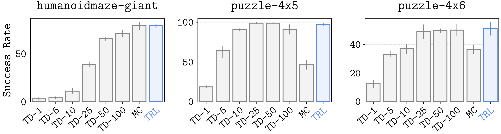
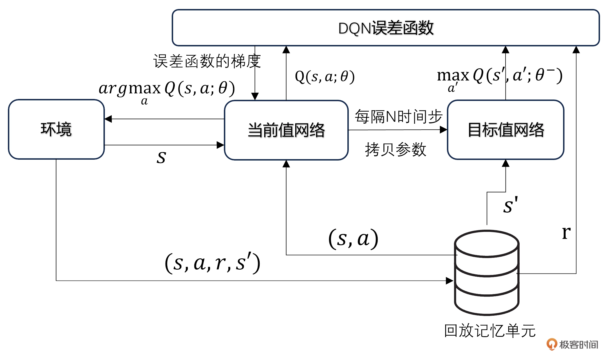
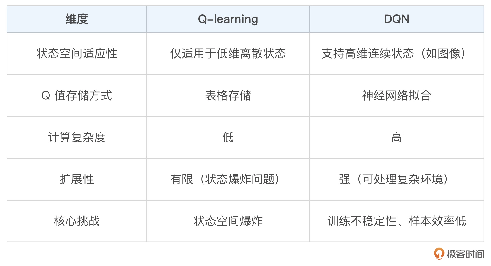

# 02 | 基于价值的强化学习：从Q-learning到DeepQ-Network

你好！欢迎来到强化学习的第二节课。上一节课我们了解了强化学习的基础知识和马尔可夫决策过程，今天我们将聚焦于基于价值的强化学习算法——从经典的 Q-learning 到结合深度学习的 Deep Q-Network（DQN）。

通过本节课的学习，你将能够：

- 理解价值函数在强化学习中的核心作用

- 掌握 Q-learning 算法的原理和实现方法

- 了解 DQN 如何解决 Q-learning 的局限性

- 掌握 DQN 的关键创新点和训练流程

- 通过代码示例直观感受两种算法的工作机制

## 一、强化学习的价值视角：为什么需要 Q 函数？

在强化学习中，智能体的目标是通过与环境交互最大化累积奖励。但面对复杂环境，我们需要一种工具来评估“在某个状态下采取某个动作是否划算”——这就是价值函数的作用。

想象你在玩游戏时，面对屏幕上的画面（状态），需要选择向左、向右或跳跃（动作）。经验丰富的玩家会根据当前画面判断“哪个动作更可能赢得游戏”，这种判断本质上就是对动作价值的评估。

智能体处于某状态时，依据当前状态与可选动作，查询 Q-table，就能得到对应的 Q 值。Q-Learning 算法通过不断与环境交互（试错），更新 Q 表中的 Q 值，让智能体逐渐学到：在什么状态下，执行什么动作，能获得更高的长期收益，最终掌握最优决策策略（比如游戏通关、机器人高效导航）。

图 2-1 展示了，Q-Learning 算法中 Q 函数（Q-function）与 Q 表（Q-table）的核心逻辑示意图，用于直观呈现“状态 - 动作 - Q 值”的映射关系，可拆解理解：

- Q-table（Q 表）：是存储“状态 - 动作 - Q 值”对应关系的数据结构，可理解为一张表格，行代表环境的不同状态（State），列代表智能体可执行的动作（Action），单元格数值就是 Q值（Q-value）。

- 状态（State）：智能体所处的环境快照，比如游戏里的当前关卡、角色位置；机器人导航中的坐标、障碍物分布等，是决策的环境基础。

- 动作（Action）：智能体在当前状态下可选择的操作，比如游戏角色“移动、攻击、跳跃”，机器人“前进、转向、停止”等，是智能体与环境交互的手段。

- Q 值（Q-value）：对“在某状态执行某动作后，未来累计收益”的估计。数值越高，代表该动作在当前状态下越“有价值”，是智能体学习“最优策略”的核心依据。



- 图2-1 Q函数

## 1.1 核心概念：奖励、回报与价值函数

为了更精准地理解 Q 函数的作用，我们先明确强化学习中与“价值评估”相关的三个核心概念：奖励、回报与价值函数。

## R

- 奖励（Reward）：环境对智能体动作的即时反馈，用表示。比如游戏中吃到金币得 10​t分，碰到敌人扣 50 分。2​ =​ +

## γ ⋅R

- ​ +

## γ ⋅

## G

## R

- 回报（Return）：从当前时刻开始的累积折扣奖励，公式为：t+1ttn−t R​ +

## ⋅⋅⋅+ γ

## ⋅

## 0 ≤γ ≤1

## R

## γ

- ，其中 是折扣因子（），用于权衡即时奖励和未来t+2​n

## γ

- 奖励的重要性。简单来说，回报是“从现在开始，所有未来奖励的加权总和”，折扣因子 越接近 1，说明智能体越重视长远奖励；越接近 0，则更关注即时奖励。

## s

## a

## π

- 动作价值函数（Q 函数）：在状态 采取动作 后，遵循策略 能获得的期望回报，公式

## E[U

## Q (s

- ​, a​) =​∣S​ =​, A​ =​]​(s, a)

## s

## a

## Q

## s

## a

- 就是“在状态 做动作 . 的好坏为：，πtttttttπ​(s, a)

## Q

## s

## Q

- 程度”的量化指标。一旦找到，智能体在任意状态 下，只需选择对应值最大∗

## a = arg max

- ​(s, a)

## a

- ​ Q的动作 （即），就是最优策略。∗a​(s​, a​) =

## Q

## Q

- 最优动作价值函数：在所有可能的策略中，能获得的最大值，公式为：⋆tt​(s​, a​), ∀s​ ∈

## (S), a

- ​ ∈

## (A)

## max

- ​Q。ππttit

我们的目标就是找到这个最优 Q 函数，因为它能直接告诉我们“在任何状态下该做什么动作”。

当状态和动作是连续空间时，Q 函数的输出是对每个（状态 - 动作）对的价值估计，此时无法用表格存储，需通过函数近似（如神经网络）拟合。Q-learning 使用表格的形式，对离散的动

## θ

## Q

作价值函数进行表示；DQN 使用一个参数为 的神经网络来拟合

- 函数，可以通过梯度下降

## θ

## Q

来更新网络参数 的值，从而逼近真实的

- 函数。

## 1.2 从 Q-table 到神经网络：Q 函数的表示方法

Q-table 型强化学习算法是指以表格形式表征价值函数的一类强化学习方法，其核心特点是通过结构化表格存储状态 - 动作对的价值信息，因此更适用于状态与动作空间规模较小且离散的问题场景。

这类算法主要涵盖蒙特卡洛（Monte Carlo, MC）算法、时序差分（Temporal Difference, TD）算法等经典方法，它们均以动态规划（Dynamic Programming, DP）思想为理论基础，并在实际应用中实现了针对性优化：MC 算法通过引入随机采样思想，有效突破了环境模型未知情况下的学习瓶颈；而 TD 学习则创新性融合了 DP 的迭代更新机制与 MC 的经验学习特性，通过引入自举法（Bootstrapping）大幅降低了计算复杂度，成为强化学习（RL）领域的核心思想之一。这类方法的显著优势在于，可直接从与环境交互的经验数据中学习最优策略，无需预先构建表征环境动态特性的精确模型。

在强化学习框架中，Q 函数是衡量决策价值的关键概念，其核心定义为“在某一特定状态下执行某一动作后所能获得的期望累积奖励”。Q-table 作为 Q 函数最基础的具象化形式，通过表格结构直接存储每个（状态，动作）对对应的 Q 值，实现价值信息的直观映射。当系统的状态空间与动作空间均为离散类型且规模可控时，Q-table 凭借其简洁的结构和高效的查询能力，成为价值函数表征的理想选择。

回顾一下，Q-learning 是一种强化学习算法，其特点如下：

- 训练一个 Q 函数（即动作价值函数），该函数在内部表现为一个 Q 表，其中包含所有状态 -动作对的价值。

- 给定一个状态和动作，我们的 Q 函数会在其 Q 表中查找对应的价值。

- 训练完成后，我们会得到一个最优 Q 函数，这意味着我们拥有了最优 Q 表。

- 而如果我们有了最优 Q 函数，也就拥有了最优策略，因为我们知道在每个状态下应采取的最佳动作。

- 注：状态价值函数的作用是对当前策略进行评估。动作价值函数的作用可以看做对于当前状态执行某个动作的评估。强化学习的目标是找到一个最优策略，这是一个迭代的过程，如何评估策略每次更好了一些，就通过状态价值函数来体现。

Q-table 法有什么局限呢？我们以传统的 Q-learning 为例，它使用一个 Q-table 来存储每一个

## Q

## Q

状态 - 动作对对应的

- 值。在每一个步骤，我们根据当前状态和 Q-table 中的值来选择动

作，然后观察环境的反馈，并且根据上面的公式来更新 Q-table 中的值。重复这个过程直到Q-table 收敛。

Q-table 方法在状态空间和动作空间都很小时，能够取得很好的效果。但是，当状态空间或动作空间很大，甚至连续时，Q-table 会变得非常庞大，导致存储困难，并且需要大量的计算资源来更新 Q 值，这就是所谓的“维度灾难”。而且，由于表格存储的 Q 值是离散的，无法泛化到未见过的状态，这使得学习效率低下。

以围棋游戏为例，棋盘有 361 个交叉点，如果我们把每一种局面都建模成一个状态，那么会

## 3361

有

- 种状态（实际会少一些，但量级不会差太多），这是一个天文数字，我们不可能用表格

来存储。

为了解决这些问题，我们可以拓展一下 Q-learning 方法，用一个函数来近似 Q 函数，而保持算法的其他部分不变。这个函数的参数可以远小于状态 - 动作数，以缓解维度灾难的问题。

Q 函数的表示方式决定了算法能处理的问题复杂度：

- 当状态和动作都是离散且数量较少时（如网格世界），可以用 Q-table 存储每个状态 - 动作

## Q

- 对的值，这就是 Q-learning 的做法。

- 当状态空间庞大或连续时（如游戏画面是像素矩阵），表格存储变得不可能，此时需要用神经网络拟合 Q 函数，这就是 DQN 的核心思想。

## 二、时序差分算法：在线学习的核心

## 2.1 贝尔曼方程：Q 值更新的数学基础

## E

- ​(s)​(s) =​(G​∣S​ =

## v

## v

对于 MDP，我们在第一课已经介绍了它的价值函数

- 的表达式πππtt

## s) = E

- 2​(R​ +​ +​ +

## ...∣S =

## s)

- ​(s)

## γR

## γ R

## v

- 。因此，除了这个状态价值函数t+1t+2t+3πtπ

## E

- ​(s, a)​(s, a) =​(G​∣S​ =

## s, A

- ​ =

## a) =

## Q

## Q

外，还有一个动作价值函数

- ，即：πππttt

## E

- 2​(R​ +​ +

## γ R

- ​ +

## ...∣S

- ​ =

## s, A

- ​ =

## a)

## γR

- 。t+1t+2t+3

π

- tt

根据价值函数的表达式，我们可以推导出价值函数基于状态的递推关系，比如对于状态价值函

- ​(s)

## v

数

- ，可以发现：π



## t + 1

## t

## s

## s

也就是说，在 时刻的状态

- 和时刻的是满足递推关系的，即：t+1​t​

## E

- ​(s) =​ + γV​(S​) ∣S​ = sπ [

## ]

## V

- ​ Rt+1πtπt

这个递推式子为时序差分的核心，一般将它叫做贝尔曼方程。这个式子告诉我们，一个状态的价值由该状态的奖励以及后续状态价值按一定的衰减比例联合组成。同样的方法，我们可以得

- ​(s, a)

## Q

到动作价值函数

- 的贝尔曼方程，它将当前 Q 值与未来 Q 值联系起来：π

## E

## Q (s, a) =

- ​(R​ +

## γ ⋅Q

- ​(S​, A​)∣S​ =​, A​ =

## a )

## s

- t+1t+1t+1πππtttt

## Q

## Q

这个方程的直观理解是：当前状态、动作对的

- 值 = 即时奖励 + 未来最优值的折扣。就

像投资回报 = 今年分红 + 未来收益的现值。

- 注：贝尔曼公式不是唯一的，存在非常多种表现形式；贝尔曼公式不是针对单独状态的，每个状态都存在一个贝尔曼公式。

## 2.2 TD 误差：更新 Q 值的依据

- ​(s, a)​(s)

## Q

## v

根据动作价值函数

- 和状态价值函数的定义，他们之间的转化关系公式：ππ​(s) =​ π(a∣s)q​(s, a)

## ∑a∈A

## v

## π

- 。也就是说，状态价值函数是所有动作价值函数基于策略

π

- π

的期望。

- ​(s)​(s, a)

## v

## Q

反过来，利用上贝尔曼方程，很容易从状态价值函数

- 表示动作价值函数，ππ′

## Q (s, a) =

- ​ +​ ⋅​(s )a

## ∑s ∈S

## R

## γ

- ​ P

## v

即：

- 。通俗说就是某状态下所有状态动作价值乘以ss′ππ′s

该动作出现的概率，最后求和，就得到了对应的状态价值。

TD 方法不必等待整个回合结束，只进行“单步采样”，就可以更新价值函数，这使得它能够快

- ​ =

## [r

- ​ +

## γ ⋅

## Q

## δ

速适应环境变化。利用贝尔曼方程，我们可以计算 TD 误差来更新

- 值：tt

## max

- ​ Q(s​, a)] −

## Q(s

- ​, a​)。通俗说就是状态动作价值有两部分相加组成，第一部分a∈At+1tt

是即时奖励，第二部分是环境所有可能出现的下一个状态的概率乘以该下一状态的状态价值，最后求和，并加上衰减。

## Q

TD 误差表示“当前 Q 值预测”与“实际奖励 + 未来

- 值”之间的差距。通过最小化这个误差，我

## Q(s

- ​, a​) ←

## Q(s

- ​, a​) −

## α ⋅δ

## α

们就能让 Q 值逐渐逼近真实值：

- ，其中 是学习率，控制tttt​t

更新幅度。

但也因为 TD 方法只考虑一步的未来，这种“自举”的方法是一种“有偏估计”，这使得它在某些情况下可能无法准确预测未来的收益。例如在延迟激励（delayed reward）的情景下，TD 方法需要很长时间才能将奖励传播到之前的状态，这被称为“信用分配问题”（credit assignmentproblem）。

而蒙特卡洛方法是一种“无偏估计”，它的优点是能够给出更加准确的价值估计，因为它基于真实的经验数据，但它也有不足之处，它需要等待一个完整的回合（episode）结束后才能更新价值函数，这使得它的学习速度较慢。此外，MC 方法只能用于回合的任务，无法直接用于连续的任务。

强化学习的根基是 TD 误差更新，TD 误差递归定义了学习方向——从未来回传到现在。然而，当时间线延长，每一次更新都会将近似偏差向前传递。结果是：越长的任务，误差越难以消散。蒙特卡洛方法通过完整回报消除了偏差，却带来巨大方差；TD-n 折中二者，却需要人工调节 n。所有方案仍困在同一条时间轴上。加州大学伯克利分校（UC Berkeley）SergeyLevine 的团队（论文《Transitive RL: Value Learning via Divide and Conquer》），意识到，如果从空间几何角度重新审视值函数，也许能彻底摆脱时间的约束。

## s

在目标导向强化学习（Goal-conditioned RL, GCRL）中，智能体的目标是从状态 到达目标

- ∗∗∗∗

## d (s, g)

## d (s, g) ≤

## d (s, w) +

## d (w, g)

## g

## w

。最短步数函数

- 天然满足三角不等式：。如果

## s

## g

## w

在 到 的最短路径上，那么经过

- 不会更远。作者进一步指出，值函数同样遵循这种可分∗∗∗

## V (s, g) ≥

## V (s, w)V (w, g)

## w

- 。整体路径的价值可以由中间点的两段值函数乘积近

性：似。这为“分而治之”（divide-and-conquer）的递归打开了空间。

基于上述几何关系，作者提出传递式 Bellman 更新：

## ⎧γ0

## ⎪

## if s = g,

## ⎨

## γ1

## if (s, g) ∈E,

## V (s, g) ←

## ⎩

## ⎪

- ​​​​V (s, w)V (w, g)

## max

## otherwise,

- w∈S

并进一步推广到动作值函数：

## ⎧γ0

## ⎪

## ⎪

## if s = g,

## ⎨

## γ1

## if g = p(s, a) and s

- ​= g,

## Q(s, a, g) ←

## ⎪

## ⎩

## ⎪

- ​​​′​Q(s, a, w)Q(w, a , g)

## max

## otherwise,

- ′w∈S, a ∈A

## max

直接取

- 易导致过估计。作者提出 TRL 方法采用期望分位回归（expectile​′w∈S, a ∈A

## Vˉ

## Vˉ

## E[ℓ

- 22​(V (s, g) −

## (s, w)

## (w, g))]

## ℓ

regression）进行软极大近似：

- 。其中为 expectileκ​κ

## Vˉ

## κ > 0.5

- 是目标网络（target network）。当时，它近似最大化高值但梯度更平滑，

损失，从而抑制离群放大。

作者首先在 humanoidmaze-giant 与 puzzle-4×5、4×6 等任务上对比 TRL 与 TD-n、MC 等值学习范式。如图 2-2 所示，结果表明，TRL 在 3000 步级别的地平线上仍能稳定收敛；TD-n随着 n 增大带来偏差累积与训练不稳，MC 则方差过大，整体不具可行性。



- 图2-2 TRL在长地平线任务上的表现

## 三、Q-Learning：表格型价值学习算法

- ​(s, a)

## Q

## Q

Q-learning 是最经典的基于价值的强化学习算法，它直接学习最优

- 函数，而不依⋆

赖于特定策略。

## 3.1 Q-learning 的核心思想

## Q

Q-learning 的核心是用一张 Q 表格存储所有状态 - 动作对的

- 值，通过与环境交互不断更新

表格中的值。算法遵循“尝试 - 错误”机制：

1. 在当前状态根据 Q 表格选择动作；

2. 执行动作获得奖励和新状态；

3. 用 TD 误差更新 Q 表格；

4. 重复直到 Q 表格收敛。

## 3.2 Q-learning 的更新公式

## Q(s

- ​, a​) ←

## Q(s

- ​, a​) +

Q-learning 可以通过时序差分算法进行更新，更新方式为：

- tttt

## α[R

- ​ +

## γ max

- ​ Q(s​, a) −

## Q(s

- ​, a)]t+1tat

其中：

## α

- 是学习率（0~1），控制每次更新的幅度；

## γ

- 是折扣因子（0~1），表示对未来奖励的重视程度；

## max

- ​ Q(s​, a)

## Q

- 是下一状态的最优值。t+1a

## 3.3 Q-learning 算法流程

Q-Learning 算法的具体流程如下：

## Q(s, a)

## Q

- 初始化表格，所有值为 0 或随机小值；

- 对于每个 episode（一局游戏）：

- 从初始状态开始

- 未到达终止状态时

## 1 −ε

## ε

## ε

- 用 -greedy 策略选择动作（以选最优动作， 随机探索）

## s′

## r

- 执行动作，获得奖励 和新状态′′更新公式 Q(s, a) ←Q(s, a) + α[r + γ max​ Q(s , a ) −

## Q(s, a)]

- a更新状态 s ←s′

## 3.4 Q-learning 代码实战：网络世界

让我们通过一个网格世界案例，直观理解 Q-learning 的工作原理。在这个环境中，智能体需要从起点走到终点，每步移动会获得 - 1 奖励，到达终点获得 + 10 奖励。

```bash
import numpy as np
# 1. 定义网格世界环境
class GridWorldEnv:
   def __init__(self):
       self.grid_size = 5  # 5x5网格
       self.start_state = (0, 0)  # 起点
       self.target_state = (4, 4)  # 终点
       self.actions = ['up', 'down', 'left', 'right']  # 四个动作
   def step(self, state, action):
       x, y = state
       # 根据动作计算新位置
       if action == 'up':
           x = max(x - 1, 0)
       elif action == 'down':
           x = min(x + 1, self.grid_size - 1)
       elif action == 'left':
           y = max(y - 1, 0)
       elif action == 'right':
           y = min(y + 1, self.grid_size - 1)
       next_state = (x, y)
       # 计算奖励：到达终点+10，否则-1
       reward = 10 if next_state == self.target_state else -1
       return next_state, reward
# 2. 初始化Q表格
def init_q_table(env):
   state_count = env.grid_size * env.grid_size  # 状态数量
   action_count = len(env.actions)  # 动作数量
   return np.zeros((state_count, action_count))  # 初始化Q表格为全0
# 3. 状态转换为索引（方便Q表格存储）
def state_to_index(state, env):
   return state[0] * env.grid_size + state[1]
# 4. Q-learning训练过程
def q_learning(env, q_table, num_episodes=1000, alpha=0.1, gamma=0.9, epsilon=0.1
   for episode in range(num_episodes):
       state = env.start_state  # 每个episode从起点开始
       while state != env.target_state:  # 直到到达终点
           state_idx = state_to_index(state, env)
           # ε-greedy策略选择动作：有ε概率随机探索，1-ε概率选最优动作
           if np.random.uniform(0, 1) < epsilon:
               action_idx = np.random.choice(len(env.actions))  # 随机选择动作
           else:
               action_idx = np.argmax(q_table[state_idx, :])  # 选择Q值最大的动作
           action = env.actions[action_idx]
           next_state, reward = env.step(state, action)  # 执行动作，获取反馈
           next_state_idx = state_to_index(next_state, env)
           # 计算目标Q值和TD误差
           target = reward + gamma * np.max(q_table[next_state_idx, :])
           td_error = q_table[state_idx, action_idx] - target
           # 更新Q值
           q_table[state_idx, action_idx] -= alpha * td_error
           state = next_state  # 进入下一个状态
   return q_table
# 5. 运行程序
if __name__ == "__main__":
   env = GridWorldEnv()
   q_table = init_q_table(env)
   trained_q_table = q_learning(env, q_table)
   print("训练后的Q表（部分）：")
   print(trained_q_table[:5])  # 打印前5个状态的Q值
训练后的Q表（部分）：
[[-1.59144703 -0.434062   -1.58102954 -1.02438011]
[-2.19606844  0.45764388 -2.23109231 -2.22775548]
[-1.65486239 -1.32183259 -1.7135866  -1.65686621]
[-1.13615128 -1.12616765 -1.2301315  -1.12272105]
[-0.77255306 -0.60971626 -0.85419031 -0.77255306]]
```

## 3.5 代码解析与结果分析

训练后的 Q 表中，每个数值代表对应状态 - 动作对的价值。观察结果你会发现：

- 越靠近终点的状态，Q 值越高（因为离奖励更近）

- 指向终点方向的动作 Q 值更高（算法学会了最优路径）

- 边缘状态的“撞墙动作” Q 值较低（算法学会避免无效动作）

这说明 Q-learning 成功通过试错学习到了网格世界中的最优动作模式。

## 四、从 Q-learning 到 DQN：解决高维状态问题

## Q

Q-learning 用表格存储

- 值的方法在简单环境中很有效，但面对复杂环境（如 Atari 游戏的像

素画面）就会失效——因为状态数量可能达到数百万甚至上亿，表格根本存不下。

## Q

## Q

Deep Q-Network（DQN）应运而生，它用深度神经网络替代

- 表格来拟合函数，从而处

理高维状态空间。

## 4.1 DQN 的核心思想

## Q(s, a; θ)

## Q

## θ

DQN 的基本思路是：用神经网络

- 近似函数，其中 是网络参数。网络输入是

## s

## Q

状态 ，输出是每个动作的

- 值。

就像用函数拟合代替查表：当你想知道 “x=10.5 时的函数值”，查表法需要存储所有 x 对应的 y值，而函数拟合只需代入公式计算。

## 4.2 DQN 的关键创新

DQN 能成功训练的关键在于三个创新点：

1. 经验回放（Experience Replay）：

- ′

## (s, a, r, s )

- 存储智能体的交互经验到回放池；

- 训练时从回放池随机采样，打破样本相关性；

- 提高数据利用率，让每个经验被多次使用。

2. 目标网络（Target Network）：

## Q′

## Q

- 用两个网络：评估网络和目标网络；

- 目标网络参数定期从评估网络复制，保持相对稳定；

## Q

- 解决值更新中的“移动目标”问题，提高训练稳定性。

3. 损失函数设计

## [(

## )2]

## L(θ) = E

## Q(s, a; θ) −y

## Q

## Q

损失函数定义为预测

- 值与目标值的平方差：′(s,a,r,s )∼D​′′′−

## θ⁻

## y = r + γ max

- ​ Q (s , a ; θ )

## Q

，其中目标

- 值是目标网络参数。，a′

## 4.3 DQN 的训练流程

如图 2-3 所示，DQN 的训练步骤如下：

1. 初始化：

- −

## Q(s, a; θ)

## Q(s, a; θ )

## Q

- 初始化网络和目标网络，两者参数相同；

## D

- 初始化经验回放池。

2. 与环境交互：

- 用 ε-greedy 策略选择动作：以 ε 概率随机探索，1-ε 概率选择 Q 值最大的动作；

- 执行动作，获取奖励 r 和新状态 s’；′

## (s, a, r, s )

## D

- 将经验存入回放池。

3. 训练网络：

- ′

## (s, a, r, s )

## D

- 从经验回放池中均匀采样一个批次的转换样本；

- ′′−

## y = r + γ max

- ​ Q(s , a ; θ )

## Q

- 计算目标值；a′

## [(

## )2]

## L(θ) = E

## Q(s, a; θ) −y

- 计算损失函数；′(s,a,r,s )∼U(D)​

## Q

## θ

- 使用优化算法（如 RMSProp 或 Adam）最小化损失函数，更新网络参数 。

4. 定期同步目标网络：

## θ⁻ ←θ

- 每隔一定步数，将评估网络参数复制到目标网络：。

5. 重复步骤 2-4，直到训练结束或达到预期的性能水平。



- 图2-3 DQN

让我们来看一个具体的例子，假设我们有一个简单的网格世界（Grid World），智能体的目标

## s

## a

是从起点到达终点。在每个状态 ，智能体可以选择上下左右四个动作 。当智能体到达终点时, 获得 +1 的奖励；否则获得 -0.04 的奖励（作为惩罚项，鼓励智能体尽快到达终点）。

## Q

## s

使用一个简单的全连接神经网络作为

- 网络，其输入是当前状态 的一维向量表示，输出是

## a

## Q

## s

## a

## Q

每个可能动作 对应的

- 值。假设在某个状态 和动作 下，网络的输出为

## s′

## Q(s, a; θ) = 0.8

## r = −0.04

## γ = 0.9

- ，下一状态为，即时奖励为，折扣因子，目标网络

## s′

- ′′−

## max

- ​ Q(s , a ; θ ) =

## 0.7

## y = r +

## Q

## Q

在下

- 所有动作的最大值为，那么目标值为：a′′′−

## γ max

- ​ Q(s , a ; θ ) =

## −0.04 + 0.9 × 0.7 = 0.59

## L(θ) =

- 。损失函数就是：a′

## )2

## )2

## =

## =

## Q(s, a; θ) −y

## (

## 0.8 −0.59

## (

## 0.0441

- 。

## Q

通过最小化这个损失函数，我们可以更新 Q 网络的参数，使得逐渐逼近真实的

- 值∗

## Q (s, a) =

## 0.59

- 。

在训练过程中，会不断地从经验回放池中采样转换样本，计算损失函数并更新 Q 网络参数。同时，我们也会定期将 Q 网络的参数复制到目标网络，以增加训练的稳定性。

通过这种方式，Q 网络可以逐步学习到最优的 Q 值函数，从而指导智能体选择最优的动作策略。

## 4.4 DQN 代码实战

环境设置：

```python
import numpy as np
class GridWorld:
   def __init__(self, size=5):
       self.size = size
       self.reset()
   def reset(self):
       # 确保起始位置不是目标位置
       self.goal = self.size**2 - 1
       while True:
           self.state = np.random.randint(self.size**2)
           if self.state != self.goal:
               break
       return self.state
   def step(self, action):
       # 0: up, 1: right, 2: down, 3: left
       row = self.state // self.size
       col = self.state % self.size
       # 执行动作
       if action == 0 and row > 0:
            row -= 1
       elif action == 1 and col < self.size - 1:
            col += 1
       elif action == 2 and row < self.size - 1:
            row += 1
       elif action == 3 and col > 0:
            col -= 1
       self.state = row * self.size + col
       # 调整奖励：到达目标得10分，否则得-0.1分（小惩罚鼓励尽快到达）
       reward = 10.0 if self.state == self.goal else -0.1
       done = self.state == self.goal
       return self.state, reward, done
   def get_state(self):
       return self.state
   def get_goal(self):
       return self.goal
   def get_size(self):
       return self.size
```

定义 DQN 模型：

```python
import torch
import torch.nn as nn
import torch.optim as optim
class DQN(nn.Module):
   def __init__(self, state_size, action_size):
       super(DQN, self).__init__()
       # 增加网络容量以提高性能
       self.fc1 = nn.Linear(state_size, 64)
       self.fc2 = nn.Linear(64, 64)
       self.fc3 = nn.Linear(64, action_size)
   def forward(self, x):
       x = torch.relu(self.fc1(x))
       x = torch.relu(self.fc2(x))
       x = self.fc3(x)
       return x
```

为了提升训练效果，我们使用经验回放缓冲区来存储和采样训练数据。

```python
import random
from collections import deque
class ReplayBuffer:
   def __init__(self, capacity):
       self.buffer = deque(maxlen=capacity)
   def push(self, state, action, reward, next_state, done):
       self.buffer.append((state, action, reward, next_state, done))
   def sample(self, batch_size):
       # 确保采样数量不超过缓冲区大小
       batch_size = min(batch_size, len(self.buffer))
       states, actions, rewards, next_states, dones = zip(*random.sample(self.bu
       return np.array(states), np.array(actions), np.array(rewards), np.array(n
   def __len__(self):
       return len(self.buffer)
```

定义训练过程，包括 epsilon-greedy 策略、Q 值更新和模型优化。

```python
def state_to_onehot(state, size):
   """将状态转换为one-hot编码"""
   onehot = np.zeros(size**2)
   onehot[state] = 1.0
   return onehot
def train_dqn(env, model, target_model, optimizer, replay_buffer, batch_size, gam
   if len(replay_buffer) < batch_size:
       return
   states, actions, rewards, next_states, dones = replay_buffer.sample(batch_siz
   # 将状态转换为one-hot编码
   state_size = env.size **2
   states_onehot = np.array([state_to_onehot(s, env.size) for s in states])
   next_states_onehot = np.array([state_to_onehot(s, env.size) for s in next_sta
   # 转换为张量
   states_tensor = torch.tensor(states_onehot, dtype=torch.float32)
   actions_tensor = torch.tensor(actions, dtype=torch.int64)
   rewards_tensor = torch.tensor(rewards, dtype=torch.float32)
   next_states_tensor = torch.tensor(next_states_onehot, dtype=torch.float32)
   dones_tensor = torch.tensor(dones, dtype=torch.float32)
   # 计算当前Q值
   q_values = model(states_tensor)
   q_value = q_values.gather(1, actions_tensor.unsqueeze(1)).squeeze(1)
   # 使用目标网络计算下一个状态的Q值（不需要梯度）
   with torch.no_grad():
       next_q_values = target_model(next_states_tensor)
       next_q_value = next_q_values.max(1)[0]
       expected_q_value = rewards_tensor + gamma * next_q_value * (1 - dones_ten
   # 计算损失并优化
   loss = nn.MSELoss()(q_value, expected_q_value)
   optimizer.zero_grad()
   loss.backward()
   # 添加梯度裁剪防止梯度爆炸
   torch.nn.utils.clip_grad_norm_(model.parameters(), 1.0)
   optimizer.step()
   return loss.item()
```

执行训练：

```bash
# 训练示例
def main():
   env = GridWorld(size=5)
   state_size = env.size** 2  # 状态空间大小
   action_size = 4  # 上下左右四个动作
   # 初始化主网络和目标网络
   model = DQN(state_size, action_size)
   target_model = DQN(state_size, action_size)
   target_model.load_state_dict(model.state_dict())  # 初始时参数相同
   optimizer = optim.Adam(model.parameters(), lr=0.001)
   replay_buffer = ReplayBuffer(10000)
   # 训练参数
   episodes = 1000
   batch_size = 32
   gamma = 0.99  # 折扣因子
   epsilon = 1.0  # 探索率
   epsilon_min = 0.01
   epsilon_decay = 0.995
   target_update = 10  # 目标网络更新频率
   for e in range(episodes):
       state = env.reset()
       total_reward = 0
       done = False
       while not done:
           # epsilon-贪婪策略选择动作
           if np.random.rand() <= epsilon:
               action = random.randrange(action_size)
           else:
               state_onehot = state_to_onehot(state, env.size)
               state_tensor = torch.tensor(state_onehot, dtype=torch.float32).un
               with torch.no_grad():
                   action = model(state_tensor).max(1)[1].item()
           # 执行动作
           next_state, reward, done = env.step(action)
           total_reward += reward
           # 存储经验
           replay_buffer.push(state, action, reward, next_state, done)
           # 训练
           loss = train_dqn(env, model, target_model, optimizer, replay_buffer,
           state = next_state
       # 衰减探索率
       if epsilon > epsilon_min:
           epsilon *= epsilon_decay
       # 定期更新目标网络
       if e % target_update == 0:
           target_model.load_state_dict(model.state_dict())
       if e % 100 == 0:
           print(f"Episode {e}/{episodes}, Total Reward: {total_reward:.2f}, Eps
if __name__ == "__main__":
   main()
```

详细解释如下：

1. 环境设置：我们定义了一个简单的网格世界环境，包含状态重置和动作执行的逻辑。

2. DQN 模型：构建了一个简单的三层全连接神经网络，用于近似 Q 值函数。

3. 经验回放缓冲区：使用一个固定大小的缓冲区存储经验，并从中采样小批量数据进行训练。

4. 训练过程：定义了 DQN 的训练过程，包括计算 Q 值、目标 Q 值和损失，并进行梯度下降优化。

5. 主循环：主循环中，我们执行 epsilon-greedy 策略选择动作，执行环境步骤，存储经验，更新模型，并逐渐减少 epsilon 值。

## 总结

Q-learning 算法

## Q

- 本质：用表格存储离散状态 - 动作价值，通过试错学习最优策略。′′

## Q(s, a) ←Q(s, a) + α[R + γ max Q(s , a ) −

## Q(s, a)]

- 核心公式：。

- 关键机制：ε-greedy 策略（平衡探索与利用）、时序差分（TD）即时更新。

- 适用场景：低维离散状态空间（如网格世界）。

DQN 核心创新

## Q

- 核心思想：用深度神经网络拟合高维状态的函数。

- 三大关键创新：

- 经验回放：存储并随机采样经验，打破样本相关性；

- 目标网络：双网络设计解决“移动目标”问题；

## Q

## Q

- 损失函数：最小化预测值与目标值的平方差。

- 优势：支持高维 / 连续状态空间（如图像类环境）。

Q-learning 与 DQN 对比



## 思考题

1. 为什么 Q-learning 被称为“异策略（off-policy）”算法？它与“同策略（on-policy）”算法有何本质区别？

## γ = 0

## γ = 1

## γ

2. 折扣因子 的取值对算法有何影响？当或时分别会导致什么问题？

希望通过今天的学习，你能对基于价值的强化学习有一个清晰的认识。如果有任何疑问，欢迎在讨论区留言交流！
