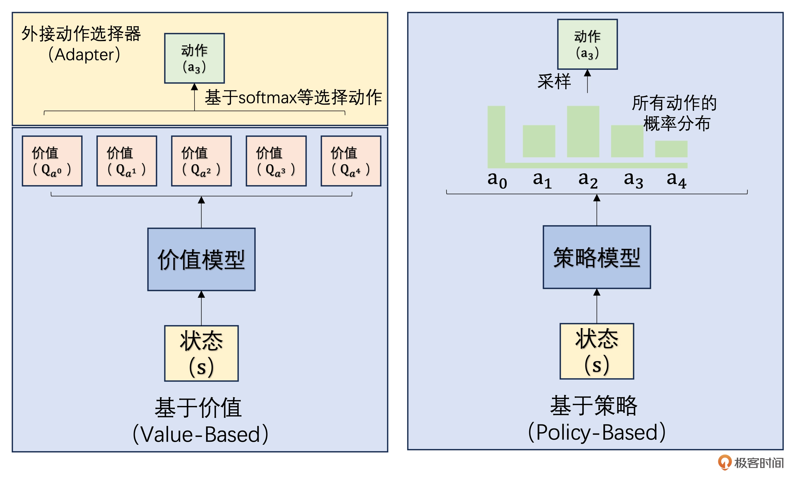
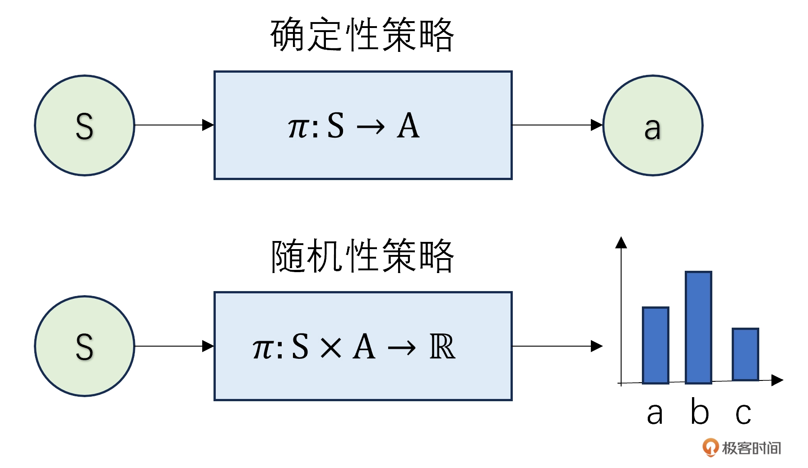
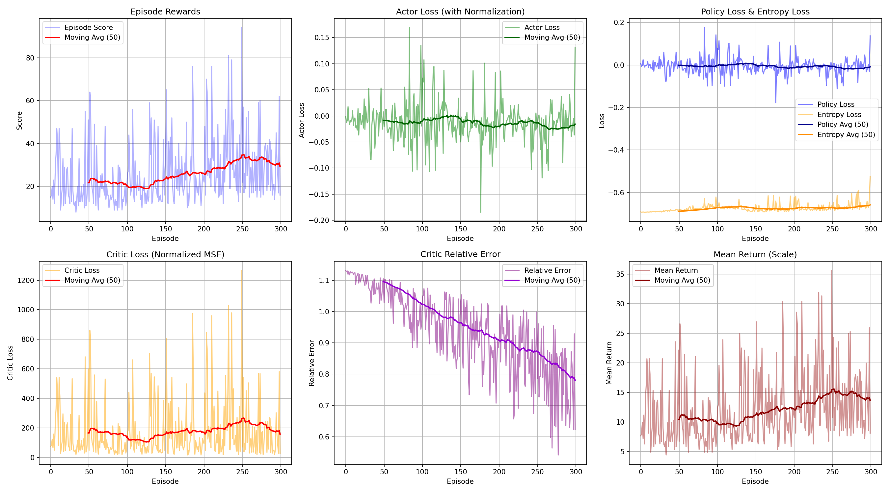

# 03 | 基于策略的强化学习：从策略梯度到Actor-Critic

你好！欢迎来到强化学习的第三节课。上一节课我们聚焦于基于价值的强化学习方法，从经典的 Q-Learning 到 DQN，理解了如何通过价值函数间接指导智能体决策。而今天，我们将转向另一种核心范式——基于策略的强化学习算法，探索如何直接优化策略以实现长期收益最大化。

通过本节课的学习，你将能够：

- 理解策略函数的参数化表示方式，以及策略梯度定理的数学原理

- 掌握 REINFORCE 算法的基本流程，以及基线调整、优势函数等方差缩减技术

- 了解确定性策略梯度的突破意义，以及 Actor-Critic 架构的协同优化逻辑

- 明晰 PPO、DDPG 等现代算法的核心改进，及其在连续动作空间中的应用场景

这节课我们将系统梳理基于策略的强化学习发展脉络，从基础的策略梯度定理讲起，逐步深入到 Actor-Critic 架构的设计原理，并探讨该领域的前沿进展与应用前景。你将建立起对策略优化方法的完整认知框架，理解各类算法背后的数学原理与工程实践考量。

## 一、背景

在强化学习（Reinforcement Learning, RL）的发展历程中，研究者始终面临一个核心问题：如何设计智能体的决策机制以实现长期收益最大化？这一问题催生出两大主流研究范式——基于价值的方法（Value-based Methods）和基于策略的方法（Policy-based Methods）。

图 3-1 展示了基于价值和基于策略的强化学习模型的差异，如下所示。



- 图3-1 机制模型和策略模型对比

基于价值的方法（如 Q-Learning、DQN）通过学习价值函数（State Value 或 State-ActionValue）间接指导决策，智能体通过选择价值最高的动作实现最优行为。这类方法在离散动作空间中取得了显著成功，例如 AlphaGo 通过深度 Q 网络（DQN）攻克了围棋领域的百年难题。然而，当面对连续动作空间（如机器人控制、自动驾驶）时，价值函数的表示和优化变得异常困难，基于价值的方法往往需要复杂的离散化处理，导致精度损失或组合爆炸。

基于策略的方法则另辟蹊径，直接参数化表示智能体的策略函数（Policy Function），通过优化策略参数最大化累积奖励。这种方法天然适配连续动作空间，且能直接输出动作的概率分布，为决策提供了更丰富的不确定性信息。从早期的 REINFORCE 算法到现代的深度确定性策略梯度（DDPG），基于策略的方法已成为解决复杂连续控制问题的主流框架。

上述两大范式的演进，本质都是对强化学习核心命题的探索，而这一命题的思想根源，深扎在行为心理学、神经科学与控制论的交叉沃土中：从巴甫洛夫实验中“条件反射”对“刺激 - 反应”机制的验证，到赫布（Hebb）“突触可塑性法则”（一起放电的神经元连在一起）为“学习过程”提供的神经科学解释；从桑代克“迷笼实验”中通过试错找到逃生路径的猫，到斯金纳箱里通过奖惩调整行为频率的老鼠——这些生物智能的底层逻辑，最终在基于策略的方法中得到算法化落地（如 REINFORCE 算法通过“奖励加权的梯度上升”，让智能体在试错中迭代策略，正是对“奖惩调整行为”的数学建模）。如今，随着多智能体强化学习（Multi-Agent RL, MARL）、大语言模型（LLMs）与强化学习（如 RLHF）的融合，基于策略的方法正进一步拓展边界，成为连接生物智能与人工智能的关键技术桥梁。

## 二、策略梯度：直接优化的数学基础

智能体的行为进化，始终围绕“如何更高效地适应环境”展开，其路径清晰地呈现出三级跃升：从巴甫洛夫式的条件反射被动响应——仅能依托预设刺激机械触发固定行为；到斯金纳的奖励塑造行为——通过“行为 - 奖惩”的关联反馈调整行动模式；再到托尔曼揭示的主动探索与认知地图——智能体开始主动游走环境、构建内部空间表征以规划路径。

然而，即便进化至认知层面，这一切仍未脱离“经验驱动试错”的范畴。智能体或许能从过往经历中归纳出“哪些行为可行”，却始终无法突破关键瓶颈：无法系统地优化自身行为策略——既不清楚“为何某些策略有效”，更不知“如何让策略变得更优”。

真正的突破，始于强化学习算法的首次登场，一场重塑智能体行为逻辑的范式飞跃就此发生。其核心革新，是为智能体植入了一枚“内在指南针”：可微分的目标函数（ObjectiveFunction）。这一函数将“最大化长期期望奖励”这一模糊目标，转化为精确、可计算的数学指标，彻底改变了策略优化的底层逻辑。

策略不再依赖盲目的经验试错，而是依托梯度上升这一严谨的数学工具，沿着目标函数指引的方向持续迭代——每一步调整都明确指向“提升长期奖励”，每一次优化都有可追溯的数学依据。这正是基于策略的方法的核心思想：它标志着智能体的行为优化，正式从“凭经验摸索的心理学启发阶段”，迈入“按目标迭代的数学可导算法世界”，为更复杂、更高效的智能行为奠定了底层框架。

## 2.1 策略是什么

在强化学习的策略梯度方法中，“策略”是定义智能体行为逻辑的核心要素，它本质上是智能体

## π(a∣s)

在环境状态（State）与动作（Action）之间建立的映射规则，通常用符号

- 表示，直观

## s

## a

理解为“当智能体处于状态 时，选择执行动作 的倾向性或概率分布”。

这一“策略”并非单一固定的规则，而是根据优化需求呈现两种核心形态（图 3-2）。

## π(s) = a

## s

## a

- 确定性策略：在特定状态 下，策略会明确指向唯一最优动作 ，即。此时智能体的行为具有明确指向性，给定状态便对应固定动作，不存在随机选择。

## s

## a

- 随机性策略：在状态 下，策略不会锁定单一动作，而是为所有可能的动作 分配一个概率值，智能体通过概率抽样选择动作（常见如基于 Softmax 函数的概率分配）。这种形态更贴合真实环境的不确定性，能帮助智能体探索更多潜在行为，避免陷入局部最优。



- 图3-2 确定性策略和随机策略的差异

需要特别注意的是，策略梯度方法中的“策略”，标志着智能体优化目标的关键转变：它不再是被动地对环境建模（如估计状态价值），也不是通过价值判断间接选择动作，而是直接将“策略

## π(a∣s)

本身”作为优化对象——通过梯度上升等数学方法，持续调整

- 的参数，让策略生成的行

为序列在与环境的互动中，最终实现“长期期望奖励”的最大化。简言之，策略是智能体“如何行动”的直接蓝图，而策略梯度的核心，就是为这张蓝图找到持续优化的数学路径。

## 2.2 策略的参数化表示

在基于策略的强化学习中，智能体的行为被定义为从状态空间到动作空间的映射函数。为实现

- ​(a∣s)

## π

## θ

## a

## s

- ，其中 为策略参数， 为动作， 为状态。

可学习性，策略通常采用参数化表示：

- θ

## s

## a

该函数表示在状态 下选择动作 的概率（离散动作空间）或概率密度（连续动作空间）。

常见的参数化形式包括：

- Teϕ(s,a)θ​(a∣s) =

## ϕ(a∣s)

## π

- 离散动作空间：softmax 函数，其中为特征函数；θ′ Tϕ(s,a )∑a′​θ​ e2​(a∣s) =

## N(μ

- ​(s), σ​(s))

## π

- 连续动作空间：高斯分布，均值和方差均由神经网络参数θθθ化。

深度强化学习中，策略函数通常由神经网络实现，通过多层非线性变换将状态特征映射为动作分布参数。这种端到端的表示方式避免了人工特征工程，引入非线性变换，极大提升了策略的表达能力。

## 2.3 目标函数的定义

## θ∗

策略优化的核心目标是找到最优参数

- ，最大化智能体在环境中的期望累积奖励。常用的目

标函数定义有三种形式：

1. ∞

## E

- ​(θ) =

## (s

- ​) =​[​∣s​]

## γ ∈

- πt t​θ ∑t=0

## J

## V

- ​ γ r

## s

- ，其中为初始状态，起始状态价值：​θ100​0π

## [0, 1)

- 为折扣因子；​(θ) =​ d (s)V

## (s)

## d (s)

- πππ

## ∑s

## J

## π

- ，其中为策略下的稳态分布；平均价值：​θ​θ​θavV​θ​(θ) =​ d (s)​(a∣s)r(s, a)π

## ∑s

## ∑a

## J

- ​ π平均奖励：，适用于无折扣的持续任务。​θavRθ

在实践中，最常用的是起始状态价值形式，因其便于理论分析且易于计算。无论采用哪种形

## J(θ)

## θ

式，策略优化的本质都是通过调整参数 提升目标函数值

- 。

对于稳态分布，学习过随机过程基础知识后，可以有更深入的理解。但在我们的专栏中，你对这一概念可以不必深究。更重要的是知道：在强化学习（以及其他描述对象较为复杂的学科）中，有时一个抽象概念的数学定义（描述）往往不止一种。这些不同的描述之间有时是互相等价的，有时是狭义到广义的关系。而之所有会有多种数学描述，是因为这些不同的描述形式往往侧重一个复杂概念的不同侧面。

从多个侧面去理解一个概念的含义固然是好的，但作为入门，掌握其中一种已经足够。

## 三、策略梯度定理：优化的数学核心

策略梯度方法的理论基础是策略梯度定理（Policy Gradient Theorem），该定理揭示了目标函数梯度与策略参数的关系。对于任意策略参数化形式，目标函数的梯度可表示为：

- ∞∞

## E

- k−t k

## ∇

- ​J(θ) =​[​ ∇​ log π​(a​∣s​)G​]​ =​θ ∑t=0

## ∑k=t

## G

- ​ γ

## r

## t

- 。其中为从时刻 开始的θπθθtttt​

累积折扣奖励（Return）。这一优雅的公式将目标函数梯度转化为可通过采样估计的期望值，为策略优化提供了可行路径。

定理的推导基于马尔可夫决策过程（MDP）的特性，通过对目标函数进行全导数展开，利用策略与状态分布的链式关系，最终消去了难以计算的状态分布梯度项，仅保留可采样的轨迹项。这一关键简化使策略梯度方法具备了实际可行性。

策略梯度定理的详细推导涉及较多数学技巧，这节课为了控制学习难度，我们先不做展开。随着课程推进，我们会在第二章重温策略梯度法，在那里给出更详细的推导过程。若你对策略梯度的推导过程非常感兴趣，想提前了解背后的原理。推荐你参考 John Schulman 大神（TRPO、GAE 和 PPO 的作者，这个星球上没有人比他更懂策略梯度）在 2017 年 Deep RLBootcamp Lecture 上的讲座。

## τ = (s

- ​, a​, r​, s​, a​, r​, ...)​ =

## g^

根据策略梯度定理，我们可通过采样轨迹

- 估计梯度：000111N ∑t=0

1 ∑i=1

- T−1​ ∇​ log π​(a​∣s​)G

## N

- 。其中为采样轨迹数量，T 为每条轨迹长度。得i,ti,ti,tθθ

N

- ​​​

## θ ←θ + α

- ​g^

## α

- ，其中 为学习率。

到梯度估计后，采用梯度上升法更新参数：

早期的策略梯度算法 REINFORCE（Williams, 1992）正是基于这一原理实现，其完整流程如下：

## π

1. 基于当前策略采样多条轨迹；​θ

## G

2. 计算每条轨迹中每个时刻的累积回报；​t​ =

## g^

- ​ ∇​ log π​(a​∣s​)G

## ∑t

- 估计策略梯度；θθttt​

## θ ←θ + α

4. ​g^执行梯度上升更新。

REINFORCE（是基于蒙特卡洛采样的策略梯度方法，所谓蒙特卡洛，可以简单理解为 Agent的采样策略是从开始状态一直到最终状态，采样一个完整的轨迹。蒙特卡洛通常和时序差分作为对比概念，一个方差大，一个偏差大，下一节会进行更详细的介绍）算法结构简单，但存在梯度估计方差大的问题，导致收敛速度慢且不稳定。为缓解这一问题，研究者提出了基线调整

- ​ =

## g^

- ​ ∇​ log π​(a​∣s​)(G​ −

## ∑t

（Baseline Subtraction）技术，将梯度估计修正为：

- θθttt

## b(s

- ​))

## b(s

- ​)

## V (s

- ​)，其中为基线函数（通常用状态价值函数估计）。理论证明，基线的引入ttt

不改变梯度的无偏性，但能有效降低估计方差，显著提升算法稳定性。

在这里提供两个补充知识：

1. 基线的提出是为了解决梯度估计方差过大的问题。在机器学习中，统计量的方差对优化算法的效果影响非常显著。通常认为，在保证统计量为无偏估计的同时，方差越小则算法收敛效果越好。机器学习中有专门的一个研究领域叫“方差缩减”（Variance Reduction）。上述基线的引入也是一种方差缩减技术。

2. 强化学习中除了策略梯度方法，还有一大类方法叫策略迭代法（Policy Iteration）。策略迭代通常包括策略评估（Policy Evaluation）和策略改进（Policy Improvement）两步，是一个迭代过程。然而，策略迭代法与策略梯度法截然不同，属于 Model-based 方法，也属于Value-based 方法。这里不做展开。希望你未来若遇到这一概念时，可以不至于混淆。

## 四、策略梯度的改进：方差缩减与样本效率

## 4.1 折扣累积回报的偏差与方差权衡

- 2 t+2​ =​ +​ +​ +

## G

## r

## γr

## γ r

原始 REINFORCE 算法使用蒙特卡洛方法直接计算累积回报

- t+1ttT−t T

## ... + γ

## r

- ，这种无偏估计方式带来了较大的方差问题——长轨迹中的随机波动会严重影响​

梯度估计质量。

为平衡偏差与方差，研究者提出了时序差分策略梯度（TD Policy Gradient）方法，用

- (n)​ +​ +

## ... + γ V (s

- ​)n

## =

## G

## r

## γr

- 替代完整回报，其中 n 为 TD 步数。当 n=0 时，t+1t+n+1tt(0)​ =​ +

## γV (s

- ​)

## n →∞

## G

## r

- ，形成一步 TD 估计；当时，则退化为蒙特卡洛估计。t+1tt

TD 方法通过引入价值函数估计引入了一定偏差，但大幅降低了梯度估计方差，在样本效率与收敛稳定性之间取得了更好的平衡。这种偏差 - 方差权衡是强化学习算法设计中的核心考量因素。

## 4.2 优势函数与信用分配

策略梯度方法的另一个关键改进是引入优势函数（Advantage Function）替代原始回报。优势

## A (s, a) =

## Q (s, a) −

## V (s)

- πππ

## s

## a

- ，表示在状态 下选择动作 相对于遵循策略

函数定义为：

## π

时该状态下期望动作价值的优势程度。

## E[

## ∇

- ​J(θ) ≈​ ∇​ log π​(a​∣s​)A (s​, a​)]π

## ∑t

使用优势函数的梯度估计形式为：

- θθθtttt

优势函数的引入带来了双重好处：

## V (s)

- 天然包含基线调整（减去状态价值），有效降低梯度方差；

- 更精准地量化动作价值，解决信用分配问题——区分环境反馈中哪些应归功于智能体的当前决策。

这里补充一个知识点：信用分配（Credit Assignment）是强化学习中的一个重要主题。在连续多步决策后获得结果，那么结果该如何分配给之前连续决策中的每一步呢？这就是 CreditAssignment 要讨论的核心问题。这一讲不做更多展开。

优势函数的估计方法主要有：

- ​ ≈​ +

## γV (s

- ​) −

## V (s

- ​)

## A

## r

- 时序差分残差：；t+1ttt

## A^t

- ∞​ =​(γλ) δk t+k

## ∑k=0

- 广义优势估计（Generalized Advantage Estimation, GAE）：，其​​ =

## r +

## γV (s

- ​) −

## V (s

- ​)

## λ ∈[0, 1]

## δ

- 中为 TD 误差，为平滑参数。t+1ttt

通过加权组合多步 TD 误差，在偏差和方差之间取得了灵活的平衡，已成为现代策略梯度算法的标准配置。GAE 是一个精妙的方法，如果你想深入理解策略梯度理论，建议不妨读一读原论文。

## 五、确定性策略梯度：连续空间的突破

在连续动作空间中，概率策略的表示和采样往往计算复杂。2014 年，Silver 等人提出确定性策略梯度定理（Deterministic Policy Gradient Theorem），为连续控制问题提供了新思路。

## a = μ

- ​(s)

## ∇

- ​J(θ) =

确定性策略定义为

- ，直接输出动作而非概率分布。其梯度公式为：θθ

## E

- ​[∇​(s)∇​Q (s, a)∣​]μ​μ

s∼ρμ

- a=μ​(s)θθaθ

确定性策略梯度具有两大优势：

1. 计算效率更高，无需对动作分布进行采样和参数化；

2. 样本复杂度更低，每个状态只需评估一个动作。

这一突破直接催生了深度确定性策略梯度（DDPG）算法，该算法结合深度神经网络与确定性策略梯度，首次实现了复杂连续控制任务的端到端学习，为机器人控制等领域提供了强大工具。

## 六、Actor-Critic 架构：价值与策略的融合

## 6.1 双网络结构设计的原理

Actor-Critic（AC）架构是策略梯度方法与价值方法的创造性融合，通过两个功能互补的网络实现高效学习：

- ​(a∣s)

## θ

## π

- Actor 网络：参数化为 ，表示策略函数，负责生成动作（“演员”）；θ

- ​(s, a)​(s)

## ϕ

## Q

## V

- Critic 网络：参数化为 ，表示价值函数或，负责评估动作价值（“评论ϕϕ家”）。

这种架构的核心优势在于：

1. Actor 利用 Critic 提供的价值信号进行策略更新，实现单步更新（而非蒙特卡洛的完整轨迹更新）；

2. Critic 通过 Actor 生成的交互数据持续学习，为策略优化提供更及时的反馈；

3. 双网络并行学习形成闭环，既保留了策略方法处理连续动作的优势，又吸收了价值方法样本效率高的特点。

AC 架构的基本更新流程为：

1. Actor 根据当前策略生成动作与环境交互，获取奖励和新状态；

2. Critic 基于交互数据更新价值估计；

3. Actor 利用 Critic 评估的优势值更新策略参数；

4. 重复迭代直至收敛。

## 6.2 优势 Actor-Critic（A2C）

优势 Actor-Critic（Advantage Actor-Critic, A2C）是 AC 架构的经典实现，其核心改进是使用优势函数指导策略更新，具体结构如下：

- ​(s)​ =​ +​(s​) −

## V

## δ

## r

## γV

- Critic 网络：学习状态价值函数，通过 TD 误差更新：t+1ϕttϕ1 ∑t2​(s​)

## L(ϕ) =

## V

- ​ δ，损失函数为。ϕtt2​​t A^t

## ∇

- ​J(θ) ≈​ ∇​ log π​(a​∣s​)

## ∑t

- Actor 网络：通过策略梯度更新，梯度估计为，其中θθθt​

## A^t

- 为优势估计。​同步更新机制：每收集一定量样本后，同步更新 Actor 和 Critic 网络。

- (n)​ =​ +​ +

## ... + γ V (s

- ​)n

## G

## r

## γr

A2C 通常结合 n 步回报提升性能，使用

- 估计优势t+1t+ntt

值。为进一步提升样本效率，A2C 常采用多线程并行采样技术，多个探索者（Worker）同时与环境交互，主进程定期收集所有样本进行批量更新，这种架构被称为 A3C（AsynchronousAdvantage Actor-Critic）。

```sql
import torch
import torch.nn as nn
import torch.optim as optim
import torch.nn.functional as F
from torch.distributions import Categorical
import gymnasium as gym  # 使用gymnasium替代gym以兼容numpy 2.0
import numpy as np
import matplotlib.pyplot as plt
# 定义Actor网络 - 策略网络
class Actor(nn.Module):
   def __init__(self, state_dim, action_dim, hidden_dim=64):
       super(Actor, self).__init__()
       self.fc1 = nn.Linear(state_dim, hidden_dim)
       self.fc2 = nn.Linear(hidden_dim, action_dim)
   def forward(self, x):
       x = F.relu(self.fc1(x))
       action_probs = F.softmax(self.fc2(x), dim=-1)
       return action_probs
# 定义Critic网络 - 价值网络
class Critic(nn.Module):
   def __init__(self, state_dim, hidden_dim=64):
       super(Critic, self).__init__()
       self.fc1 = nn.Linear(state_dim, hidden_dim)
       self.fc2 = nn.Linear(hidden_dim, 1)  # 输出状态价值
   def forward(self, x):
       x = F.relu(self.fc1(x))
       state_value = self.fc2(x)
       return state_value
# Actor-Critic agent
class ActorCriticAgent:
   def __init__(self, state_dim, action_dim, lr_actor=1e-3, lr_critic=1e-3,
                gamma=0.99, entropy_coef=0.01, normalize_advantages=True,
                normalize_values=True, max_grad_norm=0.5):
       self.gamma = gamma  # 折扣因子
       self.entropy_coef = entropy_coef  # 熵正则化系数
       self.normalize_advantages = normalize_advantages  # 是否归一化优势
       self.normalize_values = normalize_values  # 是否归一化价值
       self.max_grad_norm = max_grad_norm  # 梯度裁剪阈值
       # 初始化网络
       self.actor = Actor(state_dim, action_dim)
       self.critic = Critic(state_dim)
       # 优化器
       self.optimizer_actor = optim.Adam(self.actor.parameters(), lr=lr_actor)
       self.optimizer_critic = optim.Adam(self.critic.parameters(), lr=lr_critic
       # 存储轨迹
       self.log_probs = []
       self.rewards = []
       self.values = []
       self.entropies = []  # 存储熵值
   def select_action(self, state):
       # 将状态转换为张量
       state = torch.from_numpy(state).float().unsqueeze(0)
       # Actor选择动作
       action_probs = self.actor(state)
       dist = Categorical(action_probs)
       action = dist.sample()
       # 存储日志概率、状态价值和熵
       self.log_probs.append(dist.log_prob(action))
       self.values.append(self.critic(state))
       self.entropies.append(dist.entropy())  # 用于熵正则化
       return action.item()
   def update(self):
       # 计算折扣回报
       returns = []
       running_sum = 0
       for r in reversed(self.rewards):
           running_sum = r + self.gamma * running_sum
           returns.insert(0, running_sum)
       # 转换为张量
       returns = torch.tensor(returns).float()
       log_probs = torch.cat(self.log_probs)
       values = torch.cat(self.values).squeeze()
       entropies = torch.cat(self.entropies)
       # 计算优势 (TD误差)
       advantages = returns - values.detach()  # 注意：这里detach values，因为advan
       # 优势归一化（减少方差，使loss更稳定）
       if self.normalize_advantages and len(advantages) > 1:
           advantages = (advantages - advantages.mean()) / (advantages.std() + 1
       # 价值归一化（使critic loss不受尺度影响）
       if self.normalize_values:
           returns_mean = returns.mean()
           returns_std = returns.std() + 1e-8
           returns_normalized = (returns - returns_mean) / returns_std
           values_normalized = (values - returns_mean) / returns_std
           critic_loss = F.mse_loss(values_normalized, returns_normalized)
           # 记录原始scale用于诊断
           value_scale = returns_std.item()
       else:
           critic_loss = F.mse_loss(values, returns)
           value_scale = 1.0
       # 计算Actor损失（策略损失 + 熵正则化）
       policy_loss = -torch.mean(log_probs * advantages)
       entropy_loss = -torch.mean(entropies)  # 负熵（因为我们要最大化熵）
       actor_loss = policy_loss + self.entropy_coef * entropy_loss
       # 计算额外的诊断指标
       mean_return = returns.mean().item()
       returns_std = returns.std().item()
       critic_relative_error = (critic_loss.item() ** 0.5) * value_scale / (abs(
       advantages_mean = advantages.mean().item()
       advantages_std = advantages.std().item()
       # 梯度下降（带梯度裁剪）
       self.optimizer_actor.zero_grad()
       actor_loss.backward()
       # 梯度裁剪防止梯度爆炸
       torch.nn.utils.clip_grad_norm_(self.actor.parameters(), self.max_grad_nor
       self.optimizer_actor.step()
       self.optimizer_critic.zero_grad()
       critic_loss.backward()
       # 梯度裁剪
       torch.nn.utils.clip_grad_norm_(self.critic.parameters(), self.max_grad_no
       self.optimizer_critic.step()
       # 清空缓存
       self.log_probs = []
       self.rewards = []
       self.values = []
       self.entropies = []
       return {
           'actor_loss': actor_loss.item(),
           'policy_loss': policy_loss.item(),
           'entropy_loss': entropy_loss.item(),
           'critic_loss': critic_loss.item() * (value_scale ** 2) if self.normal
           'critic_relative_error': critic_relative_error,
           'mean_return': mean_return,
           'returns_std': returns_std,
           'advantages_mean': advantages_mean,
           'advantages_std': advantages_std,
           'value_scale': value_scale
       }
# 训练函数
def train(env_name="CartPole-v1", episodes=300, max_steps=1000):
   env = gym.make(env_name)
   # 处理Gym返回格式变化，只获取状态部分
   state, _ = env.reset()  # 新增：获取元组中的状态部分
   state_dim = env.observation_space.shape[0]
   action_dim = env.action_space.n
   # 创建agent
   agent = ActorCriticAgent(state_dim, action_dim)
   # 记录每回合的奖励和损失
   scores = []
   actor_losses = []
   policy_losses = []
   entropy_losses = []
   critic_losses = []
   critic_relative_errors = []
   mean_returns = []
   for episode in range(episodes):
       state, _ = env.reset()  # 修改：获取元组中的状态部分
       score = 0
       for step in range(max_steps):
           # 选择动作
           action = agent.select_action(state)
           # 执行动作，处理返回值 (gymnasium返回: obs, reward, terminated, truncated
           next_state, reward, terminated, truncated, _ = env.step(action)
           done = terminated or truncated  # 任一为True都表示episode结束
           # 存储奖励
           agent.rewards.append(reward)
           score += reward
           state = next_state
           if done:
               break
       # 每回合结束后更新网络
       metrics = agent.update()
       # 记录指标
       scores.append(score)
       actor_losses.append(metrics['actor_loss'])
       policy_losses.append(metrics['policy_loss'])
       entropy_losses.append(metrics['entropy_loss'])
       critic_losses.append(metrics['critic_loss'])
       critic_relative_errors.append(metrics['critic_relative_error'])
       mean_returns.append(metrics['mean_return'])
       # 打印进度（包含更详细的指标）
       if (episode + 1) % 10 == 0:
           avg_score = np.mean(scores[-10:])
           avg_actor_loss = np.mean(actor_losses[-10:])
           avg_critic_loss = np.mean(critic_losses[-10:])
           print(f"Episode {episode+1}/{episodes}, Score: {score:.2f} (Avg: {avg
                 f"Actor Loss: {metrics['actor_loss']:.4f} (Avg: {avg_actor_loss
                 f"Critic Loss: {metrics['critic_loss']:.4f} (Avg: {avg_critic_l
                 f"Critic Rel Error: {metrics['critic_relative_error']:.4f}")
   env.close()
   # 绘制训练曲线
   fig, axes = plt.subplots(2, 3, figsize=(18, 10))
   window = 50
   # 1. 奖励曲线
   axes[0, 0].plot(scores, alpha=0.3, color='blue', label='Episode Score')
   if len(scores) >= window:
       moving_avg = np.convolve(scores, np.ones(window)/window, mode='valid')
       axes[0, 0].plot(range(window-1, len(scores)), moving_avg,
                      color='red', linewidth=2, label=f'Moving Avg ({window})')
   axes[0, 0].set_title('Episode Rewards')
   axes[0, 0].set_xlabel('Episode')
   axes[0, 0].set_ylabel('Score')
   axes[0, 0].legend()
   axes[0, 0].grid(True)
   # 2. Actor Loss（改进后应该下降）
   axes[0, 1].plot(actor_losses, alpha=0.5, color='green', label='Actor Loss')
   if len(actor_losses) >= window:
       moving_avg = np.convolve(actor_losses, np.ones(window)/window, mode='vali
       axes[0, 1].plot(range(window-1, len(actor_losses)), moving_avg,
                      color='darkgreen', linewidth=2, label=f'Moving Avg ({windo
   axes[0, 1].set_title('Actor Loss (with Normalization)')
   axes[0, 1].set_xlabel('Episode')
   axes[0, 1].set_ylabel('Actor Loss')
   axes[0, 1].legend()
   axes[0, 1].grid(True)
   # 3. Policy Loss 和 Entropy Loss
   axes[0, 2].plot(policy_losses, alpha=0.5, color='blue', label='Policy Loss')
   axes[0, 2].plot(entropy_losses, alpha=0.5, color='orange', label='Entropy Los
   if len(policy_losses) >= window:
       policy_avg = np.convolve(policy_losses, np.ones(window)/window, mode='val
       entropy_avg = np.convolve(entropy_losses, np.ones(window)/window, mode='v
       axes[0, 2].plot(range(window-1, len(policy_losses)), policy_avg,
                      color='darkblue', linewidth=2, label=f'Policy Avg ({window
       axes[0, 2].plot(range(window-1, len(entropy_losses)), entropy_avg,
                      color='darkorange', linewidth=2, label=f'Entropy Avg ({win
   axes[0, 2].set_title('Policy Loss & Entropy Loss')
   axes[0, 2].set_xlabel('Episode')
   axes[0, 2].set_ylabel('Loss')
   axes[0, 2].legend()
   axes[0, 2].grid(True)
   # 4. Critic Loss（归一化后应该下降）
   axes[1, 0].plot(critic_losses, alpha=0.5, color='orange', label='Critic Loss'
   if len(critic_losses) >= window:
       moving_avg = np.convolve(critic_losses, np.ones(window)/window, mode='val
       axes[1, 0].plot(range(window-1, len(critic_losses)), moving_avg,
                      color='red', linewidth=2, label=f'Moving Avg ({window})')
   axes[1, 0].set_title('Critic Loss (Normalized MSE)')
   axes[1, 0].set_xlabel('Episode')
   axes[1, 0].set_ylabel('Critic Loss')
   axes[1, 0].legend()
   axes[1, 0].grid(True)
   # 5. Critic相对误差（应该下降）
   axes[1, 1].plot(critic_relative_errors, alpha=0.5, color='purple', label='Rel
   if len(critic_relative_errors) >= window:
       moving_avg = np.convolve(critic_relative_errors, np.ones(window)/window,
       axes[1, 1].plot(range(window-1, len(critic_relative_errors)), moving_avg,
                      color='darkviolet', linewidth=2, label=f'Moving Avg ({wind
   axes[1, 1].set_title('Critic Relative Error')
   axes[1, 1].set_xlabel('Episode')
   axes[1, 1].set_ylabel('Relative Error')
   axes[1, 1].legend()
   axes[1, 1].grid(True)
   # 6. Mean Return（显示returns的尺度变化）
   axes[1, 2].plot(mean_returns, alpha=0.5, color='brown', label='Mean Return')
   if len(mean_returns) >= window:
       moving_avg = np.convolve(mean_returns, np.ones(window)/window, mode='vali
       axes[1, 2].plot(range(window-1, len(mean_returns)), moving_avg,
                      color='darkred', linewidth=2, label=f'Moving Avg ({window}
   axes[1, 2].set_title('Mean Return (Scale)')
   axes[1, 2].set_xlabel('Episode')
   axes[1, 2].set_ylabel('Mean Return')
   axes[1, 2].legend()
   axes[1, 2].grid(True)
   plt.tight_layout()
   plt.savefig("a2c_rewards.png", dpi=150)
   plt.show()
   return agent
if __name__ == "__main__":
   # 在CartPole环境上训练
   trained_agent = train()
```

代码主要包含三个核心组件：

- Actor 网络：负责学习策略，输出每个动作的概率分布。

- Critic 网络：负责评估状态价值，为 Actor 提供策略调整提供指导。

- Agent 类：整合 Actor 和 Critic，实现动作选择和网络更新逻辑。

运行结果如下图所示。训练结果显示，经过优势归一化、价值归一化、熵正则化和梯度裁剪等改进后，Actor-Critic 算法在 CartPole-v1 环境上取得了显著效果：Episode Rewards 的移动平均从初始约 25 分持续上升至 65-70 分，表明 Agent 成功学会了平衡技能；同时 Actor Loss和 Critic Loss 的移动平均均呈现明显的下降趋势，解决了原始版本中 Loss 随 episode 变长而不降反升的问题，其中 Critic 相对误差从 1.05 降至 0.7，验证了价值估计精度的持续提升；Policy Loss 和 Entropy Loss 的分离显示策略在改进的同时保持了适当的探索，Mean Return曲线则直观展示了 returns 尺度从 17 增长到 571 的变化过程，而归一化技术确保了 Loss 不受此尺度变化影响，实现了稳定且可解释的训练过程。



异步更新虽能提升样本多样性，但会引入参数延迟问题。实践表明，在现代 GPU 计算环境下，同步更新的 A2C 配合足够大的 batchsize，往往能取得比 A3C 更稳定的性能。其中的代表性工作，如深度确定性策略梯度（Deep Deterministic Policy Gradient, DDPG）、信任区域策略优化（TRPO）与 proximal 策略优化（PPO）在后续的章节介绍。

## 总结

基于策略的强化学习通过直接优化参数化策略，为解决复杂决策问题尤其是连续动作空间问题提供了强大工具。从基础的策略梯度定理到先进的 Actor-Critic 架构，再到 PPO、SAC 等现代算法，这一领域的发展始终围绕着提升样本效率、优化稳定性和扩展应用范围三大核心目标。

这节课我们系统梳理了策略优化方法的发展脉络，详细阐述了策略梯度的数学原理、Actor-Critic 的架构设计以及各类改进算法的核心思想。我们看到，基于策略的方法通过不断吸收其他领域的先进技术（如深度学习、博弈论、控制理论），逐步克服了早期算法样本效率低、收敛不稳定等缺陷，形成了一套完整的理论体系和实践方法。

在实际应用中，选择合适的策略优化算法需要综合考虑任务特性、计算资源和性能要求。本节尚未介绍的 PPO 因其简单稳定的特性成为多数场景的首选，而 AC 架构的一种进阶版本 SAC（Soft Actor Critic） 和 DDPG 则在需要高样本效率或处理复杂连续动作的任务中表现更优。工程实践中，合理的超参数调优和探索策略设计对最终性能至关重要。

展望未来，基于策略的强化学习将朝着更高效、更安全、更通用的方向发展，与其他学科的交叉融合将催生更多创新方法。随着理论基础的不断夯实和工程技术的持续进步，基于策略的强化学习必将在智能控制、机器人学、自动驾驶等关键领域发挥越来越重要的作用，为构建更智能、更可靠的人工智能系统贡献核心力量。

对于研究者和工程师而言，深入理解策略优化的数学原理，掌握各类算法的适用场景和调优技巧，将有助于更好地应对实际问题挑战，推动强化学习技术的创新与应用。基于策略的强化学习之旅仍在继续，期待更多突破性进展的出现。

这节课的内容可能略显“硬核”。即便我们在很多知识点点到为止，这节课依旧无法避开对很多概念和理论的描述。对于刚入门的同学来说，希望你至少可以把握策略梯度法的发展脉络、了解每个关键改进（GAE、基线、双网络）所引入的背景、记住策略梯度法的基本形式。在后续课程中，我们会重温策略梯度法。届时你或许会有更深入的理解。

## 思考题

策略梯度方法中，基线函数（Baseline）的作用是什么？为什么引入基线不会影响梯度估计的无偏性？请结合数学公式说明基线调整对梯度方差的影响机制。

希望你通过今天的学习，对基于策略的强化学习有了清晰的认识。如果有任何疑问，欢迎在讨论区留言交流！
