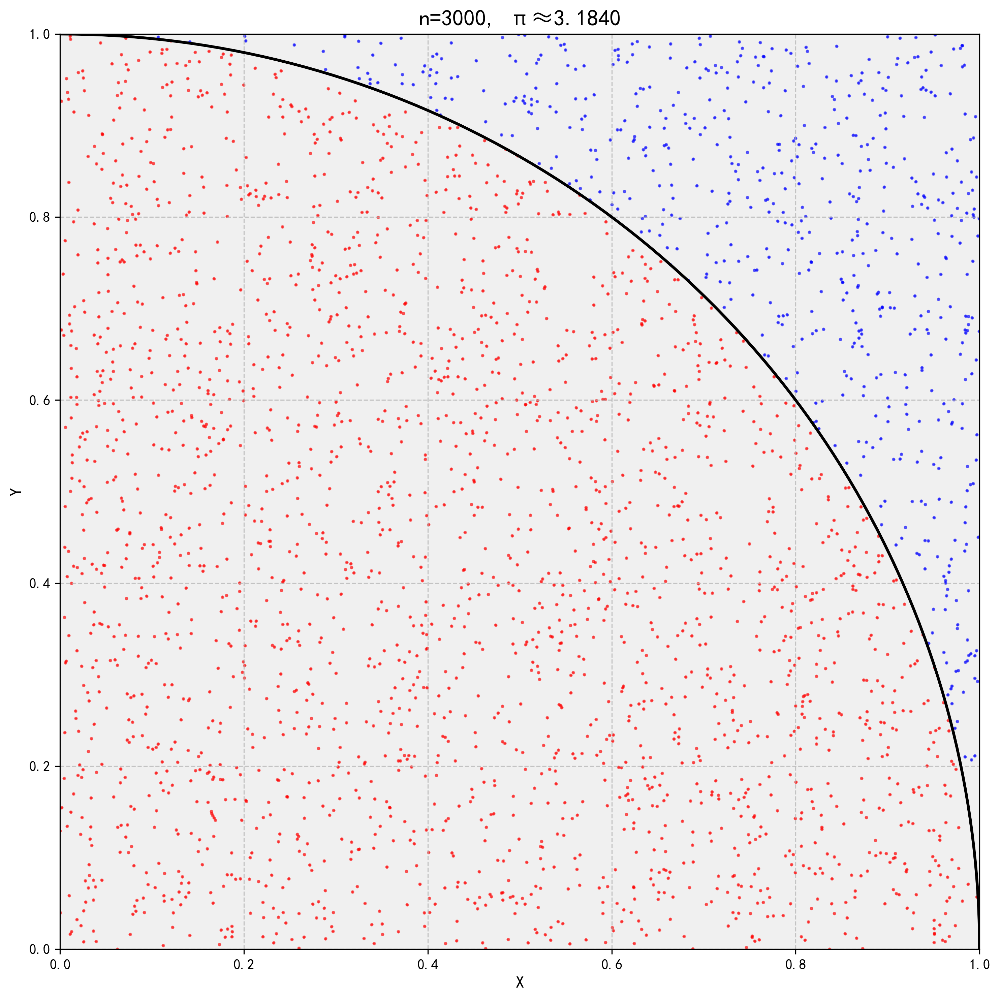
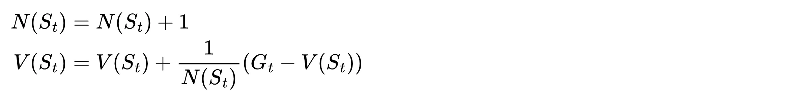
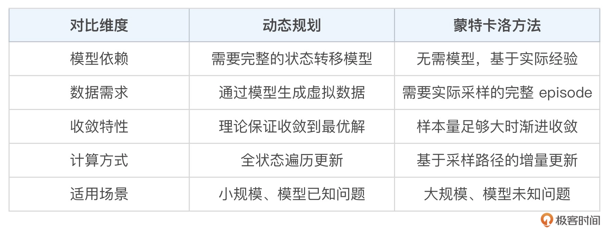

# 04 | 模型与规划：从动态规划到蒙特卡洛树搜索

你好！欢迎来到强化学习的第四节课。在人工智能与运筹学领域，规划技术是实现最优决策的核心支撑。本节课我们将沿着规划技术的发展脉络，深入解析两种里程碑式的方法——动态规划与蒙特卡洛树搜索（MCTS）。

通过本节课的学习，你将能够：

- 解析策略迭代与价值迭代的算法逻辑，明确动态规划的适用场景与局限性；

- 理解蒙特卡洛方法的随机采样思想，以及时序差分学习如何连接动态规划与蒙特卡洛；

- 掌握蒙特卡洛的四阶段循环机制（选择、扩展、模拟、回溯），理解其平衡探索与利用的核心逻辑；

- 对比两种规划范式的数学基础、计算复杂度和实际应用，构建对智能规划技术的完整认知；

- 了解动态规划与蒙特卡洛融合思路，以及在复杂场景中的混合规划方法。

## 一、动态规划：确定性环境下的最优决策框架

## 1.1 动态规划的理论基础

上世纪 50~60 年代，在空间技术发展和电子计算机实用化的推动下，针对动态系统的优化理论逐渐形成了一个重要的学科分支：最优控制。它在空间技术、系统工程、经济管理与决策、多级工艺设备的优化等许多领域都有广泛应用。

1957 年，美国数学家理查德・贝尔曼（Richard Bellman）提出了一种求解最优控制问题的经典工具——动态规划（Dynamic Programming, DP）方法。这一方法的核心支撑是贝尔曼最优性原理，其核心内涵可概括为：在多级决策过程中，无论初始状态与初始决策如何，对于由初始决策所形成的新状态而言，剩余决策序列必定构成该状态下的最优策略。这一原理可凝练为一个基础性递推公式，在求解多级决策问题时，需从决策序列的末端出发，逆向递推至始端，逐步推导最优解。

贝尔曼最优性原理的理论根基是拓扑学、泛函分析中的非常优美、非常基础的巴拿赫不动点定理（Banach Fixed-point Theorem），又称压缩映射定理（Contraction Mapping Principle）。在这里不做展开，但推荐感兴趣的同学进一步深入了解。

动态规划的核心思想在于：将复杂的全局问题分解为结构相同的递归子问题，通过求解子问题的最优解并逐步整合，最终推导得到全局最优解。在规划领域，动态规划建立在马尔可夫决策过程（Markov Decision Process, MDP）的理论框架之上，借助状态转移模型对系统未来行为进行预测与优化。其适用范围极为广泛，可有效处理离散系统、连续系统、线性系统、非线性系统、确定性系统及随机系统等多种类型的决策问题。

基于贝尔曼最优性原理，多阶段决策（又称贯序决策）问题可转化为求解哈密顿 - 雅可比 - 贝尔曼（Hamilton-Jacobi-Bellman, HJB）方程的问题，进而推导得到最优控制律。然而，在实际系统的最优控制问题中，所构建的 HJB 方程大多难以获得解析解。而利用动态规划（DP）方法通过迭代更新方法近似求解 HJB 方程的数值解，成为解决最优控制问题的核心手段。

- 补充知识：当复杂问题的解析解难以求得，通过迭代计算数值解逼近解析解是一种常用的方式。

值得注意的是，几乎所有的动态规划方法都可纳入广义策略迭代（generalized policy iteration,GPI）算法的框架下。该算法的核心逻辑是通过策略评估与策略改进两个关键流程，以特定的迭代粒度交替执行，逐步逼近最优解。在这一框架中，策略迭代（policy iteration, PI）算法和值迭代（value iteration, VI）算法是目前应用最为广泛、认可度最高的两种经典实现方式。

这里的策略迭代我们在上一讲也提到过，注意其为 Value-based 方法，与策略梯度不同。

## 1.2 策略迭代：从策略评估到策略改进

策略迭代由两个交替进行的步骤组成：

- ​(s)

## V

- 策略评估（Policy Evaluation）：对于当前策略 π，计算每个状态的价值函数，即遵π​(s) ←

## π

## s

## V

- 循策略 时从状态 出发获得的累积折扣奖励期望。其更新公式为：π′′​ π(a∣s)[R(s, a) +​ T(s ∣s, a)V​(s )]

## ∑a

## ∑s′

## γ

- ；π策略改进（Policy Improvement）：基于当前价值函数，通过贪心算法更新策略，使每个状′′′

## π (s) =

## arg max

- ​[R(s, a) +

## γΣ

- ​T(s ∣s, a)V​(s )]态下的动作选择最大化未来奖励：s′aπ。

当策略不再发生变化（π’ = π）时，可以认为收敛到最优策略 π*。策略迭代的优势在于，每次迭代都能保证策略严格改进，收敛速度稳定，但在状态空间较大时计算成本较高。

- ′​ T(s ∣s, a)

## ∑s′

请注意策略迭代中的

- ，这就是对系统中“模型”的建模，即状态转换模型（状态

转移概率）。所谓 “Model-based” 和 “Model Free” 就是指算法中是否包含这个模型。因此，策略迭代法是 Model-based 方法。

## 1.3 价值迭代：直接优化价值函数

- ∗∗

## V (s)

## V (s) ←

价值迭代省去了显式的策略评估，直接迭代更新最优状态价值函数

- ：′∗′

## max

- ​[R(s, a) +​ T(s ∣s, a)V (s )]

## ∑s′

## γ

- 。a

当价值函数的变化量小于预设阈值时，算法收敛，此时可通过最优价值函数直接推导最优策

- ∗′∗′

## π (s) =

## arg max

- ​[R(s, a) +​ T(s ∣s, a)V (s )]

## ∑s′

## γ

略：

- 。a

相比策略迭代，价值迭代不需要完整的策略评估步骤，在某些场景下收敛更快，但需要更多迭代次数才能达到稳定状态。

## 1.4 动态规划的局限性

尽管动态规划在理论上完美解决了 MDP 问题，需要说明的是，DP 方法是一种离线规划（Off-line planning）的方法。在实际应用中面临严峻挑战：

1. 维度灾难（Curse of Dimensionality）：当状态空间连续或高维时（如机器人控制中的关节角度组合），状态数量呈指数级增长，计算和存储成本不可承受；

2. 模型依赖性：需要精确已知状态转移概率和奖励函数，而现实世界中这些模型往往难以准确获取；

3. 计算复杂度：每次迭代需遍历所有状态，在大规模问题中效率极低。

这些局限促使研究者探索更灵活的规划方法，为蒙特卡洛方法的引入埋下伏笔。

## 二、蒙特卡洛方法：随机采样的概率规划范式

动态规划可以用来求解强化学习预测问题和控制问题，但是由于动态规划法需要在每一次回溯更新某一个状态的价值时，回溯到该状态的所有可能的后续状态，导致对于复杂问题计算量很大。同时很多时候，我们连环境的状态转化模型都无法知道，这时动态规划法根本没法使用。这时候我们如何求解强化学习问题呢？接下来我们要讨论的蒙特卡洛（Monte-Calo, MC）就是一种可行的方法。

## 2.1 蒙特卡洛方法的基本思想

蒙特卡洛原来是一个赌场的名称，用它作为名字大概是因为蒙特卡洛方法是一种随机模拟的方法，这很像赌博场里面的扔骰子的过程。最早的蒙特卡洛方法都是为了解决一些不太好求解的求和或者积分问题。

蒙特卡洛方法起源于 20 世纪 40 年代的核物理研究，其核心思想是通过随机采样模拟系统行为，用统计结果近似理论期望。与动态规划不同，蒙特卡洛方法不需要完整的状态转移模型，而是通过实际采样经验估计价值函数，特别适用于模型未知或模型过于复杂的场景。

图 3-1 是一个经典的用蒙特卡洛求圆周率的问题，用计算机在一个正方形之中随机的生成点，计数有多少点落在 1/4 圆之中，这些点的数目除以总的点数目即圆内面积占比，根据圆面积公式即可求得圆周率。



- 图3-1 蒙特卡洛求圆周率

蒙特卡洛算法的另一个应用是求积分。某些函数的积分不好求，我们可以按照下面的方法将这个函数进行分解，转化为在某个更好计算的分布下求期望或求均值的问题。

- bb

## ∫

## ∫

- ​ h(x)dx =​ f(x)p(x)dx =​[f(x)]

## E

- p(x)aa

## f(x)

- ​, x​, ..., x

## p(x)

- ​[f(x)] =

## x

## E

从分布

- 采样大量样本点，这些样本符合。12p(x)n​

1 ∑

## f(x

- ​)最终使用蒙特卡洛的方法求得积分。i

n​

## p(x)

对某一种概率分布

- 进行蒙特卡洛采样的方法主要分为直接采样、拒绝采样与重要性采样

三种，感兴趣的同学可以深入理解。注意模特卡洛中的拒绝采样与大语言模型的拒绝采样是两个概念，但思想相近。

## 2.2 蒙特卡洛法求解强化学习预测问题

## π

## T

假设一个给定策略 有

- 个状态的状态序列如下：​, A​, R​, S​, A​, ..., S​, A​, R​, ..., R​, S

## S

- 。

1

- 1222t+1ttTT​

## E

- ​(s)​(s) =​(G​∣S​ =

## s) =

## v

## v

我们在第一节课介绍 MDP 时，将价值函数

- 表示为：πππtt

## E

- 2​(R​ +​ +​ +

## ...∣S

- ​ =

## s)

## γR

## γ R

- 。t+1t+2t+3

π

- t

可以看出每个状态的价值函数等于所有该状态收益的期望，同时这个收益是通过奖励与对应的衰减乘积求和得到。对于蒙特卡洛这种基于随机采样的方法来说，其思路是：如果要求某一个状态的状态价值，只需要找出所有的完整序列中该状态出现时候的收益，再取平均值即可。也就是：


可以看出，预测问题的求解思路还是很简单的。不过有几个优化点可以考虑。

第一点：同样一个状态可能在一个完整的状态序列（Episode）中重复出现，那么该状态的收益该如何计算？

有两种解决方法。第一种是仅把状态序列中第一次出现该状态时的收益值纳入到收益平均值的计算中；另一种是针对一个状态序列中每次出现的该状态，都计算对应的收益值并纳入到收益平均值的计算中。两种方法对应的蒙特卡洛法分别称为：首次访问（first visit）和每次访问（every visit）蒙特卡洛法。

第二种方法比第一种的计算量要大一些，但是有时候完整的遍历样本序列比较少，这种场景下第二种方法会比第一种方法更适用。

第二点：更新平均值（incremental mean)。

在上面预测问题的求解公式里，有一个 average 的公式，意味着要保存所有该状态的收益值之和最后取平均。这样浪费了太多的存储空间。一个较好的方法是在迭代计算收益均值，即每次只保存上一轮迭代得到的收益均值与次数，当计算得到当前轮次的收益时，即可计算当前轮次收益均值和次数。通过下面的公式就很容易理解这个过程：

## 1 (

- k−1kj)

## 1

## 1 (

## 1 (

## ∑

## ∑

- ​ =

## =

- ​ =​ +​ + (k −1)μ​ =k−1)​ +​ −μ

## μ

- ​x

## x

- ​x​ x

## μ

- ​ xk−1kjkkk

## k

## k

## k

## k

- ​​​j=1j=1

这样，上面的状态更新公式可以改写为：



这样无论我们的数据量是多还是少，算法需要的内存基本是固定的。有时候，尤其是对海量数

## N(S

- ​)

据做分布式迭代的时候，我们可能无法准确计算当前的次数

- ，这时我们可以用一个系t

## v(S

- ​) ←

## v(S

- ​) +

## α(G

- ​ −

## v(S

- ​))

数 α 来代替，即：

- 。tttt

## Q(s, a)

## Q(s, a) ←Q(s, a) +

对于动作价值函数

- ，也是类似，其基本更新公式为：

## α[G

- ​ −

## Q(s, a)]

## G

## t

## α

- ，其中是从时刻 开始的累积折扣奖励， 是学习率。t​t

蒙特卡洛方法的一个重要事实是，对于每个状态的估计是相互独立的，并不需要类似 MDP 方

- ′

## P(s ∣s, a)

法那样，需要提前知道状态转移概率矩阵

- 。即：对于一个状态的估计并不会像 DP

方法那样建立在对别的状态的基础上。事实上，我们要注意到，对于一个单独的状态的估计的计算开销独立于状态数量。即，估计单个状态的值时，所需要的计算量（时间、资源等）并不会因为整个问题中状态的总数量多少而变化。这使得蒙特卡洛方法在面对只需要一个或者一部分状态的值的情况下有着自己的优势。

## 2.3 蒙特卡洛与动态规划的核心差异

蒙特卡洛法求解控制问题的思路和动态规划价值迭代的的思路类似。回忆下动态规划价值迭代

- ​(s)

## v

的的思路，每轮迭代先做策略评估，计算出价值

- ，然后基于一定的方法（比如贪婪法）k

## v

## π

更新当前策略 π。最后得到最优价值函数

- 和最优策略。​∗​∗



蒙特卡洛方法虽然解决了动态规划对完整模型的依赖，但在高维状态空间中仍面临采样效率低下的问题，尤其是在稀疏奖励环境中，需要大量采样才能获得可靠的价值估计。

## 2.4 时序差分学习：连接动态规划与蒙特卡洛的桥梁

时序差分学习（Temporal Difference, TD）结合了动态规划和蒙特卡洛的优势，它像蒙特卡洛一样从采样经验中学习，又像动态规划一样利用 bootstrapping（用估计值更新估计值）。最经

## Q(s, a) ←Q(s, a) + α[R +

典的 TD 算法是 Q-Learning，其更新公式为：

- ′′

## γ max

- ​ Q(s , a ) −

## Q(s, a)]

- 。a′

- ∗

## Q (s, a)

Q-Learning 通过直接估计最优动作价值函数

- ，实现了无模型情况下的最优策略学

习，为后续强化学习与规划的结合奠定了基础。

## 三、蒙特卡洛方法：随机采样的概率规划范式

## 3.1 蒙特卡洛树搜索的诞生背景

随着人工智能在复杂决策领域的深入应用，传统规划方法在处理高维状态空间和巨大分支因子

## 10170

问题时力不从心。以围棋为例，其状态空间规模达到

- ，远超动态规划的处理能力。蒙特

卡洛树搜索（Monte Carlo Tree Search, MCTS）应运而生，它通过启发式树搜索与蒙特卡洛采样的结合，在不完全遍历状态空间的情况下高效寻找近似最优解。

MCTS 最早在 2006 年由 Remi Coulom 在论文《Efficient Selectivity and Backup Operators inMonte-Carlo Tree Search》中系统提出，2016 年 AlphaGo 将 MCTS 与深度神经网络结合，以 4:1 击败世界围棋冠军李世石，使这一算法广为人知。

## 3.2 MCTS 的核心流程：四阶段循环机制

在强化学习的背景下，蒙特卡洛算法主要是用多次采样来近似给定策略下的状态价值函数，通常来说术语“蒙特卡洛”泛指一切包含大量随机成分的估计方法，在这里我们用它特指那些对完

- ∞

## E

- ​(s) ≐​ γ r(s​, a​)

## [∑t=0

- t ]t

## V

整回报取平均的算法，即：

- 。这就是蒙特卡洛方法的核心​∼ππatt​

思想，其实蒙特卡洛方法也可以被认为是无穷步时序差分算法。

然而，当面对更为复杂的决策问题，尤其是需要在巨大的状态空间和动作空间中进行高效搜索时，单纯的蒙特卡洛方法就显得力不从心了。为了更好地应对这类挑战，蒙特卡洛树搜索应运而生，它在蒙特卡洛方法的基础上，引入了树结构来引导搜索过程，通过四个迭代进行的阶段构建搜索树并优化决策：

1. 选择（Selection）：从根节点出发，基于树中已有的信息，通过特定策略（通常是 UpperConfidence Bound for Trees, UCB1）选择最有潜力的子节点，平衡探索（未充分评估的节

## UCB(s, a) = Q(s, a) + C ⋅

- 点）和利用（已知高价值的节点）。UCB1 公式为：

## lnN(s)/N(s, a)

## Q(s, a)

## N(s)

- 。其中是动作价值估计，是父节点访问次数，​

## N(s, a)

## C

- 是当前节点访问次数，是探索常数。

2. 扩展（Expansion）：当选中的节点已被充分访问且不是终止节点时，基于领域知识或随机策略扩展一个或多个子节点，增加搜索树的深度。

3. 模拟（Simulation）：从扩展的子节点开始，使用快速的启发式策略（rollout policy）模拟完整的 episode（指智能体从开始到结束的一次完整经历），直到到达终止状态，获得模拟奖励。

4. 回溯（Backpropagation）：将模拟获得的奖励沿搜索路径反向传播，更新路径上所有节点的访问次数和价值估计，为下一轮选择提供依据。

这四个阶段不断循环，搜索树逐渐生长，价值估计日益准确，最终根节点的最优子节点即为决策结果。

```python
import math
import random
from collections import defaultdict
class Node:
   """MCTS中的节点类，用于表示游戏状态"""
   def __init__(self, state, parent=None):
       self.state = state  # 当前节点的游戏状态
       self.parent = parent  # 父节点
       self.children = []  # 子节点列表
       self.visits = 0  # 访问次数
       self.wins = 0  # 胜利次数
       self.untried_actions = None  # 未尝试的行动列表
   def get_untried_actions(self):
       """获取当前状态下所有未尝试的行动"""
       if self.untried_actions is None:
           # 这里假设存在一个函数可以返回当前状态下的所有可能行动
           self.untried_actions = self.state.get_possible_actions()
       return self.untried_actions
   def is_terminal(self):
       """判断当前节点是否为终止节点（游戏结束）"""
       return self.state.is_game_over()
   def is_fully_expanded(self):
       """判断当前节点是否已经完全扩展（所有可能行动都已尝试）"""
       return len(self.get_untried_actions()) == 0
   def best_child(self, exploration_weight=1.414):
       """
       选择最佳子节点（UCB1算法）
       exploration_weight: 探索权重，控制探索与利用的平衡
       """
       # 处理子节点为空的情况
       if not self.children:
           return None
       choices_weights = []
       for child in self.children:
           # UCB1公式：胜率 + 探索项
           exploit = child.wins / child.visits if child.visits > 0 else 0
           explore = math.sqrt(math.log(self.visits) / child.visits) if child.vi
           choices_weights.append(exploit + exploration_weight * explore)
       # 返回权重最大的子节点
       return self.children[choices_weights.index(max(choices_weights))]
   def expand(self):
       """扩展节点：从当前未尝试的行动中选择一个，并创建相应的子节点"""
       action = self.get_untried_actions().pop()
       next_state = self.state.take_action(action)  # 执行行动得到下一状态
       child_node = Node(next_state, parent=self)
       self.children.append(child_node)
       return child_node
   def backpropagate(self, result):
       """反向传播：更新从当前节点到根节点的访问次数和胜利次数"""
       self.visits += 1
       self.wins += result
       # 如果不是根节点，继续向上传播
       if self.parent:
           self.parent.backpropagate(result)
def mcts_search(initial_state, iterations=1000):
   """
   MCTS搜索函数：通过多次迭代找到最佳行动
   initial_state: 初始游戏状态
   iterations: 迭代次数
   """
   root = Node(initial_state)
   # 检查初始状态是否有可用行动
   if root.is_terminal() or not root.get_untried_actions():
       print("没有可用的行动，游戏可能已经结束或初始状态无效")
       return None
   for _ in range(iterations):
       node = root
       # 1. 选择阶段：从根节点开始，选择最佳子节点直到到达未完全扩展的节点或终止节点
       while not node.is_terminal() and node.is_fully_expanded():
           next_node = node.best_child()
           if next_node is None:
               break  # 如果没有子节点，退出循环
           node = next_node
       # 2. 扩展阶段：如果不是终止节点，则扩展一个子节点
       if not node.is_terminal():
           node = node.expand()
       # 3. 模拟阶段：从当前节点开始随机模拟游戏直到结束，得到结果
       result = simulate(node.state)
       # 4. 反向传播阶段：将模拟结果反向传播更新路径上的节点
       node.backpropagate(result)
   # 返回根节点的最佳子节点对应的行动
   best_node = root.best_child(exploration_weight=0.0)  # 0权重表示只利用不探索
   return best_node
def simulate(state):
   """
   模拟（Rollout）函数：从给定状态开始随机玩游戏直到结束
   返回1表示当前玩家胜利，-1表示失败，0表示平局
   """
   current_state = state
   while not current_state.is_game_over():
       # 随机选择一个行动
       possible_actions = current_state.get_possible_actions()
       if not possible_actions:  # 检查是否有可用行动
           break
       action = random.choice(possible_actions)
       current_state = current_state.take_action(action)
   # 返回游戏结果（假设存在此方法）
   return current_state.get_result()
# 实现一个简单的游戏状态示例（替代原来的空实现）
class GameState:
   """简单的游戏状态示例，实现了基本的方法"""
   def __init__(self, moves_made=0, max_moves=10):
       self.moves_made = moves_made  # 已走步数
       self.max_moves = max_moves    # 最大步数
   def get_possible_actions(self):
       """返回当前状态下所有可能的行动"""
       if self.is_game_over():
           return []
       # 简单示例：提供3种可能的行动
       return [0, 1, 2]
   def take_action(self, action):
       """执行行动，返回新的游戏状态"""
       return GameState(self.moves_made + 1, self.max_moves)
   def is_game_over(self):
       """判断游戏是否结束"""
       return self.moves_made >= self.max_moves
   def get_result(self):
       """返回游戏结果，1表示当前玩家胜利，-1表示失败，0表示平局"""
       # 简单随机结果示例
       return random.choice([1, -1, 0])
# 使用示例
if __name__ == "__main__":
   # 创建初始游戏状态
   initial_state = GameState()
   # 执行MCTS搜索
   best_node = mcts_search(initial_state, iterations=1000)
   # 输出最佳行动
   if best_node:
       print("找到的最佳行动对应的状态")
   else:
       print("无法找到最佳行动")
```

代码主要包含四个核心部分：

1. Node 类：表示搜索树中的节点，存储游戏状态和搜索信息

2. mcts_search 函数：实现 MCTS 的四阶段循环

3. GameState 类：定义游戏状态和规则（可根据具体游戏修改）

4. simulate 函数：实现模拟（Rollout）过程

## 四、从动态规划到 MCTS：规划范式的演进逻辑

## 4.1 计算复杂度的突破路径

## O(∣S∣・∣A∣)

动态规划的时间复杂度与状态数量呈线性关系（

- ），但当状态空间呈指数增长时

（如棋盘游戏的状态组合），这种线性关系反而成为致命缺陷。MCTS 通过以下方式突破这一限制：

1. 选择性探索：只重点搜索有潜力的路径，而非遍历所有可能；

2. 渐进式扩展：搜索树按需生长，避免一次性构建完整状态空间；

3. 启发式引导：利用领域知识减少无效搜索，提高样本效率。

这种从“全面遍历”到“智能探索”的转变，体现了规划算法对计算资源的高效利用思路。

## 4.2 模型假设的松弛过程

规划算法的演进史也是模型假设不断松弛的过程：

1. 动态规划要求完全可知的模型和马尔可夫性，适用于环境可精确建模的场景；

2. 蒙特卡洛方法放松为模型未知但可采样，通过经验学习逼近最优解；

3. MCTS 进一步放松为部分可观测或高维状态空间，通过启发式搜索平衡探索与利用。

这种演进使规划技术能适应从简单到复杂、从确定到随机的各类环境，极大扩展了应用范围。

## 4.3 理论保证与实际效果的权衡

动态规划具有严格的收敛性证明，能保证找到全局最优解，但在实际复杂问题中往往因计算限制无法应用。MCTS 虽然缺乏全局最优的理论保证，但通过启发式策略在有限计算资源下能找到高质量近似解，实现了理论严谨性与实际可行性的平衡。

这种权衡反映了人工智能算法的普遍发展规律：在问题规模较小时追求理论最优，在大规模问题中转向实用主义的近似方法。

## 五、实际应用场景对比分析

强化学习落地的真正难点在于问题的真实构建，而非近似构建或策略求解等等方面的问题。所以首先强化学习的概念扩大了：原先任务只有求解策略的过程被看作是强化学习，后来构建问题 + 求解策略统称为强化学习。

典型如 offline model-based RL 和 RLHF，其中核心的模块变成了通过神经网络模拟状态转移函数和奖励函数，策略求解反而在方法论中被一笔带过。

## 5.1 动态规划的经典应用

动态规划特别适用于状态空间较小、模型已知且奖励函数明确的场景，能提供可解释的最优决策方案。比如：

- 控制系统优化：在工业控制、机器人导航等领域，动态规划可通过建立精确的状态转移模型实现轨迹优化。例如自动驾驶中的速度规划，通过动态规划求解不同路况下的最优加速 / 减速策略。

- 资源分配问题：在供应链管理中，动态规划可用于生产计划制定，根据市场需求预测和库存状态，优化各阶段的生产数量与库存水平。

- 金融投资决策：通过动态规划构建资产配置模型，在不同经济周期状态下调整股票、债券和现金的比例，实现风险与收益的平衡。

## 5.2 MCTS 的创新应用

MCTS 在高维状态空间、模型复杂或部分未知的场景中表现优异，尤其适合需要实时决策的动态环境。比如：

- 游戏 AI 领域：从围棋（AlphaGo）、象棋到星际争霸等复杂游戏，MCTS 已成为顶级 AI 的核心技术。通过结合深度神经网络评估状态价值和指导搜索，AI 系统可达到甚至超越人类顶尖水平。

- 机器人路径规划：在未知或动态环境中，MCTS 能实时探索可行路径，避开障碍物并优化运动效率，特别适用于救援机器人、无人机导航等场景。

- 医疗决策支持：在肿瘤治疗方案优化中，MCTS 可模拟不同治疗方案的效果，结合患者状态动态调整放疗剂量和周期，平衡治疗效果与副作用。

- 推荐系统：通过 MCTS 模拟用户对不同推荐序列的反应，优化长期推荐策略，提高用户满意度和留存率。

## 5.3 混合规划方法的兴起

在实际应用中，动态规划与 MCTS 并非相互排斥，而是常以混合形式出现：

- 基于动态规划的 MCTS 初始化：用动态规划预计算简单状态的价值函数，为 MCTS 提供初始估计。

- 分层规划架构：高层用 MCTS 进行全局探索，低层用动态规划优化局部细节。

- 模型预测控制（MPC）：结合动态规划的滚动优化与 MCTS 的前瞻搜索，实现复杂系统的实时控制。

这种混合方法吸收了两种范式的优势，在自动驾驶、智能工厂等领域已取得显著成效。

## 总结

从动态规划到蒙特卡洛树搜索，规划技术的演进始终围绕一个核心目标：在有限资源下做出最优决策。动态规划建立了规划的理论基础，通过严谨的数学框架揭示了最优策略的结构特性；MCTS 则突破了计算限制，通过启发式搜索与随机采样的结合，将规划技术应用于高维复杂问题领域。

两种范式并非替代关系，而是互补共存：在模型清晰、规模可控的场景中，动态规划的最优性保证无可替代；在高维复杂、模型未知的环境中，MCTS 的灵活性和实用性更具优势。未来，随着算力提升和算法创新，规划技术将向更深层次发展，实现从“有限理性”到“全局优化”的跨越。

从本质上看，规划技术的进步也是人类对决策过程认知深化的过程。它不仅是一种数学工具，更体现了智能决策的核心逻辑：通过对未来的预测与评估，在不确定性中寻找确定性，在可能性中创造最优解。这种能力的不断提升，终将推动人工智能从专项任务走向通用智能，为人类社会带来更深远的变革。

## 思考题

动态规划具有严格的全局最优性证明，但受限于“维度灾难”；MCTS 能处理高维问题，却只能提供近似最优解。请结合具体应用场景（如机器人路径规划或金融投资决策），分析在实际决策中如何权衡“理论最优性”与“计算可行性”？是否存在两种方法融合的中间方案？

希望你通过今天的学习，对强化学习的模型与规划有了清晰的认识。如果有任何疑问，欢迎在讨论区留言交流！
