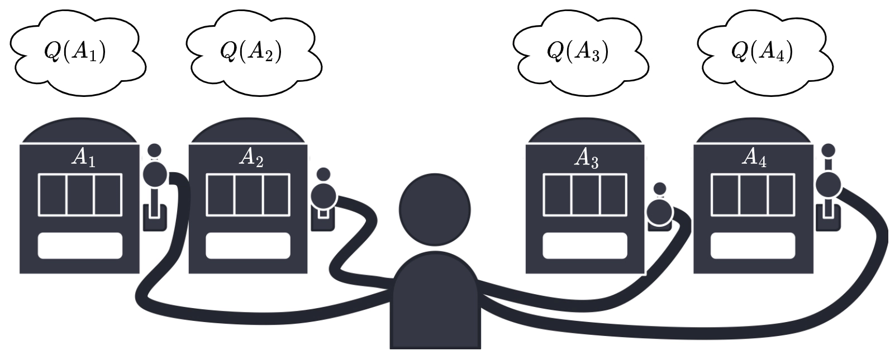
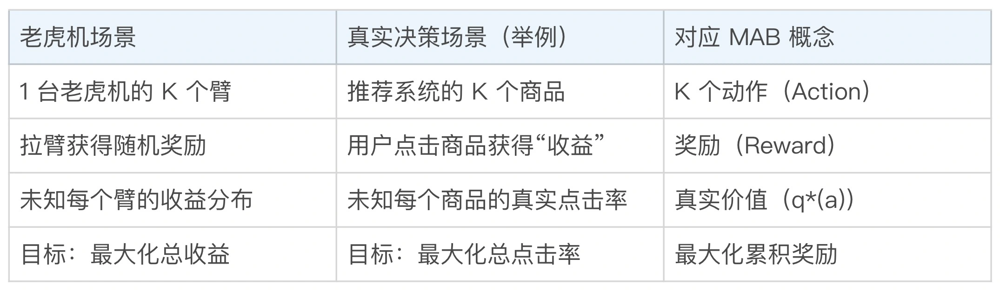
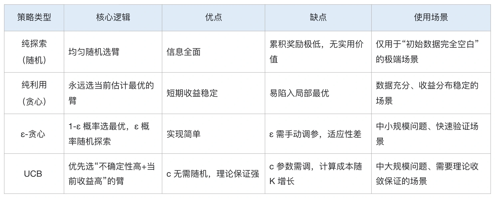
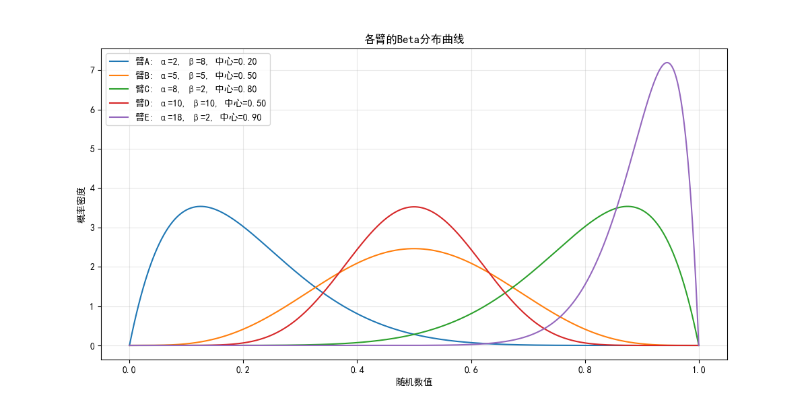
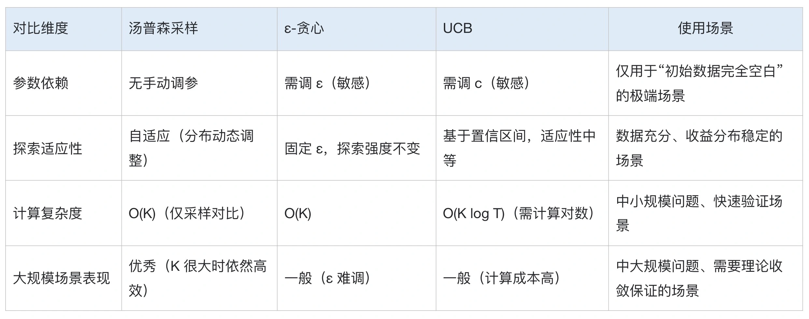
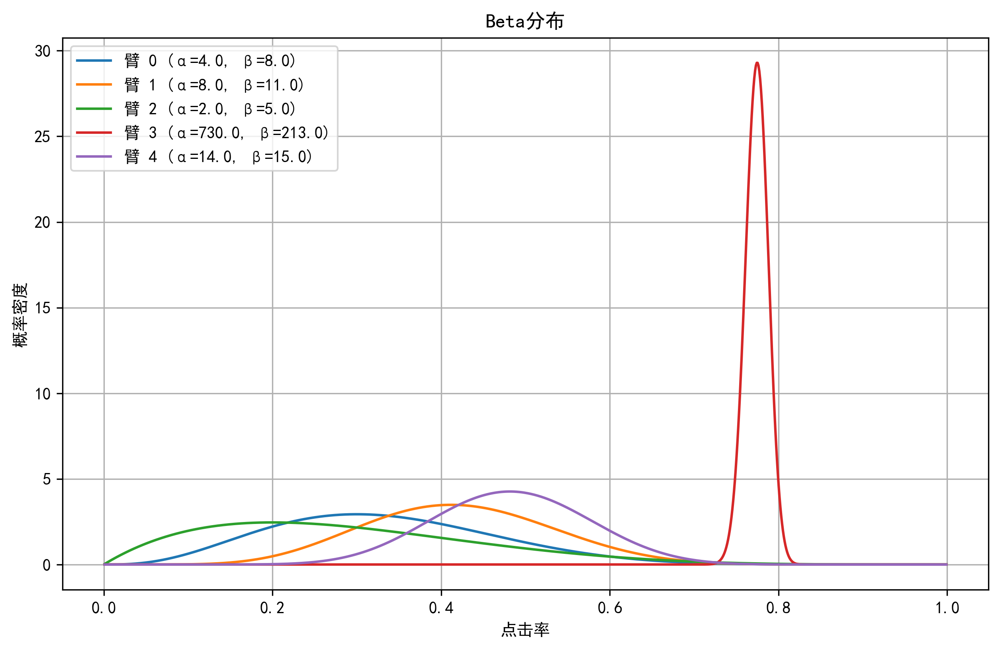
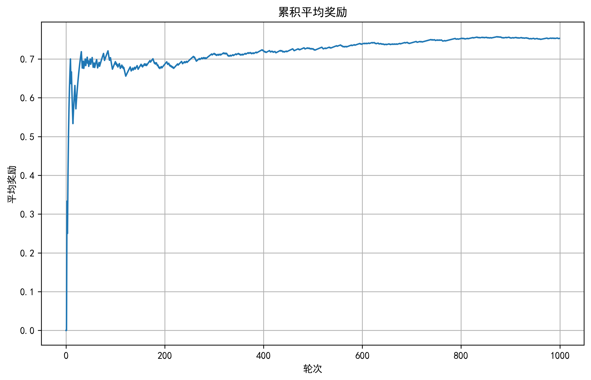

# 05 | 探索与利用：从多臂赌博机到汤普森采样

你好！欢迎来到强化学习的第五节课。上一节课我们用价值方法解决了“如何评估动作好坏”，但实际决策中还有一个更棘手的问题：推荐系统该推“用户肯定喜欢的老内容”还是“可能更喜欢的新内容”？临床试验该用“已知有效疗法”还是“潜力更大的新方案”？

这些问题的本质都是“探索与利用的平衡”——今天我们就以多臂赌博机这一经典模型为载体，拆解这个决策难题，并重点掌握工业界最常用的解决方案：汤普森采样。

通过本节课的学习，你将能够：

- 理解多臂赌博机（Multi-Armed Bandit, MAB）模型的核心定义，以及“探索 - 利用”矛盾的本质

- 掌握 ε- 贪心、UCB 等基础策略的原理差异，以及累积遗憾的评价逻辑

- 深入理解汤普森采样的贝叶斯推断思想、算法流程，及其在实际场景中的应用价值

## 一、多臂赌博机模型：探索与利用的经典框架

在强化学习领域，所有控制学习方法都绕不开“探索 - 利用困境”（exploration - exploitationdilemma）：采样时，一方面要选当前最优动作以获取更多奖励（利用，exploitation），另一方面又得尝试其他动作探索潜在更优解（探索，exploration），二者天然矛盾。

为平衡二者，人们设计了加噪声、乐观初始化、概率分配等策略。其中，ε - 贪心策略是常用的加噪声方法，依据概率平衡探索与利用——以 ε 概率探索新动作，以 1 - ε 概率利用已知最优动作，再按一定方式调节ε的变化节奏，从而从顶层控制不同阶段探索和利用的占比。

算法收敛需满足：采样 episode 数趋于无穷时，每个动作 - 状态二元组被访问无数次。探索与利用的研究也基于此需求展开。针对该困境的解决方案，依据“执行策略”与“待评估、改进的目标策略”是否一致，可分为同轨策略（on - policy）和离轨策略（off - policy）。同轨策略中，生成采样序列的行动策略，与实际决策时待优化的目标策略是同一套；离轨策略则二者分离 。

## 1.1 模型定义

多臂赌博机（Multi-Armed Bandit, MAB）是强化学习领域中的基础模型之一，用于描述在不确定环境中如何平衡“探索”与“利用”之间的权衡，从而实现最优决策策略。

多臂赌博机模型灵感来源于赌场中的老虎机（单臂赌博机）。假设有一个赌博机有 K 个手臂（即 K 个选项），每次拉动一个手臂会获得一个随机奖励，不同手臂的奖励分布不同且未知。我们的目标是通过多次拉动手臂，最大化累积奖励。（如图 5-1）



- 图5-1 多臂老虎机（出自加拿大圣弗朗西斯泽维尔大学csci-531课程）

灵感源自赌场的老虎机——但它能完美映射现实中的决策场景（表 5-1）。



- 表5-1 老虎机决策场景

简单说，MAB 的核心是：在“不知道每个选项真实收益”的情况下，通过多次尝试，找到“长期总收益最高”的选择。

### 1.1.1 核心构成

- 智能体（Agent）：决策主体，需在一系列时间步中选择“动作”。

- K 个动作（Actions）：智能体有 K 种可选择的行为（类比老虎机的 K 个拉杆）。

- 奖励（Reward）：每次选择动作后，智能体会获得一个奖励；奖励由该动作对应的固定概率分布生成——即同一动作的奖励分布不随时间变化。

- 目标：智能体的最终目的是最大化期望总奖励（而非单次奖励）。

### 1.1.2 关键概念

- ​(a)

## q

## a

- ）：动作 的“真实价值”，定义为该动作带来的奖励的数学期望，即真实价值（∗

## E[R

- ​ =​(a) =​∣A

## a]

## q

## R

## t

## A

## t

- 为 时刻的奖励，为 时刻选择的动作）。注：真实价值（∗tt​t​t是客观存在的，但智能体初始并不知道。​(a)

## Q

## t

## a

- ）：智能体在 时刻对动作 真实价值的估计，需通过不断选择动作、观估计价值（t察奖励来更新（例如通过“平均已获得奖励”计算）。

- 探索与利用的权衡：

- 利用（Exploitation）：选择当前估计价值最高的动作（贪心选择），以获取已知的较高奖励；但可能因未尝试其他动作而错过“真实价值更高”的选项。

- 探索（Exploration）：选择非当前最优的动作，以收集更多关于该动作价值的信息，更新估计值；但短期内可能获得较低奖励。

## 1.2 核心矛盾：探索与利用的权衡

例如，在推荐系统中，“利用”是给用户推荐历史点击率高的内容，但未必是最优内容，“探索”是尝试推荐新内容以发现用户潜在兴趣，但面临用户不点击的风险；在临床试验中，“利用”是优先使用已知有效的治疗方案，“探索”是测试新方案以寻找更优解。

- 探索：尝试未被充分拉动的手臂可以收集更多信息，可能发现更高奖励的选项，但短期内可能获得较低收益。

- 利用：如果已知某个手臂的平均奖励较高，持续拉动它可以获得稳定收益，但可能错过更好的选项。

从理论层面来看，实现“探索–利用”平衡的一种经典且有效的策略，是“面对不确定性时保持乐观”（optimism in the face of uncertainty）：对尚未充分探索的未知局面，默认其存在潜在的最优收益，再基于这一假设选择当前预期收益最高的动作。例如，当一名勇士面对一扇未开启的房门时，可先假定房间内藏有强力宝物，随后结合“进入房间”与“选择其他已知高收益行动”的预期价值，做出最终决策。这种策略的核心优势在于，能最大限度避免遗漏潜在的高奖励机会——随着探索的深入，未知局面不断减少，策略也会逐步收敛至全局最优。

然而，在多数实际强化学习场景中，基于“乐观假设”计算“当前最优动作”，往往会涉及高维度状态空间下的复杂优化问题，求解难度与计算成本极高。因此，在工程实践中，研究者通常会优先采用大规模随机探索（如引入动作噪声）或启发式搜索方法覆盖未知区域，再借助深度学习模型（如价值网络、策略网络）对探索获得的经验进行拟合与规划，以此平衡探索效率与决策精度。

当前，强化学习要实现高效的“探索–利用”平衡，仍需依赖大量样本数据的支撑。这也使得其在围棋、星际争霸等虚拟游戏场景中表现突出——这类场景可无成本、无限次生成训练样本，能充分满足探索需求；但在机器人控制、自动驾驶等现实物理任务中，样本采集受限于环境安全性、设备成本、时间效率（如一次自动驾驶事故样本的获取难度远高于一次游戏失败），导致强化学习难以充分发挥潜力，至今未实现突破性进展。不过，随着无人驾驶技术逐步走向商业化落地，以及仿真训练、离线强化学习等技术的快速发展，或许在不远的将来，这些现实场景中的“探索–利用”难题终将得到解决。

## 1.3 常见基础策略

为平衡探索与利用，研究者提出了多种基础策略，其核心差异在于“探索的触发方式”，如表 5-2 所示，具体如下。

- 纯探索策略：如“随机选择”，每次均匀随机拉动一个手臂，能收集全面信息，但累积奖励低。

- 纯利用策略：如“贪心算法”，始终选择当前平均奖励最高的手臂，初期可能因信息不足陷入局部最优。

- ε- 贪心算法：以概率 ε 进行探索（随机选择），以概率 1-ε 进行利用（贪心选择）。ε 的大小控制探索强度，但需手动设定，缺乏适应性。

## UCB(a) =

- Upper Confidence Bound（UCB）：基于“乐观估计”选择手臂，公式为：ln t

## (a) +

## rˉ

## (a)

## rˉ

## n(a)

## c

## a

## t

## a

- ，其中是手臂 的平均奖励， 是总次数，是手臂 被拉动的n(a)​​

## c

- 次数， 是控制探索强度的参数。该策略通过奖励的不确定性（置信区间）引导探索，不确定性越高（拉动次数少）的手臂越可能被选中。



- 表5-2 常见基础策略对比

## 1.4 怎么选 Bandit 算法：用“遗憾”衡量策略好坏

在线学习中的 Bandit 算法是一类专注于序列决策的算法，其核心思想是通过探索和利用的平衡，在不确定环境中最大化累积奖励。判断一个策略优劣的核心指标是“遗憾”（Regret）——简单说就是：“因为选错了选项，你比‘每次都选最优’少赚了多少”。

例如推荐系统有两个经典问题：EE（exploit－explore）和冷启动。前者涉及到平衡准确和多样，后者涉及到产品算法运营等一系列。Bandit 算法是一种简单的在线学习算法，常常用于尝试解决这两个问题，不过 Bandit 算法有那么多，我们该如何判断它们的好坏呢？

物理学巨匠开尔文爵士曾经说过“如果你不能衡量它，你就不能改进它”。那么，对于“探索 - 利用”策略，我们该用什么指标来衡量其效果？

学术界的先贤们，已经为这个问题想好了答案，这就是——“遗憾”。即，错误的选择到底有多大的遗憾？能不能遗憾少一些？如果我们可以衡量一个策略带来的遗憾，就可以比较这些策略的效果，并进一步提出改进措施。

比如：如果最优臂的期望收益是 0.9，你某次选了一个 0.5 的臂，这次的遗憾就是 0.4；把所有步骤的遗憾加起来，就是“累积遗憾”。

那么，如何量化地、科学地定义“遗憾”？首先介绍一个概念，叫做累积遗憾（regret）。

- TT

## ∑

## ∑

- ​ =​ −W​ =​ −

## R

- ​W

## T

## W

- w∗B(i)B(i)topt​i=1i=1

## W ∗

## W

- 是第 i 次实验时被选中的老虎机的期望收益，是所有老虎机中最佳的那个。

其中：

- B(i)​

这个公式用来计算 Bandit 算法的累积遗憾。

1. 这里我们讨论的每台老虎机的收益非 0 即 1，也就是伯努利收益。

2. 每次选择后，计算和最佳选择的选择差了多少，然后把差距加起来就是总的遗憾。

有了这个公式，我们就可以对比不同 Bandit 算法的效果。

对同样的多臂问题，用不同的 Bandit 算法试验相同次数，看看谁遗憾增长的慢。

评价逻辑：在相同步数下，累积遗憾增长越慢的策略越好（优秀策略的遗憾会随步数增长逐渐放缓，最终趋近稳定）。

## 1.5 朴素选择法

常用的 Bandit 算法有汤普森采样算法、UCB 算法、Epsilon-Greedy 算法以及朴素 Bandit 算法。接下来，我们重点介绍朴素 Bandit 算法。

其思想是：对于每个臂（arm）都进行 K 次试验，选择出平均收益最高的 arm。在之后的所有arm 选择中都选择这个最好的。

```python
import numpy as np
import matplotlib.pyplot as plt
class NaiveBandit:
   def __init__(self, n_arms, true_rewards, k_explore=10):
       """
       初始化朴素选择法多臂老虎机
       参数:
       n_arms (int): 老虎机的臂数
       true_rewards (list): 每个臂的真实奖励概率
       k_explore (int): 每个臂的试验次数
       """
       self.n_arms = n_arms
       self.true_rewards = true_rewards
       self.k_explore = k_explore
       self.best_arm = None  # 存储最佳臂的索引
       self.total_regret = 0  # 累积遗憾
       self.regret_history = []  # 每次选择后的遗憾历史
   def pull_arm(self, arm):
       """模拟拉动手臂并返回奖励"""
       return np.random.binomial(1, self.true_rewards[arm])
   def run(self, total_steps):
       """运行算法指定的步数"""
       # 初始化每个臂的收益和计数
       rewards_sum = np.zeros(self.n_arms)
       counts = np.zeros(self.n_arms)
       # 探索阶段：每个臂试验k_explore次
       explore_steps = self.n_arms * self.k_explore
       for i in range(self.n_arms):
           for _ in range(self.k_explore):
               reward = self.pull_arm(i)
               rewards_sum[i] += reward
               counts[i] += 1
               # 计算累积遗憾（当前步骤的最佳期望收益 - 实际选择的期望收益）
               optimal_reward = max(self.true_rewards)
               current_regret = optimal_reward - self.true_rewards[i]
               self.total_regret += current_regret
               self.regret_history.append(self.total_regret)
       # 选择平均收益最高的臂作为最佳臂
       self.best_arm = np.argmax(rewards_sum / counts)
       # 利用阶段：只选择最佳臂
       exploit_steps = total_steps - explore_steps
       for _ in range(exploit_steps):
           reward = self.pull_arm(self.best_arm)
           # 计算累积遗憾
           optimal_reward = max(self.true_rewards)
           current_regret = optimal_reward - self.true_rewards[self.best_arm]
           self.total_regret += current_regret
           self.regret_history.append(self.total_regret)
       return self.regret_history
   def plot_regret(self):
       """绘制累积遗憾随时间的变化"""
       plt.figure(figsize=(10, 6))
       plt.plot(range(1, len(self.regret_history) + 1), self.regret_history)
       plt.xlabel('Steps')
       plt.ylabel('Cumulative Regret')
       plt.title('Cumulative Regret over Time (Naive Bandit)')
       plt.grid(True)
       plt.show()
# 示例使用
if __name__ == "__main__":
   # 设置多臂老虎机参数
   n_arms = 5
   true_rewards = [0.1, 0.3, 0.5, 0.7, 0.9]  # 每个臂的真实奖励概率
   total_steps = 1000  # 总试验次数
   k_explore = 20  # 每个臂的探索次数
   # 创建并运行朴素选择法老虎机
   bandit = NaiveBandit(n_arms, true_rewards, k_explore)
   regret_history = bandit.run(total_steps)
   # 打印结果
   print(f"最佳臂的估计索引: {bandit.best_arm}")
   print(f"实际最佳臂的索引: {np.argmax(true_rewards)}")
   print(f"最终累积遗憾: {bandit.total_regret:.2f}")
   # 绘制累积遗憾曲线
   bandit.plot_regret()
# 最佳臂的估计索引: 4
# 实际最佳臂的索引: 4
# 最终累积遗憾: 40.00
```

## 二、汤普森采样：基于概率的自适应探索策略

下面我来介绍下解决“探索 - 利用”问题的“王炸”方法——汤普森采样。在大多数实际工作中，当面临“探索 - 利用”困境时，建议优先考虑汤普森采样。因为其算法性能好且可解释性强。

## 2.1 基本思想

汤普森采样（Thompson Sampling, TS）是一种基于贝叶斯推断的随机策略，由 William R.Thompson 于 1933 年提出。其核心思想是：对每个手臂的奖励分布参数维护一个概率分布（后验分布），每次决策时从每个手臂的后验分布中采样一个奖励值，选择采样值最高的手臂拉动。随着实验次数增加，后验分布会根据新的奖励数据不断更新，逐渐逼近真实分布，从而实现探索与利用的自适应平衡。

汤普森采样的核心是“贝叶斯推断”——我们可以用“猜硬币正反面概率”来理解：

- 初始时，你不知道硬币正面概率 p，只能假设它服从一个“模糊的分布”（比如 Beta(1,1)，均匀分布，意味着 p 可能是 0-1 之间的任何值）；

- 每抛一次硬币，你根据结果（正面 / 反面）更新这个分布：如果是正面，分布向“高 p”偏移；如果是反面，向“低 p”偏移；

- 抛的次数越多，分布越“集中”，你对 p 的判断越准确。

## 1 −p

## p

每个臂是否产生收益符合其背后的一个概率分布，即有一定的概率 能产生收益，

- 不能

产生收益；每次做选择时，每个臂对应的概率分布会产生一个随机数，选择最大随机数对应的臂。

Beta 分布的形态会随数据变化：初期数据少，分布分散（探索性强）；数据增多后，分布集中

## p

在真实 附近（利用性强）。

这里的分布采用 beta 分布，beta 分布涉及到两个参数，α 和 β，其特性如下（图 5-2）：

- 当 α+β 的值越大，则分布曲线越窄，产生的随机数容易接近中心；

- α/(α+β) 的值越大，分布的中心越靠近 1，从而使得产生的随机数也会偏向 0 或 1。



- 图5-2 beta分布示意图

汤普森采样把这个逻辑用到 MAB 上：

- 每个臂的“真实收益概率”都用一个分布（Beta 分布）来表示；

- 每次选臂时，从每个臂的分布中“抽一个样本”，选样本值最大的臂；

- 选完后根据奖励更新该臂的分布——如此反复，分布逐渐逼近真实收益，自然实现“探索（分布分散时多试）→ 利用（分布集中时选优）”的平衡。

## 2.2 算法步骤

例如在为某用户推荐商品时，若把参数 α 看做推荐该商品后，该用户点击该商品的次数，β 看做未点击的次数，则流程如下：

- 取出每个商品对应的 α 和 β；

- 利用 beta 分布计算得到一个随机数；

- 选出最大随机数对应的商品进行推荐；

- 若该用户点击则 α+1，反之 β+1。

在该算法中，把候选商品当作“臂”。通过参数 α（推荐后用户点击次数）和 β（推荐后用户未点击次数），结合 Beta 分布来决策推荐商品。

- 若商品被多次选中且点击多，α + β 大，Beta 分布曲线窄，α/(α + β) 大，随机采样值大，推荐概率高；

- 若探索不足，α + β 小，曲线宽，需更多探索让分布稳定。

详细步骤包括初始化后验分布，以及在每次决策时从后验分布采样并选择采样值最大的“臂”（商品）等，以此平衡推荐中的 exploitation（利用已知高收益商品）和 exploration（探索潜在高收益商品）。

## 2.3 数学原理：贝叶斯推断的应用

贝叶斯推理是一种统计推理方法，其核心是运用贝叶斯定理来根据新的观察数据不断更新假设的概率分布。

- 贝叶斯定理的基本形式为：后验概率 ∝ 似然度 × 先验概率。

- 其中：后延概率：结合新数据后对参数的更新估计；似然度：代表在给定参数条件下观测到当前数据的概率；先验概率：表示在获取新数据前对参数的初始概率估计。

在贝叶斯统计中，如果后验分布与先验分布属于同一分布族，则称该先验分布为似然函数的共轭先验。这一性质使得概率更新的计算大为简化。

Beta 分布是二项分布和伯努利分布的共轭先验。当先验采用 Beta 分布，似然函数为二项分布或伯努利分布时，后验分布仍然是 Beta 分布。这种共轭性质使得在线学习过程中的概率更新变得高效可行。

以最常见的“伯努利奖励”为例（奖励为 0 或 1，如点击率、转化率）：

## Ber(p

1. ​)

## a

## p

- 假设手臂 的奖励服从伯努利分布，其中是成功概率（未知参数）。a​a

## Beta(α

2. ​, β​)

## p

- 选择 Beta 分布作为的先验分布，因为 Beta 分布与伯努利分布是共轭先​aaa验（后验分布仍为 Beta 分布）。

## n = s + f

## a

## n

## s

## f

3. 若手臂 被拉动 次，其中成功 次、失败 次（），则后验分布更新为

## Beta(α

- ​ +

## s, β

- ​ +

## f)

- 。aa∗∗

## Beta(α

- ​ +

## s, β

- ​ +

## f)

## p

## p

- 每次决策时，从每个手臂的后验中采样，选择最大的手aa​a​a臂。

关于汤普森采样，只看文字描述会比较枯燥，但其实它的思想很简单直观。这里建议你去互联网上搜索可视化教程，或自己动手做一个简单的实验，可视化其先验、后验分布的变化，观察其随着样本积累逐渐收敛的过程，获得直观理解。

## 三、汤普森采样的优势与应用场景

汤普森采样通过使用贝叶斯方法来估计每个动作的奖励分布（一般是对齐参数的后验分布），然后基于分布抽样进行决策，从而实现对不确定性的自然平衡。

## 3.1 核心优势

表 5-3 汤普森采样 vs 基础策略对比，具体如下。

- 自适应平衡探索与利用：无需手动调整探索参数（如 ε- 贪心的 ε、UCB 的 c），通过后验分布的自然演化实现动态平衡。

- 高效利用不确定性：奖励不确定性高的手臂（后验分布分散）被采样到高值的概率更高，从而被优先探索；确定性高的手臂则以高概率被利用。

- 计算复杂度低：每次决策只需采样和比较，适合大规模问题（如 K 很大的场景）。

- 贝叶斯解释性强：直接基于概率模型建模不确定性，结果可解释性好。



- 表5-3 汤普森采样 vs 基础策略对比

工业界优先选择汤普森采样的原因在于：它无调参成本、适应性强且计算高效，尤其适合 K值（臂数）上千的推荐系统、广告投放等大规模场景。

随着研究深入，汤普森采样衍生出多种扩展形式以适应复杂场景：

- 上下文汤普森采样：考虑决策时的上下文信息（如用户特征、时间因素），将奖励分布建模为上下文的函数，实现个性化决策。

- 多目标汤普森采样：当目标不止一个（如同时最大化收益和用户满意度），通过多维度后验分布建模实现多目标优化。

- 分布式汤普森采样：在大规模分布式系统中，通过并行采样和后验聚合提高效率。

- 安全汤普森采样：加入约束条件（如临床试验中的风险控制），确保探索过程的安全性。

## 3.2 实际应用场景

汤普森采样因其优势在多个领域得到广泛应用：

- 推荐系统：用于内容推荐、广告投放，平衡用户已知兴趣和潜在兴趣的探索。

- A/B 测试与在线实验：动态分配流量到不同方案，快速找到最优方案并提高实验效率。

- 强化学习：作为策略优化的基础方法，在马尔可夫决策过程（MDP）中扩展为“贝叶斯强化学习”。

- 资源分配：如电网负荷调度、云计算资源分配，优化资源利用率。

例如在为某用户推荐商品时，若把参数 α 看做推荐该商品后，该用户点击该商品的次数，β 看做未点击的次数，详细步骤如下：

1. 初始化后验分布：为每个手臂的奖励参数（如均值）设定先验分布（根据领域知识，若无信息先验，则设为正态分布、Beta 分布等）。

## t

2. 采样与选择：在第 次决策时，从每个手臂的后验分布中随机采样一个参数值，选择采样值最高的手臂。

3. 更新后验分布：拉动选中的手臂，获得奖励后（详见图 5-4：推荐商品的累积平均奖励），利用贝叶斯法则更新该手臂的后验分布（详见图 5-3：推荐商品的 beta 分布）。

4. 重复步骤 2-3：随着数据积累，后验分布逐渐收敛，策略会从“探索为主”转向“利用为主”。



- 图5-3 推荐商品的beta分布



- 图5-4 推荐商品的累积平均奖励

代码样例：

```sql
import numpy as np
import matplotlib.pyplot as plt
import math
import os
# 确保中文显示正常
plt.rcParams["font.family"] = ["SimHei", "WenQuanYi Micro Hei", "Heiti TC"]
plt.rcParams["axes.unicode_minus"] = False  # 解决负号显示问题
# Beta分布的概率密度函数手动实现（数值稳定版本）
def beta_pdf(x, a, b):
   """
   手动实现Beta分布的概率密度函数（使用对数计算以提高数值稳定性）
   参数:
   x: float or array - 自变量值
   a: float - alpha参数
   b: float - beta参数
   返回:
   float or array - 概率密度值
   """
   # 处理数组输入
   if hasattr(x, '__len__'):
       result = np.zeros_like(x)
       for i, xi in enumerate(x):
           if xi <= 0 or xi >= 1:
               result[i] = 0
           else:
               # 使用对数计算避免数值溢出
               log_pdf = (math.lgamma(a + b) - math.lgamma(a) - math.lgamma(b) +
                         (a - 1) * math.log(xi) + (b - 1) * math.log(1 - xi))
               result[i] = math.exp(log_pdf)
       return result
   else:
       # 处理标量输入
       if x <= 0 or x >= 1:
           return 0
       # 使用对数计算避免数值溢出
       log_pdf = (math.lgamma(a + b) - math.lgamma(a) - math.lgamma(b) +
                 (a - 1) * math.log(x) + (b - 1) * math.log(1 - x))
       return math.exp(log_pdf)
def save_high_quality_figure(fig, filename, dpi=300, close_after_save=True):
   """
   保存高质量图片
   参数:
   fig: matplotlib.figure.Figure - 图形对象
   filename: str - 文件名（包含路径）
   dpi: int - 分辨率（每英寸点数）
   close_after_save: bool - 保存后是否关闭图形
   """
   # 确保目录存在
   os.makedirs(os.path.dirname(filename), exist_ok=True)
   # 保存图片
   fig.savefig(filename, dpi=dpi, bbox_inches='tight', format='png')
   print(f"图片已保存至: {filename}")
   if close_after_save:
       plt.close(fig)
class ThompsonSampling:
   """
   汤普森采样算法实现，用于商品推荐系统
   每个商品被视为一个'臂'，使用Beta分布来平衡探索和利用
   """
   def __init__(self, n_arms):
       """
       初始化汤普森采样算法
       参数:
       n_arms: int - 臂的数量（商品数量）
       """
       self.n_arms = n_arms
       # 初始化每个臂的alpha和beta参数
       # alpha表示推荐后用户点击的次数
       # beta表示推荐后用户未点击的次数
       self.alphas = np.ones(n_arms)  # 初始为1，表示每个商品都有一次点击
       self.betas = np.ones(n_arms)   # 初始为1，表示每个商品都有一次未点击
   def select_arm(self):
       """
       选择一个臂（商品）进行推荐
       返回:
       int - 选择的臂的索引
       """
       # 为每个臂从Beta分布中采样一个随机值
       samples = [np.random.beta(self.alphas[i], self.betas[i]) for i in range(s
       # 选择采样值最大的臂
       return np.argmax(samples)
   def update(self, chosen_arm, reward):
       """
       更新选中臂的参数
       参数:
       chosen_arm: int - 选中的臂的索引
       reward: int - 收到的奖励（1表示点击，0表示未点击）
       """
       if reward == 1:
           # 用户点击，alpha增加
           self.alphas[chosen_arm] += 1
       else:
           # 用户未点击，beta增加
           self.betas[chosen_arm] += 1
   def get_arm_statistics(self, arm_index):
       """
       获取指定臂的统计信息
       参数:
       arm_index: int - 臂的索引
       返回:
       tuple - (alpha, beta, 预期点击率)
       """
       alpha = self.alphas[arm_index]
       beta = self.betas[arm_index]
       ctr = alpha / (alpha + beta)  # 点击率
       return alpha, beta, ctr
   def plot_beta_distribution(self, arm_index=None, save_path=None):
       """
       绘制Beta分布图
       参数:
       arm_index: int or None - 要绘制的臂的索引，如果为None则绘制所有臂
       save_path: str or None - 保存路径，如果为None则不保存
       """
       fig = plt.figure(figsize=(10, 6))
       if arm_index is not None:
           # 绘制单个臂的Beta分布
           a = self.alphas[arm_index]
           b = self.betas[arm_index]
           x = np.linspace(0.001, 0.999, 1000)  # 避免0和1处的奇点
           y = beta_pdf(x, a, b)
           plt.plot(x, y, label=f'臂 {arm_index} (α={a:.1f}, β={b:.1f})')
       else:
           # 绘制所有臂的Beta分布
           for i in range(self.n_arms):
               a = self.alphas[i]
               b = self.betas[i]
               x = np.linspace(0.001, 0.999, 1000)  # 避免0和1处的奇点
               y = beta_pdf(x, a, b)
               plt.plot(x, y, label=f'臂 {i} (α={a:.1f}, β={b:.1f})')
       plt.title('Beta分布')
       plt.xlabel('点击率')
       plt.ylabel('概率密度')
       plt.legend()
       plt.grid(True)
       if save_path:
           save_high_quality_figure(fig, save_path, dpi=300)
       else:
           plt.show()
def simulate_recommendation_system(n_products=5, n_rounds=1000, true_ctr=None):
   """
   模拟商品推荐系统
   参数:
   n_products: int - 商品数量
   n_rounds: int - 推荐轮数
   true_ctr: list or None - 每个商品的真实点击率，如果为None则随机生成
   返回:
   tuple - (算法实例, 选择历史, 累积奖励)
   """
   if true_ctr is None:
       # 随机生成每个商品的真实点击率
       true_ctr = np.random.uniform(0.1, 0.9, n_products)
   # 初始化汤普森采样算法
   ts = ThompsonSampling(n_products)
   # 记录选择历史和累积奖励
   selections = np.zeros(n_products)
   cumulative_rewards = 0
   rewards_history = []
   print(f"真实点击率: {true_ctr}")
   for round in range(n_rounds):
       # 选择一个商品进行推荐
       chosen_arm = ts.select_arm()
       selections[chosen_arm] += 1
       # 模拟用户点击（基于真实点击率）
       reward = 1 if np.random.random() < true_ctr[chosen_arm] else 0
       cumulative_rewards += reward
       rewards_history.append(cumulative_rewards / (round + 1))  # 平均奖励
       # 更新参数
       ts.update(chosen_arm, reward)
       # 每100轮打印一次统计信息
       if (round + 1) % 100 == 0:
           print(f"轮次 {round + 1}:")
           for i in range(n_products):
               alpha, beta, ctr = ts.get_arm_statistics(i)
               print(f"  商品 {i}: 点击次数={alpha-1:.0f}, 未点击次数={beta-1:.0f},
           print(f"  平均奖励: {cumulative_rewards / (round + 1):.4f}")
           print("-" * 50)
   return ts, selections, rewards_history
if __name__ == "__main__":
   # 设置随机种子以保证结果可复现
   np.random.seed(42)
   # 模拟推荐系统
   n_products = 5  # 商品数量
   n_rounds = 1000  # 推荐轮数
   # 设置每个商品的真实点击率
   true_ctr = [0.2, 0.4, 0.6, 0.8, 0.3]  # 商品0到4的真实点击率
   # 运行模拟
   ts, selections, rewards_history = simulate_recommendation_system(
       n_products=n_products,
       n_rounds=n_rounds,
       true_ctr=true_ctr
   )
   # 创建保存图片的目录
   save_dir = "thompson_sampling_results"
   os.makedirs(save_dir, exist_ok=True)
   # 绘制并保存Beta分布
   ts.plot_beta_distribution(save_path=f"{save_dir}/beta_distribution.png")
   # 绘制并保存累积奖励曲线
   fig = plt.figure(figsize=(10, 6))
   plt.plot(rewards_history)
   plt.title('累积平均奖励')
   plt.xlabel('轮次')
   plt.ylabel('平均奖励')
   plt.grid(True)
   save_high_quality_figure(fig, f"{save_dir}/cumulative_rewards.png", dpi=300)
   # 绘制并保存商品选择分布
   fig = plt.figure(figsize=(10, 6))
   plt.bar(range(n_products), selections)
   plt.title('商品选择分布')
   plt.xlabel('商品索引')
   plt.ylabel('选择次数')
   plt.xticks(range(n_products))
   plt.grid(True)
   save_high_quality_figure(fig, f"{save_dir}/product_selection_distribution.png
   # 打印最终统计信息
   print("\n最终统计信息:")
   for i in range(n_products):
       alpha, beta, ctr = ts.get_arm_statistics(i)
       print(f"商品 {i}: 点击次数={alpha-1:.0f}, 未点击次数={beta-1:.0f}, 预估点击率=
   print(f"\n总选择次数: {np.sum(selections)}")
   print(f"平均奖励: {rewards_history[-1]:.4f}")
print(f"\n所有图片已保存至: {save dir}/")
```

## 总结

多臂赌博机模型揭示了决策中“探索与利用”的本质矛盾，而汤普森采样通过贝叶斯推断的思想，优雅地解决了这一矛盾。它无需人工干预参数，能自适应地根据数据调整探索强度，在理论和实践中都表现出优异的性能。

从理论到实践的选型建议

1. 小规模验证 / 快速原型：用 ε- 贪心（实现最简单）；

2. 需理论收敛保证的场景：用 UCB（数学性质严谨）；

3. 工业界大规模场景（如推荐、广告）：优先用汤普森采样（无调参、自适应、效率高）；

4. 复杂场景：用汤普森采样的扩展形式（如 Contextual TS 加入用户特征，适合个性化推荐）。

探索与利用的本质是“信息收集与收益获取的平衡”——汤普森采样用贝叶斯思想优雅地解决了这个矛盾，成为现代在线决策的核心工具。

这节课的数学味道相较于之前的策略梯度、蒙特卡洛、贝尔曼迭代等等，似乎弱了很多。然而在学术界，关于“探索 - 利用”的理论、对最小化“遗憾”的研究实际上是浩如烟海，因为这些课题本身就是机器学习的理论研究核心。感兴趣的同学可以进一步参考一些机器学习理论研究专家如 Lihong Li、Micheal Kearns（代表作：E3）、Sham Kakade、John Langford 的工作。但是在实际工作中，建议你优先考虑应用类似汤普森采样这样简单直观的方法。

## 思考题

汤普森采样通过后验分布的动态更新实现探索与利用的自适应平衡，相比 ε- 贪心算法和 UCB策略，这种基于贝叶斯推断的方法在“参数依赖”和“决策灵活性”上有哪些核心优势？

希望你通过今天的学习，对强化学习的探索与利用有了清晰的认识。如果有任何疑问，欢迎在讨论区留言交流！
