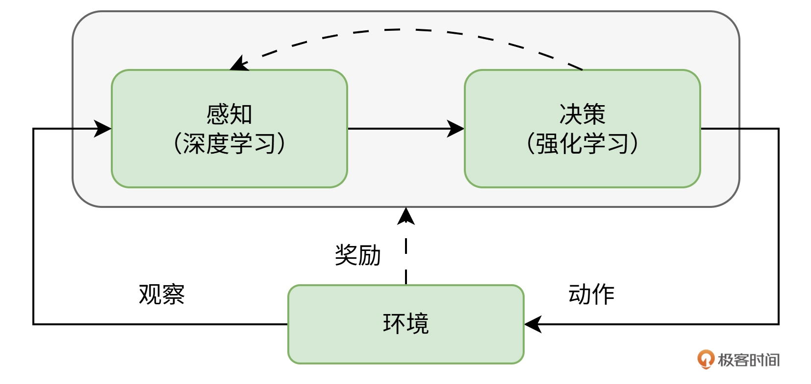
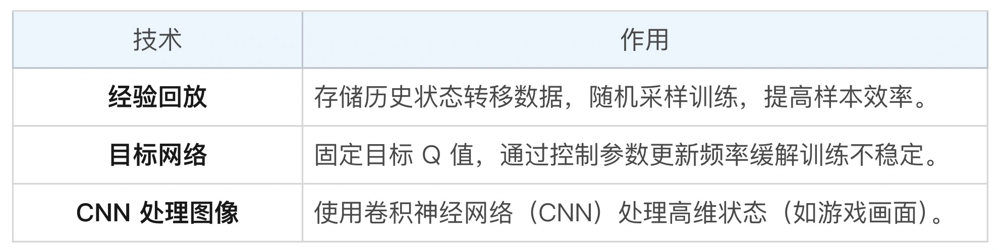
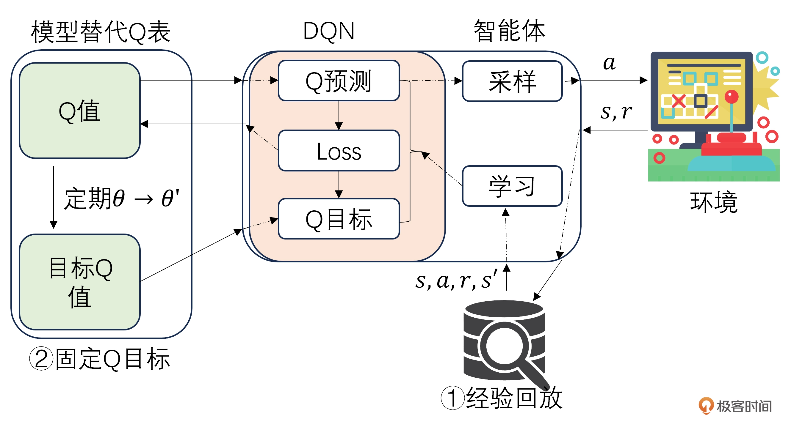
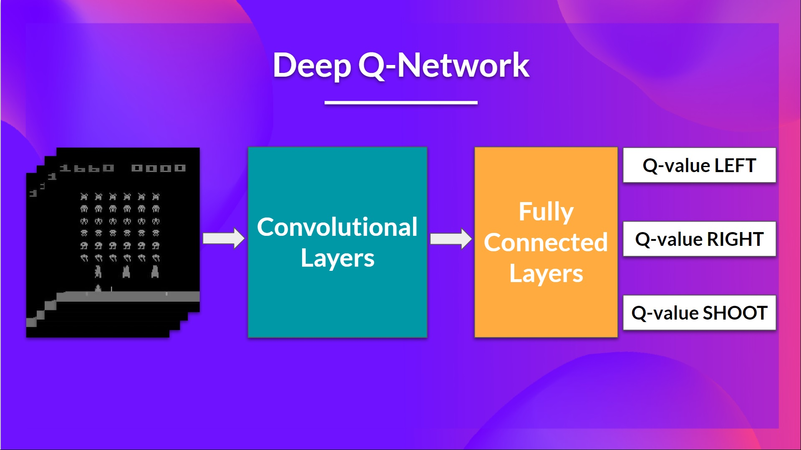
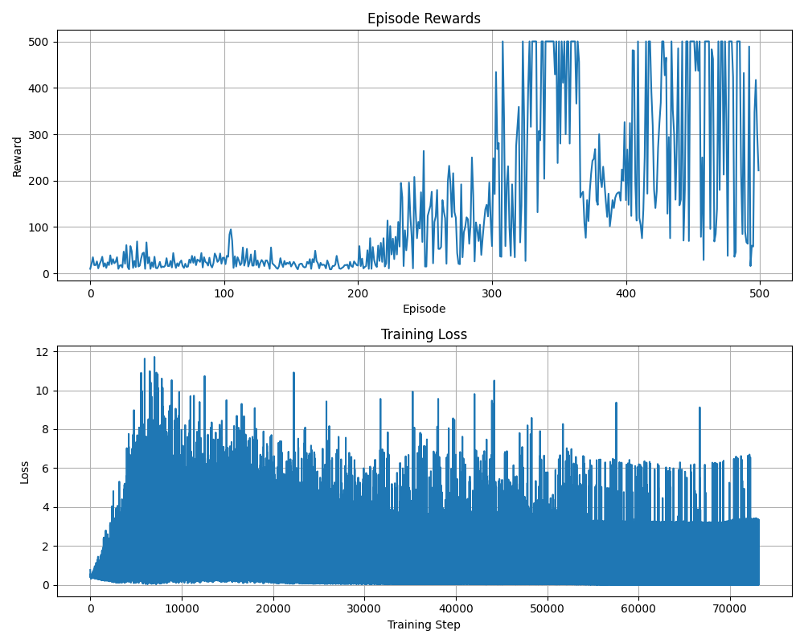
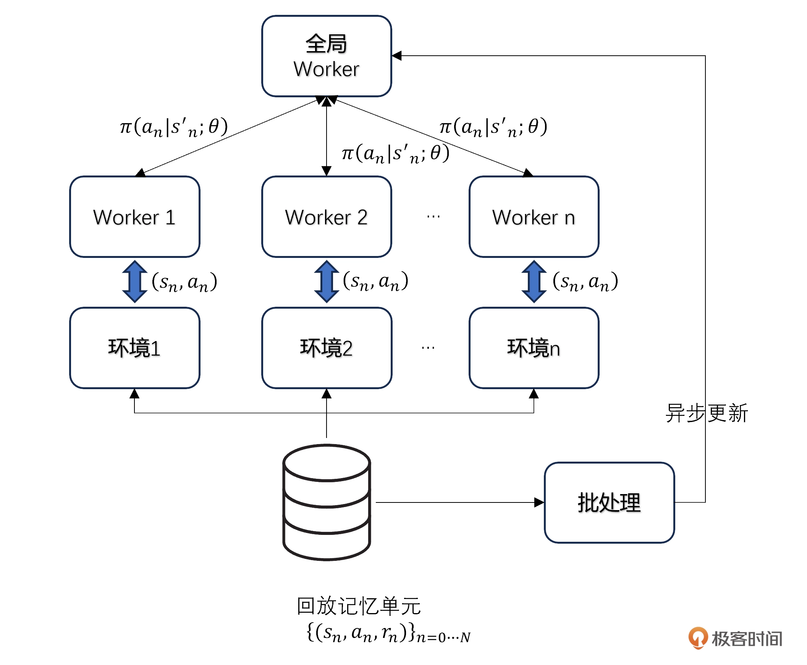
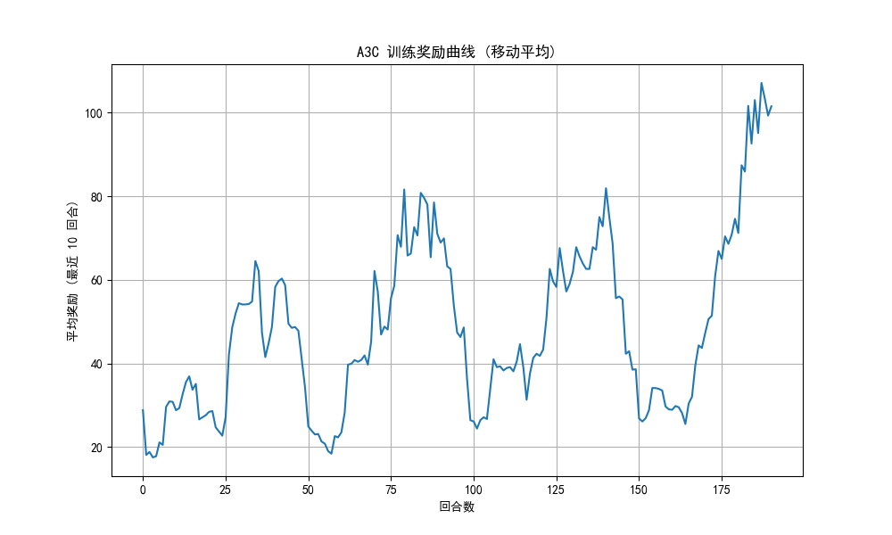

# 06 | 深度强化学习：从DQN到A3C

你好！欢迎来到强化学习的第六讲。在前几节课中，我们已经建立了对强化学习的基础认知，从核心概念入门，逐步掌握了 Q-learning、DQN 等经典算法的逻辑。而从今天开始，我们将正式迈入深度强化学习的核心领域 —— 这个融合了深度学习感知能力与强化学习决策能力的技术方向，正让智能体在游戏、机器人控制、自动驾驶等复杂场景中不断取得突破性进展。

通过本节课的学习，你将能够：

1. 理解 DQN 作为深度强化学习“开山之作”的核心价值，掌握其用神经网络近似 Q 值函数、结合经验回放与目标网络解决训练不稳定性的关键逻辑。

2. 明晰 Double DQN 缓解 “过度估计”、Dueling DQN 分解“状态价值与优势函数”的改进思路，理解不同 DQN 变体的适用场景差异。

3. 掌握 A3C 算法的异步训练框架与 Actor-Critic 双网络结构，理解其通过多 Worker 并行探索提升训练效率与稳定性的核心原理。

4. 梳理从 DQN 到 A3C 的算法演进脉络，建立“基于价值”与“基于策略”两类深度强化学习方法的认知框架。

## 一、DQN：深度强化学习的开山之作

强化学习作为人工智能领域的重要分支，自诞生以来，便在理论研究与实际应用中取得了广泛的关注。近年来，随着深度学习的快速发展，深度强化学习逐渐成为智能决策、自动控制、机器人技术等领域的关键方法之一。如图 6-1 所示，深度强化学习的核心思想是利用神经网络学习复杂环境中的最优决策策略，从而赋予智能体更高效的感知和控制能力。



- 图6-1 深度强化学习基本框架（参考孙长银、穆朝絮：深度强化学习控制前沿与展望）

DeepMind 的 Mnih 等人在 2013 年提出了开创性的工作：深度 Q 网络（Deep Q Network，DQN），首次将深度学习中的卷积网络与 Q-learning 结合, 处理基于视觉感知的控制任务。作为深度强化学习领域的里程碑算法，DQN 成功地结合了深度神经网络的感知能力与 Q-learning 的决策能力，在 Atari 游戏中超越人类水平，为解决高维状态空间下的强化学习问题提供了可行方案。

- 提示：卷积网络负责从高维视觉输入（如游戏画面）中提取特征（感知层），Q-learning 负责基于特征计算动作价值（决策层）

## 1.1 DQN 的核心原理：神经网络与 Q-learning 的融合

传统 Q-learning 依赖表格存储 Q 值，但面对高维状态（如图像）带来的维数灾难（Curse ofdimensionality）时，表格法失效。而 Q 网络（Q-Network）则通过使用神经网络近似 Q 函数，来缓解维度爆炸带来的问题。

Q 网络的工作原理：

## s

- 输入：状态 （如游戏 Atari 画面）。

## a

- 输出：每个动作 对应的 Q 值（如 Atari 游戏中的摇杆方向）。

## L(θ) =

- 训练目标：最小化损失函数（TD-Error）

## [(

## )2]

- ′′−

## E

## r + γ max

- ​ Q(s , a ; θ ) −Q(s, a; θ)。a′

Q 网络的训练技巧：

## (s, a, r, s′

- 经验回放（Experience Replay）：基于 Replay Buffer 存储状态转移样本)，进而随机采样进行训练，打破数据相关性。

- 目标网络（Target Network）：固定目标 Q 值，控制参数更新频率缓解训练不稳定问题。

Q 网络的问题：

- 过估计（Overestimation）：由于 max 操作，Q 值可能被高估。

- 训练不稳定：神经网络拟合 Q 函数时可能振荡。

下表总结了 DQN 的核心改进：



- 表6-1 DQN的核心改进

DQN 的基本概念（图 6-2）：

- 强化学习背景：智能体（Agent）在环境中采取行动，通过与环境交互获得奖励信号，目标是学习到一种策略，使得长期累积奖励最大化。Q 学习（Q-learning）是强化学习中的一种经典算法，它维护一个 Q 表，用于存储在每个状态下采取每个动作的预期未来奖励（Q值）。

- 融合深度学习：当面对状态空间和动作空间非常大的复杂问题时，传统 Q 学习的 Q 表会变得极其庞大甚至无法存储。DQN 通过使用深度神经网络（DNN）来近似 Q 函数，用神经网络的输入表示状态，输出表示在该状态下采取各个动作的 Q 值，从而解决了大规模状态空间的问题。



- 图6-2 DQN示意图

补充讨论：

传统的基于 Q 表的 Q-learning，又称 Tabular Q-learning，是初学者理解基于值的强化学习的重要方式。可以将 Q 表理解为一个二维函数：表格的行与列定义了维度和坐标，而其中的 Q值则定义了函数值。虽然当前深度学习方法都是通过神经网络取代 Q 表，但还是建议你从 Q表的角度去理解 Q-learning。

DQN 中深度学习的拟合目标是 Q-value function，拟合的手段是用神经网络取代 Q 表带来更精准更泛化的拟合，是一个用连续函数拟合离散函数的过程。在你后续的学习过程中，面对不同的深度学习模型，可以主动去想一想，这里使用神经网络的拟合目标是什么？拟合手段是什么？被取代的方法的缺陷在哪里？

## 1.2 解决不稳定性的关键技巧

深度神经网络的引入虽扩展了算法能力，但也带来了训练不稳定的问题（如样本相关性、参数更新波动）。DQN 通过两个创新机制解决这一挑战：

- ′

## (s, a, r, s )

- 经验回放（Experience Replay）：将智能体与环境交互产生的样本存储在经验池（Replay Buffer）中，训练时随机采样样本更新网络。这打破了样本间的时序相关性，降低了参数更新的方差，使训练更稳定（这也是一种 Variance Reduction 技巧）。−

## Q(s, a; θ )

- 目标网络（Target Network）：额外设置一个参数更新频率较慢的目标网络，′′−

## y = r + γ max

- ​ Q(s , a ; θ )

## Q(s, a; θ)

## Q

- 用于计算目标值，而主网络则通过最小化a′

## L(θ) = E[(y −Q(s, a; θ)) ]

- 2损失函数更新参数。目标网络定期从主网络复制参数，避

## Q

- 免了因主网络参数频繁变化导致的目标值波动。

## 1.3 DQN 的实战验证：Atari 游戏中的突破

在经典实验中，DQN 仅通过输入 Atari 游戏的原始像素画面，无需人工设计特征，就能自主学习并达到甚至超越人类玩家的水平（如《Breakout》《Pong》等游戏）。这一成果直观证明了DQN 在复杂环境中自主决策的能力，奠定了深度强化学习的发展基础。

DQN 在 Atari 游戏的应用如图 6-3 所示：

- 输入：图片左侧展示的类似游戏画面的部分，代表智能体观察到的环境状态。在许多实际应用中，状态可以是图像（如 Atari 游戏）、传感器数据等。

- 卷积层（Convolutional Layers）：中间的蓝绿色模块，卷积神经网络擅长处理具有网格结构的数据，如图片。卷积层可以自动提取状态中的特征，减少数据维度，同时保留重要信息。

- 全连接层（Fully Connected Layers）：右侧的橙色模块，将卷积层提取的特征进行整合，并通过全连接层的计算，输出每个动作对应的 Q 值，如图中所示的 “Q-value LEFT”、“Q-value RIGHT”、“Q-value SHOOT”，分别表示向左移动、向右移动、射击等动作的 Q 值。



- 图6-3 DQN架构（出自Thomas Simonini《Deep Q-Learning with Space Invaders》）

## Q(s, a; θ)

## Q

## s

## a

DQN 的核心思想是用深度神经网络近似

- 值函数，其中 为环境状态， 为动

## θ

作， 为网络参数。通过神经网络对高维输入（如游戏画面的像素值）进行特征提取，直接输

## Q

## Q

出每个动作的

- 值估计，替代了传统 Q-learning 中依赖表格存储值的方式，使其能处理

复杂环境中的连续或高维状态空间。

下面的代码是实现深度 Q 网络（DQN）算法的完整强化学习程序，使用 CartPole-v1 环境进行训练。代码包含 DQN 网络结构、经验回放缓冲区、智能体类等核心组件，实现了从环境交互到网络训练的完整流程。

该实现采用了多项现代 DQN 技术改进，包括 Double DQN 减少 Q 值过估计、目标网络软更新提高训练稳定性、Huber 损失函数增强鲁棒性，以及层归一化、梯度裁剪、学习率调度等优化技巧，确保了训练过程的稳定性和收敛性。

除了包含强化学习中的各种技巧，也包含了训练深度学习模型中必不可少的训练监控、模型保存、结果可视化和测试评估等功能，并设置了合理的超参数（如学习率 1e-4、epsilon 衰减率0.9999 等），你可以从这份代码中学习深度学习和强化学习的算法原理和实践等方面。

运行结果如图 6-4 所示，Episode Reward 是智能体在一个完整回合中获得的累计奖励，反映学习效果；Training Loss 是 Q 网络预测值与目标值之间的差异，衡量训练精度。



- 图6-4 DQN-Atari运行结果

```bash
import gymnasium as gym
import torch
import torch.nn as nn
import torch.optim as optim
import numpy as np
import random
from collections import deque
import matplotlib.pyplot as plt
# 设置随机种子以确保可重复性
def set_seed(seed=42):
   torch.manual_seed(seed)
   torch.cuda.manual_seed(seed)
   np.random.seed(seed)
   random.seed(seed)
   torch.backends.cudnn.deterministic = True
# 定义DQN网络结构
class DQN(nn.Module):
   def __init__(self, input_size, hidden_size, output_size):
       super(DQN, self).__init__()
       self.fc1 = nn.Linear(input_size, hidden_size)
       self.fc2 = nn.Linear(hidden_size, hidden_size)
       self.fc3 = nn.Linear(hidden_size, output_size)
       self.relu = nn.ReLU()
       # 添加层归一化提高训练稳定性
       self.layer_norm = nn.LayerNorm(hidden_size)
   def forward(self, x):
       x = self.relu(self.fc1(x))
       x = self.layer_norm(x)
       x = self.relu(self.fc2(x))
       x = self.layer_norm(x)
       return self.fc3(x)
# 经验回放缓冲区
class ReplayBuffer:
   def __init__(self, capacity):
       self.buffer = deque(maxlen=capacity)
   def push(self, state, action, reward, next_state, done):
       self.buffer.append((state, action, reward, next_state, done))
   def sample(self, batch_size):
       if len(self.buffer) < batch_size:
           return None
       batch = random.sample(self.buffer, batch_size)
       states, actions, rewards, next_states, dones = zip(*batch)
       return (
           np.array(states),
           np.array(actions),
           np.array(rewards),
           np.array(next_states),
           np.array(dones, dtype=np.float32)
       )
   def __len__(self):
       return len(self.buffer)
# DQN智能体
class DQNAgent:
   def __init__(self, state_size, action_size, hidden_size=64):
       self.state_size = state_size
       self.action_size = action_size
       self.hidden_size = hidden_size
       # 初始化网络
       self.policy_net = DQN(state_size, hidden_size, action_size)
       self.target_net = DQN(state_size, hidden_size, action_size)
       self.target_net.load_state_dict(self.policy_net.state_dict())
       self.target_net.eval()
       # 降低学习率
       self.optimizer = optim.Adam(self.policy_net.parameters(), lr=1e-4)
       # 添加简单的学习率调度器
       self.scheduler = optim.lr_scheduler.StepLR(self.optimizer, step_size=100,
       # 经验回放
       self.memory = ReplayBuffer(capacity=50000)
       # 调整超参数
       self.batch_size = 32
       self.gamma = 0.99
       self.epsilon = 1.0
       self.epsilon_min = 0.01
       self.epsilon_decay = 0.9999
       self.tau = 0.05
       # 训练统计
       self.episode_rewards = []
       self.losses = []
   def act(self, state):
       if random.random() < self.epsilon:
           return random.randrange(self.action_size)
       with torch.no_grad():
           state_tensor = torch.FloatTensor(state).unsqueeze(0)
           q_values = self.policy_net(state_tensor)
           return q_values.argmax().item()
   def train(self):
       if len(self.memory) < self.batch_size:
           return
       batch = self.memory.sample(self.batch_size)
       if batch is None:
           return
       states, actions, rewards, next_states, dones = batch
       # 转换为张量
       states = torch.FloatTensor(states)
       actions = torch.LongTensor(actions).unsqueeze(1)
       rewards = torch.FloatTensor(rewards).unsqueeze(1)
       next_states = torch.FloatTensor(next_states)
       dones = torch.FloatTensor(dones).unsqueeze(1)
       # 计算当前Q值
       current_q_values = self.policy_net(states).gather(1, actions)
       # Double DQN：使用policy网络选择动作，target网络评估Q值
       with torch.no_grad():
           best_actions = self.policy_net(next_states).argmax(1, keepdim=True)
           next_q_values = self.target_net(next_states).gather(1, best_actions)
           target_q_values = rewards + self.gamma * next_q_values * (1 - dones)
       # 使用Huber损失代替MSE损失，对异常值更鲁棒
       loss = nn.SmoothL1Loss()(current_q_values, target_q_values)
       self.optimizer.zero_grad()
       loss.backward()
       # 更强的梯度裁剪
       torch.nn.utils.clip_grad_norm_(self.policy_net.parameters(), max_norm=0.5
       self.optimizer.step()
       # 记录损失
       self.losses.append(loss.item())
       # 软更新目标网络
       for target_param, param in zip(self.target_net.parameters(), self.policy_
           target_param.data.copy_(self.tau * param.data + (1 - self.tau) * targ
       # 更慢的epsilon衰减
       self.epsilon = max(self.epsilon_min, self.epsilon * self.epsilon_decay)
   def update_episode_reward(self, reward):
       self.episode_rewards.append(reward)
   def save_model(self, path):
       torch.save({
           'policy_net_state_dict': self.policy_net.state_dict(),
           'target_net_state_dict': self.target_net.state_dict(),
           'optimizer_state_dict': self.optimizer.state_dict(),
           'episode_rewards': self.episode_rewards,
           'losses': self.losses,
           'epsilon': self.epsilon
       }, path)
   def load_model(self, path):
       checkpoint = torch.load(path)
       self.policy_net.load_state_dict(checkpoint['policy_net_state_dict'])
       self.target_net.load_state_dict(checkpoint['target_net_state_dict'])
       self.optimizer.load_state_dict(checkpoint['optimizer_state_dict'])
       self.episode_rewards = checkpoint['episode_rewards']
       self.losses = checkpoint['losses']
       self.epsilon = checkpoint['epsilon']
# 训练函数
def train_agent(env, agent, num_episodes=500, max_steps=500):
   for episode in range(num_episodes):
       state, _ = env.reset()
       episode_reward = 0
       for step in range(max_steps):
           # 选择动作
           action = agent.act(state)
           # 执行动作
           next_state, reward, terminated, truncated, _ = env.step(action)
           done = terminated or truncated
           # 存储经验
           agent.memory.push(state, action, reward, next_state, done)
           # 训练
           agent.train()
           # 更新状态
           state = next_state
           episode_reward += reward
           if done:
               break
       # 更新统计信息
       agent.update_episode_reward(episode_reward)
       # 打印进度
       if (episode + 1) % 10 == 0:
           avg_reward = np.mean(agent.episode_rewards[-10:])
           avg_loss = np.mean(agent.losses[-10:]) if agent.losses else 0
           current_lr = agent.optimizer.param_groups[0]['lr']
           print(f'Episode {episode + 1}/{num_episodes}, Avg Reward: {avg_reward
                 f'Epsilon: {agent.epsilon:.3f}, Avg Loss: {avg_loss:.4f}, LR: {
           # 每10个episode更新一次学习率
           agent.scheduler.step()
       # 保存模型
       if (episode + 1) % 100 == 0:
           agent.save_model(f'dqn_cartpole_episode_{episode + 1}.pth')
           print(f'Model saved at episode {episode + 1}')
   return agent.episode_rewards, agent.losses
# 绘制训练曲线
def plot_training_curves(rewards, losses):
   fig, (ax1, ax2) = plt.subplots(2, 1, figsize=(10, 8))
   # 奖励曲线
   ax1.plot(rewards)
   ax1.set_title('Episode Rewards')
   ax1.set_xlabel('Episode')
   ax1.set_ylabel('Reward')
   ax1.grid(True)
   # 损失曲线
   ax2.plot(losses)
   ax2.set_title('Training Loss')
   ax2.set_xlabel('Training Step')
   ax2.set_ylabel('Loss')
   ax2.grid(True)
   plt.tight_layout()
   plt.savefig('dqn_training_curves.png')
   plt.show()
# 测试函数
def test_agent(env, agent, num_episodes=10, max_steps=500):
   agent.policy_net.eval()
   test_rewards = []
   for episode in range(num_episodes):
       state, _ = env.reset()
       episode_reward = 0
       for step in range(max_steps):
           with torch.no_grad():
               state_tensor = torch.FloatTensor(state).unsqueeze(0)
               q_values = agent.policy_net(state_tensor)
               action = q_values.argmax().item()
           next_state, reward, terminated, truncated, _ = env.step(action)
           done = terminated or truncated
           state = next_state
           episode_reward += reward
           if done:
               break
       test_rewards.append(episode_reward)
       print(f'Test Episode {episode + 1}, Reward: {episode_reward}')
   avg_reward = np.mean(test_rewards)
   print(f'Average Test Reward: {avg_reward:.2f}')
   return test_rewards
if __name__ == "__main__":
   # 设置随机种子
   set_seed(42)
   # 创建环境
   env = gym.make('CartPole-v1')
   # 获取环境信息
   state_size = env.observation_space.shape[0]
   action_size = env.action_space.n
   print(f"State size: {state_size}")
   print(f"Action size: {action_size}")
   # 创建智能体
   agent = DQNAgent(state_size, action_size)
   # 训练智能体
   print("\nStarting training...")
   rewards, losses = train_agent(env, agent, num_episodes=500, max_steps=500)
   # 绘制训练曲线
   print("\nPlotting training curves...")
   plot_training_curves(rewards, losses)
   # 测试智能体
   print("\nTesting trained agent...")
   test_rewards = test_agent(env, agent, num_episodes=10)
   # 保存最终模型
   agent.save_model('dqn_cartpole_final.pth')
   print("\nFinal model saved as 'dqn_cartpole_final.pth'")
env close()
```

## 二、DQN 的改进算法：从稳定到高效

DQN 的成功引发了一系列改进研究，领域内的研究者们针对其局限性（如过度估计、价值分解不明确等）提出了更优方案。

## 2.1 Double DQN：缓解过度估计问题

- ′′

## max

- ​ Q(s , a ; θ)

原始 DQN 中，目标 Q 值

- 可能因噪声或过拟合导致“过度估计”（高估动a′

## Q

作实际价值）。Double DQN 通过分离目标

- 值的选择与评估解决这一问题：

- ′′′

## Q(θ)

## a =

## arg max

- ​ Q(s , a ; θ)用主网络选择下一状态的最优动作；a′−′′−

## Q(θ )

## Q(s , a ; θ )

## y = r +

- 用目标网络评估该动作的价值，目标值更新为′′−

## γQ(s , a ; θ )

- 。通过避免同一网络既选动作又评估，Double DQN 有效降低了过度估计偏差，提升了算法稳定性。

补充说明：过度估计（Overestimation）一直是强化学习中的一个重要讨论点，其来源为 Q-learing 中的 max 算子。类似 Credit Assignment 一样，都是与强化学习自身设定强烈相关的问题，很难在短时间内得到解决。

## 2.2 Dueling DQN：分解价值与优势的网络结构

## Q

Dueling DQN 的核心创新是将

- 值函数分解为状态价值（State Value）与优势函数

（Advantage Function）：

## V (s)

## s

- 状态价值：表示状态 本身的固有价值，与具体动作无关；

## A(s, a)

## s

## a

- 优势函数：表示在状态 下选择动作 相对动作平均回报的优势；1 ∑a′′

## Q(s, a) = V (s) + A(s, a) −

- ​ A(s, a )

## Q

- 值通过计算（减去优势均值以保证数∣A∣​值唯一性）。这种结构使智能体能独立学习状态价值，在动作空间较大或部分动作价值相近的场景（如导航中“直行”与“略微左转”价值差异比较小），学习效率和稳定性显著提升。

## 三、A3C：异步框架下的策略梯度进阶

从基于价值的 DQN 转向基于策略的算法，A3C（Asynchronous Advantage Actor-Critic）通过异步训练与 Actor-Critic 框架的结合，实现了更高的训练效率与稳定性。

## 3.1 A3C 的核心框架：Actor-Critic 与异步训练

A3C 是 DeepMind 提出的一种解决 Actor-Critic 不收敛问题的算法。DQN 中很重要的一点是它具有经验池，可以降低数据之间的相关性，而 A3C 则提出降低数据之间的相关性的另一种方法——异步。

A3C 架构如图 6-5 所示，会创建多个并行的环境，让多个拥有副结构的智能体（Worker）同时在这些并行环境上更新主结构中的参数，并行中的 Worker 们互不干扰，而主结构的参数更新受到副结构提交更新的不连续性干扰，所以更新的相关性被降低，收敛性提高。



- 图6-5 A3C架构图

Worker 采用 Actor-Critic 双网络结构：

## π(a∣s; θ)

- Actor（策略网络）：输出动作概率分布，负责生成策略并探索环境；

## V (s; ϕ)

## A(s, a) = Q(s, a) −V (s)

- Critic（价值网络）：估计状态价值，通过优势函数评估 Actor 动作的好坏，指导策略更新。

A3C 算法的核心逻辑，其实是将 Actor-Critic 框架部署在多线程环境中实现同步训练。我们可以这样形象地理解：就像一群玩家同时游玩同一款游戏，每个人在游戏中积累的经验都会实时同步到一个“中央大脑”；反过来，这些玩家又会定期从中央大脑获取最新的策略指导，优化自己的游戏方式。

这种机制对玩家（即各个线程）而言，好处十分明显：中央大脑汇聚了所有玩家的经验，相当于群体智慧的结晶，是当前最擅长游戏的“策略库”。玩家们能时不时从中获取经过验证的“必杀技巧”，并灵活应用到自己所处的游戏场景中，快速提升个体表现。

而对中央大脑来说，这种设计的优势更为关键：它能有效避免单一玩家连续更新带来的策略偏差。由于更新不再依赖某一个体的经验，中央大脑无需像 DQN 算法那样依赖庞大的经验回放池来打破数据相关性，就能实现稳定且高效的策略迭代。这种分布式的经验融合方式，让中央大脑的进化更具鲁棒性。

## 3.2 训练流程与优势函数的作用

A3C 的训练步骤可概括为：

## (s

1. ​, a​, r​, s​, ..., s​)每个 Worker 与环境交互，收集轨迹；0001T​ =​ +

## γV (s

- ​) −

## V (s

- ​)

## δ

## r

- Critic 通过时序差分（TD）学习更新价值网络：，最小化t+1ttt2

## ∑

## δ

- ；t​​ =

## A

## δ

- Actor 利用优势函数（或累积优势）更新策略网络，目标为最大化策略梯度t​t

## ∇

- ​ log π(a​∣s​; θ) ⋅

## A

- ；θtt​t各 Worker 异步将梯度更新至全局网络，定期同步参数。

优势函数的引入平衡了探索与利用，使 Actor 更倾向于选择“优势大”的动作，同时避免了单纯依赖价值估计的偏差。

```sql
import torch
import torch.nn as nn
import torch.nn.functional as F
import torch.optim as optim
from torch.distributions import Categorical
import gym
import threading
import queue
import numpy as np
import time
import matplotlib.pyplot as plt
# 设备配置（GPU优先）
device = torch.device("cuda" if torch.cuda.is_available() else "cpu")
print(f"使用设备: {device}")
class ActorCritic(nn.Module):
   """ Actor-Critic网络，共享特征提取层 """
   def __init__(self, state_size, action_size, hidden_size=64):
       super(ActorCritic, self).__init__()
       # 共享的特征提取层
       self.shared = nn.Sequential(
           nn.Linear(state_size, hidden_size),
           nn.Tanh(),
           nn.Linear(hidden_size, hidden_size),
           nn.Tanh()
       )
       # Actor分支：输出动作概率分布
       self.actor = nn.Linear(hidden_size, action_size)
       # Critic分支：输出状态价值
       self.critic = nn.Linear(hidden_size, 1)
   def forward(self, x):
       x = self.shared(x)
       # Actor输出动作概率
       action_logits = self.actor(x)
       action_probs = F.softmax(action_logits, dim=-1)
       # Critic输出状态价值
       state_value = self.critic(x)
       return action_probs, state_value
class Worker(threading.Thread):
   """ 工作线程，负责收集经验并更新全局模型 """
   def __init__(self, worker_id, global_model, optimizer, env_name,
                gamma=0.99, max_episodes=50, t_max=5, lock=None):
       super(Worker, self).__init__()
       self.worker_id = worker_id
       self.global_model = global_model
       self.optimizer = optimizer
       self.env_name = env_name
       self.gamma = gamma  # 折扣因子
       self.max_episodes = max_episodes  # 该worker需要完成的回合数
       self.t_max = t_max  # 每轮更新前收集的最大步数
       self.lock = lock  # 线程锁，确保参数更新的原子性
       # 创建本地环境和本地模型 - 启用新API避免警告
       try:
           self.env = gym.make(env_name, new_step_api=True)
       except TypeError:
           # 如果环境不支持new_step_api参数，使用默认设置
           self.env = gym.make(env_name)
       self.local_model = ActorCritic(
           self.env.observation_space.shape[0],
           self.env.action_space.n
       ).to(device)
       self.local_model.load_state_dict(global_model.state_dict())
       # 记录和通信
       self.episode_rewards = []
       self.result_queue = queue.Queue()
       self.episode_count = 0
   def run(self):
       """ 线程主函数，执行训练逻辑 """
       while self.episode_count < self.max_episodes:
           # 重置环境 - 兼容新旧API
           reset_result = self.env.reset()
           if isinstance(reset_result, tuple):
               state, _ = reset_result
           else:
               state = reset_result
           state = torch.from_numpy(state).float().to(device)
           episode_reward = 0
           terminated = False
           truncated = False
           while not (terminated or truncated):
               # 收集t_max步的经验
               log_probs = []
               values = []
               rewards = []
               masks = []
               entropy = 0
               for _ in range(self.t_max):
                   # 本地模型选择动作
                   action_probs, value = self.local_model(state)
                   dist = Categorical(action_probs)
                   action = dist.sample()
                   # 执行动作 - 兼容新旧API
                   step_result = self.env.step(action.item())
                   if len(step_result) == 5:
                       # 新API: (observation, reward, terminated, truncated, info
                       next_state, reward, terminated, truncated, _ = step_resul
                       done = terminated or truncated
                   else:
                       # 旧API: (observation, reward, done, info)
                       next_state, reward, done, _ = step_result
                       terminated = done
                       truncated = False
                   next_state = torch.from_numpy(next_state).float().to(device)
                   # 记录经验 - 确保张量是1维的
                   log_prob = dist.log_prob(action)
                   log_probs.append(log_prob.unsqueeze(0))  # 增加维度
                   values.append(value)
                   rewards.append(torch.tensor([reward], dtype=torch.float, devi
                   masks.append(torch.tensor([1 - done], dtype=torch.float, devi
                   episode_reward += reward
                   state = next_state
                   entropy += dist.entropy().mean()
                   if done:
                       break
               # 检查是否有收集到经验
               if not log_probs:
                   continue
               # 计算n-step回报
               _, next_value = self.local_model(next_state)
               returns = []
               R = next_value * masks[-1] if masks else 0  # 下一状态的价值
               # 反向计算累积回报
               for i in reversed(range(len(rewards))):
                   R = rewards[i] + self.gamma * R * masks[i]
                   returns.insert(0, R)
               # 计算损失
               log_probs = torch.cat(log_probs)
               returns = torch.cat(returns).detach()
               values = torch.cat(values)
               advantages = returns - values  # 优势函数
               # Actor损失：负的优势加权对数概率
               actor_loss = -(log_probs * advantages.detach()).mean()
               # Critic损失：均方误差
               critic_loss = advantages.pow(2).mean()
               # 总损失：加入熵正则化鼓励探索
               total_loss = actor_loss + 0.5 * critic_loss - 0.01 * entropy
               # 关键修复：使用线程锁确保参数更新的原子性
               with self.lock:  # 加锁，确保一次只有一个线程更新全局模型
                   # 更新全局模型
                   self.optimizer.zero_grad()
                   self.local_model.zero_grad()
                   total_loss.backward()
                   # 确保所有参数都有梯度
                   for local_param, global_param in zip(
                       self.local_model.parameters(),
                       self.global_model.parameters()
                   ):
                       if local_param.grad is None:
                           local_param.grad = torch.zeros_like(local_param.data)
                       global_param.grad = local_param.grad.detach()  # 复制梯度
                   # 再次检查梯度是否存在
                   valid_gradients = True
                   for param in self.global_model.parameters():
                       if param.grad is None:
                           valid_gradients = False
                           break
                   if valid_gradients:
                       self.optimizer.step()  # 只有所有梯度都有效时才更新
                   else:
                       print(f"Worker {self.worker_id} 检测到无效梯度，跳过更新")
               # 同步本地模型与全局模型
               self.local_model.load_state_dict(self.global_model.state_dict())
           # 记录结果
           self.episode_rewards.append(episode_reward)
           self.result_queue.put(episode_reward)
           self.episode_count += 1
           # 打印进度
           if self.episode_count % 10 == 0:
               avg_reward = np.mean(self.episode_rewards[-10:])
               print(f"Worker {self.worker_id}, 完成 {self.episode_count} 回合, "
                     f"最近10回合平均奖励: {avg_reward:.2f}")
def train_a3c(env_name="CartPole-v1", num_workers=4, total_episodes=200, lr=1e-3)
   """ 训练A3C算法 """
   # 获取环境信息 - 启用新API避免警告
   try:
       env = gym.make(env_name, new_step_api=True)
   except TypeError:
       # 如果环境不支持new_step_api参数，使用默认设置
       env = gym.make(env_name)
   state_size = env.observation_space.shape[0]
   action_size = env.action_space.n
   env.close()
   # 初始化全局模型和优化器
   global_model = ActorCritic(state_size, action_size).to(device)
   optimizer = optim.Adam(global_model.parameters(), lr=lr)
   # 创建线程锁，确保参数更新的线程安全
   lock = threading.Lock()
   # 创建并启动工作线程
   workers = []
   episodes_per_worker = total_episodes // num_workers
   for i in range(num_workers):
       worker = Worker(
           worker_id=i,
           global_model=global_model,
           optimizer=optimizer,
           env_name=env_name,
           max_episodes=episodes_per_worker,
           lock=lock  # 传递线程锁
       )
       workers.append(worker)
   # 启动所有worker
   print(f"启动 {num_workers} 个工作线程，总训练回合数: {total_episodes}")
   for worker in workers:
       worker.start()
       time.sleep(0.1)  # 错开启动时间
   # 收集结果
   all_rewards = []
   for worker in workers:
       worker.join()  # 等待worker完成
       # 收集该worker的所有结果
       worker_rewards = [worker.result_queue.get() for _ in range(episodes_per_w
       all_rewards.extend(worker_rewards)
   return global_model, all_rewards
def plot_rewards(rewards, window_size=10):
   """ 绘制奖励曲线，支持中文显示 """
   # 设置中文字体
   plt.rcParams["font.family"] = ["SimHei", "WenQuanYi Micro Hei", "Heiti TC"]
   plt.rcParams["axes.unicode_minus"] = False  # 解决负号显示问题
   # 计算移动平均
   smoothed_rewards = np.convolve(rewards, np.ones(window_size)/window_size, mod
   plt.figure(figsize=(10, 6))
   plt.plot(smoothed_rewards)
   plt.title("A3C 训练奖励曲线 (移动平均)")
   plt.xlabel("回合数")
   plt.ylabel(f"平均奖励 (最近 {window_size} 回合)")
   plt.grid(True)
   plt.savefig("a3c_rewards.png")
   print("奖励曲线已保存为 a3c_rewards.png")
   plt.show()
def test_model(model, env_name="CartPole-v1", episodes=3):
   """ 测试训练好的模型 """
   # 创建环境 - 启用新API避免警告
   try:
       env = gym.make(env_name, render_mode="human", new_step_api=True)
   except TypeError:
       # 如果环境不支持new_step_api参数，使用默认设置
       env = gym.make(env_name, render_mode="human")
   state_size = env.observation_space.shape[0]
   for episode in range(episodes):
       # 重置环境 - 兼容新旧API
       reset_result = env.reset()
       if isinstance(reset_result, tuple):
           state, _ = reset_result
       else:
           state = reset_result
       state = torch.from_numpy(state).float().to(device)
       total_reward = 0
       terminated = False
       truncated = False
       while not (terminated or truncated):
           env.render()  # 渲染画面
           with torch.no_grad():  # 不计算梯度
               action_probs, _ = model(state)
               action = torch.argmax(action_probs).item()  # 选择概率最高的动作
           # 执行动作 - 兼容新旧API
           step_result = env.step(action)
           if len(step_result) == 5:
               # 新API: (observation, reward, terminated, truncated, info)
               next_state, reward, terminated, truncated, _ = step_result
           else:
               # 旧API: (observation, reward, done, info)
               next_state, reward, done, _ = step_result
               terminated = done
               truncated = False
           state = torch.from_numpy(next_state).float().to(device)
           total_reward += reward
           time.sleep(0.01)  # 放慢速度以便观察
       print(f"测试回合 {episode+1}, 总奖励: {total_reward}")
       time.sleep(1)  # 每个测试回合后暂停
   env.close()
if __name__ == "__main__":
   # 训练模型
   model, rewards = train_a3c(
       env_name="CartPole-v1",
       num_workers=4,
       total_episodes=200,
       lr=1e-3
   )
   # 保存模型
   torch.save(model.state_dict(), "a3c_cartpole.pth")
   print("模型已保存为 a3c_cartpole.pth")
   # 绘制奖励曲线
   plot_rewards(rewards)
   # 测试模型（可视化）
   test_model(model)
```

奖励可视化：



这个 A3C 的实现包含以下核心组件：

1. Actor-Critic 网络：

- 共享两个全连接层作为特征提取器

- Actor 分支输出动作概率分布

- Critic 分支输出状态价值估计

2. Worker 类：

- 每个工作线程独立与环境交互

- 收集经验并计算梯度

- 将梯度应用到全局模型并同步参数

3. 训练流程：

- 多个 worker 异步探索环境

## t

- ​ax每收集步经验后计算损失m使用优势函数（Advantage）更新策略

- 加入熵正则化鼓励探索

## 3.3 异步机制的价值：效率与稳定性提升

异步训练的优势体现在两方面：

- 效率提升：并行环境探索充分利用计算资源，缩短训练时间；

- 稳定性增强：不同 Worker 的探索轨迹差异大，降低样本相关性，减少过拟合风险。这使得A3C 在连续动作空间（如机器人控制）和复杂决策任务中表现优异，成为后续异步强化学习算法的重要原型。

## 总结​

在本讲中，我们系统地学习了深度强化学习从 DQN 到 A3C 的重要算法。DQN 作为深度强化学习的开山之作，通过经验回放和目标网络等创新，为深度强化学习的发展奠定了基础。而Double DQN、Dueling DQN 等改进算法则进一步提升了 DQN 的性能和稳定性。A3C 算法则凭借异步训练和 Actor - Critic 框架的结合，在训练效率和学习效果上都取得了显著的突破，成为深度强化学习领域的重要算法之一。​

通过本讲的学习，我们不仅掌握了这些算法的基本原理和核心技巧，还了解了它们之间的演进关系和各自的优缺点。这些算法的提出和发展，推动了深度强化学习在实际应用中的不断拓展，让我们看到了智能体在复杂环境中自主学习和决策的巨大潜力。​

强化学习训练流程的三大模块：

1. 策略生成：对应着强化学习训练中的推演阶段（Rollout）。在此阶段，模型会依据当前策略生成响应（即行动，action），模拟与环境的交互过程。这一阶段不仅是模型推理过程的延伸，还往往需要通过大量采样来获取多样化的行为轨迹。

2. 奖励评估：这一阶段依赖于奖励模型（Reward Model），用于评估生成结果的质量。在当前阶段，由于任务复杂度提升，奖励评估的实现方式也趋于多样化。

3. 策略更新：这是强化学习训练的核心阶段，通过修改损失函数实现策略更新。不同算法（如DQN、A3C、PPO、DPO 等）在此阶段的实现逻辑有所不同，但整体结构保持一致。

## 思考题​

请你尝试分析 DQN 系列算法和 A3C 算法在适用场景上的差异，在实际应用中，如何根据具体问题选择合适的深度强化学习算法？​

希望你通过今天的学习，对强化学习有了更加清晰的认识。如果有任何疑问，欢迎在讨论区留言交流！
