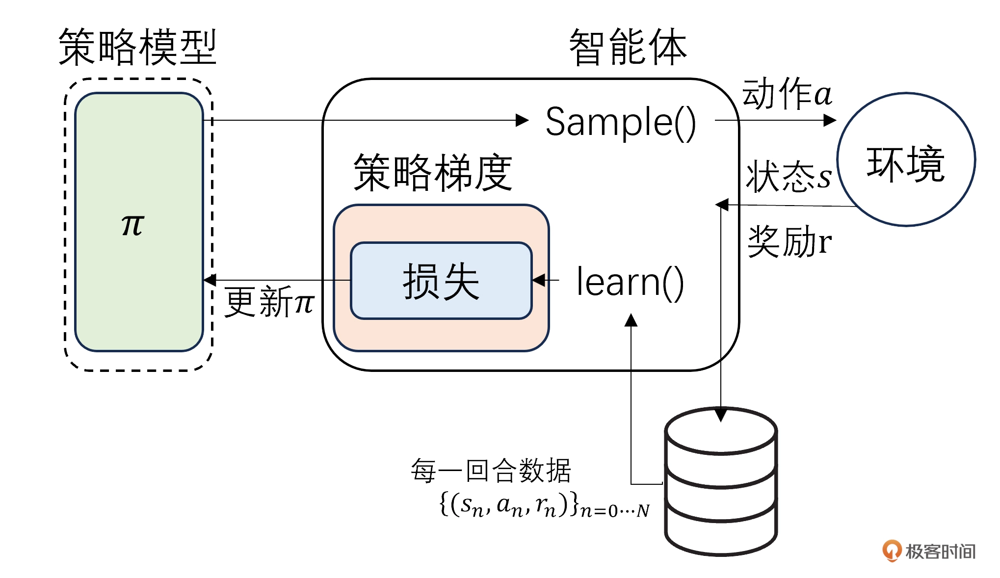
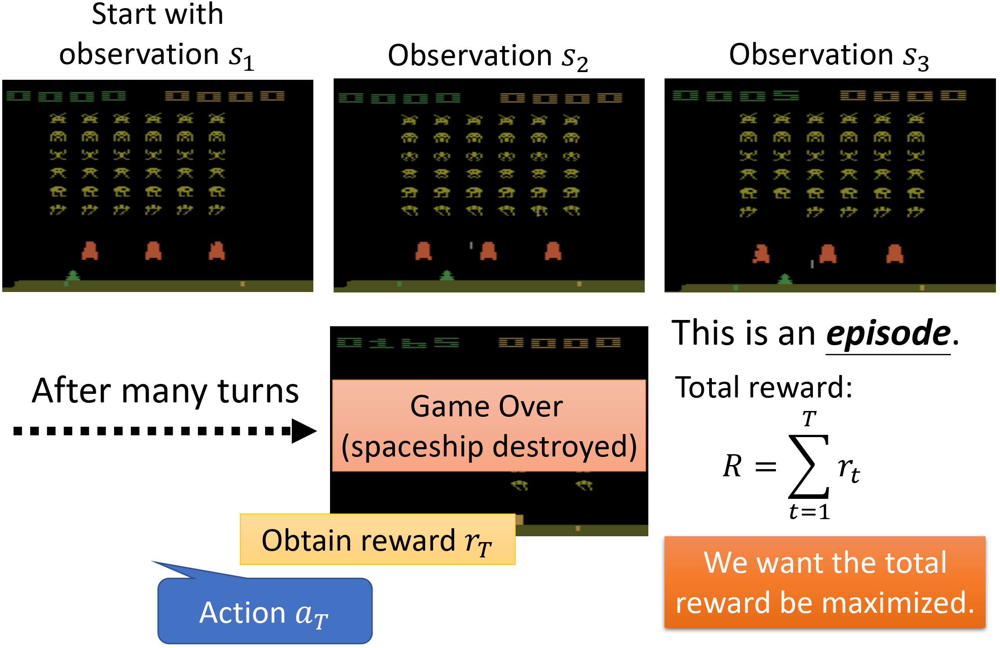
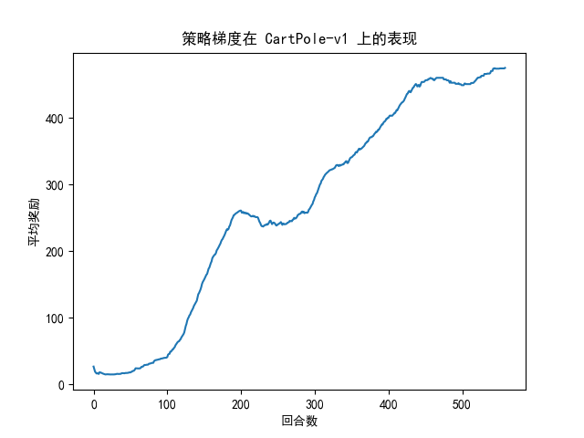
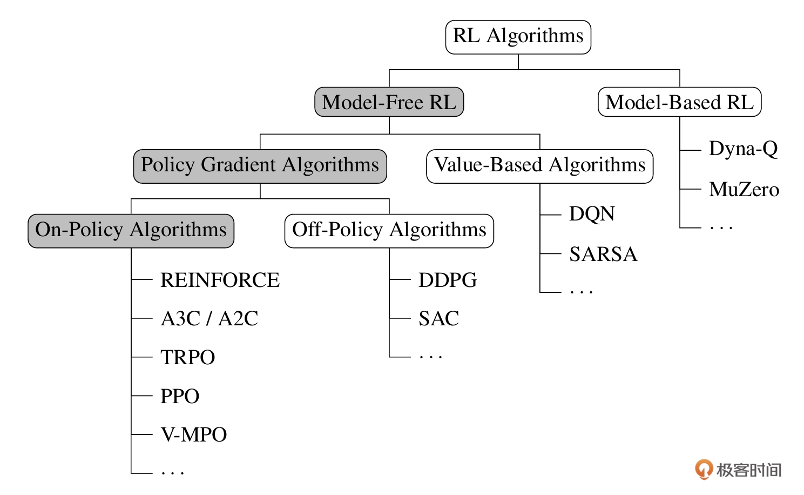
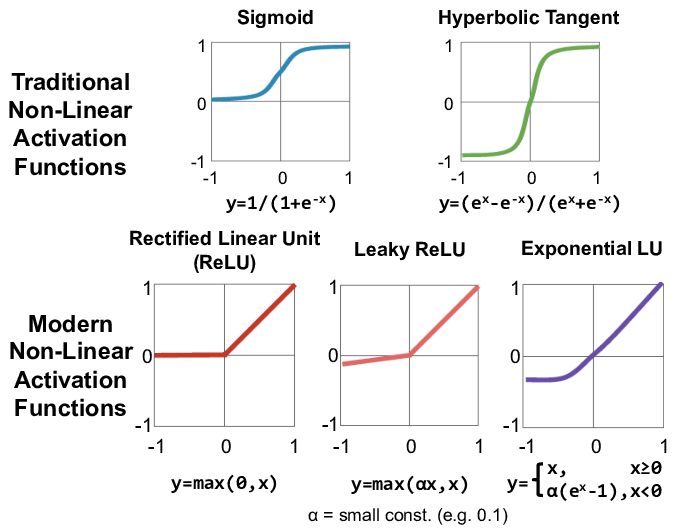

# 07 | 基础策略梯度法：PolicyGradient

你好！欢迎来到强化学习的第七讲。在前几节课中，我们重点学习了基于价值的强化学习方法（如 Q-learning、DQN），这类方法通过估计状态或动作的价值函数间接指导决策。但在连续动作、高维状态或需要随机策略的复杂场景中，这类方法会因“需枚举动作”“价值估计难”等问题陷入瓶颈。

为突破这些局限，策略梯度方法应运而生——它不依赖价值函数间接优化，而是直接对策略建模并通过梯度上升最大化累积奖励，就像让智能体从“推测哪个方向有收益”转向“直接朝着高收益方向调整行动策略”。接下来，我们将深入拆解这一“直接优化策略”的核心方法。

通过本节课的学习，你将能够：

1. ​(a∣s)

## J(θ)

## π

- 理解策略梯度的核心逻辑：掌握策略参数化表示（）、目标函数（）与策略梯θ度定理的数学意义，明白“如何通过梯度让策略向高奖励方向迭代”。

2. 掌握完整算法流程：从初始化参数、与环境交互收集轨迹，到计算累积折扣回报、估计梯度并更新策略，清晰拆解每一步的实现逻辑。

3. 辩证看待方法优劣：明确策略梯度在连续动作空间、随机策略学习上的独特优势，以及样本效率低、梯度方差大等局限性。

4. 了解改进与应用脉络：知晓 A2C/A3C、PPO 等改进算法的核心思路，以及策略梯度在机器人控制、游戏 AI、自动驾驶等领域的实际价值。

## 一、策略梯度的基本原理​

策略梯度算法的核心想法其实很简单：不用先费力去学“什么是好的价值”，而是一步到位，直接学习“该采取什么行动策略”。

## 1.1 为什么需要策略梯度

在前序强化学习学习中，我们聚焦于基于价值的方法（如 Q-Learning、DQN），这类方法通过

## V (s)

## Q(s, a)

估计状态 / 动作的价值函数（

- 或）间接指导决策：先判断“每个动作好不好”，

再选择“最好的动作”。但在三类关键场景中，这类方法会陷入困境。

## Q(s, a)

1. 连续动作空间，无法枚举动作评估：基于价值方法的核心前提是“动作可枚举”（如CartPole 的“左 / 右移”2 个动作），但面对机器人关节角度（0°~180°连续值）、自动驾驶油

## Q(s, a)

## a

- 门开度（0~100%）等场景时， 是无限多的，无法逐一计算并选最优，直接导致方法失效。

2. 高维状态空间，价值函数估计难度指数级上升：当状态是高维数据（如自动驾驶的单张图像

## V (s)

## Q(s, a)

- 含 100 万像素）时，或需要拟合“高维输入→ scalar 输出”的复杂映射，不仅需要庞大的网络规模，还容易出现过拟合、收敛缓慢等问题，估计精度难以保证。

## Q(s, a)

3. 随机策略需求，确定性决策易被预判：基于价值方法输出的是“确定性策略”（必选最大的动作），但在博弈游戏（如扑克、DOTA2）中，确定性策略会被对手轻易预判（比如“永远在残血时撤退”），而随机策略（按概率选择动作）才能保持博弈优势——但基于价值方法无法学习随机策略，只能通过“ε- 贪心”等临时手段近似，效果有限。

正是这些“间接决策”的固有缺陷，催生了策略梯度方法：它彻底绕开价值函数的估计，直接对

## π(a∣s)

“策略

- ”建模，通过优化策略参数让智能体“直接学会选动作”，从根本上解决上述场景的

痛点。

## 1.2 策略的参数化表示​

在强化学习中，策略决定了智能体在每个状态下选择何种动作。我们可以把策略看作是一个函数，它以状态作为输入，输出的是智能体在该状态下采取各个动作的概率分布。为了能够运用梯度优化的方法，我们需要对策略进行参数化。用数学语言来描述，就是将策略表示为

- ​(a∣s)

## π

## θ

## s

## a

## θ

- ，其中 是策略的参数， 是当前状态， 是动作。这个函数的含义是，在参数

θ

## s

## a

下，智能体处于状态 时选择动作 的概率。​

图 7-1 是强化学习中策略梯度（Policy Gradient）算法的流程框架图，核心是通过与环境交互采集数据，利用策略梯度优化策略模型，以让智能体学到最优策略 ，下面我们来拆解下关键环节。

## π

## θ

- ）：用参数 （如示例里神经网络权重）描述，输出智能体在各状态下选动作策略模型（的概率分布，是智能体做决策的“大脑” 。

## π

## a

- 智能体与环境交互：智能体执行 Sample()，依据策略 从动作概率分布采样选动作 ，作

## s

## r

## r

- 用于环境；环境反馈新状态 和奖励 ，奖励 引导策略优化（如二维网格世界，移到目标格可能得正奖励，撞墙得负奖励）。

## {(s

- ​, a​, r​)}策略梯度与学习：每回合交互产生数据，智能体用 learn() 计算“损失”nnn

## θ

## π

- （比如实际奖励与期望奖励偏差），基于策略梯度调整策略参数 来更新 ，让后续选动作更易获高奖励，逐步优化策略。

## π

- 循环优化：不断重复“采样交互 - 计算损失 - 梯度更新策略”，策略模型 持续迭代，智能体在环境里的决策会越来越“聪明”，趋近最优策略。



- 图7-1 策略梯度

简单来说，就是智能体通过与环境互动试错，用数据驱动策略迭代，最终学会在环境里“趋利避害”，完成任务（如网格世界寻路、游戏通关等）。

## 1.3 目标函数​

## θ

策略梯度的目标是找到一组最优的策略参数 ，使得智能体在与环境交互的过程中能够获得最

## J(θ)

大的期望累积回报。期望累积回报也被称为目标函数，用

- 来表示。它的数学定义为：​T−1t t+1

## J(θ) = E

- ​[​]​θ ∑t=0​ γ r。τ∼π

## τ

其中， 表示从初始状态到终止状态的一条轨迹，它由一系列的状态、动作和奖励组成，即

## τ = (s

- ​, a​, r​, s​, a​, r​, ⋯, s​, a​, r​)

## γ ∈[0, 1]

- 是折扣因子，它的作用是平衡；001112T−1T−1T

## γ

## γ

当前奖励和未来奖励的重要性。 越接近 1，说明智能体越看重未来的奖励； 越接近 0，智

- ​[⋅]

## r

## t

## a

## E

- 是在时刻 执行动作后获得的奖励。表示在

能体则更关注当前的即时奖励。

- t+1τ∼π​t​θ​

## π

## τ

策略

- 下，对所有可能轨迹 求期望。​​θ

## J(θ)

## θ

我们的任务就是找到使得

- 最大的 。为了实现这个目标，我们需要借助梯度上升的方

## J(θ)

法，因为梯度的方向就是函数增长最快的方向。所以，我们要计算目标函数

- 关于策略参

## ∇

- ​J(θ)

## θ

数 的梯度

- ，然后沿着这个梯度的方向去更新策略参数。​θ

## 1.4 策略梯度定理​

## J(θ)

策略梯度定理是策略梯度方法的核心理论基础。它给出了目标函数

- 的梯度的具体计算方

## ∇

- ​J(θ) =

式。根据策略梯度定理，目标函数的梯度可以表示为：​

- θT−1​ ∇​ log π​]​​[​(a​∣s​) ⋅​θ ∑t=0

## E

## G

- 。τ∼πθθttt

- T−1k−t k+1​ =

## ∑k=t

## G

- ​ γ

## r

## t

- 是从时刻 开始的累积折扣回报。这个公式初看起来有点复

其中，

- t​

杂，我们来逐步分析一下。​

## ∇

- ​ log π​(a​∣s​)

## s

## a

## θ

- 表示在状态下选择动作的概率的对数关于参数 的梯度，这

首先，

- θθtt​t​t

## θ

## a

## G

## t

个梯度反映了参数 的变化对选择动作

- 的概率的影响程度。然后，是从时刻 开始的​t​t

累积折扣回报，它衡量了从这个时刻开始，按照当前策略行动所能获得的总收益。将两者相乘并对所有时间步和所有可能的轨迹求期望，就得到了目标函数的梯度。​

直观地理解，这个公式的含义是，如果在某个状态下选择某个动作能够带来较高的累积折扣回

## θ

报，并且通过调整参数 能够增加选择这个动作的概率，那么就应该朝着这个方向去更新参数

## θ

，这样就能提高目标函数的值，也就是让智能体获得更大的期望累积回报。​

这里补充两点：

1. 下面的内容会带你重温梯度上升（梯度下降）法。策略梯度本质上也是梯度上升法在强化学

## J(θ)

- 习中的应用。对于梯度提升法，核心中的核心就是理解其原始优化目标，即的物理含义。T−1​ ∇​ log π​[​(a​∣s​) ⋅

## ∇

- ​J(θ) =​]​​θ ∑t=0

## E

## G

- 建议你牢记这一形式，并试图用自己的τ∼πθθθttt方式去理解公式中各项的物理意义。实际上，大部分策略梯度法方法，包括大语言模型时代的 DPO、GRPO、DAPO 等等，其核心优化目标都是上述形式的变体。

## 1.5 梯度上升法更新策略参数​

## θ

有了策略梯度定理给出的梯度计算公式，我们就可以使用梯度上升法来更新策略参数 。梯度

## α

上升法的基本思想很简单，就是在每一次迭代中，沿着目标函数梯度的方向，以一定的步长

## =

- ​ +

## α∇

- ​J(θ​)

## θ

## θ

来更新参数。更新公式如下：​

- ​。k+1kθk

## θ

## k

## α

- 是第 次迭代时的策略参数， 是学习率，它控制了每次参数更新的步长大小。学

其中，

- ​k

习率的选择非常关键，如果学习率过大，参数更新的步长就会过大，可能会导致算法在最优解附近来回振荡，无法收敛；如果学习率过小，参数更新的速度就会很慢，算法的收敛时间会变得很长。​

## J(θ)

## θ

通过不断地重复上述更新过程，策略参数 会逐渐朝着使得目标函数

- 最大的方向移动，

智能体的策略也会越来越好，最终找到在给定环境下的最优策略。​

## 二、策略梯度算法流程​

下面我们将详细拆解策略梯度算法的完整执行流程，从策略参数的初始化开始，依次介绍与环境交互、回报计算、梯度估计到参数更新的各个关键步骤，清晰呈现智能体如何通过迭代优化逐步逼近最优策略。

## 2.1 初始化策略参数​

## θ

在算法开始时，我们需要初始化策略参数 。这个初始化的值通常是随机生成的，因为在开始时我们并不知道最优的策略参数是什么。例如，如果我们使用神经网络来参数化策略，那么神

## θ

经网络的权重（即策略参数 ）可以使用一些常见的随机初始化方法，如正态分布初始化或者均匀分布初始化。​

## 2.2 与环境交互并收集轨迹​

## t

初始化好策略参数后，智能体就开始与环境进行交互。在每一个时间步 ，智能体根据当前的

- ​(a∣s)

## π

## s

## a

策略

- ，在当前状态下选择一个动作并执行。执行动作后，环境会根据自身的状θ​t​t

## s

## r

态转移规则，返回一个新的状态

- 和一个奖励。智能体将这个状态、动作和奖励的三t+1t+1​​

## (s

- ​, a​, r​)

元组

- 记录下来。​t+1tt

## s

## s

## a

图 7-2 展示了智能体与环境交互的过程：从初始观察

- （对应状态），到执行动作（如​1​tT​

## a

## s

## s

## s

## r

## r

对应

- ），环境返回新状态（后续的等对应）和奖励（如对应、）。这个​2​3t+1t+1​tT​​​

过程会一直持续，直到智能体达到终止状态，或者达到预设的最大步数。这样，我们就得到了

## τ = (s

- ​, a​, r​, s​, a​, r​, ⋯, s​, a​, r​)

一条完整的轨迹

- 。为了更准确地估计策略001112T−1T−1T

梯度，我们通常会进行多次这样的交互过程，收集多条轨迹，最后到 “Game Over”（终止状态）。



- 图7-2 回合示例（出自台湾大学语音处理实验室李宏毅）

## 2.3 计算累积折扣回报​

## G

对于收集到的每一条轨迹，我们需要计算从每个时间步开始的累积折扣回报

- 。如前文所​tT−1k−t k+1​ =​​

## ∑k=t

## G

- ​ γ

## r

述，累积折扣回报的计算公式为：​

- 。t

## τ =

这个公式的计算过程是从后往前的。例如，对于一条轨迹

## (s

- ​, a​, r​, s​, a​, r​, s​, a​, r​)​ =

## G

## r

- ，首先计算（因为这是最后一个时间步，没有后0011122232​32 3​ =​ +​ =​ +​ +

## G

## r

## γr

## G

## r

## γr

## γ r

续的奖励了），然后计算

- ，最后计算。​12​3012​

## 2.4 计算策略梯度​

## ∇

- ​J(θ)

这里我们可以开始根据策略梯度定理来计算

- 。在实际计算中，由于我们无法对所有可θ

能的轨迹求期望，所以通常采用蒙特卡洛方法，通过对收集到的有限条轨迹进行采样平均来估计策略梯度。​

## =

- n

## N

## n

## τ

假设我们收集了

- 条轨迹，对于第 条轨迹

## (s

- ​, a​, r​, s​, a​, r​, ⋯, s

## , a

- ​, r​)

## ∇

- ​J(θ) =nnnnnnnnnn，它对策略梯度的贡献为：θ001112T−1T−1TT−1​ ∇​ log π​​​(a​∣s​) ⋅nnn

## ∑t=0

## G

- 。θθttt

## ∇

- ​J(θ) ≈

## N

然后，将所有

- 条轨迹对策略梯度的贡献进行平均，得到策略梯度的估计值：θ

1 ∑n=1

- N​ ∇​J(θ) ​n。θ

N

- ​

## 2.5 更新策略参数​

## θ

得到策略梯度的估计值后，我们就可以使用梯度上升法来更新策略参数 。更新公式为：​

## =

- ​ +

## α∇

- ​J(θ​)​

## θ

## θ

- 。

k+1

- kθk

更新完策略参数后，我们回到 2.2 节的步骤，使用新的策略参数与环境进行交互，收集新的轨迹，然后重复整个过程，不断迭代更新策略参数，直到策略收敛或者达到预设的迭代次数。​

补充知识：

关于更新策略参数的节奏，实际上有不同选择。我们可以更新策略参数后用新的策略与环境交互来更新数据，也可以一直使用当前策略更新数据，同时用另一个策略基于收集的策略进行学习。

前者就是 on-policy，而后者是 off-policy。注意两者并不是完全对立的关系。比如，一些算法会预先采样大量经验数据，然后分 mini batch 进行更新，在这种场景下，第一个 mini-batch是 on-policy 的，后面的 mini-batch 是 off-policy 的。

## 2.6 案例

代码主要包含三个核心部分：

- PolicyNetwork：策略网络，用于参数化智能体的策略

- PolicyGradient：策略梯度算法的核心逻辑实现

- train：训练函数，协调智能体与环境的交互和学习过程

策略网络（PolicyNetwork），这是一个简单的全连接神经网络，用于表示智能体的策略：

- 输入：环境的状态（state_dim 维度）

- 输出：每个可能动作的对数概率（logits）

- 网络结构：3 层全连接层，使用 Tanh 激活函数

- 核心方法 get_action：根据当前状态输出动作以及该动作的对数概率，实现了策略梯度算法中“根据状态基于策略选择动作”的步骤

策略梯度算法（Policy Gradient）的核心逻辑：

- 初始化：创建策略网络和优化器，设置折扣因子 γ

- select_action：调用策略网络选择动作，并记录动作的对数概率

## G

- calculate_discounted_returns：计算累积折扣回报，从后往前计算并进行标准化处理​tupdate_policy：根据收集的轨迹按照策略梯度定理更新策略参数：

- 计算每条轨迹的累积折扣回报

- 计算损失（负的对数概率与回报的乘积和）

- 反向传播更新网络参数

训练函数（train）协调智能体与环境的交互和学习过程：

- 初始化环境，确定状态和动作空间维度

- 每轮训练（episode）：

- 重置环境获取初始状态

- 与环境交互，收集轨迹（状态、动作、奖励）

- 使用收集的轨迹更新策略参数

- 记录和打印训练进度（总奖励、平均奖励等）

- 当平均奖励达到环境目标（CartPole-v1 为 475）时（图 7-3），认为问题已解决



- 图7-3 策略梯度案例表现

```sql
import torch
import torch.nn as nn
import torch.optim as optim
import numpy as np
import gym
from collections import deque
import matplotlib.pyplot as plt
# 定义策略网络
class PolicyNetwork(nn.Module):
   def __init__(self, state_dim, action_dim, hidden_dim=64):
       super(PolicyNetwork, self).__init__()
       self.fc1 = nn.Linear(state_dim, hidden_dim)
       self.fc2 = nn.Linear(hidden_dim, hidden_dim)
       self.fc3 = nn.Linear(hidden_dim, action_dim)
       self.activation = nn.Tanh()
   def forward(self, x):
       x = self.activation(self.fc1(x))
       x = self.activation(self.fc2(x))
       logits = self.fc3(x)
       return logits
   def get_action(self, state):
       # 1. 处理可能的元组状态（Gym新版本）
       if isinstance(state, tuple):
           # 提取状态数组部分，忽略其他信息
           state = state[0] if len(state) > 0 else state
       # 2. 确保状态是numpy数组
       if not isinstance(state, np.ndarray):
           state = np.array(state, dtype=np.float32)
       # 3. 检查状态维度是否正确
       if state.ndim == 0:
           raise ValueError(f"状态维度异常: {state.shape}")
       # 4. 转换为张量并添加批次维度
       state_tensor = torch.from_numpy(state).float().unsqueeze(0)
       # 获取动作分布并采样
       logits = self.forward(state_tensor)
       action_probs = torch.softmax(logits, dim=1)
       action_dist = torch.distributions.Categorical(action_probs)
       action = action_dist.sample()
       return action.item(), action_dist.log_prob(action)
# 策略梯度算法类
class PolicyGradient:
   def __init__(self, state_dim, action_dim, learning_rate=0.001, gamma=0.99):
       self.policy_net = PolicyNetwork(state_dim, action_dim)
       self.optimizer = optim.Adam(self.policy_net.parameters(), lr=learning_rat
       self.gamma = gamma
       self.rewards = []
       self.log_probs = []
   def select_action(self, state):
       try:
           action, log_prob = self.policy_net.get_action(state)
           self.log_probs.append(log_prob)
           return action
       except Exception as e:
           print(f"选择动作时出错: {e}")
           print(f"当前状态: {state}, 类型: {type(state)}, 形状: {np.shape(state)}"
           raise  # 重新抛出异常以便调试
   def calculate_discounted_returns(self):
       discounted_returns = []
       running_sum = 0
       for r in reversed(self.rewards):
           running_sum = r + self.gamma * running_sum
           discounted_returns.insert(0, running_sum)
       # 标准化回报
       discounted_returns = torch.tensor(discounted_returns)
       discounted_returns = (discounted_returns - discounted_returns.mean()) / (
       return discounted_returns
   def update_policy(self):
       discounted_returns = self.calculate_discounted_returns()
       loss = 0
       for log_prob, G_t in zip(self.log_probs, discounted_returns):
           loss -= log_prob * G_t
       self.optimizer.zero_grad()
       loss.backward()
       self.optimizer.step()
       self.rewards = []
       self.log_probs = []
       return loss.item()
# 训练函数
def train(env_name, max_episodes=1000, max_steps=1000, gamma=0.99, lr=0.001):
   # 创建环境时指定旧版API行为，确保兼容性
   env = gym.make(env_name)
   # 确定状态维度
   if hasattr(env.observation_space, 'shape') and env.observation_space.shape:
       state_dim = env.observation_space.shape[0]
   else:
       state_dim = env.observation_space.n
   action_dim = env.action_space.n
   print(f"环境信息: 状态维度={state_dim}, 动作维度={action_dim}")
   pg_agent = PolicyGradient(state_dim, action_dim, learning_rate=lr, gamma=gamm
   scores = deque(maxlen=100)
   average_scores = []
   for episode in range(max_episodes):
       # 重置环境，确保获取正确的初始状态
       state = env.reset()
       # 处理Gym 0.26+版本的返回值
       if isinstance(state, tuple) and len(state) == 2:
           state = state[0]  # 只保留状态，忽略其他信息
       episode_reward = 0
       for step in range(max_steps):
           action = pg_agent.select_action(state)
           # 处理不同版本Gym的step返回值
           step_result = env.step(action)
           if len(step_result) == 4:
               next_state, reward, done, _ = step_result
           else:  # 新版本Gym返回5个值
               next_state, reward, terminated, truncated, _ = step_result
               done = terminated or truncated
           pg_agent.rewards.append(reward)
           state = next_state
           episode_reward += reward
           if done:
               break
       loss = pg_agent.update_policy()
       scores.append(episode_reward)
       avg_score = np.mean(scores)
       average_scores.append(avg_score)
       if episode % 100 == 0:
           print(f"Episode {episode}, 总奖励: {episode_reward:.2f}, 平均奖励: {avg
       # CartPole-v1的解决条件
       if avg_score >= 475:
           print(f"在第 {episode} 轮解决环境! 平均奖励: {avg_score:.2f}")
           break
   env.close()
   # 设置中文字体
   plt.rcParams["font.family"] = ["SimHei", "WenQuanYi Micro Hei", "Heiti TC"]
   plt.rcParams["axes.unicode_minus"] = False  # 解决负号显示问题
   # 绘制奖励曲线
   plt.plot(average_scores)
   plt.xlabel('回合数')
   plt.ylabel('平均奖励')
   plt.title(f'策略梯度在 {env_name} 上的表现')
   plt.savefig("policy_gradient.png")
   plt.show()
   return pg_agent
if __name__ == "__main__":
   # 尝试使用不同的环境初始化方式确保兼容性
   try:
       trained_agent = train('CartPole-v1', max_episodes=2000, lr=0.001, gamma=0
   except Exception as e:
i t(f"训练过程出错
{ }")
```

## 三、策略梯度的优势与局限性​

策略梯度方法凭借可学习随机策略、收敛性有理论支撑、适配高维状态空间及连续动作空间等核心优势，在博弈、机器人控制等多个领域展现出独特价值，但同时也面临着样本效率低、方差大且收敛慢、缺乏全局最优解保证等固有局限性，这些痛点既制约了其在真实场景中的大规模落地，也成为了强化学习领域持续攻坚的关键方向。

## 3.1 优势​

### 3.1.1 可学习随机策略​

在一些场景中，随机策略比确定性策略更具优势。例如，在博弈游戏中，随机策略可以增加对手预测的难度。策略梯度方法能够学习到随机策略，通过调整策略参数来改变动作的概率分布，从而实现随机策略。这使得策略梯度方法在博弈论、多智能体系统等领域有着广泛的应用场景。​

### 3.1.2 收敛性有理论保障​

从理论上来说，策略梯度方法根植于梯度上升方法，具有良好的收敛性。在一定的条件下，通过不断地迭代更新策略参数，策略梯度方法能够收敛到局部最优解，甚至在某些情况下可以收敛到全局最优解。这为实际应用中策略的稳定性和可靠性提供了一定的理论支持。​

### 3.1.3 对高维状态空间适应性强​

在高维状态空间的环境中，基于价值的方法需要估计高维的价值函数，这会导致计算量急剧增加，而且价值函数的估计精度也难以保证。而策略梯度方法直接对策略进行建模，策略参数的维度通常不会随着状态空间的增大而急剧增加，因此对高维状态空间具有较强的适应性。例如，在图像识别作为状态输入的场景中，状态空间维度非常高，但策略梯度方法可以通过神经网络等模型直接处理这些高维状态，学习到有效的策略。​

### 3.1.4 适用于连续动作空间​

比起高维状态空间，更可怕的是连续动作空间。基于价值的强化学习方法在处理连续动作空间时挑战极大，因为它们需要对所有可能的动作进行评估和比较。而策略梯度方法直接对策略进行优化，不需要枚举所有动作，因此能够很好地处理连续动作空间的问题。例如，在机器人控制领域，机器人的关节角度通常是连续变化的，使用策略梯度方法可以方便地让机器人学习到如何根据当前的状态调整关节角度，以完成特定的任务。​

## 3.2 局限性​

### 3.2.1 样本效率低​

策略梯度方法需要与环境进行大量的交互来收集轨迹，以估计策略梯度。每一次参数更新都依赖于新收集的轨迹数据，而这些数据在参数更新后就不再被使用，导致样本的利用率很低。这在一些真实环境中是一个很大的问题，因为与环境的交互可能需要耗费大量的时间、成本或者资源。例如，在自动驾驶领域，让真实的车辆在道路上进行大量的试验来收集数据，不仅成本高昂，而且还存在安全隐患。​

提升策略梯度法的采样效率（Efficient Sampling）以及如何复用已采样的样本，一直是 RL 领域的研究热点。

### 3.2.2 方差大收敛速度慢​

由于策略梯度法的采样数据是多条完整轨迹，其所带来的影响就是数据方差比较大。这会导致参数更新的方向不稳定，从而影响算法的收敛速度。虽然可以通过增加样本数量来降低方差，但这又会进一步降低样本效率。而且，在一些复杂的环境中，策略梯度方法可能需要经过很长时间的迭代才能收敛到较好的策略。​

### 3.2.3 没有全局最优解保证

策略梯度方法使用梯度上升法来优化目标函数，而目标函数通常是非凸的，这使得算法很容易收敛到局部最优解，而无法找到全局最优解。在一些复杂的任务中，局部最优解可能与全局最优解存在较大的差距，从而影响智能体的性能。​

## 四、策略梯度的改进方法​

为了克服策略梯度方法的局限性，研究人员提出了许多改进方法。这些方法在提高样本效率、降低方差、加快收敛速度等方面取得了显著的效果。​

## 4.1 强化学习简要分类

根据图 7-4 中强化学习（RL）算法的分类框架，策略梯度方法（Policy GradientAlgorithms） 属于无模型（Model-Free）强化学习中的重要分支，核心是直接对智能体的策略函数进行参数化建模和优化，通过梯度上升的方式最大化累积奖励。以下是其核心方法及改进算法的简要说明。



- 图7-4 强化学习简要分类

### 4.1.1 基础策略梯度算法：REINFORCE

核心思想：REINFORCE 是最经典的策略梯度算法之一，采用蒙特卡洛（Monte Carlo）方法估计策略的梯度，通过采样完整的轨迹（从初始状态到终止状态）计算累积奖励，并利用奖励加权的梯度更新策略参数。

特点：实现简单，但由于依赖完整轨迹采样，梯度估计方差较大，收敛速度较慢。

### 4.1.2 策略梯度的改进算法

为解决基础策略梯度的高方差、收敛不稳定等问题，后续衍生出多种改进算法。

- A2C（Advantage Actor-Critic）与 A3C（Asynchronous Advantage Actor-Critic）

改进点：引入 “Actor-Critic” 框架，结合策略梯度（Actor）和价值函数估计（Critic）。Critic 通过估计优势函数（Advantage Function）减少梯度估计的方差，提升收敛稳定性；A3C 进一步引入异步并行训练机制，利用多个线程同时采样和更新，加速训练效率。

另外，除了 A3C，业界还有很多工作用于拓展 Actor-Critic 架构。比如将其改造为分布式计算的方法，如 IMPALA。感兴趣的同学可以搜索“分布式 RL”进行深入了解。

- TRPO（Trust Region Policy Optimization）

改进点：针对策略更新过程中可能出现的“梯度爆炸”或“策略突变”问题，TRPO 通过约束策略更新的幅度（信任域，Trust Region），确保每次更新后，新策略与旧策略的差异在可控范围内，从而保证算法的单调改进和收敛性。

- PPO（Proximal Policy Optimization）

改进点：作为 TRPO 的简化和实用化版本，PPO 通过“剪辑目标函数（Clipped Objective）” 限制策略更新的步长，避免复杂的信任域计算，在保持稳定性的同时，大幅降低实现难度，成为目前工业界和学术界广泛使用的策略梯度算法。

- V-MPO（Variational Policy Optimization）

改进点：结合变分推断思想，通过优化策略的变分下界，提升梯度估计的准确性，同时引入价值函数引导策略更新，在高维动作空间或连续控制任务中表现出较好的稳定性和样本效率。

### 4.1.3 小结

策略梯度方法从基础的 REINFORCE 出发，通过引入优势函数（A2C/A3C）、约束策略更新幅度（TRPO/PPO）、结合变分思想（V-MPO）等改进，逐步解决了方差大、收敛不稳定、实现复杂等问题，成为处理连续动作空间和复杂任务的主流强化学习方法。

下面我们从另一个角度，介绍一下在策略梯度法的多种改进算法中一项通用的重要技术：基准线以及由其带来的优势函数。

## 4.2 增加基准线（Baseline）​

## G

策略梯度估计值的高方差，很大程度上是由累积折扣回报

- 的波动造成。增加基准线的方​t

## b(s

- ​)

法，是从累积折扣回报中减去一个与动作无关的基准值

- ，使得策略梯度的估计值变为：​t

- T−1

## ∇

- ​J(θ) ≈​ ∇​ log π

## (G

- ​ −

## b(s

- ​))]​​[​(a​∣s​) ⋅​θ ∑t=0

## E

- 。τ∼πθθθtttt

## E[∇

- ​ log π​(a​∣s​)] =

## 0

合适的基准值不会改变梯度的期望，因为

- ，所以θθtt

## E[∇

- ​ log π​(a​∣s​) ⋅

## b(s

- ​)] =

## 0

- 。但基准值可以有效地降低梯度估计的方差。θθttt

## V (s

- ​)

基准值的选择有很多种，其中较为常用的是将拟合得到的状态价值函数

- 作为基准线。​t

## 4.3 优势函数（Advantage Function）​

图 7-5 是常见的激活函数，梯度学习时，可以发现：

## x

- Sigmoid 一类的激活函数， 在两边时，函数趋于饱和；

- 在 0 附近曲线几乎线性，学习速率最大；

## x

- Relu 一类的激活函数，函数随 无限增大，学习会变得响应过敏感，难以控制。

## x

总之，输入 不能过大，否则学习会变得效率低，以至于学不到最优。



- 图7-5 常见的激活函数（出自deeplearning.ai）

对于 Sigmoid，归一化是将输入标准化到均值为 0、方差为 1 的标准正态分布上，提高学习效率。优势函数其实就是将 Q-Value“归一化”到 Value baseline 上，如上讨论的，这样有助于提高学习效率，同时使学习更加稳定；同时经验表明，优势函数也有助于减小方差，而方差过大导致过拟合的重要因素。

## A(s

- ​, a​) =

## Q(s

- ​, a​) −

## V (s

- ​)

优势函数定义为动作价值函数与状态价值函数的差值，即

- 。ttttt

## s

## a

它衡量了在状态

- 下选择动作相对于平均水平的优势。使用优势函数来替代累积折扣回报​t​t

## G

- ，可以进一步降低梯度估计的方差，因为优势函数已经减去了状态的平均价值。此时，策​tT−1

## ∇

- ​J(θ) ≈​ ∇​ log π

## A(s

- ​, a​)]​[​(a​∣s​) ⋅​θ ∑t=0

## E

略梯度的估计值为：​

- 。τ∼πθθθtttt

优势函数可以通过各种方法进行估计，如时序差分（TD）方法、广义优势估计（GAE）等。广义优势估计结合了 TD 方法和蒙特卡洛方法的优点，能够更准确地估计优势函数，同时进一步降低方差。​

## 4.3  Actor-Critic 方法​

Actor-Critic 方法是将策略梯度方法和价值函数方法结合起来的一种混合方法。其中，“Actor”指的是策略网络，它负责根据当前状态选择动作；“Critic” 指的是价值网络，它负责估计状态价值函数或者动作价值函数，并对 Actor 选择的动作进行评价。​

在 Actor-Critic 方法中，Critic 通过估计价值函数来计算优势函数，然后 Actor 根据 Critic 提供的优势函数来更新策略参数。这种方法的优点是，Critic 可以实时地对 Actor 的动作进行评价，使得参数更新更加及时，从而提高了样本效率。同时，由于使用了价值函数来计算优势函数，降低了策略梯度估计的方差，加快了算法的收敛速度。​

常见的 Actor-Critic 变体包括确定性策略梯度（DPG）、深度确定性策略梯度（DDPG）等。DDPG 结合了深度神经网络和 Actor-Critic 方法，能够处理高维状态空间和连续动作空间的问题，在许多复杂的控制任务中取得了很好的效果。​

## 五、策略梯度的应用场景​

策略梯度方法由于其独特的优势，在许多领域都有着广泛的应用。​

## 5.1 机器人控制​

在机器人控制领域，策略梯度方法被广泛用于让机器人学习各种复杂的动作和任务。例如，让机器人学习行走、抓取物体、开门等。由于机器人的动作空间通常是连续的，而且状态空间也非常高维（如包含机器人的关节角度、速度、位置等信息），策略梯度方法能够很好地处理这些问题，通过学习策略让机器人自主地完成各种任务。​

## 5.2 游戏 AI​

在游戏 AI 领域，策略梯度方法也取得了显著的成就。例如，在围棋、象棋、星际争霸等复杂的博弈游戏中，策略梯度方法结合深度神经网络，让 AI 系统达到了甚至超越人类顶尖选手的水平。在这些游戏中，策略梯度方法能够学习到随机策略，增加了游戏的不确定性和趣味性，同时也能够处理庞大的状态空间和复杂的游戏规则。​

## 5.3 自动驾驶​

自动驾驶是一个典型的需要处理连续动作空间和高维状态空间的领域。策略梯度方法可以用于自动驾驶中的决策和控制，如车道保持、跟车行驶、超车等。通过学习策略，自动驾驶系统能够根据当前的路况（如车辆的位置、速度、周围车辆的状态等）做出合理的决策和动作，确保行车安全。​

## 5.4 推荐系统​

在推荐系统中，策略梯度方法可以用于优化推荐策略，提高推荐的准确性和用户满意度。推荐系统的状态可以包括用户的历史行为、兴趣偏好、当前的时间和场景等信息，动作可以是推荐的物品列表。通过与用户的交互（用户对推荐物品的点击、购买等反馈作为奖励），策略梯度方法能够学习到最优的推荐策略，为用户推荐更符合其需求的物品。

## 总结​

本节课我们深入学习了基础策略梯度法。首先，我们了解了策略梯度方法的基本原理，包括策略的参数化表示、目标函数的定义、策略梯度定理以及如何使用梯度上升法更新策略参数。策略梯度直接对策略进行建模和优化，通过计算策略参数的梯度，让智能体朝着获得更高奖励的方向更新策略。​

接着，我们详细介绍了策略梯度算法的流程，从初始化策略参数开始，到与环境交互收集轨迹、计算累积折扣回报、估计策略梯度，再到更新策略参数，形成一个完整的迭代过程。​

然后，我们分析了策略梯度方法的优势和局限性。它的优势在于可学习随机策略、收敛性有理论保证、对高维状态空间适应性强以及适用于连续动作空间；而局限性主要包括样本效率低、方差大导致收敛速度慢，以及可能收敛到局部最优解。​

为了克服这些局限性，我们介绍了一些改进技巧，如增加基准线、使用优势函数和 Actor-Critic 方法等。这些技巧在提高样本效率、降低方差和加快收敛速度方面发挥了重要作用。​

最后，我们探讨了策略梯度方法的应用场景，包括机器人控制、游戏 AI、自动驾驶和推荐系统等，展示了策略梯度方法在实际应用中的广泛前景。​

通过本节课的学习，希望你对策略梯度方法有了全面的认识，了解了它的核心思想、算法流程、优缺点以及应用。在后续的课程中，我们将进一步学习更高级的策略梯度算法和相关技术，深入探索强化学习的奥秘。

## 思考题​

请举例说明策略梯度方法在实际生活中的应用，并分析为什么在该应用场景中策略梯度方法比其他强化学习方法更具优势？

希望你通过今天的学习，对强化学习有了更加清晰的认识。如果有任何疑问，欢迎在讨论区留言交流！
