# 08 | 优势函数：涵盖ActorCritic-GAE-TRPO

你好！欢迎来到强化学习的第八讲。在前几节课中，我们学习了策略梯度方法（如REINFORCE），但这类方法存在一个关键问题——梯度估计方差大，导致学习过程不稳定、收敛慢。比如在复杂环境中，偶然的高奖励或低奖励会严重干扰策略更新方向。为解决这一痛点，优势函数应运而生，它通过评估“动作相对平均水平的好坏”，帮助我们更精准地判断策略更新方向，而这正是本节课的核心。

我们将从 Actor-Critic 算法切入，逐步展开优势函数的应用与优化：从“Actor 决策、Critic 评估”的双网络协作框架，到用 TD 误差简化优势函数计算；再到 GAE 方法平衡偏差与方差，以及 TRPO 算法通过信赖域约束保障策略更新的稳定性。这些内容层层递进，让你充分体验强化学习中基于优势函数优化策略的核心逻辑。

通过本节课的学习，你将能够：

1. 理解 Actor-Critic 算法的双网络协作机制：明确 Actor（策略网络）如何决策、Critic（价值网络）如何通过 TD 误差估计优势函数，以及两者如何协同更新。

2. 掌握 GAE 广义优势估计的核心思想：理解其通过多步 TD 误差加权求和，在偏差与方差间找到平衡的原理，以及具体计算逻辑。

3. 明晰 TRPO 算法的安全更新逻辑：了解其通过 KL 散度约束构建“信赖域”，确保策略更新不出现大幅性能下降的核心设计，以及优势函数在其中的作用。

4. 建立算法选择思维：能根据样本效率、计算复杂度、稳定性需求，判断不同基于优势函数的算法（Actor-Critic、GAE、TRPO）的适用场景。

## 一、Actor - Critic 算法​

之前探讨过两类核心的强化学习算法：一类是基于值函数的方法（如 DQN），另一类是基于策略的方法（如 REINFORCE）。其中，基于值函数的方法专注于学习一个价值函数，以此评估状态或动作的优劣；基于策略的方法则直接学习一个策略函数，指导智能体如何选择动作。值得注意的是，二者均能借助深度神经网络分别对价值函数和策略函数进行建模。

那么一个自然的想法应运而生：我们能否构建两个独立的神经网络，让它们协同工作，一个负责学习价值函数，另一个负责学习策略函数？这正是大名鼎鼎的 Actor-Critic 算法的核心设计思路。Actor-Critic 算法是一种结合了策略梯度和价值函数学习的强化学习算法框架，通过策略网络（Actor）和价值网络（Critic）的协同工作，实现高效的学习和决策

## 1.1 Actor - Critic 的基本结构​

如图 8-1 所示，Actor - Critic 算法可以看作是 REINFORCE 算法的一个重要升级。实际应用中，单网络双输出（共享特征提取层）更节省参数，适合状态维度不高的场景；而独立双网络（Actor 与 Critic 分开特征提取）灵活性更强，适合复杂状态（如图像输入）的任务，但需注意避免训练时的梯度干扰。​

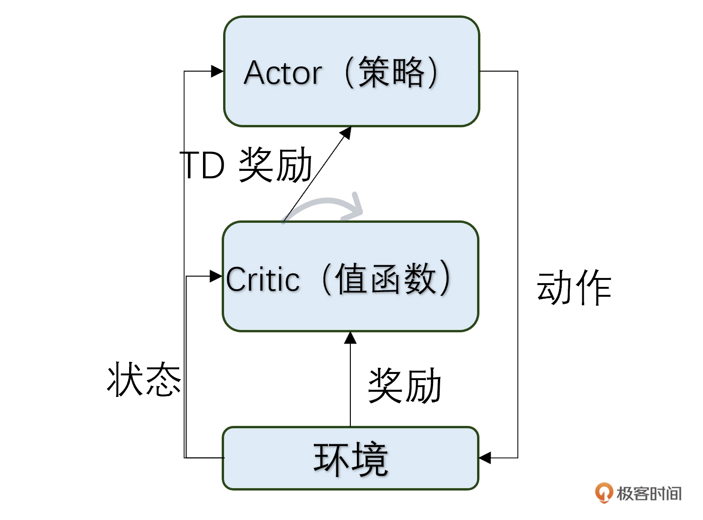

- 图8-1 Actor-Critic架构

Actor 和 Critic 的关系，如图 8-2 所示，具体如下。

Actor（演员）：这部分就是我们的策略网络，和 REINFORCE 中的策略网络类似。它的职责

## π(a∣s; θ)

## s

## θ

是根据当前的状态 ，输出一个动作的概率分布

- ，这里的 是策略网络的参数。简

单来说，Actor 负责决策，决定在当前状态下采取哪个动作。我们的最终目标就是训练好这个Actor，让它能够输出尽可能优的动作概率分布。​

Critic（评论家）：Critic 是价值网络，它不直接产生动作，而是对 Actor 的表现进行评估。它

## V (s; w)

## w

学习一个状态价值函数

- ，其中是 Critic 网络的参数，这个函数用来判断当前状态

## s

有多好。可以把 Critic 想象成一个在台下观看 Actor 表演的评论家，它根据 Actor 的动作和环境反馈的奖励等信息，对 Actor 的表现进行打分。​


- 图8-2 演员-评论家示意图

整个流程就如同演戏一般，Actor 在舞台上表演（做出动作），Critic 在台下观看并给出评价（这个动作好不好），然后 Actor 根据 Critic 的反馈来调整自己的表演（更新策略）。​Critic 的角色就是充当这个优势函数，它在每一步都评估当前动作是否比其他动作更好。相比于直接给每个动作分配一个奖励，使用优势函数能更加高效地优化策略，帮助智能体更快找到最优行为。

## 1.2 优势函数在 Actor - Critic 中的作用​

优势函数在强化学习中是一个非常关键的概念，通常用于评估在特定状态下采取某个动作比遵

## A(s, a)

循当前策略，更好或更差的程度。Critic 通过计算一个非常重要的概念——优势函数来给出评价。

## A(s, a) = Q(s, a) −V (s)

## Q(s, a)

- 。这里的是动作价值函数，表示在

优势函数的定义是：

## s

## a

状态 下采取动作 后，按照某个策略进行决策，从该状态转移到下一个状态并获得预期累

## V (s)

## s

- 是状态价值函数，表示在状态 下，按照某个策略执行动作，所能获得

积回报的价值；

## Q(s, a)

## s

## a

的长期累积奖励的期望。直观含义就是，在状态 下，采取动作 带来的价值

- ，比

## V (s)

该状态的平均价值

- 好多少。​

## A(s, a) > 0

## A(s, a) < 0

## a

如果

- ，说明动作 比平均水平要好，是“有优势的”动作；如果，说

## A(s, a)

## a

明动作 比平均水平要差。在策略梯度定理中，我们可以用优势函数

- 来替代原来

## G

REINFORCE 算法中的

- （累积折扣奖励）。这样做有一个很大的好处，就是能大大降低方​t

## ∇θJ(θ) =

差，而且在数学上可以证明其期望是不变的。策略梯度的更新公式就变成了：

## E[∇θlogπθ(a∣s)A(s, a)]

## J(θ)

- ，其中是策略的目标函数。​

## 1.3 如何计算优势函数——TD 误差的登场​

## A(s, a)

## Q(s, a)

## V (s)

为了计算优势

- ，我们似乎需要知道和。难道我们要同时学习两个网络

## Q

## V

- 网络和网络）吗？其实不必。我们可以用时序差分误差（TD-Error）来作为优势函数

（的一个很好的估计。​

- ′

## s′

## Q(s, a)

## r + γV (s )

## r

## γ

我们知道

- 的期望是，这里 是即时奖励， 是折扣因子，是下一个′′

## A(s, a) = r + γV (s ) −

## V (s)

## r + γV (s ) −

- ，而

状态。将其代入优势函数公式可得：

## V (s)

## δ

- 正是我们熟悉的 TD 误差。这是 Actor - Critic 方法最核心的洞见：Critic 计算出的 TD​t

误差，既可以用来评估和更新自己（Critic）的价值网络，又可以作为优势函数的估计来指导Actor 的策略更新。​

## s

在一个 Actor - Critic 算法中，每走一步，我们都会同时更新两个网络。假设智能体在状态

- ​t

## a

## r

## s

执行动作

- ，得到奖励和新状态。具体更新步骤如下：​t+1​t​t​

1. 计算 TD 误差（由 Critic 完成）：​​(s​)

## s

## V

## s

- 首先，我们通过 Critic 网络得到当前状态的价值估计，以及下一个状态t+1​twt​​(s​)

## V

- 的价值估计。​t+1w

## TD_target = r

- ​ +​(s​)

## γV

- 然后计算 TD 目标。​t+1tw​ =

## TD_target −V

- ​(s​)

## δ

## V

- 最后得到 TD 误差。这里的代表由 Critic 网络计算出twtw​的价值。

2. 更新评论家（Critic）：​(s​)​ +​(s​)

## V

## r

## γV

- Critic 的目标是让自己的价值估计尽可能接近 TD 目标。​因t+1wttw此，它的损失函数就是 TD 误差的平方。我们通过梯度下降来最小化这个损失，即 Critic

- 2

## L(w) = δ

## w

- 的损失为。通过反向传播算法，计算损失函数关于 Critic 网络参数的梯​t度，并更新参数，使得 Critic 的价值估计更加准确。​

3. 更新演员（Actor）：

## δ

- Actor 用 Critic 提供的 TD 误差作为优势信号，来更新自己的策略。在更新 Actor 时，​t

## δ

- 被视为一个从 Critic 传来的常数，我们不希望 Actor 的更新去影响 Critic 的计算（即梯​t

## δ

- 度不从 Actor 流回 Critic）。在代码实现中，通常会对使用.detach ()。​​t

## E ∇

## ∇

- ​J(θ) =​ log π​(a​ ∣s​)δ

## [

- t]根据策略梯度公式，我们计算策略梯度：。然后通θθθtt​

## θ

- 过梯度上升的方法更新 Actor 网络的参数 ，使得策略朝着能产生更具优势动作的方向优化。​

通常我们会用一个网络，但它有两个不同的“头”（输出层），一个输出策略（Actor），一个输出状态价值（Critic）。例如在 PyTorch 中可以这样定义模型：​

```python
import torch
import torch.nn as nn
import torch.nn.functional as F
class ActorCritic(nn.Module):
   def __init__(self):
       super(ActorCritic, self).__init__()
       # 假设输入状态的特征维度为128
       self.affine1 = nn.Linear(128, 128)  # 添加缺失的全连接层
       # 演员（Actor）的头
       self.action_head = nn.Linear(128, 2)  # 假设动作空间是二维的，输出动作概率
       # 评论家（Critic）的头
       self.value_head = nn.Linear(128, 1)  # 输出状态价值
   def forward(self, x):
       x = F.relu(self.affine1(x))
       # Actor输出动作概率分布
       action_probs = F.softmax(self.action_head(x), dim=-1)
       # Critic输出状态价值
       state_values = self.value_head(x)
       return action_probs, state_values
```

与 REINFORCE 在回合结束后更新不同，Actor - Critic 每一步都可以更新。下面是一个简单

- ​, a​, r​, s

## s

## at

的更新示例代码（假设我们已经从环境中得到

- 是通过从 Actor 的输出概率，t+1ttt​

## a

中采样得到的，同时保存了 log_prob (

- )）。​t

```
# 初始化模型和优化器
model = ActorCritic()
optimizer = torch.optim.Adam(model.parameters(), lr=0.01)
GAMMA = 0.99  # 折扣因子
# 创建模拟数据
s_t = torch.randn(1, 128)  # 当前状态
s_next = torch.randn(1, 128)  # 下一状态
r_t = torch.tensor([1.0])  # 奖励
# 使用模型进行前向传播
action_probs, state_value = model(s_t)  # Critic对当前状态的打分V(s_t)
_, next_state_value = model(s_next)  # Critic对下一状态的打分V(s_{t + 1})
# 1. 计算Critic的TD误差(即优势)
# detach()确保在计算TD目标时，梯度不会流经next_state_value
td_target = r_t + GAMMA * next_state_value.detach()
advantage = td_target - state_value
# 2. 计算Critic的损失(均方误差)
critic_loss = advantage.pow(2)
# detach()确保梯度只用于更新Actor，而不影响Critic
# 从Actor输出的概率分布中采样动作，并计算log_prob
action_dist = torch.distributions.Categorical(action_probs)  # 假设离散动作空间
a_t = action_dist.sample()  # 采样动作
log_prob = action_dist.log_prob(a_t)  # 计算采样动作的对数概率
actor_loss = -log_prob * advantage.detach()
# 4. 计算总损失并进行优化
total_loss = critic_loss + actor_loss
# 假设我们有优化器optimizer，对总损失进行反向传播和优化
optimizer.zero_grad()
total_loss.backward()
optimizer.step()
print("训练步骤完成！总损失:", total_loss.item())
```

通过这样的方式，Actor - Critic 算法能够更有效地学习到一个较好的策略，相比 REINFORCE算法，其训练过程更加稳定，收敛速度也更快。​

## 二、GAE（广义优势估计）​

虽然 Actor - Critic 算法通过引入优势函数，在一定程度上降低了方差，提高了学习效率。但是，在实际应用中，我们对优势函数的估计仍然存在一些问题。例如，在使用 TD 误差估计优势函数时，我们可能会面临偏差和方差的权衡问题。如果我们只考虑一步的 TD 误差，那么它的方差较小，但是偏差可能较大，因为它没有充分利用未来的信息；如果我们考虑多步的累积奖励来估计优势函数，虽然偏差会减小，但是方差又会增大。​

## 2.1 GAE 的原理​

在绝大多数强化学习算法里，值函数（涵盖状态值函数与动作值函数）是不可或缺的。而估计值函数的主流方法，主要有时序差分（Temporal - difference，TD）算法以及蒙特卡罗（Monte Carlo，MC）方法。这两种方法各有长短，TD 算法所得估计量的特点是偏差高但方差低，与之相反，MC 算法的估计量则呈现出低偏差、高方差的特性。

在策略梯度方法及广义强化学习框架中，信用分配问题（credit assignment problem）始终是一个关键挑战：当系统中的奖励延迟出现时，如何准确地判定哪些历史动作应当获得强化？

这一问题本质上是寻求偏差与方差之间的最佳平衡点。当算法考虑远期回报以强化当前动作时，会引入较大方差，因为准确估计真实期望回报需要大量采样轨迹。当算法仅关注短期回报时，会导致估计偏差增大，特别是当我们将状态价值估计为较小步数（如 TD 误差为 1 时）的n 步回报加权平均时。

在解决上述问题方面，强化学习领域已有资格迹和λ-returns 等工具，以及 Sutton 与 Barto 在《强化学习导论》中详细讨论的 TD-λ算法。而λ-returns 方法需要完整的训练回合才能进行计算，传统 TD-λ作为一个完整算法，直接将资格迹整合到梯度向量中。在 PPO 等现代算法中，我们期望将优势函数作为损失函数的一部分，这与 TD-λ的直接应用方式不相兼容。

为了平衡偏差和方差问题，Schulman 等人在 2016 年提出了 Generalized AdvantageEstimation（GAE）方法，它是一种在偏差和方差之间权衡的优势函数估计方法，被广泛应用于强化学习中的近端优化策略（PPO）等算法。

GAE 本质上将 TD-λ的核心思想引入策略梯度方法，通过系统性地估计优势函数，使其能够有效集成到算法损失函数中。

GAE 的核心思想是通过对不同步数的 TD 误差进行加权求和，来得到一个更加准确的优势函数估计，从而在偏差和方差之间找到一个更好的平衡。​GAE 的核心定义——优势函数

## A(s

- ​, a​)

## s

## a

- 表示在状态下选择动作的“相对价值”，即该动作带来的回报优于平均水平多tt​t​t

## A(s

- ​, a​) =

## Q(s

- ​, a​) −

## V (s

- ​)

## a

少，优势函数

- 的物理意义是：选择动作相比遵循当前策ttttt​t

## Q

## V

略选择平均动作的额外收益，其中

- 是动作值函数，是状态值函数。

## A(s

- ​, a​)

## Q

GAE 的本质是对这个

- 的高效估计——因为直接计算往往成本高，而 GAE 通过tt

## Q

## V

TD 误差的加权和，绕开了对

- 的直接依赖，仅用和即时奖励即可估计优势，这也是它被

广泛应用的重要原因。

- ​ =​ +

## γV (s

- ​) −

## V (s

- ​)

## δ

## r

我们知道，TD 误差的定义为：

- 。GAE 基于 TD 误差的递归定t+1ttt∞GAE​ =​(γλ) δl t+l

## ∑l=0

## A

## T

义为

- 。在实际训练中，轨迹会在时刻结束（如回合制任务的“终t​

## V (s

- ​) =

## 0

止状态”），此时

- （终止状态无后续价值），因此 GAE 的有限步形式更常用：T+1GAE(γ,λ)T−t−1​ =​(γλ) δl t+l

## ∑l=0

## A

- 。t​

其中：

## V (s

- ​)

## r

- TD 误差衡量了“当前状态价值估计”与“基于即时奖励和下一状态价值估计t​t

## V (s

- ​)的目标价值”之间的差距，是“时序差分学习”的核心信号；t+1

## γ

- 是折扣因子，用于控制未来回报的权重；

- λ 是 GAE 的衰减系数，控制长期和短期偏差的平衡，取值范围在 [0, 1] 之间；

## t + l

- ​ =​ +

## γV (s

- ​) −

## V (s

- ​)

## δ

## δ

## r

- 是时刻的 TD 误差，即。​t+lt+lt+lt+l+1t+l​

- ​ =

## 0

- GAE

## A

## T

我们可以通过动态规划的方法高效地计算 GAE。从后往前计算，设

- 是轨迹的（T​ =​ +

## (γλ)A

- GAEGAE

## A

## δ

终点），则对于 t < T，有：​

- 。这样，我们就可以通过一次反向传tt+1t​

播，计算出整个轨迹上每个时刻的 GAE 优势估计。​

- GAE​ =​ =​ +

## γV (s

- ​) −

## V (s

- ​)​ ≈

## A

## δ

## r

## A

## δ

当 λ=0 时：

- ，GAE 退化为单步 TD 误差（t+1tttt​tt

），即“单步优势估计”。此时估计的方差小（仅依赖当前和下一时刻的信息），但偏差大（忽略了长期回报的影响）。

- T−t−1GAE​ =l t+l

## ∑l=0

## A

- ​ γ δ

当 λ=1 时：

- ，即“蒙特卡洛优势估计”（完全依赖整个轨迹的回报）。t​

此时估计的偏差小（接近真实优势），但方差大（依赖大量未来样本，随机性强）。

## 0 < λ < 1

当

- 时：介于两者之间，通过加权融合短期和长期 TD 误差，实现偏差与方差的平

衡（这也是 GAE 的核心价值）。实际常用 λ=0.95：兼顾多步信息与方差控制，是权衡后的经验值。

## 2.2 GAE 的优势​

使用 GAE 有以下几个显著的优势：​

## λ

1. 平衡偏差和方差：通过调整 的值，我们可以灵活地控制优势估计的偏差和方差。当环境

## λ

- 比较复杂，奖励信号稀疏时，我们可以适当增大 ，利用更多未来的信息来减小偏差；当环

## λ

- 境比较简单，噪声较大时，我们可以减小 ，降低方差。​

2. 提高样本效率：GAE 能够更有效地利用采集到的样本数据，因为它综合考虑了多个时间步的信息。相比于只使用单步 TD 误差或蒙特卡洛估计，GAE 可以在相同数量的样本下，获得更准确的优势估计，从而加速学习过程。​

3. 通用性：GAE 可以很方便地与各种 Actor - Critic 算法相结合，如 A2C（优势演员 - 评论家）、A3C（异步优势演员 - 评论家）等。它为这些算法提供了一个统一的优势估计框架，提升了算法在不同环境下的性能表现。​

在实际代码实现中，计算 GAE 也比较简单。假设我们已经有了每个时刻的 TD 误差 td_delta

## γ

## λ

列表，以及折扣因子 和 GAE 参数 ，下面是计算 GAE 优势列表 advantage_list 的代码。

```python
import numpy as np
def compute_gae(rewards, values, gamma=0.99, lam=0.95):
   """
   使用 GAE 计算优势函数
   Args:
       rewards: 每一步的即时奖励 (list or array)
       values: 每一步的状态值函数估计 (list or array)
       gamma: 折扣因子
       lam: GAE 的衰减系数
   Returns:
       advantages: 每一步的优势函数估计
   """
   # 首先计算 TD 误差列表
   td_deltas = np.zeros_like(rewards)
   for t in range(len(rewards)):
       td_deltas[t] = rewards[t] + gamma * (values[t + 1] if t < len(rewards) -
   # 然后使用 TD 误差列表计算 GAE 优势列表
   advantages = np.zeros_like(rewards)
   gae = 0  # 初始化 GAE
   for t in reversed(range(len(rewards))):
       gae = td_deltas[t] + gamma * lam * gae
       advantages[t] = gae
   return advantages
# 示例数据
rewards = [1, 0, 1]  # 即时奖励
values = [0.5, 0.7, 0.9]  # 状态值函数估计
# 注意：示例中 values 仅包含非终止状态的估计，终止状态 s_T 的 V(s_T) 默认为 0；
# 实际计算时，若轨迹结束于终止状态，需显式将 V(s_T) 设为 0。
advantages = compute_gae(rewards, values)
print("GAE 计算结果:", advantages)
# GAE 计算结果: [1 0 0]
```

通过使用 GAE，我们能够进一步优化 Actor - Critic 算法，使其在各种强化学习任务中表现得更加出色。​

- 补充信息：GAE 的作者 John Schulman，同时也是大名鼎鼎的 TRPO 和 PPO 的作者，其他代表作还有 RLHF 等。如果你对 RL 领域的前沿算法感兴趣，且只想 follow 一个人的话，我推荐你follow 这位大神。

## 三、TRPO（信赖域策略优化）​

在使用策略梯度算法更新策略时，我们还面临着另一个重要问题，那就是如何保证更新后的策略不会比更新前的策略差太多。如果策略更新的步长过大，可能会导致策略性能急剧下降，使得学习过程不稳定，甚至无法收敛。TRPO 算法就是为了解决这个问题而提出的。​

## 3.1 TRPO 的核心思想​

TRPO 的核心思想是在策略更新时，引入一个约束条件，限制新策略与旧策略之间的差异，使得更新后的策略在一个“信赖域”内。这个信赖域的大小通过一个数学上的度量来控制，确保策略的更新是安全的，不会导致性能的大幅下降。​

- ′

## J(θ ) ≥

## J(θ)

TRPO 的核心是“保证策略更新后性能不下降”，即

- 。为实现这一点，我们先推

## π

导新旧策略的性能差距，再通过约束新旧策略的差异，确保差距非负。假设当前策略为

- ，​θ

## θ′

- ′

## J(θ ) ≥

## J(θ)

## θ

## θ

参数为 。现在要考虑的是如何借助当前的 找到一个更优的参数

- ，使得。

## J(θ)

## s

## π

具体来说，由于初始状态

- 的分布和策略无关，因此策略下的优化目标，可以写成​0​θ

## π

新策略

- 的期望形式：θ′​

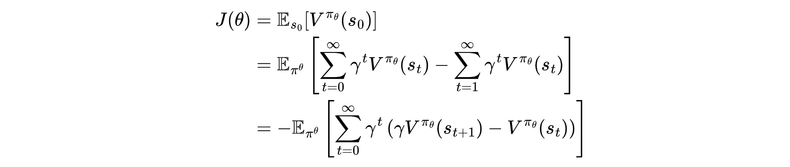

## π

基于新策略

- 的期望形式，可以推导新旧策略的目标函数之间的差距：θ′​

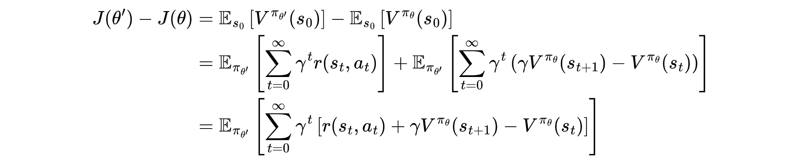

## A (s

- ​, a​)

## A (s

- ​, a​) =

## r(s

- ​, a​) +ππ

令优势函数

- 为 TD 误差，其具体形式为：​θ​θtttttt

## (s

- ​) −

## (s

- ​)

## A (s

- ​, a​)πππ

## γV

## V

## π

## s

## a

- ：表示在策略下，状态采取动作的优势，。​θ​θ​θt+1ttt​θ​t​t′

## J(θ ) −

## J(θ)

## s

即该动作带来的价值相较于状态

- 平均价值的 “额外收益”。公式可改写为：​t

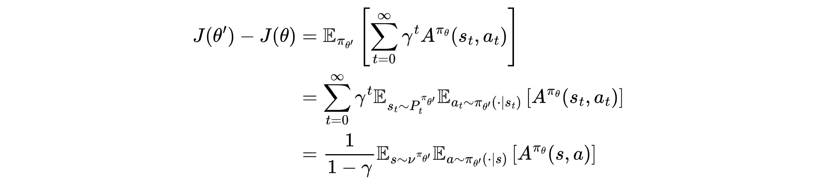

- ∞πtπ

## ν (s) =

## (1 −γ)

- ​(s)

## ∑t=0

- ​ γ P

最后一个等号的成立运用到了状态访问分布的定义：

- ，所t

## E

- ​Eπ​ A (s, a) ≥

## [

## ]

## 0

以只要我们能找到一个新策略，使得

- ，就能保证策略性能​θs∼νπθ′a∼π​(⋅∣s)θ′​1′

## J(θ ) ≥

## J(θ)

单调递增，即

- 为状态访问分布的归一化因子。。1−γ​

## π

但是直接求解该式是非常困难的，因为

- 是我们需要求解的策略，但我们又要用它来收集样θ′​

本。把所有可能的新策略都拿来收集数据，然后判断哪个策略满足上述条件的做法——这显然是不现实的。于是 TRPO 做了一步近似操作，对状态访问分布进行了相应处理。具体而言，

## π

忽略两个策略之间的状态访问分布变化，直接采用旧的策略

- 的状态分布，定义如下替代优​θ

化目标：

## 1

- ′​E​Eπ​(θ ) =

## J(θ) +

- ​ A (s, a)

## [

## ]

## L

- ​θs∼νπa∼π​(⋅∣s)θ​θθ′

## 1 −γ

当新旧策略非常接近时，状态访问分布变化很小，这么近似是合理的。其中，动作仍然用新策

## π

略

- 采样得到，可以用重要性采样对动作分布进行处理：θ′​

## π (a ∣s)

## [ π

## ]

- θ′′

## J(θ) + E

- ​Eπ​(θ ) =​A (s, a)

## L

- ​θs∼νπa∼π​(⋅∣s)θ​θ​(a ∣s)θ​θ

## π

## π

这样，就可以基于旧策略

- 已经采样出的数据来估计并优化新策略了。θ′​θ​

## KL

为了保证新旧策略足够接近，TRPO 使用了

- 散度来衡量策略之间的距离，并给出了整体

的优化公式：

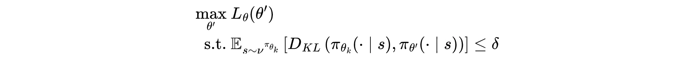

## D

## KL

- 是散度，它用来衡量两个概率分布（在实际情况下，衡量两个策略的输出

其中，

- KL​

## π

## π

## δ

- 是旧策略，是新策略， 是一个预先设定的超参数，它

动作的概率分布）之间的差异。

- θ′​θ​

## KL

- 散度越小，说明两个策略越接近。​

决定了信赖域的大小。

在满足这个约束条件的前提下，我们最大化策略的目标函数，即长期期望折扣奖励。通过这样的方式，我们可以在保证策略性能不会大幅下降的同时，逐步优化策略。​

## 3.2 TRPO 的优化过程​

为了在满足信赖域约束的情况下最大化目标函数，TRPO 使用了一种巧妙的数学变换和优化方法。首先，对策略的目标函数进行泰勒展开，得到一个近似的目标函数。然后，通过精巧的数学推导，将信赖域约束和近似目标函数转化为一个二次规划问题。​实际实现中，直接计算黑塞

## H⁻¹g

## Hx = g

矩阵 H 的逆较为困难，通常用共轭梯度法近似求解

- ，从而得到，再结合步长

缩放（line search）确保约束满足，这一步简化了 TRPO 的工程实现。

具体的数学推导过程比较复杂，这里简单介绍一下关键步骤。

TRPO 在其具体实现中做了一步近似操作来快速求解。为方便起见，我们在接下来的式子中用

## θ

## θ

## k

## θ

- 代替之前的 ，表示这是第 次迭代之后的策略。首先对目标函数和约束在进行泰勒展

​k

- ​k

开，分别用 1 阶、2 阶进行近似：

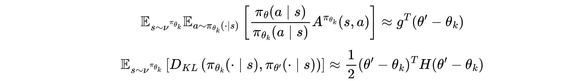

## [ π

## ]

- ​(a∣s)π​E​Eθ′π

## g = ∇

## (s, a)

## H =

- ​A表示目标函数的梯度，

其中，

- θπθ′​ka∼π​(⋅∣s)​s∼νθ​(a∣s)​​kθ​​kθ​k

## H E

- ​(⋅∣s), π​(⋅∣s)

## [

- ​k [KL (

## )]]

- ​ D​ π表示策略之间平均 KL 距离的黑塞矩阵（Hessianθ′s∼νπθθ​​k

matrix）。

于是优化目标变为：

## 1

- ′′′Tk T​ =

## arg

- ​g (θ −

## max

- ​(θ −​) H(θ −​) ≤​)

## s.t.

## θ

## θ

## θ

## θ

## δ

- k+1kk

## 2

- θ′

此时，我们可以用凸优化中的 KKT 条件直接导出上述问题的解：

## 2δ

- −1​ =​ +

## θ

## θ

- ​H

## g

- k+1k−1T​

## g H

## g

## θ′

通过求解这个二次规划问题，我们可以得到策略参数的更新量

- ，从而更新策略。​图 8-3 是

TRPO 的计算架构图，展示了从环境交互收集数据 -> 计算优势函数 -> 构建目标函数，再到通过约束 KL 散度（确保策略更新在一个合理的信任区域内，避免策略更新幅度过大导致性能恶化）来优化策略网络的完整流程。它通过对策略更新进行约束，有效平衡了策略的改进与效果的稳定性，在复杂的强化学习任务中能实现更高效、更稳健的策略学习。

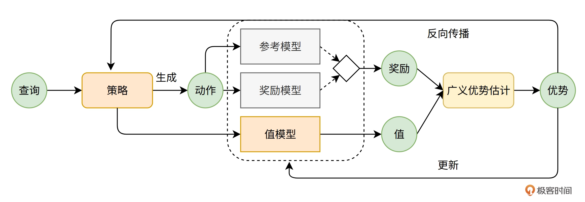

- 图8-3 TRPO架构图

## 3.3 TRPO 与优势函数的关联​

TRPO 虽然主要关注策略更新的稳定性，但它与优势函数也有着密切的联系。在 TRPO 的目

## A(s, a)

标函数近似中，优势函数

- 起着至关重要的作用。正是通过优势函数，我们才能准确地

评估不同动作的相对价值，从而指导策略的更新方向。​由于 GAE 能平衡偏差与方差，TRPO 中几乎均采用 GAE 估计优势函数，而非单步 TD 误差，这使得 TRPO 的梯度估计更准确，进一步提升策略更新的稳定性。可以说，优势函数是连接 TRPO 与 Actor-Critic 等算法的重要桥梁，它为 TRPO 提供了准确的梯度估计信息，保证了 TRPO 在约束条件下能够有效地最大化目标函数。​

## 四、KL 散度的优化

Mila 实验室（Bengio 团队）的最新研究《A Comedy of Estimators》，指出目前主流的 KL 实现方式，在数学上其梯度估计是有偏的。这种偏差不仅会导致训练不稳定，更严重的是会损害模型的泛化能力。而修复方案出奇简单，返璞归真地将 KL 移回奖励并使用朴素 K1 估算器，就能在域外任务上带来近 20% 的性能提升。

## 4.1 KL 散度的计算困境

无论是 TRPO、PPO 以及 GRPO，核心逻辑都是一致的：在最大化奖励的同时，利用 KL 散

## π

## π

度约束策略模型

- 不偏离参考模型。其优化目标通常表示为：ref​θ​​ E​ E

## max

- ​[R(y​, y)] −β KL π​(⋅∣x) ∥π​(⋅∣x)

## (

## )]

- (x,y)∼D [

## β

- ，其中 控制1:Tref​∼π​(⋅∣x)θθy1:Tθ

正则强度。然而在高维序列空间中，KL 散度无法精确计算，需依赖采样估算——常见选择包括朴素的 log-ratio（K1）或低方差近似（K3，Schulman 提出）。

更关键的是 KL 项的放置位置：应作为惩罚从奖励中扣除，还是作为正则项直接加入损失函数？尽管多数开源库（如 VeRL、OpenRLHF、SkyRL）为实现便利，默认将 K3 加入损失函数，但 Bengio 团队近期指出：这可能是一个被忽视的系统性偏差来源。

## 4.2 梯度偏差

判断一种实现方式是否正确，唯一的标准是看它的梯度是否与真实梯度一致。

对于序列级反向 KL 散度，其真实梯度为：

- ​(y​ ∣x)

## [

## ]

## [

## π

- 1:Tθ​E

## E

## ∇

## =

## ∇

- ​KL π​(⋅∣x) ∥π​(⋅∣x) =

## (

## )

- ​ logref​∼π​(⋅∣x)​∼π​(⋅∣x)θθθyy​(y​ ∣x)1:T1:Tθθ

## π

- ​​ref1:T

- π

## log

这一形式本质上是一个以

- 为“伪奖励”的策略梯度，对应 K1 估算器。​θπ​ref​

《A Comedy of Estimators》一文对四种常见组合（K1/K3 × 奖励 / 损失）进行了梯度分析（见表 8-1）。结果令人意外：当前主流方案——将低方差的 K3 估算器直接加入损失函数——虽然训练过程看似稳定，但其梯度在数学上是有偏的；而将 K1 作为奖励的惩罚项，反而是唯一同时满足无偏性与实际训练稳定性的配置。这一发现挑战了工程实践中的普遍假设。

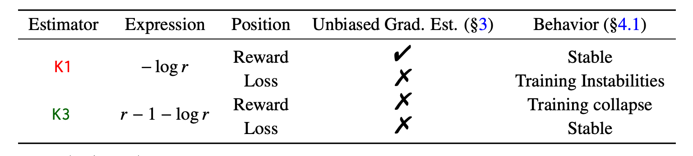

- 表8-1 不同估算器配置的梯度偏差与训练行为总结

## 4.3 为什么 K3 加在损失是错的？

当我们将 K3 估算器直接作为损失项进行反向传播时，其梯度期望会引入一个错误的系数。具体而言：

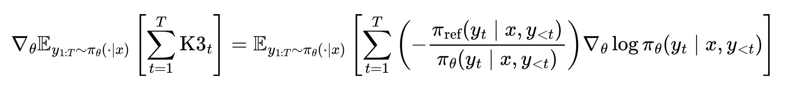

该梯度形式实际上对应于优化前向 KL 散度：

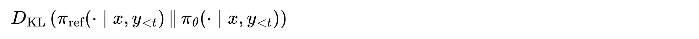

这会导致策略被强制“覆盖”参考模型的整个支撑集，而非聚焦于高奖励区域——与强化学习的目标背道而驰。

为直观验证这一偏差，作者构建了一个极简的参数化自回归模型。如图 8-4 所示，K1 加入奖励的配置（点线）梯度偏差接近于零，而 K3 加入损失（虚线）则表现出显著且持续的偏差，证实了其理论上的不一致性。

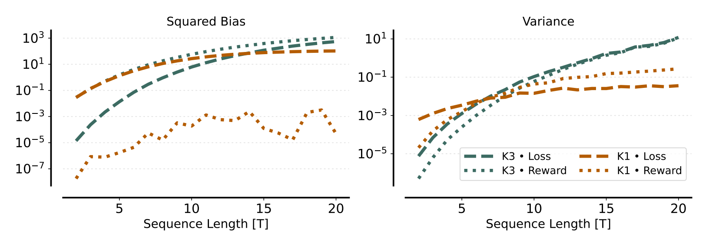

- 图8-4 极简自回归模型下各估算器的梯度偏差（左）与方差（右）

## 4.4 无偏的重要性

为了彻底验证梯度无偏性是性能提升的根本原因，作者设计了一个精妙的控制变量实验：将K3 同时作为奖励中的惩罚项和损失中的正则项，使其梯度偏差相互抵消，从而恢复理论上的无偏梯度。

如图 8-5 所示，一旦梯度被修正为无偏（右侧柱状图），原本因偏差而表现较差的 K3 配置，其性能迅速提升至与 K1 加入奖励相当的水平。这充分说明：估算器的具体形式并不关键，真正决定性能的是梯度是否无偏。

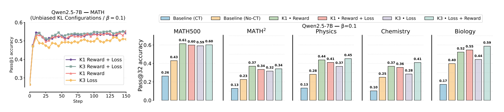

- 图8-5 一旦梯度被修正为无偏（右侧柱状图），K3 的表现立刻追平了 K1

进一步的熵分析揭示了两种配置的行为差异。K3 加入损失的行为类似于前向 KL 正则化，倾向于让策略“覆盖”参考模型的整个支撑集，导致策略熵较高；而 K1 加入奖励则体现出反向 KL的寻求最优奖励特性——在满足 KL 约束的同时，保持较低的策略熵（即更自信的输出），从而更有效地聚焦于高奖励区域。如图 8-6 所示，K1 加入奖励的策略（深色线）在整个训练过程中始终维持更低的平均熵。

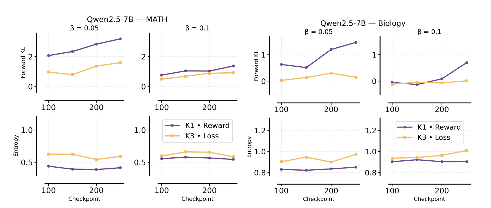

- 图8-6 熵与前向KL分析

正如《A Comedy of Estimators》所警示的：在追求算力与规模的同时，我们不应忽视数学本源的严谨性。

## 总结​

优势函数作为强化学习中的一个核心概念，在解决策略梯度方法的方差问题、提高学习效率和稳定性方面发挥了关键作用。​

Actor-Critic 算法、GAE 和 TRPO 三者对比如表 8-2 所示，具体如下。

- Actor-Critic 算法通过引入 Actor 和 Critic 两个网络，利用优势函数将策略梯度的估计与价值评估相结合，在降低方差的同时，实现了每一步的更新，大大提高了学习的效率和稳定性。其中，TD 误差作为优势函数的估计，巧妙地将 Critic 的价值更新和 Actor 的策略更新联系起来，是 Actor-Critic 算法的核心所在。​

- GAE 通过对多步 TD 误差进行加权求和，在偏差和方差之间取得了更好的平衡，为优势函数提供了更准确的估计。它的引入使得 Actor-Critic 等算法在不同环境下的适应性更强，样本效率更高。​

- TRPO 则聚焦于策略更新的稳定性问题，通过引入 KL 散度约束，确保策略在更新过程中不会偏离旧策略太远，从而保证了策略性能的单调提升。它与优势函数的结合，使得在约束条件下的策略优化更加有效，为复杂环境下的强化学习任务提供了可靠的解决方案。​

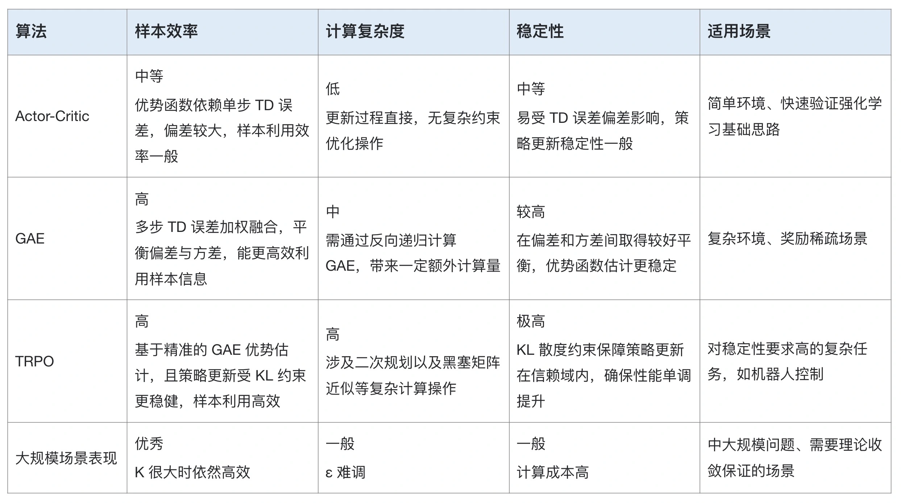

- 表8-2 模型对比

这些算法从不同角度围绕优势函数展开，不断优化强化学习的性能。Actor-Critic 奠定了利用优势函数进行策略优化的基础框架，GAE 提升了优势函数估计的准确性和灵活性，TRPO 则保障了策略更新的安全性和稳定性。它们相互补充，共同推动了强化学习技术的发展和应用。​

在实际应用中，我们需要根据具体的任务场景和环境特点，选择合适的算法和超参数。例如，在样本资源有限、对学习速度要求较高的场景中，可以优先考虑使用 GAE 增强的 Actor-Critic算法；在对策略稳定性要求极高、环境复杂且容易出现性能波动的场景中，TRPO 则是一个更好的选择。​

同时，我们也需要认识到，这些算法仍然存在一些局限性。例如，Actor-Critic 算法可能会受到价值估计偏差的影响；GAE 的性能依赖于超参数 λ 的选择；TRPO 的计算复杂度较高，实现相对复杂等。未来的研究方向将继续围绕如何进一步提高优势函数估计的准确性、降低算法的计算复杂度、增强算法的鲁棒性等方面展开。​

## 思考题​

请比较 Actor-Critic、GAE 增强的 Actor-Critic 以及 TRPO 在样本效率、计算复杂度和稳定性方面的差异，并分析它们各自适用的场景。​希望你通过今天的学习，对强化学习有了更加清晰的认识。如果有任何疑问，欢迎在讨论区留言交流！
