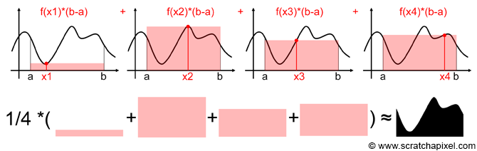
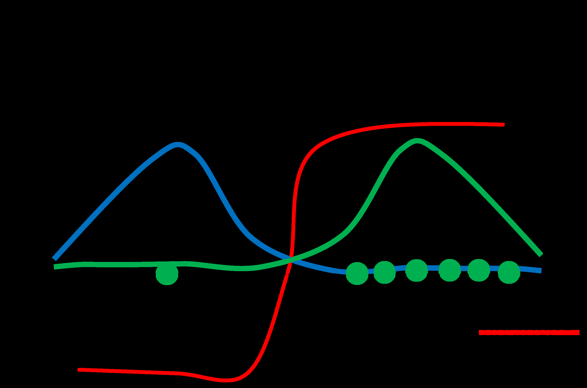
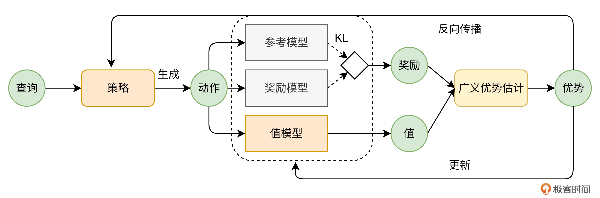
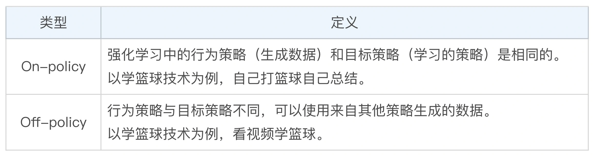
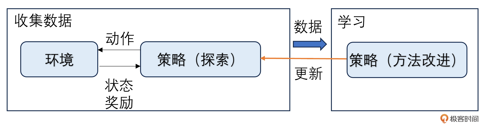
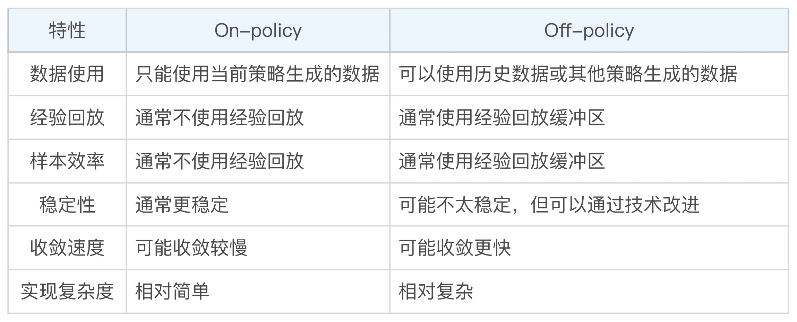
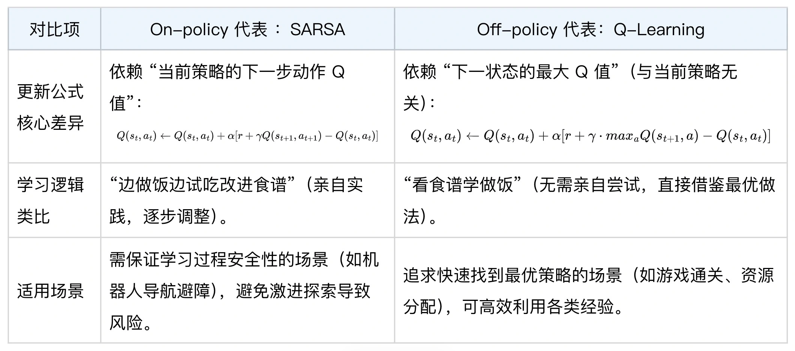
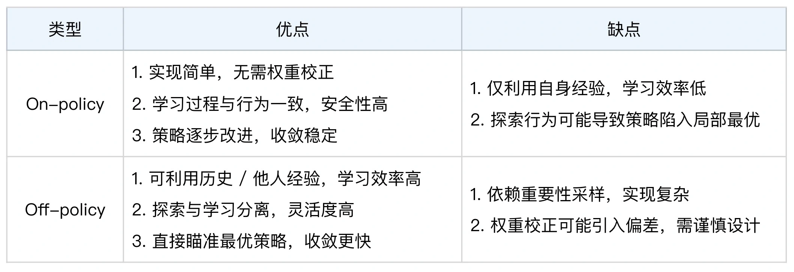
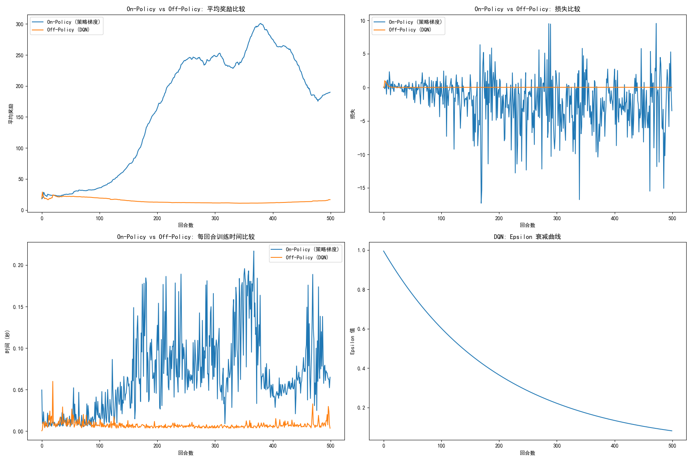

# 09 | 重要性采样：On-policyvs.Off-policy

你好！欢迎来到强化学习的第九讲。在前几节课中，我们掌握了策略梯度的核心逻辑，但在实际应用中仍面临关键挑战：比如直接从目标分布采样困难、旧策略收集的数据难以复用，导致学习效率低或数据浪费。而重要性采样正是解决这类问题的核心技术——它能将“难采样分布的期望计算”转化为“易采样分布的加权计算”，为强化学习中的数据复用与策略优化提供关键支撑。

同时，围绕“数据与策略的关系”，强化学习又分为 On-policy 与 Off-policy 两种核心范式，二者在数据利用效率、探索能力上各有优劣，而重要性采样正是连接 Off-policy 学习的关键桥梁。本节课我们将从重要性采样的原理切入，逐步解析其在强化学习中的应用，以及两种学习范式的差异与适用场景。

通过本节课的学习，你将能够：

1. 理解重要性采样（Importance Sampling）的核心原理：掌握其通过“提议分布 + 样本加权”解决难采样问题的逻辑，以及大数定律在其中的支撑作用。

2. 明晰重要性采样在强化学习中的价值：学会如何利用它复用旧策略数据、支持 Off-policy 学习，提升数据利用效率。

3. 区分 On-policy 与 Off-policy 范式：掌握二者在“数据来源与当前策略关系”上的核心差异，以及各自的优缺点（如 On-policy 简单直接但交互频繁，Off-policy 高效复用数据但需处理方差问题）。

4. 掌握策略探索的实现逻辑：了解确定性策略与随机性策略的区别，以及 ε- 贪心等为策略增加探索能力的具体方法。

## 一、重要性采样

## f(x)

## p(x)

在很多实际问题中，我们常常需要计算某个函数

- 关于概率分布的期望，即：

## E

- ​[f(x)] =

## f(x)p(x)dx

## p(x)

## ∫

- 。然而，直接从概率分布中进行采样有时是非常困难，

x∼p

## p(x)

- 的形式可能极其复杂，难以直接从中生成样本。此时，重要性

甚至是不可行的。比如，采样就派上用场了。

重要性采样是一种高效的蒙特卡洛方法变体，旨在通过改变采样分布来减少方差，从而提高模拟效率。

在正式展开重要性采样之前，我们需要先明确其核心理论支撑——大数定律。这是因为重要性采样本质上是一种基于“样本均值估计期望”的蒙特卡洛方法，而大数定律正是“样本均值能够逼近真实期望”的数学保证。简单来说，若没有大数定律的支撑，我们从提议分布中采样并计算加权均值的操作，就无法被证明是对目标分布期望的有效估计。

## 1.1 大数定律：重要性采样的理论基础

为什么要先讲大数定律？我们可以从“重要性采样的目标”与“大数定律的作用”之间的逻辑关系来理解。

## E

## f(x)

## p(x)

- ​[f(x)]

重要性采样的核心目标：计算函数

- 关于难采样分布的期望。由于无x∼p

## p(x)

## q(x)

法直接从

- 采样，我们退而求其次，从易采样的提议分布（Proposal Distribution）

## p(x)

中采样，再通过加权将这些样本“映射回”对

- 期望的估计。

- 补充信息：数学、统计学等等学科发展的历史过程中，一些数学概念在不同分支有了不同的命名。比如，自变量和因变量在一些统计学教材中被叫作解释变量（Explanatory Variable）和响应变量（Response Variable）。有时候，一些名称在初看的时候不太容易理解其含义，比如这里提到的“提议分布”。你在一开始学习的时候对这些概念做到理解其意义即可，无需纠结其命名。

大数定律的关键作用：无论从哪个分布采样，我们最终都是通过“样本均值”来估计“分布期望”。大数定律告诉我们：当样本量足够大时，独立同分布（i.i.d.）样本的均值会以概率 1 收敛到该分布的真实期望。这为“用提议分布的加权样本均值估计目标分布期望”提供了理论保证

## E

## q(x)

- ​[f(x)]

——只要我们能从

- 中采到足够多的 i.i.d. 样本，其加权均值就会逼近。x∼p

让我们看看大数定律在做一件什么事情。

## q(x)

- ​, x​, ..., x

## g(x)

## x

回顾大数定律的核心结论：对于来自分布

- 的 i.i.d. 样本，其函数的12N​1 ∑i=1N

## E

- ​[g(x)]​ g(x​)

样本均值

- 会收敛到。x∼qiN​

## E

## E

## g(x)

- ​[g(x)] =​[f(x)]

而重要性采样的本质，就是构造一个合适的

- ，使得。通过x∼qx∼pp(x)p(x)

## g(x) = f(x) ⋅

## g(x)

## f(x)

## w(x) =

数学推导可知，当

- 时（即是与重要性权重q(x)q(x)​​

的乘积），恰好满足：

## p(x)

## ∫

## ∫

## ∫

## E

## Ex∼p

## g(x)q(x)dx =

## f(x) ⋅

## f(x)p(x)dx =

- ​[g(x)] =​ ⋅

## q(x)dx =

- x∼q

## q(x)

- 1 ∑i=11 ∑i=1p(x​)NN

## E

- ​[f(x)]​ g(x​) =​ f(x​) ⋅会收敛到——

此时，根据大数定律，

- ix∼piiq(x​)NN​​​i

这正是重要性采样的核心公式。

弱大数定律（大数定律有多个版本，其中辛钦大数定律是弱大数定律中最常用的一种，也是重要性采样依赖的核心形式）：

## {X

- ​}

## E(X

- ​) =

对于一个相互独立、服从同一分布的随机变量序列

- ，且具有数学期望nk

## (∣∣Xn

## [Xn]∣∣

## μ (k = 1, 2, …)

## ε > 0

- ​ −E​ < ε =

## 1

## lim

## )

- ​ P。对于任意，则恒有。其n→∞​​1 ∑k=1Pn

## =

## X ⟶

- ​ X

## X

## μ

## μ

- 依概率收敛于 ，即

中，

- 。kn​​​

- P

## ⟶

这里，“依概率收敛”是统计学中的一个重要概念，对应上面公式上的

- 。一个随机变量序列​

## (X

- ​)

## X

## X

## X

- 依概率收敛到某一个随机变量，指的是和之间存在一定差距的可能性将n n≥1​n​

## n

会随着 的增大而趋向于 0。

## {X

- ​}

辛钦大数定律所做的，简单来讲就是求：一个随机变量序列

- 的均值，就能够得到n

## {X

- ​}

## {X

- ​}所在分布的期望，那么这个是怎么得到的呢？这里举一个很简单的例子：掷硬nn

币。

在掷硬币游戏中，我规定硬币的正面为 1，反面为 0，因此在一次掷硬币后，我必然会得到 1

- ​ =

## 1

- ​ =

## 0

## X

## X

或者 0 的结果。若我第一次掷硬币为正面，那么

- ；第二次为反面，那么；12​ =

## 0

- ​ =

## 1

## X

## X

第三次为反面，那么

- ；第四次为正面，那么……就这样，我得到了一个关于34

## X

## X

随机变量

- 的序列。这个例子很简单，不用计算我们都知道的均值是 0.5，即掷硬币​k​k

游戏中所对应的数据分布的期望就是 0.5。

这里掷一次硬币的过程，就是采样；这一个随机变量序列就是所得到的样本，或者称之为数据；大数定律就能够让我们在不知道样本分布的情况下求出样本的均值（数字特征）。

因此，大数定律是重要性采样的“信任基础”：它确保了我们从提议分布中采到的样本，经过加权后形成的均值，能够可靠地逼近我们真正想要计算的目标期望。如果没有大数定律，我们就无法确定“增加样本量是否能提升估计精度”，重要性采样的实用性也会失去理论依据。

## 1.2 重要性采样在做一件什么事情

回忆一下我们在前面课程介绍蒙特卡洛的时候，曾经介绍过数值计算定积分的思路，即将面积细分为小矩阵，然后求和，细分越多越精确。

如图 9-1 所示，红点是采样点，基于其占所有点的比例，乘以对应的方形面积，就可以得出函

## Eˉ

## f(x)

## =

## (b −

数

- 的积分的近似值。那么采样后求平均，写成求和公式：

- 1 ∑i=1N

## a)

- ​ f(X​)。其原理来自于“强大数定律”：iN​

- N

## (

## )

- b

## 1

## ∑

## ∫

## =

- ​g(X​) =​ f(x)dx

## lim N

## 1

## Pr

- i​​N→∞ai=1

- f(X​)

## g(X

- ​) =

## p(x)

- i是概率密度函数 pdf（probability density function）。 也就是

其中，

- ，ip(X​)​i

## p(x)

## f(X)

## x

## N

说，在

- 的分布下，抽取 样本，当足够大时，可以采用均值来近似的积分：

- b

## g(x

- ​) + g(x​) + ⋯+ g(x​)

## ∫

- 12N​ f(x)dx ≈​

## N

- a



- 图9-1 重要性采样示例（出自Scratchapixel 的《Monte Carlo Methods in Practice》）

- 1

## p(x) =

如图 9-1 的例子是选取了采样函数为均匀分布

- 的情况。一般来说，均匀分布计算b−a​

的效率不会高，需要另外选取一个合理的分布提高计算效率，例如高斯函数在峰值附近积分贡献比较多，应该赋予更多的采样。这就是重要性采样的概念由来——采样要按“重要性”来进行，不应该“平等对待”。

为了帮助你进一步理解重要性采样的思想，重要性采样对“原分布”和“新分布”的要求，尤其是

- p(x)

## g(x) = f(x) ⋅

理解重要性采样中的修正因子

- 的物理意义，我们这里借用李宏毅老师讲q(x)​

PPO 中的一个生动的例子。

- ​[f(x)]

## f(x)

## E

## p

如图 9-2 所示，我们希望计算

- ，即在分布 计算的期望。从直观上看，虽x∼p

## f(x)

- ​[f(x)]

## p

## E

然

- 的正负对称，但是由于分布 集中在坐标轴左侧，因此最终积分值应x∼p

## q

该是一个负值。那么，是不是我们随便找一个分布 就可以做重要性采样呢？

## p(x)

## q(x)

假设

- 和相差很大，如图中蓝色曲线和绿色曲线所示。

如果，我们的采样不够充分，则：

## p(x)

## f(x)

## x

- 如果我们按定义根据采样，那么很大概率采样到的都是坐标轴左侧的 ，注意​[f(x)]

## E

- 在这一区间为负，因此依此计算出的大概率也是负值。x∼p

## q(x)

## f(x)

## x

- 如果我们按采样，那么很大概率采样到的都是坐标轴右侧的 ，而在这一区间​[f(x)]

## E

- 为正，因此最终计算出的为正值。x∼p

## p(x)

## q(x)

可以看出两者相差还是挺大的，原因就在于

- 和分布差距过大，且采样不充分。

那么，如果我们做了充分采样的话，重要性采样是如何将结果扭转回来的呢？

## q(x)

- 如果我们按采样，当采样足够充分的情况下，那么就会采到左边的点，如图中左侧的

## q

- 绿色点。虽然按照 采样，左边的点占比比右边要少很多（图中左边只采到 1 个点，右边p(x)采到 6 个点），但是要注意，重要性采样的权重为，也就是说，左边的点对应的权重要q(x)​

## p

## q

- 远大于右边的点（你可以根据 和 的形象一眼看出），因此采样在左侧的样本虽然少，但

## p(x)

- 是最终还是可以将目标函数值拉向负值，逼近按采样的结果。



- 图9-2 重要性采样的应用（出自台湾大学李宏毅教授讲PPO的PPT）

重要性采样能够有效缓解原分布带来的较大偏差，这一过程中修正因子发挥着关键的调节作

## f

用。其核心实质在于，通过两个不同分布对目标函数 进行加权处理。

该方法的核心价值在于：当原分布下的期望求解存在困难时，可将问题转化为在另一个更易处理的分布下进行计算。值得注意的是，重要性采样的有效性高度依赖于新旧两个分布的相似性，二者尽量不要差异过大。

## q(x)

重要性采样的核心思想是引入一个相对容易采样的概率分布

- （称为提议分布，proposal

## q(x)

## i = 1, 2, ⋯, N

## x

distribution）。我们从

- 中进行采样，得到样本，，然后通过对这些​i

## p(x)

样本基于修正因子进行加权，来近似计算关于

- 的期望。即，从一个更“重要”的分布中采

样，而不是从原始分布中采样。

总结一下：

- p(x​)​ =

## p(x)

- i

## x

## w

我们对每个样本

- 赋予权重，这样，关于的期望可以近似表示为：​iiq(x​)​i

- NN

## 1

## 1

## p(x

- ​)

## ∑

## ∑

- i

## E

- ​f(x​) =​f(x​)​[f(x)] ≈​wx∼piii

## q(x

- ​)​​​

## N

## N

- ii=1i=1

## p(x)

通过这种方式，我们将从难以采样的分布

- 上的期望计算，转换为从容易采样的分布

## q(x)

- 上的加权期望计算。

## f(x) = x2

为了更直观地理解，我们来看一个简单的例子。假设我们要计算函数

- 在区间

## [0, 1]

## p(x) = 1, x ∈[0, 1]

- 上关于均匀分布的积分（这里积分等价于期望，因为均匀分布的12

## ∫0

- ​ x dx

概率密度函数为常数）：

- 。

## q(x) = 2x, x ∈[0, 1]

## [0, 1]

这里我们使用重要性采样，选择提议分布

- （这是一个在上的三

角分布，相对容易采样）。

- p(x​)1​ =​ =

## q(x)

- i

## N

## x

## w

从

- 中采样得到个样本，然后计算权重，最后计算近似值：​iiq(x​)2x​i​i

- NN1

## 1

## 1

## 1

## ∫

## ∑

## ∑

- 22​ =​ x dx ≈​x​xii

## 2x

## 2N

## N

- ​​​​​i0i=1i=1

- 1

## N

随着

- 的增大，这个近似值会越来越接近真实值 。​3

- 重要性采样不仅是强化学习领域的核心技术，亦是机器学习中处理深度模型（如 CVR、LTV 预测模型）延迟反馈问题的关键手段。通过对正负样本进行合理加权，该方法既能确保模型及时学习到最新数据的信息，又能最大程度缩小模型训练数据分布与真实业务数据分布之间的偏差。

## 1.3 方差缩减的条件

## q(x)

重要性采样的有效性取决于所选择的替代分布

- 。为了使重要性采样有效地减少方差，需

要满足以下条件：

## p(x) > 0

## q(x) > 0

1. 支撑条件：如果，则。这确保了所有在原始分布下可能的事件在新分布下也是可能的。

## q(x)

## p(x)

## f(x)

2. 应该有比更重的尾部，特别是在取值较大的区域。这确保了尾部行为：在重要区域有足够的样本。

## q(x)

## ∣f(x)∣p(x)

3. 方差最小化：理论上，最优的应该与成比例。然而，这通常难以直接实现，因为它需要预先知道我们试图估计的积分。

## f(x)

## q(x)

## X

- 是被用来对从提议分布采样得到的样本进行“加工”的函数​i

## n

## q

为了理解这一点，我们可以分析重要性采样估计量的方差。假设我们使用 个从分布 中抽

- 1 ∑i=1

## I^

- p(X​)n

## =

- ​ f(X​)​, X​, … , X​[f(X)]i

## X

## E

取的样本

- 来估计，得到估计量：。这12npiq(X​)n​​​i

个估计量的方差为：

## 1 (

- 2q [(

## ]

## )2)

## 1

## p(X))

## p(X))

- q (

## I^

## Var( ) =

- ​ Var

## f(X)

## f(X)

## −E

- ​[f(X)]

## (

## =

## E

- p

## q(X)

## q(X)

- ​​​​​

## n

## n

## q(x) ∝∣f(x)∣p(x)

通过变分法可以证明，当

- 时，上述方差达到最小。具体来说，最优的∣f(x)∣p(x)∗

## q(x)

## q (x) =

- 应为：。∣f(y)∣p(y)dy∫​

## ∣f(y)∣p(y)dy

## ∫

然而，计算分母

- 本身就是一个积分问题，通常与我们原始要求解的问题复杂

度相当。这就形成了一个循环：为了高效计算积分，我们需要知道另一个可能同样难以计算的积分。

## q^∗

- ​ (x)

在实践中，由于最优分布

- 难以直接获得，我们通常采用启发式方法来构造近似最优的

重要性采样分布。其中一种常用的方法是基于最大值原理。

- ∣f(x)∣p(x)

## q(x)

最大值原理的核心思想是：寻找一个分布

- ，使得权重函数在整个样本空间中尽q(x)​

可能均匀。这样可以避免某些样本点的权重过大，从而减少估计量的方差。

- 22f (x)p (x)

## sup

## g(x)

## sup

具体来说，最大值原理建议选择

- 使得：最小化，其中，表示上确界2xq (x)​

（supremum），即函数的最大值。

## 二、重要性采样在强化学习中的应用

在理解了重要性采样的核心原理——通过提议分布与加权校正解决难采样问题，以及大数定律为其提供的理论支撑后，我们自然会思考：这一强大的数学工具，如何落地到强化学习的实际问题中？

在强化学习中，策略优化的核心是基于数据估计价值函数或计算策略梯度，但直接用当前策略采样效率低下，且大量旧策略收集的数据若直接丢弃则造成严重浪费。此时，重要性采样恰好成为连接“理论方法”与“强化学习实践”的关键桥梁。

接下来，我们将聚焦重要性采样在强化学习中的具体应用：先剖析其解决“数据复用”与“策略更新不匹配”问题的核心动机，再以业界广泛使用的 PPO 算法为例，深入拆解其如何借助重要性采样实现稳定、高效的策略优化，让我们从理论走向实践，理解这一技术的实际价值。

## 2.1 核心动机：为何需要重要性采样？

## π

在强化学习中，我们经常需要估计策略 的价值函数或者计算策略梯度。例如，在计算策略梯度时，我们通常需要对环境中的“状态 - 动作”对进行采样，然后根据采样得到的数据来估计梯度。

重要性采样的核心动机源于强化学习中两类核心矛盾：

## π

- 效率矛盾（On-policy 场景）：直接按当前策略 采样时，若环境稀疏奖励或状态空间巨大，采样成本极高，难以快速估计价值函数 / 策略梯度；

## π

## π

- 数据矛盾（Off-policy 场景）：强化学习中常需迭代更新策略（从到），若直接丢oldnew​​

## π

## π

- 弃收集的数据，会造成严重浪费；但直接复用又会因采样分布（）与目标分布（oldold​​

## π

- ）不匹配导致估计偏差。 而重要性采样恰好通过权重校正解决了分布不匹配问题，既new​实现了旧数据复用，又保证了估计的无偏性（大数定律支撑），成为兼顾效率与数据利用的关键工具。

## π

## π

假设我们有一个旧策略

- 收集的数据，而我们现在要优化的是新策略。我们可以使用oldnew​​

重要性采样来利用旧策略的数据。具体来说，在计算策略梯度时，我们需要计算关于新策略

## π

## πold

- 的期望，但我们的数据是基于旧策略采样得到的。

new

- ​

- ​(a∣s)π

## (s, a)

## w =

- new

对于一个“状态 - 动作”对

- ，重要性采样权重为：。这样，我们就可以使用​(a∣s)π​old

旧策略收集的数据来近似计算关于新策略的期望，从而更新新策略。

## 2.2 典型应用：以 PPO 算法为例

传统策略梯度方法（如 REINFORCE）的核心瓶颈在于数据一次性使用和更新幅度过大导致崩溃，本质是未解决新旧策略分布不匹配与更新约束的平衡。TRPO 通过“置信区域（KL 散度约束）”解决了稳定性问题，但需求解复杂的二次规划，工程实现难度大。

为兼顾“稳定更新”与“简单实现”，PPO 放弃了 TRPO 的置信域硬约束，转而利用重要性采样 +

- ​(θ)

## π

## r

裁剪机制：先用旧策略

- 收集数据（复用数据，解决效率问题），再通过重要性权重θtold​​​(θ)

## r

校正新旧策略的分布差异，最后用 clip 函数限制

- 的范围（替代 TRPO 的 KL 硬约束），t

实现了“软约束”下的稳定优化。

在大语言模型场景下，PPO 核心迭代逻辑，如图 9-3 所示，具体如下。

1. 首先，策略模块根据用户的查询生成动作并与环境交互；

2. 接着，奖励模型依据交互结果生成奖励信号，同时值模型输出对应的值估计，二者结合通过广义优势估计（GAE）计算出优势值，为策略优化提供关键依据；

3. 在策略更新阶段，不仅会利用优势值引导优化方向，还会引入参考模型并通过 KL 散度约束新旧策略的差异，避免更新幅度过大导致训练不稳定；

4. 最后，通过反向传播将优化信号反馈至策略模块，完成一次策略迭代，形成“生成动作 - 评估优势 - 约束更新 - 反向传播”的闭环学习流程。



- 图9-3 PPO架构图

PPO 的核心目标函数为：

- ​(a ∣s)​(a ∣s)old [

## (π

## (π

## π

## π

- θθ

## E

- π​(θ) =​ min

## (s, a),  clip

- ​, 1 −ϵ, 1 + ϵ

## J

- ​Aθτ∼πold​PPO​​(a ∣s)​(a ∣s)θ​​θoldθold​

其中：

- ​(a ∣

## s)

## π

## s

## a

- 是当前策略（我们要优化的策略），在状态 选择动作 的概率；θ​(a ∣

## s)

## π

## s

## a

- 是旧策略（用于生成训练数据的策略），在状态 选择动作 的概率；θold​π

## (s, a)

## A

- 是在旧策略下估计的优势函数；θold​​​(a∣s)π​(θ)

## r

- 是重要性权重，表示同一个动作在新旧策略下的概率比例，我们通常记为；θt​(a∣s)π​θold​

## clip(r

- ​(θ), 1 −

## ϵ, 1 + ϵ)

- ​(θ)

## [1 −ϵ, 1 + ϵ]

## r

- 是将比率限制在范围内的裁剪函数。tt

## π

## π

在 PPO 算法中，想要估计当前策略

- 下的期望回报（目标分布为，但只有来自旧策略​θ​θ​(a∣s)πθ

## π

## π

- 的样本），此时提议分布为，我们使用比率来校正这种分布不匹配。

θ

- θ​(a∣s)πoldold​​​θ​​old​

重要性采样在强化学习中的应用非常广泛，它使得我们能够复用之前收集的数据，提高学习效率，同时也为 Off-policy 学习提供了基础。

## 三、On-policy vs. Off-policy

现在，我们暂时从繁杂的数学中脱身，重新来讨论一下强化学习的学习范式。在下面的讨论中，你可以结合自身学习技能的例子加以理解。

在强化学习中，根据学习过程中使用的数据与当前正在优化的策略之间的关系，我们可以将学习算法分为 On-policy 和 Off-policy 两类（表 9-1）。



- 表9-1 On-policy和Off-policy的定义

## 3.1 策略需要有探索能力（随机性）

抛开强化学习算法的细节，几乎所有强化学习算法都需要做两件事（如图 9-4 所示）：

1. 收集数据（Data Collection）：与环境交互，收集学习样本；

2. 学习（Learning）：学习收集到的样本中的信息，提升策略。



- 图9-4 强化学习算法的两个任务

强化学习算法的最终目标是学习每种状态下最优的动作。而在训练过程中，收敛（到最优策略）前的当前策略并非最优，所以它提供的动作并非最优。为了找到动作空间里潜在的最优动作，算法必须尝试当前策略认为的非最优的动作，因此 RL 算法中的策略需要有随机探索（Exploration）的能力。

## 3.2 策略如何做到随机探索

强化学习算法中的策略分为确定性（Deterministic）策略与随机性（Stochastic）策略。

## π(s)

## π : S →(A)

## S

## A

- 确定性策略为一个将状态空间映射到动作空间的函数，即。它

## ε −greedy

- 本身没有随机性质，因此通常会结合或往动作值中加入高斯噪声的方法来增加策略的随机性。

## π(A

- ​∣S​)​ ∈

## S

## S

## A

- 随机性策略是条件为情况下，动作的条件概率分布。它本身带有ttt​t随机性，获取动作时只需对概率分布进行采样即可。

为了简化讨论，我们仅讨论 Q 函数构造的确定性策略及其增加随机性的方式。用 Q 函数构造

## π(s) = arg max

- ​ Q(s, a)，即选取 Q

确定性策略是一种常见的策略形式，其具体方式是：

- a

值最大的动作为最优动作。(注意：一般只有在动作空间离散的情况下采用这种策略，若动作空间是连续的，上式里对动作的最大化操作，需通过复杂的优化求解过程来实现 。）

## ϵ

可用 -greedy 方法将上述确定性策略改造成具有探索能力的策略：

## {arg max

- ​ Q(s, a),

## with probability 1 −ϵ

- a​(s) =

## π

- ϵ

## random action,

## with probability ϵ

- ​​

## 1 −ϵ

## π(s)

## ϵ

即，以 的概率选择随机动作（Exploration），以

- 的概率按照确定性策略选取动

作。

## 3.3 On-policy

明确了策略需要探索能力后，接下来的核心问题是：算法应如何利用探索中收集的数据来优化策略？这就涉及到“数据来源”与“待优化策略”的关系——On-policy 正是其中一种直接绑定的模式。

On-policy 算法意味着学习过程中使用的数据是由当前正在优化的策略生成的。也就是说，我们在与环境交互获取数据时，直接使用当前的策略来选择动作。例如，很多策略梯度算法（如REINFORCE）就是典型的 On-policy 算法。

在 On-policy 学习中，策略的更新直接基于当前策略产生的经验，这使得学习过程相对简单直接。因为数据和策略是紧密相关的，所以策略的更新能够很好地反映当前策略的性能。

然而，这种方式也存在一些局限性。由于每次更新都需要新的采样数据，这意味着我们需要频繁地与环境进行交互，这在实际应用中可能非常耗时，十分昂贵，尤其是在环境复杂、交互成本高的情况下。此外，On-policy 算法对策略的探索能力相对较弱，因为它总是基于当前策略进行采样，可能陷入局部最优解。

## 3.4 Off-policy

与 On-policy 将“数据收集”和“策略优化”绑定在同一策略上不同，Off-policy 提出了一种更灵活的思路：将两者分离，通过不同策略分别承担探索与学习的任务。

强化学习算法中需要带有随机性的策略对环境进行探索获取学习样本，一种视角是：Off-policy 的方法将收集数据作为 RL 算法中单独的一个任务，它准备两个策略：行为策略（behavior policy）与目标策略（target policy）。

行为策略是专门负责学习数据的获取，具有一定的随机性，总是有一定的概率选出潜在的最优动作。而目标策略借助行为策略收集到的样本以及策略提升方法提升自身性能，并最终成为最优策略。Off-policy 是一种灵活的方式，如果能找到一个“聪明的”行为策略，总是能为算法提供最合适的样本，那么算法的效率将会得到提升。

Off-policy 算法则允许使用与当前正在优化的策略不同的策略生成的数据来进行学习。这些数据可以是之前收集的，也可以是由其他策略生成的。重要性采样在 Off-policy 学习中起着关键作用，它使得我们能够利用这些不同策略产生的数据来更新当前策略。

例如，Q 学习是一种经典的 Off-policy 算法。在 Q 学习中，我们维护一个 Q 值表（或者 Q 网络），通过观察到的状态 - 动作对以及相应的奖励来更新 Q 值，而选择动作时可以使用不同于

## ϵ

当前最优策略的探索策略（如 -greedy ）。在更新 Q 值时，我们可以使用之前探索过程中收集的数据，而这些数据不一定是由当前正在优化的最优策略产生的。

Off-policy 算法的优点在于，它能够更高效地利用数据，因为可以复用之前收集的数据，减少了与环境交互的次数。同时，由于可以利用不同策略产生的数据，Off-policy 算法具有更强的探索能力，能够更好地避免陷入局部最优解。

然而，Off-policy 算法也面临一些挑战，比如重要性采样权重可能会带来方差增大的问题，因为权重的计算依赖于两个策略的比值，如果这个比值变化较大，会导致采样的方差增大，影响学习的稳定性。

## 3.5 On-policy 和 Off-policy 对比

通过分别介绍 On-policy 与 Off-policy 的核心逻辑，我们可以发现两者在策略设计、数据利用、实现复杂度等方面存在显著差异。以下将从多个维度对两者进行系统对比。

On-policy 和 Off-policy 主要区别如表 9-2 所示，具体如下。



- 表9-2 On-policy和Off-policy主要区别

On-policy 只有一个“执行 + 学习”的策略。智能体在探索（如随机试错）和利用（如选择已知最优动作）时，都基于同一个策略，且学习过程直接优化该策略。例如，通常用来和 Q-

## a

Learning 对比的 SARSA 算法中，下一步动作（

- ）必须遵循当前策略（如 ε- 贪心策略），t+1​

并基于此更新 Q 值。

Off-policy 区分“行为策略”和“目标策略”：

- 行为策略：用于生成经验（如随机探索、专家演示）；

- 目标策略：通过经验学习并优化的最终策略（通常是最优策略）。

例如，Q-Learning 中，更新 Q 值时不依赖当前策略的下一步动作，而是直接取“下一状态的最大 Q 值”（隐含最优策略假设），与当前行为无关。

探索与利用的处理：

- On-policy：探索和利用完全融入当前策略（如 ε- 贪心策略中，以 ε 概率随机探索，1-ε 概率利用当前最优），学习过程受探索行为直接影响，更注重“边做边学”的安全性。

- Off-policy：探索（行为策略）与学习（目标策略）分离，可通过更激进的探索收集经验，且不影响目标策略的优化，更灵活高效。

关键技术依赖：

- On-policy：无需复杂的权重校正，直接用当前经验更新策略，实现简单。

- Off-policy：通常依赖重要性采样（Importance Sampling）技术——当经验来自于目标策略不同的行为策略时，通过权重校正消除分布偏差，确保学习有效性，但实现更复杂。

为了更直观地理解两者的差异，我们可以结合具体算法实例进一步说明（如表 9-3 所示）。同时，从实用性角度出发，On-policy 与 Off-policy 的优缺点也十分鲜明，可总结如表 9-4。



- 表9-3 经典算法与实例对比



- 表9-4 优缺点对比

On-policy 是“边做边学，优化自己”；Off-policy 是“看别人做，优化目标”——前者经验来源于策略绑定，后者经验来源于策略分离，直接追求最优。

接下来我们对比 On-policy（策略梯度）和 Off-policy（DQN）两种算法在相同环境下的性能表现。

该代码实现了以下功能：

1. On-policy 算法实现：策略梯度（Policy Gradient）算法；

2. Off-policy 算法实现：深度 Q 网络（DQN）算法；

3. 训练和比较：在相同环境下训练两种算法并比较它们的性能；

4. 可视化结果：绘制奖励曲线、损失曲线、训练时间等比较图表；

5. 结果保存：保存训练结果和模型参数。

如图 9-5 所示，在 CartPole-v1 任务上：

- 如果追求最终性能，On-policy 策略梯度算法是更好的选择，它能获得更高的平均奖励。

- 如果追求训练速度，Off-policy DQN 算法更有优势，它能更快地完成训练过程。

- 从样本效率角度看，策略梯度方法略占优势，表明它在利用训练时间方面更有效。

这些结果符合两种算法的理论特点：策略梯度方法通常能获得更好的最终性能但训练较慢，而DQN 等 Off-policy 方法训练速度快但可能需要更多调优才能达到最佳性能。



- 图9-5 On policy vs. Off policy

```sql
import torch
import torch.nn as nn
import torch.optim as optim
import torch.nn.functional as F
from torch.distributions import Categorical
import numpy as np
import gymnasium as gym  # 替换原来的gym库
from collections import deque
import matplotlib.pyplot as plt
import time
import os
import random
# 确保中文显示正常
plt.rcParams["font.family"] = ["SimHei", "WenQuanYi Micro Hei", "Heiti TC"]
plt.rcParams["axes.unicode_minus"] = False  # 解决负号显示问题
# ===================== On-policy 算法：策略梯度 =====================
class PolicyNetwork(nn.Module):
   def __init__(self, state_dim, action_dim, hidden_dim=64):
       super(PolicyNetwork, self).__init__()
       self.fc1 = nn.Linear(state_dim, hidden_dim)
       self.fc2 = nn.Linear(hidden_dim, hidden_dim)
       self.fc3 = nn.Linear(hidden_dim, action_dim)
       self.activation = nn.Tanh()
   def forward(self, x):
       x = self.activation(self.fc1(x))
       x = self.activation(self.fc2(x))
       logits = self.fc3(x)
       return logits
   def get_action(self, state):
       # 处理可能的元组状态（Gym新版本）
       if isinstance(state, tuple):
           state = state[0] if len(state) > 0 else state
       # 确保状态是numpy数组
       if not isinstance(state, np.ndarray):
           state = np.array(state, dtype=np.float32)
       # 处理标量状态
       if state.ndim == 0:
           state = state.reshape(1)
       # 转换为张量并添加批次维度
       state_tensor = torch.from_numpy(state).float().unsqueeze(0)
       # 获取动作分布并采样
       logits = self.forward(state_tensor)
       action_probs = torch.softmax(logits, dim=1)
       action_dist = torch.distributions.Categorical(action_probs)
       action = action_dist.sample()
       return action.item(), action_dist.log_prob(action)
class PolicyGradient:
   def __init__(self, state_dim, action_dim, learning_rate=0.001, gamma=0.99, us
       self.policy_net = PolicyNetwork(state_dim, action_dim)
       self.optimizer = optim.Adam(self.policy_net.parameters(), lr=learning_rat
       self.gamma = gamma
       self.rewards = []
       self.log_probs = []
       self.use_baseline = use_baseline  # 使用基线减少方差
   def select_action(self, state):
       try:
           action, log_prob = self.policy_net.get_action(state)
           self.log_probs.append(log_prob)
           return action
       except Exception as e:
           print(f"选择动作时出错: {e}")
           print(f"当前状态: {state}, 类型: {type(state)}, 形状: {np.shape(state)}"
           raise
   def calculate_discounted_returns(self):
       discounted_returns = []
       running_sum = 0
       for r in reversed(self.rewards):
           running_sum = r + self.gamma * running_sum
           discounted_returns.insert(0, running_sum)
       # 转换为张量
       discounted_returns = torch.tensor(discounted_returns)
       # 使用基线（平均值）减少方差
       if self.use_baseline:
           discounted_returns = discounted_returns - discounted_returns.mean()
       # 标准化回报（仅当标准差足够大时）
       std = discounted_returns.std()
       if std > 1e-7:
           discounted_returns = discounted_returns / std
       return discounted_returns
   def update_policy(self):
       discounted_returns = self.calculate_discounted_returns()
       loss = 0
       for log_prob, G_t in zip(self.log_probs, discounted_returns):
           loss -= log_prob * G_t
       self.optimizer.zero_grad()
       loss.backward()
       # 添加梯度裁剪以提高稳定性
       torch.nn.utils.clip_grad_norm_(self.policy_net.parameters(), 1.0)
       self.optimizer.step()
       # 清空存储的奖励和对数概率
       self.rewards = []
       self.log_probs = []
       return loss.item()
   def save_model(self, path):
       """保存模型参数"""
       torch.save(self.policy_net.state_dict(), path)
   def load_model(self, path):
       """加载模型参数"""
       self.policy_net.load_state_dict(torch.load(path))
# ===================== Off-policy 算法：DQN =====================
class QNetwork(nn.Module):
   def __init__(self, state_dim, action_dim, hidden_dim=64):
       super(QNetwork, self).__init__()
       self.fc1 = nn.Linear(state_dim, hidden_dim)
       self.fc2 = nn.Linear(hidden_dim, hidden_dim)
       self.fc3 = nn.Linear(hidden_dim, action_dim)
   def forward(self, x):
       x = F.relu(self.fc1(x))
       x = F.relu(self.fc2(x))
       return self.fc3(x)
class ReplayBuffer:
   def __init__(self, buffer_size, batch_size):
       self.memory = deque(maxlen=buffer_size)
       self.batch_size = batch_size
   def add(self, state, action, reward, next_state, done):
       # 处理状态格式
       if isinstance(state, tuple):
           state = state[0] if len(state) > 0 else state
       if isinstance(next_state, tuple):
           next_state = next_state[0] if len(next_state) > 0 else next_state
       self.memory.append((state, action, reward, next_state, done))
   def sample(self):
       experiences = random.sample(self.memory, k=self.batch_size)
       # 处理不同格式的状态
       states = []
       next_states = []
       for e in experiences:
           state = e[0]
           next_state = e[3]
           # 确保是numpy数组
           if not isinstance(state, np.ndarray):
               state = np.array(state, dtype=np.float32)
           if not isinstance(next_state, np.ndarray):
               next_state = np.array(next_state, dtype=np.float32)
           # 确保至少是1D数组
           if state.ndim == 0:
               state = state.reshape(1)
           if next_state.ndim == 0:
               next_state = next_state.reshape(1)
           states.append(state)
           next_states.append(next_state)
       states = torch.from_numpy(np.vstack(states)).float()
       actions = torch.from_numpy(np.vstack([e[1] for e in experiences])).long()
       rewards = torch.from_numpy(np.vstack([e[2] for e in experiences])).float(
       next_states = torch.from_numpy(np.vstack(next_states)).float()
       dones = torch.from_numpy(np.vstack([e[4] for e in experiences]).astype(np
       return (states, actions, rewards, next_states, dones)
   def __len__(self):
       return len(self.memory)
class DQNAgent:
   def __init__(self, state_dim, action_dim, buffer_size=10000, batch_size=64,
                gamma=0.99, lr=0.001, update_every=4, tau=1e-3,
                eps_start=1.0, eps_end=0.01, eps_decay=0.995):
       self.state_dim = state_dim
       self.action_dim = action_dim
       self.batch_size = batch_size
       self.gamma = gamma
       self.update_every = update_every
       self.tau = tau
       # epsilon贪婪参数（带衰减）
       self.eps = eps_start
       self.eps_end = eps_end
       self.eps_decay = eps_decay
       # Q网络
       self.qnetwork_local = QNetwork(state_dim, action_dim)
       self.qnetwork_target = QNetwork(state_dim, action_dim)
       self.optimizer = optim.Adam(self.qnetwork_local.parameters(), lr=lr)
       # 经验回放
       self.memory = ReplayBuffer(buffer_size, batch_size)
       # 初始化目标网络
       self.soft_update(self.qnetwork_local, self.qnetwork_target, 1.0)
       # 时间步计数器
       self.t_step = 0
   def step(self, state, action, reward, next_state, done):
       # 保存经验到回放缓冲区
       self.memory.add(state, action, reward, next_state, done)
       # 每隔update_every步学习一次
       self.t_step = (self.t_step + 1) % self.update_every
       if self.t_step == 0 and len(self.memory) > self.batch_size:
           experiences = self.memory.sample()
           return self.learn(experiences)
       return None
   def act(self, state, use_eps=True):
       # 处理可能的元组状态
       if isinstance(state, tuple):
           state = state[0] if len(state) > 0 else state
       # 确保状态格式正确
       if not isinstance(state, np.ndarray):
           state = np.array(state, dtype=np.float32)
       if state.ndim == 0:
           state = state.reshape(1)
       state = torch.from_numpy(state).float().unsqueeze(0)
       # epsilon-greedy动作选择
       if use_eps and random.random() <= self.eps:
           return random.choice(np.arange(self.action_dim))
       else:
           with torch.no_grad():
               action_values = self.qnetwork_local(state)
           return np.argmax(action_values.cpu().data.numpy())
   def learn(self, experiences):
       states, actions, rewards, next_states, dones = experiences
       # 获取最大Q值（来自目标网络）
       Q_targets_next = self.qnetwork_target(next_states).detach().max(1)[0].uns
       # 计算Q目标
       Q_targets = rewards + (self.gamma * Q_targets_next * (1 - dones))
       # 获取期望Q值
       Q_expected = self.qnetwork_local(states).gather(1, actions)
       # 计算损失
       loss = F.mse_loss(Q_expected, Q_targets)
       # 最小化损失
       self.optimizer.zero_grad()
       loss.backward()
       # 添加梯度裁剪
       torch.nn.utils.clip_grad_norm_(self.qnetwork_local.parameters(), 1.0)
       self.optimizer.step()
       # 更新目标网络
       self.soft_update(self.qnetwork_local, self.qnetwork_target, self.tau)
       return loss.item()
   def soft_update(self, local_model, target_model, tau):
       for target_param, local_param in zip(target_model.parameters(), local_mod
           target_param.data.copy_(tau * local_param.data + (1.0 - tau) * target
   def decay_epsilon(self):
       """衰减epsilon值"""
       self.eps = max(self.eps_end, self.eps_decay * self.eps)
   def save_model(self, path):
       """保存模型参数"""
       torch.save({
           'local_state_dict': self.qnetwork_local.state_dict(),
           'target_state_dict': self.qnetwork_target.state_dict(),
           'optimizer_state_dict': self.optimizer.state_dict(),
           'epsilon': self.eps
       }, path)
   def load_model(self, path):
       """加载模型参数"""
       checkpoint = torch.load(path)
       self.qnetwork_local.load_state_dict(checkpoint['local_state_dict'])
       self.qnetwork_target.load_state_dict(checkpoint['target_state_dict'])
       self.optimizer.load_state_dict(checkpoint['optimizer_state_dict'])
       self.eps = checkpoint['epsilon']
# ===================== 训练和比较函数 =====================
def train_on_policy(env_name, max_episodes=500, max_steps=1000, gamma=0.99, lr=0.
                   model_save_path="policy_gradient_model.pth"):
   env = gym.make(env_name)
   # 确定状态维度
   if hasattr(env.observation_space, 'shape') and env.observation_space.shape:
       state_dim = env.observation_space.shape[0]
   else:
       state_dim = env.observation_space.n
   action_dim = env.action_space.n
   print(f"On-policy - 环境信息: 状态维度={state_dim}, 动作维度={action_dim}")
   agent = PolicyGradient(state_dim, action_dim, learning_rate=lr, gamma=gamma)
   scores = deque(maxlen=100)
   average_scores = []
   losses = []
   episode_times = []
   for episode in range(max_episodes):
       start_time = time.time()
       # 重置环境 - 使用Gymnasium的API
       state, info = env.reset()
       if isinstance(state, tuple) and len(state) == 2:
           state = state[0]
       episode_reward = 0
       for step in range(max_steps):
           action = agent.select_action(state)
           # 使用Gymnasium的API - 返回5个值
           next_state, reward, terminated, truncated, info = env.step(action)
           done = terminated or truncated
           agent.rewards.append(reward)
           state = next_state
           episode_reward += reward
           if done:
               break
       loss = agent.update_policy()
       losses.append(loss)
       scores.append(episode_reward)
       avg_score = np.mean(scores)
       average_scores.append(avg_score)
       episode_time = time.time() - start_time
       episode_times.append(episode_time)
       if episode % 50 == 0:
           print(f"On-policy - Episode {episode}, 总奖励: {episode_reward:.2f}, 平
       # CartPole-v1的解决条件
       if avg_score >= 475:
           print(f"On-policy - 在第 {episode} 轮解决环境! 平均奖励: {avg_score:.2f}"
           break
   # 保存模型
   agent.save_model(model_save_path)
   print(f"On-policy 模型已保存到 {model_save_path}")
   env.close()
   return {
       'scores': scores,
       'average_scores': average_scores,
       'losses': losses,
       'episode_times': episode_times,
       'total_episodes': episode + 1
   }
def train_off_policy(env_name, max_episodes=500, max_steps=1000, gamma=0.99, lr=0
                   model_save_path="dqn_model.pth"):
   env = gym.make(env_name)
   # 确定状态维度
   if hasattr(env.observation_space, 'shape') and env.observation_space.shape:
       state_dim = env.observation_space.shape[0]
   else:
       state_dim = env.observation_space.n
   action_dim = env.action_space.n
   print(f"Off-policy - 环境信息: 状态维度={state_dim}, 动作维度={action_dim}")
   # DQN通常需要不同的学习率
   agent = DQNAgent(state_dim, action_dim, gamma=gamma, lr=lr)
   scores = deque(maxlen=100)
   average_scores = []
   losses = []
   episode_times = []
   epsilon_values = []
   for episode in range(max_episodes):
       start_time = time.time()
       # 重置环境 - 使用Gymnasium的API
       state, info = env.reset()
       if isinstance(state, tuple) and len(state) == 2:
           state = state[0]
       episode_reward = 0
       episode_losses = []
       for step in range(max_steps):
           action = agent.act(state)
           # 使用Gymnasium的API - 返回5个值
           next_state, reward, terminated, truncated, info = env.step(action)
           done = terminated or truncated
           loss = agent.step(state, action, reward, next_state, done)
           if loss is not None:
               episode_losses.append(loss)
           state = next_state
           episode_reward += reward
           if done:
               break
       # 衰减epsilon
       agent.decay_epsilon()
       epsilon_values.append(agent.eps)
       avg_loss = np.mean(episode_losses) if episode_losses else 0
       losses.append(avg_loss)
       scores.append(episode_reward)
       avg_score = np.mean(scores)
       average_scores.append(avg_score)
       episode_time = time.time() - start_time
       episode_times.append(episode_time)
       if episode % 50 == 0:
           print(f"Off-policy - Episode {episode}, 总奖励: {episode_reward:.2f},
                 f"损失: {avg_loss:.4f}, Epsilon: {agent.eps:.4f}")
       # CartPole-v1的解决条件
       if avg_score >= 475:
           print(f"Off-policy - 在第 {episode} 轮解决环境! 平均奖励: {avg_score:.2f}
           break
   # 保存模型
   agent.save_model(model_save_path)
   print(f"Off-policy 模型已保存到 {model_save_path}")
   env.close()
   return {
       'scores': scores,
       'average_scores': average_scores,
       'losses': losses,
       'episode_times': episode_times,
       'epsilon_values': epsilon_values,
       'total_episodes': episode + 1
   }
# ===================== 主函数 =====================
def main():
   # 创建模型保存目录
   if not os.path.exists('models'):
       os.makedirs('models')
   env_name = 'CartPole-v1'
   max_episodes = 500
   max_steps = 1000
   print("开始训练 On-policy 算法 (策略梯度)...")
   on_policy_results = train_on_policy(
       env_name,
       max_episodes=max_episodes,
       max_steps=max_steps,
       model_save_path="models/policy_gradient_model.pth"
   )
   print("\n开始训练 Off-policy 算法 (DQN)...")
   off_policy_results = train_off_policy(
       env_name,
       max_episodes=max_episodes,
       max_steps=max_steps,
       model_save_path="models/dqn_model.pth"
   )
   # 绘制比较图
   plt.figure(figsize=(18, 12))
   # 绘制奖励曲线
   plt.subplot(2, 2, 1)
   plt.plot(on_policy_results['average_scores'], label='On-policy (策略梯度)')
   plt.plot(off_policy_results['average_scores'], label='Off-policy (DQN)')
   plt.xlabel('回合数')
   plt.ylabel('平均奖励')
   plt.title('On-policy vs Off-policy: 平均奖励比较')
   plt.legend()
   # 绘制损失曲线
   plt.subplot(2, 2, 2)
   plt.plot(on_policy_results['losses'], label='On-policy (策略梯度)')
   plt.plot(off_policy_results['losses'], label='Off-policy (DQN)')
   plt.xlabel('回合数')
   plt.ylabel('损失')
   plt.title('On-policy vs Off-policy: 损失比较')
   plt.legend()
   # 绘制每回合时间
   plt.subplot(2, 2, 3)
   plt.plot(on_policy_results['episode_times'], label='On-policy (策略梯度)')
   plt.plot(off_policy_results['episode_times'], label='Off-policy (DQN)')
   plt.xlabel('回合数')
   plt.ylabel('时间 (秒)')
   plt.title('On-policy vs Off-policy: 每回合训练时间比较')
   plt.legend()
   # 绘制DQN的epsilon衰减曲线
   plt.subplot(2, 2, 4)
   plt.plot(off_policy_results['epsilon_values'])
   plt.xlabel('回合数')
   plt.ylabel('Epsilon 值')
   plt.title('DQN: Epsilon 衰减曲线')
   plt.tight_layout()
   plt.savefig('onPolicy_VS_offPolicy_comparison.png')
   plt.show()
   # 打印统计信息
   print("\n===== 训练结果统计 =====")
   print(f"On-policy 算法 (策略梯度):")
   print(f"  - 总回合数: {on_policy_results['total_episodes']}")
   print(f"  - 最终平均奖励: {on_policy_results['average_scores'][-1]:.2f}")
   print(f"  - 总训练时间: {sum(on_policy_results['episode_times']):.2f} 秒")
   print(f"  - 平均每回合时间: {np.mean(on_policy_results['episode_times']):.4f} 秒
   print(f"\nOff-policy 算法 (DQN):")
   print(f"  - 总回合数: {off_policy_results['total_episodes']}")
   print(f"  - 最终平均奖励: {off_policy_results['average_scores'][-1]:.2f}")
   print(f"  - 总训练时间: {sum(off_policy_results['episode_times']):.2f} 秒")
   print(f"  - 平均每回合时间: {np.mean(off_policy_results['episode_times']):.4f} 秒
   # 计算并打印样本效率
   on_policy_efficiency = on_policy_results['average_scores'][-1] / sum(on_polic
   off_policy_efficiency = off_policy_results['average_scores'][-1] / sum(off_po
   print(f"\n样本效率 (最终平均奖励/总训练时间):")
   print(f"  - On-policy: {on_policy_efficiency:.4f}")
   print(f"  - Off-policy: {off_policy_efficiency:.4f}")
   # 保存训练结果
   if not os.path.exists('results'):
       os.makedirs('results')
   torch.save(on_policy_results, 'results/on_policy_results.pth')
   torch.save(off_policy_results, 'results/off_policy_results.pth')
   print("\n结果已保存到 results 目录下")
if __name__ == "__main__":
main()
```

## 总结​

本节课核心围绕重要性采样及强化学习两大范式展开。重要性采样以大数定律为理论基础，通过引入易采样的提议分布，结合重要性权重校正分布差异，将难采样分布的期望计算转化为易实现的加权估计，解决了强化学习中采样效率低、旧数据浪费问题。

其典型应用为 PPO 算法，通过“重要性采样 + 裁剪机制”实现旧策略数据复用与稳定策略更新。此外，课程对比了 On-policy 与 Off-policy 范式：前者用当前策略采样，逻辑简单但数据利用率低；后者可复用历史 / 其他策略数据，效率更高但需处理权重方差问题。二者均需依托随机性策略或 ε-greedy 等机制实现探索，适用于不同场景需求。

## 思考题​

## q(x)

## p(x)

1. 在重要性采样中，如果提议分布与目标分布差异过大，会对估计结果产生什么影响？如何选择合适的提议分布？

2. 请举例说明一个实际应用场景，在该场景中 Off-policy 学习比 On-policy 学习更具优势，并解释原因。

希望你通过今天的学习，对强化学习有了更加清晰的认识。如果有任何疑问，欢迎在讨论区留言交流！
