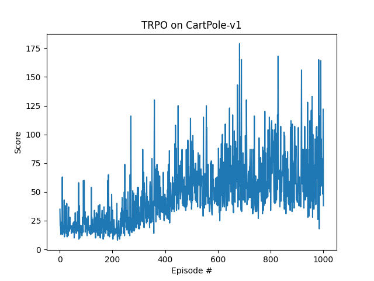
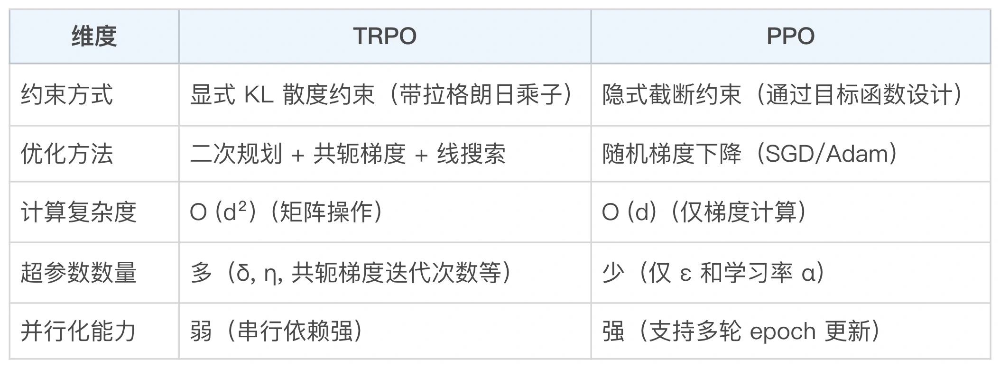
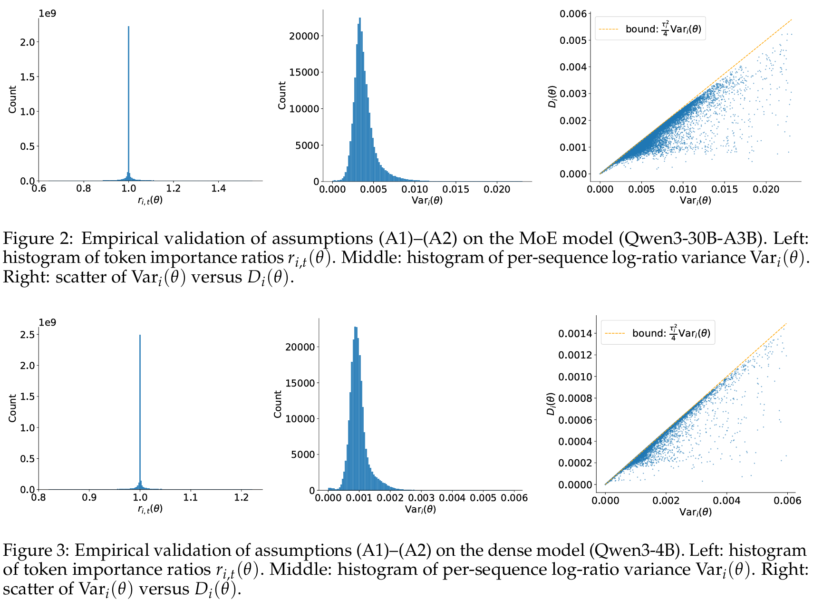
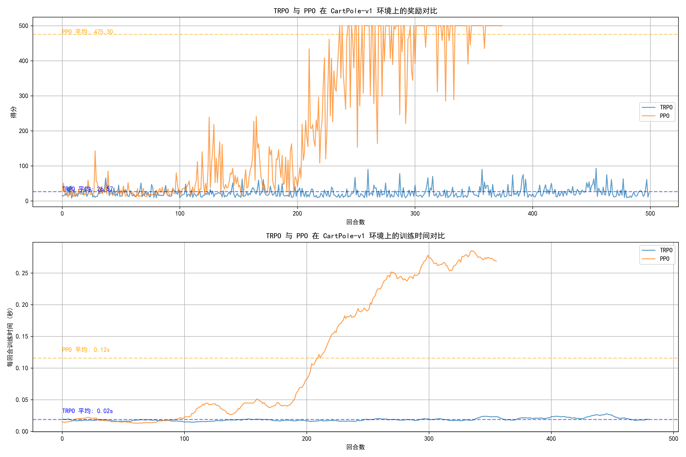

# 10 | TRPO精读：涵盖自然梯度法、全变分约束以及最终导向PPO

你好！欢迎来到强化学习的第十讲。在前几讲中，我们深入学习了策略梯度算法（如REINFORCE）的基本原理，它通过直接优化策略参数以最大化累积奖励，虽直观且易实现，却面临“步长选择极度敏感”的核心困境——步长过大会导致策略突变、训练崩溃，步长过小则会造成收敛缓慢、易陷入局部最优。

而今天，我们将聚焦这一困境的系统性解决方案，重温我们的老朋友——TRPO（置信域策略优化）。这一 2015 年提出的算法，通过“在置信区域内约束策略更新”的创新思路，既避免了策略突变的不稳定性，又保证了性能的持续提升，彻底改变了策略优化的范式。

通过本节课的学习，你将能够：

- 理解自然梯度法的核心价值，掌握其如何通过费舍尔信息矩阵修正传统梯度的“几何偏差”，找到策略性能提升的最优方向。

- 拆解 TRPO 的置信域约束框架，明晰带 KL 散度约束的优化目标建模、拉格朗日对偶转化技巧与二次近似求解的完整逻辑。

- 掌握全变分约束的定义与性质，理解其与 KL 散度的关联，以及二者在策略差异控制中的互补作用。

- 洞悉 TRPO 的工程实现细节（如 GAE 优势估计、共轭梯度求解、线搜索机制）与局限性，进而理解从 TRPO 到 PPO 的演进逻辑。

## 一、自然梯度法：修正梯度的“几何偏差”

传统梯度下降在欧几里得空间中寻找最速上升方向，但策略优化的参数空间并非平坦的欧氏空间——参数的微小变化可能导致策略分布的巨大差异，反之亦然。自然梯度法正是为解决这一“几何错配”问题而生。

## 1.1 普通梯度的致命缺陷

## ∇θJ(θ)

普通梯度

- 的本质是目标函数在参数空间的变化率，但它存在两个关键缺陷：

- 尺度依赖性：对参数进行线性变换（如将权重从“米”改为“厘米”）会改变梯度方向，导致优化过程依赖参数的度量单位；

## πθ(a∣s)

- 概率分布脱节：梯度方向仅反映参数变化率，未考虑策略分布的实际变化。例如，在连续动作空间中，参数的欧氏距离相近未必意味着策略行为相似。

- ​(μ, σ)

## π

## μ

这种缺陷在高维参数空间中尤为明显。假设我们用高斯分布

- 表示策略（ 为均值，θ

## σ

## μ

## σ

为标准差），普通梯度可能建议同时增大 和 ，但这会导致策略分布的剧烈变化（从集中分布变为分散分布），而自然梯度则能识别这种隐藏的分布差异。

## 1.2 费舍尔信息矩阵：参数空间的“度量标尺”

自然梯度的核心是引入费舍尔信息矩阵（Fisher Information Matrix, FIM），它定义了参数空间的黎曼度量（Riemannian Metric），即衡量两个策略分布差异的“天然标尺”。

- ​(a∣s)

## F(θ) =

## π

对于参数化策略

- ，费舍尔信息矩阵的定义为：θ

## E

- ​ ∇​ log π​(a ∣s)∇​ log π​(a ∣s)T]θ [。其直观含义是：策略对数概率梯度的二

s∼ρ

- ​,a∼πθθθθθ​

## F(θ)

- 的对角线元素越大，表示对应参数对

阶矩，反映了参数变化对策略分布的影响敏感度。策略分布的影响越显著；非对角线元素则反映参数间的相关性。

## δθ

费舍尔矩阵的关键性质是：它能近似度量策略分布的 KL 散度。当参数变化

- 较小时，新旧1

## F(θ)

- ​(π​ ∥​) ≈​δθ F(θ)δθT

## D

## π

策略的 KL 散度可通过

- 近似：。这一近似将参数空θ+δθKLθ2

间的变化与分布差异直接关联，为后续的置信域约束奠定了数学基础。

## 1.3 自然梯度的定义与优势

- −1

## ∇

- ​J(θ) =

## F(θ)

## ∇

- ​J(θ)N

有了费舍尔矩阵，自然梯度被定义为：

- 。即普通梯度左乘费舍θθ

尔矩阵的逆。这一操作的本质是：将欧氏空间的梯度方向投影到策略分布的自然度量空间中，确保梯度方向真正指向策略性能提升的最快方向。

自然梯度的优势可通过一个类比理解：假设我们在丘陵地带导航，普通梯度如同按平面地图指示行走（忽略地形起伏），而自然梯度则考虑了实际地形坡度，能找到“最省力的上坡路径”。在策略优化中，这意味着自然梯度更新能在相同参数变化幅度下，实现更大的策略性能提升。

## 1.4 自然梯度与策略优化的结合

## J(θ)

## ∇

- ​J(θ) =

在策略梯度方法中，目标函数

- 的梯度可表示为：θ

## E

- ​(s, a)∇​ log π​(a ∣s)θ [

## ]

- ​(s, a)​ A

## A

## a

- 。其中为优势函数，衡量动作 的相对价

s∼ρ

- ​,a∼πθθθθθ​−1

## θ ←θ + α ⋅F(θ)

## ⋅

值。将其代入自然梯度公式，得到策略优化的自然梯度更新方向：

## ∇

- ​J(θ)。θ

这一更新方向确保了：每一步参数调整都能在策略分布的“自然距离”下实现最优性能提升。但单纯的自然梯度仍未解决“步长过大导致策略突变”的问题——这正是 TRPO 引入置信域约束的核心动机。

## 二、TRPO 的核心框架：置信域约束的策略优化

TRPO 的全称是“置信域策略优化”，其核心思想可概括为：在确保新策略与旧策略差异不超过预设阈值的前提下，最大化策略性能提升。这种“约束优化”思路彻底改变了策略更新的范式。

## 2.1 TRPO 的优化目标建模

TRPO 的目标是找到新策略参数θ，使得累积奖励 J(θ) 最大化，同时限制新旧策略的差异。其

## Dˉ KL

## max

- ​ J(θ)

## s.t.

- ​(π

## ∥

- ​) ≤

## π

## δ

数学形式为带约束的优化问题：

- 。θθθold​

其中：

## θ

- 是当前策略参数；old​

## Dˉ KL

## Dˉ KL

- ​(π​ ∥​)​ =

## π

## ρ

- 是新旧策略在状态分布下的平均 KL 散度：oldθold​

## E

- ​[D​(π​(⋅∣s) ∥​(⋅∣s))]

## π

- ；s∼ρKLoldθold​

## δ

- 是预设的置信域阈值，控制策略更新的最大允许差异（通常取 0.01~0.05）。

这一约束确保了新策略不会偏离旧策略太远，从而避免了策略性能的断崖式下跌。但直接优化

## J(θ)

- 难以计算，TRPO 通过优势函数展开将目标转化为更易处理的形式。

## 2.2 策略性能的下界估计：重要性采样与优势函数

## J(θ)

为了简化

- 的计算，TRPO 利用重要性采样技术，将新策略的累积奖励表示为旧策略样本

的加权求和。通过推导可证明，策略性能的变化可表示为：

- ​(a ∣s)old [π

## ]

## π

- θ

## E

- ​(s, a) +

## J(θ) = J(θ

- ​) +

## 高阶项

- ​As∼ρ​,a∼πoldold​(a ∣s)old​old

忽略高阶项后，TRPO 采用如下近似目标函数（称为 “surrogate advantage”）：

- ​(a ∣s)s,a∼old [π

## ]

## π

- θ

## E

- ​(θ) =​(s, a)

## L

- ​Asurrogateold​(a ∣s)​old

这一近似的合理性在于：当新旧策略差异较小时（即满足 KL 约束），高阶项可忽略，最大化

- ​(θ)

## J(θ)

## L

- 等价于最大化。这一转化将复杂的策略性能优化简化为可通过采样估计的

surrogate目标函数。

## 2.3 约束条件的处理：拉格朗日对偶与二阶近似

TRPO 采用拉格朗日乘子法，将带约束优化转化为无约束优化，其拉格朗日函数为：

## (Dˉ KL

## L(θ, β) = L

- ​(θ) −​(π​ ∥π​) −δ

## )

## β

## β

- 。其中 是拉格朗日乘子，用于平衡surrogateoldθ

目标函数与约束条件的权重。为求解这一优化问题，TRPO 对目标函数和约束条件进行二阶近似：

- ​(θ)​(θ) ≈​(θ​) +

## g (θ −

- T

## L

## θ

## L

## L

- 对在处一阶泰勒展开：surrogateoldsurrogatesurrogateold​​)

## g = ∇L

- ​(θ​)

## θ

- ，其中是梯度；oldsurrogateold

## Dˉ KL

- 1​(π​ ∥​) ≈​(θ −​) H(θ −​)old T

## π

## θ

## θ

## H

- 对 KL 散度约束二阶泰勒展开：，其中oldθold2

## H ≈F(θ

- ​)

## θ

- 是 KL 散度在处的海森矩阵（在自然梯度框架下，）。oldold​

代入拉格朗日函数后，TRPO 的优化问题简化为二次函数最大化：

## 1

## max ( T

## )

## β

- TT

## s.t.

- ​Δθ HΔθ ≤

## g Δθ −

- ​Δθ HΔθ

## δ

## 2

## 2

- ​Δθ

## Δθ = θ −θ

其中

- 是参数变化量。这一二阶优化问题存在解析解：old​

## 1

- ∗−1

## Δθ =

- ​H

## g

## β

## β

通过调整 可满足约束条件，最终得到最优参数更新量。

## 2.4 TRPO 的求解流程：共轭梯度与线搜索

在实际实现中，TRPO 采用“共轭梯度法 + 线搜索”的两步流程求解优化问题：

1. 共轭梯度法求搜索方向：

由于 H 矩阵（费舍尔信息矩阵）通常高维且计算昂贵，TRPO 采用共轭梯度法求解

- −1

## H⋅Δθ = g

## Δθ

- ​ =

## H

## g

- ，得到近似的自然梯度方向。这一步避免了直接计算 H 的逆矩dir

阵，大幅降低了计算成本。

2. 线搜索确定最优步长：

## Dˉ KL

- ​(π​ ∥

## α

在得到搜索方向后，TRPO 通过线搜索寻找最大步长 ，使得：

- old

## ) ≤

## π

## δ

- 。且满足单调改进条件（确保新策略性能不下降）。线搜索通常采用保守的​+α⋅Δθ

θ

- olddir​

衰减策略（如每次乘以 0.5），直到找到满足约束的最大步长。

这种“先确定方向，再寻找最大安全步长”的流程，完美实现了“在置信域内最大化性能提升”的核心目标，也是最优化领域常用的技巧。

## 三、全变分约束：策略差异的边界控制

TRPO 的约束条件本质是对策略分布差异的控制，除了 KL 散度外，全变分（Total Variation）也是衡量分布差异的重要工具。理解全变分约束，有助于更全面地掌握策略更新的安全边界设计。

## 3.1 全变分的定义与性质

## P

## Q

全变分距离（TV 距离）用于度量两个概率分布

- 和的差异，定义为：

## 1

## ∑

- ​∣P(x) −

## TV (P, Q) =

- ​∣P(A) −

## sup

## Q(A)∣=

## Q(x)∣

## 2

- ​Ax

## sup

其中

- 表示对所有可能事件集 A 取 supremum（上确界）。在连续空间中，求和改为积A​

## P = Q

## TV

## TV

## P

## Q

- 距离的取值范围为[0,1]，当时距离为 0，当和完全不重叠时

分。

## TV

- 距离为 1。

## KL

## TV

与

- 散度相比，距离的优势在于：

## TV (P, Q) = TV (Q, P)

## KL(P∥Q)

- ​=

## KL

- ，而散度是非对称的（对称性：

## KL(Q∥P)

- ）；

- 直观性：直接反映两个分布在事件概率上的最大差异；

- 有界性：取值范围固定，便于设置统一的约束阈值。

## TV

- 距离可表示为新旧策略在状态 - 动作空间的差异：

在策略优化中，

## 1

- old ∫​E

## TV (π

- ​, π​) =​(a ∣s) −π​(a ∣s) da

## ∣

## ∣

- ​ πolds∼ρoldθθ

## 2

- ​​a

这一指标直接衡量了新旧策略在相同状态下选择动作的概率差异。

## 3.2 全变分与 KL 散度的关系

在机器学习和统计学中，经常需要衡量实际概率分布与观测概率分布之间的差异。Kullback-

## P

## Q

Leibler（KL）散度就是一种用于度量两个概率分布

- （真实分布）与（近似模型分布）之

间差异的统计距离。KL 散度也被称为信息增益或相对熵。

- K

## Q) ≜

- P​(P ∥​ log

## ∑k=1

## P

## Q

## D

- ​ P

对于离散分布

- 与，KL 散度的定义为：。对于连续分​kKLkQ​​kP(x)

## Q) ≜

## dx P(x) log

- ​(P ∥​(P ∥

## Q)

## ∫

## D

## D

布，KL 散度定义为：

- 表示用。其中，KLKLQ(x)

## P = Q

- ​(P ∥

## Q) = 0

## Q

## P

## D

- 近似时所损失的信息量（以比特为单位），因此当时。KL

- 2

## TV (P, Q) ≤

- ​(P ∥

## Q)

## D

TRPO 论文中证明了全变分与 KL 散度的重要不等式关系：

- 。KL

## KL

## TV

## KL

## δ

## TV

- 散度是距离的上界。若能保证散度不超过 ，则距离

这一不等式表明：

## δ

## KL

## TV

必然不超过 。因此，TRPO 采用的

- 散度约束本质上是对距离的保守控制——通过

## KL

限制

- 散度，间接确保了策略行为的差异不会过大。

## KL

- 散度的数学性质更便于优化（如二次近似、海森矩阵计算），

这种关系的实际意义在于：

## TV

## KL

而

- 距离更直观地反映策略行为的稳定性。TRPO 通过约束实现了对策略行为差异的

间接控制，兼顾了数学可操作性与实际稳定性需求。

## 3.3 全变分约束的实际应用

## KL

虽然 TRPO 最终选择

- 散度作为约束条件，但全变分约束在策略优化中仍有重要应用场

景。

## TV

- 距离可直接通过采样计算（无需二阶近似），适合对计算资源有限的场离散动作空间：景；

## TV

- 距离的有界性安全强化学习：在需要严格限制策略行为变化的场景（如机器人操作），使其更适合作为安全约束；

## TV

## KL

- 算法验证：通过距离评估约束的实际效果，验证策略更新的安全性。

理解全变分与 KL 散度的关系，能帮助我们更深入地把握 TRPO 约束设计的本质——通过数学

## KL

上可处理的

- 约束，实现对策略行为差异的有效控制。

## 四、TRPO 的实现细节：从理论到工程的落地

TRPO 的理论框架优雅，但实际实现涉及诸多工程技巧。这些细节直接影响算法的性能与稳定性，也是理解从 TRPO 向 PPO 演进的关键。

## 4.1 优势函数的估计：降低梯度方差

- ​(s, a)

## A

TRPO 的目标函数依赖准确的优势函数

- 估计，而优势函数的方差直接影响梯度计old

算的稳定性。TRPO 采用我们的老朋友 GAE（Generalized Advantage Estimation）方法估计优势函数。

- ​ =

## r +

## γV (s

- ​) −

## V (s

- ​)

## δ

## γ

其中

- 是时序差分误差， 是折扣因子，λ是控制偏差 - 方差权t+1ttt

衡的参数（通常取 0.95）。

GAE 通过指数加权求和平衡了偏差与方差：

- 当λ=0 时，GAE 退化为单步 TD 误差，方差小但偏差大；

- 当λ=1 时，GAE 等价于蒙特卡洛估计，偏差小但方差大；

- 典型值λ=0.95 在多数任务中能实现最优平衡。

准确的优势函数估计是 TRPO 性能的基础，这也是后续 PPO 完全沿用 GAE 方法的原因。

## 4.2 费舍尔信息矩阵的近似计算

在通过 GAE 获得可靠的优势函数估计后，TRPO 的下一步核心任务是求解“带 KL 约束的策略优化问题”——这一过程的关键瓶颈在于费舍尔信息矩阵（FIM）的计算。 作为自然梯度和 KL散度二次近似的核心组件，FIM 的精确计算在高维参数空间（如深度神经网络策略）中几乎不可行，因此必须通过工程技巧进行近似，才能让 TRPO 从理论落地到实际训练。

- 12

## k =

- ​(log r)

## k

## f

在近似计算 KL 散度时，我们引入新的统计量

- 。其中： 的期望是 - 散度2

## E[k] = KL[Q, P]

- 。

## f

这里简单介绍一下 - 散度。

- x∼q [ ( Q(x)P(x))]P(x)

## E

- ​(P, Q) =

## f(1) = 0

## r =

- ​ f

## f

## D

## f

- 散度定义为

- ， 是一个凸函数且；fQ(x)​​

## Q

## P

## f

## f

。当

- 接近时，所有具有可微 的 - 散度在二阶近似下都类似于 KL 散度。

- ′′f (1)3T​θ Hθ +​(P​, P​) =

## O(θ )

## P

## D

## H

## P

具体来说，对于一个参数化分布

- 。其中是，0​θfθ​θ2​ =

## P

## P

的费舍尔（Fisher）信息矩阵，在

- 处计算。​0θ

- 2

## O(d )

## H

## H

费舍尔信息矩阵

- 的计算是 TRPO 的核心挑战之一。直接计算需要的时间复杂

## d

度（ 为参数维度），在高维场景下（如深度神经网络策略）完全不可行。TRPO 采用随机矩阵向量乘积技术规避完整矩阵计算。

而当面对高维参数空间这类解析解难以求取的场景（像深度神经网络策略所涉及的复杂分布等情况），蒙特卡洛方法就成为了估计相关量的常用手段。并且，一个理想的估计量，应当既满足无偏性（也就是具备准确的均值），又能保持较低的方差。

## H・v

## H

## H

## v

不直接计算

- ，而是通过采样估计与任意向量 的乘积）。根据费舍尔矩阵的定（T ]

## H⋅v = E

- ​ (∇​ log π​(a∣s))(∇​ log π​(a∣s)) v

## H⋅v ≈

- s,a [

义：

- ，可简化为：θθθθ

1 ∑i=1

- T ]N​ log π​)) (∇​ log π​(a​∣s​)) v

## O(d)

- ​(∇​(a​∣s

## [

- 。通过这种方式，只需时间即可θθiiθθii

N

- ​2

## O(d )

## H・v

估计

- （而非），使得共轭梯度法能高效运行。具体步骤为：

## v

1. 随机生成单位向量 ；

## (s

2. ​, a​)

## N

- 采样个状态 - 动作对；ii​ =

## ∇θlogπ

- ​(a​∣s​)

## g

- 计算每个样本的梯度；iθii​ᵀv))

## H・v ≈均值(g

- ​・(g估计。ii

这种近似虽引入误差，但在样本量足够时（通常 N=1000~5000）能保持精度，且大幅降低计算成本。

- 是否有可能构造出一个无偏且方差低的 KL 散度估计量呢？降低方差的常用方法是引入控制

## k

## k

- 变量。具体而言，就是在 的基础上，添加一个期望为零且与 负相关的量。而能保证期P(x)​ −

## 1 = r −1

## −log r + λ(r −1)

## λ

- 望为零的量为。由此，对于任意 ，表达式都是Q(x)

## KL[Q, P]

## λ

- 的无偏估计量。我们本可以通过计算来最小化该估计量的方差，进而求解 。

## P

## Q

- 但遗憾的是，这样会得到一个依赖于和的表达式，难以进行解析计算。不过，我们

## λ

- 可以采用一种更简便的策略来选取一个合适的 。

## 4.3 单调改进保证：策略更新的安全网

TRPO 的核心承诺是“策略性能单调提升”，这通过线搜索中的接受准则实现。在找到候选更新

## Δθ

- 后，TRPO 计算新策略的实际性能提升，并要求满足：

## J(θ

- ​) −J(θ​)newold​ ≥

## η

- ​(θ​) −L​(θ​)

## L

- surrogatenewsurrogateold

## η

其中 是预设阈值（通常取 0.1），分子是实际性能变化，分母是 surrogate 目标的变化。这一准则确保了：即使 surrogate 目标的近似存在误差，新策略的实际性能也必须有足够提升才能被接受。

## θ

若不满足准则，则减小步长 α（如乘以 0.5）重新计算

- ，直到满足条件或步长过小（此时new​

放弃更新）。这一机制为策略更新提供了最后的安全网，避免了理论近似误差导致的性能下降。

## 4.4 分布式策略的适配：均值与协方差的分别处理

- 2​(a∣s) =

## N(μθ(s), diag(σθ(s)) )

## π

在连续动作空间中，TRPO 常采用高斯策略

- ，其中θ

## μθ(s)

## σθ(s)

- 是均值网络，是标准差网络。此时费舍尔矩阵可分解为均值和协方差两部分：

## s

- 均值部分的费舍尔矩阵依赖状态输入 ，需通过采样估计；

- 协方差部分若采用对角矩阵形式，可简化费舍尔矩阵的计算（非对角元素为 0）。

实际实现中，常将标准差参数设为固定值或单独优化（不纳入置信域约束），这是因为协方差的剧烈变化对策略行为的影响更大，需要更保守的更新策略。这种“分而治之”的参数处理方式，是 TRPO 在连续控制任务中表现优异的关键工程技巧。

## 4.5 代码实现

```python
import torch
import torch.nn as nn
import torch.optim as optim
import torch.nn.functional as F
from torch.distributions import Categorical
import gym
import numpy as np
from collections import deque
import matplotlib.pyplot as plt
# 策略网络
class Policy(nn.Module):
   def __init__(self, state_dim, action_dim, hidden_dim=128):
       super(Policy, self).__init__()
       self.fc1 = nn.Linear(state_dim, hidden_dim)
       self.fc2 = nn.Linear(hidden_dim, hidden_dim)
       self.fc3 = nn.Linear(hidden_dim, action_dim)
   def forward(self, x):
       x = F.relu(self.fc1(x))
       x = F.relu(self.fc2(x))
       x = self.fc3(x)
       return F.softmax(x, dim=1)
   def act(self, state):
       if isinstance(state, tuple):
           state = state[0]
       # 强制转换为float32类型
       state = torch.from_numpy(state).to(dtype=torch.float32).unsqueeze(0)
       probs = self.forward(state)
       m = Categorical(probs)
       action = m.sample()
       return action.item(), m.log_prob(action)
# 价值网络
class ValueNetwork(nn.Module):
   def __init__(self, state_dim, hidden_dim=128):
       super(ValueNetwork, self).__init__()
       self.fc1 = nn.Linear(state_dim, hidden_dim)
       self.fc2 = nn.Linear(hidden_dim, hidden_dim)
       self.fc3 = nn.Linear(hidden_dim, 1)
   def forward(self, x):
       x = F.relu(self.fc1(x))
       x = F.relu(self.fc2(x))
       return self.fc3(x)
# 计算累积折扣奖励和优势函数
def compute_advantages(rewards, values, gamma=0.99, tau=0.95):
   # 确保values和rewards长度匹配
   values = values[:-1]
   # 使用float32创建优势数组
   advantages = np.zeros_like(rewards, dtype=np.float32)
   last_advantage = 0
   for t in reversed(range(len(rewards))):
       delta = rewards[t] + gamma * (values[t+1] if t+1 < len(values) else 0) -
       last_advantage = delta + gamma * tau * last_advantage
       advantages[t] = last_advantage
   # 计算回报
   returns = advantages + values
   # 标准化优势函数
   advantages = (advantages - np.mean(advantages)) / (np.std(advantages) + 1e-8)
   # 明确指定张量类型为float32
   return torch.as_tensor(advantages, dtype=torch.float32), torch.as_tensor(retu
# 执行一轮轨迹收集
def collect_trajectory(env, policy, value_net, max_steps=1000):
   states = []
   actions = []
   log_probs = []
   rewards = []
   values = []  # 存储状态价值
   state, _ = env.reset()
   for _ in range(max_steps):
       states.append(state.astype(np.float32))  # 状态转为float32
       action, log_prob = policy.act(state)
       # 计算状态价值
       state_tensor = torch.from_numpy(state).to(dtype=torch.float32).unsqueeze(
       value = value_net(state_tensor).item()
       values.append(value)
       next_state, reward, done, _, _ = env.step(action)
       actions.append(action)
       log_probs.append(log_prob)
       rewards.append(reward)
       state = next_state
       if done:
           break
   # 添加终止状态的价值
   values.append(0.0)
   # 计算优势函数和回报
   advantages, returns = compute_advantages(rewards, values)
   return (np.array(states, dtype=np.float32), np.array(actions),
           log_probs, advantages, returns, sum(rewards))
# 计算策略梯度
def compute_policy_gradient(policy, states, actions, advantages, old_log_probs):
   new_probs = policy(states)
   new_log_probs = torch.gather(torch.log(new_probs), 1, actions)
   ratio = torch.exp(new_log_probs - old_log_probs)
   surr1 = ratio * advantages
   return -surr1.mean()
# 共轭梯度算法
def conjugate_gradient(hessian_vector_product, gradient, max_iter=10, residual_to
   x = torch.zeros_like(gradient, dtype=torch.float32)
   r = gradient.clone().to(dtype=torch.float32)
   p = r.clone()
   r_dot_r = torch.dot(r, r)
   for _ in range(max_iter):
       z = hessian_vector_product(p)
       v = torch.dot(p, z)
       if v <= 0:
           if _ == 0:
               return x
           else:
               break
       alpha = r_dot_r / v
       x += alpha * p
       r -= alpha * z
       new_r_dot_r = torch.dot(r, r)
       if torch.sqrt(new_r_dot_r) < residual_tol:
           break
       beta = new_r_dot_r / r_dot_r
       p = r + beta * p
       r_dot_r = new_r_dot_r
   return x
# 确保参数有梯度
def ensure_grads(params):
   for p in params:
       if p.grad is None:
           p.grad = torch.zeros_like(p, dtype=torch.float32)
# TRPO更新
def trpo_update(policy, states, actions, advantages, old_log_probs, max_kl=0.01,
   # 转换为张量并确保类型为float32
   states = torch.as_tensor(states, dtype=torch.float32)
   actions = torch.as_tensor(actions, dtype=torch.long).view(-1, 1)
   old_log_probs = torch.stack(old_log_probs).detach().view(-1, 1).to(dtype=torc
   advantages = advantages.view(-1, 1).to(dtype=torch.float32)
   # 计算梯度
   policy.zero_grad()
   loss = compute_policy_gradient(policy, states, actions, advantages, old_log_p
   loss.backward()
   ensure_grads(policy.parameters())
   gradient = torch.cat([p.grad.view(-1) for p in policy.parameters()]).to(dtype
   # 计算Hessian-vector乘积
   def hessian_vector_product(v):
       v = v.clone().to(dtype=torch.float32)
       params = list(policy.parameters())
       v_list = []
       idx = 0
       for p in params:
           param_size = p.numel()
           v_list.append(v[idx:idx+param_size].view(p.shape).to(dtype=torch.floa
           idx += param_size
       policy.zero_grad()
       new_probs = policy(states)
       new_log_probs = torch.gather(torch.log(new_probs), 1, actions)
       kl = (old_log_probs - new_log_probs).mean()
       kl_grads = torch.autograd.grad(kl, params, create_graph=True)
       kl_v = torch.sum(torch.stack([torch.sum(g * v) for g, v in zip(kl_grads,
       hvp = torch.autograd.grad(kl_v, params)
       hvp_flat = torch.cat([g.contiguous().view(-1).to(dtype=torch.float32) for
       return hvp_flat + damping * v
   # 使用共轭梯度求解
   step_direction = conjugate_gradient(hessian_vector_product, gradient)
   # 计算步长
   shs = 0.5 * torch.dot(step_direction, hessian_vector_product(step_direction))
   lagrange_multiplier = torch.sqrt(shs / max_kl) if shs > 0 else 1.0
   full_step = step_direction / lagrange_multiplier
   # 线搜索寻找最佳步长
   def criterion(step):
       old_params = [p.clone() for p in policy.parameters()]
       step_list = []
       idx = 0
       for p in policy.parameters():
           param_size = p.numel()
           step_list.append(step[idx:idx+param_size].view(p.shape))
           idx += param_size
       for p, step_p in zip(policy.parameters(), step_list):
           p.data.add_(step_p)
       new_probs = policy(states)
       new_log_probs = torch.gather(torch.log(new_probs), 1, actions)
       ratio = torch.exp(new_log_probs - old_log_probs)
       surr1 = ratio * advantages
       loss = -surr1.mean()
       kl = (old_log_probs - new_log_probs).mean()
       for p, old_p in zip(policy.parameters(), old_params):
           p.data.copy_(old_p)
       return loss, kl
   # 线搜索
   accept_ratio = 0.1
   max_backtracks = 10
   step = full_step
   for _ in range(max_backtracks):
       loss_new, kl_new = criterion(step)
       if kl_new <= max_kl and loss_new <= loss.item() + accept_ratio * torch.do
           step_list = []
           idx = 0
           for p in policy.parameters():
               param_size = p.numel()
               step_list.append(step[idx:idx+param_size].view(p.shape))
               idx += param_size
           for p, step_p in zip(policy.parameters(), step_list):
               p.data.add_(step_p)
           return True
       step = step * 0.5
   return False
# 训练TRPO
def train_trpo(env_name="CartPole-v1", max_episodes=1000, max_steps=1000, gamma=0
   env = gym.make(env_name)
   state_dim = env.observation_space.shape[0]
   action_dim = env.action_space.n
   policy = Policy(state_dim, action_dim)
   value_net = ValueNetwork(state_dim)
   value_optimizer = optim.Adam(value_net.parameters(), lr=3e-4)
   scores_deque = deque(maxlen=100)
   scores = []
   for i_episode in range(1, max_episodes+1):
       # 收集轨迹和计算优势
       states, actions, log_probs, advantages, returns, total_reward = collect_t
           env, policy, value_net, max_steps)
       if len(states) == 0:
           continue
       # 更新价值网络
       states_tensor = torch.as_tensor(states, dtype=torch.float32)
       returns_tensor = returns.view(-1, 1).to(dtype=torch.float32)
       for _ in range(10):
           value_optimizer.zero_grad()
           value_loss = F.mse_loss(value_net(states_tensor), returns_tensor)
           value_loss.backward()
           value_optimizer.step()
       # 执行TRPO更新
       trpo_update(policy, states, actions, advantages, log_probs)
       # 记录得分
       scores_deque.append(total_reward)
       scores.append(total_reward)
       if i_episode % print_every == 0:
           print(f"Episode {i_episode}\tAverage Score: {np.mean(scores_deque):.2
       # 检查是否解决环境
       if np.mean(scores_deque) >= env.spec.reward_threshold:
           print(f"\nEnvironment solved in {i_episode-100:d} episodes!\tAverage
           torch.save(policy.state_dict(), f'trpo_{env_name}.pth')
           break
   # 绘制训练曲线
   plt.plot(np.arange(1, len(scores)+1), scores)
   plt.ylabel('Score')
   plt.xlabel('Episode #')
   plt.title(f'TRPO on {env_name}')
   plt.show()
   return policy
if __name__ == "__main__":
policy = train trpo()
```

TRPO 是一种先进的策略梯度方法，通过引入信任区域（Trust Region）约束，来保证策略更新的稳定性。与普通策略梯度方法不同，TRPO 通过优化带约束的目标函数来寻找更优的策略更新方向，有效避免了因学习率选择不当导致的训练不稳定问题。

本实现针对 OpenAI Gym 环境设计，可直接应用于 CartPole-v1 等离散动作空间环境。

代码主要分为以下几个核心模块：

1. 神经网络结构：定义策略网络和价值网络

2. 优势函数计算：使用广义优势估计（GAE）方法

3. 轨迹收集：与环境交互并记录关键数据

4. 策略梯度计算：核心优化目标函数

5. 共轭梯度算法：求解信任区域约束下的优化问题

6. TRPO 更新：完整的策略更新流程

7. 主训练循环：协调各模块完成训练过程（训练结果如图 10-1 所示）



- 图10-1 TRPO训练结果

## 五、TRPO 的局限性：从理论优雅到工程痛点

尽管 TRPO 在理论上完美解决了策略梯度的稳定性问题，但在实际应用中暴露出诸多局限性。这些痛点直接推动了 PPO 的诞生，也揭示了算法设计中“理论严谨性”与“工程实用性”的永恒矛盾。

## 5.1 计算复杂度高昂：矩阵操作的效率瓶颈

TRPO 的核心瓶颈在于费舍尔矩阵的估计与共轭梯度求解：

- 每次策略更新需多次计算梯度（共轭梯度法通常需要 10~20 次迭代）；

## O(Nd)

## N

- 高维参数空间（如深度神经网络）中，每次矩阵向量乘积需时间（为样本量，

## d

- 为参数维度）；

## KL

- 线搜索过程可能需要多次评估散度，进一步增加计算开销。

在现代深度强化学习场景（如 Atari 游戏或机器人控制）中，TRPO 的计算成本往往是策略梯度算法的 5~10 倍，这使其难以应用于大规模任务或资源受限的场景。

## 5.2 超参数敏感：阈值选择的实践难题

TRPO 的性能严重依赖超参数设置：

## δ

- 置信域阈值 ：过小将导致更新过慢（收敛周期长），过大会破坏稳定性（性能波动）；

## η

- 线搜索参数 ：影响接受准则的严格程度，取值不当会导致策略更新过于保守或冒险；

## γ

## λ

- GAE 参数 和 ：直接影响优势函数估计的质量，间接影响 TRPO 的优化方向。

这些超参数的最优值因任务而异（如离散游戏与连续控制的 δ 取值差异可达 10 倍），且缺乏理论指导，需要大量实验调优，大幅提高了 TRPO 的使用门槛。

## 5.3 理论假设的现实偏差：近似误差的累积效应

TRPO 的理论保证建立在一系列近似假设上：

1. 策略性能的替代下界估计足够精确；

2. KL 散度的二次近似在置信域内有效；

3. 自然梯度方向能准确反映最优更新方向。

但在实际训练中，这些假设常被打破：

- 样本有限时，优势函数估计存在偏差，导致替代目标与真实性能脱节；

- 当策略参数变化较大时，二次近似误差显著增大；

- 费舍尔矩阵的随机估计引入噪声，污染自然梯度方向。

这些偏差的累积可能导致 TRPO 在某些任务中出现“理论安全但实际性能下降”的现象，削弱了其理论承诺的可靠性。

## 5.4 并行化困难：样本利用效率的局限

TRPO 的更新过程是严格串行的：必须完成当前策略的采样、优势估计、矩阵计算、线搜索后，才能进行下一轮更新。这种串行结构难以充分利用现代计算设备的并行能力（如多 GPU或分布式采样）。

相比之下，策略梯度算法可通过异步更新（如 A3C）实现高效并行，而 TRPO 的置信域约束要求严格依赖当前策略的样本，无法实现真正的异步更新。这一缺陷在样本需求量大的复杂任务中尤为突出。

## 六、从 TRPO 到 PPO：简化与实用主义的胜利

PPO（Proximal Policy Optimization）作为 TRPO 的“继任者”，并非颠覆性创新，而是对TRPO 核心思想的工程化简化。理解 TRPO 到 PPO 的演进逻辑，能帮助我们把握算法设计的“奥卡姆剃刀”原则——在保证核心效果的前提下，优先选择简单可实现的方案。

## 6.1 PPO 的核心洞察：用代理目标替代复杂约束

- ​(a​∣s​)π​(θ) =θtt

## r

TRPO 的置信域约束本质是限制新旧策略的概率比值

- 过大。PPO 的核心创t​(a​∣s​)π​oldtt

新在于：用一个带截断的代理目标函数，替代 TRPO 的 KL 约束优化，从而避免复杂的矩阵计算。

## E

- ​(θ) =​ min(r​(θ)A​, clip(r​(θ), 1 −ε, 1 + ε)A​)t [t ]

## L

PPO 的目标函数定义为：

- 。CLIPttt

其中：

## A

- 是优势函数估计（与 TRPO 相同，通常用 GAE 计算）；​t

## clip(r

- ​, 1 −

## ε, 1 + ε)

## [1 −ε, 1 + ε]

- 将概率比值限制在区间内（ε 通常取 0.2）；t

## r

- min 操作确保目标函数值不会因过大而无限增长，从而间接限制策略变化。​t

这一目标函数的直观含义是：

- ​ >

## 0

## 1 + ε

## A

## a

## r

- 当（动作是优势动作）时，鼓励增大，但不超过（避免策略突变）；t​t​t​ <

## 0

## 1 −ε

## A

## a

## r

- 当（动作是劣势动作）时，鼓励减小，但不低于（避免过度惩罚）；t​t​t

## [1 −ε, 1 + ε]

## r

- 当在范围内时，目标函数退化为 TRPO 的 surrogate 目标，保证正常优​t化。

通过这种截断代理目标，PPO 在无需计算费舍尔矩阵或线搜索的情况下，实现了与 TRPO 类似的置信域控制效果。

## 6.2 PPO 与 TRPO 的核心差异：从约束优化到无约束优化

PPO 彻底抛弃了 TRPO 的约束优化框架，转而采用无约束的梯度下降，通过目标函数的设计间接实现策略约束。两者的核心差异可概括为：



PPO 的无约束设计使其能直接使用深度学习框架中的优化器（如 Adam），大幅降低了工程实现难度。同时，PPO 允许对同一样本进行多轮 epoch 训练（通常 3~10 轮），显著提高了样本利用效率。

## 6.3 PPO 的两种变体：Clip 与 Penalty

PPO 论文提出了两种实现方案，均基于 TRPO 的简化。

## r

1. PPO-Clip：即上文介绍的截断目标函数，通过 clip 操作限制范围，是实际应用中最常用​t的版本；

2. PPO-Penalty：保留 TRPO 的拉格朗日形式，但用固定系数的 KL 惩罚项替代复杂的线搜

## E

- ​(θ) =​(θ)A​ −βD​(π​ ∥π​)t [ tθ ]

## L

- ​ r

## β

- ，其中 是固定或自适应调整索：PENALTYtKLold

## KL

## β

- 的惩罚系数（如当散度过大时增大 ）。

## KL

PPO-Clip 的优势在于，完全避免了

- 散度的计算，而 PPO-Penalty 更接近 TRPO 的原始

形式。实验表明，PPO-Clip 在大多数任务中表现更稳定，因此成为 PPO 的标准实现。

无论是“裁剪”（Clipping）还是“惩罚”（Penalty），当前主流的强化学习策略优化方法都面临一个共通难题：一刀切式的刚性控制。

想象你正在用强化学习微调一个大型语言模型（比如 Qwen3-30B-MoE），让它学会解答奥数题。每轮训练中，模型对同一道题生成多个答案（例如 8 个），然后根据评分器给出的奖励（如是否完全正确）进行策略更新。在某次迭代中，模型偶然生成了一个看似合理但逻辑错误的答案，并意外获得了高奖励（比如因为评分器没发现漏洞）。由于这个样本的重要性比率

- ​(y​)π​ =θt

## r

（importance ratio,

- ）在某些关键 token 上变得极大（比如从 1.0 飙升到 3.0），i,t​(y​)π​oldt

传统方法如 GRPO 会面临两难：

- ​ >

## 1.2

## r

- 如果使用硬裁剪（hard clipping，如 ε=0.2），那么所有的 token 梯度会被直接i,t置零。结果：整条回答的学习信号被丢弃，哪怕其中大部分 token 是合理的。

- 如果不裁剪或裁剪过宽，这些高比率 token 会带来巨大梯度，导致模型参数剧烈更新——尤其在 MoE 架构中，不同专家路由的异质性会放大这种波动。

于是，在下一轮生成中，模型开始“迷信”那个错误推理路径，甚至将无关词汇（如“显然”“易得”）与高奖励错误关联。很快，它不再尝试严谨推导，而是机械套用错误模板。性能断崖式下跌：原本 Pass@1 达 60% 的模型，几轮后跌至 10%，且输出充满幻觉。

这就是论文中所说的“训练崩溃”：并非模型变笨了，而是一次过大的、由离策略（off-policy）。而硬裁剪机制要么粗暴丢弃有效信号，要么放任噪声破坏全局策略。

SAPO 正是为解决此问题而生。它不会一刀切地丢弃整个样本，而是通过温度控制的软门控函数（soft gate）：

- ​ =

## 3.0

## r

- 对的异常 token，将其梯度权重平滑衰减（如降至 0.1）；i,t​ ≈

## 1.0

## r

- 对同序列中的正常 token，则保留接近完整的梯度。i,t

- 简言之：训练崩溃不是模型“学不会”，而是优化器“刹不住车”。SAPO 提供的不是急刹车，而是一套智能缓速系统——该快时快，该稳时稳。

图 10-2 展示了这一假设的实证支持：

- ​(θ)

## r

- 左图：token 重要性比率的分布高度集中于 1.0 附近，形成尖锐峰值，说明大多数i,t更新幅度温和，无剧烈变化；

## Var

- ​(θ)中图：每条序列内 log-ratio 方差多数低于 0.02，进一步证明序列内部一致性高；i

## Var

- ​(θ)​(θ)

## D

- 与的散点图显示，二者呈强线性关系且紧贴理论边界，表明 SAPO右图：ii的理论假设在真实模型中成立。



- 图10-2 验证SAPO的设计假设（出自阿里巴巴通义团队《Soft Adaptive Policy Optimization》）

传统的硬裁剪机制犹如一把双刃剑：既能防爆，也常误伤。而 SAPO 通过软化约束、动态适配，实现了更自然、更高效的策略优化路径。它不仅是对现有方法的改进，更是对“如何让 AI像人类一样稳健学习”的一次深刻探索。

正如自然界中的生物进化依赖渐进变异而非突变跃迁，未来的 AI 训练或许也需要更多这样的“柔性智慧”——不靠蛮力压制，而是以柔韧应变，走向真正可靠的智能成长之路。

## 6.4 性能对比：简单性带来的意外优势

尽管 PPO 放弃了 TRPO 的理论严谨性，但其在实际任务中的表现却超越了 TRPO。

- 收敛速度：PPO 的更新步骤更简单，相同计算资源下能完成更多迭代；

- 稳定性：截断操作有效防止了策略突变，实际性能波动甚至小于 TRPO；

- 泛化性：更少的超参数和更简单的更新规则，使其在不同任务间的适配性更强；

- 工程落地：易于并行化和部署，成为深度强化学习的工业标准（如 OpenAI 的机器人控制、AlphaFold 的强化学习阶段）。

这种“理论简化但实践更优”的现象，深刻揭示了强化学习算法设计的核心原则：在复杂环境中，鲁棒的近似方法往往比脆弱的精确方法更有效。TRPO 的理论框架为 PPO 提供了思想源泉，而 PPO 则通过工程化简化，实现了理论价值的落地。

下面是 TRPO 和 PPO 算法在 CartPole-v1 环境上的对比（图 10-3）。PPO 在最终性能上显著优于 TRPO，平均得分达到 475.30，远高于 TRPO 的 26.57；然而 TRPO 在训练效率和稳定性方面表现更好，每回合训练时间更短且得分波动更小。



- 图10-3 TRPO和PPO对比

```python
import torch
import torch.nn as nn
import torch.optim as optim
import torch.nn.functional as F
from torch.distributions import Categorical
import gymnasium as gym
import numpy as np
from collections import deque
import matplotlib.pyplot as plt
import time
import os
# 设置中文字体
plt.rcParams["font.family"] = ["SimHei", "WenQuanYi Micro Hei", "Heiti TC"]
plt.rcParams["axes.unicode_minus"] = False  # 解决负号显示问题
# 策略网络
class Policy(nn.Module):
   def __init__(self, state_dim, action_dim, hidden_dim=64):
       super(Policy, self).__init__()
       self.fc1 = nn.Linear(state_dim, hidden_dim)
       self.fc2 = nn.Linear(hidden_dim, hidden_dim)
       self.fc3 = nn.Linear(hidden_dim, action_dim)
   def forward(self, x):
       x = F.relu(self.fc1(x))
       x = F.relu(self.fc2(x))
       x = self.fc3(x)
       return F.softmax(x, dim=1)
   def act(self, state):
       # 转换为float32并添加batch维度
       state = torch.from_numpy(state).to(dtype=torch.float32).unsqueeze(0)
       probs = self.forward(state)
       m = Categorical(probs)
       action = m.sample()
       return action.item(), m.log_prob(action)
# 价值网络
class ValueNetwork(nn.Module):
   def __init__(self, state_dim, hidden_dim=64):
       super(ValueNetwork, self).__init__()
       self.fc1 = nn.Linear(state_dim, hidden_dim)
       self.fc2 = nn.Linear(hidden_dim, hidden_dim)
       self.fc3 = nn.Linear(hidden_dim, 1)
   def forward(self, x):
       x = F.relu(self.fc1(x))
       x = F.relu(self.fc2(x))
       return self.fc3(x)
# 计算累积折扣奖励和优势函数（修正版）
def compute_advantages(rewards, values, gamma=0.99, tau=0.95):
   T = len(rewards)
   advantages = np.zeros(T, dtype=np.float32)
   last_advantage = 0.0
   # 反向计算GAE，避免索引越界
   for t in reversed(range(T)):
       # 下一个状态的价值：t=T-1时，next_value=values[T]（终止状态价值）
       next_value = values[t+1] if t < T else 0.0
       delta = rewards[t] + gamma * next_value - values[t]
       last_advantage = delta + gamma * tau * last_advantage
       advantages[t] = last_advantage
   # 回报 = 优势 + 状态价值（values[:T]对应轨迹中的T个状态）
   returns = advantages + np.array(values[:T], dtype=np.float32)
   # 标准化优势（提升训练稳定性）
   advantages = (advantages - np.mean(advantages)) / (np.std(advantages) + 1e-8)
   return advantages, returns
# 执行一轮轨迹收集（修正版）
def collect_trajectory(env, policy, value_net, max_steps=1000):
   states = []
   actions = []
   log_probs = []
   rewards = []
   values = []  # 存储轨迹中每个状态的价值（长度=T）
   state, _ = env.reset()
   for _ in range(max_steps):
       states.append(state.astype(np.float32))
       # 策略采样动作
       action, log_prob = policy.act(state)
       # 价值网络估计当前状态价值
       value = value_net(torch.from_numpy(state).float().unsqueeze(0)).item()
       values.append(value)
       # 与环境交互
       next_state, reward, terminated, truncated, _ = env.step(action)
       done = terminated or truncated
       # 记录数据
       actions.append(action)
       log_probs.append(log_prob)
       rewards.append(reward)
       # 更新状态
       state = next_state
       if done:
           break
   # 添加终止状态的价值（区分正常终止和截断）
   if done:
       terminal_value = 0.0  # 正常终止，价值为0
   else:
       terminal_value = value_net(torch.from_numpy(state).float().unsqueeze(0)).
   values.append(terminal_value)
   # 计算优势和回报
   advantages, returns = compute_advantages(rewards, values)
   return (np.array(states), np.array(actions), log_probs,
           advantages, returns, sum(rewards))
# 计算策略梯度（修正版）
def compute_policy_gradient(policy, states, actions, advantages, old_log_probs):
   new_probs = policy(states)
   new_log_probs = torch.gather(torch.log(new_probs), 1, actions)
   ratio = torch.exp(new_log_probs - old_log_probs)
   surr1 = ratio * advantages
   return -surr1.mean()  # 负号因为我们要用梯度下降最小化损失
# 共轭梯度算法
def conjugate_gradient(hessian_vector_product, gradient, max_iter=10, residual_to
   x = torch.zeros_like(gradient, dtype=torch.float32)
   r = gradient.clone().to(dtype=torch.float32)
   p = r.clone()
   r_dot_r = torch.dot(r, r)
   for _ in range(max_iter):
       z = hessian_vector_product(p)
       v = torch.dot(p, z)
       if v <= 0:
           if _ == 0:
               return x
           else:
               break
       alpha = r_dot_r / v
       x += alpha * p
       r -= alpha * z
       new_r_dot_r = torch.dot(r, r)
       if torch.sqrt(new_r_dot_r) < residual_tol:
           break
       beta = new_r_dot_r / r_dot_r
       p = r + beta * p
       r_dot_r = new_r_dot_r
   return x
# 确保参数有梯度
def ensure_grads(params):
   for p in params:
       if p.grad is None:
           p.grad = torch.zeros_like(p, dtype=torch.float32)
# TRPO更新
def trpo_update(policy, states, actions, advantages, old_log_probs, max_kl=0.01,
   # 转换为张量并确保类型为float32
   states = torch.as_tensor(states, dtype=torch.float32)
   actions = torch.as_tensor(actions, dtype=torch.long).view(-1, 1)
   old_log_probs = torch.stack(old_log_probs).detach().view(-1, 1).to(dtype=torc
   advantages = torch.as_tensor(advantages, dtype=torch.float32).reshape(-1, 1)
   # 计算梯度
   policy.zero_grad()
   loss = compute_policy_gradient(policy, states, actions, advantages, old_log_p
   loss.backward()
   ensure_grads(policy.parameters())
   gradient = torch.cat([p.grad.view(-1) for p in policy.parameters()]).to(dtype
   # 计算Hessian-vector乘积（修正KL散度方向）
   def hessian_vector_product(v):
       v = v.clone().to(dtype=torch.float32)
       params = list(policy.parameters())
       v_list = []
       idx = 0
       for p in params:
           param_size = p.numel()
           v_list.append(v[idx:idx+param_size].view(p.shape).to(dtype=torch.floa
           idx += param_size
       policy.zero_grad()
       new_probs = policy(states)
       new_log_probs = torch.gather(torch.log(new_probs), 1, actions)
       # 修正KL散度计算方向：KL(π_old || π_new) = E[log π_old - log π_new]
       kl = (old_log_probs - new_log_probs).mean()
       kl_grads = torch.autograd.grad(kl, params, create_graph=True)
       kl_v = torch.sum(torch.stack([torch.sum(g * v) for g, v in zip(kl_grads,
       hvp = torch.autograd.grad(kl_v, params)
       hvp_flat = torch.cat([g.contiguous().view(-1).to(dtype=torch.float32) for
       return hvp_flat + damping * v
   # 使用共轭梯度求解
   step_direction = conjugate_gradient(hessian_vector_product, gradient)
   # 计算步长
   shs = 0.5 * torch.dot(step_direction, hessian_vector_product(step_direction))
   lagrange_multiplier = torch.sqrt(shs / max_kl) if shs > 0 else 1.0
   full_step = step_direction / lagrange_multiplier
   # 线搜索寻找最佳步长
   def criterion(step):
       old_params = [p.clone() for p in policy.parameters()]
       step_list = []
       idx = 0
       for p in policy.parameters():
           param_size = p.numel()
           step_list.append(step[idx:idx+param_size].view(p.shape))
           idx += param_size
       for p, step_p in zip(policy.parameters(), step_list):
           p.data.add_(step_p)
       new_probs = policy(states)
       new_log_probs = torch.gather(torch.log(new_probs), 1, actions)
       ratio = torch.exp(new_log_probs - old_log_probs)
       surr1 = ratio * advantages
       loss = -surr1.mean()
       kl = (old_log_probs - new_log_probs).mean()
       # 恢复参数
       for p, old_p in zip(policy.parameters(), old_params):
           p.data.copy_(old_p)
       return loss, kl
   # 线搜索
   accept_ratio = 0.1
   max_backtracks = 10
   step = full_step
   for _ in range(max_backtracks):
       loss_new, kl_new = criterion(step)
       if kl_new <= max_kl and loss_new <= loss.item() + accept_ratio * torch.do
           step_list = []
           idx = 0
           for p in policy.parameters():
               param_size = p.numel()
               step_list.append(step[idx:idx+param_size].view(p.shape))
               idx += param_size
           for p, step_p in zip(policy.parameters(), step_list):
               p.data.add_(step_p)
           return True
       step = step * 0.5
   return False
# PPO更新
def ppo_update(policy, value_net, states, actions, advantages, old_log_probs, ret
              policy_optimizer, value_optimizer, ppo_epochs=4, mini_batch_size=6
              clip_epsilon=0.2, value_loss_coef=0.5, entropy_coef=0.01, max_grad
   # 转换为张量并确保类型为float32
   states = torch.as_tensor(states, dtype=torch.float32)
   actions = torch.as_tensor(actions, dtype=torch.long).view(-1, 1)
   old_log_probs = torch.stack(old_log_probs).detach().view(-1, 1).to(dtype=torc
   advantages = torch.as_tensor(advantages, dtype=torch.float32).reshape(-1, 1)
   returns = torch.as_tensor(returns, dtype=torch.float32).reshape(-1, 1)  # 修复
   # 创建数据集
   dataset_size = states.size(0)
   # PPO多次更新
   for _ in range(ppo_epochs):
       # 创建小批量索引
       rand_indices = torch.randperm(dataset_size)
       for start in range(0, dataset_size, mini_batch_size):
           # 获取小批量数据
           end = min(start + mini_batch_size, dataset_size)
           mb_indices = rand_indices[start:end]
           mb_states = states[mb_indices]
           mb_actions = actions[mb_indices]
           mb_old_log_probs = old_log_probs[mb_indices]
           mb_advantages = advantages[mb_indices]
           mb_returns = returns[mb_indices]
           # 计算新的概率和比率
           new_probs = policy(mb_states)
           new_log_probs = torch.gather(torch.log(new_probs), 1, mb_actions)
           ratio = torch.exp(new_log_probs - mb_old_log_probs)
           # 计算PPO损失
           surr1 = ratio * mb_advantages
           surr2 = torch.clamp(ratio, 1.0 - clip_epsilon, 1.0 + clip_epsilon) *
           policy_loss = -torch.min(surr1, surr2).mean()
           # 计算价值损失
           values = value_net(mb_states)
           value_loss = F.mse_loss(values, mb_returns)
           # 计算策略熵
           entropy = -torch.sum(new_probs * torch.log(new_probs + 1e-8), dim=1).
           # 更新策略网络
           policy_optimizer.zero_grad()
           policy_loss.backward(retain_graph=True)
           torch.nn.utils.clip_grad_norm_(policy.parameters(), max_grad_norm)
           policy_optimizer.step()
           # 更新价值网络
           value_optimizer.zero_grad()
           value_loss.backward()
           torch.nn.utils.clip_grad_norm_(value_net.parameters(), max_grad_norm)
           value_optimizer.step()
   return policy_loss.item(), value_loss.item(), entropy.item()
# 训练TRPO
def train_trpo(env_name="CartPole-v1", max_episodes=500, max_steps=1000, gamma=0.
   env = gym.make(env_name)
   state_dim = env.observation_space.shape[0]
   action_dim = env.action_space.n
   policy = Policy(state_dim, action_dim)
   value_net = ValueNetwork(state_dim)
   value_optimizer = optim.Adam(value_net.parameters(), lr=3e-4)
   scores_deque = deque(maxlen=100)
   scores = []
   episode_times = []
   for i_episode in range(1, max_episodes+1):
       start_time = time.time()
       # 收集轨迹和计算优势
       states, actions, log_probs, advantages, returns, total_reward = collect_t
           env, policy, value_net, max_steps)
       if len(states) == 0:
           continue
       # 更新价值网络（减少迭代次数，避免过拟合）
       states_tensor = torch.as_tensor(states, dtype=torch.float32)
       returns_tensor = torch.as_tensor(returns, dtype=torch.float32).view(-1, 1
       for _ in range(3):  # 从10次减少到3次
           value_optimizer.zero_grad()
           value_loss = F.mse_loss(value_net(states_tensor), returns_tensor)
           value_loss.backward()
           value_optimizer.step()
       # 执行TRPO更新
       trpo_update(policy, states, actions, advantages, log_probs)
       # 记录得分和时间
       scores_deque.append(total_reward)
       scores.append(total_reward)
       episode_times.append(time.time() - start_time)
       if i_episode % print_every == 0:
           print(f"TRPO - Episode {i_episode}\tAverage Score: {np.mean(scores_de
                 f"Time per episode: {np.mean(episode_times[-print_every:]):.2f}
       # 检查是否解决环境
       if np.mean(scores_deque) >= env.spec.reward_threshold:
           print(f"\nTRPO solved in {i_episode-100:d} episodes!\tAverage Score:
           torch.save(policy.state_dict(), f'trpo_{env_name}.pth')
           break
   env.close()
   return scores, episode_times
# 训练PPO
def train_ppo(env_name="CartPole-v1", max_episodes=500, max_steps=1000, gamma=0.9
   env = gym.make(env_name)
   state_dim = env.observation_space.shape[0]
   action_dim = env.action_space.n
   policy = Policy(state_dim, action_dim)
   value_net = ValueNetwork(state_dim)
   # 优化器定义在训练循环外（修正）
   policy_optimizer = optim.Adam(policy.parameters(), lr=3e-4)
   value_optimizer = optim.Adam(value_net.parameters(), lr=1e-3)
   scores_deque = deque(maxlen=100)
   scores = []
   episode_times = []
   for i_episode in range(1, max_episodes+1):
       start_time = time.time()
       # 收集轨迹和计算优势
       states, actions, log_probs, advantages, returns, total_reward = collect_t
           env, policy, value_net, max_steps)
       if len(states) == 0:
           continue
       # 执行PPO更新（传入优化器）
       policy_loss, value_loss, entropy = ppo_update(
           policy, value_net, states, actions, advantages, log_probs, returns,
           policy_optimizer, value_optimizer)
       # 记录得分和时间
       scores_deque.append(total_reward)
       scores.append(total_reward)
       episode_times.append(time.time() - start_time)
       if i_episode % print_every == 0:
           print(f"PPO - Episode {i_episode}\tAverage Score: {np.mean(scores_deq
                 f"Time per episode: {np.mean(episode_times[-print_every:]):.2f}
                 f"Policy Loss: {policy_loss:.4f}, Value Loss: {value_loss:.4f},
       # 检查是否解决环境
       if np.mean(scores_deque) >= env.spec.reward_threshold:
           print(f"\nPPO solved in {i_episode-100:d} episodes!\tAverage Score: {
           torch.save(policy.state_dict(), f'ppo_{env_name}.pth')
           break
   env.close()
   return scores, episode_times
# 绘制对比图
def plot_comparison(trpo_scores, ppo_scores, trpo_times, ppo_times, env_name):
   plt.figure(figsize=(15, 10))
   # 创建环境实例以获取reward_threshold
   env = gym.make(env_name)
   # 绘制得分曲线
   plt.subplot(2, 1, 1)
   plt.plot(trpo_scores, label='TRPO', alpha=0.7)
   plt.plot(ppo_scores, label='PPO', alpha=0.7)
   plt.ylabel('得分')
   plt.xlabel('回合数')
   plt.title(f'TRPO 与 PPO 在 {env_name} 环境上的奖励对比')
   plt.legend()
   plt.grid(True)
   # 计算并显示平均得分
   trpo_avg = np.mean(trpo_scores[-100:]) if len(trpo_scores) >= 100 else np.mea
   ppo_avg = np.mean(ppo_scores[-100:]) if len(ppo_scores) >= 100 else np.mean(p
   plt.axhline(y=trpo_avg, color='blue', linestyle='--', alpha=0.5)
   plt.axhline(y=ppo_avg, color='orange', linestyle='--', alpha=0.5)
   plt.text(0, trpo_avg + 1, f'TRPO 平均: {trpo_avg:.2f}', color='blue')
   plt.text(0, ppo_avg + 1, f'PPO 平均: {ppo_avg:.2f}', color='orange')
   # 绘制时间曲线
   plt.subplot(2, 1, 2)
   # 计算移动平均以平滑曲线
   window_size = 20
   if len(trpo_times) >= window_size:
       trpo_times_smooth = np.convolve(trpo_times, np.ones(window_size)/window_s
       ppo_times_smooth = np.convolve(ppo_times, np.ones(window_size)/window_siz
       plt.plot(trpo_times_smooth, label='TRPO', alpha=0.7)
       plt.plot(ppo_times_smooth, label='PPO', alpha=0.7)
   else:
       plt.plot(trpo_times, label='TRPO', alpha=0.7)
       plt.plot(ppo_times, label='PPO', alpha=0.7)
   plt.ylabel('每回合训练时间 (秒)')
   plt.xlabel('回合数')
   plt.title(f'TRPO 与 PPO 在 {env_name} 环境上的训练时间对比')
   plt.legend()
   plt.grid(True)
   # 计算并显示平均时间
   trpo_time_avg = np.mean(trpo_times)
   ppo_time_avg = np.mean(ppo_times)
   plt.axhline(y=trpo_time_avg, color='blue', linestyle='--', alpha=0.5)
   plt.axhline(y=ppo_time_avg, color='orange', linestyle='--', alpha=0.5)
   plt.text(0, trpo_time_avg + 0.01, f'TRPO 平均: {trpo_time_avg:.2f}s', color='b
   plt.text(0, ppo_time_avg + 0.01, f'PPO 平均: {ppo_time_avg:.2f}s', color='oran
   plt.tight_layout()
   plt.savefig(f"trpo_vs_ppo_{env_name}.png", dpi=300)
   plt.show()
   # 打印统计信息
   print("\n===== 训练结果统计 =====")
   print(f"TRPO 平均得分: {trpo_avg:.2f}")
   print(f"PPO 平均得分: {ppo_avg:.2f}")
   print(f"TRPO 平均每回合时间: {trpo_time_avg:.2f}s")
   print(f"PPO 平均每回合时间: {ppo_time_avg:.2f}s")
   print(f"TRPO 总训练时间: {sum(trpo_times):.2f}s")
   print(f"PPO 总训练时间: {sum(ppo_times):.2f}s")
   # 计算收敛速度
   trpo_conv = None
   ppo_conv = None
   threshold = env.spec.reward_threshold * 0.95  # 95%的阈值作为收敛标准
   for i in range(100, len(trpo_scores)):
       if np.mean(trpo_scores[i-100:i]) >= threshold:
           trpo_conv = i
           break
   for i in range(100, len(ppo_scores)):
       if np.mean(ppo_scores[i-100:i]) >= threshold:
           ppo_conv = i
           break
   if trpo_conv:
       print(f"TRPO 在 {trpo_conv} 回合后收敛")
   if ppo_conv:
       print(f"PPO 在 {ppo_conv} 回合后收敛")
   # 计算波动性
   trpo_std = np.std(trpo_scores[-100:]) if len(trpo_scores) >= 100 else np.std(
   ppo_std = np.std(ppo_scores[-100:]) if len(ppo_scores) >= 100 else np.std(ppo
   print(f"TRPO 得分标准差: {trpo_std:.2f}")
   print(f"PPO 得分标准差: {ppo_std:.2f}")
   # 关闭环境
   env.close()
   # 结论
   print("\n===== 结论 =====")
   if ppo_avg > trpo_avg:
       print("PPO 在最终性能上优于 TRPO")
   elif trpo_avg > ppo_avg:
       print("TRPO 在最终性能上优于 PPO")
   else:
       print("PPO 和 TRPO 在最终性能上相当")
   if ppo_time_avg < trpo_time_avg:
       print("PPO 在训练效率上优于 TRPO")
   elif trpo_time_avg < ppo_time_avg:
       print("TRPO 在训练效率上优于 PPO")
   else:
       print("PPO 和 TRPO 在训练效率上相当")
   if ppo_std < trpo_std:
       print("PPO 在训练稳定性上优于 TRPO")
   elif trpo_std < ppo_std:
       print("TRPO 在训练稳定性上优于 PPO")
   else:
       print("PPO 和 TRPO 在训练稳定性上相当")
   if trpo_conv and ppo_conv:
       if ppo_conv < trpo_conv:
           print("PPO 在收敛速度上优于 TRPO")
       elif trpo_conv < ppo_conv:
           print("TRPO 在收敛速度上优于 PPO")
       else:
           print("PPO 和 TRPO 在收敛速度上相当")
# 主函数
def main():
   env_name = "CartPole-v1"  # 默认使用CartPole环境
   print(f"开始训练 TRPO 和 PPO 算法在 {env_name} 环境上的对比...")
   # 训练TRPO
   print("\n===== 训练 TRPO =====")
   trpo_scores, trpo_times = train_trpo(env_name)
   # 训练PPO
   print("\n===== 训练 PPO =====")
   ppo_scores, ppo_times = train_ppo(env_name)
   # 绘制对比图
   plot_comparison(trpo_scores, ppo_scores, trpo_times, ppo_times, env_name)
if __name__ == "__main__":
main()
```

## 总结​

本节课我们系统精读了 TRPO 算法，从自然梯度的几何修正、置信域约束的安全边界设计，到全变分约束的辅助作用，完整梳理了 TRPO 的理论框架。我们还深入分析了 TRPO 的工程实现细节及其局限性，并带着你一起走过了从 TRPO 到 PPO 的演进逻辑，揭示了“实用主义简化”在算法创新中的核心价值。

核心要点回顾：

- 自然梯度法通过费舍尔信息矩阵修正了传统梯度的几何偏差，提供了更符合策略分布特性的更新方向；

- TRPO 的置信域约束通过 KL 散度限制策略更新幅度，实现了性能单调改进的理论保证；

- 全变分约束作为 KL 散度的补充，提供了策略差异的直观度量和边界控制；

- TRPO 的工程痛点（计算复杂、超参数敏感、并行困难）催生了 PPO 的诞生；

- PPO 通过截断目标函数简化了 TRPO 的约束优化，在保持核心效果的同时，大幅提升了实用性。

TRPO 与 PPO 的传承关系表明：强化学习算法的进步不仅依赖理论突破，更需要对工程实践的深刻理解。TRPO 的理论优雅为策略优化指明了方向，而 PPO 的工程简化则让这一方向真正落地实用。这种“理论指导实践，实践反哺理论”的循环，正是强化学习领域快速发展的核心动力。

## 思考题​

1. 假设在训练中发现 TRPO 的性能出现大幅波动，可能的原因有哪些？如何通过调整超参数或实现细节解决？

2. PPO 的 clip 操作为什么能替代 TRPO 的 KL 散度约束？请从数学形式和实际效果两方面对比分析。

希望你通过今天的学习，对强化学习有了更加清晰的认识。如果有任何疑问，欢迎在讨论区留言交流！
