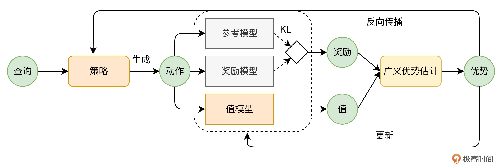
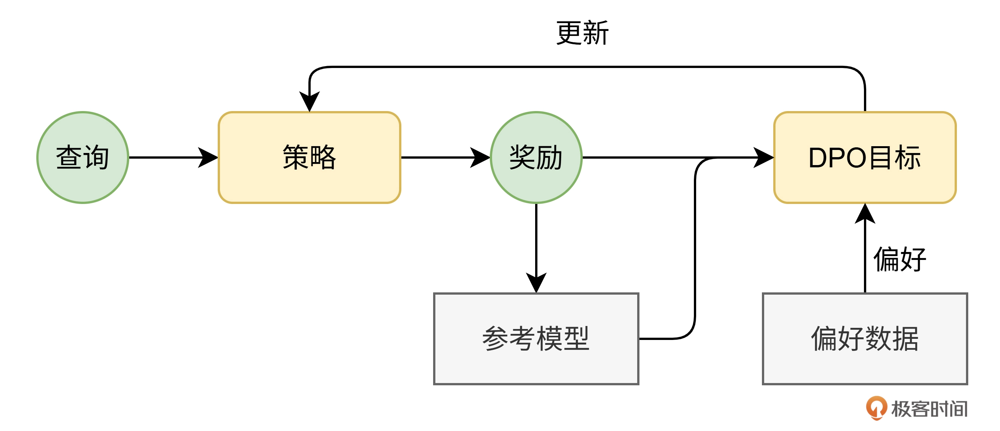
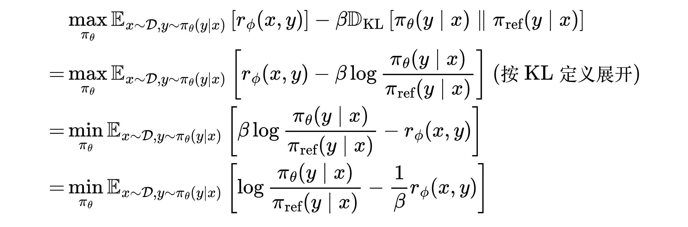
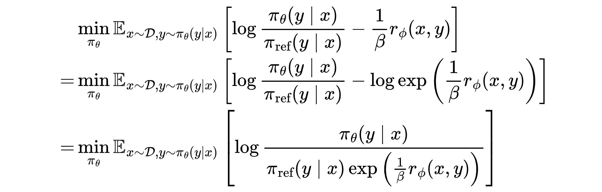
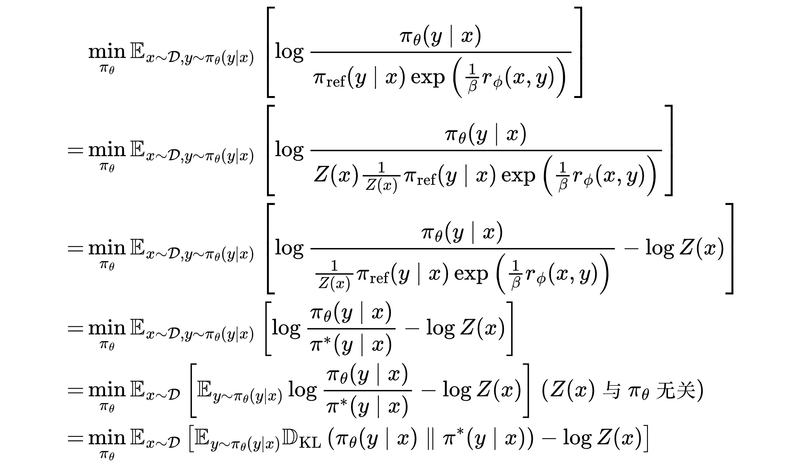
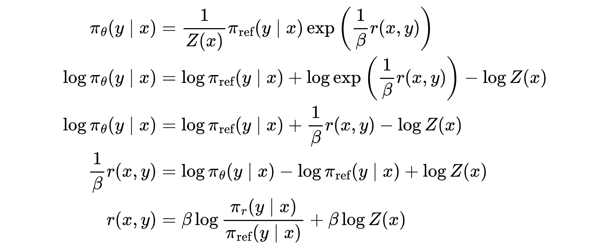
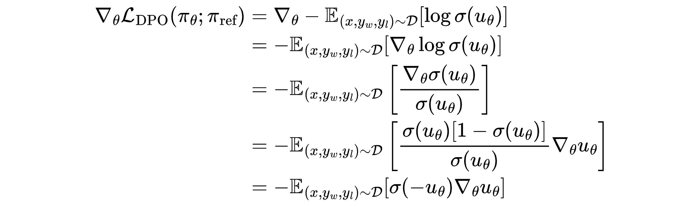
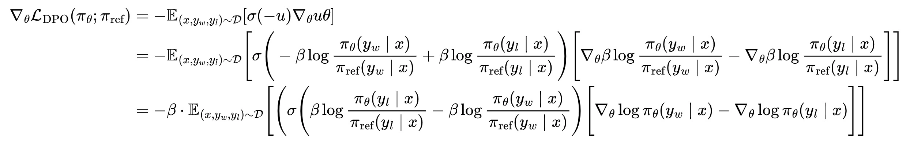
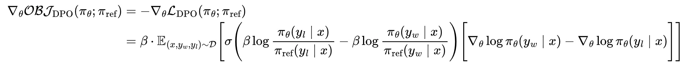
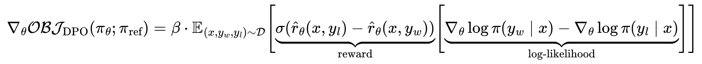

# 11 | TRPO的大语言模型时代扩展：PPO、DPO、GRPO（上）

你好！欢迎来到强化学习的第十一讲，这节课因内容较多，我们将拆分为上下两节。

在前一讲中，我们深入剖析了 TRPO 算法的核心逻辑：它通过“置信区域”约束策略更新幅度，有效解决了传统策略梯度对步长敏感的问题，为策略优化的稳定性筑牢了基础。但随着大语言模型（LLM）向千亿级参数、复杂任务场景演进，TRPO 在计算复杂度（如矩阵求逆）、大规模数据适配性上的短板愈发明显，难以平衡大模型训练中“高效迭代”“样本复用”与“策略稳定”的三重需求。

这两节课我们将聚焦 TRPO 的三大关键扩展算法——PPO（近端策略优化）、DPO（直接偏好优化）与 GRPO（组相对策略优化）。它们分别从“简化约束逻辑”、“革新优化范式”、“适配序列奖励特性”三个维度突破，为大语言模型的强化学习训练提供了更贴合实际需求的解决方案：PPO 简化了 TRPO 的约束实现，兼顾稳定性与效率；DPO 跳过显式奖励建模，直击偏好对齐核心；GRPO 则针对 LLM 序列生成的奖励特性，进一步降低了训练资源开销。

通过两节课的学习，你将能够：

- 理解 PPO 的核心创新：如何通过“重要性采样 + 裁剪机制”，在规避 TRPO 复杂矩阵运算的同时保证策略稳定性，及其在 LLM 微调（如文本生成、对话对齐）中的应用逻辑。

- 掌握 DPO 的突破点：为何它能脱离“环境交互采样”与“独立奖励模型”，通过直接优化策略损失实现高效偏好对齐，及其在样本稀缺场景（如医疗文本、法律问答）中的独特价值。

- 明晰 GRPO 的设计初衷：如何通过“舍弃评论家模型 + 组采样基线估计”，适配 LLM “奖励集中于序列末尾”的特性，解决 PPO 在 token 级价值估计上的难题与资源瓶颈。

- 系统对比 PPO、DPO 与 GRPO 在原理、性能（样本效率、训练速度、稳定性）、应用场景上的差异，学会根据 LLM 任务的核心需求（如数据量、交互成本、奖励形式）选择最优算法。

## 一、PPO 算法

PPO 算法旨在优化策略网络以最大化累计奖励，同时限制新策略与旧策略之间的差异，确保训练过程的稳定性。它通过引入一个近端策略优化目标函数，使得策略更新能够在保证策略改进的同时，避免更新过大导致模型性能下降。

PPO 算法在大模型训练中表现出了良好的性能和稳定性，能够有效地利用样本数据进行学习，适用于各种复杂的任务，如机器人控制、自动驾驶等领域的大模型训练。

## 1.1 PPO 算法的提出背景

在强化学习中，策略梯度算法是一类常用的方法，它通过直接优化策略网络的参数，使得智能体在环境中获得的累积奖励最大化。然而，传统的策略梯度算法在更新策略时，容易出现更新幅度过大的问题，导致策略不稳定，甚至出现性能下降的情况。

TRPO 算法通过引入置信区域的概念，限制了策略更新的范围，从而保证了策略的稳定性。但是，TRPO 算法在计算置信区域时，需要进行复杂的矩阵运算，计算复杂度较高，限制了它在实际中的使用。

为了解决 TRPO 算法的计算复杂度问题，OpenAI 的研究人员提出了 PPO 算法。PPO 算法的核心思想是通过引入一个简单的裁剪机制，来限制策略更新的幅度，从而达到与 TRPO 算法类似的稳定性效果，同时避免了复杂的矩阵运算，大大提高了算法的计算效率。

## 1.2 PPO 算法的核心原理

PPO 算法的核心在于引入了裁剪后的目标函数（clipped surrogate objective），PPO 架构图如11-1 所示。为了理解这个目标函数，我们首先需要了解一些基本概念。

在策略梯度算法中，我们通常通过最大化一个目标函数来更新策略网络的参数。这个目标函数通常是基于优势函数（advantage function）来定义的。优势函数表示在某个状态下采取某个动作相对于平均动作的优势程度，它可以帮助我们更有效地优化策略。

- 图11-1 PPO架构图

PPO 网络的核心机制是重要性采样、裁剪机制和优势函数。

### 1.2.1 重要性采样

这里我们重温之前介绍过的重要性采样。这一技术的目标是复用旧策略收集的数据，提高样本效率，具体的方法则是通过新旧策略的概率比修正旧数据的权重。下面我们回顾一下概率比的定义。

- ​(a​∣s​)

## π

## π

## s

## a

## π

设当前的策略为

- ，旧的策略为，在状态下采取动作的概率分别为和​θθ​t​tθttold​​​(a​∣s​)π​(a​∣s​)​(θ) =θtt

## π

## r

## θ

- 。我们定义概率比，其中 是新策略的参数。

θ

- ttt​(a​∣s​)πold​tt​θold​

### 1.2.2 裁剪机制（Clipping）

- ​(θ)

## r

裁剪机制的目的限制新旧策略的概率比

- 的变化范围，防止更新幅度过大。PPO 算法的t

## E

- CLIP

## (θ) =

- ​[min(r​(θ)A​, clip(r​(θ), 1 −

## ϵ, 1 + ϵ)A

- ​)]

## L

裁剪后的目标函数定义为：

- ttttt

## E^t

- ​[…]

## clip(r

- ​(θ), 1 −

## A

- 表示在一个批次的样本上取经验平均；是优势函数；；

。其中，

- ​tt

## ϵ, 1 + ϵ)

- ​(θ)

## [1 −ϵ, 1 + ϵ]

## r

## ϵ

- 函数是一个裁剪函数，它将比例的限制在区间内， 是一个超t

参数，通常设置为一个较小的值，如 0.1 或 0.2。

## min(…)

- 裁剪函数的直观解释：​ >

## 0

- ​(θ) ≤

## 1 + ϵ

## A

## r

- 若（当前动作优于平均），限制，避免过度增加该动作的概率。tt​ <

## 0

- ​(θ) ≥

## 1−ϵ

## A

## r

- 若（当前动作劣于平均），限制，避免过度降低该动作的概率。tt

- ​(θ)

## r

这个目标函数的含义是：我们希望新策略相对于旧策略的改进是在一定范围内的。如果

- t

过大，说明新策略相对于旧策略的变化太大，可能会导致策略不稳定，此时我们通过裁剪函数

- ​(θ)

## [1 −ϵ, 1 + ϵ]

## r

将

- 限制在内，从而限制了策略更新的幅度。t

### 1.2.3 优势函数

在 PPO 之前，策略梯度模型最早是没有评估模型，只让动作（Actor）去生成行为，然后利用所有行为共同获得累积奖励（或回报）来训练模型，但是，因为每一个行为（例如大语言模型对应生成句子中的每一个 token，即轨迹（trajectory））都是一个随机变量，N 个随机变量加在一起，方差就会非常巨大，这通常会导致整个强化学习训练崩掉。为了解决这个问题，我们可以让每一个随机变量都减掉一个基线，这样就可以降低方差，稳定训练。

## s

PPO 通常与一个评估模型一起训练，该网络的目标是准确估计在给定状态

- 下未来奖励的总​t

和。对某个动作，如果实际奖励超过了评估模型的预期，就作为奖励（正反馈），若低于预期则为惩罚（负反馈）。也就是说，PPO 使用了一个“相对评估模型进步程度”的新范式，而非采用绝对奖励反馈。引入评估模型可以显著降低训练过程中的方差，相对于奖励反馈，模型进步能获得的梯度更显著。

- ​(s​)

## V

- 评估模型（即 Critic，价值函数，这里请注意区分：在大语言模型时代的 PPO 还有ψt另外一个参考模型即 Reference Model，其与这里提到的 Critic 不是一个。

## A^t

价值函数的主要作用是作为基线来计算优势

- ，从而显著降低策略梯度的方差。价值函数的​

## E^t [(

- 2]target)VF

## (ψ) =

- ​(s​) −V

## L

## V

损失通常是一个简单的均方误差（MSE）：

- 。其中，ψtt​​target

## V

## t

- 是回报的蒙特卡洛估计，即从时间步 开始的累积折扣奖励。

t

- ​

为了鼓励策略进行充分的探索，避免过早地收敛到次优的确定性策略，PPO 的目标函数中通

## S[π

- ​](s​)

## St

常会加入一个熵奖励项。熵

- 衡量了策略在状态下输出动作的随机性。最大化熵θt

等同于让策略的概率分布更平坦，从而探索更多可能性。

在目标函数中加入熵从而提升强化学习的能力，这一类方法又叫最大熵强化学习，目的是优化RL 的探索性能，代表性工作有 Soft Q-learning、Soft Actor-Critic 等。这是一种典型的结合控制论和信息论的机器学习方法。类似的方法，如前文提到的使用 Total Variation 或 KL 散度来优化模型，也是将信息论引入机器学习的典型方式。 更进一步，最大熵强化学习方法属于“最大熵学习（Max Entropy）”这一分支，有很多优美的理论性质。推荐你自行了解相关信息。

## 1.3 PPO 算法的优势

相比于 TRPO 算法，PPO 算法具有以下几个显著的优势：

1. 计算效率高：PPO 算法避免了 TRPO 算法中复杂的矩阵运算，通过简单的裁剪机制就可以实现对策略更新幅度的限制，大大提高了计算效率。这使得 PPO 算法能够在大规模数据和复杂环境下更快速地进行训练。

2. 实现简单：PPO 算法的实现相对简单，不需要像 TRPO 算法那样进行复杂的数学推导和计算。这使得更多的研究人员和开发者能够轻松地上手使用 PPO 算法来解决实际问题。

3. 稳定性好：PPO 算法通过裁剪机制有效地限制了策略更新的幅度，保证了策略的稳定性。在实际应用中，PPO 算法能够在不同的环境和任务中表现出较好的稳定性和鲁棒性。

## 1.4 PPO 算法在大语言模型中的应用

随着大语言模型的发展，强化学习在大语言模型的训练和优化中发挥着越来越重要的作用。PPO 算法由于其高效性和稳定性，被广泛应用于大语言模型的训练中。

例如，在文本生成任务中，我们可以将大语言模型看作一个智能体，它在给定的文本上下文环境中生成下一个单词。通过使用 PPO 算法，我们可以优化大语言模型的策略网络，使得模型生成的文本更加符合人类的语言习惯和语义要求。

具体来说，我们可以定义一个奖励函数，根据生成文本的质量（如语法正确性、语义连贯性等）来给予奖励。然后，通过 PPO 算法不断更新模型的策略网络，使得模型能够生成更优质的文本。

在实际应用中，PPO 算法在大语言模型的微调阶段表现出了很好的效果。通过使用 PPO 算法对预训练的大语言模型进行微调，可以显著提高模型在特定任务上的性能，如问答系统、文本摘要等。

## 1.5 PPO 核心挑战分析

PPO 在基于人类反馈的强化学习（RLHF）领域取得了显著成功，但将其应用于大语言模型（LLM）时，却面临着诸多严峻挑战，而这些挑战也推动了后续相关算法的诞生。

- 系统复杂性：PPO - RLHF 流程需要同时协调策略模型、价值 / 评论家模型、奖励模型以及参考模型这四个大型模型。如此复杂的多模型架构，让训练、调试与扩展工作变得极为困难，且耗费高昂。

- 奖励黑客攻击（Reward Hacking）：这是一个根本性问题，指策略模型会利用奖励模型的漏洞来获取高分，可生成的回答在人类眼中质量并未提高，甚至变得更差。这种现象也被称作“模式崩溃（Mode Collapse）”。模型会察觉到某些特定的文本模式或风格，像过度礼貌、表述冗长等，能够稳定地骗取奖励模型的高分，进而过度生成这类模式，造成输出质量下降。这也凸显出 RLHF 的上限严重依赖奖励模型的质量与鲁棒性。​ =

## r

- KL 散度控制：在 RLHF 里，KL 散度惩罚项被直接纳入奖励计算，公式为total​(x, y) −​(π​(y∣x) ∥​(y∣x))

## r

## βD

## π

- 。该惩罚项至关重要，它既充当熵奖励以鼓励模KLrefϕθ

## β

## β

- 型探索，又能防止策略过度偏离有监督微调（SFT）模型。然而， 的取值十分敏感：若

## β

- 过小（约束过弱），策略可能会过度优化奖励模型，引发策略发散与奖励滥用；若 过大（约束过强），则会抑制模型的学习能力，使其无法充分利用奖励信号来改进自身。因此，找到 KL 散度的最佳平衡点，是 PPO 调优过程中的核心难题。

## 二、DPO 算法

鉴于 PPO-RLHF 的复杂性，研究者们开始寻求更简洁、更直接的对齐方法。直接偏好优化（Direct Preference Optimization, DPO）应运而生，它巧妙地绕过了显式的奖励建模和复杂的 RL 优化循环，为偏好对齐提供了一个优雅的替代方案。

## 2.1 DPO 算法的提出背景

尽管 PPO 算法在强化学习中取得了很大的成功，但它仍然存在一些不足之处。在处理大规模语言模型时，PPO 算法需要大量的样本数据来进行训练，这不仅增加了训练的时间和成本，而且在一些情况下可能会导致过拟合的问题。此外，PPO 算法在训练过程中需要不断地与环境进行交互，获取新的样本数据，这在实际应用中可能会受到环境的限制。

为了解决这些问题，研究人员提出了 DPO 算法。DPO 算法的核心思想是直接对策略进行优化，而不需要通过与环境交互来获取样本数据。这样可以大大减少训练所需的样本数量，提高训练效率，同时也可以避免过拟合的问题。

## 2.2 DPO 算法的核心原理

DPO 算法的核心是基于一种称为“近端策略优化的对偶形式”（dual form of proximal policyoptimization）的思想。具体来说，DPO 算法通过最小化一个与策略相关的损失函数来直接优化策略网络的参数。

DPO 架构图如图 11-2 所示，具体如下。

- 图11-2 DPO架构图

### 2.2.1 DPO 的核心洞见：封闭形式最优解

DPO 的核心洞见在于，标准的 RLHF 目标，也就是 KL 散度约束下的奖励最大化问题，存在一个封闭形式的最优解。

## r

假设 为真实人类反馈函数，在大语言模型使用强化学习进行 Fine-tuning 阶段优化目标为：

- ​ E

## βD

## max

- ​ r(x, y) −

## [

## ]

- ​(y ∣x) ∥π​(y ∣x)KL [

## ]

- ​ π。这个优化目标公式可x∼D,y∼π​(y∣x)refπθ​θθ

## max{Reward + α ∗KL Penalty}

简化为：

- ，这一形式有很成熟的解法，可以通过设计分

配函数来得出闭式解。

- 【提示】配分函数（英语：Partition Function）是一个平衡态统计物理学中经常应用到的概念，经由计算配分函数可以将微观物理状态与宏观物理量相互联系起来，而配分函数等价于自由能，与路径积分在数学上有巧妙的类似。 配分函数通常意指正则系综中的配分函数，而其他的系综，亦有其相对应的配分函数，如巨正则系综对应巨配分函数。

## r(x, y)

- ​(y∣x)

## π

这就表明，对于任意给定的一个奖励函数

- ，与之相对应的最优策略能够通过r

## ( β

## )

- 11​(y∣x) exp​(y∣x) =​r(x, y)

## Z(x)

## π

- ​π是用于

解析的方式被表示出来：

- 。其中，refrZ(x)

## β

确保概率归一化的配分函数， 是控制 KL 惩罚强度的超参数。

下面给出证明，从原始优化目标出发：

## log

现在看一下，如果把目标函数的后半部分放入

- 会是怎样的形式：

## log

- 注意部分有如下特点：

## log

- 中的形式为除法，分子为一个概率分布；

## π

- 待优化的只在分子项中，而不在分母中；​θ

## π

## r

- 分母项中包含参考策略，包含反馈函数，数值上大于等于 0；ref​ϕ​

## π

## r

- 分母项的物理意义为“参考策略在反馈函数下的某种期望回报。ref​ϕ​

## log

因此，若能将

- 中分母部分映射为一个概率分布，则上诉形式可以进一步转为 KL 散度。这

也是机器学习中常见的一种小技巧：构造配分函数。具体构造概率分布的方式比较简单，对不

## π

包含

- 的分母进行归一化。​θ

为了将分母转化为概率分布，需引入配分函数进行归一化令：

## 1

## (β

## )

## ∑

- ​(y ∣

## x) exp

## Z(x) =

- ​r(x, y)​πref

进而令：

## 1

## 1

## (β

## )

- ∗

## x) exp

## π (y ∣

## x) =

- ​(y ∣​r(x, y)​πref

## Z(x)

可以证明：

## ∑

- ∗∗

## x) ≥0

- ​π (y ∣

## π (y ∣

## x) = 1

- y

- ∗

## π (y ∣

## x)

因此，我们构造出的

- 为一个概率分布。

于是，上述公式可以进一步变形为：

- ∗​(y ∣

## x) = π (y ∣

## x)

## π

根据 Gibbs 不等式，当

- 时，上述最小化问题可以获得最优解。到这θ1∗​(y ∣

## x) = π (y ∣

## x) =

- ​(y ∣

## π

- ​π

里，就找到了上述问题的闭式解：

- refθZ(x)

## ( β

## )

- 1​r(x, y)

## x) exp

- 。

基于以上闭式解，我们可以再进一步用最优策略来表达回报函数：

## r(x)

## Z(x)

## r(x, y)

这里请注意，上式右侧并非

- 的解析式，因为中也含有。但是这一形式具

## β log Z(x)

有重要意义。将上式代入 BT 模型后，上式中的

- 项可以消掉，从而使得排序函数

可以完全由简洁的最优策略来表达。

### 2.2.2 逆向操作：重参数化奖励函数

## π

## π

DPO 的关键步骤是进行逆向操作：把上述方程重新整理，借助最优策略

- 和参考策略ref​r​

## ( π

## )

- ​(y∣x)π

## +

## r(x, y)

## r(x, y) = β log

## β log Z(x)

- r

来表示奖励函数

- ：。这种对奖励函数的重​(y∣x)​ref

参数化是 DPO 理论的基石。它构建起了从策略空间到奖励空间的直接映射关系，这意味着任何一个语言模型策略都在无形中定义了一个奖励函数。

- 重参数化（reparameterization）是机器学习中的一种常见技巧，这里不做展开。

### 2.2.3 算法核心思想：近端策略优化的对偶形式

DPO 算法核心基于“近端策略优化的对偶形式”思想，通过最小化与策略相关的损失函数，直接优化策略网络的参数。

### 1) 策略网络与损失函数构成

- ​(θ)

## θ

## L

设策略网络的参数为 ，我们定义一个损失函数

- ，它包含两个部分：DPO

- 优势估计：衡量当前策略与参考策略的性能差异，评估策略优劣；

- 熵正则化项：鼓励策略多样性，避免过早收敛到局部最优。

优势估计部分用于衡量策略的优劣程度，它通过比较当前策略与一个参考策略的性能来实现。熵正则化项则用于鼓励策略的多样性，避免策略过早地收敛到局部最优解。

### 2) 无环境交互的优化过程

- ​(θ)

## L

DPO 算法通过迭代最小化损失函数

- 来更新策略网络的参数，使得策略不断优化。DPO

在这个过程中，DPO 算法不需要与环境进行交互，只需要利用已有的数据来计算损失函数的梯度，从而更新策略网络的参数。

DPO 的损失函数推导过程，巧妙地把前述理论和人类偏好模型融合在一起。

从 Bradley - Terry 模型出发，和奖励建模阶段类似，DPO 假定人类偏好遵循 Bradley - Terry

## p∗

## y

## y

（BT）模型。该模型表明，人类偏好回答

- 胜过的概率，取决于它们在某一潜在真实w​l​

## r∗

- ∗∗∗​ ≻

## p (y

- ​∣x) =

## σ(r (x, y ) −

## r (x, y

- ​))

## y

奖励函数

- 下的得分差异，公式为：。其中，wlwl

## σ(⋅)

- 是 logistic sigmoid 函数。

## r∗

## π∗

代入重参数化的奖励，现将参数化奖励公式（应用于真实奖励

- 及其对应的最优策略），∗∗

## r (x, y

- ​)

## r (x, y

- ​)

代入 BT 模型里的

- 和，得到：wl

- ∗∗

## π (y

- ​∣x)

## π (y

- ​∣x)

## (

## )

## (

- wl∗∗

## r (x, y

- ​) −

## r (x, y

- ​) =

## β log

- ​ + β log Z(x)

## β log

- ​ + β

## −

- wl​(y​∣x)​(y​∣x)

## π

## π

- refrefwl

## β log Z(x)

一个极为关键的发现是，未知的配分函数项

- 在相减时完全抵消了。这让奖励差异

能够完全通过策略来表示：

- ∗∗

## π (y

- ​∣x)

## π (y

- ​∣x)wl∗∗

## r (x, y

- ​) −

## r (x, y

- ​) =

## β log

- ​ −

## β log

- wl​(y​∣x)​(y​∣x)

## π

## π

- ​refrefwl

## π

有了这个仅依赖策略的偏好概率表达式，DPO 就能直接为策略模型

- 构建最大似然目标。给​θ(i)(i)(i)N

## D = {(x

## , y

- ​, y​)}

定人类偏好数据集

- ，DPO 的目标是最大化观测到这些偏好的对数wi=1l​

似然。这等同于最小化负对数似然损失，也就是 DPO 的最终损失函数：

- ​(y​∣x)​(y​∣x)

## [

## (

## )]

## π

## π

- θwθl

## −E

- ​(π​; π​) =​ log σ

## β log

## −β log

## L

- DPOref(x,y​,y​)∼Dθ​(y​∣x)​(y ∣x)wl

## π

## π

- ​refrefwl

## π

## y

这个损失函数本质上是简单的二元交叉熵损失。它促使

- 提高对的相对概率（相对于​θw​

## π

## y

- ），同时降低对的相对概率。

ref

- ​l​

DPO 的最终损失函数，虽然形式复杂，但本质较为简单且直观：

## −E

- ​(π​; π​) =​[log σ(u​)]

## L

- DPOref(x,y​,y​)∼Dθθwl

- ​(y​∣x)​(y​∣x)ππ​ =

## β log

- ​ −

## β log

- θwθl

## u

其中，

- 。θ​(y​∣x)​(y​∣x)ππ​refrefwl

进而我们可以得到 DPO 损失函数的导数：

## u

将

- 代入可得：​θ

- ​(π​; π​)

## OBJ

因此，令

- 为 DPO 的优化目标，其导数为：DPOrefθ

- ​(y∣x)π​(x, y) =

## r^θ

## β log

- θ

使用

- ，于是：​(y∣x)π​ref

仔细观察这一公式，可以发现其形式本质上与策略梯度的公式一致：都是对数似然（loglikelihood）。

- ​ =​ log π(y​ ∣

## Log-likelihood

## ∇

## x) −

这样，我们得到 DPO 的对数似然项形式为：

- θwDPO​ log π(y​ ∣

## ∇

## x)

- ，这与策略梯度类似，两个导数分别指明了参数更新的方向。综合来看，其θl

## y

## y

物理意义是使模型参数朝着“提升选择较好答案

- 的概率，同时降低选择较差答案的概率”w​l​

的方向进行更新。

## Reward

- ​ =

## σ(

- ​(x, y​) −

## r^θ

- ​(x, y​))

## r^θ

DPO 的 reward（奖励）项形式为：

- 。它的物理DPOlw

## y

含义是，对数似然所代表的参数更新方向的力度大小。当模型对较差答案

- 的评分越是高于​l

## y

对较好答案

- 的评分时，梯度更新的力度就越大。w​

DPO 的理论很优美，在一段时间内也取得了非常好的效果，甚至一度有取代 RLHF 之势。不过，从近期发展来看，大语言模型对齐的最佳方式还是 RLHF。不论是什么 PO（PreferenceOptimization，偏好优化），基本都是采用了和 RM（Reward Model，奖励模型）结合的 xPO+ RM 的做法，没有纯原始 DPO 的玩法，这与 DPO 初始的声明还是有一些差异。

## 2.3 DPO 算法的优势

相比于 PPO 算法，DPO 算法具有以下几个明显的优势：

1. 样本效率高：DPO 算法不需要通过与环境交互来获取大量的样本数据，它可以直接利用已有的数据进行策略优化。这使得 DPO 算法在样本效率上有了很大的提升，能够在较少的样本数据下取得较好的性能。

2. 训练速度快：由于 DPO 算法减少了与环境交互的时间，并且可以在较少的样本数据上进行训练，因此它的训练速度通常比 PPO 算法更快。这在处理大规模语言模型时尤为重要，可以大大缩短训练时间，提高开发效率。

3. 泛化能力强：DPO 算法通过熵正则化项鼓励策略的多样性，这有助于提高策略的泛化能力。在实际应用中，DPO 算法能够在不同的任务和环境中表现出较好的泛化性能，能够更好地适应新的情况。

## 2.4 DPO 算法在大语言模型中的应用

DPO 算法在大语言模型中的应用，主要集中在模型的预训练和微调阶段。在预训练阶段，DPO 算法可以利用大规模的无监督文本数据来直接优化大语言模型的策略网络，使得模型能够学习到更好的语言表示和语义理解能力。

在微调阶段，DPO 算法可以根据特定任务的少量标注数据，快速地对预训练的大语言模型进行优化，使得模型能够在任务上取得更好的性能。由于 DPO 算法的样本效率高，它可以在较少的标注数据下进行有效的微调，这对于一些标注数据稀缺的任务来说具有很大的优势。

例如，在一些医疗领域的文本分类任务中，由于医疗数据的标注成本较高，有标注数据的数量通常较少。使用 DPO 算法可以在这些少量的标注数据上对大语言模型进行微调，使得模型能够准确地对医疗文本进行分类，为医疗诊断和决策提供支持。

这节课先到这里，下节课我们将继续探讨 GRPO 算法，并进行总结。敬请期待！
