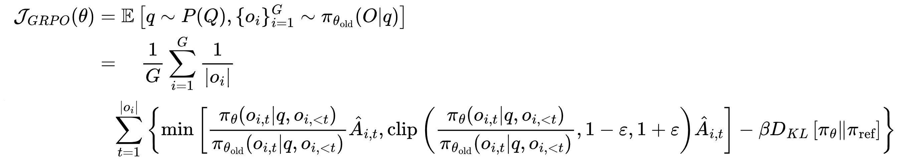
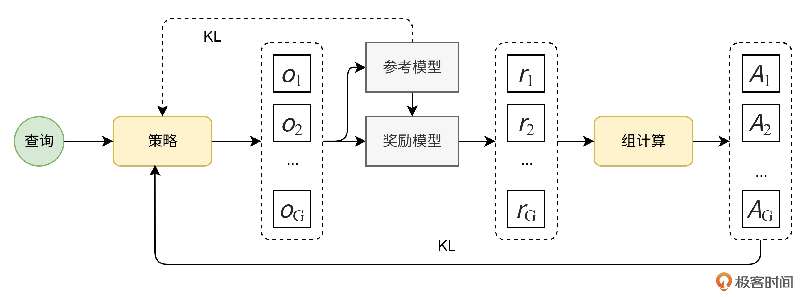
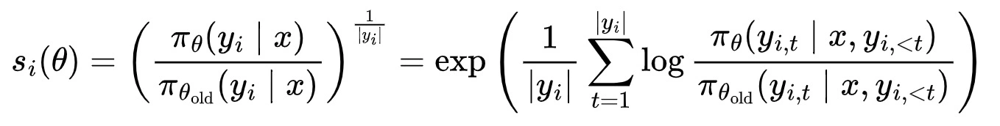
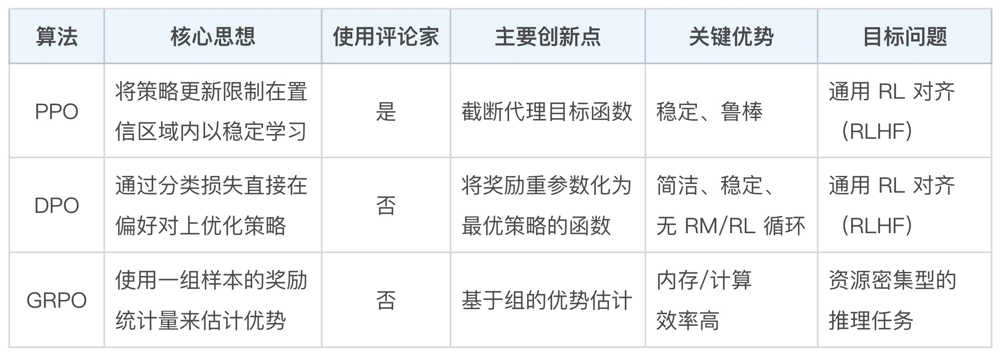
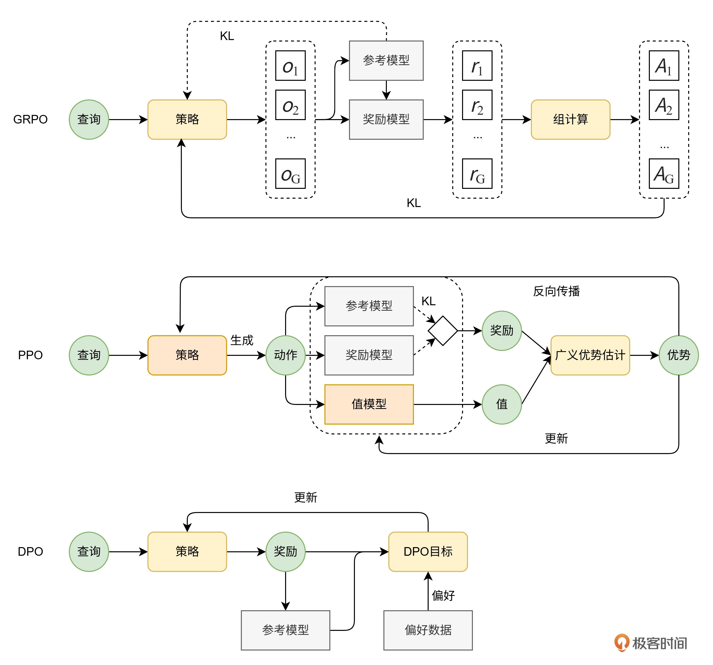
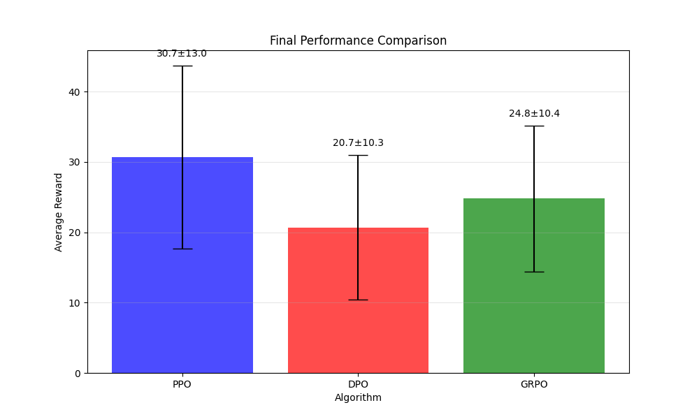

# 12 | TRPO的大语言模型时代扩展：PPO、DPO、GRPO（下）

内容接上节课，这节课聚焦 GRPO 算法。

## 一、GRPO 算法

组相对策略优化（Group Relative Policy Optimization, GRPO）是 DeepSeek 在训练其DeepSeekMath 模型时提出的一种高效 RL 算法，其核心目标是解决 PPO 在 LLM 推理任务中的资源瓶颈。

## 1.1 GRPO 算法提出的背景

尽管 DPO 提供了一条优雅的替代路径，但在许多需要模型进行复杂、多步推理的任务（如数学、编程）中，基于强化学习的方法依然显示出独特的优势。这类任务的奖励通常是二元的（答案正确或错误），可以通过程序自动验证，这被称为可验证奖励的强化学习（RL withVerifiable Rewards, RLVR）。然而，PPO 的计算和内存开销依然是一个巨大的障碍，特别是其与策略模型大小相当的评论家模型。这催生了一系列旨在保留 RL 优势同时降低其复杂性的新算法。

这一系列算法的演进过程揭示了一个清晰的研究轨迹。GRPO 通过移除 PPO 中资源消耗巨大的价值模型（Value Network）或评论家模型（Critic），实现了在推理任务上的重大效率突破。然而，这一看似简单的改动并非没有代价，它引入了一系列更微妙的、先前未被充分认识的问题。随后的“G 家族”算法——Dr. GRPO、GSPO、GMPO——可以被看作是对 GRPO 核心框架的一系列精准“补丁”。每一个新算法都识别并修正了 GRPO 的一个特定缺陷，共同完善了最初的“无参考”概念，使其变得更加稳定和可控。

## 1.2 GRPO 算法的核心原理

GRPO 中一般存在两个模型，主模型 Actor 模型以及参考模型，这两个模型初始时是同一个模型，但训练过程中参考模型只作为 KL 散度约束项来防止主模型训练中权重偏离原始模型权重太多，避免出现模式崩溃（Mode Collapse）。

### 1.2.1 动机与核心机制

标准 PPO 需要训练一个与策略模型规模相当的评论家（价值）模型，在大语言模型时代，这会带来极大的内存与计算负担。另外，在大语言模型的推理任务里，奖励往往仅在生成序列的末尾给出（比如最终答案是否正确），这让为每个 token 训练出精准的价值函数变得极为困难。

GRPO 的核心创新点在于舍弃评论家模型，转而采用一种基于组采样的基线估计方法。具体

## π

而言，对于每一个问题（prompt），算法会利用旧策略

- 采样生成一个包含 G 个不同回答θold​​

## {o

- ​, o​, … , o​}

的 “组”

- 。之后，通过对比这个组内各个回答的奖励，来估计每个回答的优12G

势。

GRPO 的核心是通过组内相对奖励优化策略，而非依赖单独的价值网络。具体来说：

- 分组比较：对每个输入状态，采样一组动作（如多个回答），通过奖励函数评估后，计算组内相对优势。

- 避免价值网络：无需维护与策略模型大小相当的价值网络，显著减少内存和计算开销。

- 稳定性约束：引入 KL 散度约束，防止策略更新过于剧烈，确保训练稳定性。

### 1.2.2 GRPO 目标的数学公式

## A^i,t

GRPO 的目标函数在形式上与 PPO 类似，但其优势项

- 的计算方式完全不同。GRPO 的​​(θ)

## J

目标函数

- 定义为：GRPO



## q

## G

从公式中可以看到，对于一个输入 ，GRPO 会产生一组

- 个输出，对于这些输出会使用规

## r = {r

- ​, r​, ⋯, r​}

则函数分别计算奖励值，即

- ，使用这一组不同输出来计算优势函数12G

## r~i

## A^i,t

- ​−mean(r)r​ =​ =i。std(r)​

其中：

## r

## o

- 是回答通过奖励模型（或验证器）获得的标量奖励；​i​i

## mean({r

- ​}​)G是组内所有回答奖励的平均值；jj=1

## std({r

- ​}​)G是组内所有回答奖励的标准差。jj=1

可以看到优势函数的计算只依赖于每个输出的结果奖励（结果奖励的意思是对整个输出序列即多个 token 进行整体的奖励值计算，但注意此时动作的粒度仍是单个 token，而不是整个输出序列）。

## A^i,t

计算完每个输出的优势值，即

- 后，会将这个整体优势值均匀分配给该序列的每个 token，​

这么做还是因为 GRPO 的动作粒度是 token，而且后面进行重要性采样时是以 token 为粒度来进行计算的（关于重要性采样，稍后也会进行论述）。也就是为什么优势值下标会带着时间

## t

步 ——实际上在计算时，同一个序列的每个 token 优势值是相同的。

- 【提示】将整体优势均匀分配给每个 token 动作粒度是 token，而非序列），因序列奖励是整体结果，单个 token 的贡献难以拆分，均匀分配是简化且有效的近似。

GRPO 公式里也带上了 Actor 模型与参考模型的 KL 散度。KL 散度直观理解上十分简单，就是两个不同离散数据分布的相似程度，两个分布越相近则 KL 散度值越小，两个分布差距越大则 KL 散度值越大。

### 1.2.3 GRPO 算法流程

如图 12-1 所示，PPO 中奖励模型更换成了特定的规则函数来进行奖励值打分，PPO 中的价值模型则直接被取消，优势函数的计算更换成了 LLM 一组输出的奖励值标准化的形式。



- 图12-1 GRPO架构图

## {a

1. ​, a​, … , a​}

## s

## π

- 采样动作组：针对每个输入状态 ，从当前策略里采样一组动作，以12​θG此保证动作的多样性。

## a

## R

## r

2. 奖励评估：每个动作借助奖励函数来获取奖励值。奖励函数一般依据具体任务进​i​i行设计，例如数学推理的正确性、回答格式是否符合规范等方面。​−mean({r​,r​,…,r​})r​ =12iG

## A

- 计算相对优势：对组内的奖励开展归一化处理：。istd({r​,r​,…,r​})​12GGRPO

## (θ)

## J

## θ

- 策略更新：通过最大化目标函数来优化策略参数 。

## 1.3 GRPO 算法的优势

GRPO 针对 PPO 中评论家（价值）模型带来的高内存与计算负担进行优化，直接舍弃这一模块，从根本上减少模型训练的资源消耗。由于大语言模型在数学推理、编程等任务中，奖励往往集中于序列末尾（如最终答案的正确性），难以精准训练 token 级价值函数，评论家模型的实际作用有限。GRPO 通过移除该模型，既规避了价值估计不准的问题，又大幅简化了训练流程，使算法更适配千亿级参数 LLM 的轻量化训练需求。

为替代评论家模型的优势估计功能，GRPO 创新提出“组采样基线”机制，针对性解决 LLM“序列级奖励 vs. token 级动作”的矛盾, 对于每个输入 prompt，算法利用旧策略采样生成 G 个回答组成样本组，通过计算组内所有回答的奖励均值与标准差，对单个回答的奖励进行标准化处理，得到该回答的优势值，并将其均匀分配给序列中的每个 token。这种基于组内相对奖励的估计方式，无需依赖 token 级价值函数，却能有效引导策略在 token 层面的优化，完美适配LLM 序列生成的奖励特性。

GRPO 在简化架构的同时，保留了 PPO 中保障策略稳定的核心设计，并结合自身特性优化约束逻辑。它延续了“裁剪机制”，通过限制新旧策略的概率比范围，避免策略更新幅度过大导致性能波动；同时引入与参考模型的 KL 散度约束，防止主模型过度偏离初始策略，保证生成结果的一致性。这种“去冗余 + 保核心”的优化思路，使 GRPO 在降低资源开销、适配序列奖励的同时，仍能维持较高的策略稳定性，在 DeepSeekMath 等模型的训练中，实现了推理性能与训练效率的双重提升。

## 1.4 GRPO 算法的改进

在大语言模型的强化学习微调中，GRPO 算法虽展现出卓越的推理能力提升效果，却也暴露出稳定性差与优化粒度错配等深层挑战。随着模型规模扩大、任务复杂度提升，传统 token 级别的策略更新机制难以匹配整体奖励信号，加之熵失衡带来的探索 - 利用困境，进一步制约了RL 训练的效率与可靠性。

为此，研究者们从重要性采样的粒度重构到熵调控机制的创新，不断推动算法演进——不仅催生了如 GSPO 这类更稳健的序列级优化方法，也孕育出 CE-GPPO 等以熵为核心的新范式，为构建高效、稳定、具备强推理能力的大模型强化学习框架开辟了新路径。

### 1.4.1 解决大语言模型强化学习中的稳定性与粒度错配问题

在 DeepSeekMath 模型的训练中，GRPO 发挥了关键作用。通过使用 GRPO 进行强化学习微调，DeepSeekMath-RL 7B 模型在多个数学推理基准上取得了显著性能提升：例如，在GSM8K 上的准确率从监督微调（SFT）后的 82.9% 提高到 88.2%，在 MATH 数据集上也从46.8% 提升至 51.7%，超越了当时所有同等规模的开源模型。这一成果凸显了 GRPO 作为一种资源高效的 RL 算法，在增强大语言模型（LLM）复杂推理能力方面的有效性。

然而，Qwen 团队的研究指出，GRPO 在实际应用中存在严重的训练稳定性问题，甚至可能导致模型不可逆地崩溃。其根本原因在于：GRPO 在每个 token 级别应用重要性采样（importance sampling）。在长序列生成过程中，这种逐 token 的重要性权重会累积高方差，从而引发训练不稳定。这一问题在专家混合模型（Mixture-of-Experts, MoE）中尤为突出——由于 MoE 架构中 token 级别的路由机制本身具有动态性，进一步放大了策略更新的不稳定性。

需要理解的是，重要性采样的初衷是为了缓解 off-policy 训练中行为策略（behavior policy）与目标策略（target policy）之间的分布差异。理想情况下，我们希望通过行为策略采样的数据，结合重要性权重，来无偏估计目标策略下的期望值。但这一方法的有效性依赖于多次采样以降低方差。而在大语言模型的实际训练中，每个样本通常只生成一次（即单次采样），此时在 token 级别进行重要性采样不仅无法有效校正分布偏差，反而会引入大量高方差噪声。

此外，还有一个关键矛盾：奖励信号通常是针对整个回答序列给出的整体评分（例如一道数学题是否答对），但模型优化却是在 token 粒度上进行的。常见的做法是将整体奖励平均分配到每个 token 上，再据此更新策略。这种“颗粒度不匹配”导致模型可能在个别 token 上过度优化，却无法真正提升整体回答质量。

为解决上述问题，Qwen 团队在 GRPO 的基础上提出了 组序列策略优化（Group SequencePolicy Optimization, GSPO）。GSPO 的核心思想是将重要性采样从 token 级别提升到序列级别，即基于整个输出序列的似然比来计算重要性权重。具体而言，其重要性比值定义为：



该设计通过序列整体的对数似然均值来归一化重要性权重，自然地抑制了逐 token 方差的累积，从而显著提升了训练的稳定性，同时更好地对齐了奖励信号与策略更新的目标。

### 1.4.2 解决模型熵失衡问题

近年来，随着 OpenAI O1、Deepseek R1、KIMI K2 等大模型不断展示出复杂推理与思维链能力，强化学习已成为推动语言模型智能跃升的关键技术环节。相比传统的监督微调，RL 通过奖励信号直接优化模型行为，使模型能够在训练中自我探索、自我修正。

然而，这一阶段的训练并非稳态过程。业界在大规模 RLVR 实践中普遍发现，模型熵的失衡，即探索与利用的不协调，是导致模型训练不稳定、性能难以提升的核心原因。

现有的方法通常面临熵不稳定的问题，具体来说包含两方面，一方面是熵坍缩，这会造成模型的输出趋于单一，丧失探索能力，另一方面是熵爆炸，这会造成模型过度探索，进而导致训练不稳定、难以收敛。

针对这一长期瓶颈，快手 Klear 团队提出了一种新的强化学习算法 CE-GPPO，该方法以“熵”为核心视角，重新审视强化学习中梯度裁剪机制的本质影响，并对应地提出了梯度保留策略，在保证训练稳定的前提下，纳入裁剪区间外的梯度使模型能够在训练过程中达到探索与收敛的平衡。

## 二、PPO 、DPO 和 GRPO 算法对比

在大语言模型（LLM）的发展浪潮中，强化学习算法扮演着关键角色，推动着模型更好地适配人类偏好与任务需求。PPO、DPO 以及 GRPO 等算法（表 11-1），正是这一进程中极具代表性的技术。接下来，我们将深入对比 PPO、DPO 和 GRPO 算法，从原理、性能到应用场景等方面展开剖析，带大家更清晰地认识它们在大语言模型领域的价值与差异。



- 表12-1 PPO、DPO和GRPO算法对比

## 2.1 算法原理对比

模型结构对比，如图 12-2 所示，具体如下。

PPO 算法通过引入裁剪后的目标函数来限制策略更新的幅度，它基于策略梯度的思想，通过与环境交互获取样本数据，然后利用这些样本数据来优化策略网络的参数。PPO 算法在更新策略时，需要考虑新策略与旧策略之间的差异，并通过裁剪机制来确保这种差异在一定范围内。

DPO 算法则是直接对策略进行优化，它基于近端策略优化的对偶形式，通过最小化一个包含优势估计和熵正则化项的损失函数来更新策略网络的参数。DPO 算法不需要与环境进行交互，只需要利用已有的数据来进行策略优化。

GRPO 算法：核心创新是放弃评论家模型，采用基于组采样的基线估计方法。对于每个问

## {o

- ​, o​, … , o​}

## π

题，利用旧策略

- 采样生成包含 G 个不同回答的 “组”，再通过比较组内12θGold​​

各回答的奖励来估计每个回答的优势，以此优化策略。



- 图12-2 PPO 、DPO和GRPO模型结构对比

## 2.2 性能表现对比

样本效率方面，DPO 算法显著优于 PPO 算法，仅需少量样本就能取得较好性能；PPO 算法通常需要大量样本保障策略的稳定性与收敛性；GRPO 依靠组内样本对比估计优势，在样本利用效率上也有不错表现，能在一定样本规模下有效推进策略优化，但整体样本效率较 DPO稍逊。

训练速度方面，DPO 算法因减少了与环境交互时间且依赖少量样本，训练速度通常快于 PPO算法；GRPO 无需训练评论家模型，在训练流程上更为简洁，训练速度也较快，不过由于涉及组采样等操作，整体训练速度介于 DPO 与 PPO 之间。

策略稳定性方面，PPO 算法的裁剪机制能有效保障策略稳定性，避免策略更新幅度过大导致性能下降；DPO 算法借助熵正则化项等方式，在一定程度上可保证策略的稳定性与泛化能力；GRPO 利用组内样本的相对奖励来引导策略更新，也能在一定程度上维持策略更新的平稳性，但相比 PPO 直接的裁剪机制，稳定性保障的直接性稍弱。

下面代码算法层实现了 PPO、DPO、GRPO 的核心更新。PPO 采用裁剪目标、GAE 与熵正则化，并对冻结的“旧策略快照”做 KL 正则；每次更新后将当前策略参数快照到参考策略。DPO 在无人工偏好数据时，用“相对参考策略的优势加权”信号替代偏好损失，同时对冻结的初始参考策略做 KL 约束并配合价值回归。GRPO 使用 LSTM 追踪时序信息，训练中对隐藏状态每步 detach、每回合重置，并以 PPO 风格优化目标结合对循环参考策略的序列 KL 正则。

- 注：此处为简化实验，采用 CartPole 离散控制环境验证算法逻辑；实际大模型训练中，需将“状态”替换为“文本上下文”、“动作”替换为“下一个 token”、“奖励”替换为“文本质量评分”。

训练评估部分，train_agent 以 update_interval 滚动收集轨迹，标准化优势函数后调用各算法的 update；evaluate_agent 评估平均回报；plot_results 与 plot_final_comparison 生成训练曲线与最终柱状图。main() 在 CartPole-v1 上依次训练 PPO/DPO/GRPO，完成评估与作图展示，并保存结果。

如图 12-3 所示，评估时跑完整回合，得到可比的平均回报与方差：PPO 30.7±13 > GRPO24.8±10 > DPO 20.7±10。PPO 取得最优是在预期之内的：其裁剪目标 + 旧策略 KL 在这种短视野、低复杂度任务更稳健；GRPO 的循环优势在 CartPole 上不明显；DPO 使用的是“优势加权的相对参考”替代偏好信号，缺少真实偏好数据，下限较高、上限受限。



- 图12-3 平均奖励对比

```sql
import gymnasium as gym
import torch
import torch.nn as nn
import torch.optim as optim
import torch.nn.functional as F
import numpy as np
import matplotlib.pyplot as plt
import time
# 设置随机种子以确保可重复性
torch.manual_seed(42)
np.random.seed(42)
# ------------------------------------------------------------------------------
# 基础网络结构（策略网络、价值网络、参考模型）
# ------------------------------------------------------------------------------
class PolicyNetwork(nn.Module):
   """基础策略网络（全连接层）- 用于PPO和DPO"""
   def __init__(self, state_dim, action_dim, hidden_dim=64):
       super(PolicyNetwork, self).__init__()
       self.fc1 = nn.Linear(state_dim, hidden_dim)
       self.fc2 = nn.Linear(hidden_dim, hidden_dim)
       self.fc3 = nn.Linear(hidden_dim, action_dim)
   def forward(self, x):
       x = F.relu(self.fc1(x))
       x = F.relu(self.fc2(x))
       x = self.fc3(x)
       # 返回未归一化的logits，分布在外部用 Categorical(logits=...) 构造
       return x
class ValueNetwork(nn.Module):
   """基础价值网络（全连接层）- 用于PPO和DPO"""
   def __init__(self, state_dim, hidden_dim=64):
       super(ValueNetwork, self).__init__()
       self.fc1 = nn.Linear(state_dim, hidden_dim)
       self.fc2 = nn.Linear(hidden_dim, hidden_dim)
       self.fc3 = nn.Linear(hidden_dim, 1)
   def forward(self, x):
       x = F.relu(self.fc1(x))
       x = F.relu(self.fc2(x))
       return self.fc3(x)
class ReferenceModel(nn.Module):
   """参考模型 - 用于KL散度计算（PPO/DPO/GRPO共用）"""
   def __init__(self, state_dim, action_dim, hidden_dim=64):
       super(ReferenceModel, self).__init__()
       self.policy = PolicyNetwork(state_dim, action_dim, hidden_dim)
   def forward(self, x):
       return self.policy(x)
class RecurrentPolicyNetwork(nn.Module):
   """循环策略网络（LSTM）- 用于GRPO"""
   def __init__(self, state_dim, action_dim, hidden_dim=64):
       super(RecurrentPolicyNetwork, self).__init__()
       self.fc1 = nn.Linear(state_dim, hidden_dim)
       self.lstm = nn.LSTM(hidden_dim, hidden_dim, batch_first=True)
       self.fc2 = nn.Linear(hidden_dim, action_dim)
       self.hidden_dim = hidden_dim
   def forward(self, x, hidden=None):
       # 输入预处理：添加时间步维度（若不存在）
       x = F.relu(self.fc1(x))
       if len(x.shape) == 2:
           x = x.unsqueeze(1)  # (batch_size, seq_len=1, hidden_dim)
       # LSTM前向传播
       out, hidden = self.lstm(x, hidden)
       # 取最后一个时间步的输出
       out = out[:, -1, :] if out.size(1) > 1 else out.squeeze(1)
       # 输出未归一化的logits
       return self.fc2(out), hidden
   def init_hidden(self, batch_size=1):
       """初始化LSTM隐藏状态"""
       weight = next(self.parameters()).data
       return (
           weight.new(1, batch_size, self.hidden_dim).zero_(),
           weight.new(1, batch_size, self.hidden_dim).zero_()
       )
class RecurrentValueNetwork(nn.Module):
   """循环价值网络（LSTM）- 用于GRPO"""
   def __init__(self, state_dim, hidden_dim=64):
       super(RecurrentValueNetwork, self).__init__()
       self.fc1 = nn.Linear(state_dim, hidden_dim)
       self.lstm = nn.LSTM(hidden_dim, hidden_dim, batch_first=True)
       self.fc2 = nn.Linear(hidden_dim, 1)
       self.hidden_dim = hidden_dim
   def forward(self, x, hidden=None):
       # 输入预处理：添加时间步维度（若不存在）
       x = F.relu(self.fc1(x))
       if len(x.shape) == 2:
           x = x.unsqueeze(1)  # (batch_size, seq_len=1, hidden_dim)
       # LSTM前向传播
       out, hidden = self.lstm(x, hidden)
       # 取最后一个时间步的输出
       out = out[:, -1, :] if out.size(1) > 1 else out.squeeze(1)
       # 输出状态价值
       return self.fc2(out), hidden
   def init_hidden(self, batch_size=1):
       """初始化LSTM隐藏状态"""
       weight = next(self.parameters()).data
       return (
           weight.new(1, batch_size, self.hidden_dim).zero_(),
           weight.new(1, batch_size, self.hidden_dim).zero_()
       )
# ------------------------------------------------------------------------------
# 强化学习算法实现
# ------------------------------------------------------------------------------
class PPO:
   """近端策略优化（PPO）- 基于裁剪目标函数"""
   def __init__(self, state_dim, action_dim, lr=0.001, gamma=0.99, epsilon=0.2,
       # 网络初始化
       self.policy_net = PolicyNetwork(state_dim, action_dim)
       self.value_net = ValueNetwork(state_dim)
       self.reference_net = ReferenceModel(state_dim, action_dim)  # 参考网络（用于
       # 优化器
       self.policy_optim = optim.Adam(self.policy_net.parameters(), lr=lr)
       self.value_optim = optim.Adam(self.value_net.parameters(), lr=lr)
       # 超参数
       self.gamma = gamma          # 折扣因子
       self.epsilon = epsilon      # PPO裁剪系数
       self.c1 = c1                # 价值损失系数
       self.c2 = c2                # 熵正则化系数
       # 冻结参考策略参数，并用当前策略初始化
       for p in self.reference_net.parameters():
           p.requires_grad = False
       with torch.no_grad():
           self.reference_net.policy.load_state_dict(self.policy_net.state_dict(
   def get_action(self, state):
       """根据状态生成动作（含探索）"""
       # 状态预处理
       if isinstance(state, tuple):
           state = state[0]
       state = torch.from_numpy(np.asarray(state, dtype=np.float32)).unsqueeze(0
       # 生成动作分布（基于logits）
       logits = self.policy_net(state)
       dist = torch.distributions.Categorical(logits=logits)
       # 采样动作并计算对数概率
       action = dist.sample()
       log_prob = dist.log_prob(action)
       return action.item(), log_prob.item()
   def compute_gae(self, rewards, values, next_value, dones):
       """广义优势估计（GAE）"""
       advantages = []
       gae = 0.0
       # 反向计算优势
       for t in reversed(range(len(rewards))):
           # 时序差分误差
           if dones[t]:
               delta = rewards[t] - values[t]
               gae = delta
           else:
               delta = rewards[t] + self.gamma * next_value - values[t]
               gae = delta + self.gamma * 0.95 * gae  # 0.95为GAE衰减因子
           # 插入到列表头部（恢复顺序）
           advantages.insert(0, gae)
           next_value = values[t]
       return torch.tensor(advantages, dtype=torch.float32)
   def update(self, states, actions, log_probs_old, rewards, dones):
       """更新策略和价值网络"""
       # 数据转换为Tensor
       states = torch.from_numpy(np.asarray(states, dtype=np.float32))
       actions = torch.LongTensor(actions)
       log_probs_old = torch.FloatTensor(log_probs_old)
       rewards = torch.FloatTensor(rewards)
       dones = torch.BoolTensor(dones)
       # 1. 计算状态价值和回报
       values = self.value_net(states).squeeze()  # (batch_size,)
       with torch.no_grad():
           next_value = self.value_net(states[-1].unsqueeze(0)).item()  # 最后一个
       advantages = self.compute_gae(rewards, values, next_value, dones)
       # 标准化优势以提高数值稳定性
       advantages = (advantages - advantages.mean()) / (advantages.std() + 1e-8)
       returns = advantages + values  # 带基线的回报
       # 2. 计算新的动作概率和熵
       logits_new = self.policy_net(states)
       dist_new = torch.distributions.Categorical(logits=logits_new)
       log_probs_new = dist_new.log_prob(actions)
       entropy = dist_new.entropy().mean()
       # 3. 计算PPO裁剪损失
       ratio = torch.exp(log_probs_new - log_probs_old)  # 概率比
       surr1 = ratio * advantages
       surr2 = torch.clamp(ratio, 1 - self.epsilon, 1 + self.epsilon) * advantag
       policy_loss = -torch.min(surr1, surr2).mean()
       # 4. 计算价值损失
       value_loss = F.mse_loss(values, returns)
       # 5. 计算KL散度约束（可选）
       with torch.no_grad():
           ref_logits = self.reference_net(states)
       dist_ref = torch.distributions.Categorical(logits=ref_logits)
       kl_div = torch.distributions.kl.kl_divergence(dist_new, dist_ref).mean()
       # 6. 总损失（含熵正则化和KL约束）
       total_loss = policy_loss + self.c1 * value_loss - self.c2 * entropy + 0.0
       # 7. 反向传播与参数更新
       self.policy_optim.zero_grad()
       self.value_optim.zero_grad()
       total_loss.backward()
       # 梯度裁剪（防止梯度爆炸）
       torch.nn.utils.clip_grad_norm_(self.policy_net.parameters(), max_norm=0.5
       torch.nn.utils.clip_grad_norm_(self.value_net.parameters(), max_norm=0.5)
       self.policy_optim.step()
       self.value_optim.step()
       # 更新参考策略为当前策略的快照（供下一次更新时作为旧策略）
       with torch.no_grad():
           self.reference_net.policy.load_state_dict(self.policy_net.state_dict(
       return total_loss.item()
class DPO:
   """直接偏好优化（DPO）- 基于偏好数据优化策略"""
   def __init__(self, state_dim, action_dim, lr=0.001, gamma=0.99, beta=0.01):
       # 网络初始化
       self.policy_net = PolicyNetwork(state_dim, action_dim)
       self.value_net = ValueNetwork(state_dim)
       self.reference_net = ReferenceModel(state_dim, action_dim)  # 参考策略（通常
       # 优化器
       self.policy_optim = optim.Adam(self.policy_net.parameters(), lr=lr)
       self.value_optim = optim.Adam(self.value_net.parameters(), lr=lr)
       # 超参数
       self.gamma = gamma          # 折扣因子
       self.beta = beta            # KL散度权重
       # 冻结参考策略参数（保持为初始化策略）
       for p in self.reference_net.parameters():
           p.requires_grad = False
       with torch.no_grad():
           self.reference_net.policy.load_state_dict(self.policy_net.state_dict(
   def _generate_synthetic_preferences(self, state_dim, action_dim, num_samples=
       """保留接口（未使用）：实际应加载人类偏好数据"""
       return []
   def get_action(self, state):
       """根据状态生成动作（含探索）"""
       if isinstance(state, tuple):
           state = state[0]
       state = torch.from_numpy(np.asarray(state, dtype=np.float32)).unsqueeze(0
       logits = self.policy_net(state)
       # 数值稳定性：若出现NaN，用均匀logits替代
       if torch.isnan(logits).any():
           logits = torch.zeros_like(logits)
       dist = torch.distributions.Categorical(logits=logits)
       action = dist.sample()
       log_prob = dist.log_prob(action)
       return action.item(), log_prob.item()
   def compute_gae(self, rewards, values, next_value, dones):
       """广义优势估计（与PPO共用逻辑）"""
       advantages = []
       gae = 0.0
       for t in reversed(range(len(rewards))):
           if dones[t]:
               delta = rewards[t] - values[t]
               gae = delta
           else:
               delta = rewards[t] + self.gamma * next_value - values[t]
               gae = delta + self.gamma * 0.95 * gae
           advantages.insert(0, gae)
           next_value = values[t]
       return torch.tensor(advantages, dtype=torch.float32)
   def compute_preference_loss(self, states):
       """基于偏好数据计算DPO损失"""
       policy_probs = self.policy_net(states)
       ref_probs = self.reference_net(states)
       # 对偏好数据中的动作加权
       loss = 0.0
       matched_count = 0
       for pref_state, pref_action in self.preference_data:
           # 在当前批次中查找与偏好状态最接近的状态
           min_diff = float('inf')
           best_idx = -1
           for i, state in enumerate(states):
               diff = (state - pref_state).abs().sum()
               if diff < min_diff:
                   min_diff = diff
                   best_idx = i
           # 如果找到足够接近的状态，计算损失
           if min_diff < 1e-3 and best_idx != -1:
               # DPO核心：最大化偏好动作的相对概率
               policy_log_prob = torch.log(policy_probs[best_idx, pref_action])
               ref_log_prob = torch.log(ref_probs[best_idx, pref_action])
               loss -= (policy_log_prob - ref_log_prob)  # 负对数似然
               matched_count += 1
       # 如果没有匹配的状态，返回0损失以避免NaN
       if matched_count == 0:
           return torch.tensor(0.0, requires_grad=True)
       return loss / matched_count
   def update(self, states, actions, log_probs_old, rewards, dones):
       """更新策略和价值网络"""
       # 数据转换为Tensor
       states = torch.from_numpy(np.asarray(states, dtype=np.float32))
       actions = torch.LongTensor(actions)
       log_probs_old = torch.FloatTensor(log_probs_old)
       rewards = torch.FloatTensor(rewards)
       dones = torch.BoolTensor(dones)
       # 1. 计算状态价值和回报
       values = self.value_net(states).squeeze()
       with torch.no_grad():
           next_value = self.value_net(states[-1].unsqueeze(0)).item()
       advantages = self.compute_gae(rewards, values, next_value, dones)
       advantages = (advantages - advantages.mean()) / (advantages.std() + 1e-8)
       returns = advantages + values
       # 2. 计算DPO偏好损失
       # 使用batch可导的相对参考的优势加权信号（简化DPO）
       logits = self.policy_net(states)
       with torch.no_grad():
           ref_logits = self.reference_net(states)
       dist = torch.distributions.Categorical(logits=logits)
       ref_dist = torch.distributions.Categorical(logits=ref_logits)
       logp_pi = dist.log_prob(actions)
       logp_ref = ref_dist.log_prob(actions)
       adv_detached = advantages.detach()
       pref_loss = -torch.mean(torch.sigmoid(self.beta * (logp_pi - logp_ref)) *
       # 3. 计算KL散度（约束策略与参考策略的差异）
       logits_new = self.policy_net(states)
       dist_new = torch.distributions.Categorical(logits=logits_new)
       with torch.no_grad():
           ref_logits = self.reference_net(states)
       dist_ref = torch.distributions.Categorical(logits=ref_logits)
       kl_div = torch.distributions.kl.kl_divergence(dist_new, dist_ref).mean()
       # 4. 价值损失
       value_loss = F.mse_loss(values, returns)
       # 5. 总损失
       total_loss = pref_loss + value_loss + self.beta * kl_div
       # 6. 反向传播与更新
       self.policy_optim.zero_grad()
       self.value_optim.zero_grad()
       total_loss.backward()
       torch.nn.utils.clip_grad_norm_(self.policy_net.parameters(), max_norm=0.5
       torch.nn.utils.clip_grad_norm_(self.value_net.parameters(), max_norm=0.5)
       self.policy_optim.step()
       self.value_optim.step()
       # 参考策略保持为初始（冻结），不随训练更新
       return total_loss.item()
class GRPO:
   """循环近端策略优化（GRPO）- 结合LSTM与PPO特性"""
   def __init__(self, state_dim, action_dim, lr=0.001, gamma=0.99, epsilon=0.2,
       # 循环网络初始化
       self.policy_net = RecurrentPolicyNetwork(state_dim, action_dim)
       self.value_net = RecurrentValueNetwork(state_dim)
       # 参考策略采用与策略相同的循环结构，便于参数快照
       self.reference_net = RecurrentPolicyNetwork(state_dim, action_dim)
       # 优化器
       self.policy_optim = optim.Adam(self.policy_net.parameters(), lr=lr)
       self.value_optim = optim.Adam(self.value_net.parameters(), lr=lr)
       # 超参数
       self.gamma = gamma          # 折扣因子
       self.epsilon = epsilon      # PPO裁剪系数
       self.c1 = c1                # 价值损失系数
       self.c2 = c2                # 熵正则化系数
       self.beta = beta            # KL散度权重
       # LSTM隐藏状态
       self.policy_hidden = None
       self.value_hidden = None
       self.ref_hidden = None
       # 冻结参考策略参数，按 PPO 风格每次更新后快照
       for p in self.reference_net.parameters():
           p.requires_grad = False
       with torch.no_grad():
           self.reference_net.load_state_dict(self.policy_net.state_dict())
   def get_action(self, state):
       """根据状态生成动作（含LSTM状态跟踪）"""
       # 状态预处理
       if isinstance(state, tuple):
           state = state[0]
       state = torch.from_numpy(np.asarray(state, dtype=np.float32)).unsqueeze(0
       # 循环策略前向传播（更新隐藏状态）
       if self.policy_hidden is not None:
           self.policy_hidden = (self.policy_hidden[0].detach(), self.policy_hid
       logits, self.policy_hidden = self.policy_net(state, self.policy_hidden)
       dist = torch.distributions.Categorical(logits=logits)
       action = dist.sample()
       log_prob = dist.log_prob(action)
       return action.item(), log_prob.item()
   def reset_hidden(self, batch_size=1):
       """重置LSTM隐藏状态"""
       self.policy_hidden = self.policy_net.init_hidden(batch_size)
       self.value_hidden = self.value_net.init_hidden(batch_size)
       # 参考网络隐藏态也重置（仅在需要时使用）
       weight = next(self.reference_net.parameters()).data
       self.ref_hidden = (
           weight.new(1, batch_size, self.reference_net.hidden_dim).zero_(),
           weight.new(1, batch_size, self.reference_net.hidden_dim).zero_()
       )
   def compute_advantages(self, rewards, values, next_value, dones):
       """计算优势函数"""
       advantages = []
       gae = 0.0
       for t in reversed(range(len(rewards))):
           if dones[t]:
               delta = rewards[t] - values[t]
               gae = delta
           else:
               delta = rewards[t] + self.gamma * next_value - values[t]
               gae = delta + self.gamma * 0.95 * gae
           advantages.insert(0, gae)
           next_value = values[t]
       return torch.tensor(advantages, dtype=torch.float32)
   def update(self, states, actions, log_probs_old, rewards, dones):
       """更新策略和价值网络"""
       # 数据转换为Tensor
       states = torch.from_numpy(np.asarray(states, dtype=np.float32))
       actions = torch.LongTensor(actions)
       log_probs_old = torch.FloatTensor(log_probs_old)
       rewards = torch.FloatTensor(rewards)
       dones = torch.BoolTensor(dones)
       # 重置隐藏状态
       self.reset_hidden()
       # 计算状态价值和回报
       values = []
       for i in range(len(states)):
           state = states[i].unsqueeze(0).unsqueeze(0)  # (1, 1, state_dim)
           value, self.value_hidden = self.value_net(state, self.value_hidden)
           values.append(value.item())
       values = torch.tensor(values, dtype=torch.float32)
       # 计算下一个状态的价值
       self.value_hidden = self.value_net.init_hidden(1)  # 重置为单个批次
       next_state = states[-1].unsqueeze(0).unsqueeze(0)  # (1, 1, state_dim)
       next_value, _ = self.value_net(next_state, self.value_hidden)
       next_value = next_value.item()
       # 计算优势和回报
       advantages = self.compute_advantages(rewards, values, next_value, dones)
       advantages = (advantages - advantages.mean()) / (advantages.std() + 1e-8)
       returns = advantages + values
       # 重置隐藏状态以进行策略更新
       self.reset_hidden()
       # 计算新的动作概率和熵
       probs_new = []
       for i in range(len(states)):
           state = states[i].unsqueeze(0).unsqueeze(0)  # (1, 1, state_dim)
           if self.policy_hidden is not None:
               self.policy_hidden = (self.policy_hidden[0].detach(), self.policy
           logits, self.policy_hidden = self.policy_net(state, self.policy_hidde
           probs_new.append(logits)
       logits_new = torch.cat(probs_new, dim=0)
       dist_new = torch.distributions.Categorical(logits=logits_new)
       log_probs_new = dist_new.log_prob(actions)
       entropy = dist_new.entropy().mean()
       # 计算PPO裁剪损失
       ratio = torch.exp(log_probs_new - log_probs_old)
       surr1 = ratio * advantages
       surr2 = torch.clamp(ratio, 1 - self.epsilon, 1 + self.epsilon) * advantag
       policy_loss = -torch.min(surr1, surr2).mean()
       # 计算价值损失
       value_loss = F.mse_loss(values, returns)
       # 计算KL散度约束（使用循环参考策略逐步前向）
       ref_logits_steps = []
       # 初始化/重置参考隐藏状态为单步推理
       weight = next(self.reference_net.parameters()).data
       ref_hidden = (
           weight.new(1, 1, self.reference_net.hidden_dim).zero_(),
           weight.new(1, 1, self.reference_net.hidden_dim).zero_()
       )
       with torch.no_grad():
           for i in range(len(states)):
               state_step = states[i].unsqueeze(0).unsqueeze(0)  # (1,1,state_di
               logits_ref, ref_hidden = self.reference_net(state_step, ref_hidde
               ref_logits_steps.append(logits_ref)
       ref_logits = torch.cat(ref_logits_steps, dim=0)
       dist_ref = torch.distributions.Categorical(logits=ref_logits)
       kl_div = torch.distributions.kl.kl_divergence(dist_new, dist_ref).mean()
       # 总损失（结合PPO和DPO的特点）
       total_loss = policy_loss + self.c1 * value_loss - self.c2 * entropy + sel
       # 反向传播与参数更新
       self.policy_optim.zero_grad()
       self.value_optim.zero_grad()
       total_loss.backward()
       torch.nn.utils.clip_grad_norm_(self.policy_net.parameters(), max_norm=0.5
       torch.nn.utils.clip_grad_norm_(self.value_net.parameters(), max_norm=0.5)
       self.policy_optim.step()
       self.value_optim.step()
       # 更新参考策略为当前策略的快照（循环到循环，参数形状匹配）
       with torch.no_grad():
           self.reference_net.load_state_dict(self.policy_net.state_dict())
       return total_loss.item()
# ------------------------------------------------------------------------------
# 训练和评估函数
# ------------------------------------------------------------------------------
def train_agent(env, agent, num_episodes=500, update_interval=10, print_interval=
   """训练智能体"""
   episode_rewards = []
   loss_history = []
   for episode in range(num_episodes):
       state, _ = env.reset()
       # 若为GRPO，重置隐藏状态
       if hasattr(agent, 'reset_hidden'):
           agent.reset_hidden()
       episode_reward = 0
       # 存储轨迹数据
       states = []
       actions = []
       log_probs = []
       rewards = []
       dones = []
       # 收集轨迹
       for t in range(update_interval):
           # 获取动作
           action, log_prob = agent.get_action(state)
           next_state, reward, terminated, truncated, _ = env.step(action)
           done = terminated or truncated
           # 存储数据
           states.append(state)
           actions.append(action)
           log_probs.append(log_prob)
           rewards.append(reward)
           dones.append(done)
           # 更新状态和奖励
           state = next_state
           episode_reward += reward
           if done:
               break
       # 更新网络
       loss = agent.update(states, actions, log_probs, rewards, dones)
       # 记录数据
       episode_rewards.append(episode_reward)
       loss_history.append(loss)
       # 打印进度
       if episode % print_interval == 0:
           avg_reward = np.mean(episode_rewards[-print_interval:])
           print(f"Episode {episode}, Avg Reward: {avg_reward:.2f}, Loss: {loss:
   return episode_rewards, loss_history
def evaluate_agent(env, agent, num_episodes=10):
   """评估智能体"""
   episode_rewards = []
   for episode in range(num_episodes):
       state, _ = env.reset()
       # 若为GRPO，重置隐藏状态
       if hasattr(agent, 'reset_hidden'):
           agent.reset_hidden()
       episode_reward = 0
       done = False
       while not done:
           action, _ = agent.get_action(state)
           state, reward, terminated, truncated, _ = env.step(action)
           done = terminated or truncated
           episode_reward += reward
       episode_rewards.append(episode_reward)
   return np.mean(episode_rewards), np.std(episode_rewards)
# ------------------------------------------------------------------------------
# 绘图函数
# ------------------------------------------------------------------------------
def plot_results(ppo_rewards, dpo_rewards, grpo_rewards, ppo_losses, dpo_losses,
   """绘制训练结果对比图"""
   plt.figure(figsize=(15, 10))
   # 绘制奖励曲线
   plt.subplot(2, 1, 1)
   plt.plot(ppo_rewards, label='PPO', color='blue')
   plt.plot(dpo_rewards, label='DPO', color='red')
   plt.plot(grpo_rewards, label='GRPO', color='green')
   plt.xlabel('Episode')
   plt.ylabel('Reward')
   plt.title('Training Rewards Comparison')
   plt.legend()
   plt.grid(True)
   # 绘制损失曲线
   plt.subplot(2, 1, 2)
   plt.plot(ppo_losses, label='PPO Loss', color='blue')
   plt.plot(dpo_losses, label='DPO Loss', color='red')
   plt.plot(grpo_losses, label='GRPO Loss', color='green')
   plt.xlabel('Update Step')
   plt.ylabel('Loss')
   plt.title('Training Loss Comparison')
   plt.legend()
   plt.grid(True)
   plt.tight_layout()
   plt.savefig('ppo_vs_dpo_comparison.png')
   plt.show()
def plot_final_comparison(ppo_avg, ppo_std, dpo_avg, dpo_std, grpo_avg, grpo_std)
   """绘制最终性能对比柱状图"""
   algorithms = ['PPO', 'DPO', 'GRPO']
   avg_rewards = [ppo_avg, dpo_avg, grpo_avg]
   std_rewards = [ppo_std, dpo_std, grpo_std]
   plt.figure(figsize=(10, 6))
   bars = plt.bar(algorithms, avg_rewards, yerr=std_rewards, capsize=10,
                  color=['blue', 'red', 'green'], alpha=0.7)
   # 添加数值标签
   for bar, avg, std in zip(bars, avg_rewards, std_rewards):
       height = bar.get_height()
       plt.text(bar.get_x() + bar.get_width()/2., height + std + 1,
                f'{avg:.1f}±{std:.1f}', ha='center', va='bottom')
   plt.xlabel('Algorithm')
   plt.ylabel('Average Reward')
   plt.title('Final Performance Comparison')
   plt.grid(True, axis='y', alpha=0.3)
   plt.savefig('final_performance_comparison.png')
   plt.show()
# ------------------------------------------------------------------------------
# 主函数
# ------------------------------------------------------------------------------
def main():
   """主函数：训练和比较PPO、DPO和GRPO算法"""
   # 创建环境
   env = gym.make('CartPole-v1')
   state_dim = env.observation_space.shape[0]
   action_dim = env.action_space.n
   # 创建智能体
   ppo_agent = PPO(state_dim, action_dim)
   dpo_agent = DPO(state_dim, action_dim)
   grpo_agent = GRPO(state_dim, action_dim)
   # 训练参数
   num_episodes = 300
   update_interval = 10
   print_interval = 10
   print("开始训练PPO智能体...")
   ppo_rewards, ppo_losses = train_agent(env, ppo_agent, num_episodes, update_in
   print("\n开始训练DPO智能体...")
   dpo_rewards, dpo_losses = train_agent(env, dpo_agent, num_episodes, update_in
   print("\n开始训练GRPO智能体...")
   grpo_rewards, grpo_losses = train_agent(env, grpo_agent, num_episodes, update
   # 评估智能体
   print("\n评估PPO智能体...")
   ppo_avg, ppo_std = evaluate_agent(env, ppo_agent)
   print(f"PPO平均奖励: {ppo_avg:.2f} ± {ppo_std:.2f}")
   print("\n评估DPO智能体...")
   dpo_avg, dpo_std = evaluate_agent(env, dpo_agent)
   print(f"DPO平均奖励: {dpo_avg:.2f} ± {dpo_std:.2f}")
   print("\n评估GRPO智能体...")
   grpo_avg, grpo_std = evaluate_agent(env, grpo_agent)
   print(f"GRPO平均奖励: {grpo_avg:.2f} ± {grpo_std:.2f}")
   # 绘制结果
   print("\n绘制训练结果对比图...")
   plot_results(ppo_rewards, dpo_rewards, grpo_rewards, ppo_losses, dpo_losses,
   print("\n绘制最终性能对比图...")
   plot_final_comparison(ppo_avg, ppo_std, dpo_avg, dpo_std, grpo_avg, grpo_std)
   print("\n训练和评估完成！")
   # 关闭环境
   env.close()
if
i
```

## 2.3 应用场景对比

PPO 算法：凭借稳定性与通用性，适用于各类需与环境交互的强化学习任务，如游戏 AI、机器人控制等。在大语言模型领域，文本生成、问答系统等任务的微调阶段应用广泛。

DPO 算法：更适合样本数据稀缺或与环境交互成本高的场景，比如在大语言模型中，预训练阶段以及标注数据少的微调任务。能高效利用有限数据优化模型策略。

GRPO 算法：适合大语言模型这类奖励常在序列末尾给出（如最终答案是否正确），难以给每个 token 训练精确价值函数的场景，可通过组采样和组内奖励对比来优化生成策略，在一些对训练效率和策略优化灵活性有一定要求的大语言模型任务中具有应用潜力。

## 总结

这两节课我们围绕 TRPO 算法在大语言模型（LLM）训练中的局限性，重点讲解了 PPO、DPO、GRPO 三大扩展算法。三者虽同源于对 TRPO 的优化，但突破方向各有侧重：PPO 通过简化约束逻辑解决 TRPO 计算复杂的问题，DPO 以革新优化范式跳过显式奖励建模与环境交互，GRPO 则针对 LLM 序列奖励特性舍弃评论家模型、降低资源开销，共同构成了适配不同 LLM 训练需求的强化学习算法体系。

PPO 作为基础算法，核心依托“重要性采样 + 裁剪机制”实现策略优化：重要性采样复用旧策略数据提升样本效率，裁剪机制将新旧策略概率比约束在 [1-ε,1+ε] 区间，避免更新幅度过大，同时搭配评论家模型估计优势函数、降低梯度方差。尽管其稳定性与通用性较强，适用于文本生成、问答系统微调等场景，但存在系统复杂（需协调多模型）、易受奖励黑客攻击、KL散度参数敏感等挑战。

DPO 通过理论创新实现了优化范式的突破，其核心洞见在于证明 KL 约束下的奖励最大化存在闭式解，进而将奖励函数重参数化为策略与参考模型的比值形式，直接利用人类偏好数据（优劣回答对）构建二元交叉熵损失优化策略。这一设计使其无需环境交互与独立奖励模型，样本效率和训练速度显著优于 PPO，尤其适合医疗文本、法律问答等样本稀缺或交互成本高的 LLM 微调场景。

GRPO 则聚焦 LLM “奖励集中于序列末尾”的特性，通过“组采样基线估计”替代传统评论家模型：针对每个输入生成 G 个回答组成样本组，利用组内奖励的均值与标准差标准化得到优势值，并均匀分配给序列中每个 token，再结合裁剪机制与 KL 约束优化策略。这种设计既规避了 token 级价值估计的难题，又大幅降低了内存与计算开销，在数学推理、编程生成等需验证最终结果的 LLM 任务中表现突出。

三者在性能与场景上各有优劣，实际应用中需结合数据量、交互成本、奖励形式等核心需求合理选型。

## 思考题

智能客服系统的强化学习优化需结合业务场景的核心约束（如数据规模、标注成本、交互模式）。请结合以下具体场景要求，回答问题：

某企业计划为其电商平台开发智能客服大模型，核心需求包括：

1. 数据特点：已积累 10 万条“用户咨询 - 人工回复”历史对话数据，但缺乏人工标注的“偏好数据”（如“哪条回复更优质”）；若额外标注偏好数据，每条成本约 2 元，预算上限 5 万元。

2. 优化目标：提升回复的“相关性”（匹配用户咨询意图）、“简洁性”（避免冗余）和“合规性”（不泄露商品隐私信息）。

3. 工程约束：训练资源有限（单张 A100 显卡），要求训练周期不超过 7 天，且模型上线后需支持“每周基于新对话数据快速迭代”。

请回答：你会优先选择 PPO、DPO、GRPO 中的哪一种（或哪几种组合）作为核心优化算法？说明选择的核心依据（需结合算法特性与场景约束的匹配度）。

希望你通过今天的学习，对强化学习有了清晰的认识。如果有任何疑问，欢迎在讨论区留言交流！
