# 13 | 大语言模型时代的RL工作流：以RLHF为代表的后训练方法

你好！欢迎来到强化学习第十三讲。在前几讲中，我们已系统学习 PPO、DPO、GRPO 等核心优化算法，这些技术为大模型策略优化搭建了基础框架。但随着大模型从“技术验证”走向“产业落地”，一个关键矛盾日益突出：预训练模型虽能生成连贯文本，却常偏离人类预期——可能输出虚假信息、有害内容，或无法精准理解复杂指令（比如用户需要“简洁建议”，模型却生成冗长论述）。

而 RLHF（基于人类反馈的强化学习）为核心的后训练方法，正是解决“模型与人类偏好对齐”这一难题的关键技术，它将人类主观判断融入强化学习闭环，成为大模型从“能生成”跨越到“生成好”的核心桥梁。

通过本节课的学习，你将达成三个核心目标：

- 吃透 RLHF 核心逻辑：理解为何必须通过“有监督微调（SFT）- 奖励模型（RM）训练 - 策略优化”三阶段流程实现对齐，以及每个阶段如何协同让模型贴近人类需求。

- 掌握技术差异与选型：对比 RLHF 与 DPO（直接偏好优化）、RLVR（带可验证奖励的强化学习）在流程设计、数据依赖、适用场景上的核心区别，明确不同场景下的技术选择逻辑。

- 洞悉实践价值与挑战：了解 RLHF 在大语言模型中的落地方式，同时直面人类反馈主观性、标注高成本等现实问题，掌握当前主流应对思路。

## 一、RLHF 原理及流程详解

大语言模型在经过大规模无监督预训练后，虽然具备了强大的语言理解和生成能力，但在面对实际应用场景时，往往存在一些与人类期望不一致的问题。例如，生成的文本可能存在逻辑不连贯、信息不准确、不符合道德伦理规范等情况。RLHF 等后训练方法通过引入人类反馈，能够有效引导模型优化自身行为，从而生成更优质、更贴合人类需求的文本。

接下来，我们将深入探讨以 RLHF 为代表的后训练方法的具体原理、流程以及在大语言模型时代的重要意义和广泛应用。

## 1.1 RLHF 的核心原理

大众对大语言模型的普遍认知聚焦于“预训练”阶段——通过海量无标注数据的自监督学习，掌握语言规律与世界常识，核心能力是预测下一个词以生成连贯文本。但这一理解并不完整，预训练仅能让模型“学会说话”，却无法保证其输出符合人类偏好。

SFT 使用高质量问答数据集微调预训练模型，目标是让模型学会生成符合指令的回复。但其存在三大瓶颈：

1. 缺乏对比学习：SFT 只学习“正确”答案，未区分“好回答”与“差回答”的差异，导致模型无法识别低质量输出（如重复、无关或有害内容）。

2. 难以建模主观偏好：人类期望的回复往往依赖主观标准（如“有趣”“安全”“有帮助”），这些无法通过简单标注定义，而 SFT 无法捕捉此类复杂偏好。

3. 数据依赖性强：SFT 依赖专家编写的高质量数据，成本高且规模有限，泛化能力易受数据覆盖范围制约。

而人类反馈强化学习（RLHF）作为大模型“后训练”的核心技术，通过将人类反馈纳入训练闭环，构建了人性化的优化路径，成为解决“对齐难题”（让模型输出与人类价值观、意图一致）的关键方案，显著提升了模型响应的有效性、安全性与可靠性。

### 1.1.1 RLHF 的核心定位与价值

RLHF 并非独立的训练方法，而是“预训练 - 后训练”全流程中的关键后训练技术，其核心价值体现在两方面：

1. 对齐人类偏好：将抽象的人类需求（如“有用”“无害”“真实”）转化为可量化的训练信号，引导模型生成更符合人类认知与期望的内容。

2. 优化实用性能：针对特定场景需求，弥补预训练模型的局限性，提升指令遵循能力、事实准确性与输出稳定性。

### 1.1.2 RLHF 的核心训练流程

如图 13-1 所示，RLHF 涉及三个核心组成部分（表 13-1）：

- 一是语言模型，负责接收指令并生成文本，是整个流程的“输出端”。

- 二是奖励模型，基于人类偏好评估语言模型所生成的文本的质量（维度包括有用性、无害性、真实性等），并为不同输出分配对应奖励分数——分数高低直接反映人类对该输出的认可程度。

- 三是强化学习算法（如 PPO），以“最大化奖励分数”为目标，通过梯度下降调整语言模型的参数，同时约束模型与初始指令微调（SFT）模型的偏差（避免生成脱离指令的内容），最终让语言模型在后续生成中持续产出更符合人类偏好的文本。

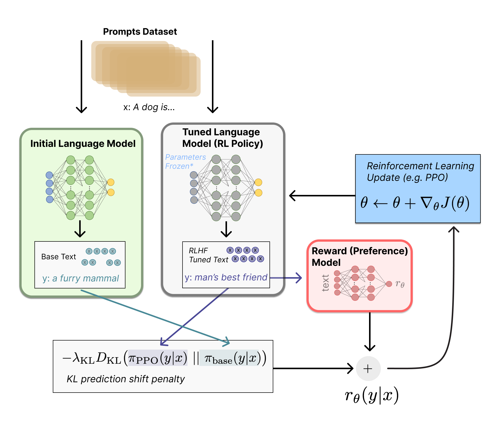

- 图13-1 PPO工作流程（出自HuggingFace《ChatGPT背后的功臣——RLHF技术详解》）

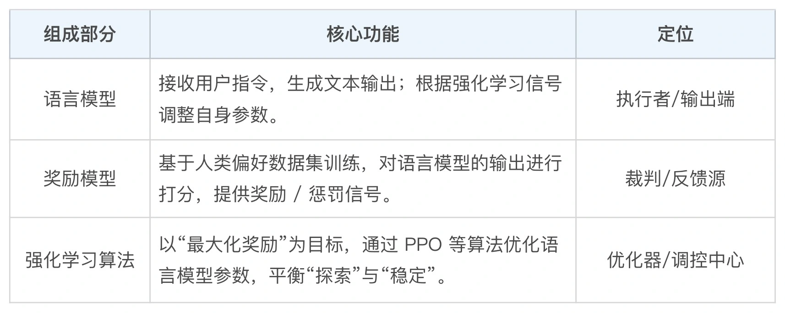

- 表13-1 RLHF核心组成

## 1.2 符号和问题表述

在 RLHF 框架中，将文本或图像生成建模为“片段的（Episodic）马尔可夫决策过程（MDP）”是连接生成任务与强化学习算法的核心桥梁。这种建模方式既贴合生成任务“逐 token 自回归（Autoregressive）”的本质，又能通过 RLHF 的奖励机制和优化算法对齐人类偏好。下面将从核心概念拆解、算法细节扩展两个层面，对原表述进行详细阐释。

### 1.2.1 RLHF 核心框架与“片段式 MDP”的适配性

首先需要明确：RLHF 的目标是通过人类偏好信号优化生成模型的策略，而“片段式 MDP”恰好能描述“从用户提示出发，逐步生成内容，最终得到完整输出并接受反馈”的闭环过程。这里的“片段（Episode）”特指“从接收用户提示到生成完整输出”的单次生成任务——每个片段独立存在，片段结束后不会延续到下一个任务，因此符合“片段式 MDP”的核心定义。​

在这个框架下，有四个核心要素需要先明确，它们是理解后续建模的基础：​

1. 参考模型（Reference Model）：通常是预训练后的生成模型（如 GPT 类模型、扩散模型），作为策略优化的“基准”，避免新策略偏离原有语言或图像生成能力过多。​

## R

2. 奖励模型（Reward Model,）：通过人类对不同生成结果的偏好标注训练而成，能为“用​ψ

## p

## y

- 户提示 ​ + 生成结果 ​ ”的组合输出一个标量奖励值，量化该结果符合人类偏好的程度（奖励越高，越符合偏好）。​

3. 行为策略（Behavior Policy）：用于采集生成样本的初始策略，通常就是参考模型，或基于参考模型微调后的初步策略。​

4. 目标策略（Target Policy）：RLHF 最终要优化的策略，即能生成更符合人类偏好的文本 / 图像的新模型。

### 1.2.2 生成任务的“片段式 MDP”建模细节拆解

## p

将文本或图像生成视为“片段的马尔可夫决策过程”（符号定义参考表 13-2），以用户提示 为

- ​ =

## s

## p

## t

## s

初始状态

- ，时间步 的状态为提示加先前生成的动作，续写是自回归采样的完整动0​t

## a

## π

作序列，每个 token

- 基于策略在当前状态下选择。​t​t

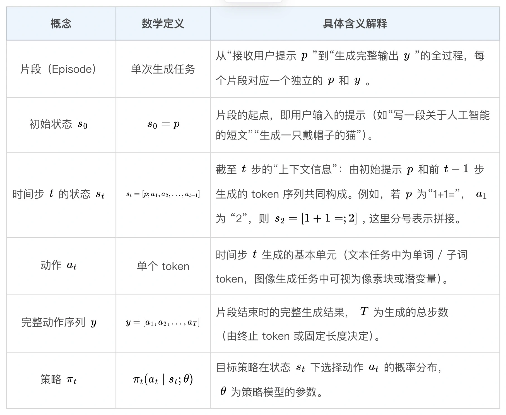

- 表13-2 核心概念定义

将上述内容串联，RLHF 中生成任务的“片段式 MDP”建模与优化逻辑可总结为以下四步：

## R

1. 初始化：以参考模型作为行为策略和初始目标策略，以训练好的奖励模型作为人类偏​ψ好的量化工具。

## p(p ∼D)

## y

2. 片段采样：对每个提示，通过行为策略生成完整的 token 序列 （即一个片

## s

## a

- 段），记录每一步的状态和动作。​t​t优势计算：

## A^t

- ​ =​(p, y) −​(s​)

## V

## R

## V

- a. PPO：用评论者估计状态价值，计算；​ψψψt

## A^t

- ​ =​(p, y) −

## p

## G

## y

## R

## B

- b. GRPO：对同一 采样个 ，用群体平均奖励作为基线，计算ψ。

4. 策略更新：在最大化“期望优势估计”的同时，通过 KL 正则化约束策略与参考模型的差异，PPO 还通过裁剪目标函数控制更新幅度，最终得到优化后的目标策略。

这个过程循环迭代，直到目标策略生成的内容能稳定符合人类偏好，且不偏离基本的生成规律——这正是 RLHF 能让 AI 生成内容“更懂人类”的核心逻辑。

## 1.3 对齐范式

图 13-2 清晰呈现不同强化学习对齐范式在流程与实现方式上的差异：

1. RLHF（基于人类反馈的强化学习）先依据人类偏好数据训练奖励模型，再借 PPO 优化策略；

2. DPO 摒弃奖励模型，基于冻结参考模型，直接优化对比目标；

3. RLVR（可验证奖励强化学习）用确定性可验证信号取代主观偏好，通过 GRPO 训练策略。

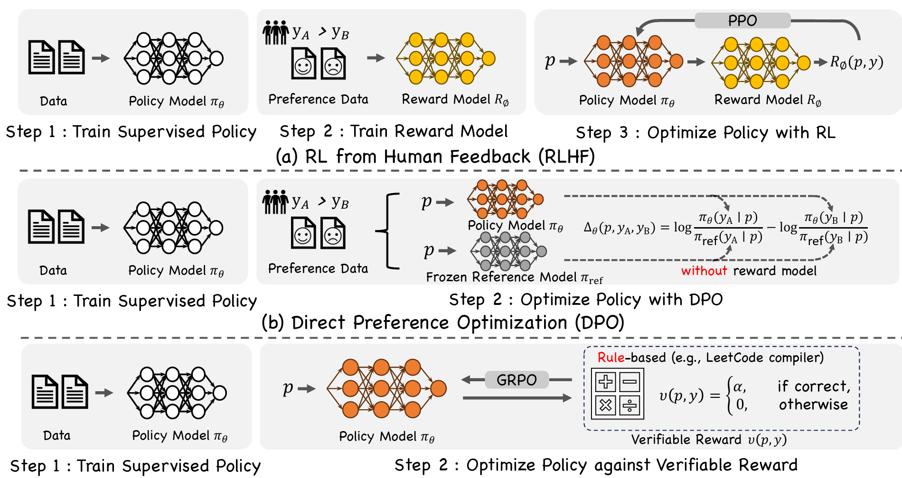

- 图13-2 强化学习范式（出自《Reinforcement Learning in Vision: A Survey》）

### 1.3.1 基于人类反馈强化学习

## p, y

- ​, y

## y

RLHF 通过整理人类标注者的成对偏好数据（三元组 (

- ) 及标签 ）扩展潜在马尔可夫aβ​

## R

决策过程，其标量奖励模型

- 通过 Bradley-Terry 似然训练重现成对排序，训练收敛后提供​ψ

人类偏好代理；策略优化通过最大化学习到的奖励、KL 惩罚（使策略接近监督微调基线）及可选对数似然正则化器实现，前两项用 KL 正则化的 PPO 优化，第三项添加预训练梯度；大多数现代 RLHF 流程遵循三阶段方案，先收集演示数据训练监督策略，再收集比较数据训练奖励模型，最后用 PPO 针对奖励模型优化策略，该范式由 Christiano 等开创，Ouyang 等扩展到大型语言模型。

### 1.3.2 直接偏好优化

## p, y

- ​, y

## y

直接偏好优化（DPO）采用与 RLHF 相同的成对偏好数据（三元组 (

- )，其中为更aβ​a​

## y

受偏好的“赢家”，

- 为不太受偏好的“输家”），但移除了中间奖励模型和强化学习循环，而是​β

## π

导出封闭形式的监督目标，该目标隐式强制执行与冻结参考策略

- 的 KL 约束；DPO 最小ref​

## log σ(βΔθ(p, y

- ​, y​))

## Δθ

## L

化的目标

- 为数据集上的期望的负值，其中对数几率差距是dpoab​

## π

## y

## y

## π

## σ

策略

- 对和的对数概率差与参考策略对应差值的差，通过逻辑函数 将差距转​θ​a​βref​

化为二元分类损失，训练使用标准最大似然梯度，无需奖励模型、价值网络或重要性采样。

### 1.3.3 带可验证奖励的强化学习

## V

带可验证奖励的强化学习（RLVR）用确定性、可通过编程检查的奖励信号

- 取代成对人类偏

好，消除了 RLHF 的主观性和数据收集成本，其奖励信号如代码合成的单元测试结果、数学答

## r(p, y) = v(p, y) ∈0, 1

案的精确匹配等，能在线生成；对于提示 p 和续写 y，验证器返回，多数 RLVR 系统采用 GRPO 和标准 KL 正则化训练策略模型，遵循两阶段流程，先在演示

## V (p, y)

数据上进行监督策略预训练得到初始模型，再用 GRPO/PPO 针对动态可验证奖励

- 进

行强化学习微调，还可混入小比例教师强制 SFT（有监督微调）更新以稳定训练，且能实现超越监督学习的策略改进。

## 1.4 RLHF 的详细流程

RLHF 学习过程如图 13-3 所示，RLHF 是一种通过人类反馈来优化语言模型性能的重要方法，其学习过程主要分为有监督微调、训练奖励模型和策略优化三个核心步骤。

- 图13-3 RLHF学习过程（出自《Improving your LLMs with RLHF on Amazon SageMaker》）

### 1.4.1 有监督微调（Supervised Fine-Tuning, SFT）

- 核心目标：让基础语言模型（Base LLM）初步学习人类的指令遵循能力和任务规范，生成符合人类预期格式和逻辑的回答。

- 具体过程：

- 收集人类示范数据：收集人类专家在特定任务上的高质量示范数据，这些数据通常是人类针对各类指令（Prompt）生成的标准、优质回答。

- 微调基础模型：使用收集到的人类示范数据对基础语言模型进行有监督微调。通过这一步骤，基础模型学习到如何根据输入的指令生成合理的回答，得到一个初步优化的模型——SFT 模型（Supervised Fine-Tuned Model）。

### 1.4.2 训练奖励模型（Reward Model, RM）

- 核心目标：构建一个能够量化评估回答质量的模型，为后续强化学习提供“评分标准”。

- 具体过程：

- 收集人类偏好数据：让人类对模型（通常是 SFT 模型）生成的多个回答（如 Answer 1和 Answer 2）进行偏好排序或评分，标注出更符合人类需求的回答。这些数据包含指令（Prompt）、对应的多个回答以及人类对回答的偏好反馈。

- 训练奖励模型：使用收集到的人类偏好数据对另一个基础语言模型进行有监督微调，得到奖励模型（RM）。奖励模型的核心能力是根据输入的指令和回答，输出一个量化的奖励分数（Reward），分数越高代表回答越符合人类偏好。

如图 13-4 所示，这一模型接收一系列文本并返回一个标量奖励，数值上对应人的偏好。我们可以用端到端的方式用大模型建模，或者用模块化的系统建模（比如对输出进行排名，再将排名转换为奖励）。这一奖励数值将对后续无缝接入现有的强化学习算法至关重要。

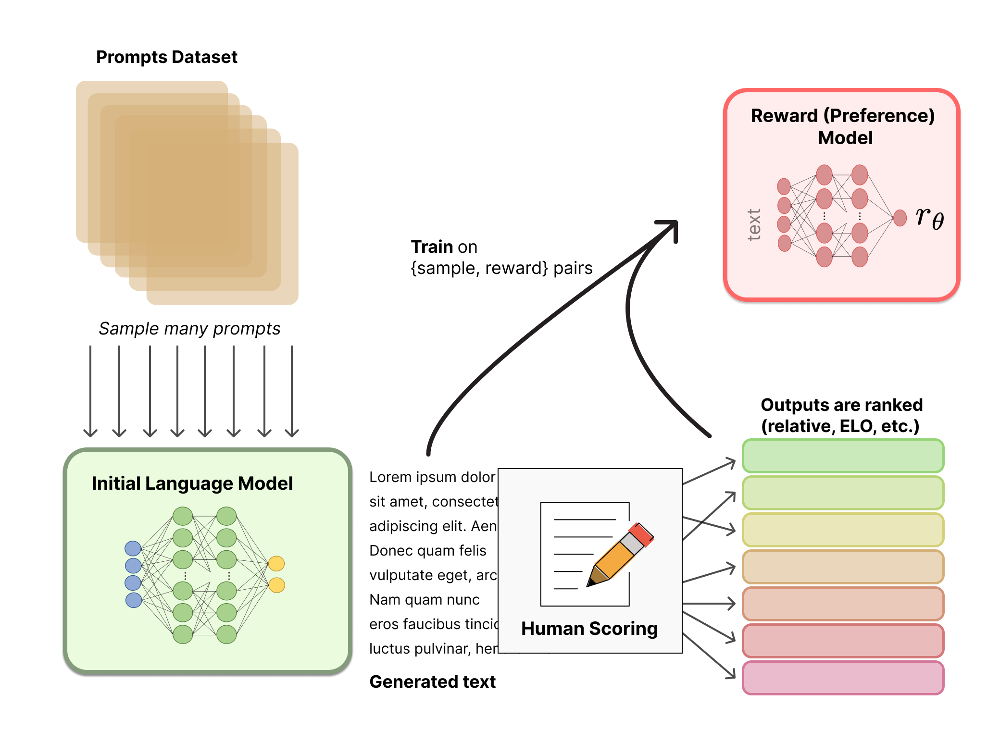

- 图13-4 奖励模型工作流程（出自HuggingFace《ChatGPT背后的功臣——RLHF技术详解》）

### 1.4.3 策略优化（Policy Optimization）

- 核心目标：以奖励模型的反馈为指导，通过强化学习进一步优化 SFT 模型，使其生成的回答更符合人类长期偏好。

- 具体过程：

- 定义策略模型：将经过 SFT 微调的模型作为初始策略模型（Policy），该模型负责根据指令生成回答。

- 强化学习迭代优化：采用强化学习算法（如 PPO）对策略模型进行优化。在每次迭代中，策略模型根据指令生成回答，奖励模型对该回答进行评分并给出奖励；算法根据奖励信号调整策略模型的参数，使模型更倾向于生成能获得更高奖励的回答。通过多次迭代，不断提升策略模型的性能，最终得到经过 RLHF 优化的模型。

例如，在一个对话场景中，语言模型最初生成的回复可能比较生硬、缺乏针对性。经过奖励模型评估并给出较低分数后，强化学习算法会调整语言模型的参数，使得下一次生成的回复更加自然、贴合对话情境，从而获得更高的奖励分数。

## 二、以 RLHF 为代表的后训练方法

过去几年间，各类大型语言模型依据人类输入提示（prompt）生成多样化文本的能力，已然达到了令人惊叹的水平。然而，对这些生成结果的评估却极具主观性与上下文依赖性——无论是评判模型生成的创意故事是否新颖、信息类文本是否准确，还是代码片段是否可执行，传统基于规则的文本生成指标（如 BLEU、ROUGE）都显得力不从心，难以精准衡量其真实质量。

更关键的是，现有模型的训练逻辑普遍局限于“预测下一个单词（Next Token）”的范式，且多采用交叉熵等简单损失函数进行优化，整个过程中并未显式融入人类的偏好与主观判断。

那么，若直接将人类对生成文本的反馈作为性能衡量标准，甚至更进一步，以这类反馈为损失信号来优化模型，是否能突破上述局限？这正是 RLHF 的核心思想。通过强化学习的框架直接优化融合人类反馈的语言模型，RLHF 可以让在通用文本语料库上训练的语言模型得以与复杂的人类价值观实现对齐。

## 2.1 从大语言模型的有监督微调开始

我们要训练一个大语言模型，第一步是准备好一个待训练的 Transformer Decoder 模型和一批要训练的数据。

## x = (x

- ​, x​, x​, … , x​)

## θ

给定一个输入 token 序列：

- ，我们要训练的模型 ，模型的输出可123TT​(x​∣x , … , x​)​(x) =

## ∏t=1

- ​ P

## P

- 。在有监督微调（SFT）阶段的训练目标为

以定义为：

- 1t−1θθt

最大化当前模型预测的训练数据的似然度，为此可以最小化负对数似然损失：

## log P

这个损失的本质是让模型尽可能预测对下一个 token ——

- 越大，说明模型对当前​θ

token 的预测信心越准，加负号后最小化损失，就是让模型的预测尽可能贴近人类示范的正确输出。

SFT 的过程是让模型学习条件概率的过程：

- SFT 的过程主要是学习每一步最合理的 token，在输出第 t 个 token 的时候，完全依赖 (1 ~t-1) 个 token 所得到的 embeddings，其反馈粒度是 token 级别的。

- SFT 只是为了学习“什么是对的输出”，模型只能通过“提高好的”来间接地“降低坏的”，无法直接对负样本进行合理利用。

## 2.2 RLHF

我们不妨回到几年前，回到那个在 RLHF 的有效性还没有被大量证明的时候。彼时 SFT 已让模型“会回答”，但 RLHF 的目标是让模型“回答得更符合人类的有用性、真实性、无害性偏好”。正因为 SFT 无法区分“好回答”与“差回答”，才需要 RL 结合人类反馈进一步优化。

其实最早使用 RLHF，主要是由于预训练阶段训练的数据过大，导致 LLM 虽然可以正常输出一个完整的句子，但是其内容会有很大的语义偏差。OpenAI 早在 2020 年的时候针对文本摘要模型，最早提出了要从 human feedback 中学习。其三段式的训练方式如下：

- 收集人类反馈

- 训练奖励模型

- 使用 PPO 算法训练策略

- 【提示】为何选择 PPO 而非其他 RL 算法呢？LLM 参数规模极大，传统 RL 算法（如Policy Gradient）易导致训练不稳定或“灾难性遗忘”（忘记 SFT 学到的基础能力），而 PPO通过“裁剪目标函数”限制策略更新幅度，兼顾了优化效果与训练稳定性，因此成为 RLHF 的主流算法。

也逐渐成为后续 RLHF 的一个雏形。这里也简单对 RL 在 NLP 语境下的任务进行阐述，以PPO 为例。

## R(⋅)

## π

## τ

强化学习总体目标为找到一个策略

- ，使通过它产出的轨迹 的回报的期望尽可能​θ

## E

## arg max

- ​ J(π​) =​[R(τ)]。在 LLM 的语境下，RL 的整体目标就

高。可以定义为：

- τ∼ππθ​θ​θ

## τ

是要学习一个最优的 LLM（Policy model），让它产生的回复尽可能的好，这里的轨迹 是

## τ = t

- ​, t​, ..., t

LLM 生成回复时的 token 序列（

- ）—— RL 的“轨迹”本质是“状态 - 动作序12T​

列”，在 LLM 中“状态”是已生成的 token 序列，“动作”是下一个生成的 token，整条回复就是完整的轨迹。

在大语言模型中，有几种可能的方式可以从预测的 token 概率分布中生成响应。

## p

- 贪心搜索（Greedy Search）在每轮预测中都选择概率最大的词，给定 token 的输出分布，模型总是确定性地选择概率最高的 token。（图 13-5）

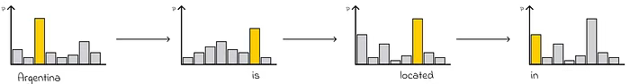

- 图13-5 每次取最高概率

- Top-K 采样方法，每轮预测时，先筛选一组高概率候选词，再依概率分布随机采样确定输

## p

- 出。给定 token 的输出分布 ，模型根据其指定的概率随机采样一个 token。（图 13-6）

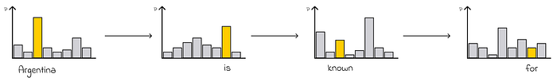

- 图13-6 指定的概率随机选取

- 以上两幅示意图均出自《Explained Simply: Reinforcement Learning from HumanFeedback》。

但在不同场景中，我们对于随机性的要求可能不一样。比如在开放式文本生成中，我们更倾向于生成更具创造力的文本，所以我们需要采样具有更强的随机性。而代码生成中，我们希望生成的代码更为保守，所以我们需要较弱的随机性。

那么怎么来定义怎样的回复是好回复？很自然地想到，专门去训练一个模型，去对这个回复进

## R(⋅)

行评价，而这个模型，我们可以叫做奖励模型（Reward Model，RM），这里定义为

- ，

其输入为 LLM 生成的回复，输出是一个标量分数。训练好的 RM 会为强化学习阶段中策略模

## R(τ)

型生成的每一条回复打分（即回报

- ），PPO 再根据这个分数调整策略模型的参数，使模

型更倾向于生成高分回复（即符合人类偏好的回复）。

RM 的训练目标是一个“分数”，但是直接对大量数据标注分数显然是不够合理且不够准确的。所以奖励模型最常用的训练策略是基于 Bradley-Terry (也称为 Bradley-Terry-Luce 模型）。

基于“人类成对比较偏好数据”的训练策略，其理论基础是 Bradley-Terry 模型。注意，Bradley-Terry 是偏好建模的概率框架，而非训练策略本身，而训练策略是用成对比较数据拟合该框架下的奖励函数。具体来说，模型对同样一个输入生成两条回复，分别经过 RM 得到两个分数，最大化选择减少拒绝的奖励，其具体损失函数构造如下：

- ​(τ​ >​ ∣

## x, τ

- ​, τ​) =

## σ(R(τ

- ​) −

## R(τ

- ​))

## P

## τ

- 121212θ

## R(⋅)

## x

其中 为输入，

- 为奖励模型。

## 2.3 后训练方法

后训练（Post-Training）是指在预训练模型的基础上，针对特定的任务或数据集进行额外的训练。这个阶段通常涉及到微调（Fine-tuning）和对齐（Alignment），即调整预训练模型的参数以适应新的任务。如图 13-7 所示，黑色表示预训练阶段，红色表示后训练阶段，紫色表示推理测试阶段。

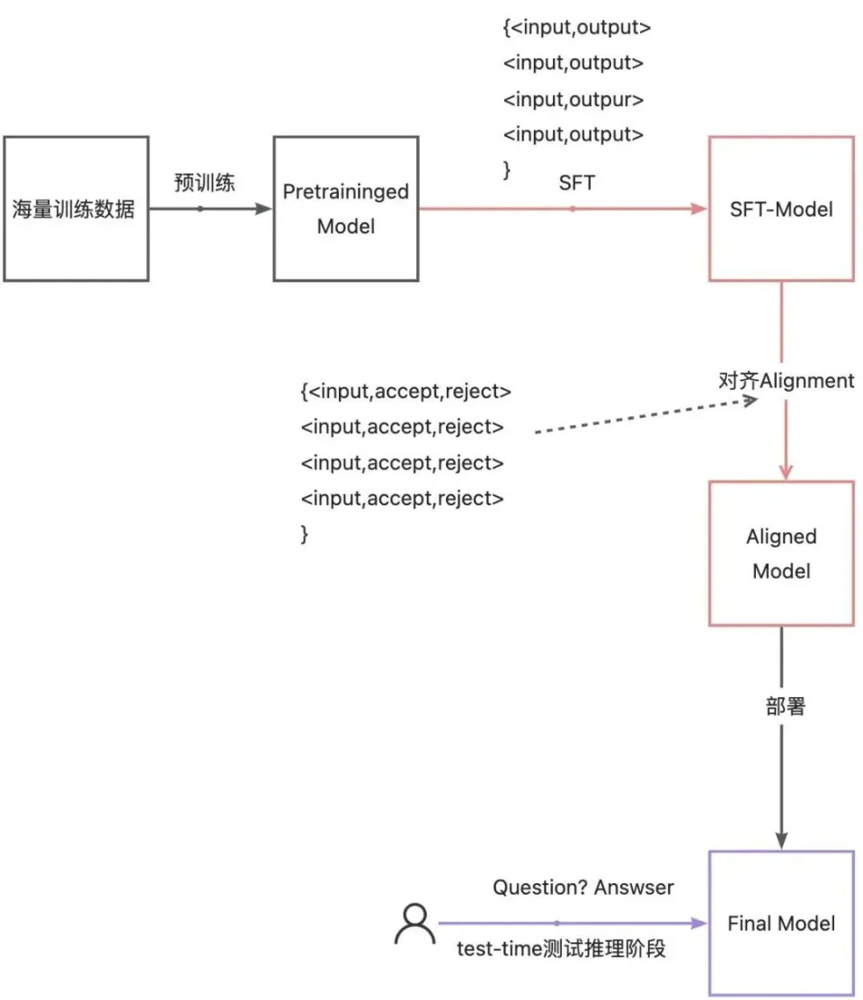

- 图13-7 大模型训练到应用流程图（出自阿里技术《微调之后还能做什么？大模型后训练全链路技术解析》）

自从参数规模达 1750 亿的 GPT-3 问世以来，后训练领域迎来了关注度与创新成果的爆发式增长。为进一步提升大语言模型（LLM）性能，业界与学界探索出多种核心技术路径，具体可归纳为四类：

1. 微调：依托标注数据集或特定任务数据，对模型参数进行针对性调整，使其适配具体应用场景。

2. 对齐策略：通过优化模型输出逻辑，让其决策与生成内容更贴合用户偏好及实际需求。

3. 知识适配技术：助力模型高效融入领域专属知识，打破通用知识与垂直领域的适配壁垒。

4. 推理改进：聚焦增强模型的逻辑分析、因果推断与复杂决策能力，提升其解决实际问题的可靠性。

在技术迭代过程中，多项关键创新进一步推动了后训练技术的成熟。

- 对齐与适配效率优化：2023 年，直接偏好优化（DPO）技术简化了基于人类反馈的强化学习（RLHF）流程——它绕开中间奖励建模环节，直接针对人类偏好优化模型输出，大幅提升了对齐效率与结果稳健性；同年，检索增强生成（RAG）等领域适配技术问世，通过集成外部知识库，让模型在专门领域的输出更丰富，且无需对模型进行全面再训练，这对需要实时更新信息的专业应用（如医疗、金融）至关重要。​

- 架构创新与效率提升：专家混合（MoE）模型的兴起，成为后训练架构层面的重要突破。与传统密集架构不同，MoE 模型通过动态激活选择性参数子集，在优化计算效率的同时，还能容纳更大的参数规模。2022 年，Google 推出的 Switch-C Transformer 率先提出这一范式，其 1.6 万亿参数分布在 2048 个专家中，开创了“平衡资源需求与性能提升”的新路径；后续迭代模型进一步完善这一框架——如 Mixtral，以及总参数达 2360 亿、160 个专家中仅 21 亿参数活跃的 DeepSeek V2.5，不仅在 LMSYS 基准测试中取得最先进结果，还证明稀疏 MoE 架构在可扩展性和效能上可与密集模型媲美，推动 PoLM 向“效率导向”转变，让 LLM 能以更低计算开销处理复杂任务，为扩大实用范围奠定基础。​

进入新发展阶段，2025 年推出的 DeepSeek-R1 成为 PoLM 创新的里程碑——它摆脱了对传统监督微调（SFT）的依赖，转而采用链式思维（CoT）推理与探索性强化学习（RL）策略。以其衍生模型 DeepSeek-R1-Zero 为例，该模型集成了自我验证、反思与扩展式 CoT 生成能力，验证了“开放研究范式下 RL 驱动推理激励”的可行性；同时引入蒸馏技术，将复杂推理模式从大架构迁移至小架构，既实现了比单独 RL 训练更优的性能，又为 LLM 开辟了“可扩展、推理为中心”的新范式，为解决后训练方法中长期存在的“计算效率”与“任务适应性”难题提供了新思路。

如图 13-8 所示，迭代的监督微调（SFT）预热阶段，随后在同一数据集上进行强化学习训练。强化微调（Reinforcement Fine-Tuning, ReFT）是后训练领域中极具创新性的先进技术，其核心优势在于将强化学习（RL）与监督微调（SFT）深度融合，能有效增强模型解决复杂动态问题的能力，为提升 LLM 的泛化性与问题解决效率提供了新路径。​

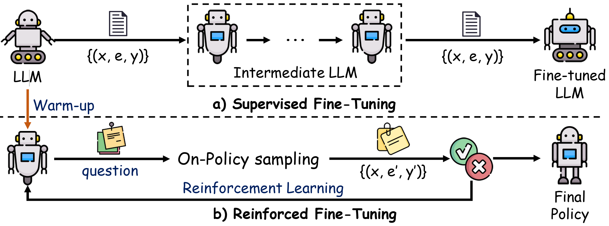

- 图13-8 强化微调的过程（出自《A SURVEY ON POST-TRAINING OF LARGE LANGUAGE MODELS》）

与传统监督微调（SFT）相比，ReFT 在推理路径探索上实现了关键突破：传统 SFT 针对单个问题通常仅依赖单一链式思维（CoT）注释，模型的推理逻辑被局限在固定路径中；而 ReFT通过灵活的机制，让模型能够自主探索多条有效推理路径——这种多路径探索不仅打破了单一注释的限制，还能帮助模型从不同角度理解问题、验证解决方案，最终显著提升其泛化能力与复杂问题解决技能。​

从技术流程来看，ReFT 的实现遵循“基础训练 - 强化精炼”的两步式逻辑，具体过程如下：​

1. 初始 SFT 阶段：ReFT 以标准监督微调为起点。在此阶段，模型借助高质量监督标注，在标注数据集上完成初步训练——核心目标是让模型掌握任务的基础解决方法，建立起与任务适配的基本能力框架，为后续强化学习阶段打下基础。​

2. 强化学习精炼阶段：完成初始微调后，模型进入基于强化学习算法（如主流的 PPO）的精炼环节。这一阶段的核心是“多路径生成 - 奖惩反馈 - 策略迭代”：模型针对每个问题生成多个 CoT 注释，主动探索不同的潜在推理路径；随后，系统通过将模型预测答案与真实答案进行精准比对，对正确输出给予奖励，对错误输出实施惩罚；通过这种持续的迭代反馈，模型会不断调整自身推理策略，逐步优化路径选择逻辑，最终实现推理能力的显著提升。

## 2.4 RLHF 的应用

RLHF（基于人类反馈的强化学习）凭借其在对齐人类偏好与优化模型实用性能上的显著优势，在大语言模型领域有着广泛且深入的应用。ChatGPT 作为大语言模型的杰出代表，就应用 RLHF 技术来提升对话质量。在 ChatGPT 的训练过程中，首先通过大规模无监督预训练构建基础语言模型。然后，进行监督微调，使用人工标注的对话数据，让模型学习如何生成合理的对话回复。

在奖励模型训练阶段，OpenAI 的研究人员收集了大量 ChatGPT 生成的对话回复，并邀请人类标注者对这些回复进行评价。标注者根据回复的相关性、准确性、流畅性以及是否符合人类对话习惯等因素，对回复进行排序和打分。基于这些标注数据，训练奖励模型。最后，利用PPO 等强化学习方法，根据奖励模型给出的分数，对 ChatGPT 的语言模型进行优化。通过这种方式，ChatGPT 能够不断改进对话生成能力，生成的回复更加自然、智能，能够更好地满足用户的需求。

图 13-9 大模型发展时间线，展示了采用强化学习训练的具有代表性的推理模型的发展历程，其中包括开源和闭源的语言模型、多模态模型以及智能体模型。推理模型的两个重要里程碑（OpenAI o1 和 DeepSeek-R1 ）表明，通过带有可验证奖励（RLVR）的训练，例如数学题答案正确率或代码单元测试通过率，可以让模型掌握长链推理能力，包括规划、反思和自我纠错。

强化学习在大推理模型上的应用，标志着人工智能发展的一次重要转折。它不仅仅是让语言模型对齐人类的偏好，更是在推动它们真正掌握推理和逻辑思考的能力。通过可验证的奖励机制、先进的优化算法以及大规模的训练基础设施，研究者们正在打造能够进行多步推理、跨领域解决问题的智能系统。

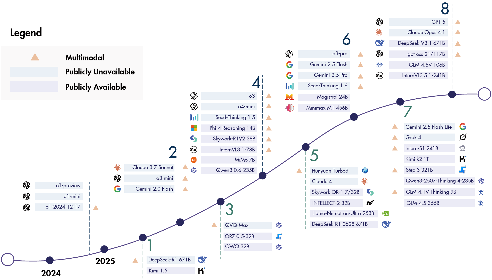

- 图13-9 大模型发展时间线概览图（出自《A Survey of Reinforcement Learning for Large Reasoning Models》）

除了 ChatGPT，RLHF 的应用场景还在不断拓展，许多其他大语言模型也纷纷借鉴了 RLHF的思想和方法。例如，一些企业开发的智能客服模型，通过 RLHF 技术，使得模型能够根据用户的问题生成更准确、更具针对性的回答。在训练过程中，同样先进行预训练和监督微调，然后利用人类客服对模型生成的回答进行评估和反馈，训练奖励模型，最后通过强化学习优化模型。这样训练出来的智能客服模型，能够显著提高客户满意度，减少人工客服的工作量。

## 三、RLHF 的优势与挑战

在明确 RLHF 的核心原理、建模逻辑与落地流程后，我们需要从实践视角辩证审视这一技术：它既通过人类反馈为大模型“对齐人类偏好”提供了突破性方案，也因依赖人工标注、训练流程复杂等特性面临现实瓶颈。本节将系统梳理 RLHF 的核心优势，同时剖析其在落地过程中亟待解决的关键挑战。

## 3.1 RLHF 的显著优势

通过引入人类反馈，RLHF 能显著提升模型的输出质量，使其生成的文本在流畅性、逻辑性、准确性和相关性上均有明显改善。在知识问答等任务中，经过 RLHF 训练的模型可有效避免模糊或错误信息的生成，为用户提供更精准、详尽的答案，更好地满足人类对高质量内容的期望。​

在内容创作需遵循道德、伦理和社会价值观的当下，RLHF 发挥着关键作用。它借助人类反馈让模型学习并内化这些准则，确保生成内容符合社会规范。面对敏感话题时，模型能凭借所学的价值观避免偏见、歧视或不当言论，从而保障内容的安全性与伦理性。​

RLHF 还增强了模型的适应性和灵活性，使其能根据不同应用场景与用户群体的需求进行个性化优化。在医疗领域，通过医生等专业人士的反馈，问答模型可更深入理解医学问题并提供专业建议；在教育领域，结合教师和学生的反馈，模型能生成更适配教学与学习的内容，充分满足特定任务的个性化需求。

## 3.2 RLHF 面临的挑战

人类反馈的主观性和不一致性是 RLHF 面临的显著挑战。由于人类标注者的背景、经验与个人偏好存在差异，他们对文本的评价往往带有主观性，甚至出现不一致的情况。这种差异可能导致奖励模型接收到不准确或矛盾的偏好信号，进而影响模型的优化方向和效果。比如在对故事趣味性的评价中，不同标注者的看法可能大相径庭，使得奖励模型难以精准把握“有趣”的统一标准。​

高成本的人力投入是 RLHF 实施过程中的另一大难题。该技术需要大量人类标注者参与模型输出的评估、排序和打分等工作，这不仅要耗费巨额的时间和人力成本，还对标注者的专业素养和时间精力提出了较高要求。尤其是在大规模模型的训练场景中，人力成本问题更为突出，例如训练一个参数规模庞大的语言模型，可能需要数百名甚至数千名标注者进行长期的标注工作。​

RLHF 的训练过程还存在复杂性和不稳定性问题。其涉及奖励模型训练、强化学习算法应用等多个阶段，且算法逻辑复杂，导致整体训练流程繁琐。同时，强化学习过程中易出现训练崩溃、陷入局部最优解等不稳定情况。此外，超参数设置对训练结果影响极大，需通过大量实验和调优才能确定合适配置，就像使用近端策略优化算法时，学习率、折扣因子等超参数的微小变动，都可能引发模型性能的大幅波动。​

## 四、RLHF 与其他后训练方法的比较

RLHF 并非大模型后训练的唯一方案。随着“模型对齐”需求的深化，学界和工业界衍生出了直接偏好优化（DPO）、基于规则的微调、任务特定微调等多种替代或补充方法。这些方法在“是否依赖奖励模型”“数据需求”“适用场景”等维度存在显著差异，选择何种方案需结合实际任务目标与资源约束。本节将通过对比 RLHF 与主流后训练方法，明确其技术定位与适用边界。

## 4.1 与监督微调（SFT）的比较

为什么要 RLHF，其实就源于它和 SFT 的区别。这个问题也回到了为什么要强化学习，而不是传统的监督学习。监督学习依赖直接的监督信号，强化学习可以进行模仿学习。在大语言模型中，监督微调的训练目标是，给定指令（Prompt），拟合响应（Response）。即，给定指令的条件下，响应出现的概率。

监督微调是在预训练模型的基础上，利用人工标注的高质量指令 - 响应对进行有监督学习。其核心目标是让模型更好地理解任务指令，并产生符合预期的输出。在这个过程中，模型主要学习的是给定输入到目标响应的映射关系，通过最小化模型输出与标注数据之间的交叉熵损失来优化模型参数。例如，给定输入“解释一下光合作用”，标注的理想输出可能是“光合作用是植物利用光能将二氧化碳和水转化为有机物，并释放氧气的过程”，模型通过学习大量这样的输入 -输出对来调整自身参数。​

而基于人类反馈的强化学习则更为复杂。它是在监督微调的基础上进行的进一步优化。首先，需要训练一个奖励模型（Reward Model），这个奖励模型的训练数据来源于人类对模型输出的偏好反馈。即，强化学习可以通过奖励模型实现自迭代。在少量标注的代价下，通过强化学习可以在特定领域拥有相当强的判别能力。OpenAI 给出的解释，对于能够用编程手段量化对错的问题，比如分类，在数据量很充足的情况用监督微调显然可以。RLHF 针对的主要是没法通过常规手段判断对错，只能用人类评价来模糊判断的场景。

其核心仍是强化学习与监督学习的差异。监督学习是纯粹的“利用”已有数据；而强化学习则兼具“探索”与“利用”。理论上，若有无穷多的样本，仅用监督学习便已足够，但现实中这一前提并不成立。实际场景里，人工标注的优质或劣质样本数量极为有限。于是，人们想到依据这些有限样本，学习出“什么样的样本是好样本”的信号，也就是奖励信号。随后，在奖励信号的引导下，借助强化学习的探索特性，去生成更多优质样本，以此推动模型学习。简而言之，就是在样本极度有限的情况下，凭借强化学习的“探索 + 利用”机制，在现有样本的基础上，进一步提升样本质量，从而让模型趋近于局部最优。

具体来说，对于同一输入，模型会生成多个不同的输出，人类标注者对这些输出进行排序或打分，奖励模型通过学习这些排序或打分数据，来近似人类偏好，即学会给“人类更偏好”的回答打高分，给不合适的回答打低分。然后，利用强化学习算法（如近端策略优化 PPO 算法），以奖励模型给出的分数作为奖励信号，对语言模型进行优化，使得语言模型生成的内容更符合人类偏好，提升安全性、可用性与响应质量。例如，对于输入“推荐一本适合初学者的编程书籍”，模型可能生成三个回答：A“推荐《Python 基础教程》，内容详细全面”，B“《C++ 入门经典》很不错”，C“看看《JavaScript 高级程序设计》”，人类标注者对这三个回答进行排序（如 A> B > C），奖励模型通过学习这类排序数据来评估回答质量，进而指导语言模型优化。​

监督微调的优点在于其训练过程相对简单直接，是单阶段的监督训练。它只需要大量高质量的示例问答对或“指令 - 响应”对，资源和调参开销较小，训练速度快。例如，Vicuna 在大约 300美元成本下就完成了 13B 模型的 SFT。通过 SFT，模型能够提升对训练任务的性能和一致性，更好地回答示例中出现的问答类型。然而，SFT 也存在明显的局限性。它可能导致模型进行“填鸭式”学习，仅仅关注训练数据的分布，无法捕捉人类偏好的微妙要求。如果训练数据质量不足，模型可能产生偏差，并且对于超出训练数据模式的情况，模型的泛化能力可能较弱。例如，在面对一些需要灵活处理和理解人类复杂偏好的任务时，监督微调模型可能表现不佳。​

RLHF 的优势则体现在，它能够直接优化人类偏好目标，使模型输出更符合“有帮助、无害”等标准。通过奖励模型，RLHF 可以从多个维度对模型输出进行评估，对于复杂偏好场景具有更好的适应性。例如，在对一篇涉及多领域知识的复杂文章进行评价时，RLHF 的奖励模型可以综合考虑文章的逻辑性、准确性、完整性等多个因素对文章进行打分，从而引导模型生成更优质的内容。此外，RLHF 通常能提升生成回答的对齐性和安全性，减少模型生成毒性、偏见等不当内容的风险。

不过，RLHF 也并非完美无缺。它的训练复杂度高，属于多阶段复杂流程，通常需要先进行监督微构建基础模型，再训练奖励模型，最后用强化学习算法进行策略优化。这导致其训练成本高昂，并且难以调试。同时，在强化学习过程中，模型可能会引入过度谨慎、自我审查等行为，而且在基础知识推理上，相比监督微调模型，其提升效果可能不明显，甚至在某些情况下会略微下降 。​

关于监督微调与 RLHF 的“优缺点、数据需求、适用场景”等维度对比，如表 13-3 所示，具体如下。

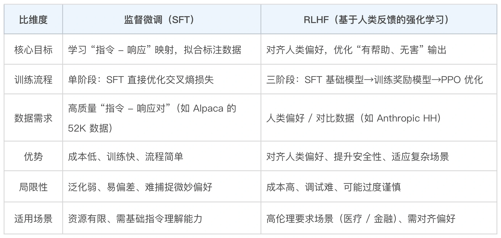

- 表13-3 监督微调与RLHF对比

后训练阶段，业界主流的模型优化路径是“监督微调冷启动→RLHF 增强”：先通过监督微调让预训练模型快速摆脱“通用文本生成”的泛化性，初步适配目标场景的指令理解与响应逻辑（例如让通用大模型学会“遵循客服对话话术”“输出结构化的医疗问诊回复”）；再基于监督微调模型生成多组候选输出，通过人类标注偏好数据训练奖励模型，最终用强化学习算法（如 GRPO）以奖励信号优化模型，实现从“能应”到“响应好、符合人类预期”的能力升级，兼顾效率与效果。

如图 13-10 所示，首先，收集提示，每个提示进行 K 次生成。同时，利用成对标注且按能力细分的二元偏好数据来训练奖励模型。接着，通过拒绝采样得到监督微调数据，再结合按能力细分的专用监督微调数据训练监督微调模型。然后，基于监督微调模型进行 DPO 训练，得到最终的 DPO 模型。而且，前几轮的最佳模型也会参与到后续流程中，以得到下一轮的最佳模型，整个后训练策略涵盖了拒绝采样、监督微调以及直接偏好优化等环节。

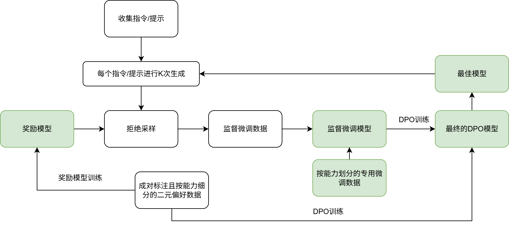

- 图13-10 LLaMA3整体后训练方法

## 4.2 与其他传统后训练方法的对比

与基于规则的后训练方法对比。

基于规则的后训练方法是通过预先定义一系列规则，对模型输出进行修正和调整。例如，在文本生成中，设定一些语法规则、逻辑规则等，当模型生成的文本违反这些规则时，对其进行修改。

与 RLHF 相比，基于规则的方法具有明确性和确定性，能够快速纠正一些明显的错误。但是，这种方法的局限性也很明显，它难以应对复杂多变的语言现象和人类多样化的偏好。规则往往是有限的，而语言和人类需求是无限的，对于一些超出规则范围的情况，基于规则的方法无法有效处理。而 RLHF 能够通过学习人类反馈，不断适应新的语言场景和偏好要求。

与基于特定任务数据微调的方法对比。

基于特定任务数据微调的方法是，使用针对特定任务的标注数据对预训练模型进行微调，以提高模型在该任务上的性能。这种方法在特定任务上能够取得一定效果，但它缺乏对人类整体偏好的考虑。模型可能在微调的任务上表现良好，但在生成其他相关内容时，仍然可能不符合人类的普遍期望。

而 RLHF 不仅关注特定任务，更注重从人类反馈中学习通用的偏好模式，使得模型在各种场景下生成的内容都更符合人类的价值观和需求。例如，一个经过情感分析任务数据微调的模型，在进行情感分析时表现较好，但在生成日常对话时，可能因为没有考虑人类对话的自然性和多样性偏好，而生成生硬、不自然的回复，而经过 RLHF 训练的模型则能更好地平衡不同场景下的表现。

## 总结

在大语言模型从“通用能力”向“实用价值”跃迁的过程中，以 RLHF 为代表的后训练方法无疑是核心技术支柱。它通过“人类反馈 + 强化学习”的创新组合，打破了传统训练中“仅依赖数据拟合”的局限——不再让模型只学会“预测下一个词”，而是引导模型理解“人类想要什么”，最终生成更符合价值观、更贴近实际需求的内容。无论是 ChatGPT 流畅自然的对话能力，还是智能客服精准高效的问题解决能力，背后都离不开 RLHF 对“模型 - 人类对齐”的推动，其在对话系统、文本生成、专业领域助手等场景的应用，已切实提升了用户体验与产业效率。

但我们也需清醒认识到 RLHF 面临的挑战：人类反馈的主观性（如不同标注者对“有趣”“有用”的判断差异）可能导致奖励模型偏差；大规模人工标注带来的时间与资金成本，让中小团队难以负担；多阶段训练流程（SFT→RM→RL）的复杂性，以及强化学习过程中可能出现的训练崩溃、局部最优等问题，仍需技术突破。

同时，RLHF 并非“万能方案”：与 SFT 相比，它虽能捕捉复杂偏好，但训练成本更高、流程更繁琐；与 DPO 相比，它依赖中间奖励模型，虽适配更复杂场景，却不如 DPO 简洁高效；与基于规则的后训练相比，它虽能应对多变需求，却缺乏规则的确定性。因此在实际应用中，需结合场景目标（如是否需通用偏好对齐、成本预算多少、任务复杂度高低），灵活选择单一方法或组合策略（如“先 SFT 冷启动，再 RLHF 优化”）。

展望未来，随着“降低标注成本”（如结合主动学习筛选关键样本）、“提升反馈一致性”（如引入领域专家校准标注标准）、“简化训练流程”（如融合 RL 与 SFT 的 ReFT 技术）等方向的探索，以 RLHF 为代表的后训练方法将更成熟、更易用。而大模型的训练目标，也将从“对齐人类偏好”进一步迈向“理解人类意图、辅助复杂决策”，最终推动自然语言处理技术从“工具”升级为“智能伙伴”。

## 思考题

在大模型后训练实践中，某团队计划为医疗领域问答模型设计优化方案：该模型需同时满足“医学知识准确性”（可通过专业数据库验证）与“患者沟通友好性”（依赖人类主观判断，如语言通俗度、共情表达）两大核心需求。请你结合本节课所学的 RLHF、DPO、RLVR 等后训练方法，分析下：

1. 单一后训练方法（如仅用 RLHF 或仅用 RLVR）为何难以同时高效满足这两类需求？

2. 你会如何设计“多方法融合的后训练流程”，既保证医学知识的客观准确性，又能让模型生成符合患者偏好的友好回复？请说明各阶段选用的方法、核心目标及方法间的协同逻辑。

希望你通过今天的学习，对强化学习有了清晰的认识。如果有任何疑问，欢迎在讨论区留言交流！
