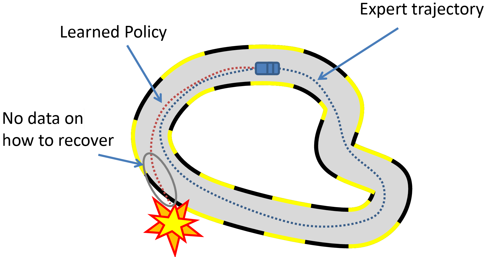
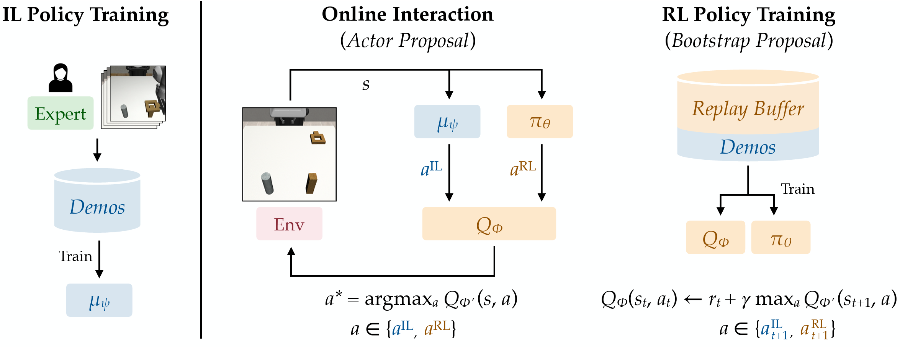
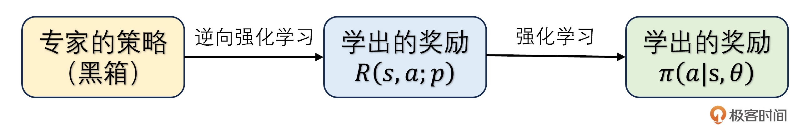
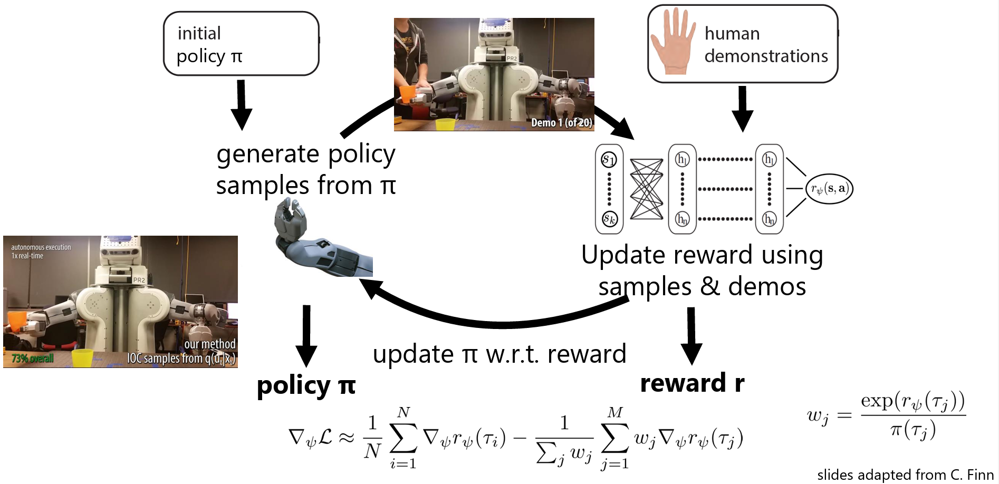
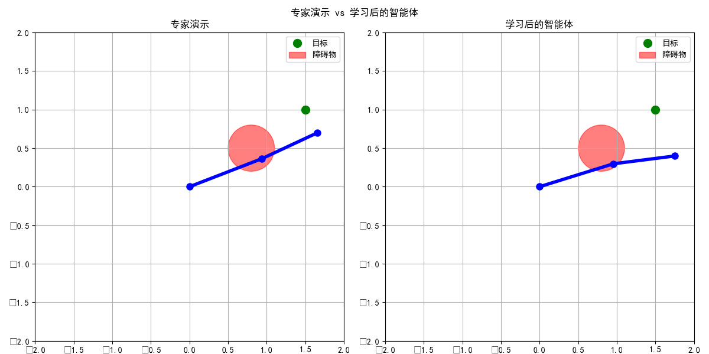
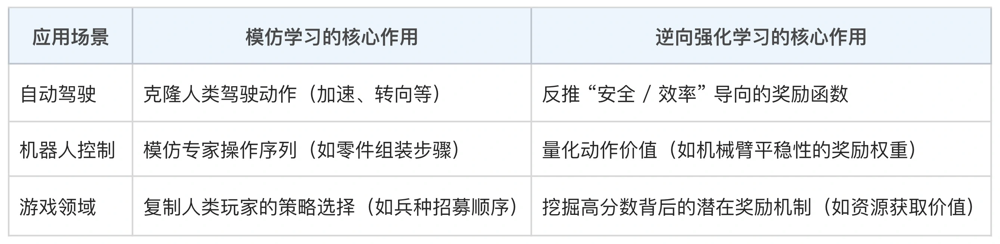

# 14 | 强化学习前沿：从模仿学习到逆向强化学习

你好！欢迎来到强化学习的第十四讲。在前几讲中，我们学习的强化学习算法大多依赖“人工定义奖励函数”这一前提，但在自动驾驶、机器人复杂操作等实际场景中，精确量化“好的行为”（比如如何定义驾驶的“安全性”“效率”）往往异常困难，甚至无法实现。而模仿学习与逆向强化学习，正是为突破“奖励函数设计困境”而生的前沿方向——它们不依赖人工设定的奖励，而是从人类专家的示范行为中学习策略或反推奖励，为复杂任务的智能体训练提供了全新思路。

通过本节课的学习，你将能够：

- 理解模仿学习的核心逻辑：为何行为克隆能像监督学习一样直接“复制”专家动作，以及数据集聚合（DAgger）如何解决其“状态分布偏移”问题。

- 掌握逆向强化学习（Inverse Reinforcement Learning，IRL）的关键思路：如何从专家轨迹中反推潜在奖励函数，以及最大熵 IRL、引导成本学习（GCL）等方法的实现逻辑。

- 清晰区分两种方法的联系与差异：明确二者在“数据依赖”“学习路径”“环境交互需求”上的核心不同，以及在自动驾驶、机器人控制等场景中的适配性。

## 一、模仿学习（Imitation Learning）

在我们之前介绍的 RL 中，通常需要大量的试错，并且对奖励函数的设计有很高的要求。但在某些实际应用场景中，显式地定义奖励函数非常困难，甚至不可能。比如，让机器人学习人类的驾驶行为，很难用一个精确的奖励函数来描述“好的驾驶行为”，因为涉及很多复杂因素，比如安全、效率、法规遵守，还有人类驾驶员的经验判断，这些很难量化。

这种情况下，模仿学习（Imitation Learning, IL）就有了用武之地。模仿学习是一种在没有显式奖励信号的情况下，让智能体学习专家策略的方法。其核心思想是：通过观察专家的行为，学习一个策略，使其能够像专家一样完成任务。

模仿学习与强化学习有着密切的联系，但也有着本质的区别。强化学习的目标是优化一个由奖励函数定义的策略，而模仿学习的目标是复制一个由专家演示定义的策略。换句话说，强化学习是“创造”策略，而模仿学习是“模仿”策略。

## 1.1 定义与背景

模仿学习，也被称为示范学习（Learning from Demonstration）、学徒学习（ApprenticeshipLearning）或者观察学习（Learning by Watching）。在很多实际问题中，我们难以从环境中获取明确的奖励信号。以聊天机器人为例，怎样才算一次高质量的对话，很难给出确切的量化奖励。但我们可以收集人类专家的示范数据，比如人类驾驶员的驾驶记录、人们之间的对话范例等。

多拉德和 N.E. 米勒首先提出模仿学习说，认为若观察者的行为与示范者的行为相一致，并经常获得足够的强化，就能使观察者学会模仿。现代社会学习理论的代表班杜拉认为，模仿学习的过程是观察者以整体知觉的方式观察到示范者在一定情境中对某一刺激物的反应，并以表象的方式在意识中再现，借助语言符号系统的思维表征作用，从而熟练、牢固地掌握特定情景中的特殊反应。

- 说明：

- 模仿学习问题：状态空间中不存在显式的奖励。解决方案：行为克隆、逆强化学习，即根据专家路径和智能体路径，逆向学习奖励函数。类似于对抗生成网络的学习方式。特殊场景：第三人称视角模仿学习（类似对抗学习，增加视角判别器）、序列生成和聊天机器人。

## 1.2 方法介绍

模仿学习类似于监督式学习，只不过模型输出的值更多是动作而非标签。直观上，类似小孩通过观察学习大人拿东西一样，对于同样的输入（比如苹果），大人怎么拿苹果，小孩就学习去拿。小孩的整个学习过程，就像以大人的动作作为监督信号，怎么去训练一个监督式学习的模型来使得模型输出的结果跟监督的动作信号一致，这种行为字面解释上就很像行为克隆（behavior cloning）。在自动驾驶中，有时候会把这个行为扩展为一整条短时序下的轨迹。这也是目前业界端到端自动驾驶里的最主要的学习目标。

### 1.2.1 行为克隆

行为克隆的原理较为简单，本质上与监督学习相似。以自动驾驶为例，我们通过行车记录器等

## s

## a

方式收集人类驾驶汽车的大量数据，记录在各种状态

- 下人类采取的动作。然后构建一个​i​i

## a^i

## s

网络模型（即智能体的策略模型），将状态

- 作为输入，期望模型输出的动作与人类专家​i​

## a

的动作

- 尽可能一致。这就如同让智能体“克隆”人类专家的行为决策。​i

## D = (s

- ​, a​), (s​, a​), ..., (s​, a​)​(a∣s)

## π

假设我们有一组训练数据

- ，构建一个策略网络1122nnθ

## πE

## θ

（由参数 决定）来学习专家策略

- 。

一种方法是通过最小化损失函数来训练网络，常见的损失函数可以是均方误差（针对连续动作

## L(θ)

空间）或者交叉熵损失（针对离散动作空间）。以均方误差为例，损失函数

- 为：

- n

## 1

## ∑

- i ∣2​ −π

## L(θ) =

- ​(s​)

## ∣i

- ​ aθ​

## n

- i=1

## θ

训练过程就是不断调整参数 ，使得损失函数最小化，从而让智能体的策略尽可能接近人类专家的策略。

## πE

## π

另一种估计方法是最大似然估计，就是直接从数据里去估计

- 。稳态策略 能够用一个

## ∣S∣× ∣A∣

## π(⋅∣s)

## A

## s

- 的表格（矩阵）来表示；具体到某一状态 ，就是动作空间上的单纯型

## A

（可以理解为动作空间

- 上的一种概率分布）。

## (s, a)

## πθ

## θ

对于任意给定的待估计概率模型

- （ 为待估计参数），一个数据样本的似然可表示​​(a∣s)

## πθ

为：

- 。所以，最大化对数似然模型可表述为：

## ∑

- ​log π(a∣s)

## max

- ​​∈R∣S∣×∣A∣πθ(s,a)∈D

## ∑πθ

- ​​

## s.t.

- ​(a∣s) = 1,

## ∀s ∈S.

- ​a∈A

经验证，上述公式对应的问题属于凸优化问题，而且对于有限状态和动作空间的马尔可夫决策过程问题，其最优解形式很简单。具体来说，最优解可通过“计数”求解：对于数据集里出现的

- ​ I(s​=s,a​=a)∑(s

## I(⋅)

## I(⋅) =

- ii​,a​)∈D​(a∣s) =

## ⋅

## s

## πθ

状态 ，令

- 。这里表示示例函数，即若 为真，ii​ I(s​=s)∑(s​i​,a​)∈Dii

## I(⋅) = 0

## 1

## s

；否则

- 。对于数据集里未出现过的状态 ，可将其动作分布设为均匀分布，即

## π(a∣s) = 1/∣A∣

- 。

- 注：这种参数化方法通常被称为直接参数化（Direct Parameterization），即每个动作选择概

## θ ∈R∣S∣×∣A∣

- ​(a∣s)

## πθ

## θ

- 率就是一个参数，这里。s,a​

当面对非离散空间问题时（比如状态空间是欧几里得空间，或动作空间是欧几里得空间，又或者两者都是欧几里得空间），前面那种基于“计数”的求解方案就不再适用了。尤其是在这种情况

- ​ =​(a∣s)

## θ

## πθ

- 这个关系不再成立。此时，上式一般会转化为：

下，

- s,a

## max

- ​ log(​(a∣s))θ ∑(s,a)∈D

## πθ

- 。（出自南京大学许天等人《模仿学习简洁教程》)​

### 1.2.2 数据集聚合

行为克隆虽实现简单，但存在一个难以规避的核心缺陷：复合误差（Compounding Error）。由于其训练数据局限于专家已有的示范轨迹，当智能体在实际执行中遇到未被示范过的状态时，只能做出次优决策；而这一次优决策又会将智能体引入更陌生的后续状态，导致误差不断累积，最终脱离任务目标。

针对这一痛点，Stéphane Ross 等人提出了数据集聚合（Dataset Aggregation，DAgger）算法——通过“智能体探索 + 专家补全”的动态数据扩充机制，从根源上解决状态分布偏移问题。

例如，行为克隆的“复合误差”在自动驾驶中可能引发致命问题：假设训练数据全是“正常行驶”的专家轨迹，从未包含“车辆偏离车道、即将撞向护栏”这类危险状态，那么当智能体实际驾驶时真的遇到这种情况，由于没有匹配的“状态 - 动作对”参考，它根本不知道该刹车、转向还是减速，最终极可能引发事故。

而数据集聚合算法的核心思路，就是通过“智能体探索 + 专家补全”的迭代循环，主动填补这类“状态空白”。其具体操作可拆解为三个关键步骤，形成一个持续优化的闭环。

1. 初始化：用专家数据训基础策略。首先，用原始的专家示范数据（比如人类安全驾驶的轨

## π

- 迹）训练出一个初始策略。这个策略能应对专家示范中出现过的常规状态，但对未见过​1的“分布外状态”依然束手无策。

## π

2. 交互探索：让策略“试错”，专家“纠偏”把初始策略放到真实环境（或高保真模拟器）中​1运行，同时安排人类专家全程监控。a. 当智能体遇到常规状态（如平稳跟车）：它可能做出和专家一致的动作，此时无需额外操作；

- b. 当智能体遇到陌生状态（如突发横穿马路的行人、车道线模糊）：它可能做出犹豫或错误的决策（比如迟迟不刹车），此时专家会立刻介入——不直接干预驾驶，而是针对当前这个

## s

## a

- “陌生状态 ”，给出自己会采取的最优动作（比如“立即轻踩刹车、小幅减速”）。关expert​

## s

## a

- 键操作：记录下这组“智能体遇到的陌生状态 + 专家给出的最优动作”，形成新的expert​训练样本。

3. 聚合更新：扩充数据，迭代优化策略，将第二步收集到的“陌生状态 - 专家动作”样本，全部加入到原始训练数据集里，形成一个更全面的“混合数据集”（既包含初始专家数据，也包含

- 新探索出的边缘场景数据）。 用这个扩充后的数据集重新训练模型，得到性能更优的新策略

## π

- 。​2

重复上述“策略运行→专家补全样本→聚合数据→更新策略”的流程，经过多轮迭代后，训练数据会覆盖越来越多智能体可能遇到的“非常规状态”，策略也能学到对应场景的最优应对动作——就像让智能体在“专家教练”的实时指导下“见多识广”，最终摆脱对初始专家数据的依赖，大幅降低复合误差的风险。

模仿学习的潜在假设清晰而直接：每一条训练数据轨迹都对应着当前状态下的最优行为真值，换言之，模型的行为与训练数据越贴近，就被认为越接近理想效果。​

但这一假设在驾驶这类具有丰富多模态解的场景中，却面临着现实的挑战——根本不存在所谓“唯一完美”的驾驶行为。在纯粹依赖模仿学习的端到端模型训练中，数据多来源于真人驾驶场景，而这些驾驶员的驾驶风格、操作技术乃至文明礼让程度各不相同，其中不乏非合规驾驶的案例。这使得训练数据不仅在驾驶策略与风格上缺乏一致性，更难以称得上“最优”与“完美”；从这类不完美的数据中，模型自然无法习得清晰、严谨的驾驶逻辑，最多只能掌握一些模糊且似是而非的驾驶模式。​

因此，纯粹基于模仿学习的端到端模型，很难达到人们对“具备强逻辑与因果关系的拟人驾驶策略”的期待，其实际表现反而充斥着明显的随机性与不确定性。

模仿学习还存在一个核心症结：其默认数据中每一刻的行为真值都具备同等权重，在模型训练过程中，这些数据对策略行为模型参数的影响呈现出“吃大锅饭”的均一化特征——决策轨迹的每一个局部都被要求尽可能逼近人驾数据的真值，却无法对决策场景进行有效区分：哪些属于需要精准把控的关键场景决策，哪些又是阈值宽松、容错度更高的普通场景决策，始终处于模糊状态。​

由于缺乏对不同场景决策的差异化对待，所有决策在训练中被赋予了近乎均等的重要性。这种“无重点”的训练模式，往往导致模型在关键时刻难以做出精准判断，甚至犯下致命错误。最终的结果是，模型输出的可靠性大打折扣，无法被完全信赖，必须依赖其他兜底策略的补充才能保障应用安全。

### 1.2.3 对抗式模仿学习

对抗式模仿学习（adversarial imitation learnin）作为重要的模仿学习算法类型，主要通过匹配专家的状态 - 动作访问分布来模仿专家策略。如果学得的策略与专家策略能够访问相似的状态- 动作对，那么该策略应该与专家策略有相似的性能。

## πE

## π

要最小化策略 与专家策略

- 在各时间步状态 - 动作访问分布上的差异总和，目标函数为：

## ( h

- πE)π dhH​,

## min

- π ∑h=1​ ϕ d。​​

其中：

- π

## d

## π

## h

- 表示策略 在时间步 时的状态 - 动作访问分布；​hπE

## πE

## dh

## h

- 是对专家策略在时间步 时状态 - 动作访问分布的估计；​

## ϕ(⋅, ⋅)

- 是用于度量两个分布之间差异的函数（如 KL 散度、 Wasserstein 距离等）。

为了优化这一目标函数，对抗式模仿学习同时需要专家样本和环境交互样本。然而，在现实任务中，获取专家样本和环境交互样本往往是昂贵的。

## 1.3 具身智能中的模仿学习：范式局限与突破方向

具身智能（Embodied AI）作为人工智能领域的前沿方向，旨在赋予机器人或智能体在物理世界中感知、决策与行动的核心能力。

为何具身智能尤其依赖模仿学习？要解答这一问题，需先回归具身智能的核心定义：它旨在让机器人等智能体通过感知物理世界、执行实体动作来完成任务，而这一过程天然面临两大棘手挑战。​

第一个挑战是奖励函数设计的固有困境。对于真实世界中大量非标准化任务，我们很难用精确的数学公式定义“完美奖励函数”。例如，如何量化“将衣物叠得整齐”的标准？怎样界定“优雅地为人类倒一杯水”的尺度？更关键的是，奖励函数哪怕存在微小偏差，都可能引发“奖励破解”（Reward Hacking）现象——机器人会钻规则漏洞，习得看似符合奖励要求却偏离任务本质的怪异行为。​而模仿学习恰好绕开了这一难题：它无需抽象定义“什么是好的行为”，而是通过专家演示直接具象化“好的行为是什么”，从根源上规避了奖励函数设计的短板。​

第二个挑战是探索空间的指数级庞大。若让机器人以强化学习的初始模式——通过随机试错从零开始学习，仅“开门”这样一个简单动作，就可能需要数百万甚至数十亿次尝试。这在物理世界中完全不具备可行性：漫长的试错周期、巨大的能源消耗，以及高频动作对硬件造成的损耗，都是无法承受的成本。​

模仿学习则通过注入高质量专家演示，极大压缩了智能体的探索范围，使其从“高起点”开启学习进程——这一优势被精准概括为“提升样本效率”（Improving Sample Efficiency）。其核心逻辑其实极为直观：让机器人等智能体通过观察人类等“专家”的操作示范来习得任务技能。这就像人类学开车的过程：我们不会从零摸索物理定律与操作逻辑（这正是强化学习的思路），而是先观察教练如何打方向盘、控制油门刹车、观察后视镜，再通过模仿这些具体行为掌握技能。模仿学习之于具身智能，正如同教练指导之于学车者，是高效且贴合需求的学习路径。

近年来，视觉 - 语言 - 动作模型（Vision-Language-Action, VLA）虽已取得诸多进展，但具身智能领域始终未能迎来类似 GPT 的爆发式“奇点时刻”。越来越多研究者意识到，单纯扩大模型规模、增加数据量级，似乎难以催生通用化的操作模型——若想充分释放现有数据的潜在价值，关键在于革新机器人操作的核心学习范式，而模仿学习作为该领域的核心技术路径，其建模逻辑的优化尤为重要。

当前模仿学习的经典方法（如 ACT、Diffusion Policy（DP））均遵循前向预测范式，这一范式的固有缺陷却成为模型学习效率的瓶颈。具体而言，此类方法在学习过程中，会将策略优化目标聚焦于“基于当前观察预测短期的下一步动作”，而非确保模型能学习到完成完整任务的全局逻辑。这种学习逻辑不可避免地导致了显著的复合误差：每一步短期预测的微小偏差会随动作序列累积放大，最终偏离任务目标。尽管学界尝试通过动作分块（action chunking）等策略缓解误差问题，但始终未能根治其 “短视性” 本质 —— 模型仍无法从数据中学习到跨越长期序列的任务全局最优策略，这正是当前模仿学习在具身智能场景中难以突破的核心症结。

- 提示：“前向预测范式”是一种通过对未来状态或结果进行预测来指导决策或学习的模式。在强化学习等领域中，它通常指模型基于当前状态和采取的动作，对环境接下来可能产生的状态、奖

- 励等进行预测，并利用这些预测信息来优化策略或决策过程。这种范式强调通过推断未来的发展趋势来指导当前的行为选择，帮助智能体更好地适应环境并实现长期目标。

## 1.4 模仿学习和强化学习的结合

在机器人学习领域，模仿学习（IL）与强化学习（RL）是两类核心方法，二者各有鲜明优劣：

- 模仿学习通过复刻人类示范数据，能够快速收敛至一个具备基础性能的策略，但其局限性也十分突出——面对分布外（OOD）数据时（图 14-1），机器人常因缺乏对应示范而陷入 “无从下手” 的困境，泛化能力受限。

- 强化学习则依托智能体的自主探索机制，理论上可突破示范边界挖掘更优策略，但它对奖励函数设计高度敏感：若采用稀疏奖励函数，在连续控制等任务中，庞大的动作空间会导致探索效率极低，训练过程极易陷入停滞。



- 图14-1 数据分布不匹配（出自卡内基梅隆大学强化学习课程）

在自动驾驶领域，可能大多数模型还是基于模仿学习训练出来的（使用专家司机的轨迹信息），那如何将二者融合以实现优势互补？

斯坦福大学团队在 2024 年机器人科学与系统大会（RSS 2024）上发表的论文，提出了一种名为“模仿引导强化学习（Imitation Bootstrapped Reinforcement Learning, IBRL）”的创新方案，为这一问题提供了全新解法。

如图 14-2 所示，IBRL 将训练分为三部分，IL 策略训练（IL Policy Training）、在线交互（Online Interaction）和 RL 策略训练（RL Policy Training）。

- 说明：IL (Imitation Learning)：即模仿学习，此处指通过学习示范数据来训练初始策略。RL (Reinforcement Learning)：即强化学习，此处指基于环境反馈（奖励）来优化策略。Online Interaction：指智能体（如机器人）与真实或模拟环境进行实时交互，以获取数据用于后续的强化学习优化。



- 图14-2 IBRL训练流程

## μ

在 IL 策略训练阶段，使用专家演示进行模仿学习训练，得到模仿学习策略

- ，在这一阶段​ψ

你可以选择自己熟悉的模仿学习算法进行训练，不会影响到后续的训练。

在线交互阶段，强化学习部分使用 actor-critic 框架进行训练，在给定状态后，模仿学习策略

## μ

## π

- 和 actor会根据状态分别给出一个动作，然后使用 Q 函数对这两个动作进行打分，选

​ψ

- ​θ

择分高的动作进行执行，并将与环境交互的转移（样本）放到经验缓冲区中供 actor 网络和critic 网络进行学习。

RL 策略训练，采样在线交互时存放在经验缓冲区中的转移（样本）进行学习，更新 actor 网络和 critic 网络的参数。

IBRL 通过使用 Q 函数对动作打分，对来自 BC 策略和 actor 网络的动作进行评价，选择 critic网络认为较好的动作进行交互与学习，实现了从模仿学习到强化学习的自然过渡，无需手动设计切换规则，无需引入额外参数，为模仿学习与强化学习结合提供了新思路。

尽管模仿学习通过直接复刻专家行为，成功绕开了“人工设计奖励函数”的难题，但其“以行为复现为核心”的本质也带来了难以规避的局限：无论是行为克隆对“专家示范覆盖所有状态”的强依赖，还是 DAgger 需要人类专家实时介入补全数据的高成本，本质上都是因为模仿学习仅停留在“复制动作”的表层，未能触及专家行为背后的“决策逻辑”——即专家为何在该状态下选择此动作，而非其他动作？那些未被示范的状态中，“好的行为”又该遵循何种价值准则？

当任务复杂度进一步提升（如机器人需理解“优雅倒水”的隐性要求、自动驾驶需平衡“效率与礼让”的冲突），单纯模仿动作已无法满足需求——我们需要的不仅是“像专家一样做”，更是“像专家一样思考”。这种对“专家决策背后价值标准”的探索，催生了另一种更具深度的前沿方法：逆向强化学习。它不再直接学习动作，而是从专家的示范轨迹中反推那个“让专家行为成为最优解”的潜在奖励函数——这正是我们接下来要深入探讨的核心内容。

## 二、逆向强化学习

强化学习是通过动态奖励的方式来指导模型学习，但在很多任务中，奖励函数不太好定义。比如自然语言处理中的一个问题的两种回答怎么区分好坏，没有固定的定义规则。因此大家会看到初期大语言模型会主动输出两个答案来让用户告诉他哪个答案好。

本质上，这个就是模型在初期也不知道哪种结果好，需要通过这种方式收集用户的反馈。通过用户反馈的结果，大语言模型会类似学习出一个奖励模型。在主模型训练任务中，会通过奖励模型来指导强化学习任务中的奖励信号。

比起自然语言模型，自动驾驶中的奖励相对来说有一些比较明确的定义。但为了进一步衡量舒适性 / 效率等指标，自动驾驶领域会利用专家数据（高质量的人类驾驶数据）结合不太好的驾驶行为数据共同训练出一个奖励模型。因为强化学习是利用奖励来指导模型训练，而上述描述的任务本身是为了学习生成奖励，这个过程刚好相反，故一般把这些任务叫做逆强化学习。

逆强化学习旨在从示范行为中推断出奖励函数，这对于理解和模仿人类行为特别有价值。

## 2.1 定义与动机

逆强化学习的出现，核心是为了解决传统强化学习在特定场景下对“外在奖励”过度依赖的痛点，尤其在大语言模型（LLM）训练等复杂任务中这一需求更为突出。具体原因可归结为以下两点：

1. 传统强化学习的“奖励信号获取瓶颈”。

在经典强化学习训练 LLM 的流程（SFT→RM→PPO）中，奖励信号的获取依赖两种外在方式：一是 RLHF 中的奖励模型（RM），需大规模高质量人类偏好数据集训练，成本高、周期长且难以扩展；二是 RLVR 中的验证器（Verifier），仅适用于有明确标准答案的场景，无法覆盖开放问题。当缺乏人工标注的偏好数据或标准答案时，传统 RL 会因“奖励信号缺失”而失效。

2. “专家行为可观测，但奖励逻辑难显式定义”的现实需求。

在许多任务中（包括 LLM 的对齐训练），人们容易获取“专家策略的轨迹数据”（如人类专家的高质量文本输出、演示样本），但很难直接、准确地定义“驱动专家行为的奖励函数”。例如，人类撰写一篇优质回答的背后，涉及逻辑连贯、信息准确、表达流畅等多重隐性标准，无法用简单的显式规则量化为奖励信号。逆强化学习正是为了从可观测的专家行为中“反推”出内在奖励，填补“行为可见但奖励未知”的差异。

逆向强化学习，又称逆最优控制（Inverse Optimal Control）。传统强化学习是在已知奖励函数的前提下，智能体学习如何优化策略以最大化奖励。而逆向强化学习则反其道而行之，它试图从专家的示范行为中反推出潜在的奖励函数。

在许多现实任务中，奖励函数难以人工设计。例如在机器人的复杂操作任务中，不同动作组合对完成任务的贡献难以精确量化为奖励值。但我们可以观察到专家（如熟练的机器人操作员）如何高效完成任务，逆向强化学习就是利用这些专家示范数据，去寻找一个合理的奖励函数，使得在这个奖励函数下，通过传统强化学习得到的最优策略能够尽可能接近专家的行为策略。

- 奖励机制是强化学习的核心构成要素，其本质在于界定任务目标，并驱动智能体通过优化行为来实现该目标。这一机制与生物系统中多巴胺的作用具有类比性 —— 正如多巴胺能够激励和强化生物的适应性行为，强化学习中的奖励信号会推动智能体主动探索环境，并引导其行为向期望方向演进。

- 然而，奖励信号的获取并非总是直接的。在研究场景中，奖励函数通常由研究者预先明确设定；但在大量真实世界应用中，奖励往往天然缺失，或因任务复杂性、目标模糊性等因素难以被清晰定义。因此，如何从多样化的反馈信息中提炼出有效的奖励信号，进而利用标准强化学习算法优化智能体策略，已成为当代强化学习领域的关键研究方向之一。

- 尽管奖励建模对强化学习的落地与发展至关重要，但现有强化学习多局限于特定子领域（如逆强化学习（IRL）、基于人类反馈的强化学习（RLHF）等），鲜少将其作为一个独立的核心课题进行系统性的梳理与整合。

逆强化学习通过“从专家轨迹反推奖励函数”的核心逻辑，针对性解决了传统方法的多个关键问题，尤其在 LLM 训练场景中价值显著：

1. 解决了“外在奖励信号难以获取或成本过高”的问题

无需人工标注大规模偏好数据集（如 RLHF 的 RM 训练数据），也无需依赖预设的标准答案或规则（如 RLVR 的 Verifier），仅通过已有的专家演示数据（如 SFT 的专家样本、LLM 的高质量生成轨迹）即可诱导出奖励函数。这极大降低了奖励信号获取的成本，突破了 “无人工标注则无法训练” 的限制。

2. 解决了“奖励函数定义模糊或不全面”的问题

复杂任务（如 LLM 的开放域生成）的奖励逻辑往往包含多重隐性维度（如逻辑性、相关性、流畅性），人工定义的显式奖励函数容易遗漏关键因素或产生偏差。IRL 通过拟合专家行为的整体分布，能自动捕捉这些隐性标准，生成更贴合“真实最优目标”的奖励函数，避免了“人工设计奖励与实际需求脱节”的问题。

3. 解决了“奖励信号的模糊性”（多奖励函数可解释同一行为）

单一的专家行为轨迹可能对应多个潜在的奖励函数，直接反推易产生歧义。以“最大熵逆强化学习”为代表的方法，通过引入熵正则化，在“解释专家行为”的同时，对未观测到的行为保持中立，从而筛选出唯一且合理的奖励函数，消除了 “奖励函数多解性” 带来的模糊性。

4. 为 LLM 提供了“内在奖励”的理论基础，突破参考模型依赖

在 LLM 场景中，IRL 证明了模型的 token 生成策略（由 logits 决定）本身可通过逆运算诱导出内在奖励——即模型的 logits 本质上是一种隐含奖励的 Q 函数。这一发现打破了传统 RL 对“外在 RM 或参考模型”的依赖，甚至衍生出如 RLPR 等“无参考策略”的方法，仅通过模型自身对“正确答案的置信度”即可计算奖励，让强化学习训练脱离“数学孤岛”，适用于更广泛的开放问题场景。

## 2.2 方法原理

逆向强化学习的核心思想是假设专家的行为是在某个未知奖励函数下的最优行为。如图 14-3

- ∗

## π (a∣s)

所示，逆向强化学习目的是，通过模仿人类专家的黑箱策略

- ，学到一个策略网络

## π(a∣s; θ)

- 。



- 图14-3 逆向强化学习原理

求解逆向强化学习，关键在于建立从奖励函数到专家策略的映射，从而通过专家数据求解反问题来恢复奖励函数。典型的求解方法有两种：

- 一种是概率建模，即通过线性规划来直接建模专家策略在奖励函数下的 MDP 最优性，典型方法即最大熵逆强化学习；

- 一种则是最大边际算法，即最大化专家策略的值函数与其他策略的值函数的差距来建立最优性， 典型方法即最大边际逆强化学习。

## R(s, a)

- ​ =

## τ

我们的目标就是找到这个奖励函数

- 。假设专家的示范轨迹为expert​, a​, s​, a​, ..., s​, a

## R(s, a)

## s

- ，我们希望找到一个奖励函数，使得智能体在该奖励函数

1

- 122TT​

## π

下，通过强化学习算法（如策略梯度算法、Q - learning 算法等）学习到的策略 产生的轨迹

## τ

## τ

- 与专家示范轨迹尽可能相似。

​π

- expert​

为了衡量轨迹之间的相似性，可以使用多种方法，例如最大熵逆向强化学习中，引入熵的概念来鼓励策略的多样性，其目标函数可以表示为：

- T−1

## ∑[

- R ]

## ∑

- ​R(s​, a​) + λH(π )

## max

- tt​​Rτ∼πt=0R​

## H(π

- ​)

## π

## πR

## λ

- 是在奖励函数 R 下学习到的策略，是策略的熵， 是调节熵项权重的

其中，

- RR​

参数。通过优化这个目标函数，不断调整奖励函数 R，使得生成的轨迹既能够获得较高的奖励，又具有一定的多样性。

这里我们又提到了最大熵这一机器学习中的重要原则。推荐你回顾在之前课程中对最大熵的讨论与介绍。

## 2.3 从黑盒策略反推隐式奖励

图 14-4 是 Guided Cost Learning（引导成本学习，GCL）算法的流程图，这一经典方法由Finn 等人在 2016 年的 ICML 会议中提出，用于从人类示范中学习奖励函数（逆强化学习的一种实现），核心是通过 “策略采样→奖励更新→策略优化” 的循环，让机器人（或智能体）模仿人类行为完成任务。



- 图14-4 从黑盒策略反推隐式奖励（出自UCB CS285 slides）

以下拆解每个环节：

## π

- Initial Policy（初始策略）：用一个初始策略 （比如随机策略、简单规则）启动流程，这是智能体最初的“行为模式”。

## π

- Generate Policy Samples（生成策略样本）： 让初始策略 在环境中“试错”，收集大量行为轨迹（比如机器人随机运动的视频 / 数据），这些样本代表智能体“自主探索”的行为。

- Human Demonstrations（人类示范）：提供人类专家的“最优行为”（比如人亲自操作机器人完成任务的轨迹），作为学习目标的参考。

- Update Reward（更新奖励函数）：核心环节！用策略样本（智能体自己试错的数据）和人​(s, a)

## r

## ψ

- 类示范（专家数据），通过梯度下降更新奖励函数是奖励函数的参数）。（ψ1 ∑i=1NM1

## ∇

- ​L ≈​ ∇​(τ​) −​∇​(τ​)

## ∑j=1

- ​r​ w​r公式里的梯度近似：。简单ψψ ψijψ ψj∑j​ wN​​j​说：用策略样本的奖励梯度（第一项）“惩罚”自主探索的“次优行为”，用人类示范的加权梯度（第二项）“奖励”专家行为，让奖励函数更接近人类意图。exp(r​(τ​))​ =

## π(τ

- ​)ψj

## w

- 权重：为“人类示范中，智能体原本很难自己做到（小）但奖励高jjπ(τ​)​j​(τ​)

## r

- 大）”的轨迹赋予更高权重，优先让奖励函数学习这类“专家特色行为”。（ψj

## π

- Update Policy（更新策略）： 用更新后的奖励函数 r，重新优化策略 （比如用强化学习算法，让策略更倾向于获得高奖励的行为），让智能体“模仿”人类示范的模式。

解决的问题：

- 逆强化学习核心需求：不需要人工设计奖励函数，而是从人类示范中“逆推”奖励，让智能体学会模仿人类行为。

- 适用场景：机器人模仿学习（如机械臂操作）、自动驾驶、游戏 AI 等“人类行为可示范，但奖励难显式定义”的任务。

关键特色：

- 数据融合：把智能体“自主探索”和“人类专家示范”结合，既利用专家经验，又让智能体适应环境。

- 动态迭代：通过“奖励更新→策略优化”的循环，让智能体逐步逼近人类行为模式，避免直接模仿的僵硬性（比如机器人不会机械复制人类动作，而是学 “完成任务的逻辑”）。

## 2.4 应用案例

在机器人操作领域，逆向强化学习有着广泛应用。例如，对于一个机械臂完成物体抓取和放置的任务，人类专家能够熟练且高效地完成操作。通过记录专家操作过程中的机械臂状态（位置、角度等）以及对应的动作（关节的转动角度变化等），利用逆向强化学习算法，可以推断出一个适合该任务的奖励函数。这个奖励函数不仅考虑了完成任务（成功抓取并放置物体）的奖励，还可能包含一些中间过程的奖励，如机械臂运动的平稳性、与周围障碍物保持安全距离等因素对应的奖励或惩罚。当得到这个奖励函数后，就可以利用传统强化学习算法训练机械臂，使其能够自主学习并执行类似的高效操作任务。

```bash
import numpy as np
import matplotlib.pyplot as plt
from matplotlib.animation import FuncAnimation
import random
# 确保中文显示正常
plt.rcParams["font.family"] = ["SimHei", "WenQuanYi Micro Hei", "Heiti TC"]
# 机械臂环境类
class RobotArmEnv:
   def __init__(self):
       # 机械臂参数
       self.num_joints = 2  # 2个关节
       self.joint_limits = [(-np.pi/2, np.pi/2), (-np.pi/2, np.pi/2)]  # 关节角度
       self.arm_lengths = [1.0, 0.8]  # 手臂长度
       # 目标位置
       self.target_pos = np.array([1.5, 1.0])
       # 障碍物
       self.obstacle_pos = np.array([0.8, 0.5])
       self.obstacle_radius = 0.3
       # 状态空间: 关节角度 + 末端位置
       self.state_dim = self.num_joints + 2
       # 动作空间: 关节角度变化
       self.action_dim = self.num_joints
       self.action_limit = 0.1  # 最大角度变化
   def reset(self):
       # 随机初始化关节角度
       self.joint_angles = np.array([
           random.uniform(*self.joint_limits[0]),
           random.uniform(*self.joint_limits[1])
       ])
       return self.get_state()
   def get_end_effector_pos(self):
       # 计算末端执行器位置
       x = self.arm_lengths[0] * np.cos(self.joint_angles[0]) + \
           self.arm_lengths[1] * np.cos(np.sum(self.joint_angles))
       y = self.arm_lengths[0] * np.sin(self.joint_angles[0]) + \
           self.arm_lengths[1] * np.sin(np.sum(self.joint_angles))
       return np.array([x, y])
   def get_state(self):
       # 返回完整状态
       end_pos = self.get_end_effector_pos()
       return np.concatenate([self.joint_angles, end_pos])
   def step(self, action):
       # 执行动作
       self.joint_angles += action * self.action_limit
       # 限制关节角度在合理范围内
       for i in range(self.num_joints):
           self.joint_angles[i] = np.clip(
               self.joint_angles[i],
               self.joint_limits[i][0],
               self.joint_limits[i][1]
           )
       # 获取新状态
       state = self.get_state()
       end_pos = state[-2:]
       # 计算与目标的距离
       target_dist = np.linalg.norm(end_pos - self.target_pos)
       # 计算与障碍物的距离
       obstacle_dist = np.linalg.norm(end_pos - self.obstacle_pos)
       # 判断是否完成任务
       done = target_dist < 0.1
       # 返回状态、奖励(暂时不用，因为IRL会学习奖励函数)、是否完成、信息
       return state, 0, done, {"target_dist": target_dist, "obstacle_dist": obst
   def render(self, ax=None, show_target=True, show_obstacle=True):
       # 绘制机械臂
       if ax is None:
           fig, ax = plt.subplots(figsize=(6, 6))
       # 计算关节位置
       joint1_x = self.arm_lengths[0] * np.cos(self.joint_angles[0])
       joint1_y = self.arm_lengths[0] * np.sin(self.joint_angles[0])
       end_x, end_y = self.get_end_effector_pos()
       # 绘制机械臂
       ax.plot([0, joint1_x, end_x], [0, joint1_y, end_y], 'bo-', lw=4, markersi
       # 绘制目标
       if show_target:
           ax.plot(self.target_pos[0], self.target_pos[1], 'go', markersize=10,
       # 绘制障碍物
       if show_obstacle:
           obstacle = plt.Circle(self.obstacle_pos, self.obstacle_radius, color=
           ax.add_patch(obstacle)
       ax.set_xlim(-2, 2)
       ax.set_ylim(-2, 2)
       ax.set_aspect('equal')
       ax.grid(True)
       ax.legend()
       return ax
# 专家策略类 - 提供专家演示
class ExpertPolicy:
   def __init__(self, env):
       self.env = env
   def get_action(self, state):
       # 专家策略: 朝着目标移动，避开障碍物
       end_pos = state[-2:]
       target_dir = self.env.target_pos - end_pos
       target_dist = np.linalg.norm(target_dir)
       # 如果距离目标很远，主要朝着目标移动
       if target_dist > 0.5:
           angle_to_target = np.arctan2(target_dir[1], target_dir[0])
           joint1_desired = angle_to_target * 0.6
           joint2_desired = angle_to_target * 0.4
       else:
           # 接近目标时，微调
           joint1_desired = np.arctan2(self.env.target_pos[1], self.env.target_p
           joint2_desired = 0.0
       # 计算关节角度误差
       joint1_error = joint1_desired - state[0]
       joint2_error = joint2_desired - state[1]
       # 计算动作
       action = np.array([joint1_error, joint2_error])
       action = action / (np.linalg.norm(action) + 1e-8)  # 归一化
       # 检查是否接近障碍物，如果是则调整方向避开
       obstacle_dist = np.linalg.norm(end_pos - self.env.obstacle_pos)
       if obstacle_dist < self.env.obstacle_radius + 0.2:
           # 远离障碍物的方向
           avoid_dir = end_pos - self.env.obstacle_pos
           avoid_angle = np.arctan2(avoid_dir[1], avoid_dir[0])
           action = action * 0.5 + np.array([np.cos(avoid_angle), np.sin(avoid_a
           action = action / (np.linalg.norm(action) + 1e-8)
       return action
# 生成专家演示数据
def generate_expert_demonstrations(env, expert, num_demos=5, max_steps=100):
   demonstrations = []
   for _ in range(num_demos):
       demo = []
       state = env.reset()
       for _ in range(max_steps):
           action = expert.get_action(state)
           demo.append((state, action))
           next_state, _, done, _ = env.step(action)
           state = next_state
           if done:
               break
       demonstrations.append(demo)
   return demonstrations
# 逆向强化学习算法 - 最大边际规划(Max Margin Planning)简化版
class IRL:
   def __init__(self, env, feature_dim=5, learning_rate=0.01):
       self.env = env
       self.feature_dim = feature_dim
       self.learning_rate = learning_rate
       # 初始化奖励函数参数
       self.theta = np.random.randn(feature_dim) / np.sqrt(feature_dim)
   def features(self, state):
       # 提取状态特征
       joint_angles = state[:2]
       end_pos = state[2:]
       # 特征包括: 与目标的距离、与障碍物的距离、关节角度的平滑性等
       target_dist = np.linalg.norm(end_pos - self.env.target_pos)
       obstacle_dist = np.linalg.norm(end_pos - self.env.obstacle_pos)
       return np.array([
           1.0,  # 偏置项
           -target_dist,  # 距离目标越近特征值越高
           min(obstacle_dist - self.env.obstacle_radius, 0),  # 靠近障碍物会有惩罚
           -np.sum(np.square(joint_angles)),  # 关节角度不要太大
           -np.sum(np.abs(np.gradient(joint_angles)))  # 关节角度变化不要太剧烈
       ])
   def reward(self, state):
       # 基于特征计算奖励
       return np.dot(self.theta, self.features(state))
   def train(self, demonstrations, num_iterations=100, num_trajectories=10, traj
       # 训练IRL模型，从专家演示中学习奖励函数
       for i in range(num_iterations):
           # 计算专家轨迹的总奖励
           expert_rewards = []
           for demo in demonstrations:
               total_reward = sum(self.reward(state) for state, _ in demo)
               expert_rewards.append(total_reward)
           avg_expert_reward = np.mean(expert_rewards)
           # 生成随机轨迹并计算其总奖励
           random_rewards = []
           for _ in range(num_trajectories):
               state = self.env.reset()
               total_reward = 0
               for _ in range(trajectory_length):
                   total_reward += self.reward(state)
                   action = np.random.uniform(-1, 1, self.env.action_dim)
                   next_state, _, done, _ = self.env.step(action)
                   state = next_state
                   if done:
                       break
               random_rewards.append(total_reward)
           avg_random_reward = np.mean(random_rewards)
           # 计算损失: 专家奖励应该大于随机行为的奖励加上一个边际
           margin = 10.0
           loss = max(0, margin + avg_random_reward - avg_expert_reward)
           # 如果有损失，更新参数
           if loss > 0:
               # 计算梯度并更新
               grad = np.zeros_like(self.theta)
               # 专家轨迹的特征期望
               expert_feature_sum = np.zeros(self.feature_dim)
               for demo in demonstrations:
                   for state, _ in demo:
                       expert_feature_sum += self.features(state)
               expert_feature_avg = expert_feature_sum / (sum(len(demo) for demo
               # 随机轨迹的特征期望
               random_feature_sum = np.zeros(self.feature_dim)
               for _ in range(num_trajectories):
                   state = self.env.reset()
                   for _ in range(trajectory_length):
                       random_feature_sum += self.features(state)
                       action = np.random.uniform(-1, 1, self.env.action_dim)
                       next_state, _, done, _ = self.env.step(action)
                       state = next_state
                       if done:
                           break
               random_feature_avg = random_feature_sum / (num_trajectories * tra
               # 梯度下降更新
               grad = random_feature_avg - expert_feature_avg
               self.theta -= self.learning_rate * grad
           # 打印训练进度
           if i % 10 == 0:
               print(f"Iteration {i}: Expert Reward = {avg_expert_reward:.2f}, "
                     f"Random Reward = {avg_random_reward:.2f}, Loss = {loss:.2f
# 强化学习智能体 - 基于策略梯度
class RLAgent:
   def __init__(self, env, reward_function, learning_rate=0.01):
       self.env = env
       self.reward_function = reward_function  # 使用IRL学到的奖励函数
       self.learning_rate = learning_rate
       # 策略参数
       self.policy_params = np.random.randn(env.state_dim, env.action_dim) / np.
   def get_action(self, state):
       # 简单的线性策略
       action_mean = np.dot(state, self.policy_params)
       # 添加少量噪声鼓励探索
       action = action_mean + np.random.randn(*action_mean.shape) * 0.1
       # 归一化动作
       action = action / (np.linalg.norm(action) + 1e-8)
       return action
   def train(self, num_episodes=100, max_steps=100):
       # 训练强化学习智能体
       rewards_history = []
       for episode in range(num_episodes):
           state = self.env.reset()
           total_reward = 0
           trajectory = []
           for step in range(max_steps):
               action = self.get_action(state)
               trajectory.append((state, action))
               next_state, _, done, _ = self.env.step(action)
               reward = self.reward_function(state)  # 使用IRL学到的奖励函数
               total_reward += reward
               state = next_state
               if done:
                   break
           rewards_history.append(total_reward)
           # 策略梯度更新
           grad = np.zeros_like(self.policy_params)
           for t, (state, action) in enumerate(trajectory):
               # 计算未来总奖励(折扣因子为1.0)
               future_reward = sum(self.reward_function(s) for s, _ in trajector
               # 策略梯度
               grad += np.outer(state, action) * future_reward
           # 应用梯度更新
           self.policy_params += self.learning_rate * grad / len(trajectory)
           # 打印训练进度
           if episode % 10 == 0:
               print(f"RL Episode {episode}: Total Reward = {total_reward:.2f}")
       return rewards_history
# 主函数
def main():
   # 创建环境
   env = RobotArmEnv()
   # 创建专家策略
   expert = ExpertPolicy(env)
   print("生成专家演示...")
   demonstrations = generate_expert_demonstrations(env, expert, num_demos=5)
   print(f"生成了 {len(demonstrations)} 条专家演示轨迹")
   # 使用IRL从专家演示中学习奖励函数
   print("\n开始逆向强化学习训练...")
   irl = IRL(env)
   irl.train(demonstrations, num_iterations=100)
   # 使用学到的奖励函数训练RL智能体
   print("\n开始强化学习训练...")
   agent = RLAgent(env, irl.reward)
   rewards_history = agent.train(num_episodes=100)
   # 绘制奖励历史
   plt.figure(figsize=(10, 5))
   plt.plot(rewards_history)
   plt.title('强化学习训练过程中的奖励变化')
   plt.xlabel(' episode')
   plt.ylabel('总奖励')
   plt.grid(True)
   plt.show()
   # 展示专家和学习后的智能体表现
   fig, (ax1, ax2) = plt.subplots(1, 2, figsize=(12, 6))
   fig.suptitle('专家演示 vs 学习后的智能体')
   # 专家演示
   ax1.set_title('专家演示')
   state = env.reset()
   for _ in range(50):
       action = expert.get_action(state)
       env.step(action)
       if _ == 49:  # 只绘制最后一步
           env.render(ax1)
       state = env.get_state()
   # 智能体表现
   ax2.set_title('学习后的智能体')
   state = env.reset()
   for _ in range(50):
       action = agent.get_action(state)
       env.step(action)
       if _ == 49:  # 只绘制最后一步
           env.render(ax2)
       state = env.get_state()
   plt.tight_layout()
   plt.show()
   # 创建动画展示智能体的运动过程
   fig, ax = plt.subplots(figsize=(6, 6))
   def animate(i):
       ax.clear()
       nonlocal state
       if i == 0:
           state = env.reset()
       else:
           action = agent.get_action(state)
           state, _, done, _ = env.step(action)
           if done:
               state = env.reset()
       env.render(ax)
       return ax
   ani = FuncAnimation(fig, animate, frames=50, interval=200)
   plt.title('智能体操作过程')
   plt.show()
if __name__ == "__main__":
main()
```

这个逆向强化学习演示包含以下几个主要部分：

1. 机械臂环境：模拟了一个 2 关节机械臂，包含目标位置和障碍物，用于模拟抓取和放置任务。

2. 专家策略：模拟人类专家的操作，能够朝着目标移动并避开障碍物，生成演示数据。

3. 逆向强化学习（IRL）：实现了简化版的最大边际规划（Max Margin Planning）算法，从专家演示中学习奖励函数。奖励函数考虑了以下因素：

- 与目标的距离（越近奖励越高）

- 与障碍物的距离（太近会有惩罚）

- 关节角度的平滑性

- 关节角度变化的剧烈程度

4. 强化学习智能体：使用通过 IRL 学到的奖励函数进行训练，学习如何操作机械臂完成任务。

图 14-5 是代码运行中的截图。上述代码运行后，会先展示训练过程中的奖励变化，然后对比专家演示和学习后的智能体表现，最后通过动画展示智能体的操作过程。



- 图14-5 逆向强化学习示例

这个示例简化了许多实际应用中的复杂因素，但展示了逆向强化学习的核心思想：从专家行为中推断奖励函数，再利用该奖励函数进行强化学习。

## 三、模仿学习与逆向强化学习的联系与区别

## 3.1 联系

- 数据驱动：两者都依赖专家示范数据。模仿学习直接利用专家的状态 - 动作对来训练智能体的策略；逆向强化学习则通过专家示范数据来推断奖励函数，进而间接指导智能体策略的学习。

- 目标一致性：最终目的都是让智能体学习到接近专家行为的策略，以在特定任务中实现高效表现。无论是模仿学习直接克隆专家行为，还是逆向强化学习通过推断奖励函数来引导智能体行为，都是朝着与专家行为相似的方向发展。

## 3.2 区别

- 学习方式：模仿学习中的行为克隆方法类似监督学习，直接从专家示范数据中学习输入（状态）到输出（动作）的映射关系；而逆向强化学习则是通过优化一个与专家示范轨迹相关的目标函数，来反推奖励函数，然后再利用传统强化学习基于该奖励函数学习策略，学习过程更为间接和复杂。

- 对环境奖励的利用：模仿学习在一些情况下（如基本的行为克隆）可以不依赖环境反馈的奖励信号，仅依据专家示范数据学习；逆向强化学习则是在假设存在一个潜在奖励函数，且专家行为是在该奖励函数下最优的前提下，通过示范数据来挖掘这个奖励函数，最终还是要依靠奖励函数与环境进行交互学习。

## 四、应用场景

随着人工智能技术的迅猛发展，如何让智能系统高效习得复杂任务的决策与操作能力，成为行业研究的核心课题之一。在这一进程中，模仿学习与逆向强化学习凭借其独特的学习范式，逐渐成为推动智能体能力进阶的关键技术支撑。两者均以人类专家的示范经验为重要输入，但通过不同的逻辑路径实现智能习得：模仿学习侧重对专家行为的直接复刻与效仿，而逆向强化学习则致力于挖掘示范行为背后的价值准则，进而构建引导智能体自主优化的奖励机制。​应用场景对比，如表 14-1 所示，具体如下。



- 表14-1 应用场景对比

## 4.1 自动驾驶

在自动驾驶领域，模仿学习和逆向强化学习都发挥着重要作用。通过模仿学习的行为克隆方法，可以收集大量人类驾驶员的驾驶数据，包括不同路况、天气条件下的驾驶操作。将这些数据作为训练数据，训练自动驾驶车辆的决策模型，使其能够模仿人类驾驶员在各种场景下的合理操作，如加速、刹车、转向等。

逆向强化学习则可以根据人类专家安全、高效的驾驶轨迹，推断出适合自动驾驶的奖励函数。这个奖励函数不仅包含到达目的地的奖励，还可以融入避免碰撞、保持合适车距、遵循交通规则等方面的奖励或惩罚。基于此奖励函数，自动驾驶车辆通过强化学习不断优化自身驾驶策略，以实现更安全、高效的自动驾驶。

## 4.2 机器人控制

对于机器人完成复杂任务，如在工业生产中机器人进行零件组装、在家庭环境中机器人完成清洁任务等场景。利用模仿学习，记录人类专家操作机器人完成任务的过程，机器人通过模仿专家的动作序列来学习如何完成任务。

逆向强化学习可以根据专家成功完成任务的示范，分析出每个动作步骤对完成任务的价值，从而推断出奖励函数。机器人在这个奖励函数的引导下，通过强化学习不断尝试和改进，逐渐掌握高效完成任务的策略，并且能够根据不同的环境变化进行自适应调整。

## 4.3 游戏领域

在游戏中，例如策略类游戏、角色扮演游戏等。模仿学习可以让智能体学习人类玩家的优秀策略，通过观察人类玩家在不同游戏状态下的决策（如选择建造建筑、招募兵种、完成任务的顺序等），智能体进行模仿学习，提升自身游戏表现。

逆向强化学习则可以根据人类玩家在游戏中取得高分数、完成困难关卡等成功示范，推断出游戏中的潜在奖励机制。智能体基于这个奖励机制，通过强化学习探索出适合自己的最优游戏策略，甚至可能发现一些人类玩家尚未察觉的高效玩法。

## 五、挑战与未来发展方向

## 5.1 挑战

在模仿学习和逆向强化学习里，专家示范数据起着基石作用，数据质量和多样性直接关乎学习成效。低质量数据若包含错误示范，会误导智能体学习；缺乏多样性的数据，会让智能体学到的策略“见识短浅”，遇到复杂实际场景就难以应对。像自动驾驶，仅采集常规路况数据，没涵盖极端天气、突发道路状况等，系统碰到这类罕见场景时，很可能无法正确决策 。

逆向强化学习中推断奖励函数时，受诸多因素干扰。专家行为受多种条件影响，不同专家还有各异行为风格，这使得精准推断出唯一、准确的奖励函数变得困难。不同奖励函数虽都能对专家示范有一定解释力，但应用到智能体学习时，会让其学到差异极大的策略，最终性能表现也天差地别 。

智能体模型需有良好泛化能力，才能在新环境、新任务变体里正常工作。但模仿学习和逆向强化学习过程中，模型易过度拟合专家示范数据或特定训练环境。比如机器人操作任务，训练环境和实际应用环境哪怕只有光照、物体摆放位置这类细微差异，都可能让训练好的模型“失灵”，性能大幅下降。

## 5.2 未来发展方向

通过将模仿学习、逆向强化学习与监督学习、无监督学习、迁移学习等范式深度结合，可充分发挥各类方法的优势，显著提升智能体的学习效率与综合性能。例如，利用无监督学习对海量未标注环境数据进行特征提取和潜在模式挖掘，为模仿学习和逆向强化学习提供更丰富的先验知识与环境认知基础；借助迁移学习将已在特定任务或环境中习得的知识快速迁移至相似新场景，不仅能加速智能体的学习进程，更能有效增强其在未知环境中的泛化能力，突破单一学习范式的局限性。

借鉴认知科学对人类学习、决策与推理机制的研究成果，可为强化学习理论与算法的优化提供全新视角。人类在学习过程中展现的注意力分配策略、记忆存储与遗忘规律等认知特性，若能被有效引入强化学习框架，将助力智能体更高效地处理复杂信息、聚焦关键任务目标。这种跨域融合能使智能体在动态变化的环境中，像人类一样实现更合理的决策优先级排序与更具适应性的行为调整，推动强化学习从“数据驱动”向“认知启发”的深度升级。

随着计算资源的持续升级与分布式技术的成熟，大规模分布式训练正成为强化学习发展的重要方向。通过整合海量专家示范数据与多样化环境模拟资源，可训练出更强大、更通用的智能体模型，突破传统单机训练的算力与数据瓶颈。同时，将这些高性能模型逐步落地于智能交通、智慧工厂、智能家居等实际场景，不仅能验证技术的实用性，更能通过真实环境反馈持续优化模型，形成“训练 - 应用 - 迭代”的闭环，推动人工智能技术在各行业的深度渗透与价值释放。

## 总结

本次课程我们深入探索了强化学习前沿中的模仿学习和逆向强化学习。模仿学习通过借鉴专家示范数据，让智能体学习专家的行为模式，其中行为克隆是较为直接的方法，但存在数据局限性问题，数据集聚合则有效弥补了这一缺陷，通过不断扩充多样化数据来提升智能体应对复杂情况的能力。逆向强化学习则另辟蹊径，从专家示范中反推奖励函数，为智能体的策略学习提供指导，其在复杂任务奖励函数设计困难的场景下具有显著优势。

两者在自动驾驶、机器人控制、游戏等众多领域都有着广泛且极具潜力的应用。尽管目前面临数据质量、奖励函数推断不确定性以及模型泛化能力等挑战，但随着与其他学习范式融合、向认知科学借鉴以及大规模分布式训练等方向发展，模仿学习和逆向强化学习有望在未来推动强化学习取得更大突破，为人工智能技术的发展注入新的活力，创造更多实际价值。

强化学习的优化首先聚焦于“领域深耕”与“能力泛化”的双向突破。一方面，其驱动的大模型智能体需深度绑定特定专业领域，依托领域知识构建适配的问题形式与奖惩机制，确保在垂直场景中精准发挥价值，例如在具身智能领域，需以强化学习为核心支撑，通过数据层面的搜索算法拓展规划深度，结合 GRPO 等策略优化方法提升模型训练性能，让多模态智能体在复杂动态环境中实现自主长时推理与交互；另一方面，不能局限于单一领域，需向更通用的智能体系统演进，通过技术迭代打破场景壁垒，拓宽整体应用范畴，实现“专”与“通”的平衡。

在技术落地与训练效能层面，强化学习需针对性解决智能体发展中的核心痛点。针对训练过程中全量调参限制大模型参数量、牺牲通用能力的问题，可探索外挂记忆系统等替代方案，在保障任务性能的同时留存智能体的泛化潜力；面对数据量有限制约策略提升的瓶颈，需强化智能体的自我挑战式提问与主动环境探索能力，推动跨场景泛化，同时增强其信息整合能力，降低观察窗口动态变化引发的知识缺失与认知偏差风险。此外，多智能体系统成为重要突破路径，通过联合能力分布不同的智能体，可实现更广泛、深入的任务求解，而通过 Central Critic 统一奖励目标、探索 Attention Level 跨智能体训练，以及发展分布式纯异步架构、支持 Non-verifiable Reward 等技术，能进一步释放多智能体强化学习的实用价值。

强化学习的长远优化还需攻克基础模型与自我迭代的关键难题。在模型架构上，通过强化学习优化端到端的智能体基础模型，是通用智能体能力持续进化的核心路径，其中 Long-Horizon任务自动合成、在 Unverifiable 通用任务中高效开展强化学习，是决定模型进化速度的关键技术突破点。而在自我迭代机制上，构建可规模化的检验器（Verifier）成为核心瓶颈，尤其在非数学、非代码领域及低数据场景下，需突破现有大模型的能力限制，探索 Non-numericalReward 等新型评价方式，让智能体具备自主迭代优化的能力，为强化学习在大模型时代的价值落地奠定基础。

## 思考题

1. 在行为克隆方法中，除了均方误差和交叉熵损失，还可以考虑哪些损失函数来衡量智能体策略与专家策略的差异？这些损失函数在不同应用场景下各有什么优缺点？

2. 逆向强化学习中，如何验证推断出的奖励函数的合理性和有效性？可以从哪些方面设计实验进行评估？

希望你通过今天的学习，对强化学习有了清晰的认识。如果有任何疑问，欢迎在讨论区留言交流！
