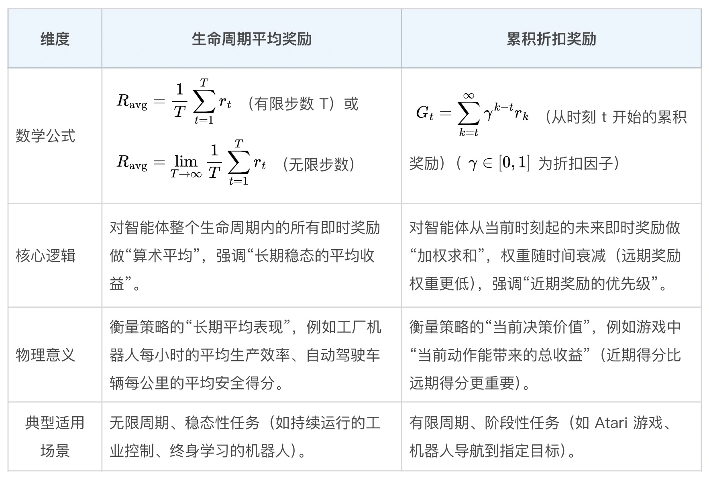
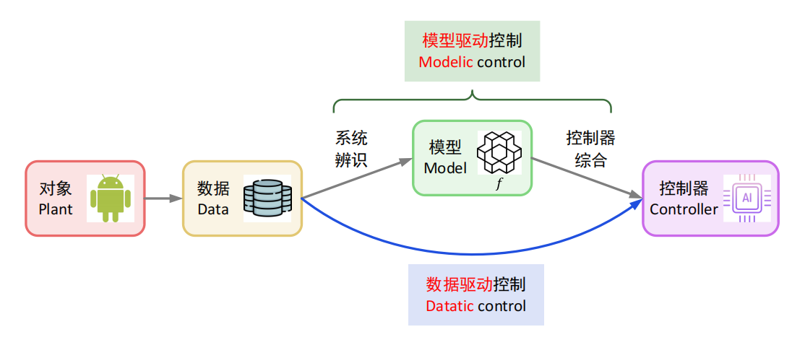
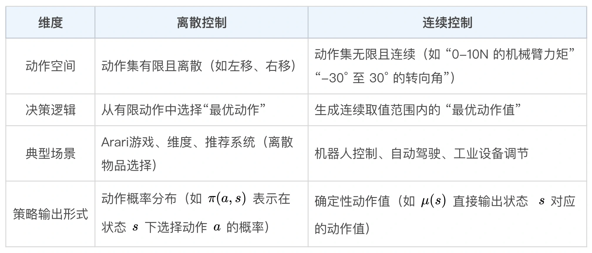
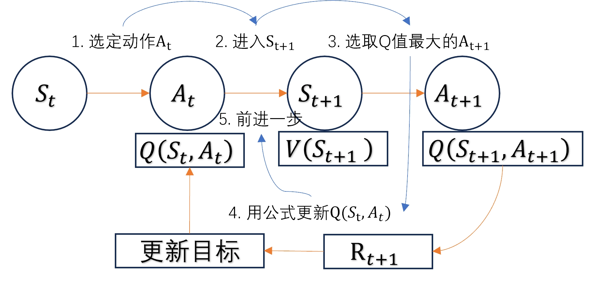
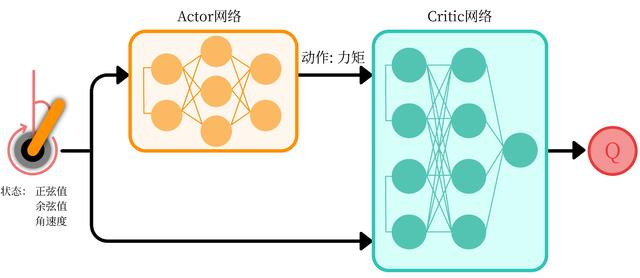
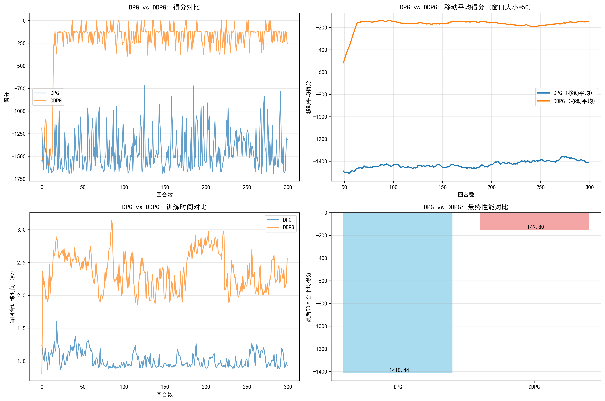
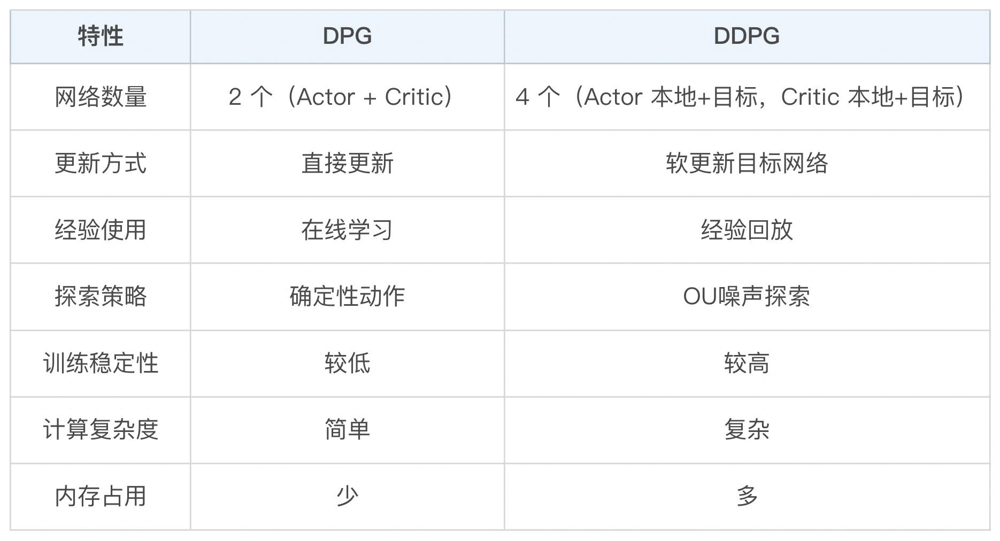

# 15 | 强化学习前沿：从离散控制到连续控制

你好！欢迎来到强化学习的第十五讲。在前几讲中，我们学习的 DQN 等经典算法在 Atari 游戏这类离散动作场景中表现出色，但当面对现实世界里机械臂关节控制、自动驾驶转向调节等连续动作任务时，传统离散化动作的思路会导致动作空间呈指数级膨胀（比如 6 个关节的机械臂，仅精度到 0.01 就有 200⁶ 种动作组合），让算法完全无法落地。而深度确定性策略梯度（DDPG）算法，正是为突破“连续动作空间困境”而生，它将确定性策略与深度学习结合，为连续控制任务提供了高效解决方案。

通过本节课的学习，你将能够：

1. 清晰区分离散控制与连续控制的核心差异，理解连续控制任务的技术瓶颈；

2. 掌握确定性策略梯度（DPG）的核心原理，明确其适配连续动作空间的本质原因；

3. 拆解深度确定性策略梯度（DDPG）的算法架构与核心组件，理解目标网络、经验回放等机制的作用；

4. 结合代码实例与实验场景，洞悉 DDPG 的训练流程与实际应用价值。

## 一、控制任务的核心分类与技术演进

在深入强化学习算法之前，我们首先需要厘清“控制”的本质，以及离散控制与连续控制的核心区别——这是理解连续控制算法设计逻辑的基础，也是从经典强化学习走向前沿应用的关键一步。

## 1.1 什么是控制

## t

控制问题由观测（observations）和动作（actions）构成。智能体在每一个时间步 接收到一

## Rn

## Rd

- ​ ∈​ ∈

## x

## a

个观测向量

- ，并输出一个动作向量。观测向量中包含一个特殊的分量，即tt

## r

奖励

- 奖励所在的分量索引在整个智能体生命周期中是固定不变。​t

控制问题的性能通过生命周期平均奖励（lifetime average reward）来衡量，定义为：

- T

## 1

## ∑

## Lifetime reward(T) =

- ​rt

## T

- ​t=1

在控制问题中，智能体所选择的动作将决定其未来所能感知到的观测，因此智能体的目标是通过控制未来的观测序列来最大化其生命周期奖励。

在强化学习中，“生命周期平均奖励”与“累积折扣奖励”是两类核心的奖励目标函数，二者既存在底层逻辑的关联（均用于衡量智能体策略的优劣），又因设计目标、数学形式和适用场景的差异而有本质区别。理解二者的联系与差异，是掌握强化学习“目标设计”核心逻辑的关键。

在深入关联前，需先清晰界定二者的数学含义与物理意义（表 15-1），避免基础混淆。



- 表15-1 生命周期平均奖励和累积折扣奖励对比

简单来说，两种奖励函数的选择取决于任务的“时间特性”和“优化目标”：

- 若任务是无限周期、追求长期稳态表现（如持续运行的机械臂、终身学习的智能体），则用生命周期平均奖励更合适——它能避免“为了短期收益牺牲长期稳态”（例如，机械臂为快速完成当前动作而过度消耗电机，导致长期故障率上升）；

- 若任务是有限周期、追求短期快速收益（如游戏、导航、一次性控制任务），则用累积折扣

## γ = 0.9

## γ

- 奖励更合适——通过调整 （如），可引导智能体优先关注近期反馈，避免“为了远期小收益而错失近期大收益”（例如，游戏中为了捡远处的道具而被敌人击败）。

控制的本质是智能体根据环境状态调整自身动作，以达成特定目标的过程。在强化学习框架中，这一过程可抽象为“状态感知→动作决策→环境交互→目标优化”的闭环：智能体通过感知环境状态（如机械臂的关节角度、自动驾驶车辆的位置与速度），生成合适的动作（如关节力矩调整、方向盘转向角度），与环境交互后获得反馈（如任务完成奖励、碰撞惩罚），最终通过迭代优化使动作决策无限逼近“最大化累积奖励”的目标。

从技术范式来看，控制方法可分为两大类（如图 15-1 所示）：

- 模型驱动控制：依赖于对被控对象（Plant）的精确数学建模，通过控制器（Controller）设计使系统输出跟踪期望目标。但在复杂系统中，建模误差难以避免，导致控制精度下降。

- 数据驱动控制：无需预先建立数学模型，直接通过环境交互产生的数据（Data）学习控制策略。强化学习正是数据驱动控制的核心技术之一，尤其适用于模型未知的复杂场景。



- 图15-1 模型驱动范式控制与数据驱动范式控制（出自清华大学李升波教授课题组）

## 1.2 离散控制与连续控制的核心差异

根据动作空间的性质，控制任务可明确划分为“离散控制”与“连续控制”两类，二者在问题本质、适用场景和技术要求上存在根本区别。

如表 15-2 所示，我们以游戏和机器人控制为例：在 Atari 游戏《Breakout》中，智能体仅需从“左移、右移、不操作” 3 个离散动作中选择其一，属于典型的离散控制；而在倒立摆（Pendulum-v1）环境中，智能体需要输出连续的力矩值（通常范围为 [-2, 2]）来维持摆杆平衡，属于典型的连续控制。



- 表15-2 离散控制与连续控制对比

控制理论中，连续系统用微分方程来描述，离散系统用差分方程来描述。在传统控制理论视角下，我们一般认为连续是控制系统的本质（来源于对物理世界的理解），而离散是在计算机技术等发展情况下，为实现计算机控制系统而对控制系统的一种刻画手段。

## 1.3 从离散到连续：控制任务的核心难点

经典强化学习算法（如 DQN）在离散控制场景中取得了巨大成功，但直接迁移至连续控制任务时，会面临动作空间维度爆炸、Q 值估计的数学困境已经训练稳定性与数据效率挑战三大不可逾越的技术瓶颈。

### 1.3.1 动作空间维度爆炸

连续动作空间和离散动作空间是完全不同的。Softmax 函数是离散动作空间中常用的输出层激

- ​ π(a∣s) =

## 1

## ∑a

活函数，它将连续的 logits 值转化为归一化的概率分布（满足

- ），使智能体能

## argmax

够通过采样或

- 选择动作。也就是说，你有一组选择：动作 A，动作 B，动作 C 等

等。你需要创建一个函数，将你的环境变量映射到采取每个动作的概率。然后你选择概率最高

## argmax

- ）。连续动作空间有执行的程度。离散动作空间说“左转或右转”。连续动作

的动作（空间说“将方向盘转到 X 度”。

强化学习中的离散控制算法（特别是 actor-critic 模型）的优势在于使用分类器作为 actor。当你进入连续动作空间时，actor-critic 模型会遇到严重的问题。

例如，离散控制中，动作数量通常为有限数量（如十几个动作），算法可以通过遍历或

## A ⊆Rd

## argmax

## d

- 操作选择最优动作。连续动作空间通常表现为（ 为动作维度），如机械臂

## A = [−1, 1]6

控制中

- 表示 6 个关节的力矩范围，若每个关节精度到 0.01，动作组合达6

## 6.4 × 1013

## 200 =

- 种，传统“枚举动作→评估价值”的思路完全失效。

### 1.3.2 Q 值估计的数学困境

- ′′

## max Q(s , a )

DQN 等基于价值的算法核心依赖“最大化下一状态 Q 值”（

- ）更新策略（如图

15-2 所示），其数学公式为：

## [

## ]

- ′

## Q(S, A) ←Q(S, A) + α R + γ

- ​Q(S , a) −Q(S, A)

## max

- a

- ′′

## max Q(s , a )

但在连续动作空间中，“

- ” 是对连续函数的极值求解，无法通过离散枚举实现，

导致价值更新链路断裂。



- 图15-2 DQN更新动作Q值（来自知乎“张斯俊”的文章）

### 1.3.3 训练稳定性与数据效率挑战

连续控制任务的环境交互成本极高（如真实机械臂操作的物理损耗、自动驾驶的安全风险），导致训练数据稀缺；同时，连续动作的微小变化可能引发环境状态的剧烈波动，若直接采用随机策略梯度算法，会因数据相关性强、梯度方差大，导致训练震荡甚至不收敛。

正是为应对这些难点，确定性策略梯度（DPG）算法应运而生——它通过“确定性策略 +Actor-Critic 架构 + 稳定性优化机制”的三重设计，为连续控制问题提供了突破性解决方案。

## 二、确定性策略梯度（DPG）详解

在智能体与环境的交互过程中，控制任务的核心目标在于让智能体通过学习与决策，找到一组最优动作序列以最大化累积回报。从任务场景的本质差异出发，控制任务可被划分为离散动作空间与连续动作空间两大类——前者的动作选项有限且相互独立（如围棋的落子位置、游戏的按键指令），后者的动作则呈现出连续可调节的特性（如机械臂的关节角度控制、自动驾驶的油门与方向盘调节）。

随着强化学习技术的演进，针对这两类任务的策略优化方法也在不断迭代。早期基于策略梯度的方法多聚焦于随机策略，通过对动作概率分布的建模与采样更新，在离散动作空间中取得了显著成效。然而，当面对高维连续动作空间时，随机策略梯度因需对无限动作空间进行积分近似，暴露出样本效率低、计算复杂度高的瓶颈。正是这一核心痛点，推动了确定性策略梯度（Deterministic Policy Gradient，DPG）等更适配连续控制场景的技术诞生。接下来，我们将深入剖析随机策略梯度的局限，并详细解读 DPG 如何突破这一困境。

## 2.1 随机策略梯度的缺点

在之前的课程中，我们探讨的基于策略梯度的方法均采用随机性策略。这种策略的随机性特质，使得我们必须通过采样获取轨迹，并依据策略梯度定理来更新策略。

这类方法在离散动作空间中往往能取得理想效果。这是因为在离散动作空间中，动作数量有限，我们可以为每个动作计算梯度，再结合概率分布进行采样，进而完成策略更新。然而，当面对连续动作空间时，这种方法会暴露出效率方面的问题，原因如下：

- ​(a∣s)

## π

在连续动作空间中，动作数量是无限的，此时策略的数学表达

- 通常以概率密度函数θ

的形式呈现。为计算策略梯度，理论上需要对整个连续动作空间进行积分或求和，这在实际操作中显然不具备可行性。常规做法是通过采样进行近似计算 —— 例如在策略梯度定理中，期望的计算就需要对轨迹进行采样。这意味着我们不仅要对状态空间进行采样，还需在每个状态对应的连续动作空间中采样，才能近似得到策略梯度，这无疑会导致样本效率低下。

其数学表达式为：

- T

## [

- t]

## ∑

## E

- ​ log π​ ∣s

## ∇

- ​J(θ) =​∇θ ( tt)​ a​ Rτ∼p​(τ)θθθ​​t=0

$$

## 2.2 确定性策略梯度

为解决随机策略梯度方法在高维连续动作空间里的效率问题，DeepMind 的 Silver 等人于2014 年提出了确定性策略梯度方法。

DPG 定理表明，在连续动作空间中，策略的期望回报梯度可表示为：

- s∼ρπ [

## ]

## E

- π​ ∇​ ∇

## ∇

- ​J(θ) =​Q (s, a)​(s)

## ∣a=μ

- ​μθaθθ​(s)θ

其中：

- ​(s)

## μ

## s

- 是确定性策略，代表在状态 下执行的动作。θ

## Q (s, a)

- π

## s

## a

- 是状态 - 动作值函数，指在状态 下执行动作 所获得的期望回报。

## ρπ

## π

- 是状态分布，描述智能体遵循策略 时所访问的状态的分布情况。

该公式的意思是，我们能够在状态空间中进行采样，接着计算当前状态下动作值函数 Q 对动

## θ

作的梯度，再将其与策略对策略参数 的梯度相乘，以此来估计策略梯度。

## π

## μ

需要注意的是，之前我们一直用数学符号 来表示策略，而在此处换成了符号 ，这是有意为之，目的是区分随机策略和确定性策略：

## π(a∣s)

## s

## a

- 随机策略：随机策略用概率分布来表示，它体现了在状态 下执行动作 的概率。也就是说，在给定状态时，智能体有可能以不同的概率选择不同的动作。

## μ(s)

## s

- 确定性策略：确定性策略用函数来表示，它意味着在状态 下执行的是唯一的确定性动作。也就是说，在给定状态时，智能体总是会选择同一个动作。

## 2.3 为什么 DPG 适合连续动作空间？

DPG 借助确定性策略的特性，把原本繁杂的积分或求和运算转化为针对特定动作的梯度计算，极大地降低了计算复杂度，所以更适配连续动作空间。

这里最核心的差异在于：随机策略的采样操作是不可导的，可确定性策略是可导的。要是策略是随机的，我们没办法直接对动作求导，因为采样操作不具备可导性。但 DPG 的策略是一个确定的函数，能够直接进行求导操作。

随机策略梯度方法要对动作空间做积分或者求和，以此来计算策略的期望回报梯度。在连续动作空间里，这样的积分或者求和会变得极为复杂，甚至难以开展计算。就像前文说的，为了近似这个积分，一般得采样大量的动作。

- ​(s)

## μ

而 DPG 通过运用确定性策略

- ，把动作的选择转变为一种确定的函数映射，不再需要对θ

## a = μ

- ​(s)

## s

动作空间进行积分或者求和。它直接计算当前状态 下，确定性动作

- 处的值函数θ

## Q (s, a)

- π对动作的梯度：

- s∼ρπ [

## ]

## E

- π​ ∇​ ∇

## ∇

- ​J(θ) =​Q (s, a)​(s)

## ∣a=μ

- ​μθaθθ​(s)θ

## Q (s, a)

- π

## a

在这个公式里，我们只需要求解

- 对 的梯度就行。

- ​(s)

## μ

如此一来，我们就能直接对策略函数

- 进行优化，让它可以直接生成最优动作，而不用θ

像随机策略那样从概率分布里采样。这就意味着，我们只需要找到一个函数，能在任意状态下直接给出最优动作就可以了，这比去寻找一个概率分布要容易得多。

## 三、深度确定性策略梯度（DDPG）详解

离散强化学习方法在序列决策问题中表现出了极佳性能，但用于真实物理世界中连续的控制问题时，面临离散化动作空间时可能导致的维度爆炸问题。DQN 可以解决离散控制问题，不可以解决连续控制问题，因为输出的向量不可能有无穷维度。策略网络也适用于离散控制问题，输出是动作空间上的概率分布，也是一个向量，无法做连续控制。

DDPG 算法由 Lillicrap 等人于 2015 年提出，其核心是将“确定性策略梯度（DPG）”与“深度学习”深度融合，构建了适用于连续动作空间的端到端学习框架。

## 3.1 算法诞生背景与理论基础

离散控制与连续控制：

- 离散控制：动作空间集和里面的动作是有限的、离散的。比如大部分 Atari 游戏。

- 连续控制：动作空间集和里面的动作是连续的、无穷的。比如机械臂的运动。

DDPG 算法是由 Lillicrap 等人在确定性策略梯度（DPG）方法的基础上发展而来的。DPG 方法的提出，为解决连续动作空间的强化学习问题提供了一种新的视角。

DPG（Deterministic Policy Gradient，确定性策略梯度）方法通过直接对确定性策略进行优化，从根本上规避了随机策略中普遍存在的高方差问题，为连续动作控制任务提供了更高效、更稳定的解决方案。

作为强化学习领域中 Actor-Critic（AC）架构的典型代表，DDPG（Deep Deterministic PolicyGradient，深度确定性策略梯度）算法进一步融合了两类核心方法的优势：一方面借鉴了基于策略的策略梯度方法，直接优化策略函数；另一方面整合了基于行动价值的 DQN 思想，通过价值网络指导策略更新。这种设计使 DDPG 能够采用 off-policy（异策略）学习方式，基于历史经验数据进行单步策略更新，精准预测确定性动作策略，最终实现累积奖励的最大化。

为应对复杂场景下的高维连续动作空间问题，DDPG 算法将 DPG 与深度神经网络深度结合，构建了端到端的无模型（model-free）学习框架，大幅扩展了算法的适用范围。在机器人操控等真实应用场景中，在线收集海量训练数据往往成本极高，且由于动作的连续性特征，通过在线抽取批量轨迹的方式难以实现对动作空间的充分覆盖，极易导致模型陷入局部最优解。针对这些痛点，DDPG 通过目标网络、经验回放等一系列创新性设计，有效降低了数据相关性带来的训练波动，提升了策略更新的稳定性和数据利用效率，为连续动作控制领域带来了突破性进展。

## 3.2 DDPG 算法核心组件与架构

## a ∼π

- ​(⋅∣

## s)

之前我们学习的策略是随机性的，可以表示为

- ；如果策略是确定性的，则可以θ

## a = μ

- ​(s)

记为

- 。与策略梯度定理类似，可以推导出确定性策略梯度定理：θ

## ∣∣

## E

- μ

## ∇

- ​J(π​) =​[∇​(s) ∇​(s, a)​]​μ​Qs∼νπθθθθaω​θa=μ​(s)​θ

## π

- 是用来收集数据的行为策略。

其中，

- ​θ

## Q

## s

可以这样理解这个定理：假设现在已经有函数

- ，给定一个状态 ，由于现在动作空间是无限

## Q(s, a)

## Q

## μ

的，无法通过遍历所有动作来得到

- 值最大的动作，因此我们想用策略 找到使值

## μ(s) = arg max

- ​ Q(s, a)

## a

## Q

## μ

最大的动作 ，即

- 就是 Critic， 就是 Actor，这是一。此时，a

个 Actor-Critic 的框架，如图 15-3 所示。



- 图15-3 DDPG中的Actor网络和Critic网络，以倒立摆环境为例（出自动手学强化学习）

DDPG 算法采用了 Actor - Critic 架构，这种架构将策略学习（Actor）和价值估计（Critic）分开进行，同时利用深度神经网络来逼近策略函数和价值函数。

这里我们重新回顾一下经典的 AC 架构。

- Actor 网络（策略网络）：它接收环境的状态作为输入，经过神经网络的多层变换后，直接输出一个连续的动作值。这个动作值代表了智能体在当前状态下要采取的动作。例如在机器人关节控制场景中，输出的就是具体的关节角度值等。Actor 网络的作用是根据当前状态生成动作，其目标是通过不断学习，调整网络参数，使得智能体采取的动作能够最大化长期累积奖励。

- Critic 网络（值网络）：Critic 网络的输入包含状态和动作，它的作用是评估 Actor 所选择的

## Q(s, a)

- 动作在当前状态下的好坏程度，也就是估计“状态 - 动作”对的值函数。通过准确地估计这个值函数，Critic 网络为 Actor 网络的策略更新提供了重要的梯度信息。具体来说，Critic 网络希望找到使得价值估计更高的动作，从而引导 Actor 网络朝着能产生更高价值的动作方向更新。

为了使训练过程更加稳定，DDPG 算法为 Actor 和 Critic 都设置了目标网络（TargetNetwork）。目标网络的参数是从对应的主网络（Actor 和 Critic）缓慢更新过来的。在计算目标价值等关键指标时，使用目标网络来进行计算。这样做的好处是可以减少训练过程中的波动，避免价值估计等出现过大的变化，有助于算法更快地收敛到最优解。

这里补充一点，使用目标网络和下面即将介绍的软更新技巧来实现参数的稳定更新，是深度强化学习领域的常用技巧。

## 3.3 训练流程与关键步骤

DDPG 算法的训练过程围绕“探索 - 学习 - 优化”的核心逻辑展开，通过 Actor-Critic 双网络架构与经验回放机制的协同作用，实现连续控制场景下的策略迭代。其关键步骤可分为探索与经验存储、Critic 网络更新、Actor 网络更新及目标网络更新四个核心环节，各环节紧密衔接且各有侧重。

### 3.3.1 探索与经验存储：构建数据基础

在训练初期，为避免智能体陷入局部最优解、确保其充分探索动作空间，DDPG 算法会对Actor 网络输出的原始动作进行噪声注入。实践中，Ornstein-Uhlenbeck 噪声（OU 噪声）是最常用的选择——这种噪声具有天然的惯性特性，能够模拟真实环境中连续动作的随机变化规律，尤其适配机械臂控制、自动驾驶等连续动作场景。​

智能体以添加噪声后的动作为指令与环境交互，每一次交互都会生成一组完整的经验数据：包

## s′

## s

## a

## r

含当前环境状态 ​ 、执行的动作​ 、获得的即时奖励​ 以及交互后进入的下一个状态​

- 。这些

经验数据会被实时存储至经验回放缓冲区（Experience Replay Buffer）中，形成训练的“数据池”。​

经验回放机制是 DDPG 算法实现稳定训练的关键支撑。它通过打破经验数据间的时间序列相关性，将原本有序的交互数据转化为近似独立同分布的样本集合，不仅大幅提升了数据利用率，更避免了网络训练受连续相关数据的干扰，为后续参数更新的稳定性奠定基础。​

### 3.3.2 Critic 网络更新：优化价值评估​

当经验回放缓冲区积累足够数据后，Critic 网络的更新流程随即启动。首先从缓冲区中随机采

- N′)}i=1​, a​, r​, s

## {( i

## s

样一批经验样本​

- ，利用目标网络组计算每个样本对应的目标 Q 值，以此iii​​

作为价值评估的“基准参考”。​

- μ′Q′′′′′

## y = r + γQ (s , μ (s ; θ ); θ

## )

目标 Q 值的计算遵循时序差分学习思想，公式为：​

- 。

## Q′

## μ′

## γ

其中，​

- 代表目标 Critic 网络，​ 代表目标 Actor 网络，而​ 为折扣因子——这一参数用于

权衡即时奖励与未来奖励的重要性，通常取值在 0.9 至 0.99 之间，使智能体既关注当前收益，也兼顾长期策略价值。​

Critic 网络的优化目标是最小化“预测 Q 值”与“目标 Q 值”之间的偏差，其损失函数定义为均方

- 1 ∑i=1Ni 2

## L(θ ) =

- ​; θ ) −​)​(Q(s​, aQQ

## y

误差：​

- 。通过反向传播算法求解该损失函数的梯iiN​

## θQ

度，并基于梯度下降法更新 Critic 网络的参数​

- ，使 Critic 网络的价值评估能力逐步提升。

### 3.3.3 Actor 网络更新：迭代策略输出​

Actor 网络作为策略的直接输出者，其更新目标与 Critic 网络的价值评估结果深度绑定——核心是通过调整参数，使输出的动作能够获得 Critic 网络更高的 Q 值评分，即实现策略的“价值最大化”。​

- 1 ∑i=1N

## J(θ ) =

- ​; θ ); θ )​ Q(s​, μ(sμμQ

Actor 网络的目标函数为：​

- 。由于该函数需通过梯度iiN​

上升法实现最大化，实际更新过程中需借助 Critic 网络的梯度信息：先计算 Critic 网络在“当前Actor 输出动作”处关于动作的梯度，再将其与 Actor 网络关于自身参数的梯度相乘，得到

## ∇

- ​J ≈

Actor 网络的参数更新方向，具体公式为：

- θμ

## ∣∣∣∣

1 ∑i=1

- N​ ∇​Q(s, a; θ )​μ(s; θ )​∇Qμ。θμa

N

- ​​a=μ(s)

这一过程使 Actor 网络能够“跟随”Critic 网络的价值导向，持续优化动作输出策略。​

### 3.3.4 目标网络更新：维持训练稳定​

为避免目标 Q 值因当前网络参数的频繁变化而产生剧烈波动，DDPG 算法采用软更新机制更新目标网络（包括目标 Critic 网络与目标 Actor 网络），即让目标网络缓慢追踪当前网络的参数变化。​

具体更新公式如下：​

- Q′

## (1 −τ)θQ′

- Q

## +

## ←

## θ

## τθ

- μ′

## (1 −τ)θμ′

- μ

## ←

## τθ +

## θ

## τ

​其中，​ 为软更新系数，通常取值极小（如 0.001）。这种“小步慢走”的更新方式，既保证了目标网络能够及时跟进当前网络的优化进度，又避免了因参数突变导致的训练震荡，是维持DDPG 算法训练稳定性的核心设计之一。

## 3.4 DPG 与 DDPG 对比

下面通过代码展示 DPG 与 DDPG 对比的运作流程。

```bash
import torch
import torch.nn as nn
import torch.optim as optim
import torch.nn.functional as F
import numpy as np
import gym
import random
from collections import deque, namedtuple
import matplotlib.pyplot as plt
import time
# 确保中文显示正常
import matplotlib
matplotlib.rcParams['font.sans-serif'] = ['SimHei', 'Microsoft YaHei', 'WenQuanYi
matplotlib.rcParams['axes.unicode_minus'] = False  # 解决负号显示问题
# 设备配置
device = torch.device("cuda" if torch.cuda.is_available() else "cpu")
# Actor网络：输入状态，输出动作
class Actor(nn.Module):
   def __init__(self, state_size, action_size, action_low, action_high, hidden_s
       super(Actor, self).__init__()
       self.fc1 = nn.Linear(state_size, hidden_size)
       self.fc2 = nn.Linear(hidden_size, hidden_size)
       self.fc3 = nn.Linear(hidden_size, action_size)
       # 动作范围
       self.action_low = torch.tensor(action_low, dtype=torch.float32).to(device
       self.action_high = torch.tensor(action_high, dtype=torch.float32).to(devi
       self.action_range = self.action_high - self.action_low
   def forward(self, state):
       x = F.relu(self.fc1(state))
       x = F.relu(self.fc2(x))
       # 使用tanh将输出限制在[-1, 1]，然后缩放到动作空间范围
       x = torch.tanh(self.fc3(x))
       return self.action_low + (x + 1.0) * 0.5 * self.action_range
# Critic网络：输入状态和动作，输出Q值
class Critic(nn.Module):
   def __init__(self, state_size, action_size, hidden_size=256):
       super(Critic, self).__init__()
       # 状态路径
       self.fc1 = nn.Linear(state_size, hidden_size//2)
       # 状态和动作合并后的路径
       self.fc2 = nn.Linear(hidden_size//2 + action_size, hidden_size)
       self.fc3 = nn.Linear(hidden_size, hidden_size)
       self.fc4 = nn.Linear(hidden_size, 1)
   def forward(self, state, action):
       x_state = F.relu(self.fc1(state))
       x = torch.cat([x_state, action], dim=1)
       x = F.relu(self.fc2(x))
       x = F.relu(self.fc3(x))
       return self.fc4(x)
# 经验回放缓冲区（仅DDPG使用）
class ReplayBuffer:
   def __init__(self, buffer_size, batch_size):
       self.memory = deque(maxlen=buffer_size)
       self.batch_size = batch_size
       self.experience = namedtuple("Experience", field_names=["state", "action"
   def add(self, state, action, reward, next_state, done):
       e = self.experience(state, action, reward, next_state, done)
       self.memory.append(e)
   def sample(self):
       experiences = random.sample(self.memory, k=self.batch_size)
       states = torch.from_numpy(np.vstack([e.state for e in experiences if e is
       actions = torch.from_numpy(np.vstack([e.action for e in experiences if e
       rewards = torch.from_numpy(np.vstack([e.reward for e in experiences if e
       next_states = torch.from_numpy(np.vstack([e.next_state for e in experienc
       dones = torch.from_numpy(np.vstack([e.done for e in experiences if e is n
       return (states, actions, rewards, next_states, dones)
   def __len__(self):
       return len(self.memory)
# OU噪声过程（仅DDPG使用）
class OUNoise:
   def __init__(self, size, mu=0., theta=0.15, sigma=0.2):
       self.mu = mu * np.ones(size)
       self.theta = theta
       self.sigma = sigma
       self.reset()
   def reset(self):
       self.state = np.copy(self.mu)
   def sample(self):
       x = self.state
       dx = self.theta * (self.mu - x) + self.sigma * np.random.randn(len(x))
       self.state = x + dx
       return self.state
# DPG智能体（原始确定性策略梯度）
class DPGAgent:
   def __init__(self, state_size, action_size, action_low, action_high,
                gamma=0.99, lr_actor=1e-4, lr_critic=1e-3):
       self.state_size = state_size
       self.action_size = action_size
       # 只使用本地网络，没有目标网络
       self.actor = Actor(state_size, action_size, action_low, action_high).to(d
       self.critic = Critic(state_size, action_size).to(device)
       self.actor_optimizer = optim.Adam(self.actor.parameters(), lr=lr_actor)
       self.critic_optimizer = optim.Adam(self.critic.parameters(), lr=lr_critic
       # 超参数
       self.gamma = gamma  # 折扣因子
       self.episode_count = 0
       print("DPG Agent initialized (no experience replay, no target networks, n
   def act(self, state):
       # 确定性策略，不添加噪声
       state = torch.from_numpy(state).float().unsqueeze(0).to(device)
       self.actor.eval()
       with torch.no_grad():
           action = self.actor(state).cpu().data.numpy()
       self.actor.train()
       return np.clip(action, self.actor.action_low.cpu().numpy(),
                     self.actor.action_high.cpu().numpy())
   def learn(self, state, action, reward, next_state, done):
       # 直接使用当前经验进行更新，不使用经验回放
       state = torch.from_numpy(state).float().unsqueeze(0).to(device)
       # 确保action是2D张量 (batch_size, action_size)
       if action.ndim == 1:
           action = torch.from_numpy(action).float().unsqueeze(0).to(device)
       else:
           action = torch.from_numpy(action).float().to(device)
       reward = torch.tensor([reward], dtype=torch.float32).to(device)
       next_state = torch.from_numpy(next_state).float().unsqueeze(0).to(device)
       done = torch.tensor([done], dtype=torch.float32).to(device)
       # 更新Critic
       with torch.no_grad():
           # 计算目标Q值（使用当前网络，因为DPG没有目标网络）
           next_action = self.actor(next_state)
           Q_target = reward + (self.gamma * self.critic(next_state, next_action
       Q_expected = self.critic(state, action)
       critic_loss = F.mse_loss(Q_expected, Q_target)
       self.critic_optimizer.zero_grad()
       critic_loss.backward()
       self.critic_optimizer.step()
       # 更新Actor
       predicted_action = self.actor(state)
       actor_loss = -self.critic(state, predicted_action).mean()
       self.actor_optimizer.zero_grad()
       actor_loss.backward()
       self.actor_optimizer.step()
# DDPG智能体（深度确定性策略梯度）
class DDPGAgent:
   def __init__(self, state_size, action_size, action_low, action_high,
                buffer_size=int(1e5), batch_size=128, gamma=0.99,
                tau=1e-2, lr_actor=1e-3, lr_critic=1e-3):
       self.state_size = state_size
       self.action_size = action_size
       # Actor网络（本地+目标）
       self.actor_local = Actor(state_size, action_size, action_low, action_high
       self.actor_target = Actor(state_size, action_size, action_low, action_hig
       self.actor_optimizer = optim.Adam(self.actor_local.parameters(), lr=lr_ac
       # Critic网络（本地+目标）
       self.critic_local = Critic(state_size, action_size).to(device)
       self.critic_target = Critic(state_size, action_size).to(device)
       self.critic_optimizer = optim.Adam(self.critic_local.parameters(), lr=lr_
       # 初始化目标网络参数与本地网络相同
       self.hard_update(self.actor_target, self.actor_local)
       self.hard_update(self.critic_target, self.critic_local)
       # 经验回放
       self.memory = ReplayBuffer(buffer_size, batch_size)
       # 噪声过程
       self.noise = OUNoise(action_size)
       # 超参数
       self.gamma = gamma  # 折扣因子
       self.tau = tau      # 软更新参数
       self.batch_size = batch_size
       self.episode_count = 0
       print("DDPG Agent initialized (with experience replay, target networks, a
   def act(self, state, add_noise=True):
       state = torch.from_numpy(state).float().unsqueeze(0).to(device)
       self.actor_local.eval()
       with torch.no_grad():
           action = self.actor_local(state).cpu().data.numpy()
       self.actor_local.train()
       # 添加噪声以鼓励探索
       if add_noise:
           action += self.noise.sample()
       return np.clip(action, self.actor_local.action_low.cpu().numpy(),
                     self.actor_local.action_high.cpu().numpy())
   def step(self, state, action, reward, next_state, done):
       # 保存经验到回放缓冲区
       self.memory.add(state, action, reward, next_state, done)
       # 如果有足够的样本，就进行学习
       if len(self.memory) > self.batch_size:
           experiences = self.memory.sample()
           self.learn(experiences)
   def learn(self, experiences):
       states, actions, rewards, next_states, dones = experiences
       # 更新Critic
       actions_next = self.actor_target(next_states)
       Q_targets_next = self.critic_target(next_states, actions_next)
       Q_targets = rewards + (self.gamma * Q_targets_next * (1 - dones))
       Q_expected = self.critic_local(states, actions)
       critic_loss = F.mse_loss(Q_expected, Q_targets)
       self.critic_optimizer.zero_grad()
       critic_loss.backward()
       torch.nn.utils.clip_grad_norm_(self.critic_local.parameters(), 1)
       self.critic_optimizer.step()
       # 更新Actor
       actions_pred = self.actor_local(states)
       actor_loss = -self.critic_local(states, actions_pred).mean()
       self.actor_optimizer.zero_grad()
       actor_loss.backward()
       self.actor_optimizer.step()
       # 软更新目标网络
       self.soft_update(self.critic_local, self.critic_target)
       self.soft_update(self.actor_local, self.actor_target)
   def soft_update(self, local_model, target_model):
       for target_param, local_param in zip(target_model.parameters(), local_mod
           target_param.data.copy_(target_param.data * (1.0 - self.tau) + local_
   def hard_update(self, target_model, local_model):
       for target_param, local_param in zip(target_model.parameters(), local_mod
           target_param.data.copy_(local_param.data)
   def reset(self):
       self.noise.reset()
# 训练函数
def train_agent(env, agent, n_episodes=500, max_t=1000, print_every=50, agent_typ
   scores_deque = deque(maxlen=print_every)
   scores = []
   times = []
   for i_episode in range(1, n_episodes+1):
       start_time = time.time()
       # 处理不同Gym版本的reset()返回值
       reset_result = env.reset()
       if isinstance(reset_result, tuple):
           state = reset_result[0]
       else:
           state = reset_result
       if agent_type == "DDPG":
           agent.reset()
       score = 0
       for t in range(max_t):
           action = agent.act(state)
           # 处理不同Gym版本的step()返回值
           step_result = env.step(action[0])
           if len(step_result) == 5:
               next_state, reward, done, _, _ = step_result
           else:
               next_state, reward, done, _ = step_result
           # 根据智能体类型选择学习方式
           if agent_type == "DPG":
               agent.learn(state, action, reward, next_state, done)
           else:  # DDPG
               agent.step(state, action, reward, next_state, done)
           state = next_state
           score += reward
           if done:
               break
       episode_time = time.time() - start_time
       times.append(episode_time)
       scores_deque.append(score)
       scores.append(score)
       print(f'\r{agent_type} Episode {i_episode}\t平均得分: {np.mean(scores_dequ
       if i_episode % print_every == 0:
           print(f'\r{agent_type} Episode {i_episode}\t平均得分: {np.mean(scores_
   return scores, times
# 主函数
if __name__ == "__main__":
   # 创建环境
   env = gym.make('Pendulum-v1')
   # 获取环境信息
   state_size = env.observation_space.shape[0]
   action_size = env.action_space.shape[0]
   action_low = env.action_space.low
   action_high = env.action_space.high
   print(f"状态空间大小: {state_size}")
   print(f"动作空间大小: {action_size}")
   print(f"动作范围: [{action_low}, {action_high}]")
   print("="*60)
   # 训练DPG智能体
   print("开始训练DPG智能体...")
   dpg_agent = DPGAgent(state_size, action_size, action_low, action_high)
   dpg_scores, dpg_times = train_agent(env, dpg_agent, n_episodes=300, agent_typ
   print("\n" + "="*60)
   # 训练DDPG智能体
   print("开始训练DDPG智能体...")
   ddpg_agent = DDPGAgent(state_size, action_size, action_low, action_high)
   ddpg_scores, ddpg_times = train_agent(env, ddpg_agent, n_episodes=300, agent_
   # 绘制对比图
   plt.figure(figsize=(15, 10))
   # 得分对比
   plt.subplot(2, 2, 1)
   plt.plot(dpg_scores, label='DPG', alpha=0.7)
   plt.plot(ddpg_scores, label='DDPG', alpha=0.7)
   plt.ylabel('得分')
   plt.xlabel('回合数')
   plt.title('DPG vs DDPG: 得分对比')
   plt.legend()
   plt.grid(True, alpha=0.3)
   # 移动平均得分对比
   plt.subplot(2, 2, 2)
   window_size = 50
   dpg_smooth = np.convolve(dpg_scores, np.ones(window_size)/window_size, mode='
   ddpg_smooth = np.convolve(ddpg_scores, np.ones(window_size)/window_size, mode
   plt.plot(range(window_size-1, len(dpg_scores)), dpg_smooth, label='DPG (移动平
   plt.plot(range(window_size-1, len(ddpg_scores)), ddpg_smooth, label='DDPG (移动
   plt.ylabel('移动平均得分')
   plt.xlabel('回合数')
   plt.title(f'DPG vs DDPG: 移动平均得分 (窗口大小={window_size})')
   plt.legend()
   plt.grid(True, alpha=0.3)
   # 训练时间对比
   plt.subplot(2, 2, 3)
   plt.plot(dpg_times, label='DPG', alpha=0.7)
   plt.plot(ddpg_times, label='DDPG', alpha=0.7)
   plt.ylabel('每回合训练时间 (秒)')
   plt.xlabel('回合数')
   plt.title('DPG vs DDPG: 训练时间对比')
   plt.legend()
   plt.grid(True, alpha=0.3)
   # 最终性能对比
   plt.subplot(2, 2, 4)
   final_episodes = 50
   dpg_final = np.mean(dpg_scores[-final_episodes:])
   ddpg_final = np.mean(ddpg_scores[-final_episodes:])
   algorithms = ['DPG', 'DDPG']
   final_scores = [dpg_final, ddpg_final]
   colors = ['skyblue', 'lightcoral']
   bars = plt.bar(algorithms, final_scores, color=colors, alpha=0.7)
   plt.ylabel(f'最后{final_episodes}回合平均得分')
   plt.title(f'DPG vs DDPG: 最终性能对比')
   plt.grid(True, alpha=0.3, axis='y')
   # 在柱状图上显示数值
   for bar, score in zip(bars, final_scores):
       plt.text(bar.get_x() + bar.get_width()/2, bar.get_height() + 1,
               f'{score:.2f}', ha='center', va='bottom')
   plt.tight_layout()
   plt.savefig('DDPG_vs_DPG_comparison.png', dpi=300, bbox_inches='tight')
   plt.show()
   # 打印统计信息
   print("\n" + "="*60)
   print("训练完成！统计信息：")
   print(f"DPG - 最终得分: {dpg_final:.2f}, 平均训练时间: {np.mean(dpg_times):.2f}s
   print(f"DDPG - 最终得分: {ddpg_final:.2f}, 平均训练时间: {np.mean(ddpg_times):.2
   print(f"性能提升: {((ddpg_final - dpg_final) / abs(dpg_final) * 100):.1f}%")
   env.close()
```

核心组件说明：

1. 神经网络结构

- Actor 网络：输入状态，输出确定性动作。采用三层全连接网络，通过 tanh 激活函数将输出映射到环境的动作空间范围内。

- Critic 网络：输入状态和动作，输出 Q 值（状态 - 动作价值）。网络先分别处理状态和动作，在中间层合并特征。

2. 经验回放机制

- 使用 ReplayBuffer 类存储智能体的经验（状态、动作、奖励、下一状态、是否结束）。

- 通过随机采样打破样本间的相关性，提高训练稳定性。

- 支持指定缓冲区大小和采样批次大小。

3. 探索策略

- 实现了 OU（Ornstein-Uhlenbeck）噪声过程，为确定性动作添加噪声以鼓励探索。

- 噪声参数可通过 mu、theta 和 sigma 调整，控制噪声的特性。

4. DPG 智能体核心

- 单一网络结构：DPG 只维护一组网络（Actor 和 Critic），没有目标网络。

- 直接更新：所有网络参数都直接更新，没有软更新机制。

- 简化设计：相比 DDPG，DPG 的网络结构更加简单直接。

5. DDPG 智能体核心

- 维护两组网络：本地网络（用于选动作和更新）和目标网络（用于计算目标 Q 值）。

- 采用软更新策略，缓慢更新目标网络参数，提高训练稳定性。

- 分别定义了 Critic 和 Actor 的损失函数和优化方法。

DPG 和 DDPG 运行对比如图 15-4 所示，这个实验很好地展示了从 DPG 到 DDPG 的演进过程，DDPG 通过引入深度学习的稳定化技术，显著提升了确定性策略梯度的性能。



- 图15-4 DPG和DDPG对比

DPG 和 DDPG 的核心比如表 15-3 所示，DPG 作为确定性策略梯度的基础算法，虽然在某些方面不如 DDPG 稳定和高效，但其简洁的设计和快速的学习特性使其在特定场景下仍有应用价值。DDPG 正是在 DPG 的基础上，通过引入深度学习的稳定化技术，解决了 DPG 的主要问题。



- 表15-3 DPG vs DDPG 核心对比

实际应用建议：

- 简单环境：如果环境简单且数据充足，DPG 可能更高效。

- 复杂环境：对于复杂环境，DDPG 的稳定性优势明显。

- 计算资源：DDPG 需要更多内存和计算资源，但性能提升显著。

## 3.5 算法优势与实验验证

在连续动作控制这一强化学习领域的关键挑战中，DDPG 算法凭借其独特的技术设计与显著的实践效果，树立了难以替代的标杆地位。接下来将系统剖析 DDPG 算法的核心技术优势——从对连续动作空间的原生适配，到确定性策略带来的效率提升，再到双机制保障的训练稳定性，以及 Actor-Critic 架构的协同优化效能，全面阐释其突破传统算法瓶颈的底层逻辑。同时，通过经典控制、机器人运动规划与自动驾驶等多场景的实验验证，具象化展现该算法在解决实际问题时的强大能力，揭示其成为连续控制领域基准方法的深层原因。

### 3.5.1 核心技术优势

DDPG 算法之所以能成为连续控制领域的里程碑式方法，源于其对连续动作场景核心痛点的精准破解，以及对强化学习技术范式的创新性融合，具体优势体现在以下四方面：

- 原生适配连续动作空间

不同于传统算法需通过离散化手段将连续动作拆解为有限选项（易引发维度爆炸），DDPG 的Actor 网络可直接输出连续数值型动作，无需任何中间转换环节。这种“状态→连续动作”的端到端映射，完美契合物理世界中机械臂关节力矩、自动驾驶转向角度等连续可控量的本质需求，从根本上解决了离散化带来的精度损失与计算冗余问题。

- 确定性策略的效率与稳定性增益

相较于随机策略需通过采样逼近动作概率分布（样本利用率低、梯度方差大），DDPG 采用的

- ​(s)

## μ

确定性策略

- 可在给定状态下直接输出最优动作。这种特性不仅减少了探索过程中的随θ

机冗余，提升了交互效率，更通过规避动作采样的不可导性，降低了策略梯度估计的方差，使训练过程更稳定、收敛速度更快。

- 双机制保障训练鲁棒性

DDPG 创新性地继承并融合了 DQN 的两大核心稳定机制：

## s, a, r, s′

经验回放机制：通过存储智能体与环境交互的历史经验（

- ）并随机采样训练，打破

了数据间的时间相关性，使样本更接近独立同分布特性，有效抑制了参数更新的震荡；

## τ

目标网络软更新：为 Actor 和 Critic 网络分别设置目标网络，通过极小的软更新系数 缓慢同步参数，避免了目标 Q 值因当前网络波动而剧烈变化，为价值估计提供了稳定的更新目标。

- Actor-Critic 架构的协同优化效能 DDPG 的双网络架构形成了高效的协同优化闭环

## Q(s, a)

Critic 网络通过精准估计状态 - 动作价值

- ，为 Actor 网络提供明确的优化方向（即最

大化 Critic 评估的 Q 值）；而 Actor 网络生成的动作又为 Critic 网络提供了高质量的价值学习样本。这种“策略生成 - 价值评估”的双向反馈机制，大幅提升了策略迭代的针对性与效率，加速了最优策略的收敛。

### 3.5.2 实验验证与场景落地

DDPG 算法的有效性已在从经典控制到复杂现实场景的多类任务中得到充分验证，其性能表现远超传统方法，成为连续控制领域的基准算法之一。

- 经典控制任务：高精度平衡与调节

在 CartPole（小车倒立摆）、Pendulum-v1（单摆平衡）等经典控制任务中，DDPG 能够快速学习到稳定的控制策略。以 Pendulum-v1 为例，智能体可在数十个训练回合内精准输出连续力矩值，使摆杆从任意初始角度快速回归竖直平衡状态，且在外部微小扰动下仍能保持稳定。这一表现不仅优于基于离散动作的改进型 DQN，更接近基于模型的经典控制方法（如 PID 控制）的精度。

- 机器人控制任务：复杂运动规划

在 Mujoco 等高级物理仿真环境中，DDPG 展现出强大的复杂运动控制能力：

在 Half Cheetah（猎豹奔跑）任务中，算法可优化腿部关节的连续力矩分配，使猎豹模型达到接近物理极限的奔跑效率，且能根据地形坡度变化动态调整步态；

在 Humanoid（人形机器人行走）任务中，DDPG 能够学习到符合生物力学的步态周期，实现平稳行走、转弯及上下台阶等复杂动作，解决了传统策略梯度算法因动作维度高（通常含 20+ 个连续关节）而难以收敛的问题。

- 自动驾驶任务：端到端决策学习

在 Torcs 赛车等模拟自动驾驶场景中，DDPG 可直接以原始像素或车辆状态（位置、速度、航向角）为输入，学习端到端的驾驶策略。实验表明，经过训练的智能体能够根据赛道曲率、前车距离等动态信息，连续调节油门、刹车与方向盘角度，实现自主避障、弯道超车等操作，其平均速度与路径规划合理性已接近甚至超越基于规则的传统驾驶算法。

## 总结

本节课围绕“连续动作空间的强化学习解决方案”展开，从控制任务的本质分类切入，逐步深入到 DDPG 算法的理论与实践核心，形成了完整的知识闭环。

首先，我们明确了控制任务的两大范式——模型驱动与数据驱动，并重点剖析了离散控制与连续控制的核心差异：前者动作有限且独立，后者动作连续可调节，且连续是物理系统的本质刻画。在此基础上，我们指出了经典强化学习算法迁移至连续控制时面临的三大瓶颈：动作空间维度爆炸导致枚举失效、Q 值估计的连续极值求解困境，以及训练稳定性与数据效率的双重挑战，为后续算法的引入奠定了问题基础。

- ​(s)

## μ

其次，我们深入解读了确定性策略梯度（DPG）的核心突破：通过引入确定性策略

- ，将θ

随机策略中复杂的动作空间积分转化为特定动作的梯度计算，利用“Q 值对动作的梯度引导策略更新”的逻辑，规避了随机策略梯度在连续空间中样本效率低、计算复杂的问题，为连续控制提供了关键的理论支撑。

最后，我们聚焦于 DDPG 算法的完整架构：它以 DPG 为理论核心，融合 DQN 的经验回放与目标网络机制，构建了“Actor-Critic + 双目标网络 + 软更新”的端到端框架。通过 Actor 网络输出确定性连续动作、Critic 网络评估动作价值、经验回放打破数据相关性、目标网络软更新稳定训练等设计，DDPG 成功解决了连续控制的落地难题。实验验证表明，该算法在经典控制、机器人操作、自动驾驶等场景中均表现出优异的适应性与高效性。

从理论原理到代码实现，DDPG 算法的设计思路充分体现了强化学习从“离散场景”向“连续现实”的跨越，是连接理论研究与工程应用的关键算法。理解其核心机制不仅能掌握连续控制的解决方法，更能为后续更复杂的强化学习算法学习奠定基础。

## 思考题

DDPG 与 DQN 均采用了目标网络和经验回放机制，但 DDPG 是 Actor-Critic 架构，而 DQN是纯价值学习架构。请结合连续 / 离散动作空间的差异，从“策略表示方式”“动作选择逻辑”和“参数更新动力”三个维度，详细对比两种算法的核心区别，并解释为何 DQN 无法直接应用于高维连续动作空间。

希望你通过今天的学习，对强化学习有了清晰的认识。如果有任何疑问，欢迎在讨论区留言交流！
