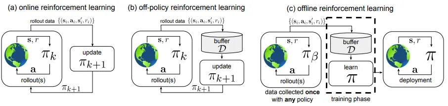

# 16 | 强化学习前沿：离线强化学习

你好！欢迎来到强化学习的第十六讲。在前面的学习中，我们探讨了多种依赖智能体与环境实时交互的强化学习算法。然而，在现实世界中，并非所有场景都允许试错或承受高昂的探索成本。例如：医疗诊断中一次错误决策可能危及生命，自动驾驶系统无法在真实道路上随意尝试危险动作，金融交易中的策略失误会带来直接经济损失。

这些高风险、高成本的应用场景催生了一个重要研究方向——离线强化学习（OfflineReinforcement Learning, Offline RL）。它的核心思想是：仅利用已收集的历史数据集训练智能体，无需与环境进行任何在线交互。这种“从过去经验中学习”的模式，极大提升了强化学习在实际系统中的安全性与可行性。

通过本节课的学习，你将能够：

- 明确区分 on-policy、off-policy 与 offline RL 的本质差异，理解离线学习“无探索”的特性及其在安全敏感场景中的关键价值。

接下来，让我们一起走进离线强化学习的世界，探索如何让智能体在“不犯错”的前提下，依然具备持续提升策略的能力。

## 离线强化学习的定义与研究动机

离线强化学习（Offline Reinforcement Learning, Offline RL），又称作批量强化学习（BatchReinforcement Learning, BRL），是强化学习的一种变体，主要研究的是如何利用预先收集的大规模静态数据集来训练强化学习智能体。 利用静态数据集意味着在智能体的训练过程中，离线强化学习不进行任何形式的在线交互与探索，这也是它和其它常见的强化学习方法最显著的区别。

## on-policy vs. off-policy vs. offline RL

强化学习（RL）通过智能体与环境的试错交互最大化奖励信号，而深度学习的融合推动了深度强化学习在复杂任务中的成功。但传统范式存在明显局限，如图 16-1 所示，三者核心差异如下：

- 在线强化学习（Online RL）：智能体需通过最新策略持续与环境交互收集经验，每次策略更新都依赖新数据，样本效率低且交互成本高。

- 异策略强化学习（Off-policy RL）：可复用历史策略的经验数据，但仍需持续与环境交互以修正行为，无法脱离在线数据收集。

- 离线强化学习（Offline RL）：仅依赖行为策略预先收集的静态数据集 D 学习优化策略，无需额外环境交互，可直接利用大规模多样化历史数据，大幅拓展了强化学习的应用场景。

- 图16-1 on-policy vs. off-policy vs. offline RL出自Sergey Levine《Decisions from Data: How Offline Reinforcement Learning Will Change How We Use MachineLearning》

在现实生活中的许多场景下，让尚未学习好的智能体和环境交互可能会导致危险发生，或是造成巨大损失。例如，在训练自动驾驶的规控智能体时，如果让智能体从零开始和真实环境进行交互，那么在训练的最初阶段，它操控的汽车无疑会横冲直撞，造成各种事故。再例如，在推荐系统中，用户的反馈往往比较滞后，统计智能体策略的回报需要很长时间。而如果策略存在问题，早期的用户体验不佳，就会导致用户流失等后果。

在线强化学习和离线强化学习的区别在于是否与环境实时交互，标准的强化学习算法通过反复试错来学如何执行任务，并在探索与利用之间进行平衡达到更好的表现，而离线强化学习要求智能体从固定的数据集汇总进行学习，不能进行探索，因此离线强化学习研究的是如何最大限度的利用静态的离线数据集来训练 RL 智能体。离线强化学习的目标是，在智能体不和环境交互的情况下，仅从已经收集好的确定的数据集中，通过强化学习算法得到比较好的策略。

离线强化学习正是为应对这些挑战而兴起的重要研究方向。它的核心优势在于，智能体无需实时与环境交互，而是基于已有的历史数据进行学习与策略优化。这种方式能够有效规避在线探索带来的高成本、高风险问题，极大地拓展了强化学习的应用边界。

## 离线强化学习调整与解决方案

离线强化学习的训练过程始终围绕数据分布偏移这一核心矛盾展——优化目标是学习优于行为

## (s, a)

## π

## π

## π

策略

- 的新策略 ，但训练数据完全来自，导致新策略探索的对在数据集中稀缺​β​β

甚至不存在，直接套用在线强化学习算法会引发严重问题。

离线强化学习的核心难题源于静态数据集的局限性：学习的策略可能产生数据集未覆盖的状态- 动作对（分布外行为，OOD），导致价值函数估计偏差，进而引发策略发散。现有在线 RL算法因假设可通过在线交互修正错误，无法直接适配离线场景。离线强化学习三大核心挑战：

## π(a∣s)

- ​(a∣s)

## π

## π

- 分布偏移（Distribution Shift）：新策略 的动作分布与行为策略的分布β

## (s, a)

- 差异过大，导致 Q 函数在数据集外的上被错误估计（通常被高估）。例如，若数据

## s

## a

## a

- 集中某状态 下仅包含“保守动作”，新策略尝试“冒险动作”时，Q 函数可能因缺乏数​1​2据支撑而高估其收益，最终导致策略性能崩溃。

- Q 值过高估计（Overestimation Bias）：在线强化学习中，Q 值估计的偏差可通过在线探索

## (s, a)

- 修正，但离线场景下，数据集中的动作覆盖有限，贝尔曼更新会不断累积对未见过的错误估计，导致 Q 值持续偏高，进而引导策略选择有害动作。

- 数据质量依赖（Data Quality Dependency）：即使算法设计完善，若数据集缺乏关键状态 -动作对（如高回报路径上的中间步骤）、存在噪声（奖励信号不准确）或覆盖范围过窄，仍无法学习出有效策略。

主流解决方案，为约束与修正策略。为缓解分布偏移和 Q 值高估问题，离线强化学习算法主要通过约束策略更新范围或修正 Q 值估计两类思路设计，以下以典型算法为例说明。

1. 策略约束类：限制新策略与行为策略的差异

## π

## π

- 核心逻辑：通过数学约束强制新策略 的动作分布贴近行为策略，避免探索数据集外的​β“未知动作”。

- 代表算法：BCQ（Batch-Constrained Q-Learning）

## G(a∣s, ζ)

- 动作生成器（Action Generator）：先训练一个生成模型，从行为策略的数据

## ζ

- 分布中采样动作（ 为随机噪声），确保生成的动作均在数据集的动作分布范围内。

- Q 值学习：Q 函数仅对生成器输出的动作进行评估，而非所有可能动作，即贝尔曼更新′′′′′′

## a ∼

## G(a ∣s , ζ)

## a ∼

## π(a ∣s )

- 中的，而非。

- 策略提取：最终策略从生成器的输出中选择 Q 值最高的动作，既保证了动作在数据分布内，又实现了策略优化。

- 代表算法：CQL（Conservative Q-Learning）

- 核心是在 Q 值损失函数中加入保守项（Conservative Term），主动降低数据集外动作的Q 值估计，而非限制动作生成。

## L(ϕ) = 传统贝尔曼均方误差+ α ⋅

- 优化目标

## E

- ​(s, a) −E​ max​(s, a)s∼D [

## ]

- ​ Q​Q。其中，第二项“保守项”强制 Q 函数对a∼π​(a∣s)aϕϕβ任意动作的估计不超过行为策略数据中动作的平均 Q 值，从而避免高估未知动作的收益。

2. Q 值修正类：优化价值函数的估计偏差

- 核心逻辑：通过改进贝尔曼更新的计算方式，减少 Q 值估计的累积偏差，尤其针对数据集

## (s, a)

- 外的对。

- 代表算法：TD3（Twin Delayed DDPG），它的离线适配在线 TD3 通过“双 Q 网络”和“延迟策略更新”缓解高估，离线场景下进一步强化：

## Q

## Q

- 双 Q 网络验证：同时训练两个 Q 网络和，贝尔曼更新中使用两者的最小值作ϕϕ​1​2​​′′′′

## min(Q

- ​(s , a )), Q​(s , a ))为目标 Q 值（），减少单一网络的高估偏差。ϕϕ​1​2

## a′

- 动作噪声裁剪：在计算目标 Q 值时，对下一动作加入少量噪声并裁剪到合理范围，避免因动作过度偏离数据集分布导致的 Q 值错误。

- 代表算法：IQL（Implicit Q-Learning），它不直接优化策略，而是通过 Q 值函数隐式定义策

## π(a∣s) ∝exp(Q

- ​(s, a)/τ)

## τ

- ， 为温度参数），同时在损失函数中加入对行为策略的略（ϕ“模仿约束”，让隐式策略贴近数据分布，间接缓解偏移问题。

## D =

离线强化学习的训练迭代过程，我们以 Actor-Critic 架构为例。给定数据集

- ′

## {(s, a, r, s )}

- ，我们能够将价值迭代（value iteration）和策略优化（policy optimization）表

述为：

- 2s,a∼D [(B^πQ^

## ]

## )

## Q^k+1

- ​E

## ←

## arg

- ​(s, a) −Q(s, a)

## min

- ​​Q

## [Q^k+1

## ]

## π^k+1

- ​E

## ←

## arg

## (s, a)

## max

- s∼D,a∼π (a∣s)k​π

## B^π

## (a ∣

## π^

## s)

- 代表遵循策略的贝尔曼操作符，且：

其中，

- ′ ]]

## [

- ′ [Q^k

## B^πQ^

- ′

## E

- ​ r(s, a) + γE​ (s , a )​(s, a) =′s,a,s ∼D′′a ∼(a ∣s )π^k​

- i }

## D (s

- ​, a​, s​, r​)iii

## {

智能体从一个静态的数据集

- 中进行学习。这里将生成数据集的策略称t+1ttt

## π

## π

为策略

- ，并在实际交互时构造一个策略 以获得最大的累计奖励。然而，由于智能体不能​β

在线收集数据，导致出现无法探索的问题。探索与利用是在线强化学习中的经典问题，探索是指智能体在未知环境中探索新的动作和状态，以了解环境并找到更好的策略。而利用是指智能体采取已知的、在之前尝试中表现良好的动作和策略，以最大化当前回报。离线强化学习无法像在线学习那样通过实时交互进行主动探索，这一根本限制无法突破。

继而转变思路，通过最小化贝尔曼均方误差学习 Q 值函数：

## [(

- 2]′ ] )′

## L(ϕ) = E

- ​(s, a) −(r(s, a) + γE​(s , a ) )

## [

- ​ Q

## Q

- ′′ϕ′s,a,s ∼Da ∼πϕ​

## a′

## π

## π

当最小化误差时，为了保证 Q 函数在动作

- 下进行训练，需要当前策略 与行为策略相​β

同。然而在实践中，要实现这一点是具有挑战性的。因为通常来说，追求找到一种比当前行为

## π

## π

策略

- 更为优越的新策略 ，从而不可避免地经历分布偏移的过程。此外，数据集质量也十​β

分重要。因为离线强化学习对静态数据集的依赖性，所以要求静态数据集需要具备较高的质量。

一个良好的离线数据集应该具备以下３个特点：

1. 多样性：数据集尽量覆盖不同的状态和动作，从而让算法学到更加鲁棒的模型。

2. 准确性：数据集可以准确地反映真实的奖励信号，否则可能导致学习算法产生偏差。

3. 覆盖性：数据集包含多种任务，以保证算法的泛化性与适应性。

## 离线强化学习与模仿学习的区别

离线强化学习与模仿学习在核心训练模式上高度相似：二者均依赖静态数据集进行模型训练，且训练过程中智能体均不与环境发生交互以进行探索。然而，作为两种独立的智能体训练范式，它们在算法根基、数据假设、核心目标等维度存在显著差异，具体如下：

1. 算法范式与优化目标不同

离线强化学习的算法体系大多构建于标准的异策略（Off-Policy）强化学习框架之上，其核心优化逻辑围绕贝尔曼方程的近似求解或 TD 误差的最小化展开，本质是通过动态规划思想学习价值函数与策略。模仿学习则更贴近传统监督学习的范式，核心目标是让智能体学习并复现数据中蕴含的行为模式，无需通过价值函数的迭代更新来优化策略。

2. 数据来源与质量假设不同

模仿学习通常对数据质量有明确且较高的要求，绝大多数场景中，都要假设数据集由一个最优或高性能的“专家”生成，智能体的学习上限直接与专家数据的质量挂钩。离线强化学习则更强调对数据的“鲁棒利用”，其核心挑战之一便是如何从大量的非最优、甚至包含噪声的历史数据中学习到有效的策略，对数据的“专家属性”无强制要求。

3. 对“奖励”的依赖程度不同

奖励信号并非模仿学习的核心要素，大多数模仿学习问题无需显式定义奖励函数，智能体仅通过学习数据中“状态 - 动作”对的映射关系即可完成训练。然而，在离线强化学习中，奖励信号则是不可或缺的关键信息。智能体需要通过奖励信号来判断行为的优劣，进而指导价值函数的更新与策略的优化，其算法设计需显式地考虑奖励项的建模与利用。

4. 数据标注要求不同

部分模仿学习场景（如逆强化学习中的某些变体或对比模仿学习）需要对数据进行额外标注，明确区分“专家经验”与“非专家经验”，以辅助智能体学习有效的行为边界。离线强化学习对数据的标注无此类特殊要求，其数据集通常仅包含“状态 - 动作 - 奖励 - 下一状态”的原始交互轨迹，无需预先划分数据的优劣属性。

直接在离线设置中使用现有的基于价值的离线强化学习算法通常会导致性能不佳，这是由于从分布外动作（out-of-distribution actions）引导和过度拟合等问题。因此，许多约束技术被添加到基础的在线强化学习算法中。这些技术通过对标准的基于价值的强化学习算法进行改进，使其能够学习到一个保守的 Q 函数——该函数的期望值可作为真实价值期望的下界。

接下来，我们还会花两节课，深入探讨离线强化学习领域中的两种重要算法：BCQ（Batch -Constrained Q - Learning，批约束 Q 学习）和 CQL（Conservative Q - Learning，保守 Q 学习）。总结在完整学习离线强化学习后进行。敬请期待！

希望你通过今天的学习，对强化学习有了清晰的认识。如果有任何疑问，欢迎在讨论区留言交流！
