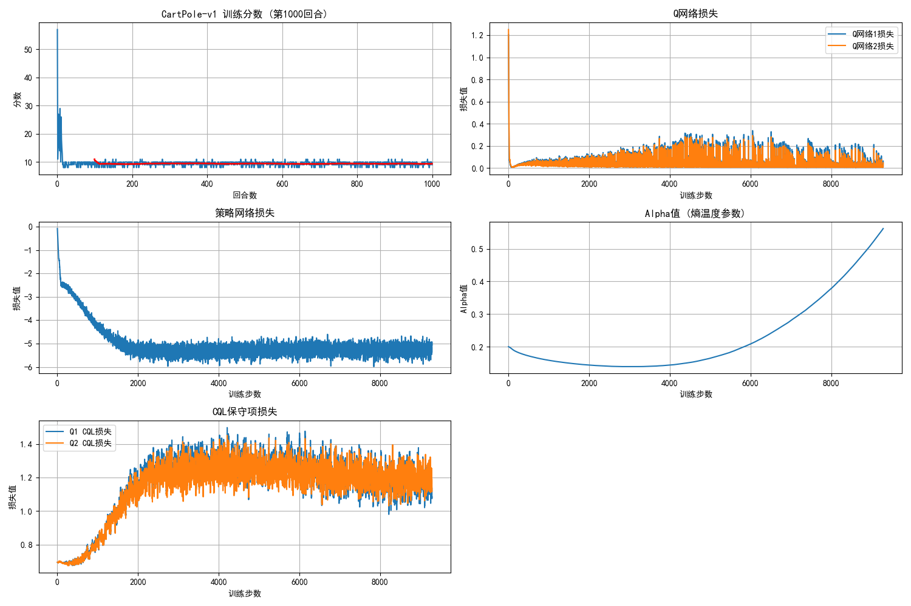

# 18 | 强化学习前沿：离线强化学习之CQL

你好！欢迎来到强化学习的第十八讲。这节课我们深入学习离线强化学习的另一个代表算法——CQL。

通过本节课的学习，你将能够：

- 深入理解 CQL 算法的设计哲学：为何要引入保守性正则项？它是如何抑制 Q 值过高估计、缓解分布偏移问题的？

## CQL 算法详解

在强化学习的实际落地进程中，如何高效盘活已收集的大规模数据集是一项关键挑战。离线强化学习算法的核心使命，便是从静态数据集中学习有效策略，且无需与环境开展实时交互。但在实践应用中，离线强化学习方法始终面临一个突出难题：标准的离策略（off-policy）强化学习方法往往会因数据集与学习策略之间的价值分布漂移而失效，这一问题在数据分布复杂或具有多模态特性的场景中表现得尤为明显。

为攻克这一难题，2020 年 Aviral Kumar 在其研究论文《Conservative Q-Learning for OfflineReinforcement Learning》中提出了保守 Q 学习（Conservative Q-learning, CQL）方法。该方法通过学习一个保守的 Q 函数，确保策略在该 Q 函数下的期望值能够成为其真实价值期望的下界，进而从根本上缓解价值分布漂移带来的负面影响。

这一创新设计不仅为离线强化学习的稳定性提供了理论支撑，更通过对 Q 函数的保守性约束，为复杂数据场景下的策略学习筑牢了可靠性基础，有效填补了传统离策略方法在离线场景中的性能短板。

## 算法背景与动机

在离线强化学习中，分布偏移问题是一个严重阻碍算法性能的关键因素。由于离线数据集中的状态 - 动作分布与当前策略下的状态 - 动作分布往往不一致，当智能体基于这些数据学习时，容易出现过拟合或错误泛化的现象。

例如，在一个推荐系统的离线强化学习场景中，历史用户行为数据所反映的用户偏好分布可能与当前市场环境下用户的真实偏好存在差异，若直接基于这些历史数据训练推荐策略，可能会推荐出不符合用户当前需求的内容，导致用户满意度下降。

同时，值函数估计偏差也是一个常见问题。在离线情况下，由于只能依赖固定的数据，对某一状态或动作的未来回报估计常常受到数据的限制，使得估计值与真实值存在偏差，这可能导致算法选择的策略并非最优，从而影响整体性能。

CQL 算法正是为解决这些问题而提出的，它通过独特的保守性约束机制，使智能体能够在离线数据上学习到更加稳健、可靠的策略。

## 核心技术与原理

离线强化学习的核心困境——分布偏移与值函数估计偏差，本质上源于“策略优化需求”与“静态数据局限”的内在矛盾：策略追求更优性能必然会尝试偏离历史行为的动作，而静态数据无法为这些未出现的动作提供可靠的价值反馈，导致 Q 值估计极易陷入过度乐观的陷阱。

为打破这一僵局，CQL 算法跳出了“仅优化贝尔曼残差”的传统框架，提出了以“保守性”为核心的解决方案，通过对 Q 值估计施加系统性约束，迫使策略在数据支撑的安全范围内进行优化。其核心技术设计围绕“如何构建合理的保守性约束”展开，具体可从 Q 值的正则化约束与目标函数的整体设计两方面深入解析。

1. 保守性约束 Q 值

CQL 的核心思想是对 Q 值进行保守性约束。在传统的 Q 学习中，目标是最小化贝尔曼残差，

## Q

以优化 Q 值函数。在普通的 Q-learning 中，

- 的更新方程可以写为：

- 2(s,a)∼D [(

## ]

## )

## Q^k+1

## B^πQ^k

- ​E

## ←

## arg

## Q(s, a) −

- ​ (s, a)

## min

- ​​Q

## B^π

## π

## Q

- 是实际计算时策略 的贝尔曼算子。为了防止值在各个状态上（尤其是不在数

其中，

## Q

据集中的状态上）的过高估计，我们要对某些状态上的

- 高值进行惩罚。考虑一般情况，我

## B^π

## μ(s, a)

## Q

们希望

- 值在某个特定分布上的期望值最小。在上式中，的计算需要用到′′

## a′

## (s, a, s , a )

## s

- ，但只有是生成的，可能不在数据集中。因此，我们对数据集中的状态 按策

## μ

略 得到的动作进行惩罚：

## 1

- 2(s,a)∼D [(

## ]

## )

## Q^k+1

## B^πQ^k

- ​βE​E

## ←

## arg

- ​[Q(s, a)] +

## min

## Q(s, a) −

- ​ (s, a)s∼D,a∼μ(a∣s)

## 2

- ​​Q

## (s, a)

## β

## Q

其中， 是平衡因子。可以证明，上式迭代收敛给出的函数

- 在任何上的值都比真实

## π(a∣s)

## V π

## Q

值要小。不过，如果我们放宽条件，只追求

- 在上的期望值比真实值小的话，

就可以略微放松对上式的约束。

## π

## Q

一个自然的想法是，对于符合用于生成数据集的行为策略

- 的数据点，我们可以认为对​b

## Q

这些点的估值较为准确，在这些点上不必限制让

- 值很小。作为对第一项的补偿，将上式改

为：

## 1

## Q^k+1

## E

- ​[Q(s, a)] −E​E

## ←

## arg

- ​β ⋅

## min

- ​[Q(s, a)] +

## (

## )

- s∼D,a∼μ(a∣s)s∼D,a∼​(a∣s)π^b(s,a)∼D

## 2

- ​Q

## π^b

## π

将行为策略

- 写为，是因为我们无法获知真实的行为策略，只能通过数据集中已有的数据​b​

## μ = π

## Q

近似得到。可以证明，当

- 时，上式迭代收敛得到的函数，虽然不是在每一点上都小

于真实值，但其期望是小于真实值的，即：

- π(a∣s) [Q^π

## ]

## E

- π​ (s, a) ≤

## V (s)

- ​

## μ =

至此，CQL 算法已经有了理论上的保证，但仍有一个缺陷：计算的时间开销太大了。当

## π^k

## π

## Q

时，在

- 迭代的每一步，算法都要对策略做完整的离线策略评估来计算上式中的

## arg min

- ，再进行一次策略迭代，而离线策略评估是非常耗时的。

## π

## Q

## Q

## Q

既然 并非与

- 独立，而是通过值最大的动作衍生出来的，那么我们完全可以用使取

## μ

## π

最大值的 去近似 ，即：

- ​E

## π ≈

- ​ Q(s, a)

## max

- s∼D,a∼μ(a∣s) [

## ]

- μ

## R(μ)

为了防止过拟合，再加上正则项

- 。综合起来就得到完整的迭代方程：

## 1

## Q^k+1

## E

- ​[Q(s, a)] −E​E

## ←

## arg

- ​β ⋅

## min

- ​[Q(s, a)] +

## (

## )

- s∼D,a∼μ(a∣s)s∼D,a∼​(a∣s)π^b(s,a)∼D

## 2

- ​Q

## ρ(a∣s)

## R(μ) = −D

- ​(μ, ρ)

正则项采用和一个先验策略

- 的 KL 距离，即。一般来说，取KL

## ρ(a∣s)

## U(a)

- 为均匀分布即可，这样可以将迭代方程简化为：

## [

## ]

## 1

## ∑

## ^k+1

## μ

可以注意到，简化后式中已经不含有 ，为计算提供了很大方便。

## Q

这个正则化项的作用是：限制估计的

- 值在某个合理的范围内。具体来说，CQL 通过减少策

## Q

## Q

略生成的

- 值的期望，并增加数据中真实动作的值的期望，确保估计值函数更加保守。这

## Q

意味着对于在历史数据中未出现过或出现很少的状态 - 动作对，CQL 不会给予过高的

- 值估

计，从而有效降低了分布偏移带来的不良影响。

例如，在一个工业生产过程的控制任务中，对于一些罕见的设备状态和操作组合，如果按照传

## Q

## Q

统

- 学习可能会因为数据稀疏而给予过高的值估计，导致在实际应用中采取错误的操作。

而 CQL 通过保守性约束，能够避免这种过度乐观的估计，使策略更加稳健。

2. 目标函数设计

CQL 的目标函数形式为：在标准 Q 学习目标函数的基础上，添加了保守性正则化项。其中，涉及到对当前策略下动作 Q 值的期望以及历史数据中实际观测到动作的 Q 值的期望的计算。通过调整正则化系数，可以灵活调节保守程度。较大的正则化系数会使约束更加严格，Q 值估计更加保守；较小的系数则相对放宽约束，给予一定的探索空间。在实际应用中，需要根据数据的特点和任务的需求，合理选择正则化系数，以平衡保守性与探索性，实现最优的策略学习效果。

## 算法执行流程

与 BCQ 类似，在 CQL 算法的执行流程中，数据收集是基础环节。首先需从环境中采集历史交互数据，构建离线数据集，这些数据可来源于实际生产过程、用户历史行为记录或仿真实验等多种渠道。数据质量与多样性直接影响 CQL 算法的最终性能，因此在数据收集阶段需尽可能确保数据能全面、准确地反映环境特征及各类可能场景。​

完成数据准备后，进入初始化阶段，需对用于估计状态 - 动作价值的 Q 值函数进行初始化。实践中通常采用神经网络等参数化模型表示 Q 值函数，其初始参数可随机生成，也可结合先验知识进行设定，以此加快训练速度并提升收敛稳定性。​算法的核心在于迭代更新过程。每次迭代中，首先基于当前策略与历史数据计算 Q 值，计算过程需融合状态转移、奖励反馈等关键信息，以准确估计动作价值。随后将保守性正则项引入损失函数，通过梯度下降等优化算法对 Q 值函数进行更新。加入正则项后的损失函数，既关注 Q 值与实际回报的匹配度，又强调 Q 值的保守性约束，引导 Q 值函数向更稳健的方向迭代。​

基于更新后的 Q 值函数进行策略更新，是算法迭代的关键环节。策略更新以选择高 Q 值动作为目标，同时需确保不过度偏离历史数据中的行为分布。常用策略包括贪心策略（在每个状态下选择 Q 值最大的动作）和 ε- 贪心策略（以一定概率随机选择动作以保留探索性）。更新过程中必须严格遵循 Q 值函数的保守性约束，避免因过度追求高 Q 值导致策略在实际应用中出现不稳定问题。​

算法通过收敛检测机制判断终止条件，需重复执行上述迭代过程直至 Q 值与策略达到收敛状态。收敛判断标准可设定为：Q 值函数的参数变化量小于预设阈值，或策略在连续多次迭代中的性能波动控制在特定范围内。当算法收敛时，表明智能体已从离线数据中学习到稳定策略，可将其应用于实际任务场景。

总结起来，CQL 算法流程如下：

## Q

## Q

## Q

## π

## α

- 初始化 Q 网络、目标网络和策略、熵正则系数θ′​θ​ϕ​

## t = 1 →T

- for 训练次数do​E​ ←​ −​∇

## [−α

- ​ log π​(a∣s) −​H]更新熵正则系数：α

## α

## η

## α

- t−1t−1t−1s∼D,a∼π​(a∣s)tααϕϕ​(α ⋅

## E

- ​∇​ ←​ −​[ log​ exp(Q​(s, a)) −

## ∑a

- 更新函数 Q：θ

## θ

## η

- t−1s∼DtQθθ​(s, a)) ])1

## E

- ​E2​[Q​(s, a)]] +​[(Q​(s, a) −π

## B

## Q

- ​ϕa∼​(a∣s)π^b(s,a)∼Dθθθ2​E​ ←​ −​∇​[α log π​(a∣s) −​(s, a)]更新策略：ϕ

## ϕ

## η

## Q

- t−1s∼D,a∼π​(a∣s)tπϕϕθϕend for

```bash
import torch
import torch.nn as nn
import torch.optim as optim
import torch.nn.functional as F
from torch.distributions import Normal
import numpy as np
from collections import deque, namedtuple
import random
import gym
from gym.spaces import Box, Discrete
import matplotlib.pyplot as plt
import os
from datetime import datetime
# 确保中文显示正常
plt.rcParams["font.family"] = ["SimHei", "WenQuanYi Micro Hei", "Heiti TC"]
plt.rcParams["axes.unicode_minus"] = False  # 解决负号显示问题
# 工具函数：将动作缩放到环境的动作空间范围内
def scale_action(action, action_space):
   if isinstance(action_space, Box):
       low, high = action_space.low, action_space.high
       return low + (0.5 * (action + 1.0) * (high - low))
   return action
# 经验回放缓冲区
class ReplayBuffer:
   def __init__(self, buffer_size, batch_size):
       self.memory = deque(maxlen=buffer_size)
       self.batch_size = batch_size
       self.experience = namedtuple("Experience",
                                   field_names=["state", "action", "reward", "ne
   def add(self, state, action, reward, next_state, done):
       e = self.experience(state, action, reward, next_state, done)
       self.memory.append(e)
   def sample(self):
       experiences = random.sample(self.memory, k=self.batch_size)
       states = torch.from_numpy(np.vstack([e.state for e in experiences if e is
       actions = torch.from_numpy(np.vstack([e.action for e in experiences if e
       rewards = torch.from_numpy(np.vstack([e.reward for e in experiences if e
       next_states = torch.from_numpy(np.vstack([e.next_state for e in experienc
       dones = torch.from_numpy(np.vstack([e.done for e in experiences if e is n
       return (states, actions, rewards, next_states, dones)
   def __len__(self):
       return len(self.memory)
# Q网络 - 适用于连续动作空间
class QNetwork(nn.Module):
   def __init__(self, state_size, action_size, hidden_sizes=[256, 256]):
       super(QNetwork, self).__init__()
       layers = []
       input_size = state_size + action_size
       # 创建隐藏层
       for hidden_size in hidden_sizes:
           layers.append(nn.Linear(input_size, hidden_size))
           layers.append(nn.ReLU())
           input_size = hidden_size
       # 输出层
       layers.append(nn.Linear(input_size, 1))
       self.model = nn.Sequential(*layers)
   def forward(self, state, action):
       x = torch.cat([state, action], dim=1)
       return self.model(x)
# 策略网络 - 用于连续动作空间的高斯策略
class PolicyNetwork(nn.Module):
   def __init__(self, state_size, action_size, hidden_sizes=[256, 256], log_std_
       super(PolicyNetwork, self).__init__()
       self.log_std_min = log_std_min
       self.log_std_max = log_std_max
       # 均值网络
       mean_layers = []
       input_size = state_size
       for hidden_size in hidden_sizes:
           mean_layers.append(nn.Linear(input_size, hidden_size))
           mean_layers.append(nn.ReLU())
           input_size = hidden_size
       mean_layers.append(nn.Linear(input_size, action_size))
       mean_layers.append(nn.Tanh())  # 输出范围在[-1, 1]
       self.mean_model = nn.Sequential(*mean_layers)
       # 标准差网络
       log_std_layers = []
       input_size = state_size
       for hidden_size in hidden_sizes:
           log_std_layers.append(nn.Linear(input_size, hidden_size))
           log_std_layers.append(nn.ReLU())
           input_size = hidden_size
       log_std_layers.append(nn.Linear(input_size, action_size))
       self.log_std_model = nn.Sequential(*log_std_layers)
   def forward(self, state):
       mean = self.mean_model(state)
       log_std = self.log_std_model(state)
       log_std = torch.clamp(log_std, self.log_std_min, self.log_std_max)
       return mean, log_std
   def sample(self, state):
       mean, log_std = self.forward(state)
       std = log_std.exp()
       normal = Normal(mean, std)
       # 重参数化技巧
       x_t = normal.rsample()
       action = torch.tanh(x_t)
       # 计算对数概率
       log_prob = normal.log_prob(x_t)
       # 修正tanh带来的概率变化
       log_prob -= torch.log(1 - action.pow(2) + 1e-6)
       log_prob = log_prob.sum(1, keepdim=True)
       return action, log_prob, mean
# 离散动作空间的策略网络
class DiscretePolicyNetwork(nn.Module):
   def __init__(self, state_size, action_size, hidden_sizes=[256, 256]):
       super(DiscretePolicyNetwork, self).__init__()
       layers = []
       input_size = state_size
       for hidden_size in hidden_sizes:
           layers.append(nn.Linear(input_size, hidden_size))
           layers.append(nn.ReLU())
           input_size = hidden_size
       layers.append(nn.Linear(input_size, action_size))
       self.model = nn.Sequential(*layers)
   def forward(self, state):
       logits = self.model(state)
       return logits
   def sample(self, state):
       logits = self.forward(state)
       probs = F.softmax(logits, dim=1)
       dist = torch.distributions.Categorical(probs)
       action = dist.sample()
       log_prob = dist.log_prob(action).unsqueeze(1)
       return action, log_prob, logits
# CQL代理（同时支持连续和离散动作空间）
class CQLAgent:
   def __init__(self, state_size, action_size, action_space,
                buffer_size=int(1e6), batch_size=256,
                gamma=0.99, tau=0.005, lr_q=3e-4, lr_policy=3e-4,
                alpha=0.2, auto_alpha=True, target_entropy=None,
                cql_tau=1.0, cql_alpha=0.001):
       self.state_size = state_size
       self.action_size = action_size
       self.action_space = action_space
       self.is_discrete = isinstance(action_space, Discrete)
       self.gamma = gamma
       self.tau = tau
       self.batch_size = batch_size
       self.cql_tau = cql_tau
       self.cql_alpha = cql_alpha
       # Q网络 - 使用两个Q网络减少过估计偏差
       if self.is_discrete:
           # 离散动作空间的Q网络只需要状态作为输入
           self.qf1 = nn.Sequential(
               nn.Linear(state_size, 256),
               nn.ReLU(),
               nn.Linear(256, 256),
               nn.ReLU(),
               nn.Linear(256, action_size)
           )
           self.qf2 = nn.Sequential(
               nn.Linear(state_size, 256),
               nn.ReLU(),
               nn.Linear(256, 256),
               nn.ReLU(),
               nn.Linear(256, action_size)
           )
           self.qf1_target = nn.Sequential(
               nn.Linear(state_size, 256),
               nn.ReLU(),
               nn.Linear(256, 256),
               nn.ReLU(),
               nn.Linear(256, action_size)
           )
           self.qf2_target = nn.Sequential(
               nn.Linear(state_size, 256),
               nn.ReLU(),
               nn.Linear(256, 256),
               nn.ReLU(),
               nn.Linear(256, action_size)
           )
       else:
           # 连续动作空间的Q网络需要状态和动作作为输入
           self.qf1 = QNetwork(state_size, action_size)
           self.qf2 = QNetwork(state_size, action_size)
           self.qf1_target = QNetwork(state_size, action_size)
           self.qf2_target = QNetwork(state_size, action_size)
       # 复制参数到目标网络
       for target_param, param in zip(self.qf1_target.parameters(), self.qf1.par
           target_param.data.copy_(param.data)
       for target_param, param in zip(self.qf2_target.parameters(), self.qf2.par
           target_param.data.copy_(param.data)
       # 策略网络 - 根据动作空间类型选择不同的网络
       if self.is_discrete:
           self.policy = DiscretePolicyNetwork(state_size, action_size)
       else:
           self.policy = PolicyNetwork(state_size, action_size)
       # 优化器
       self.q_optimizer = optim.Adam(list(self.qf1.parameters()) + list(self.qf2
       self.policy_optimizer = optim.Adam(self.policy.parameters(), lr=lr_policy
       # 经验回放
       self.memory = ReplayBuffer(buffer_size, batch_size)
       # 熵调节
       self.auto_alpha = auto_alpha
       if target_entropy is None:
           if self.is_discrete:
               self.target_entropy = -np.log(1.0 / action_size) * 0.98
           else:
               self.target_entropy = -action_size  # 对于连续动作空间的默认值
       else:
           self.target_entropy = target_entropy
       if self.auto_alpha:
           self.log_alpha = torch.tensor(np.log(alpha))
           self.log_alpha.requires_grad = True
           self.alpha_optimizer = optim.Adam([self.log_alpha], lr=lr_q)
           self.alpha = self.log_alpha.exp()
       else:
           self.alpha = alpha
   def step(self, state, action, reward, next_state, done):
       self.memory.add(state, action, reward, next_state, done)
       if len(self.memory) > self.batch_size:
           experiences = self.memory.sample()
           return self.learn(experiences)
       return None
   def act(self, state, deterministic=False):
       # 确保state是numpy数组
       if isinstance(state, tuple):
           state = state[0]  # 取元组中的观察值部分
       state = torch.from_numpy(state).float().unsqueeze(0)
       with torch.no_grad():
           if self.is_discrete:
               logits = self.policy(state)
               probs = F.softmax(logits, dim=1)
               if deterministic:
                   action = torch.argmax(probs, dim=1)
               else:
                   action = torch.distributions.Categorical(probs).sample()
               action_np = action.cpu().numpy().flatten()[0]  # 离散动作返回标量
           else:
               if deterministic:
                   mean, _ = self.policy(state)
                   action = torch.tanh(mean)
               else:
                   action, _, _ = self.policy.sample(state)
               action_np = action.cpu().numpy().flatten()
               # 缩放到环境的动作空间
               action_np = scale_action(action_np, self.action_space)
       return action_np
   def learn(self, experiences):
       states, actions, rewards, next_states, dones = experiences
       # ---------------------------- 更新策略网络 ---------------------------- #
       self.policy_optimizer.zero_grad()
       if self.is_discrete:
           # 离散动作空间的策略损失计算
           logits = self.policy(states)
           probs = F.softmax(logits, dim=1)
           dist = torch.distributions.Categorical(probs)
           log_pi = dist.log_prob(actions.squeeze(1)).unsqueeze(1)
           qf1_all = self.qf1(states)
           qf2_all = self.qf2(states)
           qf1_pi = torch.sum(probs * qf1_all, dim=1, keepdim=True)
           qf2_pi = torch.sum(probs * qf2_all, dim=1, keepdim=True)
       else:
           # 连续动作空间的策略损失计算
           pi, log_pi, _ = self.policy.sample(states)
           qf1_pi = self.qf1(states, pi)
           qf2_pi = self.qf2(states, pi)
       min_qf_pi = torch.min(qf1_pi, qf2_pi)
       policy_loss = ((self.alpha * log_pi) - min_qf_pi).mean()
       policy_loss.backward()
       self.policy_optimizer.step()
       # ---------------------------- 更新alpha ---------------------------- #
       if self.auto_alpha:
           self.alpha_optimizer.zero_grad()
           alpha_loss = -(self.log_alpha * (log_pi + self.target_entropy).detach
           alpha_loss.backward()
           self.alpha_optimizer.step()
           self.alpha = self.log_alpha.exp()
       # ---------------------------- 更新Q网络 ---------------------------- #
       self.q_optimizer.zero_grad()
       with torch.no_grad():
           # 目标动作分布
           if self.is_discrete:
               next_logits = self.policy(next_states)
               next_probs = F.softmax(next_logits, dim=1)
               next_dist = torch.distributions.Categorical(next_probs)
               next_log_pi = next_dist.log_prob(torch.argmax(next_probs, dim=1))
               qf1_target_next_all = self.qf1_target(next_states)
               qf2_target_next_all = self.qf2_target(next_states)
               qf1_target_next = torch.sum(next_probs * qf1_target_next_all, dim
               qf2_target_next = torch.sum(next_probs * qf2_target_next_all, dim
           else:
               next_pi, next_log_pi, _ = self.policy.sample(next_states)
               qf1_target_next = self.qf1_target(next_states, next_pi)
               qf2_target_next = self.qf2_target(next_states, next_pi)
           min_qf_target_next = torch.min(qf1_target_next, qf2_target_next) - se
           # 贝尔曼方程更新
           q_target = rewards + (1 - dones) * self.gamma * min_qf_target_next
       # 当前Q值
       if self.is_discrete:
           # 离散动作空间：使用gather获取对应动作的Q值
           qf1_current = self.qf1(states).gather(1, actions.long())
           qf2_current = self.qf2(states).gather(1, actions.long())
       else:
           # 连续动作空间：直接计算Q值
           qf1_current = self.qf1(states, actions)
           qf2_current = self.qf2(states, actions)
       # 标准MSE损失
       qf1_loss = F.mse_loss(qf1_current, q_target)
       qf2_loss = F.mse_loss(qf2_current, q_target)
       # ---------------------------- CQL保守项计算 ---------------------------- #
       if self.is_discrete:
           # 离散动作空间的CQL损失
           qf1_all = self.qf1(states)
           qf2_all = self.qf2(states)
           # 计算所有动作的log-sum-exp
           log_sum_exp_q1 = torch.logsumexp(qf1_all / self.cql_tau, dim=1, keepd
           log_sum_exp_q2 = torch.logsumexp(qf2_all / self.cql_tau, dim=1, keepd
           # 减去当前动作的Q值
           cql_loss_q1 = (log_sum_exp_q1 - qf1_current).mean()
           cql_loss_q2 = (log_sum_exp_q2 - qf2_current).mean()
       else:
           # 连续动作空间的CQL损失
           with torch.no_grad():
               random_actions, _, _ = self.policy.sample(states)
           qf1_rand = self.qf1(states, random_actions)
           qf2_rand = self.qf2(states, random_actions)
           qf1_current_actions = self.qf1(states, actions)
           qf2_current_actions = self.qf2(states, actions)
           log_sum_exp_q1 = torch.logsumexp(qf1_rand / self.cql_tau, dim=0) * se
           log_sum_exp_q2 = torch.logsumexp(qf2_rand / self.cql_tau, dim=0) * se
           cql_loss_q1 = log_sum_exp_q1
           cql_loss_q2 = log_sum_exp_q2
       # 总Q损失（包含CQL保守项）
       qf1_loss_total = qf1_loss + self.cql_alpha * cql_loss_q1
       qf2_loss_total = qf2_loss + self.cql_alpha * cql_loss_q2
       q_total_loss = qf1_loss_total + qf2_loss_total
       q_total_loss.backward()
       self.q_optimizer.step()
       # ---------------------------- 软更新目标网络 ----------------------------
       self.soft_update(self.qf1, self.qf1_target)
       self.soft_update(self.qf2, self.qf2_target)
       return {
           'qf1_loss': qf1_loss.item(),
           'qf2_loss': qf2_loss.item(),
           'policy_loss': policy_loss.item(),
           'alpha': self.alpha.item() if not self.auto_alpha else self.alpha.ite
           'cql_loss_q1': cql_loss_q1.item() if self.is_discrete else cql_loss_q
           'cql_loss_q2': cql_loss_q2.item() if self.is_discrete else cql_loss_q
       }
   def soft_update(self, local_model, target_model):
       for target_param, local_param in zip(target_model.parameters(), local_mod
           target_param.data.copy_(self.tau * local_param.data + (1.0 - self.tau
# 训练函数
def train_cql(env_name="CartPole-v1", max_episodes=1000, max_steps=1000,
             batch_size=256, buffer_size=int(1e6), save_path=None):
   env = gym.make(env_name)
   # 处理环境的reset返回值是元组的情况
   state, _ = env.reset()
   state_size = state.shape[0]
   if isinstance(env.action_space, Box):
       action_size = env.action_space.shape[0]
   else:
       action_size = env.action_space.n
   # 初始化智能体
   agent = CQLAgent(
       state_size=state_size,
       action_size=action_size,
       action_space=env.action_space,
       buffer_size=buffer_size,
       batch_size=batch_size
   )
   scores = []
   scores_window = deque(maxlen=100)
   stats = {
       'qf1_loss': [],
       'qf2_loss': [],
       'policy_loss': [],
       'alpha': [],
       'cql_loss_q1': [],
       'cql_loss_q2': []
   }
   # 创建图形
   plt.figure(figsize=(15, 10))
   plt.subplots_adjust(hspace=0.5)
   # 实时绘图设置
   plt.ion()  # 开启交互模式
   for i_episode in range(1, max_episodes + 1):
       state, _ = env.reset()  # 处理元组返回值
       score = 0
       for t in range(max_steps):
           action = agent.act(state)
           next_state, reward, done, _, _ = env.step(action)  # 处理新的step返回值
           learn_stats = agent.step(state, action, reward, next_state, done)
           # 记录训练统计信息
           if learn_stats:
               for key, value in learn_stats.items():
                   if key in stats:
                       stats[key].append(value)
           state = next_state
           score += reward
           if done:
               break
       scores_window.append(score)
       scores.append(score)
       # 打印训练进度
       print(f'\rEpisode {i_episode}\tAverage Score: {np.mean(scores_window):.2f
       if i_episode % 100 == 0:
           print(f'\rEpisode {i_episode}\tAverage Score: {np.mean(scores_window)
           # 每100回合更新一次图形
           update_plots(scores, stats, i_episode, env_name)
       # 根据环境设置不同的解决条件
       if env_name == "CartPole-v1" and np.mean(scores_window) >= 495:
           print(f'\nEnvironment solved in {i_episode-100} episodes!\tAverage Sc
           if save_path:
               # 创建保存目录
               os.makedirs(os.path.dirname(save_path), exist_ok=True)
               torch.save(agent.qf1.state_dict(), save_path + "_qf1.pth")
               torch.save(agent.qf2.state_dict(), save_path + "_qf2.pth")
               torch.save(agent.policy.state_dict(), save_path + "_policy.pth")
           break
       elif env_name.startswith("HalfCheetah") and np.mean(scores_window) >= 300
           print(f'\nEnvironment solved in {i_episode-100} episodes!\tAverage Sc
           if save_path:
               os.makedirs(os.path.dirname(save_path), exist_ok=True)
               torch.save(agent.qf1.state_dict(), save_path + "_qf1.pth")
               torch.save(agent.qf2.state_dict(), save_path + "_qf2.pth")
               torch.save(agent.policy.state_dict(), save_path + "_policy.pth")
           break
   # 训练结束后绘制最终图形
   plt.ioff()  # 关闭交互模式
   update_plots(scores, stats, i_episode, env_name, final=True)
   plt.show()
   env.close()
   return scores, agent, stats
def update_plots(scores, stats, episode, env_name, final=False):
   """更新并显示训练过程中的各种图表"""
   plt.clf()
   # 1. 分数曲线
   plt.subplot(3, 2, 1)
   plt.plot(scores)
   # 计算并绘制滑动平均
   if len(scores) >= 100:
       moving_avg = np.convolve(scores, np.ones(100)/100, mode='valid')
       plt.plot(range(99, len(scores)), moving_avg, 'r-', linewidth=2)
   plt.title(f'{env_name} 训练分数 (第{episode}回合)')
   plt.xlabel('回合数')
   plt.ylabel('分数')
   plt.grid(True)
   # 2. Q网络损失
   plt.subplot(3, 2, 2)
   if stats['qf1_loss']:
       plt.plot(stats['qf1_loss'], label='Q网络1损失')
       plt.plot(stats['qf2_loss'], label='Q网络2损失')
       plt.legend()
   plt.title('Q网络损失')
   plt.xlabel('训练步数')
   plt.ylabel('损失值')
   plt.grid(True)
   # 3. 策略损失
   plt.subplot(3, 2, 3)
   if stats['policy_loss']:
       plt.plot(stats['policy_loss'])
   plt.title('策略网络损失')
   plt.xlabel('训练步数')
   plt.ylabel('损失值')
   plt.grid(True)
   # 4. Alpha值
   plt.subplot(3, 2, 4)
   if stats['alpha']:
       plt.plot(stats['alpha'])
   plt.title('Alpha值 (熵温度参数)')
   plt.xlabel('训练步数')
   plt.ylabel('Alpha值')
   plt.grid(True)
   # 5. CQL损失项
   plt.subplot(3, 2, 5)
   if stats['cql_loss_q1']:
       plt.plot(stats['cql_loss_q1'], label='Q1 CQL损失')
       plt.plot(stats['cql_loss_q2'], label='Q2 CQL损失')
       plt.legend()
   plt.title('CQL保守项损失')
   plt.xlabel('训练步数')
   plt.ylabel('损失值')
   plt.grid(True)
   plt.tight_layout()
   if final:
       # 保存最终图表
       timestamp = datetime.now().strftime("%Y%m%d_%H%M%S")
       plt.savefig(f'cql_training_{env_name}_{timestamp}.png', dpi=300)
# 使用示例
if __name__ == "__main__":
   # 创建结果保存目录
   result_dir = os.path.join("results", datetime.now().strftime("%Y%m%d_%H%M%S")
   os.makedirs(result_dir, exist_ok=True)
   # 使用CartPole环境（不需要MuJoCo）
   scores, agent, stats = train_cql(
       env_name="CartPole-v1",
       max_episodes=1000,
       max_steps=1000,
       save_path=os.path.join(result_dir, "cql_cartpole")
   )
   # 可以在这里添加更多分析代码
   print("\n训练完成！")
   print(f"最终100回合平均分数: {np.mean(scores[-100:]):.2f}")
```

上述算法的核心模块，实现了 CQL 的主要逻辑：

1. 初始化方法：

- 根据动作空间类型（连续 / 离散）自动选择合适的网络结构。

- 配置双 Q 网络（减少过估计偏差）和目标网络。

- 初始化优化器、经验回放缓冲区和熵调节参数。

2. 动作选择（act 方法）：

- 处理环境返回的状态（支持元组类型状态）。

- 根据当前策略网络输出选择动作，支持确定性和随机采样两种模式。

- 对连续动作进行缩放以匹配环境要求。

3. 学习过程（learn 方法）：

- 策略网络更新：最小化策略损失，平衡价值估计和熵正则项。

- 自动熵调节：动态调整温度参数 alpha，平衡探索与利用。

- Q 网络更新：结合标准 MSE 损失和 CQL 保守项。

- CQL 保守项计算：对离散空间直接计算所有动作的 log-sum-exp，对连续空间通过采样近似。

- 软更新目标网络：缓慢更新目标网络参数以提高稳定性。

4. 辅助方法：

- step()：添加经验到缓冲区并判断是否进行学习。

- soft_update()：实现目标网络的软更新。

如图 18-1 所示，从运行结果来看，CQL 算法在 CartPole - v1 环境中展现出良好的训练效果。训练分数方面，虽初始有波动，但后续逐渐稳定，体现出算法学习到有效策略的趋势；Q网络损失曲线随着训练步数增加逐步下降并趋于平稳，说明 Q 值估计逐渐准确；策略网络损失也呈下降态势，表明策略在不断优化；Alpha 值（熵温度参数）的变化反映出算法在探索与利用之间的动态平衡调整；CQL 保守项损失的表现则验证了算法通过保守性约束，有效避免了对未充分探索区域的过度乐观估计，整体上证明了 CQL 算法在离线强化学习场景下的有效性与稳定性。



- 图18-1 CQL运行结果

## 优势与应用场景

CQL 算法通过“保守性 Q 值估计”这一核心设计，从根本上缓解了离线强化学习中致命的分布偏移与值函数过估计问题，其技术特性不仅带来了算法理论层面的稳健性，更使其在现实场景中具备了极强的落地适配能力。这种“以保守换安全、以精准估值换可靠决策”的优势，使其能够突破在线强化学习的探索限制，在高风险、数据稀缺或交互成本极高的领域发挥不可替代的作用。以下将具体拆解 CQL 算法的核心优势，及其在关键行业场景中的实践价值。

### 优势

- 分布偏移鲁棒性强：通过对策略行为施加保守性约束，CQL 能够有效应对分布偏移问题，使策略在面对历史数据未覆盖的状态空间时，不会产生过度乐观的决策，从而提高了策略的稳定性和可靠性。

- 值函数估计准确：通过引入正则化项，CQL 减少了值函数估计的偏差，避免了因离线数据稀疏性导致的过高 Q 值估计，使得策略选择更加基于真实的价值评估，提升了算法的性能。

- 适用场景广泛：CQL 适用于各种无法进行在线探索的高风险场景，如医疗决策、自动驾驶、机器人控制等。在这些场景中，CQL 能够利用有限的历史数据，学习到安全、有效的策略，避免了在线探索可能带来的严重后果。

### 应用场景

- 医疗决策：在医疗领域，CQL 可以利用大量的历史病例数据，为患者制定个性化的治疗方案。例如，根据不同患者的病情特征、治疗历史等数据，学习到最优的治疗策略，避免因盲目尝试新治疗方法而给患者带来风险。

- 自动驾驶：在自动驾驶场景中，CQL 可以基于大量的模拟驾驶数据和实际道路测试的历史数据，训练自动驾驶汽车的决策模型。通过对不同路况、驾驶场景下的动作价值进行保守估计，使自动驾驶汽车在面对复杂多变的交通环境时，能够做出更加安全、可靠的驾驶决策，降低事故风险。

- 机器人控制：对于机器人在复杂环境中的操作任务，CQL 可以利用历史操作数据，学习到稳健的控制策略。例如，机器人在危险环境中执行任务时，如核电站的故障检测与修复，CQL 能够确保机器人根据历史经验选择安全、有效的动作，避免因过度探索而导致设备损坏或人员伤亡。

## 总结

我们花了三节课，系统地介绍了离线强化学习的基本概念、核心挑战以及两类代表性解决方案：BCQ 与 CQL。

离线强化学习（Offline Reinforcement Learning）是一种无需与环境实时交互的强化学习范式，仅依靠预先收集的静态数据集训练智能体，适用于医疗、自动驾驶、金融等高风险场景。它解决了传统在线强化学习中探索成本高、试错风险大的问题，但面临核心挑战：由于新策略与行为策略的数据分布不一致，导致分布偏移和 Q 值过高估计，进而引发策略性能下降甚至崩溃。

为应对这些挑战，主流方法分为两类：

- 一类是通过约束策略行为来保证安全，如 BCQ 算法，它利用生成模型（如 VAE）学习历史数据中的动作分布，并在该范围内生成候选动作，再结合 Q 网络选择最优动作，从而避免产生数据外的动作；

- 另一类是通过修正 Q 函数估计来增强鲁棒性，如 CQL 算法，它在损失函数中引入保守性正则项，主动压低未见状态 - 动作对的 Q 值，防止过度乐观估计，确保学习到的策略在数据支持范围内保持稳健。

BCQ 和 CQL 虽路径不同，但目标一致：在不进行在线探索的前提下，最大限度地从历史数据中学习优于行为策略的决策能力。BCQ 更贴近“模仿 + 微调”的思路，在动作空间上做限制；而 CQL 则从价值函数角度出发，通过数学正则化实现全局保守性，理论保障更强，适用范围更广。两者都显著优于直接将传统 DQN 或 DDPG 应用于离线场景的表现。

总体而言，离线强化学习标志着强化学习从“边试错边学习”向“从历史中学习”的范式转变。它不仅提升了智能体在现实系统中的安全性与可行性，也为大规模利用已有数据进行策略优化提供了有效路径。未来的发展方向包括提升对低质量数据的鲁棒性、结合模型 -based 方法提高样本效率，以及探索离线预训练与在线微调相结合的混合学习模式。

## 思考题

在离线强化学习中，BCQ 和 CQL 分别代表了“策略约束”与“Q 值保守估计”两种不同的解决思路。请结合课程内容，回答以下问题：

1. 核心机制对比：简要说明 BCQ 和 CQL 是如何分别应对“分布偏移”和“Q 值过高估计”问题的？它们在实现“保守学习”时的技术路径有何本质不同？

2. 设计启示：从这两种算法的设计思想中，你认为在现实应用中构建一个安全且高效的离线强化学习系统时，应如何平衡“模仿历史”与“超越历史”之间的矛盾？

希望你通过今天的学习，对强化学习有了清晰的认识。如果有任何疑问，欢迎在讨论区留言交流！
