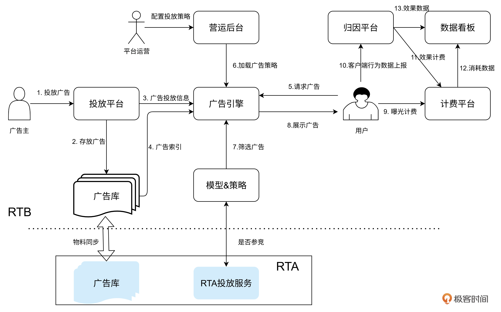
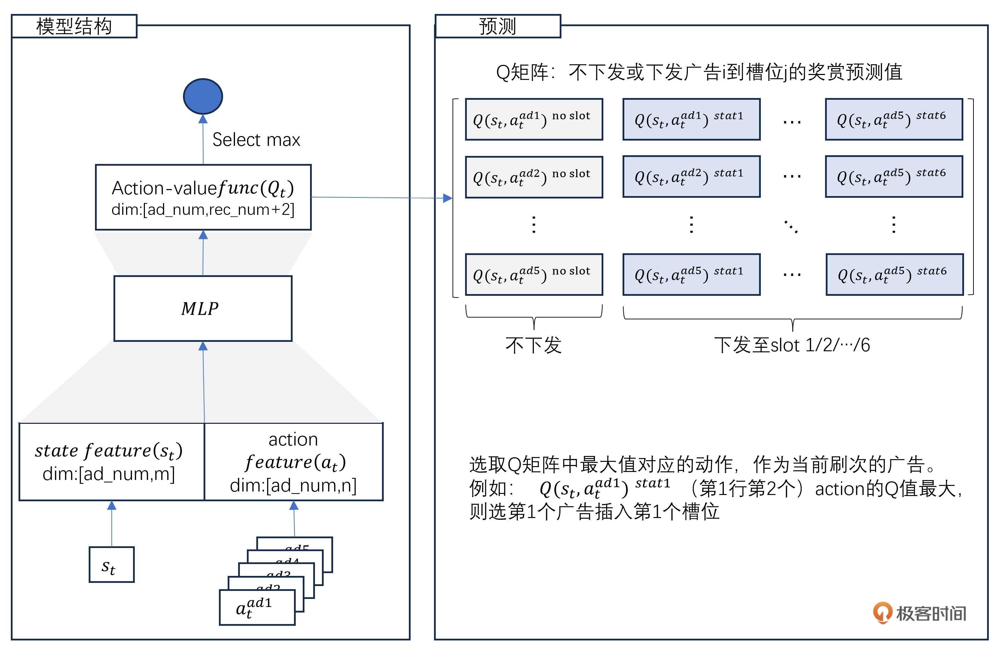
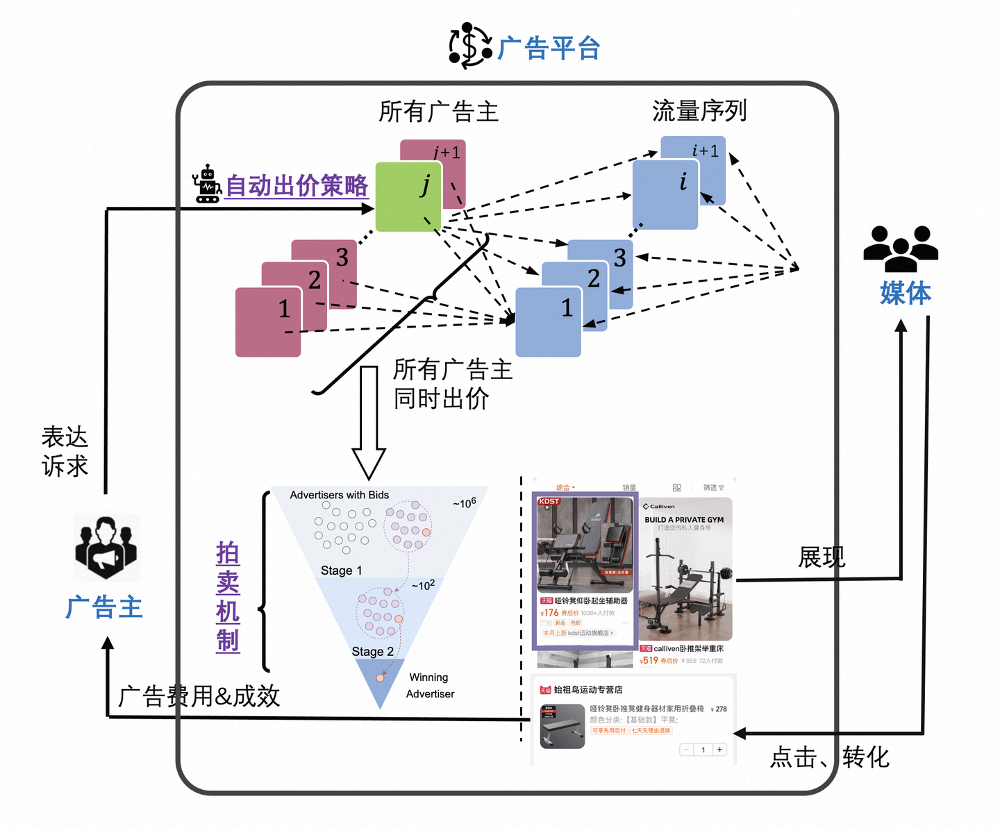
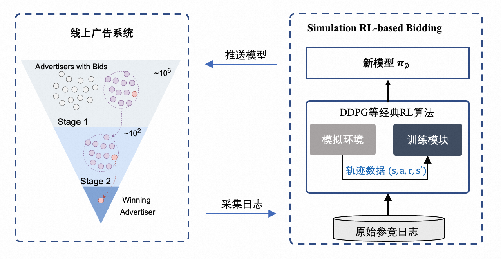

# 20 | 推荐系统：从个性化推荐到广告投放（下）

你好！欢迎来到强化学习的第二十讲。这节课我们继续讲解强化学习在推荐系统中的应用。

通过本节课的学习，你将能够：

- 洞悉推荐与广告的商业衔接：掌握广告投放的核心指标（点击率、转化率等），以及精准定向、实时竞价、动态创意优化等基于推荐系统的投放策略。

- 理解强化学习的落地价值：学会用强化学习解决推荐系统的冷启动、多目标混排、广告动态出价等实际问题，掌握其在商业场景中的闭环应用逻辑。

## 一、从个性化推荐到广告投放

当个性化推荐技术在满足用户需求、提升平台用户粘性方面展现出强大价值后，其技术逻辑自然延伸至平台商业变现的核心场景——广告投放。

对互联网平台而言，个性化推荐解决的是“如何让用户找到感兴趣的内容 / 商品”，而广告投放则是在这一逻辑基础上，进一步实现“让广告主的营销内容找到精准受众”的商业目标。二者本质上共享“用户需求与内容匹配”的核心逻辑：个性化推荐的对象是平台自有内容或商品，广告投放的对象则是广告主的营销内容，前者是提升用户体验的“基础引擎”，后者是实现商业价值的“变现引擎”。

从技术层面看，个性化推荐积累的用户画像、实时数据处理能力、多维度匹配算法，为广告投放突破传统“广撒网”模式、走向“精准化”提供了关键支撑。例如，基于推荐系统构建的用户兴趣标签，可直接用于广告的定向筛选；推荐算法中的实时反馈机制，能帮助广告动态调整投放策略以提升效果。

接下来，我们将深入剖析广告投放与个性化推荐的内在联系，明确广告投放的核心评估指标，并拆解基于推荐技术的广告投放策略，理解“用户体验优化”与“商业价值实现”如何通过技术手段达成平衡。

## 1.1 广告投放与推荐系统的联系

广告投放是互联网企业实现商业变现的重要手段之一，而推荐系统为广告投放提供了强大的技术支持，使得广告能够更加精准地触达目标用户。从本质上讲，广告投放也是一种推荐行为，只不过推荐的对象是广告主的广告内容。

主体部分，技术栈上，广告算法和推荐算法是基本互通的，召回、粗排、精排、重排（混排），样本拼接，模型训练，都可以用同一套架构。但因为二者目标上的差异，具体做起来会有一些细节上的区别。

广告算法的目标是提升收入，推荐算法的目标是提升用户满意度。这里我想事先说明一下，推荐的目标在我看来并不是用户长期 LTV（生命周期价值），推荐就是应该让用户刷得爽，愿意用，而在这个基础上做的商业化，应该是广告应该考虑的事情。如果某一项改动，让用户刷得更爽了，但对 LTV 没有贡献，也是应该上线的。

在传统的广告投放模式中，广告主通常采用“广撒网”的方式，将广告投放到大量的媒体平台上，希望能够覆盖尽可能多的潜在用户。这种方式虽然能够提高广告的曝光量，但由于缺乏对用户的精准定位，广告的点击率和转化率往往较低，广告主的投入产出比不理想。而推荐系统通过对用户行为和兴趣的深入分析，能够构建出精准的用户画像，将广告与用户的兴趣进行匹配，实现广告的个性化投放。这样不仅能够提高广告的效果，还能减少对用户的干扰，提升用户体验。

从宏观视角来看，个性化广告推荐系统是依托技术手段实现广告交易与全流程管理的现代化广告形态，其核心在于通过技术赋能让广告投放更具科学性与效率性。而从微观执行层面分析，它则是借助算法模型与数据技术精准锁定目标受众，为匹配度最高的用户推送适配广告的智能解决方案，本质上也是一种高效提取网络场景中价值信息的技术路径。​

在实际运作中，该系统能够深度整合并利用多维度用户数据——不仅包括用户的历史行为记录、广告点击轨迹、内容评分偏好等核心行为数据，还能结合用户实时所处的地理位置、访问时间、使用场景等动态上下文信息。通过个性化推荐算法的精准运算，系统可有效预测每位用户对不同商品或服务的潜在需求与偏好倾向，进而为用户推送其最有可能产生浏览兴趣甚至转化行为的广告内容。最终，这一整套技术流程的核心目标，是最大化挖掘广告投放的商业价值，实现广告主投入效益与用户接收体验的双重优化。

个性化广告推荐系统与其他领域的个性化推荐系统相比，最显著的差异体现在应用场景的多样性上。像新闻推荐系统、音乐推荐系统这类其他领域的推荐系统，往往只能在支持浏览新闻或聆听音乐的设备里，借助特定的新闻或音乐应用平台来开展推荐工作，在传播途径与平台方面时常受到限制。然而，广告推荐系统打破了传播途径的束缚，能够在个人电脑（PC）、移动端、交互式网络电视（IPTV）等众多终端上使用。同时，它还突破了领域和平台的限制，比如可以在新闻、音乐等应用平台中进行广告推荐，而且广告推荐和新闻、音乐推荐在同一个应用平台里也不会产生冲突。正是这种应用场景的多样性，让人们觉得广告无处不在。

## 1.2 广告投放中的关键指标

在广告投放领域，有几个关键指标用于衡量广告的效果和投放策略的优劣。

点击率（Click-Through Rate，CTR）是指广告被点击的次数与广告展示次数的比值。CTR 反映了用户对广告的兴趣程度，是衡量广告吸引力的重要指标。较高的 CTR 意味着广告能够吸引用户的注意力，激发用户进一步了解广告内容的欲望。

转化率（Conversion Rate）是指用户在点击广告后，完成特定目标行为（如购买商品、注册账号、下载应用等）的比例。转化率直接关系到广告主的商业目标是否达成，是评估广告投放效果的核心指标。提高转化率需要广告内容与用户需求高度匹配，并且广告落地页的设计要简洁明了、易于操作，能够引导用户顺利完成转化行为。

千次展示成本（Cost Per Mille，CPM）是指广告每展示 1000 次所需要支付的费用。CPM 主要用于衡量广告投放的成本，广告主可以根据自己的预算和目标受众，选择合适的 CPM 出价策略。在保证广告效果的前提下，降低 CPM 能够提高广告主的投资回报率。

点击成本（Cost Per Click，CPC）是指广告主为每次用户点击广告所支付的费用。CPC 与CTR 和 CPM 密切相关，广告主通常希望在获得较高 CTR 的同时，控制 CPC 在一个合理的范围内，以实现最佳的广告投放效果和成本效益。

## 1.3 基于推荐系统的广告投放策略

依托推荐系统的技术能力，广告投放已从传统的“固定定向、静态出价”升级为“精准定向、实时竞价、动态创意”的立体化策略体系，实现了“广告内容 - 用户需求 - 投放时机”的动态匹配，核心策略可分为精准定向投放、实时竞价广告和动态创意优化三类。

### 1.3.1 精准定向投放

精准定向是广告投放的基础，其核心是利用推荐系统构建的用户画像，将广告精准推送给“高兴趣、高转化潜力”的用户群体，避免“广撒网”式的低效投放。根据定向维度的不同，可分为三类核心定向方式。

- 基础属性定向：基于用户静态属性（年龄、性别、地域、设备类型）的定向，适用于“目标人群明确”的广告场景。例如，母婴品牌广告可定向“25-35 岁女性 + 一二线城市 + 使用 iOS设备（通常消费能力较高）”的用户；白酒品牌广告可定向“35-55 岁男性 + 三四线城市”的用户。这类定向依赖推荐系统对用户基础属性的精准刻画，尤其是“非直接采集”的属性（如通过消费行为推断年龄、通过 IP 地址推断地域）。

- 兴趣标签定向：基于用户动态兴趣标签的定向，是精准度最高的定向方式，直接复用推荐系统的兴趣挖掘能力。推荐系统通过用户的浏览、点击、收藏、购买等行为，生成多维度兴趣标签（如“健身 - 瑜伽”“美妆 - 口红”“数码 - 手机摄影”），广告主可选择与自身产品匹配的标

- 签进行定向。例如，瑜伽垫品牌可定向“健身 - 瑜伽”标签用户，同时排除“健身 - 力量训练”标签用户（避免向无瑜伽需求的用户推送）；口红品牌可定向“美妆 - 口红”标签且“近期有购买记录”的用户（高转化潜力）。

- 场景化定向：基于用户实时场景的定向，结合推荐系统对“用户当前状态”的判断，实现“适时适景”的广告触达。推荐系统通过实时数据（如当前时间、地理位置、设备状态）判断用户场景——例如，“工作日早 8 点 + 地铁 WiFi 环境”可能是“通勤场景”，“周末晚 7 点 + 家庭WiFi 环境”可能是“休闲场景”，“商场附近 + GPS 开启”可能是“线下购物场景”。广告主可根据场景调整定向策略：如咖啡品牌在“通勤场景”定向推送“早餐咖啡优惠”广告，外卖平台在“线下购物场景”定向推送“商场周边餐厅满减”广告。

### 1.3.2 实时竞价广告

实时竞价（Real-Time Bidding, RTB）是广告投放的核心机制，如图 20-1 所示，其本质是利用推荐系统的实时数据处理能力，在“用户每次浏览页面”的瞬间，通过拍卖机制确定最优广告，实现“流量价值最大化”。RTB 的完整流程依赖推荐系统与竞价平台的协同，可拆解为四个步骤。

1. 流量请求：当用户访问某媒体页面（如新闻 APP、电商首页）时，媒体平台向 RTB 竞价平台发送“流量请求”，附带用户的核心特征（如兴趣标签、当前场景）和页面信息（如页面类型、广告位位置）——这些数据直接来自推荐系统的实时特征库。

2. 需求方出价：竞价平台将流量请求同步至多个广告主（需求方）的投放系统，广告主基于推荐系统对“该流量价值”的评估（如该用户是高转化潜力用户，预估 CVR 为 5%），结合自身预算与出价策略（如 CPA 目标为 20 元，因此最高出价为 1 元），实时反馈出价金额。

3. 平台竞价与筛选：竞价平台根据广告主的出价、广告质量得分（由推荐系统根据广告历史CTR、投诉率评估）综合排序，选择“综合得分最高”的广告主赢得此次竞价——例如，广告主 A 出价 0.8 元、质量得分为 10，广告主 B 出价 1 元、质量得分为 8，最终广告主 A 因“出价 × 质量得分”更高（8＞8）胜出。

4. 广告展示与反馈：赢得竞价的广告在用户页面展示，用户的点击、转化等行为实时上报至推荐系统，用于更新该广告的质量得分、用户的兴趣标签，为下一次竞价提供数据支撑——例如，用户点击广告后，推荐系统强化“用户对该类广告的兴趣标签”，广告主下次可适当提高对该类用户的出价。

- 图20-1 广告竞价流程

RTB 机制的核心优势在于“实时性”与“精准性”：推荐系统对流量价值的实时评估，让广告主能针对每一个用户、每一次曝光动态调整出价，避免对“低价值流量”的无效支出，同时保障平台获得最高的广告收益。

### 1.3.3 动态创意优化：基于用户偏好的“个性化广告内容”

传统广告采用“统一创意”（如所有用户看到相同的广告文案、图片），无法适配不同用户的偏好差异，而动态创意优化（Dynamic Creative Optimization, DCO）则利用推荐系统的内容匹配能力，为不同用户生成“个性化广告创意”，提升广告的吸引力与转化效果。其核心逻辑是“拆分创意元素 - 组合个性化版本 - 实时优化”。

1. 创意元素拆分：将广告创意拆解为可替换的基础元素，如文案（如“买 1 送 1”“限时折扣”）、图片（如产品图、场景图）、配色（如红色系、蓝色系）、CTA 按钮（如“立即购买”“查看详情”）。例如，一款运动鞋广告可拆分为“文案 A：透气防滑 / 文案 B：轻便减震”“图片 A：跑步场景 / 图片 B：日常穿搭场景”“按钮 A：立即抢购 / 按钮 B：了解更多”。

2. 个性化创意组合：推荐系统根据用户的兴趣偏好、历史行为，选择最匹配的元素组合生成个性化广告。例如，对“运动爱好者”用户，组合“文案 A + 图片 A + 按钮 A”（突出产品功能与购买引导）；对“时尚爱好者”用户，组合“文案 B + 图片 B + 按钮 B”（突出产品颜值与详情了解）；对“价格敏感用户”，额外添加“限时折扣”文案元素。

3. 实时数据优化：推荐系统实时监控不同创意版本的表现（如 CTR、CVR），动态调整元素组合策略——例如，“文案 A + 图片 A”的 CTR 为 8%，“文案 B + 图片 A”的 CTR 为 5%，则系统增加前者的展示比例；“按钮 A”的转化率为 6%，“按钮 B”的转化率为 3%，则系统优先使用“按钮 A”。

动态创意优化的核心价值在于“让广告内容适配用户偏好”，而非让用户适应统一的广告——例如，同一护肤品牌广告，向“干皮用户”展示“保湿功效”文案与“水润质地”图片，向“油皮用户”展示“控油功效”文案与“清爽质地”图片，显著提升广告与用户需求的契合度。

## 1.4 推荐与广告的协同平衡：避免“商业优先”损害用户体验

尽管广告投放依赖推荐系统的技术能力，但二者的目标差异（推荐以用户体验为核心，广告以商业收益为核心）可能导致冲突——例如，过度推送广告可能导致用户流失，过度侧重用户体验可能降低平台收益。因此，需建立“协同平衡机制”，在二者间找到动态最优解，核心机制包括三类。

### 1.4.1 流量分层分配：高价值流量优先保障用户体验

推荐系统根据“流量价值”（如用户活跃度、付费意愿）将流量分为不同层级，对高价值流量（如核心付费用户、高留存用户）优先保障推荐体验，降低广告干扰；对普通流量适当提升广告占比，平衡商业收益。例如：

- 对“月均消费超 1000 元”的电商核心用户，推荐列表中广告占比控制在 5% 以内，且仅展示原生广告（如与商品混排、无明显广告标识）；

- 对“仅浏览不购买”的普通用户，推荐列表中广告占比可提升至 15%，但避免弹窗、插屏等强干扰广告形式。

### 1.4.2 多目标优化模型：融合体验与收益的综合排序

传统广告排序仅考虑“出价”与“CTR”，易导致“高出价但低体验”的广告占据优质位置。通过构建多目标优化模型，将“用户体验指标”（如跳过率、投诉率）纳入排序权重，实现“收益 - 体验”的综合优化。例如，广告最终排序得分计算公式为：排序得分 = 出价 × CTR × (1 - 跳过率) ×(1 - 投诉率系数)，其中，“投诉率系数”根据广告历史投诉率调整（如投诉率 ＞1% 时系数为0.5，投诉率 ＜0.1% 时系数为 1.0）。通过该模型，即使某广告出价高、CTR 高，但跳过率或投诉率高，也会被降低排序，避免损害用户体验。

### 1.4.3 动态频率控制：避免广告过度曝光

推荐系统实时统计“同一广告对同一用户的曝光次数”，当达到阈值时自动减少或停止曝光，避免用户因“重复看到相同广告”产生反感。例如：

- 视频广告对同一用户单日曝光不超过 3 次；

- 同一品牌广告对同一用户周曝光不超过 10 次；

- 若用户对某类广告点击后未转化，短期内（如 7 天内）不再推送同类广告。

通过上述协同机制，推荐系统与广告投放可实现“共生”：广告投放借助推荐技术提升精准度与效果，为平台带来商业收益；推荐系统通过对广告的调控，避免用户体验降级，保障平台长期用户留存——最终形成“用户体验提升→用户留存增加→广告流量价值提升→商业收益增长”的正向循环。

## 二、强化学习在推荐系统的应用

在明确了推荐系统的核心架构、个性化推荐技术逻辑，以及其向广告投放场景的商业延伸后，我们发现传统推荐与广告策略仍面临诸多待解难题：新用户 / 新物品缺乏行为数据的“冷启动”困境、多目标（用户体验与商业收益）优化下的混排决策难题、广告实时竞价中动态环境的适配挑战等。这些问题的共性在于，均需要系统具备“动态决策”与“长期收益优化”的能力——而这正是强化学习（RL）的核心优势所在。

强化学习通过“智能体（Agent）- 环境（Environment）- 反馈（Reward）”的交互闭环，能够实时捕捉环境变化（如用户兴趣切换、流量竞争波动），动态调整策略以追求长期累积收益最大化，而非局限于短期指标。

接下来，我们将具体拆解强化学习如何针对性解决推荐系统（含广告投放）中的三大核心问题：

- 如何通过多臂老虎机策略突破冷启动瓶颈？

- 如何以列表级建模思路优化多目标混排？

- 如何构建自适应出价框架实现广告投放的成本与效果平衡？

## 2.1 通过多臂老虎机解决冷启动问题

推荐系统的核心逻辑是依据用户的历史行为与兴趣偏好，预测其未来的行为和偏好，因此用户历史行为在很大程度上成为推荐的重要前提。但在实际场景中，我们会频繁面对大量新用户——这些用户尚未形成可追溯的行为画像。针对这类用户，常见的冷启动算法会基于个人基础信息（如性别、年龄、地理位置等）进行推荐，然而在实际操作中，这类用户信息往往难以直接从系统中获取。

对于新用户而言，推荐内容的“试错成本”极高：若推荐的物品无法引发兴趣，用户很可能直接流失。因此，给新用户推荐物品时，需同时满足三个关键条件：足够热门（降低用户对陌生内容的抵触感）、足够多样（覆盖用户潜在的多元兴趣）、尽可能具备区分度（在多样性中突出内容特色，避免同质化）。

与用户冷启动相对应的是物品冷启动问题：当新物品加入平台时，如何快速将其推送给目标用户？对于协同过滤算法而言，无论是基于领域知识的方法，还是基于模型的方法，新物品要获得展示机会，都需要先积累一定的用户行为数据。若简单地在推荐列表中随机展示新物品，效率往往极低。更优的策略是，将新物品推荐给曾经喜欢过相似物品的用户。

由于新物品缺乏用户行为数据或行为数据较弱，物品相似度的计算只能从物品自身属性出发：一方面，可以通过挖掘物品的内容信息（如文本描述、标签、类别等）生成向量表示，再通过向量相似度刻画物品间的关联；另一方面，也可以借助主题模型挖掘物品的主题分布，通过主题相似度实现相似物品的匹配。

## 2.2 用于混排解决多目标最优化问题

针对广告系统中的混排模块，可将其建模为强化学习问题，并搭建特殊的神经网络结构从中抽取信息，以优化推荐效果。值得注意的是，该模型更强调对所推荐列表的整体进行建模和信息抽取，而非像传统方法那样仅依赖单点打分排序。

以广告展示位分配为例，传统方法采用固定位分配策略，例如仅在第 3、6、9 等位置投放广告。这种方式可能使用户形成对特定位置广告的习惯性忽略——类似百度常在前三个位置展示广告时，用户往往直接跳过前三条内容。

为此，浮动位广告的研究应运而生。当前广告系统结构复杂，包含多个前后衔接的模块，此处仅聚焦于混排模块：其输入为两个已完成排序的队列（自然结果队列与广告队列），输出则是将两者混合后的序列，整个过程类似归并排序，不改变队列内部的原有顺序。

以往的方法多基于单点计算，即针对每个商家单独生成一个分数（可能由深度学习模型输出），再根据分数高低排列形成混合列表。但这种方式存在明显局限：用户实际浏览时往往关注页面整体，而非逐一点击判断“是否感兴趣”，因此单点方法无法建模列表中不同商家的排列方式对用户行为的影响。

结合示意图 20-2，可进一步说明强化学习的建模思路：将信息流中每一屏的五个展示位作为一个决策步。在每一步中，输入的状态包含广告队列、自然结果队列及相关上下文信息（如用户画像、地理位置等）；输出的动作则是当前屏幕的排列方式，表现为一个五维二值向量（例如“0，1，1”表示第一个展示位放置自然结果，第二个、第三个展示位放置广告）。奖励函数综合考虑平台收入与用户体验，其中平台收入涵盖平台佣金与广告费两部分。

- 图20-2 DEAR架构图

最终目标是设计合适的网络结构，结合已有离线数据，训练出具有良好泛化性的强化学习模型。

## 2.3 在广告场景用于最优化出价

在数字广告领域，出价策略直接影响广告主的投放效果（如曝光量、点击率、转化率）和成本控制。传统出价方法（如固定出价、基于规则的动态出价）难以应对复杂多变的广告环境（如实时竞价、用户行为波动、竞争对手策略变化）。强化学习通过与环境的持续交互学习最优决策策略，为广告出价优化提供了自适应、数据驱动的解决方案。

### 2.3.1 广告出价场景的核心问题

广告平台（如信息流广告、搜索广告）通常采用实时竞价（RTB）或第二价格拍卖机制，广告主需针对每次曝光机会动态出价。核心优化目标包括：

1. 效果最大化：提升曝光量、点击率（CTR）、转化率（CVR）等指标；

2. 成本可控：控制单次点击成本（CPC）、单次转化成本（CPA）等；

3. 预算约束：在有限预算内实现最优 ROI（投资回报率）；

4. 环境适应性：应对用户兴趣变化、竞品出价策略调整、平台规则更新等动态因素。

传统方法依赖人工规则或静态模型，难以平衡长期收益与短期成本，而强化学习通过“试错 -学习（Trail and Error）”机制可动态优化出价策略。

如图 20-3 所示，广告智能决策需解决系列智能决策问题，一方面，要为广告主设计并落地自动出价策略，借助广告平台的策略机制，精准对接流量序列，提升广告投放效果，让广告主诉求有效触达；另一方面，要为媒体打造智能拍卖机制，在所有广告主同时出价的情况下，保障广告生态系统的繁荣与健康，实现广告从表达诉求到展现、点击转化的良性运转 。

- 图20-3 广告智能决策通过自动出价和拍卖机制等方式实现多方优化出自阿里妈妈《强化学习在广告自动出价场景的大规模落地实践》

### 2.3.2 强化学习在广告出价中的核心框架

强化学习本质上是“试错”算法，需与环境交互，获取当前策略反馈，还得持续探索新决策空间以迭代更新策略 。但在现实场景里，受广告主投放周期限制，完整交互过程现实时间跨度常为一天。而经典强化学习算法训练，一般要历经上万次交互，这在实际系统中难以实现。

实践中，算法工程师通常搭建模拟竞价环境用于强化学习模型训练，以此突破现实时空束缚，提升训练效率。不过，在线竞价环境极为复杂，构建模拟环境时，需重点权衡训练效率与训练效果的平衡。这种训练模式，通常被称为基于模拟环境的强化学习竞价，流程如图 20-4 所示。

- 图20-4 基于强化学习的出价出自阿里妈妈《强化学习在广告自动出价场景的大规模落地实践》

线上广告系统通过两阶段筛选（从百万级广告主到最终赢家）完成投放，图 20-2 右侧基于仿真的强化学习出价模块，正是用马尔可夫决策过程（MDP）框架建模出价策略。

核心要素与业务场景的映射如下：

### 1. 状态（State,

### ）：刻画投放环境的“全景快照”

对应广告系统中，每次曝光机会的实时投放环境，需整合三类核心信息：

- 用户侧：年龄、性别、兴趣标签、历史点击 / 转化行为（决定需求匹配度）；

- 广告侧：素材类型（图片 / 视频）、目标人群定向、历史投放表现（CTR 点击率、CVR 转化率等）；

- 竞争侧：当前时段流量水位、竞品广告主的历史出价分布、自身剩余预算、第二价扣费规则（影响出价策略的成本约束）。

这些状态数据，既是广告系统两阶段筛选（Stage 1/Stage 2）的决策依据，也是图 20-2 右侧

- ′

## (s, a, r, s )

## s

RL 模块中“模拟环境”的输入（如附图里“轨迹数据

- ” 的 ）。

### 2. 动作（Action,

### ）：曝光机会的“实时出价决策”

## bid = a

## a

智能体（Agent）针对单次曝光机会的核心决策：输出具体出价金额（如

- ， 可设为

连续值或离散档位 ）。 在图 20-2 左侧广告系统中，这一动作直接影响 Stage 1/Stage 2 的筛

## π

选结果（出价高 / 策略优的广告主，更易进入下一阶段）；图 20-2 右侧模块里，动作是策略

## a = π(s)

- ），驱动仿真环境模拟中标 / 扣费结果。

的输出（

### 3. 奖励（Reward, R ）：业务目标的“量化反馈”

需贴合广告投放的核心诉求设计，典型场景如：

## R = 转化收益−λ × 出价金额

## λ

- 若追求“低成本转化”：（ 为成本控制权重，平衡转化与支出）；

## R = 1

- ​ −

## 出价/总预算

- 若追求“预算内最大化曝光”：（中标得 1 分，出价占预算比例中标越高扣分越多，鼓励高效消耗）。

## r

奖励是“环境反馈”的核心（对应附图里轨迹数据的 ），直接体现动作的业务价值，引导策略学习“长期累积收益最大”的出价方式。

### 4. 策略（Policy,  ）：从状态到动作的“智能映射”

## π∗

## a = π(s)

## s

## a

定义智能体如何基于当前状态 输出出价动作 （即

- ）。目标是学习最优策略

，让广告投放的长期累积奖励最大（平衡单次出价收益与预算、竞争的长期影响 ）。 附图右

## π

侧的“新模型

- ”，正是通过 DDPG 等 RL 算法，在“模拟环境 + 训练模块”中迭代优化出的策​∅

略，最终通过“推送模型”作用于图 20-2 左侧广告系统的两阶段筛选。

### 5. 环境反馈：闭环迭代的“数据燃料”

广告系统 / 仿真环境会返回动作的结果：是否中标、实际扣费（通常为第二高价）、用户后续行为（点击 / 转化）等。这些反馈：

## s′

- 一方面更新下一时刻的状态（如用户点击后，兴趣标签、剩余预算变化 ）；′

## (s, a, r, s )

- 另一方面生成“轨迹数据”，作为 RL 模块的训练素材（如附图里“原始参竞日志

## π

- →轨迹数据→训练模块”的闭环 ），驱动策略 持续迭代。

### 6. 闭环逻辑：从理论到业务的“落地路径”

如附图所示，MDP 要素贯穿广告系统的“投放→反馈→训练→再投放”闭环：

- 线上广告系统通过两阶段筛选，产生真实投放日志（状态、动作、结果）；′

## (s, a, r, s )

- 日志被加工为“轨迹数据”，输入右侧 RL 模块的“模拟环境”；

## π

## π

- DDPG 等算法基于轨迹数据训练策略 ，优化出更优出价模型；​∅新策略通过“推送模型”回到广告系统，指导下一阶段的曝光出价，持续追求长期收益最大化。

这种闭环，让强化学习的 MDP 框架，真正成为广告出价策略“智能迭代”的技术底座。

### 2.3.3 关键技术与算法选择

根据广告场景的特性（如状态空间大、动作连续、实时性要求高）不同，我们之前介绍的各种强化学习算法都可以找到用武之地。

1. 深度强化学习（DRL）结合深度学习处理高维状态特征（如用户画像、广告属性），典型算法：

- DQN（Deep Q-Network）：适用于离散出价场景（如预设几个出价档位），通过神经网络逼近 Q 值（状态 - 动作价值）；

- DDPG（Deep Deterministic Policy Gradient）：适用于出价为连续值的场景，直接输出具体出价金额，兼顾探索与利用；

- PPO（Proximal Policy Optimization）：通过约束策略更新幅度提升稳定性，适合工业级大规模部署。

2. 多目标强化学习当优化目标存在冲突（如“提升转化”与“降低成本”）时，可通过以下方式处理：

- 奖励函数加权：R = w1×转化 + w2×(- 成本)（权重 w1、w2 可动态调整）；

- 分层强化学习：高层策略决定目标优先级，低层策略执行具体出价。

3. 离线强化学习（Offline RL）利用历史投放数据（无需实时交互）预训练模型，解决在线探索成本过高的问题，适合冷启动阶段。

### 2.3.4 实际应用流程

1. 数据采集与预处理：收集历史曝光日志（用户特征、广告特征、出价、中标结果、用户行为等），构建状态 - 动作 - 奖励样本库。

2. 模型训练：

- 基于离线数据预训练 RL 模型（如 DDPG/PPO），学习初步出价策略；

- 引入领域知识约束（如出价不得超过预算上限、不得低于平台底价）。

3. 在线部署与迭代：

- 将模型部署到广告投放系统，实时接收状态并输出出价；

- 通过 A/B 测试对比新策略与基线策略（如人工规则）的效果；

- 基于在线反馈持续更新模型（如周期性用新数据微调）。

4. 约束控制，加入安全机制避免风险：

- 预算硬约束：实时监控消耗，当接近预算上限时降低出价或结合其他风控策略；

- 成本保护：若某时段 CPA 超出阈值，临时调整策略减少激进出价。

### 2.3.5 优势与挑战

1. 优势

- 自适应动态环境：无需手动调整规则，可自动适应流量变化、竞品策略等；

- 长期收益优化：平衡短期成本与长期 ROI（如为高价值用户适当提高出价）；

- 数据驱动决策：直接从投放数据中学习，减少对人工经验的依赖。

2. 挑战

- 样本效率低：在线探索可能导致初期成本上升，需结合离线数据优化；

- 环境非平稳性：用户行为、平台规则频繁变化，模型需具备快速适应能力；

- 可解释性差：相较于其他出价方法如 PID、MPC，深度强化学习模型的决策逻辑难以解释，不利于业务调优；

- 工程落地难：需解决实时性（毫秒级响应）、高并发（百万级曝光 / 秒）等工程问题。

## 三、案例分析

理论的价值最终需通过实践验证，强化学习驱动的推荐系统与广告投放策略，已在电商、内容等多个核心互联网场景中实现规模化落地，并展现出显著的商业价值。这些实际案例不仅印证了前文所述技术逻辑的可行性，更揭示了不同业务场景下推荐系统的差异化优化思路——电商平台需平衡“商品推荐转化”与“广告商业变现”，内容平台则需兼顾“用户内容兴趣匹配”与“广告体验融合”。

接下来，我们将选取两大典型领域的标杆平台——电商领域的阿里巴巴淘宝、内容领域的字节跳动抖音，深入剖析其推荐系统的核心设计逻辑、广告投放策略的技术落地路径，以及强化学习在其中解决的关键业务痛点，让抽象的技术框架转化为可感知的商业实践，进一步理解“技术 - 场景 - 价值”的闭环逻辑。

## 3.1 电商平台的推荐与广告投放

以阿里巴巴的淘宝平台为例，淘宝拥有庞大的用户群体和海量的商品数据，推荐系统在其业务中发挥着至关重要的作用。在个性化推荐方面，淘宝通过收集用户的浏览、搜索、购买等行为数据，构建了全面而细致的用户画像。基于这些用户画像，淘宝采用了多种推荐算法相结合的方式，为用户提供个性化的商品推荐。例如，在用户打开淘宝 APP 时，首页会展示“猜你喜欢”的商品推荐列表，这些商品是根据用户的兴趣偏好和历史行为进行推荐的，能够极大地提高用户发现心仪商品的效率。

在广告投放方面，淘宝的直通车广告是一种典型的基于推荐系统的广告投放产品。直通车采用了实时竞价的模式，广告主可以根据自己的营销目标和预算，选择与商品相关的关键词进行出价。当用户在淘宝上搜索这些关键词时，系统会根据广告主的出价、关键词质量得分以及用户的个性化特征，综合计算出广告的展示顺序。这种方式使得广告能够精准地展示给有相关需求的用户，提高了广告的点击率和转化率。同时，淘宝还通过对广告创意的优化和管理，帮助广告主提高广告的吸引力和效果。

## 3.2 内容平台的推荐与广告投放

字节跳动的抖音是一款非常成功的短视频内容平台，其推荐系统和广告投放策略也值得深入研究。抖音的推荐系统以用户兴趣为核心，通过对用户观看、点赞、评论、转发等行为数据的分析，深入了解用户的兴趣偏好，并为用户推荐个性化的视频内容。抖音的推荐算法能够快速捕捉用户的兴趣变化，及时调整推荐策略，让用户始终能够看到感兴趣的内容，从而保持用户的活跃度和粘性。

在广告投放方面，抖音的巨量千川平台为广告主提供了强大的广告投放服务。巨量千川利用抖音的推荐系统，实现了广告的精准定向投放。广告主可以根据用户的年龄、性别、地域、兴趣爱好等多种维度进行定向设置，将广告推送给目标用户群体。同时，巨量千川还支持动态创意优化，广告主可以上传多种广告素材，系统会根据用户的特征和行为，自动选择最适合的广告创意进行展示，提高广告的效果和转化率。例如，一些美妆品牌在抖音上投放广告时，通过巨量千川平台的精准定向和动态创意优化，能够将广告精准地推送给对美妆感兴趣的用户。

## 总结​

我们花了两节课，围绕推荐系统从个性化推荐到广告投放的全流程展开了深入探讨，为你构建了完整的知识体系。​

在推荐系统的重要性方面，我们明确在信息爆炸的互联网时代，推荐系统是解决用户信息过载、提升用户体验的关键，同时也是平台提高用户留存率、活跃度和商业价值的核心手段。以电商和内容平台为例，推荐系统能显著提升用户转化率和停留时间，其价值不言而喻。​

个性化推荐基础部分，我们掌握了核心概念，包括通过用户基本信息与行为数据构建的用户画像、描述推荐对象属性的物品特征，以及连接二者的推荐算法。重点学习了协同过滤算法（含基于用户和基于物品两种类型）、基于内容的推荐算法和矩阵分解算法，了解了每种算法的原理、优势与局限性，例如协同过滤依赖用户物品交互数据，基于内容推荐可解释性强，矩阵分解能解决数据稀疏问题。​

推荐系统架构与流程分为数据层、算法层和业务层。数据层是基础，负责数据的收集、存储与预处理，确保数据质量和特征有效性；算法层是核心，融合多种推荐算法，且随着深度学习发展，MLP、CNN、RNN 等模型在特征学习和匹配计算中发挥重要作用；业务层则关注推荐结果展示、场景适配和用户反馈，实现推荐系统的持续优化。​

从个性化推荐到广告投放的过渡中，我们明晰二者本质联系——广告投放是推荐广告内容的行为。广告投放关键指标如点击率、转化率、千次展示成本和点击成本，是衡量投放效果的重要依据。基于推荐系统的广告投放策略包括精准定向投放、实时竞价广告和动态创意优化，这些策略借助用户画像和实时数据处理能力，实现广告精准触达和效果提升。​

通过淘宝和抖音的案例分析，我们直观看到推荐系统在电商和内容平台的实践应用，验证了理论知识在实际场景中的价值，进一步理解了推荐系统与广告投放结合的商业逻辑。

## 思考题​

某信息流平台计划引入强化学习优化广告混排策略，当前面临两个核心问题：一是部分高付费广告主的广告内容与用户兴趣匹配度低，导致用户跳过率高达 40%；二是热门内容推荐占比过高，新广告主的优质素材难以获得曝光机会。请结合文中强化学习“环境 - 智能体 - 反馈”闭环逻辑与多目标优化思路，设计一套广告混排方案，需说明方案中强化学习各核心要素（环境、智能体、动作、反馈）如何与业务场景适配，以及如何平衡“平台广告收益”“用户体验”“新广告主曝光机会”这三个目标。

希望你通过今天的学习，对强化学习有了清晰的认识。如果有任何疑问，欢迎在讨论区留言交流！
