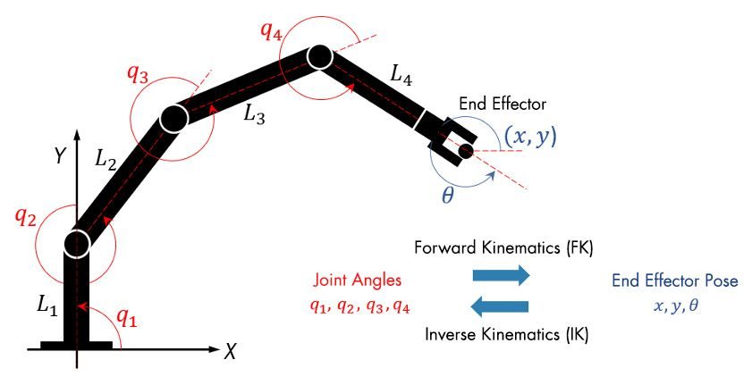
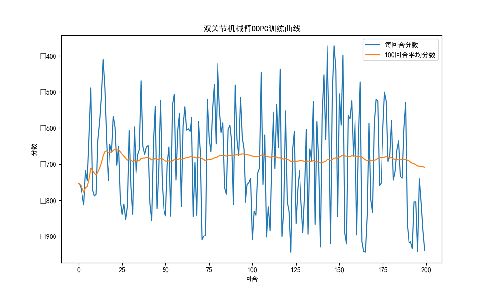

# 21 | 机器人控制：从机械臂到自动驾驶（上）

你好！欢迎来到强化学习的第二十一讲。在前几讲中，我们学习了 DDPG 等适用于连续控制的强化学习算法，而今天我们将花三节课，把这些技术落地到两大核心应用场景：工业领域的机械臂控制与交通领域的自动驾驶。这两者看似场景迥异，却共享“感知 - 决策 - 规划 - 控制”的核心逻辑——机械臂在结构化环境中追求毫米级操作精度，自动驾驶在动态交通中需平衡安全与效率，而强化学习正是打通两者技术壁垒、实现智能化控制的关键纽带。

这节课我们聚焦机械臂，通过本节课的学习，你将能够：

- 掌握机械臂控制的核心原理：理解正向运动学（从关节角度推导末端位姿）与逆运动学（从目标位姿反求关节配置）的数学逻辑，以及 DDPG 等强化学习算法如何解决力反馈、轨迹优化等实操问题。

## 一、从机械臂到自动驾驶的介绍

机械臂与自动驾驶虽分属不同应用领域，但在机器人控制技术的发展脉络中，存在着紧密的技术传承与演进关系。这种从机械臂到自动驾驶的跨越，不仅是应用场景的拓展，更是控制技术在复杂性、动态性和智能化程度上的升级。

从技术演进的角度来看，机械臂控制是机器人控制技术的早期探索和实践载体。在工业自动化的需求驱动下，机械臂控制技术率先实现了从简单重复动作到高精度、高可靠性操作的突破。其对运动学、动力学的深入研究，以及对 PID 等经典控制算法的成熟应用，为后续更复杂的机器人控制场景奠定了坚实的理论和技术基础。例如，机械臂逆运动学求解中对冗余自由度的处理方法，为自动驾驶路径规划中多约束条件下的优化问题提供了借鉴思路；基于动力学模型的计算力矩（computed torque）控制策略，其核心思想在自动驾驶车辆动力学控制中也得到了延伸和发展。

在场景关联方面，机械臂主要工作在结构化的工业环境中，环境干扰少、任务相对单一且可重复性强。而自动驾驶则面临着非结构化、动态变化的交通环境，需要应对复杂的交通参与者交互、突发路况等不确定因素。这种场景的差异使得控制技术从机械臂的“精准执行预设任务”向自动驾驶的“动态适应环境变化”转变。但两者在核心控制逻辑上存在共通之处：都需要通过传感器感知环境信息，基于感知结果进行决策与规划，最终通过执行器实现精确控制。机械臂的传感器融合技术，如将视觉传感器与力传感器信息结合以实现灵巧抓取，为自动驾驶中多传感器融合感知提供了技术参考；机械臂的轨迹跟踪控制经验，也为自动驾驶车辆的路径跟踪控制提供了重要启示。

从控制目标的衔接来看，机械臂控制以末端执行器的精确位姿和力控制为核心，强调操作的准确性和稳定性；自动驾驶控制则以车辆的安全、高效、舒适行驶为目标，注重在动态环境中的适应性和鲁棒性。强化学习在这两个领域的应用也呈现出逐步深入的趋势，从机械臂相对简单任务中的策略学习，到自动驾驶复杂场景下的决策与控制优化，强化学习正不断突破传统控制方法的局限，推动机器人控制技术向更高的智能化水平发展。这种从结构化环境到动态环境、从单一任务到复杂任务的演进，体现了机器人控制技术从机械臂到自动驾驶的自然延伸与升级。

## 二、机械臂控制

机械臂控制是机器人控制领域的基础，其核心目标是使机械臂的末端执行器能够按照期望的轨迹运动，并实现精确的定位和力控制。

## 2.1 机械臂运动学控制详解

在工业自动化、精密制造、服务机器人等领域，机械臂的精准运动控制是实现复杂操作任务的核心基石。从流水线上的零件抓取到手术台上的精细操作，从仓储物流的智能分拣到太空探索的设备维护，机械臂能否按照预设轨迹稳定移动、精准定位，直接决定了任务的效率与质量。而这一切精准运动的背后，离不开运动学控制的支撑。

运动学控制作为机械臂控制的基础框架，架起了关节运动与末端执行器位姿之间的桥梁。它通过数学建模与算法优化，解决了“如何让机械臂动起来”“如何让末端到达指定位置”“如何实现平滑轨迹规划”等核心问题。从正向运动学中“由关节参数推导末端状态”的确定性计算，到逆运动学中“由目标位姿反求关节配置”的复杂求解，再到线性运动学中笛卡尔空间的高精度轨迹控制，每一环都凝聚着对机械结构、数学模型与控制逻辑的深度融合。

我们将系统拆解机械臂运动学控制的核心原理，从正向与逆运动学的逻辑关系，到线性运动学的实现方法，带你揭开机械臂“精准舞动”的技术密码，为理解更复杂的控制策略奠定基础。

### 2.1.1 正向运动学和逆运动学控制

机械臂采用空间开链结构设计，其各关节具备独立运动特性。然而，要实现末端执行器（如手爪）精准的运动轨迹，必须依赖多关节之间的高度运动协调——这一核心需求直接决定了机械臂控制系统相较于普通自动化控制系统，在结构与逻辑上更为复杂。

机械臂的结构采用空间开链接结构，其各个关节的运动是独立的，为了实现末端点的运动轨迹，需要多关节的运动协调。所以，其控制系统要比普通的控制系统复杂得多，具有以下几个特点：

1. 机器人的控制与结构运动学及动力学密切相关。机器人手爪的状态可以在各种坐标下进行描述，根据需要选择不同的参考坐标系并做适当的坐标变换。

2. 经常要求解运动的正问题和逆问题，除此之外还要考虑惯性力、外力（包括重力）、哥氏力、向心力的影响。

3. 一个简单的机器人也至少有 3~5 个自由度，比较复杂的机器人有十几个，甚至几十个自由度。每个自由度一般包含一个伺服机构，它们必须协调起来，组成一个多变量控制系统。

4. 把多个独立的伺服系统有机地协调起来，使其按照人的意志行动，甚至赋予机器人一定的智能，这个任务只能是由计算机来完成。因此，机器人控制系统必须是一个计算机系统。

5. 描述机器人状态和运动的数学模型是一个非线性模型，随着状态的不同和外力的变化，其参数也在变化，各变量之间还存在耦合。

6. 机器人的运动可以通过不同的方式和路径来完成，因此，存在一个“最优”的问题。较高级的机器人可以用人工智能的方法，用计算机建立起庞大的信息库，借助信息库进行控制、决策、管理和操作。

传统的自动机械是以自身的动作未重点，而工业机器人的控制系统更着重本体与操作对象的互相关系。所以，机器人控制系统是一个与运动学和动力学原理密切相关的、有耦合的、非线性的多变量控制系统。

图 21-1 清晰展示了机器人运动学中正向运动学（Forward Kinematics，FK）与逆运动学（Inverse Kinematics，IK）的核心原理。在该机器人模型中，包含一个多关节机械臂，由多

## (L1、L2、L3、L4)

## (q1、q2、q3、q4)

个连杆

- 和关节组成，机械臂末端为末端执行器

## (x, y)

## θ

（End Effector），其位置通过

- 坐标表示，姿态则由角度 描述。



- 图21-1 使用正向或逆向运动学配置机器人的关节位置（出自MATLAB产品介绍）

### 正向运动学（FK）

## (q1, q2, q3, q4)

图 21-1 中 “Forward Kinematics (FK)” 指向 “Joint Angles

- ” 的箭头可直观理

## (q1、q2、q3、q4)

解：正向运动学的核心逻辑是基于已知的关节角度参数

- ，通过运动学方

## (x, y, θ)

程计算末端执行器的位置和姿态

- 。简单来说，就是从关节参数出发，推导出末端执

行器的状态。

在机械臂控制中，FK 常用于末端状态的实时反馈——通过传感器获取各关节角度后，经 FK计算得到末端当前位姿，再结合 PID 控制等算法，驱动各关节修正运动偏差，最终使末端达到期望位置。

### 逆运动学（IK）

## (x, y, θ)

图 21-1 中 “Inverse Kinematics (IK)” 从 “End Effector Pose

- ” 指向 “Joint Angles

## (q1, q2, q3, q4)

## (x, y, θ)

- ” 的箭头表明：逆运动学的任务是在已知末端执行器期望位置和姿态

## (q1、q2、q3、q4)

的前提下，利用运动学方程求解出对应的关节角度

- 。其本质是确定机械

臂关节的具体配置，使末端执行器能够精确移动到目标位姿，是机械臂控制中的关键环节。

因机械臂可能存在冗余自由度（自由度数量大于末端位姿所需参数数量），IK 求解需根据机械臂结构选择适配方法：​

- 解析法：适用于结构简单（如 3 自由度平面机械臂）、运动学方程可线性化的机械臂，能推导出关节变量与末端位姿的显式解析表达式，求解速度快、精度高；​

- 数值法：适用于复杂结构（如多自由度空间机械臂）或无法推导解析解的场景，通过迭代算法（如牛顿 - 拉夫逊法、阻尼最小二乘法）逼近最优解，兼顾求解稳定性与通用性。

机械臂控制系统并非简单的“驱动 - 执行”闭环，而是以运动学正、逆问题求解为核心，融合动力学补偿、多变量协同、非线性自适应及智能化决策的复杂系统，其本质是与运动学、动力学紧密相关，具备耦合特性的非线性多变量控制系统，也是机械臂工业化应用与智能化升级的核心技术支撑。

### 2.1.2 线性运动学控制

线性运动学控制聚焦于机械臂末端执行器在笛卡尔空间（直角坐标系）中的线性运动控制，涵盖沿 X、Y、Z 轴方向的直线移动，以及围绕这些轴的旋转运动。其核心目标是对末端执行器的位置、姿态变化速率、加速度等参数进行精确调控，从而实现特定的轨迹规划。这种控制方式广泛应用于需要精确直线运动或复杂曲线运动的场景，例如数控机床加工、激光切割等高精度制造领域。

在线性运动学控制中，通常采用齐次变换矩阵描述末端执行器的位姿变换，同时需考虑速度、加速度等运动学参数在笛卡尔空间中的表达与控制逻辑。其中，雅可比矩阵发挥着关键作用——它能够将关节空间的速度转换为笛卡尔空间的速度，为末端执行器线性运动控制提供桥梁。

具体控制流程如下：首先通过雅可比矩阵建立关节空间与末端执行器空间的误差传播关系，其

- −1

## δx = J(q)δq

## δq = J(q)

## J(q)

## δx

数学表达式为

- ，经过推导可得（其中为雅可比矩阵）。

## δx = x

- ​ −

## x

## x

接着，根据末端执行器的期望位姿与当前位姿计算空间误差

- 为期望位姿，（d​d

## δq

x 为当前位姿）。最后，结合上述误差与雅可比矩阵的逆矩阵计算关节角度修正量

- ，进而得​ =

## q + δq

## q

到期望关节角度

- ，实现对末端执行器线性运动的精确控制。d

从使用角度看，机械臂作为特殊的自动化设备，其控制需满足多维度核心要求：

- 一方面需实现多轴运动协调控制，通过精准调控各关节的运动轨迹与动作时序，将所有关节运动合成符合需求的工作轨迹，确保手部按设定规律运动；

- 另一方面对运动精度与动态性能有严格标准，需具备较高的位置精度、较大的调速范围，同时要求系统静差率小、各关节速度误差系数尽量一致，且位置无超调、动态响应快速，为避免运动冲击还需采用加（减）速控制。

从操作与成本角度看，机械臂控制系统需兼顾易用性与经济性：

- 操作层面要求具备良好的人机界面，简化操作流程以尽量降低对操作者的技能要求；

- 成本层面则需在保障性能的前提下，尽可能降低硬件成本，通过更多采用软件伺服的方式优化控制算法，完善系统性能，实现功能与成本的平衡。

### 2.1.3 强化学习控制机械臂

在机械臂需力反馈的操作任务中，强化学习可助力机械臂在与环境交互时动态调整动作以优化性能。这类任务对环境感知的实时性要求极高，环境的动态性、不确定性与复杂性，使得依赖预设模型的传统控制方法难以适配；而强化学习通过“试错 - 反馈 - 迭代”的自我学习机制，能让机械臂依据实时环境反馈调整行为策略，从而快速适应环境变化，弥补传统方法的短板。

强化学习的核心目标是最大化长期回报，这一特性使其能在力反馈任务中帮助机械臂探索最优行为策略。通过持续与环境交互、迭代优化，机械臂可逐步掌握不同场景下的高效动作模式，提升任务完成效率与质量。这类需求在人机物理交互场景中尤为突出，例如辅助康复、家庭服务与工业协作作业等领域：

- 在辅助康复训练中，机械臂可实时感知患者的发力大小与肢体姿势，动态调整辅助力度，在避免二次伤害的同时，为患者提供适配的康复助力，帮助其恢复运动功能；

- 在家庭服务场景中，机械臂递送物品时，能通过力反馈感知人类接触物品的力度，实时调整自身夹持力，既防止物品滑落，又避免过度用力损坏易碎物品；

- 在工业协作作业中，机械臂可接收工友传递的力信号，快速协调自身动作节奏与力度，确保人机协作过程顺畅、高效。

机械臂强化学习训练主要分为模拟训练与真实训练两类，二者各有优劣，直接影响机器人的开发周期与实际性能。模拟训练与真实训练的对比：

- 模拟训练：依托虚拟环境开展训练，无需考虑物理碰撞对机械臂的损伤，安全性高；同时可批量生成训练数据，采样效率远高于真实环境。但模拟环境与真实环境存在“领域差异”（如虚拟力反馈精度、物体物理属性模拟偏差等），仅通过模拟数据训练的模型，直接迁移到真实机械臂时易出现“训练 - 部署鸿沟”，无法保证操作精度。

- 真实训练：直接在物理环境中收集数据，训练过程与实际应用场景完全一致，无需解决模型迁移问题，更利于机械臂实际功能开发。但真实训练存在两大痛点：一是采样效率低，单次试错需消耗物理时间，大量训练数据需长期积累；二是安全隐患大，机械臂若在训练中动作失控，可能损坏设备或造成人员伤害。

为缓解模拟训练与真实训练的矛盾，迁移学习成为核心技术手段。其本质是将模拟环境中训练的模型知识（如基础动作策略、环境感知逻辑）迁移到真实环境中，通过“模拟预训练 + 真实环境微调”的模式，减少真实环境的训练成本，同时弥补领域差异带来的性能损耗。迁移学习与深度强化学习的结合，能显著提升模型在真实环境中的可靠性与鲁棒性，是当前低成本开发机械臂的主流思路之一。

尽管迁移学习优势显著，但在高精度力反馈任务中，真实训练仍是保障性能的关键选择。本节研究工作均聚焦于真实环境中的模型训练，其中最典型、最先进的案例是 Kalashnikov 等提出的 QT-Opt 框架。该框架针对机械臂抓取任务的复杂性，采用“长期推理 + 动作序列分解”的思路，将抓取过程拆解为“接近目标 - 接触感知 - 稳定夹持”等子动作，通过分阶段优化提升操作精度。

实验中，研究团队使用 7 台 KUKA LBR IIWA 机械臂（7 自由度，具备高精度力控能力，适配力反馈场景），持续训练 4 个月，累计完成 58 万次抓取尝试，覆盖易损件、不规则件等多类目标物体。最终该框架实现了 96% 的抓取成功率，虽需投入大量时间与硬件成本，但验证了真实训练在高精度任务中的不可替代性。

在机械臂强化学习中，奖励函数是引导模型学习的核心——它通过量化“行为好坏”，为机械臂提供训练反馈：若动作有助于实现任务目标（如成功抓取物体、力反馈符合安全阈值），则给予正奖励；若动作偏离目标（如碰撞障碍物、夹持力过大），则给予负奖励。根据奖励信号的反馈模式，奖励函数主要分为两类，二者各有局限。

稀疏奖励，通常为二元函数，仅当机械臂完全完成任务目标时（如成功抓取物体并放置到指定位置），才给予唯一正奖励；未完成目标的所有动作均无奖励或仅获负奖励。其核心问题在于训练初期正反馈极度稀缺：机械臂在学习初期难以探索到成功路径，大量试错仅产生负奖励，导致模型难以定位“有效动作方向”，严重降低学习效率，甚至出现“训练停滞”。

稠密奖励，其核心是将奖励与任务过程中的关键变量绑定（如机械臂与目标的距离、夹持力与安全阈值的偏差等），机械臂每完成一步有效动作（如接近目标、调整到合适夹持角度），均可获得实时正奖励，奖励值随变量动态变化。稠密奖励能引导模型逐步向最优策略靠近，缓解训练初期的探索困境，但在复杂力反馈任务中存在明显局限：关键变量的选择与权重设计难度大，若奖励函数定义不合理（如过度关注距离而忽视力反馈安全），可能导致模型“局部最优”（如快速接近目标但因夹持力过大损坏物体），且复杂任务中的变量耦合性强，奖励函数设计易陷入“维度灾难”，难以实际落地。

## 2.2 以控制双关节机械臂为例

聚焦机械臂核心理论，需系统掌握其运动控制与建模的关键知识模块，重点攻克以下内容：

- DH 参数（Denavit-Hartenberg Parameters，丹纳维特 - 哈滕伯格）：深入理解这一标准化连杆建模工具，掌握如何通过参数定义（连杆长度、扭转角、关节偏距、关节角）建立机械臂连杆坐标系，为后续运动学分析奠定基础。

- 运动学基础：全面覆盖正运动学与逆运动学两大核心方向。其中，正运动学需掌握如何通过DH 参数或齐次变换矩阵，根据关节变量（角度 / 位移）求解末端执行器的位姿（位置 + 姿态）；逆运动学则需突破“已知末端位姿反求关节变量”的关键问题，理解解析法、数值法等常用求解思路及适用场景。

- 雅可比矩阵（Jacobian Matrix）：明晰其物理意义——建立关节空间速度与操作空间速度（末端线速度、角速度）的映射关系，掌握雅可比矩阵的构造方法，及其在机械臂速度控制、力控制、奇异点分析中的应用逻辑。

围绕强化学习“智能体与环境交互学习最优策略”的核心逻辑，需重点攻克主流算法原理与应用场景，构建完整的算法知识框架：

- 基础经典算法：以 DQN（Deep Q-Network）为起点，理解“价值函数近似 + 经验回放 + 目标网络”三大核心创新，掌握基于价值的强化学习基本范式；深入学习 PPO（ProximalPolicy Optimization），理解其“信任域优化 + clipped 目标函数”的设计思路，把握其在连续 /离散动作空间中稳定性强、样本效率高的优势。

- 深度强化学习进阶算法：针对连续动作空间场景，重点突破 DDPG（Deep DeterministicPolicy Gradient），掌握“演员 - 评论员（Actor-Critic）架构 + 确定性策略 + 目标网络软更新”的核心机制；进一步学习 SAC（Soft Actor-Critic），理解其“最大熵强化学习框架 + 双 Q网络 + 自动温度参数调整”的设计，明晰其在探索效率与策略鲁棒性上的提升逻辑。

Reacher 是一种机械臂模拟器，常用于控制算法的开发和测试。它提供了一个虚拟环境，模拟了机械臂的物理特性和运动规律，使得开发者可以在不需要实际硬件的情况下进行控制算法的研究和实验。

Reacher 的环境主要由以下几个部分组成：

1. 机械臂：Reacher 模拟了一个双关节机械臂，包括一个固定基座和两个可动关节。开发者可以通过控制机械臂的两个关节来改变机械臂的姿态和位置。

2. 目标点：在机械臂的运动范围内，Reacher 提供了一个目标点，目标点的位置是随机生成的。开发者的任务是控制机械臂，使得机械臂的末端能够接触到目标点。

3. 物理引擎：Reacher 使用物理引擎来模拟机械臂的物理特性和运动规律。开发者可以通过调整物理引擎的参数来模拟不同的物理环境。

4. 视觉界面：Reacher 提供了一个可视化的界面，可以显示机械臂和目标点的位置，以及机械臂的姿态和运动轨迹。开发者可以通过视觉界面来调试和优化控制算法。

当涉及到像 Reacher 问题这样的连续控制任务时，算法的选择对于实现最佳性能至关重要。在这个项目中，选择 DDPG 算法（第 15 课有详细介绍）。

```bash
import gym
import numpy as np
import torch
import torch.nn as nn
import torch.optim as optim
import torch.nn.functional as F
from torch.autograd import Variable
import matplotlib.pyplot as plt
import time
from collections import deque
import os
# 检查是否有可用的GPU
device = torch.device("cuda" if torch.cuda.is_available() else "cpu")
print(f"使用设备: {device}")
# 确保中文显示正常
plt.rcParams["font.family"] = ["SimHei", "WenQuanYi Micro Hei", "Heiti TC"]
class Actor(nn.Module):
   def __init__(self, state_dim, action_dim, max_action):
       super(Actor, self).__init__()
       self.fc1 = nn.Linear(state_dim, 400)
       self.fc2 = nn.Linear(400, 300)
       self.fc3 = nn.Linear(300, action_dim)
       self.max_action = max_action
   def forward(self, x):
       x = F.relu(self.fc1(x))
       x = F.relu(self.fc2(x))
       x = torch.tanh(self.fc3(x))  # 输出范围[-1,1]
       return x * self.max_action    # 缩放到动作空间范围
class Critic(nn.Module):
   def __init__(self, state_dim, action_dim):
       super(Critic, self).__init__()
       # 第一个Q网络
       self.fc1 = nn.Linear(state_dim + action_dim, 400)
       self.fc2 = nn.Linear(400, 300)
       self.fc3 = nn.Linear(300, 1)
       # 第二个Q网络（用于TD3的双Q网络结构，提高稳定性）
       self.fc4 = nn.Linear(state_dim + action_dim, 400)
       self.fc5 = nn.Linear(400, 300)
       self.fc6 = nn.Linear(300, 1)
   def forward(self, x, u):
       # 拼接状态和动作
       xu = torch.cat([x, u], 1)
       # 第一个Q网络前向传播
       x1 = F.relu(self.fc1(xu))
       x1 = F.relu(self.fc2(x1))
       x1 = self.fc3(x1)
       # 第二个Q网络前向传播
       x2 = F.relu(self.fc4(xu))
       x2 = F.relu(self.fc5(x2))
       x2 = self.fc6(x2)
       return x1, x2
   def Q1(self, x, u):
       # 仅使用第一个Q网络
       xu = torch.cat([x, u], 1)
       x1 = F.relu(self.fc1(xu))
       x1 = F.relu(self.fc2(x1))
       x1 = self.fc3(x1)
       return x1
class ReplayBuffer(object):
   def __init__(self, max_size=1e6):
       self.storage = []
       self.max_size = max_size
       self.ptr = 0
   def add(self, transition):
       if len(self.storage) == self.max_size:
           self.storage[int(self.ptr)] = transition
           self.ptr = (self.ptr + 1) % self.max_size
       else:
           self.storage.append(transition)
   def sample(self, batch_size):
       ind = np.random.randint(0, len(self.storage), size=batch_size)
       batch_states, batch_next_states, batch_actions, batch_rewards, batch_done
       for i in ind:
           state, next_state, action, reward, done = self.storage[i]
           batch_states.append(np.array(state, copy=False))
           batch_next_states.append(np.array(next_state, copy=False))
           batch_actions.append(np.array(action, copy=False))
           batch_rewards.append(np.array(reward, copy=False))
           batch_dones.append(np.array(done, copy=False))
       return (
           np.array(batch_states),
           np.array(batch_next_states),
           np.array(batch_actions),
           np.array(batch_rewards).reshape(-1, 1),
           np.array(batch_dones).reshape(-1, 1)
       )
class DDPG(object):
   def __init__(self, state_dim, action_dim, max_action):
       self.actor = Actor(state_dim, action_dim, max_action).to(device)
       self.actor_target = Actor(state_dim, action_dim, max_action).to(device)
       self.actor_target.load_state_dict(self.actor.state_dict())
       self.actor_optimizer = optim.Adam(self.actor.parameters(), lr=1e-4)
       self.critic = Critic(state_dim, action_dim).to(device)
       self.critic_target = Critic(state_dim, action_dim).to(device)
       self.critic_target.load_state_dict(self.critic.state_dict())
       self.critic_optimizer = optim.Adam(self.critic.parameters(), lr=1e-3)
       self.max_action = max_action
       self.replay_buffer = ReplayBuffer()
       self.batch_size = 100
       self.discount = 0.99
       self.tau = 0.005
       self.policy_noise = 0.2
       self.noise_clip = 0.5
       self.policy_freq = 2
       self.total_it = 0
   def select_action(self, state, noise=0.1):
       state = torch.Tensor(state.reshape(1, -1)).to(device)
       action = self.actor(state).cpu().data.numpy().flatten()
       # 添加探索噪声
       if noise > 0:
           action += np.random.normal(0, noise, size=action.shape)
           # 确保动作在合法范围内
           action = np.clip(action, -self.max_action, self.max_action)
       return action
   def train(self):
       self.total_it += 1
       # 从经验回放池采样
       batch_states, batch_next_states, batch_actions, batch_rewards, batch_done
       # 转换为Tensor并移动到设备
       state = torch.Tensor(batch_states).to(device)
       next_state = torch.Tensor(batch_next_states).to(device)
       action = torch.Tensor(batch_actions).to(device)
       reward = torch.Tensor(batch_rewards).to(device)
       done = torch.Tensor(batch_dones).to(device)
       # 计算目标Q值
       with torch.no_grad():
           # 给目标动作添加噪声
           noise = torch.Tensor(batch_actions).data.normal_(0, self.policy_noise
           noise = noise.clamp(-self.noise_clip, self.noise_clip)
           next_action = (self.actor_target(next_state) + noise).clamp(-self.max
           # 计算目标Q值
           target_Q1, target_Q2 = self.critic_target(next_state, next_action)
           target_Q = torch.min(target_Q1, target_Q2)
           target_Q = reward + (1 - done) * self.discount * target_Q
       # 当前Q值
       current_Q1, current_Q2 = self.critic(state, action)
       # 计算 critic 损失
       critic_loss = F.mse_loss(current_Q1, target_Q) + F.mse_loss(current_Q2, t
       # 优化 critic
       self.critic_optimizer.zero_grad()
       critic_loss.backward()
       self.critic_optimizer.step()
       # 延迟更新 actor
       if self.total_it % self.policy_freq == 0:
           # 计算 actor 损失
           actor_loss = -self.critic.Q1(state, self.actor(state)).mean()
           # 优化 actor
           self.actor_optimizer.zero_grad()
           actor_loss.backward()
           self.actor_optimizer.step()
           # 更新目标网络
           for param, target_param in zip(self.critic.parameters(), self.critic_
               target_param.data.copy_(self.tau * param.data + (1 - self.tau) *
           for param, target_param in zip(self.actor.parameters(), self.actor_ta
               target_param.data.copy_(self.tau * param.data + (1 - self.tau) *
   def save(self, filename):
       torch.save(self.actor.state_dict(), filename + "_actor.pth")
       torch.save(self.critic.state_dict(), filename + "_critic.pth")
   def load(self, filename):
       self.actor.load_state_dict(torch.load(filename + "_actor.pth"))
       self.critic.load_state_dict(torch.load(filename + "_critic.pth"))
       self.actor_target.load_state_dict(self.actor.state_dict())
       self.critic_target.load_state_dict(self.critic.state_dict())
def train_ddpg(agent, env, num_episodes=200, max_t=1000, print_every=10):
   scores_deque = deque(maxlen=100)
   scores = []
   best_score = -np.inf
   for i_episode in range(1, num_episodes + 1):
       # 灵活处理不同版本的返回值
       reset_result = env.reset()
       if isinstance(reset_result, tuple):
           # 新版gym，取第一个元素作为状态
           state = reset_result[0]
       else:
           # 旧版gym，直接使用返回值作为状态
           state = reset_result
       score = 0
       for t in range(max_t):
           # 选择动作
           action = agent.select_action(state)
           # 执行动作
           try:
               # 适配gym 0.26+的返回格式
               next_state, reward, terminated, truncated, _ = env.step(action)
               done = terminated or truncated
           except ValueError:
               # 适配旧版gym的返回格式
               next_state, reward, done, _ = env.step(action)
           # 存储经验
           agent.replay_buffer.add((state, next_state, action, reward, done))
           # 训练代理
           if len(agent.replay_buffer.storage) > agent.batch_size:
               agent.train()
           # 更新状态和分数
           state = next_state
           score += reward
           if done:
               break
       # 记录分数
       scores_deque.append(score)
       scores.append(score)
       avg_score = np.mean(scores_deque)
       # 打印进度
       if i_episode % print_every == 0:
           print(f'回合 {i_episode}\t平均分数: {avg_score:.2f}\t当前分数: {score:.2
       # 保存最佳模型
       if avg_score > best_score:
           best_score = avg_score
           agent.save('best_ddpg_two_joint_arm')
   return scores
def main():
   # 创建双关节机械臂环境 (使用MuJoCo的TwoJointArm环境)
   env_name = "TwoJointArm-v0"  # 双关节机械臂环境
   try:
       # 尝试创建环境，设置渲染模式
       env = gym.make(env_name, render_mode="human")
       print(f"成功加载环境: {env_name}")
   except Exception as e:
       print(f"加载环境 {env_name} 失败: {e}")
       # 如果没有双关节机械臂环境，使用替代环境
       print("尝试使用替代环境...")
       env = gym.make("Pendulum-v1", render_mode="human")
       print(f"成功加载替代环境: Pendulum-v1")
   # 获取状态空间和动作空间大小
   state_dim = env.observation_space.shape[0]
   action_dim = env.action_space.shape[0]
   max_action = float(env.action_space.high[0])
   print(f"状态空间大小: {state_dim}, 动作空间大小: {action_dim}")
   # 初始化DDPG代理
   agent = DDPG(state_dim, action_dim, max_action)
   # 尝试加载已有模型
   if os.path.exists("best_ddpg_two_joint_arm_actor.pth"):
       try:
           agent.load("best_ddpg_two_joint_arm")
           print("成功加载已有模型")
       except:
           print("加载模型失败，将从头开始训练")
   # 开始训练
   print("开始训练...")
   scores = train_ddpg(agent, env)
   # 绘制训练曲线
   plt.figure(figsize=(10, 6))
   plt.plot(scores)
   plt.plot([np.mean(scores[max(0, i-100):i+1]) for i in range(len(scores))])
   plt.xlabel('回合')
   plt.ylabel('分数')
   plt.title('双关节机械臂DDPG训练曲线')
   plt.legend(['每回合分数', '100回合平均分数'])
   plt.savefig('ddpg_two_joint_arm_training.png')
   plt.show()
   # 关闭环境
   env.close()
if __name__ == "__main__":
   main()
```

该代码实现了基于深度确定性策略梯度（DDPG）算法的机械臂强化学习控制系统，核心功能如下：

1. 核心算法框架

- 强化学习决策系统：采用 DDPG 算法处理连续动作空间控制问题，适用于机械臂多关节运动控制场景。

- 双网络结构：通过“演员 - 评论家”（Actor-Critic）框架实现策略学习，其中 Actor 网络负责生成动作，Critic 网络负责评估动作价值。

- 稳定性优化机制：引入目标网络、经验回放、软更新策略和探索噪声，确保在高维度连续控制任务中稳定收敛。

2. 核心组件功能

- 策略网络（Actor）：根据机械臂当前状态（如关节角度、角速度等）生成最优控制动作，输出范围严格匹配机械臂关节的物理限制，确保动作安全性。

- 价值网络（Critic）：评估当前动作在特定状态下的价值（Q 值），通过双 Q 网络结构减轻价值过度估计问题，为策略优化提供可靠指导。

- 经验回放机制：存储机械臂与环境交互的经验数据（状态、动作、奖励、下一状态、终止标志），通过随机采样打破数据相关性，提升训练稳定性。

- 自适应学习系统：动态调整学习策略，包括基于环境反馈的策略更新、探索噪声的自适应调整、目标网络的软更新，实现机械臂控制策略的持续优化。



- 图21-2 双关节机械臂训练曲线

下节课我们将重点学习另一个核心应用场景——自动驾驶，总结在完整学习后进行。敬请期待！

希望你通过今天的学习，对强化学习有了清晰的认识。如果有任何疑问，欢迎在讨论区留言交流！
